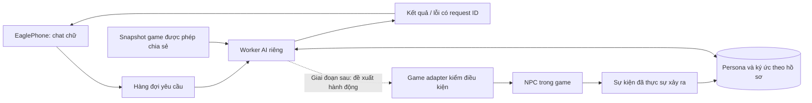

# Điểm bắt đầu cho AI companions trong Project Eagle

Ngày khảo sát: **22/10/2026 (Asia/Saigon)**. Phạm vi: đề xuất sản phẩm và kiểm tra source chỉ đọc. Target: `Project Eagle/gta sa gameplay-lab`. **Chưa triển khai AI, chưa gọi model, chưa thử trong game.**

> **Điều chỉnh thứ tự sau yêu cầu người dùng:** trước phần NPC AI phải chứng minh lớp hội thoại trực tiếp trên gameplay-lab bằng input và câu trả lời cố định/backend giả. GTA SA có scripted dialogue và CLEO có target/text/audio primitives, nhưng chưa có demo end-to-end được nghiệm thu trên Eagle. Xem [khảo sát nền hội thoại](npc-dialogue-feasibility-2026-10-22.md). Các bước AI bên dưới là định hướng sau prerequisite, không phải khẳng định Eagle đã có UI chat NPC.

## Đề xuất chính

Bắt đầu bằng **một người bạn có danh tính và trí nhớ trên EaglePhone**, làm tốt một vòng trải nghiệm ngắn: trò chuyện tiếng Việt → nhớ điều đã nói → lần sau nhắc lại đúng lúc. Sau đó nối chính nhân vật ấy với một NPC có mặt ngoài thế giới để tin nhắn, cuộc gặp và quan hệ dùng chung ký ức.

Độ sống động nên đến từ tính cách nhất quán, ký ức đúng, việc nhân vật biết và có thể làm, cùng lịch sinh hoạt. LLM đảm nhận hội thoại và đề xuất; game logic quyết định sự kiện thật và thực thi hành động. Các NPC nền có thể dùng lịch trình và phản ứng theo luật, chỉ gọi AI khi có tương tác đáng kể.

## Nền tảng đang có và khoảng trống

Đã đọc `AGENTS.md`, README, shared-agent-workflow, báo cáo merge/chuyển ổ, phiếu công việc và các tài liệu gameplay liên quan. Luna khảo sát source; Codex kiểm lại các điểm quyết định bên dưới. Bằng chứng ở đây là **code trên đĩa**, không phải xác nhận runtime.

| Nội dung | Bằng chứng hiện tại | Ý nghĩa |
| --- | --- | --- |
| Điện thoại web | `eagle_phone_ui.py:1167` gửi JSON tới `/api/action`; `:1806` poll `/api/state` mỗi giây | Điểm làm thử chat, nhập tiếng Việt và xem lịch sử thuận lợi nhất |
| Tiến trình Python ngoài game | `EagleCompanion.py:4465-4522` có HTTP handler; `:4532-4558` khởi tạo server và workers | Có nền để thêm worker AI; chưa cần xây lại toàn bộ cầu nối game |
| Dữ liệu người chơi | `EagleCompanion.py:395-452` đọc tiền, HP, giáp, giờ/phút, area code, vị trí, hướng, vận tốc, cờ đang ở trong xe | Có thể đưa snapshot nhỏ vào hội thoại; area code không tự tương đương tên phố hay hiểu biết về NPC xung quanh |
| Giới hạn luồng xử lý | `EagleCompanion.py:2453-2454` giữ `self.lock` trong `handle_action`; HTTP server kế thừa `HTTPServer` thường | Gọi model đồng bộ trong action có thể chặn server và giữ lock quá lâu |
| Đồng bộ HUD | `EagleCompanion.py:4351-4367` ghi các file `EaglePhoneState_0/1.lua` và `.dat` | Đây là projection cho giao diện; không dùng chúng làm database ký ức |
| Persistence/save | `ini_path` được khai báo ở `EagleCompanion.py:651`; không thấy luồng load/save dùng biến này hoặc snapshot theo GTA save trong file đã khảo sát | Cần xây persistence AI riêng; chưa được coi save-slot sync trong tài liệu kiến trúc là tính năng đã có |
| LLM và nhân vật | Chưa thấy client LLM, persona, conversation memory hoặc persistent NPC identity trong ba source `EagleCompanion.py`, `eagle_phone_ui.py`, `hud.lua` | AI NPC vẫn là phần phát triển mới trong phạm vi đã kiểm tra |
| Nhập chữ trong game | Hotkey/keypad hiện tập trung điều hướng và số (`EagleCompanion.py:1437-1448`); HUD dùng `to_clean_viet_ascii` ở nhiều trường | Web chat tiếng Việt trước; nhập chữ tự do và font tiếng Việt trong HUD cần khảo sát riêng |

Tài liệu cũ `deep-gameplay/04-target-architecture-and-feasibility.md` đã đề xuất `AINpcModule`, SQLite và snapshot theo save slot. Đây là hướng kiến trúc tham khảo. Các cam kết thời gian tick hoặc cô lập lỗi tuyệt đối trong tài liệu đó chưa được lượt khảo sát này đo hay chứng minh. Không suy ra toàn bộ hệ thống economy hiện tại đã lưu bền chỉ từ việc có file state.

## Lộ trình theo trải nghiệm

### 1. Một người bạn trên điện thoại

- Một contact có tên, avatar, cách xưng hô, sở thích, mục tiêu cá nhân và giới hạn kiến thức. Chốt phiên bản bối cảnh: nhân vật sống trong thế giới đô thị của Aether, với lore phù hợp.
- Chat chữ tiếng Việt trên giao diện web của EaglePhone trước; thêm trang hoặc thông báo HUD sau khi xác minh đường hiển thị.
- Ghi nhớ vài loại thông tin có ích: sở thích người chơi đã kể, lời hẹn trong hội thoại, điều đang quan tâm và kỷ niệm được xác nhận.
- Trí nhớ tồn tại khi đóng/mở chương trình, có thể xem, sửa hoặc xóa. Một lời hẹn nói ra chưa được ghi thành hoạt động đã diễn ra.
- Thử trước 1–2 tình huống có ngữ cảnh như giờ game hoặc người chơi chia sẻ nơi đang đi. Kiến thức vị trí/máu từ hệ thống chỉ chuyển thành điều nhân vật biết khi có cơ chế hợp lý: chia sẻ vị trí, người chơi kể hoặc cùng chứng kiến.
- Chưa thực thi spawn, đi theo, lên xe, sửa tiền hoặc điều khiển NPC trong bước này.

Tiêu chí nghiệm thu: mở lại vẫn nhớ đúng sở thích; sửa thông tin thì không tiếp tục dùng dữ kiện cũ; không nhận trải nghiệm bịa thành ký ức thật; timeout/mất mạng kết thúc trạng thái chờ; app khác vẫn phản hồi trong lúc AI đang xử lý. Đo độ trễ và chi phí hội thoại thực, chưa hứa một mức latency cụ thể.

### 2. Một companion hiện diện ngoài phố

Dùng cùng `character_id` cho contact và NPC. Người chơi nhắn tin hẹn gặp; game xác nhận địa điểm/điều kiện; khi cuộc gặp thật sự hoàn tất mới sinh kỷ niệm. Hành vi đầu tiên nên nhỏ: chào hỏi, quay mặt, đi theo hoặc lên xe, triển khai lần lượt sau khi kiểm cầu nối cho từng hành vi.

Cần phân biệt **skin/model và cá thể**: cùng model có thể được dùng cho nhiều ped. Không dùng model ID, pointer hay handle tạm thời làm khóa trí nhớ dài hạn. Nhân vật có ID bền; entity runtime chỉ là binding có vòng đời, được kiểm lại khi streamed out, despawn, chết hoặc load game. Mỗi lệnh phải kiểm trạng thái entity ở lúc thực thi.

Lịch sinh hoạt và phản ứng theo tình huống giúp nhân vật có cuộc sống riêng: lúc đi làm, lúc sẵn sàng gặp, khi đang nguy hiểm thì hoãn hội thoại. Không cần gọi LLM mỗi frame để làm những điều này.

### 3. Quan hệ và bạn gái

Thêm niềm tin, mức thân thiết, sở thích hoạt động, mốc quan hệ và trải nghiệm chung vào chính hồ sơ companion. Đối thoại phản ánh tiến trình ấy. Quan hệ nên thay đổi qua sự kiện có ý nghĩa và quy tắc rõ ràng, thay vì cứ thêm một lượng điểm cho mỗi tin nhắn hoặc để model tự quyết toàn bộ trạng thái.

Thử một nhân vật xuyên suốt nhắn tin → gặp mặt → hoạt động chung → nhớ lại ở phiên sau. Sau khi vòng này ổn mới mở rộng vài bạn bè/NPC thường gặp. Gọi thoại, TTS và hội thoại nhóm là các bước kế tiếp vì có thêm latency, âm thanh, nhập liệu và nhiều trạng thái cần kiểm.

## Kiến trúc nhỏ để bắt đầu

- HTTP action chỉ nhận yêu cầu, trả ID và trạng thái ngay; worker gọi model ngoài lock của engine. Poll kết quả qua request ID là đủ cho bản thử, chưa cần giữ một kết nối streaming dài trên HTTP server hiện tại. Giới hạn queue, timeout, chống gửi trùng và loại kết quả khi profile/timeline đã đổi.
- Tách module hội thoại và kho nhớ khỏi file engine lớn; chỉ sửa điểm nối nhỏ khi có yêu cầu triển khai. API key ở tiến trình backend, không đưa vào HTML/state HUD/prompt hoặc log.
- SQLite là lựa chọn đề xuất cho kho AI mới. Ban đầu cần persona, turns gần nhất, facts có nguồn, tóm tắt và sự kiện quan trọng; truy vấn theo nhân vật/thời điểm/chủ đề là đủ. Chỉ thêm vector search khi kích thước và kiểm thử recall cho thấy cần.
- Facts lưu nguồn và thời điểm; phân biệt người chơi kể, NPC chứng kiến, suy đoán của model và lore thiết kế. Ký ức của mỗi NPC chỉ gồm chuyện họ có cơ hội biết.
- Mỗi hồ sơ có `profile_id` và `timeline_id`. Prototype điện thoại có thể chọn hồ sơ thử thủ công, ghi rõ độc lập GTA save; chưa tự hứa rollback theo game. Trước bước NPC/quan hệ có hậu quả, phải xác minh save/load thực tế và thiết kế snapshot để load save cũ không mang ký ức tương lai sang. Save slot đơn lẻ cũng có thể bị ghi đè nên cần identity của lượt chơi/snapshot.
- Khi bổ sung hành động, model chỉ trả intent có schema và tham số giới hạn. Adapter kiểm entity, khoảng cách, nội thất, tình trạng xe/chiến đấu và kết quả thực thi. Ký ức sự kiện chỉ ghi sau xác nhận; model nói đã làm không phải bằng chứng game đã thực hiện.

## Model và phạm vi đầu tư ban đầu

Ưu tiên một interface đổi được backend; thử chat chữ qua một dịch vụ cloud trong prototype để đánh giá chất lượng nhân vật trước, với ngân sách và giới hạn lượt rõ ràng khi người dùng chọn dịch vụ. Chưa cần chốt nhà cung cấp/model trong lượt định hướng này.

Local là lựa chọn cần benchmark trên máy thật khi game đang chạy, xét RAM/VRAM và frame time. Ollama có API structured outputs theo JSON schema; vẫn cần validation và kiểm logic game. Hỗ trợ schema không chứng minh model roleplay tốt, nhớ đúng, hoặc đủ nhanh. Chưa kiểm GPU, chưa cài runtime local và chưa dùng credential trong tác vụ này.

Phạm vi bản đầu đề xuất: **một nhân vật, chat chữ, trí nhớ qua lần mở lại, một ít ngữ cảnh được phép chia sẻ, xử lý bất đồng bộ và đường lỗi rõ ràng**. Bước chuẩn bị tiếp theo là viết hồ sơ nhân vật và vài đoạn hội thoại mẫu/nghiệm thu, rồi mới triển khai phần chat.

## Nguồn tham khảo đã kiểm

- [Generative Agents — bài nghiên cứu gốc](https://arxiv.org/abs/2304.03442): mô tả memory, reflection và planning trong môi trường mô phỏng. Dùng làm căn cứ thiết kế; không phải bằng chứng tương thích hoặc performance trên Eagle.
- [Mantella — tài liệu chính thức](https://art-from-the-machine.github.io/Mantella/pages/installation.html): phần Saved Data mô tả tóm tắt hội thoại theo NPC và nạp lại lần sau; phần Actions khuyến nghị giới hạn hành động được bật. Tham khảo cách chia vấn đề; đây là mod cho Skyrim/Fallout, chưa phải gói cài trực tiếp cho Eagle.
- [Ollama — Structured Outputs](https://docs.ollama.com/capabilities/structured-outputs): schema cho phản hồi có cấu trúc và validation. Không sử dụng model mẫu của tài liệu làm khuyến nghị lựa chọn model.

## Bàn giao và giới hạn

Chỉ tạo báo cáo này và phiếu `work-items/2026-10-22-codex-ai-companions-discovery.md`. Không sửa game, code runtime, archive, metadata deployment, save hoặc cấu hình AI. Không khởi động/restart game hay Sidecar. Không giữ khóa ghi chung. Chưa benchmark model, gọi dịch vụ trả phí, kiểm font trong game hoặc kiểm save/load. Các bước triển khai sau phải đăng ký phạm vi mới và tuân thủ backup/hash/khóa ghi của gameplay-lab.
