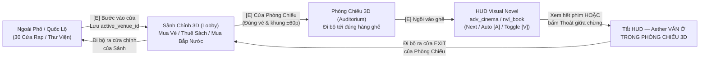

# Hạng Mục 1 (v2): Khảo Sát Thế Giới, Phân Tầng Quy Mô (15 Rạp Phim + 15 Thư Viện/Nhà Sách) & Quy Hoạch Tài Nguyên 3D

- **Ngày cập nhật:** `2026-11-06`
- **Agent thực hiện:** Antigravity (`199f0287-723d-43b5-a013-d519137afba4`)
- **Đích khảo sát:** `C:\Users\LENOVO\Desktop\GTA\Project Eagle\gta sa gameplay-lab` (chỉ đọc `100%`, `0` thay đổi file runtime)
- **Kho staging & dữ liệu kiểm chứng:** `D:\GTA Archive\Staging\project-eagle\cinema-library-survey-20261106\venues_30_verified.json`
- **Sơ đồ phân bố toàn bản đồ 30 điểm (2D PNG):** `docs/project-eagle/evidence/cinema_library_30_venues_world_map.png`
- **Tài liệu hợp đồng nội dung liên kết:** [eagle-literature-studio-contract-2026-11-06.md](eagle-literature-studio-contract-2026-11-06.md) (`D:\Eagle Literature Studio`)

---

## 1. Tóm Tắt Kết Quả Khảo Sát & Tách Bạch Trạng Thái Thực Tế

Theo đúng quy ước làm việc của Project Eagle, bảng dưới đây tách bạch rõ những gì **đã có file thực tế trong `gameplay-lab`**, **phát hiện kỹ thuật khi quét dải trung tâm & hai bờ**, và **phần sẽ đóng gói ở Hạng mục 2–6**:

| Mảng kiểm tra | Hiện trạng thực tế đã xác minh trên `gameplay-lab` | Quyết định thiết kế chốt cho Hạng mục 1 (v2 — 30 điểm) |
| :--- | :--- | :--- |
| **Bản đồ đang nạp thực tế (`data/default.dat` + `data/gta.dat`)** | Đang bật **`192` file `.IDE`**, **`277` file `.IPL`**, **`72` archive `.IMG`**, **`60.180` model active** và **`1.118` cổng `ENEX` active**. `S&S\MAPS\MW\SQUARE.IPL` đang bị comment (`#IPL`), Downtown Chicago thực tế chạy `S&S\MAPS\PRA\CHICAGO\ChicagoN/S/E/W.IPL`. Vùng giữa bản đồ (`X = 3500..13000`) gồm biển Vịnh Mexico ở phía Nam (`Y < -2500`) và dải lục địa nội địa Mỹ rộng lớn ở phía Bắc (`Frostwater, Colorado, Anywhere City, Wichska/Wichita, Redland, Cottonmouth, Peachtree, Argal, Independence, Carcer City`). | Nâng tổng quy mô lên **`15` Rạp phim (`6` Lớn + `9` Nhỏ) + `15` Thư viện & Nhà sách (`6` Lớn + `9` Nhỏ) = `30` điểm đến văn hóa** phủ kín toàn bộ **`20` vùng lãnh thổ** từ Tây sang Trung sang Đông, không còn khoảng trống giữa bản đồ. |
| **Quỹ đất trống đặt tòa nhà 3D mới (`new_3d_building`)** | Đã quét độ dốc mặt đất `.COL` tại cả khu đô thị xây mới (`INLAND-03A`, `WIBU-01`, `Mondstadt M1`) lẫn các tuyến quốc lộ/đồng cỏ trống ở dải trung tâm (`Frostwater`, `Colorado`, `Wichita`, `Redland`, `Peachtree`, `Argal`), chọn được các lô đất phẳng (`độ dốc 0.00m – 0.18m`) nằm sát mặt đường `.COL` cách `22m – 44m` và không vướng bất kỳ nhà cửa nào. | Đặt tổng cộng **`10` Tòa Nhà 3D Mới** trên đất trống (từ kho `Mod Donor Library` có sẵn `.DFF/.COL` khớp tỷ lệ đô thị hoặc ven quốc lộ), kết hợp **`20` Công Trình Điểm Nhấn Có Sẵn** được nâng cấp biển hiệu / hộp đèn poster tuần. |
| **Kiểm tra va chạm mặt đất `.COL` & khoảng cách an toàn (`>= 50m`)** | Đã chạy bộ dò tia thẳng đứng có kiểm tra khoảng không trần (`headroom >= 3.0m`) trên `2.318` lưới `.COL1/COL2/COL3` quanh 30 địa điểm, đối chiếu với toàn bộ `1.118` `ENEX`, `4` cổng Sàn Chứng Khoán, `24` điểm Waifu và `7` nội thất Mondstadt `INT-01..07`. | **`30 / 30` địa điểm đạt `PASS` tuyệt đối** (`all_checks_passed = true` trong `venues_30_verified.json`): khoảng cách bảo vệ ngắn nhất từ `52.7m` đến `2.871,3m`; mọi `door_pos` nằm trên nền đi bộ thật và mọi `dropoff_pos` nằm trên mặt đường sát lề. |
| **Tích hợp hẹn hò Waifu về sau (`WaifuLink`)** | `eagle_dating_sim.py` hiện quản lý `6` Waifu (`wl_furina..wl_vesna`, Ped ID `49428..49433`) với cơ chế đón xe, đi dạo và chấm điểm hảo cảm. | Chưa code logic hẹn hò trong Hạng mục 1, nhưng **khóa sẵn tọa độ đỗ xe đón/trả (`dropoff_pos`) tại cả 30 điểm, dãy ghế đôi (`Couple Seats`) trong 4 mẫu nội thất 3D và góc trò chuyện hậu buổi chiếu tại Sảnh (`Lobby Lounge`)**. |

---

## 2. Phân Tầng Quy Mô & Cơ Chế Vận Hành Thực Tế (Lớn vs Nhỏ)

Số lượng công trình gấp **7,5 lần** Sàn Chứng Khoán (`15` Rạp phim + `15` Thư viện/Nhà sách = **`30` địa điểm**), chia làm 2 phân khúc rõ rệt:

| Tiêu chí | Hạng Lớn — Đại Rạp / Đại Thư Viện (`6 CIN GRAND` + `6 LIB GRAND`) | Hạng Nhỏ — Rạp Độc Lập / Hiệu Sách Ấm Cúng (`9 CIN SMALL` + `9 LIB SMALL`) |
| :--- | :--- | :--- |
| **Quy mô nội thất 3D** | Sảnh lớn trần cao 2 tầng, quầy vé & quầy bắp nước tách riêng, hành lang poster tuần phát sáng; phòng chiếu **IMAX `60` ghế + ban công VIP** (hoặc đại sảnh đọc sách **2 tầng lửng `24` bàn**). | Sảnh gỗ/Art-Deco ấm cúng, quầy vé tích hợp bắp nước nhỏ gọn; phòng chiếu boutique **`24` ghế** (hoặc tiệm sách/trạm dừng chân cafe **`10` bàn đọc cạnh cửa sổ**). |
| **Danh mục & Lịch chiếu tuần** | **Rạp Lớn:** Chiếu **`4 – 5` phim/tuần** (đủ các suất bom tấn mới nhất như *Re:Zero — Pride IF*). **Thư Viện Lớn:** Mở khóa **100% kho Light Novel toàn cầu** trong studio. | **Rạp Nhỏ:** Chiếu **`2` phim chọn lọc/tuần** theo gu từng vùng / trạm quốc lộ. **Nhà Sách Nhỏ:** Kệ sách tuyển chọn theo chủ đề vùng (*Học đường/RomCom*, *Fantasy/Teyvat*, *Road-Trip/Mystery*...). |
| **Giá vé / Phí thuê & Mua sách** | **Vé xem phim:** `\$25` / vé (Combo Bắp + Nước thêm `\$10`). **Thư viện:** Thuê đọc tại chỗ `\$8` / tập hoặc mua sở hữu vĩnh viễn `\$35 – \$60` (lưu vào tủ sách `EaglePhone`). | **Vé xem phim:** `\$10 – \$12` / vé (Combo Bắp + Nước `\$6`). **Hiệu sách:** Thuê đọc tại chỗ `\$4 – \$5` / tập hoặc mua sở hữu `\$20 – \$45`. |
| **Khung giờ suất chiếu thông minh** | Mỗi phim có **`5` suất chiếu/ngày**: `09:00`, `13:00`, `17:00`, `20:30`, `23:30`. Do đồng hồ GTA trôi nhanh (`1` giờ game ≈ `1` phút thật), cửa phòng chiếu mở linh hoạt trong khoảng **`±60` phút quanh giờ ghi trên vé** (vào sớm ngồi chờ hoặc trễ nhẹ vẫn xem trọn vẹn; lỡ quá xa có thể đổi miễn phí sang suất kế tiếp). | Áp dụng cùng quy tắc `5` suất chiếu/ngày và biên độ linh hoạt **`±60` phút in-game**. |

---

## 3. Quy Hoạch Chi Tiết 15 Rạp Chiếu Phim (`CIN-01` .. `CIN-15`, Model IDs `15110..15124`)

Gồm **`6` Đại Rạp (`GRAND`) + `9` Rạp Nhỏ (`SMALL`)**, trong đó có **`5` Tòa Nhà Rạp 3D Mới đặt trên đất trống** (`CIN-02`, `CIN-03`, `CIN-11`, `CIN-13`, `CIN-14`):

| Mã | Phân hạng & Tên rạp | Khu vực | Phương án 3D & Texture biển hiệu | `door_pos` (Cửa vào) | `dropoff_pos` (Đỗ xe) | Nội thất & Giá vé | Khoảng cách an toàn |
| :---: | :--- | :--- | :--- | :--- | :--- | :--- | :---: |
| **`CIN-01`** | **GRAND** — *Vinewood Cathay Grand Theatre* | Los Santos (Vinewood Blvd) | **Retexture + Marquee** trên `manns01_LAwN` / `manns02_LAwN` (`txd=sunrise02_lawn`) — ID `15110` | `(1025.0, -1099.0, 22.88, 180°)` *(`manns02_lawn`)* | `(1025.0, -1135.0, 22.93)` *(`road_lawn19`)* | `INT-CIN-GRAND` `\$25` • `5` phim/tuần | **`101.6m`** (`PASS`) |
| **`CIN-02`** | **GRAND** — *Sakura Multiplex IMAX* | North Chicago (`INLAND-03A`) | **Đặt Tòa Nhà 3D Mới** trên đất trống `(6130.0, 10262.0, -0.46)`: donor `laox_honten.dff` (`48.9×30.3×61.6m`) — ID `15111` | `(6130.0, 10244.0, 14.45, 180°)` *(`in03_pad_r0_c1`)* | `(6130.0, 10215.0, 14.50)` *(`in03_pad_r0_c1`)* | `INT-CIN-GRAND` `\$25` • `5` phim/tuần | **`763.0m`** (`PASS`) |
| **`CIN-03`** | **GRAND** — *Akihabara TOHO Anime Cinema* | Japan Island (`WIBU-01`) | **Đặt Tòa Nhà 3D Mới** trên đất trống `(-1530.0, -4782.0, 8.65)`: donor `ishimarusoft_honkan.dff` (`37.4×36.5×59.5m`) — ID `15112` | `(-1530.0, -4760.0, 23.20, 0°)` *(`dodai01`)* | `(-1530.0, -4746.0, 23.25)` *(`dodai01`)* | `INT-CIN-GRAND` `\$25` • `5` phim/tuần | **`1453.4m`** (`PASS`) |
| **`CIN-04`** | **GRAND** — *The Loop Historic Grand Theatre* | Downtown Chicago (The Loop) | **Retexture + Marquee** trên nhà hát active `wb_ttba` (`txd=pr_WBtheatre`) — ID `15113` | `(6462.5, 9640.6, 9.78, 90°)` *(`wb_ground12`)* | `(6454.5, 9640.6, 9.83)` *(`wb_ground12`)* | `INT-CIN-GRAND` `\$25` • `4` phim/tuần | **`298.3m`** (`PASS`) |
| **`CIN-05`** | **SMALL** — *East Los Santos Cinemark* | Los Santos (East LS Strip) | **Retexture + Marquee** trên `cinemark2_lae2` (`txd=eastls4_lae2`) — ID `15114` | `(2524.0, -1472.2, 23.02, 0°)` *(`autoshpblok_lae2`)* | `(2524.0, -1498.0, 23.10)` *(`lae2_roads31`)* | `INT-CIN-SMALL` `\$12` • `2` phim/tuần | **`110.6m`** (`PASS`) |
| **`CIN-06`** | **SMALL** — *Queens Castro Art-House Cinema* | San Fierro (Queens) | **Retexture + Marquee** trên `queens_03_SFS` (`txd=queens1_sfs`) — ID `15115` | `(-2591.5, 156.0, 3.23, 180°)` *(`roadssfs26`)* | `(-2591.5, 148.0, 3.44)` *(`roadssfs26`)* | `INT-CIN-SMALL` `\$12` • `2` phim/tuần | **`54.8m`** (`PASS`) |
| **`CIN-07`** | **SMALL** — *Chinatown Lantern Indie Cinema* | Las Venturas (Chinatown) | **Retexture + Marquee** trên `chnatwnmll02_lvs` (`txd=chinatownmall`) — ID `15116` | `(2513.1, 1823.2, 9.90, 90°)` *(`vgseedge09`)* | `(2503.0, 1823.2, 9.80)` *(`vgseedge09`)* | `INT-CIN-SMALL` `\$12` • `2` phim/tuần | **`100.7m`** (`PASS`) |
| **`CIN-08`** | **SMALL** — *Staunton Opera & Indie Film Hall* | Liberty City (Staunton West) | **Retexture + Marquee** trên `opera_house` (`txd=operahouse`) — ID `15117` | `(14145.2, 7015.6, 25.18, 180°)` *(`lc_comswrd3`)* | `(14145.2, 7004.0, 25.08)` *(`lc_comswrd3`)* | `INT-CIN-SMALL` `\$12` • `2` phim/tuần | **`86.1m`** (`PASS`) |
| **`CIN-09`** | **SMALL** — *Bullworth Classic Town Theatre* | Bullworth Town (Main St) | **Retexture + Marquee** trên `BW_BUS_42` (`txd=bw_tbusines`) — ID `15118` | `(14032.4, 11912.4, 5.50, 0°)` *(`bw_bus_109`)* | `(14024.4, 11920.4, 5.58)` *(`bw_bus_109`)* | `INT-CIN-SMALL` `\$10` • `2` phim/tuần | **`102.3m`** (`PASS`) |
| **`CIN-10`** | **SMALL** — *Rose City Retro Cinema* | Rose City (NW Continent) | **Retexture + Marquee** trên `rccinema` (`txd=rosecity`) — ID `15119` | `(-1555.5, 6676.8, 6.62, 180°)` *(`rccinema`)* | `(-1555.5, 6652.8, 6.66)` *(`rcrocks096`)* | `INT-CIN-SMALL` `\$10` • `2` phim/tuần | **`279.0m`** (`PASS`) |
| **`CIN-11`** | **GRAND** — *Wichita Heartland Grand Multiplex* | Wichska / Wichita (Tâm Bản Đồ) | **Đặt Tòa Nhà 3D Mới** trên đồng cỏ phẳng sát quốc lộ trung tâm `(9155.0, 1720.0, 13.92)` (`độ dốc 0.00m`): donor `radio_center.dff` (`50.6×25.6×15.9m`) — ID `15120` | `(9137.0, 1720.0, 13.97, 90°)` *(`wk_grass61`)* | `(9115.0, 1720.0, 14.02)` *(`wk_road71`)* | `INT-CIN-GRAND` `\$25` • `5` phim/tuần | **`2871.3m`** (`PASS`) |
| **`CIN-12`** | **GRAND** — *Cottonmouth Bayou Grand Movie Haus* | Cottonmouth (Miền Nam Ven Vịnh) | **Retexture + Marquee** trên rạp điện ảnh `cms_moviehaus1` (`txd=cotton_s`) — ID `15121` | `(10959.8, -5955.9, 10.04, 90°)` *(`cms_moviehaus1`)* | `(10949.8, -5955.9, 9.29)` *(`cms_road32`)* | `INT-CIN-GRAND` `\$25` • `4` phim/tuần | **`136.8m`** (`PASS`) |
| **`CIN-13`** | **SMALL** — *Cordillera Route 66 Starlight Cinema* | Colorado (Tây Trung Bộ) | **Đặt Tòa Nhà 3D Mới** trên đất trống ven quốc lộ `(5110.0, 520.0, 47.16)` (`độ dốc 0.00m`): donor `ishimaru_1gou_neon3.dff` (`21.8×25.6×10.6m` rạp neon thấp tầng) — ID `15122` | `(5092.0, 520.0, 47.21, 90°)` *(`cosand066`)* | `(5070.0, 520.0, 47.26)` *(`coroad005`)* | `INT-CIN-SMALL` `\$10` • `2` phim/tuần | **`67.2m`** (`PASS`) |
| **`CIN-14`** | **SMALL** — *Peachtree Midtown Boutique Cinema* | Peachtree / Atlanta (Đông Nam Nội Địa) | **Đặt Tòa Nhà 3D Mới** trên lô đất phẳng ven công viên `(11935.0, -1475.0, 11.24)` (`độ dốc 0.01m`): donor `kuminkaikan.dff` (`21.8×25.1×34.1m`) — ID `15123` | `(11935.0, -1493.0, 11.30, 180°)` *(`pt_grass11`)* | `(11935.0, -1515.0, 11.34)` *(`ph_road09`)* | `INT-CIN-SMALL` `\$12` • `2` phim/tuần | **`235.1m`** (`PASS`) |
| **`CIN-15`** | **SMALL** — *Independence Liberty Screening Hall* | Independence City (Đông Bắc Nội Địa) | **Retexture + Marquee** trên khối nhà cổ điển `icbuild013` / `icindpndnchall` (`txd=independence`) — ID `15124` | `(11020.0, 6390.0, 18.29, 0°)` *(`icroad010`)* | `(11020.0, 6398.0, 18.19)` *(`icroad010`)* | `INT-CIN-SMALL` `\$12` • `2` phim/tuần | **`81.1m`** (`PASS`) |

---

## 4. Quy Hoạch Chi Tiết 15 Thư Viện & Nhà Sách (`LIB-01` .. `LIB-15`, Model IDs `15125..15139`)

Gồm **`6` Đại Thư Viện (`GRAND`) + `9` Nhà Sách / Book-Cafe (`SMALL`)**, trong đó có **`5` Tòa Nhà Sách 3D Mới đặt trên đất trống** (`LIB-05`, `LIB-06`, `LIB-13`, `LIB-14`, `LIB-15`):

| Mã | Phân hạng & Tên thư viện / nhà sách | Khu vực | Phương án 3D & Texture biển hiệu | `door_pos` (Cửa vào) | `dropoff_pos` (Đỗ xe) | Nội thất & Phí thuê / Mua | Khoảng cách an toàn |
| :---: | :--- | :--- | :--- | :--- | :--- | :--- | :---: |
| **`LIB-01`** | **GRAND** — *Los Santos Central Public Library* | Downtown Los Santos | **Retexture + Standee** trên `librarywall_lan2` / `LibPlaza1_LAn` (`txd=skyscr1_lan2`) — ID `15125` | `(1504.0, -1392.0, 13.08, 90°)` *(`libplaza1_lan`)* | `(1462.2, -1392.0, 12.65)` *(`roads10_lan`)* | `INT-LIB-GRAND` Thuê `\$8` • Mua `\$35–\$60` | **`52.7m`** (`PASS`) |
| **`LIB-02`** | **GRAND** — *Kinokuniya 8F Light Novel Megastore* | Japan Island (`WIBU-01`) | **Tòa Nhà Custom Có Sẵn + Standee** trên `kinokuniya` (`txd=akihabara_town`) — ID `15126` | `(-1317.0, -4665.2, 23.67, 0°)` *(`kinokuniya`)* | `(-1317.0, -4649.2, 23.25)` *(`dodai02`)* | `INT-LIB-GRAND` Thuê `\$8` • Mua `\$35–\$60` | **`1548.2m`** (`PASS`) |
| **`LIB-03`** | **GRAND** — *San Fierro Civic Center Grand Library* | San Fierro (Civic Center) | **Retexture + Banner** trên `artgallery_SFS` (`txd=cityhall_sfs`) — ID `15127` | `(-2653.4, 376.0, 3.39, 90°)` *(`roadssfs28`)* | `(-2663.0, 376.0, 3.23)` *(`roadssfs28`)* | `INT-LIB-GRAND` Thuê `\$8` • Mua `\$35–\$60` | **`119.0m`** (`PASS`) |
| **`LIB-04`** | **GRAND** — *Staunton Grand Athenaeum & Library* | Liberty City (Staunton East) | **Retexture + Banner** trên `museum` (`txd=comsky3`) — ID `15128` | `(14557.6, 7221.7, 25.12, 90°)` *(`museum`)* | `(14549.6, 7221.7, 24.46)` *(`lc_comserd4`)* | `INT-LIB-GRAND` Thuê `\$8` • Mua `\$35–\$60` | **`105.2m`** (`PASS`) |
| **`LIB-05`** | **SMALL** — *Sakura High Light Novel & Manga Cafe* | North Chicago (`INLAND-03A`) | **Đặt Tòa Nhà 3D Mới** trên đất trống `(5780.0, 10512.0, -0.46)`: donor `takarajima24.dff` (`28.7×10.2×18.2m`) — ID `15129` | `(5780.0, 10502.0, 14.45, 180°)` *(`in03_pad_r1_c0`)* | `(5780.0, 10489.0, 14.50)` *(`in03_pad_r1_c0`)* | `INT-LIB-SMALL` Thuê `\$5` • Mua `\$25–\$45` | **`1082.6m`** (`PASS`) |
| **`LIB-06`** | **SMALL** — *Cider Lake Yae & Favonius Book Pavilion* | Mondstadt (`M1` Hồ Cider) | **Đặt Tòa Nhà 3D Mới** trên đất trống `(-4160.0, -3280.0, 8.61)`: donor `4KHi_House011.dff` (`17.9×14.1×11.2m`) — ID `15130` | `(-4160.0, -3290.0, 8.59, 180°)` *(`mw1_t09`)* | `(-4152.0, -3308.0, 9.79)` *(`mw1_t09`)* | `INT-LIB-SMALL` Thuê `\$5` • Mua `\$25–\$45` | **`115.3m`** (`PASS`) |
| **`LIB-07`** | **SMALL** — *Ocean Drive Art-Deco Book & News Cafe* | Vice City (Ocean Drive) | **Retexture + Standee** trên `od_newscafedr_LH/RH` (`txd=od_newscafe`) — ID `15131` | `(15336.5, -8700.5, 4.08, 270°)` *(`oceanrda05`)* | `(15344.5, -8700.5, 3.96)` *(`oceanrda05`)* | `INT-LIB-SMALL` Thuê `\$5` • Mua `\$25–\$45` | **`55.8m`** (`PASS`) |
| **`LIB-08`** | **SMALL** — *Dragon's Wing Books & Light Novels* | Bullworth Town (Main St) | **Retexture + Standee** trên `BW_BUS_94` (`txd=bw_tbusines`) — ID `15132` | `(14031.8, 11985.4, 4.94, 180°)` *(`bw_bus_109`)* | `(14023.8, 11985.4, 4.93)` *(`bw_bus_109`)* | `INT-LIB-SMALL` Thuê `\$5` • Mua `\$20–\$40` | **`157.4m`** (`PASS`) |
| **`LIB-09`** | **SMALL** — *Michigan Ave Cultural Reading Hall* | Downtown Chicago | **Retexture + Standee** trên `wb_cultcentre` (`txd=pr_props`) — ID `15133` | `(6598.9, 9660.4, 14.38, 90°)` *(`wb_ground08`)* | `(6590.9, 9644.4, 13.82)` *(`wb_ground08`)* | `INT-LIB-SMALL` Thuê `\$5` • Mua `\$25–\$45` | **`418.3m`** (`PASS`) |
| **`LIB-10`** | **SMALL** — *Palomino Creek Town Library* | Red County (Palomino Creek) | **Retexture + Standee** trên `sw_library` (`txd=sw_library`) — ID `15134` | `(2261.4, -79.8, 25.80, 180°)` *(`sw_library`)* | `(2261.4, -95.8, 25.44)` *(`cunte_roads21`)* | `INT-LIB-SMALL` Thuê `\$4` • Mua `\$20–\$40` | **`58.1m`** (`PASS`) |
| **`LIB-11`** | **GRAND** — *Anywhere City Central Archive & Library* | Anywhere City (Bắc Trung Bộ) | **Retexture + Banner** trên tòa lưu trữ trung tâm `anyarchivebuild` (`txd=anneland`) — ID `15135` | `(6674.9, 4460.4, 26.80, 90°)` *(`smwroad125`)* | `(6662.9, 4460.4, 26.85)` *(`smwroad125`)* | `INT-LIB-GRAND` Thuê `\$8` • Mua `\$35–\$60` | **`297.9m`** (`PASS`) |
| **`LIB-12`** | **GRAND** — *Carcer Old Town Museum & Grand Library* | Carcer City (Hành Lang Bắc) | **Retexture + Banner** trên dinh thự cổ `jou_museum` (`txd=journo`), sảnh sân Tây thoáng rộng — ID `15136` | `(10505.5, 9850.0, 18.78, 90°)` *(`jou_ground02`)* | `(10493.5, 9850.0, 19.47)` *(`jou_ground02`)* | `INT-LIB-GRAND` Thuê `\$8` • Mua `\$35–\$60` | **`81.5m`** (`PASS`) |
| **`LIB-13`** | **SMALL** — *Frostwater Pine Lodge Bookstore & Cafe* | Frostwater / Cheyenne (Đèo Tây Bắc) | **Đặt Tòa Nhà 3D Mới** trên thảm cỏ phẳng ven đèo `(3840.0, 4800.0, 16.48)`: donor `CasaCampo.dff` (`35.0×32.1×14.4m` nhà gỗ đồi thông) — ID `15137` | `(3840.0, 4818.0, 16.43, 0°)` *(`selndirt015`)* | `(3840.0, 4840.0, 16.49)` *(`selnroads012`)* | `INT-LIB-SMALL` Thuê `\$4` • Mua `\$20–\$40` | **`1663.6m`** (`PASS`) |
| **`LIB-14`** | **SMALL** — *Redland Wheatfield Roadside Book & Coffee* | Redland (Nam Trung Bộ) | **Đặt Tòa Nhà 3D Mới** trên đất phẳng cạnh quốc lộ cánh đồng lúa mì `(9480.0, -1575.0, 19.04)`: donor `ishimaru_ekim_neon2.dff` (`15.4×16.0×6.8m` tiệm 1 tầng ấm cúng) — ID `15138` | `(9480.0, -1593.0, 19.25, 180°)` *(`redl_trigal18`)* | `(9480.0, -1615.0, 19.32)` *(`redl_road89`)* | `INT-LIB-SMALL` Thuê `\$4` • Mua `\$20–\$40` | **`66.4m`** (`PASS`) |
| **`LIB-15`** | **SMALL** — *Argal Blue Ridge Woodland Book Pavilion* | Argal (Đông Trung Bộ) | **Đặt Tòa Nhà 3D Mới** trên trảng cỏ phẳng sát đường núi `(12570.0, 740.0, 6.13)` (`độ dốc 0.18m`): donor `ie1.dff` (`32.2×41.0×13.9m`) — ID `15139` | `(12570.0, 758.0, 6.29, 0°)` *(`argls_grass337`)* | `(12570.0, 780.0, 6.40)` *(`argls_road264`)* | `INT-LIB-SMALL` Thuê `\$4` • Mua `\$20–\$40` | **`1918.2m`** (`PASS`) |

---

## 5. Kiến Trúc 4 Tổ Hợp Nội Thất 3D Trên `Area Code = 1` & Luồng Di Chuyển Liên Tục

### 5.1. Tọa độ Sky-Grid (`Z = +1650.0m`, dùng chung theo hạng Lớn/Nhỏ và nhớ đúng cửa thành phố lúc bước vào)

| Mã Nội Thất | Tâm đặt `.IPL` (`Area Code = 1`) | Cấu trúc phòng ốc 3D (`.DFF` + `.COL3` đóng mới bằng Blender 5.0 ở Hạng mục 3 & 4) | Sức chứa & Ghế đôi Waifu |
| :--- | :--- | :--- | :--- |
| **`INT-CIN-GRAND`** | `(2700.0, -1650.0, 1650.0)` | **Tổ hợp 2 không gian nối liền** (`6` Đại Rạp `CIN-01..04, 11, 12`): 1) *Grand Lobby (`28m × 22m`)*: Quầy vé Box Office, quầy Bắp rang & Nước ngọt, 5 khung Poster LED phát sáng. 2) *IMAX Auditorium (`30m × 34m`, sàn bậc thang)*: Màn bạc cong `18m × 8m`, `60` ghế nhung đỏ + cửa `EXIT` xanh. | `60` ghế thường + **`6` cặp ghế đôi VIP (`Couple Seats`)** + `1` bàn Lounge tại sảnh. |
| **`INT-CIN-SMALL`** | `(3150.0, -1650.0, 1650.0)` | **Rạp Boutique / Quốc lộ ấm cúng** (`9` Rạp Nhỏ `CIN-05..10, 13..15`): 1) *Cozy Lobby (`14m × 12m`)*: Quầy vé kiêm bán bắp nước gỗ cổ điển, 2 khung Poster tuần. 2) *Screening Room (`16m × 18m`)*: Màn chiếu `10m × 4.5m`, `24` ghế nệm xếp 4 hàng + cửa `EXIT`. | `24` ghế + **`4` cặp ghế đôi (`Couple Seats`)** hàng cuối + góc sofa sảnh. |
| **`INT-LIB-GRAND`** | `(2700.0, -2150.0, 1650.0)` | **Đại Thư Viện 2 Tầng (`32m × 26m`, trần vòm `12m`)** (`6` Đại Thư Viện `LIB-01..04, 11, 12`): Quầy thủ thư trung tâm, kệ gỗ cao kịch trần, cầu thang đôi lên tầng lửng Light Novel, dãy bàn đèn xanh cổ điển. | `24` bàn đọc đơn + **`6` ô bàn đôi (`Couple Study Booths`)** tầng lửng. |
| **`INT-LIB-SMALL`** | `(3150.0, -2150.0, 1650.0)` | **Tiệm Sách & Trạm Đọc Cafe Gỗ Ấm (`16m × 14m`)** (`9` Nhà Sách `LIB-05..10, 13..15`): Quầy thu ngân kiêm pha cà phê, kệ trưng bày bìa Light Novel, dãy bàn gỗ sát khung cửa sổ ấm áp. | `10` ghế đọc đơn + **`3` bàn đôi cạnh cửa sổ (`Window Couple Tables`)**. |

### 5.2. Chuỗi Trạng Thái Di Chuyển Đúng Thực Tế (Không Nhảy Cóc Ra Đường Khi Tắt HUD)

---

## 6. Thiết Kế Chừa Sẵn Cho Tính Năng Hẹn Hò Waifu (`WaifuLink` Future-Proofing)

1. **Điểm Đỗ Xe Đón/Trả Khách Trên Đường (`dropoff_pos`)**: Cả 30 địa điểm (bao gồm 10 trạm ven quốc lộ & đô thị mới) đều khóa sẵn tọa độ làn đường phẳng cách cửa `8m – 42m`, tương thích trực tiếp với `eagle_dating_sim.py` và `EagleRide`.
2. **Ghế Đôi Cạnh Nhau (`Couple Seat Anchors`)**: Cả 4 mẫu nội thất 3D định nghĩa sẵn các cặp tọa độ ghế đôi `(seat_player_xyz, seat_waifu_xyz, heading)` cách nhau `0.68m`.
3. **Điểm Trò Chuyện Sau Buổi Chiếu (`post_date_lobby_chat_anchor`) & Metadata Cảm Nhận Phim**: Mỗi gói `EagleLit Pack v1.0` có thể kèm `waifu_discussion_hooks` để Waifu trò chuyện về bộ phim vừa xem tại sảnh rạp và cộng điểm tình cảm (`+Affection ♥`).

---

## 7. Bảng Cấp Phát & Khóa Cứng Dải Tài Nguyên Không Xung Đột

| Loại tài nguyên | Dải cấp phát khóa cứng | Trạng thái kiểm tra xung đột trên `gameplay-lab` | Mục đích sử dụng chi tiết cho Hạng mục 2 – 6 |
| :--- | :--- | :--- | :--- |
| **Static / Building / Interior Model ID** | **`15110 .. 15249`** (`140` ID liên tiếp) | **Trống `100%`** (ngay sau `int_wallstreet = 15100`, an toàn dưới trần `65.535` của `.COL3`). | • `15110..15124` (`15` ID): `CIN-01..15` (`5` tòa rạp 3D mới + `10` cụm biển hiệu/poster rạp). • `15125..15139` (`15` ID): `LIB-01..15` (`5` tòa nhà sách 3D mới + `10` cụm biển hiệu/standee thư viện). • `15140..15179` (`40` ID): Nội thất 3D `INT-CIN-GRAND` & `INT-CIN-SMALL`. • `15180..15219` (`40` ID): Nội thất 3D `INT-LIB-GRAND` & `INT-LIB-SMALL`. • `15220..15249` (`30` ID): Dự phòng mở rộng thêm về sau. |
| **Custom Ped Model ID** | **`49466 .. 49485`** (`20` ID liên tiếp) | **Trống `100%`** (tiếp nối ngay sau `49465` trong `DATA\PEDS.IDE`). | Nhân viên bán vé, nhân viên bắp nước, thủ thư và độc giả ngồi đọc sách spawn động trong nội thất `Area Code = 1`. |
| **Khe Texture CG Động** | **`LITCG0.TXD`** & **`LITCG1.TXD`** | Tách biệt khỏi `STORYCG0/1.TXD` và `WLCARD0..5.TXD`. | Nạp mượt không giật khung hình các bức CG `16:9` (`1280×720` / `1024×576`). |
| **Kênh Nhạc Nền Win32 MCI** | Alias **`lit_bgm`** | Tách biệt khỏi `sq_bgm`, `wl_bgm` và Radio xe hơi. | Phát nhạc nền instrumental từ thư mục `bgm/` của từng gói `EagleLit Pack`. |
| **Cầu Giao Tiếp & Lưu Tiến Độ** | `cleo/eagle_lit_cmd.txt`, `eagle_lit_state.json`, `eagle_lit_save.json` | Độc lập 100%, không đụng vùng nhớ của module khác. | Lưu vé xem phim theo rạp/suất chiếu, `bookmark` đọc dở Light Novel và tủ sách đã sở hữu. |

---

## 8. Thứ Tự Triển Khai Tiếp Theo (Sẵn Sàng Cho Hạng Mục 2)

Hạng mục 1 (v2) đã chốt xong toàn bộ mặt bằng **30 địa điểm (`30/30 PASS`)** trải kín cả hai bờ lẫn toàn dải lục địa trung tâm (`10` tòa nhà 3D mới trên đất trống + `20` công trình điểm nhấn). Bước tiếp theo là **Hạng mục 2: Xây dựng Core `EagleLiteratureEngine` (`eagle_literature_engine.py` + HUD Dual-Mode `adv_cinema` / `nvl_book` + Auto-Play `[A]` + Bookmark + Nhạc nền `lit_bgm` + Gói mẫu test trực tiếp trong game)**.
