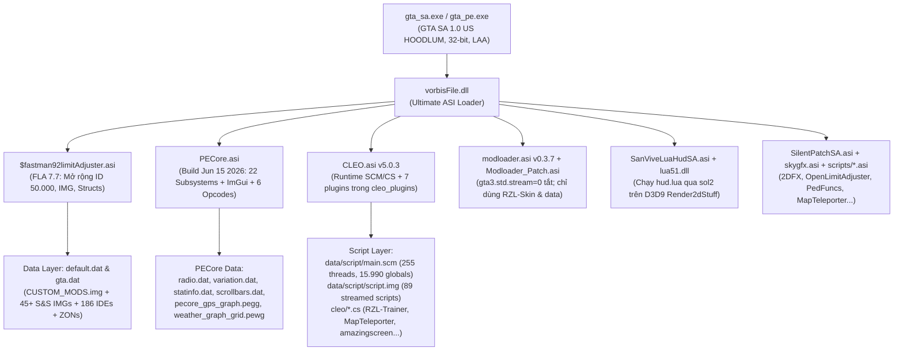

# 01. Định danh Bản cài & Kiến trúc Engine Thực tế (Project Eagle v1.3)

- **Ngày khảo sát:** 14/10/2026 (Asia/Saigon)
- **Thư mục game mục tiêu:** [`C:\Users\LENOVO\Desktop\GTA\Project Eagle\gta sa clean\gta sa clean`](file:///C:/Users/LENOVO/Desktop/GTA/Project%20Eagle/gta%20sa%20clean/gta%20sa%20clean)
- **Thư mục User Files:** [`C:\Users\LENOVO\Documents\GTA PE User Files`](file:///C:/Users/LENOVO/Documents/GTA%20PE%20User%20Files)
- **Phương pháp xác minh:** Phân tích PE32 header/section/import/export tĩnh, diff byte-level giữa `gta_sa.exe` và `gta_pe.exe`, giải mã 38.083 symbol từ [`gta_sa.pdb`](file:///C:/Users/LENOVO/Desktop/GTA/Project%20Eagle/gta%20sa%20clean/gta%20sa%20clean/gta_sa.pdb), dịch ngược chuỗi/cross-reference x86 trên [`PECore.asi`](file:///C:/Users/LENOVO/Desktop/GTA/Project%20Eagle/gta%20sa%20clean/gta%20sa%20clean/PECore.asi) và [`SanViveLuaHudSA.asi`](file:///C:/Users/LENOVO/Desktop/GTA/Project%20Eagle/gta%20sa%20clean/gta%20sa%20clean/SanViveLuaHudSA.asi), đối chiếu runtime log ([`PECore.log`](file:///C:/Users/LENOVO/Desktop/GTA/Project%20Eagle/gta%20sa%20clean/gta%20sa%20clean/PECore.log), [`cleo.log`](file:///C:/Users/LENOVO/Desktop/GTA/Project%20Eagle/gta%20sa%20clean/gta%20sa%20clean/cleo.log), [`modloader\modloader.log`](file:///C:/Users/LENOVO/Desktop/GTA/Project%20Eagle/gta%20sa%20clean/gta%20sa%20clean/modloader/modloader.log), [`fastman92limitAdjuster.log`](file:///C:/Users/LENOVO/Desktop/GTA/Project%20Eagle/gta%20sa%20clean/gta%20sa%20clean/fastman92limitAdjuster.log)) và 9 crash dump trong [`ProjectEagle_crashes/`](file:///C:/Users/LENOVO/Desktop/GTA/Project%20Eagle/gta%20sa%20clean/gta%20sa%20clean/ProjectEagle_crashes).

---

## 1. Bảng Định danh Binary, Hash SHA-256 & Kiến trúc PE32

Toàn bộ các thực thi và plugin trong bản cài đều là **PE32 32-bit x86** (`Machine = 0x014C`).

| Thành phần | Đường dẫn | Kích thước (Bytes) | SHA-256 | Vai trò & Nhận diện phiên bản |
| --- | --- | ---: | --- | --- |
| [`gta_sa.exe`](file:///C:/Users/LENOVO/Desktop/GTA/Project%20Eagle/gta%20sa%20clean/gta%20sa%20clean/gta_sa.exe) | Root | `14,383,616` | `7C5A7661B2E01D64B2A9201C369F26888B8F9B38CE82C9928EF81775079240CF` | Executable GTA SA 1.0 US HOODLUM (`ImageBase=0x400000`, `EntryRVA=0x424570`, `SizeOfImage=0x858000`, `LARGE_ADDRESS_AWARE` bật). |
| [`gta_pe.exe`](file:///C:/Users/LENOVO/Desktop/GTA/Project%20Eagle/gta%20sa%20clean/gta%20sa%20clean/gta_pe.exe) | Root | `14,383,616` | `F115B49C5AC3A8FCEDB00EE216730B2A6F573AFE4908B2AC328A9CC2B9D0DCB3` | Bản patch chuỗi/icon của `gta_sa.exe` (xem Mục 1.1). |
| [`gta_sa.pdb`](file:///C:/Users/LENOVO/Desktop/GTA/Project%20Eagle/gta%20sa%20clean/gta%20sa%20clean/gta_sa.pdb) | Root | `1,998,848` | `06026C84B595FBEE16737B0C095ABBA85206A8DC2AE9618CB9D870620370EED4` | Microsoft PDB v7.00 đi kèm bộ cài; chứa **38.083 public/global symbols** của `gta_sa.exe` 1.0 US. |
| [`vorbisFile.dll`](file:///C:/Users/LENOVO/Desktop/GTA/Project%20Eagle/gta%20sa%20clean/gta%20sa%20clean/vorbisFile.dll) | Root | `223,232` | `667DC49EF2E51E785EE750B9EC02C7A269FF8BAEFB0E5AE04CEFFAA2B862ADDF` | Ultimate ASI Loader (`EntryRVA=0x235FD`), điểm vào nạp toàn bộ `.asi` trong root và `scripts\`. |
| [`PECore.asi`](file:///C:/Users/LENOVO/Desktop/GTA/Project%20Eagle/gta%20sa%20clean/gta%20sa%20clean/PECore.asi) | Root | `2,977,792` | `A81C69EF38B8DE8FC9CECEC2C1A38AF3DB6DA0A68D34C4BF4F3A175D0A65FFF7` | Core engine plugin của Project Eagle v1.3 (build `Jun 15 2026`, PDB path: `C:\Users\Madhav Gupta\Documents\GitHub\ProjectEagleCore\build\bin\PECore.pdb`). |
| [`$fastman92limitAdjuster.asi`](file:///C:/Users/LENOVO/Desktop/GTA/Project%20Eagle/gta%20sa%20clean/gta%20sa%20clean/$fastman92limitAdjuster.asi) | Root | `11,234,304` | `4F681AC79045DE3C33DCDE858FE405ADBE684781A335FA9DFBE4DA884F8D938B` | Fastman92 Limit Adjuster v7.7 (32-bit), mở rộng ID limit, archive, IDE/IPL, ped/vehicle structs. |
| [`CLEO.asi`](file:///C:/Users/LENOVO/Desktop/GTA/Project%20Eagle/gta%20sa%20clean/gta%20sa%20clean/CLEO.asi) | Root | `462,848` | `EFE6EECE2D4C03AEAB7A7E404992CC1394F9FB7DFD363FDB309EB9C2658B6DA0` | CLEO 5.0.3 runtime, export 36 hàm C API (`_CLEO_RegisterOpcode@8`, v.v.). |
| [`modloader.asi`](file:///C:/Users/LENOVO/Desktop/GTA/Project%20Eagle/gta%20sa%20clean/gta%20sa%20clean/modloader.asi) | Root | `700,928` | `64EC399DFBE6306DFBDC650D2205936DFAA252A1D2BBBC3CF6A4E61ADEEFD6CA` | ModLoader 0.3.7 (`git96c727b`). **Lưu ý:** `gta3.std.stream=0` bị tắt chủ động. |
| [`Modloader_Patch.asi`](file:///C:/Users/LENOVO/Desktop/GTA/Project%20Eagle/gta%20sa%20clean/gta%20sa%20clean/Modloader_Patch.asi) | Root | `67,584` | `B98AD3FC04DC3D4C0F146C028759710CA33686375DC1791DC23CC5EE71450C8C` | Plugin patch memory của `modloader.asi` (sửa lỗi handle/FindNextFile trên Windows hiện đại). |
| [`SilentPatchSA.asi`](file:///C:/Users/LENOVO/Desktop/GTA/Project%20Eagle/gta%20sa%20clean/gta%20sa%20clean/SilentPatchSA.asi) | Root | `282,624` | `785E8F7B20124F2EEFC717841E2AAECAB3B52A47C707200D97AD4F5EC7FF05EE` | SilentPatch SA (sửa lỗi timer, frame limiter, Chuột, D3D9, streaming). |
| [`skygfx.asi`](file:///C:/Users/LENOVO/Desktop/GTA/Project%20Eagle/gta%20sa%20clean/gta%20sa%20clean/skygfx.asi) | Root | `305,664` | `CDDCAD2EBADDD0018E776B59C3C670C95A27CA7215C74D15A1DB92EB3ED581B8` | SkyGfx (pipeline đồ họa PS2/Xbox building/vehicle). |
| [`SanViveLuaHudSA.asi`](file:///C:/Users/LENOVO/Desktop/GTA/Project%20Eagle/gta%20sa%20clean/gta%20sa%20clean/SanViveLuaHudSA.asi) | Root | `348,160` | `E1761A40B41277FC40336D5A0407EBD3A807FCEBD223F9EB038BF2691F76E983` | Host Lua 5.1 (`sol2`) chạy [`hud.lua`](file:///C:/Users/LENOVO/Desktop/GTA/Project%20Eagle/gta%20sa%20clean/gta%20sa%20clean/hud.lua) để vẽ HUD/Radar tùy biến. |
| [`lua51.dll`](file:///C:/Users/LENOVO/Desktop/GTA/Project%20Eagle/gta%20sa%20clean/gta%20sa%20clean/lua51.dll) | Root | `358,400` | `8DD0ACCAA13EE14D17BEFB52BE0A9FE2382825ACAAADDD35EFD8E061DC3444D7` | Runtime Lua 5.1 được `SanViveLuaHudSA.asi` import. |
| [`bass.dll`](file:///C:/Users/LENOVO/Desktop/GTA/Project%20Eagle/gta%20sa%20clean/gta%20sa%20clean/bass.dll) | Root | `147,528` | `677E83A5FA2DAEC9804D582C0FE16DA6AEBCDBCEACCD2F3EC1014A344D6B828D` | Un4seen BASS audio library, dùng bởi `CLEO.asi`, `SA.Audio.cleo`, và `PECore.asi` (`RadioEx`). |
| [`CrashInfo.SA.asi`](file:///C:/Users/LENOVO/Desktop/GTA/Project%20Eagle/gta%20sa%20clean/gta%20sa%20clean/CrashInfo.SA.asi) | Root | `544,768` | `BD19D52F7F6CC44A995426DF83D9249B97CC3DECD5EB35FD9DB3C7CAEB9C775E` | CrashInfo logger (tạo báo cáo trong `ProjectEagle_crashes\`). |
| [`ProjectEagle.RPC.asi`](file:///C:/Users/LENOVO/Desktop/GTA/Project%20Eagle/gta%20sa%20clean/gta%20sa%20clean/ProjectEagle.RPC.asi) | Root | `102,400` | `781FEBAFB7B01815A87594D7DF5B2573DC11A7463F24FA3FFDD0F70FF227B9B1` | Discord Rich Presence integration (`discord-rpc.dll`). |
| [`limit_adjuster_sbc.asi`](file:///C:/Users/LENOVO/Desktop/GTA/Project%20Eagle/gta%20sa%20clean/gta%20sa%20clean/limit_adjuster_sbc.asi) | Root | `102,400` | `83952F7B0D558CF0A9B61E8C027A940DE7F5BE42B180B3BF0C3E4A4B31EBD365` | Bổ trợ giới hạn mảng car generator / script model. |
| [`CustomSaa2.asi`](file:///C:/Users/LENOVO/Desktop/GTA/Project%20Eagle/gta%20sa%20clean/gta%20sa%20clean/CustomSaa2.asi) | Root | `180,224` | `7A200BAEF1F74F7E68EB744C57D6A7AA7F1BE6402B729D1D7BC2B149C9DC19BA` | Giải mã custom `.saa` file (cho phép nạp `handling.cfg` / `ped.dat` tùy biến). |
| [`data\script\main.scm`](file:///C:/Users/LENOVO/Desktop/GTA/Project%20Eagle/gta%20sa%20clean/gta%20sa%20clean/data/script/main.scm) | `data\script\` | `4,849,743` | `9D291C730D1B9CDEDBA9519081351478BE50DB136C3F28FD25BC4D6F6623BC73` | Master SCM của Project Eagle v1.3 (`15,990` biến toàn cục, `255` luồng `03A4`, kèm bảng symbol 5.598 biến ở cuối file). |
| [`data\script\script.img`](file:///C:/Users/LENOVO/Desktop/GTA/Project%20Eagle/gta%20sa%20clean/gta%20sa%20clean/data/script/script.img) | `data\script\` | `1,300,480` | `20C578A98BD822C4AA7B8F60CF774C16B13853B38073688CEFB1491BBCA3B4AC` | Archive chứa `89` streamed `.scm` scripts (gồm `pefoods.scm`, `usaplane.scm`, `otb_msc.scm`, v.v.). |

> [!CAUTION]
> Trong thư mục gốc game có file `secrets.local.json`. Theo quy tắc bảo mật nghiêm ngặt của dự án, file này **tuyệt đối không được đọc, không log và không đụng chạm** trong mọi công cụ phân tích hay sidecar về sau.

### 1.1. Khác biệt chính xác tới từng byte giữa `gta_sa.exe` và `gta_pe.exe`
Kết quả so sánh byte-by-byte toàn bộ `14,383,616` bytes giữa [`gta_sa.exe`](file:///C:/Users/LENOVO/Desktop/GTA/Project%20Eagle/gta%20sa%20clean/gta%20sa%20clean/gta_sa.exe) và [`gta_pe.exe`](file:///C:/Users/LENOVO/Desktop/GTA/Project%20Eagle/gta%20sa%20clean/gta%20sa%20clean/gta_pe.exe) xác nhận **section `.text` (code máy) hoàn toàn giống hệt nhau 100%**. Sự khác biệt chỉ nằm ở `780` bytes thuộc `.rdata`, `.data` và `.rsrc`:

| Section | Virtual Address (VA) | File Offset | Nội dung trong `gta_sa.exe` | Nội dung trong `gta_pe.exe` | Ý nghĩa kỹ thuật |
| --- | --- | --- | --- | --- | --- |
| `.rdata` | `0x0086506C` | `0x0046386C` | `"SAN_AND\0"` | `"UNI_STA\0"` | Key GXT tên bản đồ mặc định (`San Andreas` $\rightarrow$ `United States`). |
| `.rdata` | `0x00865678` | `0x00463E78` | `"gta_sa.set\0"` | `"gta_pe.set\0"` | Tên file lưu cấu hình trong thư mục User Files. |
| `.rdata` | `0x0086D2EF` | `0x0046BAEF` | `"GTASAsf"` | `"GTAPEsf"` | Tiền tố tên file save (`GTASAsf1.b` $\rightarrow$ `GTAPEsf1.b`). |
| `.rdata` | `0x0086D38D` | `0x0046BB8D` | `"GTA: San Andreas\0"` | `"GTA: Project Eagle\0"` | Chuỗi tiêu đề cửa sổ Win32. |
| `.rdata` | `0x008747AD` | `0x00472FAD` | `"\GTA San Andreas User Files\0"` | `"\GTA PE User Files\0"` | Thư mục con trong `Documents`. |
| `.data` | `0x008D5EB9..0x008D5F21` | `0x004D3AB9..0x004D3B21` | 16 bytes hằng số UI/Menu | 16 bytes chỉnh màu/layout menu | Tinh chỉnh màu sắc Frontend Menu. |
| `.rsrc` | `0x00C4F648..0x00C53CA8` | `0x0052A048..0x0052E6A8` | Icon GTA SA gốc | Icon Project Eagle (707 bytes khác) | Biểu tượng ứng dụng. |

> [!NOTE]
> Ngay cả khi người dùng khởi chạy bằng `gta_sa.exe` (như ghi nhận trong `PECore.log` và `ProjectEagle_crashes\*.log`), `PECore.asi` vẫn chủ động patch chuỗi `\GTA PE User Files` trong bộ nhớ tại thời điểm khởi tạo, giúp mọi thao tác User Files đều trỏ về `Documents\GTA PE User Files`.

---

## 2. Sơ đồ Kiến trúc & Chuỗi Nạp Runtime (Loader, Native, Script, Data, Render)

### 2.1. Vòng lặp Thực thi Chính (`CGame::Process` & `Render2dStuff`) theo Địa chỉ `gta_sa.pdb`
Nhờ [`gta_sa.pdb`](file:///C:/Users/LENOVO/Desktop/GTA/Project%20Eagle/gta%20sa%20clean/gta%20sa%20clean/gta_sa.pdb), các điểm neo trong vòng lặp frame của engine được xác định chính xác tuyệt đối:

1. **WinMain / Idle Loop:**
   - `WinMain` (`0x00748710`) $\rightarrow$ `Idle` (`0x0053E920`) $\rightarrow$ `FrontendIdle` (`0x0053E770`).
2. **Logic Tick (`CGame::Process` tại `0x0053BEE0`):**
   - `CTimer::Update` (`0x00561B10`) cập nhật `ms_fTimeStep` (`0x00B7CB5C`) và `m_snTimeInMilliseconds` (`0x00B7CB84`).
   - `CTheScripts::Process` (`0x0046A000`): Duyệt danh sách liên kết `CTheScripts::pActiveScripts` (`0x00A8B42C`). Mỗi luồng SCM/CLEO thực thi các lệnh trong [`CRunningScript::ProcessOneCommand`](file:///C:/Users/LENOVO/Desktop/GTA/Project%20Eagle/gta%20sa%20clean/gta%20sa%20clean/gta_sa.pdb) (`0x00469EB0`) cho đến khi gặp lệnh `wait` (`0001`).
   - `CStreaming::Update` (`0x0040E670`), `CPopulation::Update` (`0x00616650`), `CTheZones::Update` (`0x00572D10`).
3. **Render Tick (`RenderScene` & `Render2dStuff`):**
   - `RenderScene` (`0x0053DF40`) $\rightarrow$ `RenderEffects` (`0x0053E170`) $\rightarrow$ `Render2dStuff` (`0x0053E230`).
   - `CHud::Draw` (`0x0058FAE0`): Bị hook bởi [`SanViveLuaHudSA.asi`](file:///C:/Users/LENOVO/Desktop/GTA/Project%20Eagle/gta%20sa%20clean/gta%20sa%20clean/SanViveLuaHudSA.asi) để gọi hàm Lua `render()` trong [`hud.lua`](file:///C:/Users/LENOVO/Desktop/GTA/Project%20Eagle/gta%20sa%20clean/gta%20sa%20clean/hud.lua).
   - `CMessages::Display` (`0x0069EFC0`) & `CMenuManager::DrawStandardMenus` (`0x00576CD0`).
   - `IDirect3DDevice9::EndScene` / `Reset`: Được hook bởi `PECore.asi` (Dear ImGui 1.90.5 overlay khi `DeveloperMode = true`).

---

## 3. Giải phẫu Chi tiết `PECore.asi` (22 Subsystems & Bảng Hook Địa chỉ Thực)

Phân tích binary [`PECore.asi`](file:///C:/Users/LENOVO/Desktop/GTA/Project%20Eagle/gta%20sa%20clean/gta%20sa%20clean/PECore.asi) (ImageBase `0x10000000`) kết hợp [`PECore.log`](file:///C:/Users/LENOVO/Desktop/GTA/Project%20Eagle/gta%20sa%20clean/gta%20sa%20clean/PECore.log) và [`gta_sa.pdb`](file:///C:/Users/LENOVO/Desktop/GTA/Project%20Eagle/gta%20sa%20clean/gta%20sa%20clean/gta_sa.pdb) xác nhận **22 mô-đun nội bộ** và các địa chỉ hàm GTA SA 1.0 US được `PECore.asi` hook trực tiếp:

| Mô-đun `PECore.asi` | Trạng thái (`PECore.ini` / `PECore.log`) | Địa chỉ GTA SA 1.0 US bị Hook / Patch (đối chiếu `gta_sa.pdb`) | Cơ chế hoạt động thực tế |
| --- | --- | --- | --- |
| `Gamepatches` | Active | `0x53BC2C` (`CGame::Shutdown`), `0x53C6DB`, `0x53C991`, `0x53E555`, `0x53E99E` (`Idle`), `0x53EB17`, `0x728379`, `0x748063` | Vá chuỗi khởi tạo, đường dẫn User Files (`\GTA PE User Files`), sửa lỗi sương mù/bầu trời, hook vòng lặp `Idle` và `CGame::Process`. |
| `SaveSideloader` | Active | Hook cùng luồng `CGenericGameStorage::GenericSave` (`0x5D13E0`) / `GenericLoad` (`0x5D17B0`) | Đọc/ghi file sidecar `.dat` (magic header `PECoreSaveData`) tương ứng với từng save slot (`GTAPEsf1.dat` / `GTASAsf1.dat`). |
| `StatExtender` | Active | `0x55A780` (`CStats::ConstructStatLine`), `0x5599B8`, `0x55B980`, `0x579A2C` | Đọc [`data\statinfo.dat`](file:///C:/Users/LENOVO/Desktop/GTA/Project%20Eagle/gta%20sa%20clean/gta%20sa%20clean/data/statinfo.dat) (`%hu %d %d %d`), mở rộng mảng stat cho dải ID `400..500`, tự động serialize qua `SaveSideloader`. |
| `OpcodeMgr` / `ScriptCommands` | Active | Import `_CLEO_RegisterOpcode@8` từ `CLEO.asi` | Đăng ký **6 custom CLEO opcodes** (`0x3200`, `0x3201`, `0x3202`, `0x3210`, `0x3211`, `0x3212`). |
| `ZoneEx` | Active | `0x5B4B2E` (`CFileLoader::LoadZone` / `CreateZone`) | Mở rộng bảng Zone (`S&S\ZON\*.ZON`), tách biệt Weather Region (19 vùng) và Radio Region (7 vùng). |
| `RadioEx` | Active (`CustomRadioStations=true`) | `0x5746F0` (`CAERadioTrackManager::PrintRadioStationList`), `0x507000` (`GetRadioStationName`) | Đọc [`data\radio.dat`](file:///C:/Users/LENOVO/Desktop/GTA/Project%20Eagle/gta%20sa%20clean/gta%20sa%20clean/data/radio.dat) (7 vùng, 63 đài). **Lazy-load** các stream qua `bass.dll` khi người chơi bước vào `radioRegionId` mới. |
| `IplExt` | Active | `0x5B8722`, `0x5B8A0F` (`CFileLoader::LoadScene`), `0x5B47B0` (`LoadPickup`) | Parse các section IPL mở rộng của Project Eagle: `arpt` (sân bay), `scrl` (bảng điện tử), `cloc` (đồng hồ), `crsh` (máy nghiền xe), `pick` (pickup mở rộng). |
| `Scrollbars` | Active (`EnableScrollbars=true`) | `0x5B8722` + Render hook | Đọc [`data\scrollbars.dat`](file:///C:/Users/LENOVO/Desktop/GTA/Project%20Eagle/gta%20sa%20clean/gta%20sa%20clean/data/scrollbars.dat), hiển thị bảng LED ma trận điểm với biến thời gian thực `<TIME>`, `<TEMP>`, `<WEATHER>`, `<TUNNEL>`, `<BRIDGE>`. |
| `RoadSigns` | Active (`Enable3dSigns=true`) | Renderware atomic/material hook | Đọc [`data\roadsigns.dat`](file:///C:/Users/LENOVO/Desktop/GTA/Project%20Eagle/gta%20sa%20clean/gta%20sa%20clean/data/roadsigns.dat), sinh chữ 3D trên biển báo cao tốc. |
| `ModelVariation` | Active (`VehicleModelVariation=true`, `PedModelVariation=true`) | Hook chọn model xe/ped khẩn cấp & taxi theo vùng | Đọc [`data\variation.dat`](file:///C:/Users/LENOVO/Desktop/GTA/Project%20Eagle/gta%20sa%20clean/gta%20sa%20clean/data/variation.dat), tráo đổi động ID cảnh sát/SWAT/FBI/quân đội/cứu thương/taxi theo từng bang (hỗ trợ cả ID FLA > 20.000 và > 48.000). |
| `GangsEx` | Active | `0x5D58E0` (gang save/load), `0x443B00`, `0x572D10` | Đọc [`data\gangs.dat`](file:///C:/Users/LENOVO/Desktop/GTA/Project%20Eagle/gta%20sa%20clean/gta%20sa%20clean/data/gangs.dat) (17 vùng $\times$ 10 slot băng đảng), quản lý turf war đa thành phố. |
| `CarCrushers` | Active | `IplExt` (`crsh`) + crane/crusher logic | Máy nghiền xe tương tác lấy thưởng tiền mặt (như GTA 3 / LCS) đặt tại `S&S\CarCrushers.ipl`. |
| `ClimbingLadders` | Active (`EnableClimbingLadders=true`) | `0x618F60` (`CPed` task hook) | Cho phép nhân vật trèo thang dựng đứng dựa trên vật liệu va chạm/object. |
| `MapLegends` | Active (`EnableMapLegends=true`) | `0x575B20`, `0x5828A0` (`CMenuManager` map draw) | Vẽ danh sách chú giải icon bản đồ và ranh giới bang trên Pause Map. |
| `Pager` | Active | `0x58EC20` (`CHud::DrawScriptText`) + Opcode `0x3200`/`0x3201` | Hiển thị máy nhắn tin góc trên bên trái kiểu GTA 3 / VCS với chữ chạy và tiếng bíp. |
| `PathFindEx` | Active (`EnhancedGpsPath=true`) | `0x4518F8`, `0x452160` (`CPathFind`) | Nạp [`data\pecore_gps_graph.pegg`](file:///C:/Users/LENOVO/Desktop/GTA/Project%20Eagle/gta%20sa%20clean/gta%20sa%20clean/data/pecore_gps_graph.pegg) (147.175 node, 253.962 cạnh) để tìm đường GPS xuyên lục địa. |
| `TimecycEx` | Active (`24HoursTimecycle=true`) | `0x55F4B0` (`CTimeCycle::Initialise`), `0x5601E0` | Nạp [`data\timecyc_ss.dat`](file:///C:/Users/LENOVO/Desktop/GTA/Project%20Eagle/gta%20sa%20clean/gta%20sa%20clean/data/timecyc_ss.dat) (103 thời tiết $\times$ 24 giờ). |
| `WeatherEx` | Active (`SmoothWeatherTransition=true`) | `0x72A4F0` (`CWeather::Update`) | Nạp [`data\weather_graph_grid.pewg`](file:///C:/Users/LENOVO/Desktop/GTA/Project%20Eagle/gta%20sa%20clean/gta%20sa%20clean/data/weather_graph_grid.pewg) (lưới 2048$\times$2048), nội suy thời tiết mượt theo tọa độ $(x, y)$. |
| `WaterInitializer` | Active (`WaterQuadTree=true`) | `0x6EAE80` (`CWaterLevel::WaterLevelInitialise`) | Phân hoạch không gian mặt nước bằng QuadTree để tăng FPS trên bản đồ lớn. |
| `WeaponInfoEx` | Active | `0x5BF770` (`CWeaponInfo::LoadWeaponData`) | Mở rộng bảng thông số vũ khí vùng miền. |
| `GamePatchLog` | Active (`ShowChangelog=true`) | Opcode `0x3202` + UI overlay | Hiển thị bảng Changelog v1.3 khi vào game. |
| `DebugMenu` & `Profiler` | Bật khi `DeveloperMode=true` (hiện tại `false` trong `PECore.ini:4`) | D3D9 `EndScene` / `Reset` + Export 16 hàm C API (`DebugMenuAddCmd`, v.v.) | Tích hợp **Dear ImGui 1.90.5** (`Ctrl+M` mở Debug Menu, `Ctrl+P` mở Profiler đo frame time từng module). |

---

## 4. Giới hạn Engine (`$fastman92limitAdjuster.asi`), `ModLoader` & `SanViveLuaHudSA`

### 4.1. Cấu hình Giới hạn Thực tế trong `fastman92limitAdjuster_GTASA.ini`
Từ [`fastman92limitAdjuster_GTASA.ini`](file:///C:/Users/LENOVO/Desktop/GTA/Project%20Eagle/gta%20sa%20clean/gta%20sa%20clean/fastman92limitAdjuster_GTASA.ini) và [`fastman92limitAdjuster.log`](file:///C:/Users/LENOVO/Desktop/GTA/Project%20Eagle/gta%20sa%20clean/gta%20sa%20clean/fastman92limitAdjuster.log):
- **ID Limits:** `Count of killable model IDs = 50000` (dòng 356; chia vùng: `0..44999` cho Vehicles/Objects, `45000..49999` cho Peds).
- **Dynamic Limits (Pools):**
  - `VehicleStructs = 500` (mặc định 50)
  - `PedStructs = 140`, `Peds = 140`
  - `PtrNode Doubles = 25600`, `EntryInfoNodes = 25600`
  - `Objects = 10000`, `Tasks = 5000`, `Events = 2000`
  - `ColModels = 95000`, `Matrices = 9000`
  - `Rwattle / Streaming Memory = 1536000 KB` (~1.5 GB).
- **Saveblock size:** `Saveblock size = 66000` bytes (dòng 514, tăng kích thước khối lưu biến SCM trong file `.b` để chứa đủ `15.990` biến toàn cục = `63.960` bytes của `main.scm`).

### 4.2. Trạng thái ModLoader (`modloader.asi` + `Modloader_Patch.asi`)
- Trong [`modloader\.data\plugins\plugins.ini:14`](file:///C:/Users/LENOVO/Desktop/GTA/Project%20Eagle/gta%20sa%20clean/gta%20sa%20clean/modloader/.data/plugins/plugins.ini#L14), dòng `gta3.std.stream=0` tắt hoàn toàn plugin streaming chuẩn của ModLoader.
- **Hệ quả kiến trúc:** ModLoader **không** tự động thay thế model `.dff`/`.txd` thả rời trong thư mục `modloader\` (ngoại trừ các file được script nạp thủ công bằng đường dẫn như `modloader\RZL-Skin\AETHER.dff` qua opcode `023C` `load_special_character`).
- Ngược lại, `gta3.std.asi` (nạp `.asi`/`.cs`) và `gta3.std.data` (merge file text config) vẫn bật.
- [`Modloader_Patch.asi`](file:///C:/Users/LENOVO/Desktop/GTA/Project%20Eagle/gta%20sa%20clean/gta%20sa%20clean/Modloader_Patch.asi) can thiệp vào địa chỉ cơ sở của `modloader.asi` để vá hàm `FindFirstFile`/`FindNextFile` và xử lý handle khi duyệt thư mục.

### 4.3. Phạm vi Thực sự của `SanViveLuaHudSA.asi`
Phân tích symbol/RTTI C++ trong [`SanViveLuaHudSA.asi`](file:///C:/Users/LENOVO/Desktop/GTA/Project%20Eagle/gta%20sa%20clean/gta%20sa%20clean/SanViveLuaHudSA.asi) chứng minh đây là một plugin chuyên biệt cho HUD sử dụng `sol2` + `lua51.dll` để thực thi duy nhất [`hud.lua`](file:///C:/Users/LENOVO/Desktop/GTA/Project%20Eagle/gta%20sa%20clean/gta%20sa%20clean/hud.lua):
- **Các class C++ được bind sang Lua:** `Hud`, `Font`, `Sprite`, `Sprite2d`, `PlayerPed` / `CPed`, `CVehicle`, `CWeapon`, `CWeaponInfo`, `CStats`, `CDarkel`, `CTxdStore`, `RwTexDictionary`, `CRGBA`, `CVector`, `CVector2D`.
- **Các biến toàn cục Lua được đẩy vào mỗi frame:** `ScreenWidth`, `ScreenHeight`, `DeltaMS`, `CurrentInterior`, `ExitEnterState`, `PlayerPed`, `Hud`.
- **Giới hạn:** Không có API tạo luồng gameplay, không có hàm gọi SCM opcode, không có hook sự kiện thế giới, không có socket/IPC. Vì vậy, **`SanViveLuaHudSA.asi` chỉ nên dùng nếu muốn đọc trạng thái vẽ lên HUD**, không phải môi trường chạy logic gameplay chính.

---

## 5. Chẩn đoán 9 Crash Logs trong `ProjectEagle_crashes\`

Khảo sát toàn bộ 9 file log trong [`ProjectEagle_crashes/`](file:///C:/Users/LENOVO/Desktop/GTA/Project%20Eagle/gta%20sa%20clean/gta%20sa%20clean/ProjectEagle_crashes) (ngày 13/10/2026) cho thấy:
1. **8/9 crash logs** (`16-14-14`, `16-33-53`, `16-43-17`, `16-54-02`, `18-08-35`, `18-17-36`, `22-35-38`, `22-46-28`) **không phải crash khi đang chơi**, mà là ngoại lệ `0xC0000005` xảy ra **sau khi người dùng bấm thoát game (`ExitProcess` $\rightarrow$ `RtlExitUserProcess` $\rightarrow$ `LdrShutdownProcess`)** bên trong destructor của `modloader\std.data.dll (+0x0016F6DD)`. Nó hoàn toàn vô hại với tiến trình chơi nhưng cần lưu ý khi thiết kế plugin mới: mọi plugin C++ ASI hoặc kết nối IPC của chúng ta phải giải phóng tài nguyên an toàn trước khi `LdrShutdownProcess` tháo dỡ các DLL phụ thuộc.
2. **Chỉ 1/9 crash log** (`2026-10-13_16-24-36.log`) xảy ra trong lúc chơi tại địa chỉ `0x007F3737` (`RwTexDictionaryForAllTextures` trong `gta_sa.exe`) ngay sau khi nạp `MODELS\PLAYER.IMG` — trùng khớp với thời điểm thử nghiệm nạp skin Aether tự động lúc đầu (đã được gỡ bỏ).
