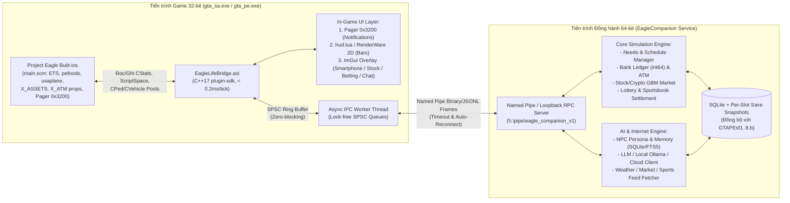

# 04. Đánh giá Khả thi 4 Trụ cột Gameplay & Kiến trúc Đề xuất (Hybrid In-Process + Sidecar)

- **Mục tiêu:** Đánh giá chi tiết mức khả thi, ràng buộc kỹ thuật trên nền Project Eagle v1.3 và thiết kế kiến trúc phần mềm tổng thể đáp ứng cả 4 hướng gameplay dài hạn mà không gây stutter, crash hay xung đột với thế giới Eagle.

---

## 1. Đánh giá Khả thi Chi tiết theo 4 Trụ cột Gameplay

### Trụ cột 1: Life Sim kiểu The Sims (Nhà ở, Ngủ nghỉ, Nhu cầu Cơ thể, Đổ xăng, Siêu thị, Việc làm)
- **Mức độ khả thi:** **RẤT CAO (High Feasibility — Có thể triển khai hoàn toàn cục bộ, không phụ thuộc mạng).**
- **Phân tích kỹ thuật & Kết nối với Project Eagle v1.3:**
  1. **Nhu cầu cơ thể (Hunger, Thirst, Energy/Sleep, Hygiene):**
     - Quản lý 4 biến float (`0.0..100.0`) giảm dần theo thời gian thực hoặc giờ in-game (`CClock::ms_nGameClockHours` tại `0xB70153`, `ms_nGameClockMinutes` tại `0xB70152`).
     - **Nối khớp với hệ thống ăn uống sẵn có của Eagle:** Khi người chơi ăn tại các cửa hàng trong `pefoods.scm` / `junkfud.scm` (phát hiện qua sự kiện tăng `Stat 21 Fat` / máu hoặc animation nhóm `FOOD`: `EAT_PIZZA`, `EAT_BURGER`), hệ thống tự động hồi thanh `Hunger`.
     - **Hiệu ứng nhẹ nhàng, không phá trải nghiệm dạo phố:** Khi `Energy < 15%` hoặc `Hunger < 10%`, chỉ gửi tin nhắn nhắc nhở qua **Pager (`0x3200`)** và giảm nhẹ tốc độ hồi Stamina — không tự động giết nhân vật hay khóa điều khiển khi đang lái xe.
  2. **Tương thích Animation với nhân vật chính Aether (`modloader\RZL-Skin\AETHER.dff`):**
     - Như đã xác minh ở Task 1, Aether có bộ xương cơ sở (bone table) khớp chuẩn ped GTA SA nhưng không có rigging biểu cảm mặt (`face_jaw`) đầy đủ.
     - Do đó, mọi hành động Life Sim (ăn, uống nước, ngủ trên giường, tắm, rút tiền ATM, bơm xăng) chỉ sử dụng **full-body/upper-body IFP animations chuẩn của GTA SA** (`FOOD`, `INT_HOUSE`, `PED`, `MISC`, `SHOP`) đã tương thích 100% với bộ xương chuẩn của Aether, không dùng morph/facial animation.
  3. **Nhà ở, Ngủ nghỉ & Lịch sinh hoạt:**
     - Tận dụng các Safehouse (`XSAVE`, `PSAVE*`) và khách sạn *Majestic Hotel* (`X_HOTEL`) có sẵn trên 17 thành phố, cộng thêm các điểm giường ngủ/phòng tắm được khai báo bằng tọa độ trong file cấu hình JSON/INI ngoài `main.scm`.
     - Khi ngủ: Cho phép chọn số giờ muốn ngủ ($1..12$ giờ), fade màn hình (`016A`), tua đồng hồ game (`CClock`), hồi đầy `Energy`, đồng thời gửi sự kiện **`TIME_ADVANCED(hours)`** cho hệ thống Kinh tế / Vé số / ETS để quyết toán lãi suất, hợp đồng và kỳ quay!
  4. **Nhiên liệu (Fuel) & Trạm xăng trên toàn bản đồ Eagle:**
     - Thay vì chỉ đặt tọa độ trạm xăng ở San Andreas, plugin C++ quét tự động các `CObject` trong pool gần xe người chơi có model ID thuộc nhóm **cột bơm xăng** (`model 1676` `washgaspump`, `1686`, `3465`, v.v. dùng chung khắp các bang S&S) + danh sách tọa độ bổ sung.
     - Mức xăng được lưu theo từng xe (hoặc gắn với xe hiện tại của người chơi), hiển thị thanh nhỏ trên HUD (`hud.lua` hoặc overlay).
  5. **Siêu thị & Túi đồ (Inventory):**
     - Cho phép bước vào các cửa hàng 24/7 / siêu thị, mở menu mua đồ đóng gói (nước suối, bento, cà phê, hộp sửa xe, bình xăng dự phòng) cất vào **Inventory** để Aether có thể dùng bất cứ lúc nào khi đang dừng xe ngắm cảnh.

---

### Trụ cột 2: Kinh tế Trong Game (Ngân hàng, ATM, Nghề nghiệp, Tài sản, Chứng khoán & Crypto)
- **Mức độ khả thi:** **RẤT CAO (High Feasibility — Kết hợp In-Process Adapter + Sidecar Engine).**
- **Phân tích kỹ thuật & Giải quyết giới hạn Engine:**
  1. **Vượt giới hạn tiền 32-bit (`$PLAYER_MONEY` tại `0xB7CE50`):**
     - Tiền mặt trong ví (`Cash` của GTA SA, giới hạn hiển thị `\$999,999,999`) được giữ nguyên để tương thích 100% với mọi cửa hàng, trạm thu phí, đại lý xe (`CAR_DEALERSHIP`), máy bán vé máy bay (`usaplane.scm`) và nhiệm vụ `ETS` của Project Eagle.
     - **Sổ cái Ngân hàng & Tài sản (`Bank Ledger`)** được lưu bằng số nguyên **64-bit (`int64_t`, tính theo đơn vị cent hoặc USD)** trong cơ sở dữ liệu của mod: gồm `Checking Account` (Tài khoản thanh toán), `Savings Account` (Tiết kiệm có lãi suất ngày), và `Investment Portfolio` (Chứng khoán & Crypto).
  2. **Biến các cây ATM có sẵn của Eagle (`X_ATM`) thành ATM giao dịch thực:**
     - Bản Eagle đã spawn sẵn hàng chục object cây ATM (`model 2942` `kmb_atm1`) trong luồng `X_ATM`.
     - Khi người chơi đứng trong bán kính $1.8\text{ m}$ trước object `model 2942` và bấm phím tương tác (ví dụ `E`), plugin sẽ mở **Menu Giao dịch ATM** (Nạp tiền mặt vào TK, Rút tiền mặt ra ví, Chuyển sang Tiết kiệm, Xem sao kê) thay vì chỉ để đập vỡ như mặc định. (Cơ chế đập vỡ ATM của Eagle vẫn hoạt động bình thường nếu người chơi dùng vũ khí tấn công).
  3. **Thị trường Chứng khoán & Crypto (Mô phỏng trước, Dữ liệu thực tùy chọn sau):**
     - **Chế độ 1 (Simulated Local Market — Mặc định):** Chạy mô hình **Geometric Brownian Motion có nhảy (Jump-Diffusion GBM)** kết hợp **Sự kiện Thế giới trong Game (Market Events)**:
       - Ví dụ các mã cổ phiếu gắn với thế giới GTA/Eagle: `SPNK` (Sprunk), `ERIS` (Eris Shoes), `IGLB` (InterGlobal Studios), `VTCK` (VoltTruck Co.), `JankAir` (US Airlines), cùng các đồng Crypto giả lập hoặc ánh xạ (`BTC`, `ETH`, `SOL`).
       - Các hành động trong game hoặc tin tức sinh ra sẽ tác động tới hệ số drift $\mu$ và độ biến động $\sigma$ (ví dụ: hoàn thành chuỗi hợp đồng xe tải `ETS` làm cổ phiếu `VTCK` tăng điểm; tin tức khủng hoảng làm thị trường điều chỉnh).
     - **Chế độ 2 (Live Feed qua Sidecar):** Tiến trình Sidecar ngoài game có thể lấy giá `BTC/USD`, `ETH/USD`, hoặc chỉ số chứng khoán thực từ API công khai (CoinGecko / Yahoo Finance) theo chu kỳ $60\text{s}$ và ánh xạ sang bảng giá trong game mà không tốn bất kỳ chu kỳ CPU nào của game.

---

### Trụ cột 3: Vé số (Lottery) & Cá cược Thể thao (Sports Betting)
- **Mức độ khả thi:** **CAO (High Feasibility — Cần thiết kế chặt chẽ bộ máy Thời gian & Quyết toán).**
- **Phân tích kỹ thuật & Xử lý các bài toán biên (Save/Load, Tua thời gian, Offline):**
  1. **Đồng hồ Chuẩn cho Quyết toán Kỳ quay & Trận đấu (`Canonical World Calendar`):**
     - Trong GTA SA, thời gian có thể trôi tự nhiên ($1\text{ phút thực} = 1\text{ giờ game}$), hoặc nhảy vọt khi người chơi **Ngủ**, **Save game** (+6 giờ), **Đi máy bay (`usaplane.scm`)**, hoặc **Hồi sinh tại bệnh viện**.
     - **Giải pháp:** Xây dựng một biến **`MonotonicGameTimestamp` (Tổng số phút in-game tính từ Ngày 1, 00:00)** đối chiếu với thời gian thực tế (`RealTimestamp`).
     - Mỗi vé số hoặc phiếu cược thể thao đều gắn với một `draw_id` / `match_id` và mốc mở thưởng xác định (`scheduled_game_epoch` hoặc `scheduled_utc_time`).
  2. **Xử lý khi Tua thời gian (Time Skip) hoặc Save/Load:**
     - Khi người chơi ngủ qua đêm hoặc nạp lại save slot: Bộ máy Quyết toán (`Settlement Engine` trong Sidecar/Plugin) so sánh `CurrentEpoch` với tất cả các vé đang ở trạng thái `PENDING`.
     - Mọi kỳ quay vé số hoặc trận đấu có `scheduled_epoch <= CurrentEpoch` sẽ được **quay thưởng/quyết toán tất định (deterministic RNG seeded by `save_id + draw_id`)** ngay lập tức, cộng tiền trúng thưởng vào `Checking Account` và đẩy thông báo kết quả vào **Pager (`0x3200`)** (*"Lottery Draw #14: Winning numbers 07-19-24-35-42. You won \$500!"*).
     - Nhờ dùng **Deterministic Seed (`HMAC(save_seed, draw_id)`)**, kết quả kỳ quay không bị thay đổi nếu người chơi cố tình load lại save cũ ngay trước giờ quay (chống save-scumming nếu muốn, hoặc cấu hình bật/tắt tùy ý).
  3. **Kết hợp Lịch/Kết quả Thể thao Thực tế từ Internet (Bóng đá / Bóng rổ):**
     - Tiến trình **Sidecar** tải lịch thi đấu sắp diễn ra (Premier League, Champions League, NBA...) và lưu cache vào SQLite cục bộ.
     - Người chơi đặt cược bằng tiền in-game.
     - **Xử lý khi mất mạng hoặc trận đấu chưa có kết quả:** Nếu đến hạn mà máy đang offline hoặc API bên ngoài trễ dữ liệu, phiếu cược sẽ giữ trạng thái `AWAITING_OFFICIAL_RESULT` (cho phép người chơi chọn: *Chờ có mạng để lấy kết quả thật* HOẶC *Mô phỏng kết quả ngay theo tỷ lệ kèo*).

---

### Trụ cột 4: AI NPC & Internet trong Game (Hội thoại, Trí nhớ, Tính cách, Tin tức, Sự kiện)
- **Mức độ khả thi:** **CAO KHI DÙNG KIẾN TRÚC SIDECAR (Medium-High Feasibility — Tuyệt đối không chạy LLM trong tiến trình 32-bit của game).**
- **So sánh Kiến trúc: In-Process Plugin vs. External Companion/Sidecar Process:**

| Tiêu chí Kỹ thuật | Phương án 1: Nhúng tất cả trong Plugin 32-bit (`gta_sa.exe`) | Phương án 2 (ĐỀ XUẤT): In-Process Bridge ASI nhẹ + Tiến trình Sidecar 64-bit Độc lập |
| --- | --- | --- |
| **Giới hạn RAM & Địa chỉ** | Chia sẻ trần không gian địa chỉ 32-bit (~3.5 GB với LAA) cùng 45+ file IMG và 1.5 GB streaming của Eagle $\rightarrow$ **Nguy cơ Out-of-Memory cao**. | Sidecar chạy 64-bit độc lập hoàn toàn; dùng thoải mái RAM hệ thống cho SQLite, LLM client, TTS, cache. |
| **Độ mượt Frame Time (Stutter)** | Parse JSON lớn, TLS handshake, hoặc thư viện mạng nặng dễ gây gai frame (frame spikes). | Bridge trong game chỉ đọc/ghi Ring Buffer trong bộ nhớ chia sẻ / Named Pipe (**$< 0.15\text{ ms}$ mỗi tick**). Mọi I/O nặng nằm ở Sidecar. |
| **Cô lập Lỗi (Crash Isolation)** | Lỗi thư viện mạng/JSON/AI làm sập ngay lập tức `gta_sa.exe`. | Nếu Sidecar lỗi hoặc khởi động lại, **game vẫn chạy bình thường 100%**, Bridge tự động reconnect ngầm. |
| **Bảo mật API Key & Secrets** | Phải nạp key vào vùng nhớ tiến trình game (dễ lộ trong crash dump của `CrashInfo.SA.asi`!). | API key chỉ nằm trong biến môi trường của Sidecar ngoài game; **không bao giờ đi vào bộ nhớ `gta_sa.exe`**. |
| **Tốc độ Phát triển & Bảo trì** | Mọi thay đổi prompt, logic thị trường, parser web đều phải biên dịch lại C++ `.asi` và khởi động lại game. | Có thể sửa code Python/TypeScript của Sidecar và **hot-reload ngay trong khi đang đứng trong game**! |

---

## 2. Kiến trúc Đề xuất Tổng thể: `EagleLife` 3-Tier Hybrid Architecture

### 2.1. Phân bổ Trách nhiệm giữa các Mô-đun (Module Boundaries)

1. **`EagleLifeBridge.asi` (In-Process Game Adapter — C++17 / `plugin-sdk`):**
   - **Ngân sách thời gian (Tick Budget):** Nghiêm ngặt **$< 0.3\text{ ms}$ mỗi frame** trong `Events::gameProcessEvent`.
   - **Nhiệm vụ duy nhất trên Main Thread:**
     1. Đọc trạng thái thế giới tối giản (tọa độ Aether, ID xe đang lái, tốc độ xe, giờ/phút `CClock`, tiền mặt `$PLAYER_MONEY`, slot save hiện tại, ID ped gần nhất đang ngắm/tương tác).
     2. Đẩy gói tin trạng thái (`WorldTickState`, ~128 bytes) vào hàng đợi Lock-Free Single-Producer Single-Consumer (`SPSCQueue`) cho luồng `IPC Worker`.
     3. Rút các lệnh phản hồi đã được xác thực từ `SPSCQueue` (ví dụ: `ADD_CASH`, `DEDUCT_CASH`, `PAGER_NOTIFY`, `PLAY_ANIM`, `ADVANCE_CLOCK`, `SHOW_UI_VIEW`) và thực thi bằng hàm native GTA SA.
     4. Vẽ giao diện Smartphone / ATM / Bảng giá / Hộp thoại NPC bằng **Dear ImGui** (chỉ khi người chơi bấm mở UI).
2. **`EagleCompanion` (External Sidecar Service — Python 3.10+ hoặc Node.js 64-bit sẵn có trên máy):**
   - Chạy toàn bộ logic nghiệp vụ nặng, lưu trữ bền vững và kết nối ngoài:
     - **`LifeSimModule`:** Tính toán độ vơi của `Hunger`, `Thirst`, `Energy`, `Hygiene`, `VehicleFuel`; quản lý túi đồ (`Inventory`) và lịch sinh hoạt.
     - **`EconomyModule`:** Quản lý sổ cái ngân hàng 64-bit (`Checking`, `Savings`), lãi suất kép theo ngày, danh mục cổ phiếu/crypto, thuật toán sinh giá GBM + sự kiện thị trường.
     - **`BettingModule`:** Phát hành kỳ quay vé số, quản lý bảng kèo thể thao (mô phỏng + feed thực), quyết toán tự động theo `MonotonicGameTimestamp`.
     - **`AINpcModule`:** Quản lý hồ sơ NPC (tính cách, lịch sử trò chuyện trong SQLite, mức độ thân thiết với Aether), gọi LLM bất đồng bộ và dịch phản hồi thành **Danh sách Hành động Cho phép (Whitelisted Intents)**.

### 2.2. Ranh giới An toàn & Kiểm duyệt Hành động từ AI/Mạng (`Strict Action Validation`)
Để đảm bảo AI hoặc dữ liệu internet không bao giờ gây crash game:
- Tiến trình Sidecar và LLM **tuyệt đối không được gửi địa chỉ bộ nhớ, mã máy hay chuỗi opcode SCM thô** vào game.
- Giao thức IPC chỉ chấp nhận một tập hợp đóng các **Lệnh Đã Định nghĩa Kiểu (`Typed Command Whitelist`)** với bộ kiểm tra biên (bounds check) ngay trong `EagleLifeBridge.asi`:
  - `CMD_MODIFY_CASH(delta_int32)`: Kiểm tra giới hạn `[-99999999, +99999999]` và không làm âm tiền mặt.
  - `CMD_PAGER_TEXT(ascii_str_max_127)`: Lọc bỏ ký tự ngoài bảng mã GXT, tự động escape ký tự `~` không hợp lệ trước khi gọi `0x3200`.
  - `CMD_NPC_EMOTE(ped_handle, anim_enum)`: Chỉ chấp nhận `anim_enum` nằm trong bảng 15 animation hội thoại chuẩn đã nạp sẵn trong bộ nhớ (`IDLE_CHAT`, `WAVE`, `LAUGH`, `NOD`, `GIVE_ITEM`...), kiểm tra `CPools::ms_pPedPool->GetAtRef(ped_handle) != nullptr` trước khi gọi.

### 2.3. Thiết kế Lưu trữ Bền vững theo Save Slot (`Slot-Synchronized Persistence`)
- Khi người chơi lưu game tại Slot $N$ (`GTAPEsf{N}.b` / `GTASAsf{N}.b`), `EagleLifeBridge.asi` bắt sự kiện `CGenericGameStorage::GenericSave` (`0x5D13E0`), đọc `ms_CurrentSaveSlot` và gửi tín hiệu `EVENT_SAVE_SLOT(slot_id, save_timestamp)` sang Sidecar.
- Sidecar thực hiện một giao dịch nguyên tử (atomic transaction) trong SQLite, tạo bản chụp (**Snapshot**) toàn bộ trạng thái Life Sim, Ngân hàng, Danh mục Cổ phiếu, Vé số đang chờ và Trí nhớ NPC gắn với `slot_id`.
- Khi người chơi Load Game ở Slot $N$ (hoặc bắt đầu New Game), Bridge gửi `EVENT_LOAD_SLOT(slot_id)` để Sidecar khôi phục đúng Snapshot của slot đó — đảm bảo không bao giờ bị lệch tiền hay lệch trạng thái vé số giữa các lần save/load!
