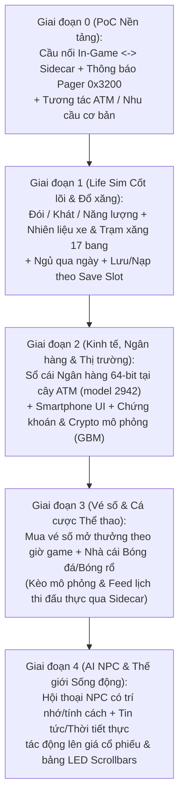

# 05. Lộ trình Triển khai (Vertical-Slice Roadmap), Kế hoạch PoC Đầu tiên & Sổ cái Bằng chứng (Evidence Ledger)

- **Mục tiêu:** Đề xuất thứ tự triển khai từng lát cắt chơi được ngay (playable vertical slices), thiết kế chi tiết 3 phương án Proof-of-Concept (PoC) đầu tiên có tiêu chí nghiệm thu rõ ràng, và lập sổ cái bằng chứng kèm danh mục khoảng trống chưa xác minh runtime.

---

## 1. Lộ trình Triển khai theo Lát cắt Chơi được (Playable Vertical-Slice Roadmap)

Nguyên tắc cốt lõi: **Mỗi giai đoạn phải tạo ra một vòng lặp gameplay hoàn chỉnh có thể thưởng thức ngay khi lái xe dạo phố với Aether**, không xây dựng các thư viện ngầm khổng lồ chưa mang lại trải nghiệm trong game.

| Giai đoạn | Hạng mục triển khai | Phụ thuộc kỹ thuật | Tiêu chí nghiệm thu (Acceptance Criteria) & Bảo vệ Hiện trạng |
| --- | --- | --- | --- |
| **Phase 0: PoC Nền tảng** | Kiểm chứng vòng lặp giao tiếp không giật lag giữa game (`CLEO 5` hoặc `Bridge ASI`) và `EagleCompanion Sidecar`, hiển thị thông báo lên `Pager (0x3200)` và giao dịch thử tại cây ATM/trạm xăng. | Không phụ thuộc biên dịch `main.scm`; dùng `CLEO 5` (`SA.FileSystemOperations` / `SA.IniFiles`) hoặc `EagleLifeBridge.asi` nhẹ. | - FPS giữ nguyên tuyệt đối (không khựng khi gửi/nhận dữ liệu). - Đổi skin Aether qua `F2` và 3 skin cảnh sát (`280`, `285`, `287`) hoạt động bình thường. |
| **Phase 1: Life Sim & Nhiên liệu** | - Thanh `Hunger`, `Thirst`, `Energy`, `Vehicle Fuel` (hiển thị gọn trên HUD). - Bơm xăng tại mọi cột bơm xăng (`model 1676/1686/3465`) trên 17 thành phố. - Ăn tại `pefoods.scm` hồi `Hunger`; ngủ tại Safehouse/Hotel hồi `Energy` và qua ngày. | Phase 0 + Hook đồng bộ save slot (`GTAPEsf1..8.b`). | - Lái xe đường dài giữa các bang có tiêu hao xăng hợp lý, ghé trạm xăng đổ đầy và trừ tiền. - Save/Load khôi phục đúng % xăng và chỉ số cơ thể. |
| **Phase 2: Kinh tế, ATM & Đầu tư** | - Kích hoạt toàn bộ cây ATM (`model 2942`) của Eagle thành điểm Gửi/Rút/Tiết kiệm. - Giao diện Smartphone/Terminal (phím `F5` / `J`) xem danh mục Cổ phiếu (`SPNK`, `ERIS`, `VTCK`...) & Crypto (`BTC`, `ETH`). | Phase 1 + `EconomyModule` trong Sidecar. | - Gửi/rút vượt mốc `\$999,999,999` an toàn. - Giá cổ phiếu/crypto cập nhật mượt theo giờ game và sự kiện, không ảnh hưởng frame time. |
| **Phase 3: Vé số & Sports Betting** | - Mua vé số tự chọn / ngẫu nhiên, quay thưởng cố định lúc `18:00` mỗi ngày in-game, báo kết quả qua `Pager (0x3200)`. - Đặt cược Bóng đá / Bóng rổ (1X2, Chấp, Tài/Xỉu) bằng tiền ngân hàng; hỗ trợ cả lịch mô phỏng và lịch thực từ internet. | Phase 2 + `Canonical World Calendar` xử lý tua thời gian khi ngủ/bay. | - Khi ngủ qua đêm hoặc đi máy bay (`usaplane.scm`), mọi vé đến hạn được quyết toán chính xác 100%, cộng tiền thưởng và gửi biên lai Pager. |
| **Phase 4: AI NPC & Internet Feed** | - Nhấn phím `E` gần NPC được chọn để trò chuyện; NPC nhớ tên/lịch sử tương tác với Aether trong SQLite. - Tin tức/thời tiết/thị trường từ Sidecar cập nhật vào bảng tin Smartphone và bảng LED `Scrollbars`. | Phase 3 + `AINpcModule` (Local Ollama hoặc Cloud API với Whitelisted Intents). | - Trong lúc LLM đang suy luận ($1..3\text{s}$), game vẫn chạy mượt 60+ FPS. - Nếu tắt Sidecar hoặc ngắt mạng, game tự chuyển sang thoại fallback mà không bao giờ crash. |

---

## 2. Đề xuất Cụ thể 3 Phương án PoC Đầu tiên (Dành cho Lượt Triển khai Kế tiếp)

Để bước từ nghiên cứu sang thử nghiệm thực tế một cách an toàn nhất (có staging & script rollback đầy đủ), dưới đây là **3 phương án PoC nhỏ gọn** để bạn chọn cho bước tiếp theo:

### Phương án PoC A (Khuyến nghị số 1 — Nhanh, Không cần trình biên dịch C++, Thấy kết quả ngay):
**"CLEO 5 + Python Sidecar Bridge: Máy nhắn tin Pager (`0x3200`), ATM Ngân hàng (`model 2942`) & Vé số/Thị trường Mini"**
- **Cơ chế:**
  - Một script CLEO 5 gọn nhẹ (`cleo\EagleLifePoC.cs`) sử dụng các plugin có sẵn của Eagle (`SA.IniFiles.cleo`, `SA.FileSystemOperations.cleo`, và custom opcode `0x3200` `pager_add_message` của `PECore.asi`) kết hợp với tiến trình Python `EagleCompanion.py` (chạy bằng `C:\Python310\python.exe` sẵn có trên máy).
  - **Trải nghiệm ngay trong game:**
    1. Khi vào game, `Pager` góc trái hiển thị bản tin chào mừng Aether, dự báo thời tiết, báo giá nhanh `BTC / SPNK` và kỳ quay vé số hôm nay từ Python Sidecar.
    2. Khi Aether đi bộ lại gần bất kỳ cây ATM nào có sẵn của Project Eagle (`model 2942`) và nhấn **`E`**, một menu native GTA SA (`08D4`) hiện ra cho phép: **Gửi tiền / Rút tiền / Mua 1 Vé số ($\$50$) / Xem số dư Ngân hàng & Cổ phiếu**.
    3. Đến giờ quay thưởng trong game, Sidecar tự động dò số, cộng tiền thưởng và bắn thông báo trúng thưởng lên máy nhắn tin `Pager`!
- **Ưu điểm:** Không cần cài Visual Studio C++ build tools; chỉ thêm 1 file `.cs` vào `cleo\` (gỡ ra trong 1 giây là về nguyên trạng 100%).

### Phương án PoC B (Trọng tâm Life Sim & Lái xe dạo phố):
**"Hệ thống Nhiên liệu Xe (Fuel), Trạm xăng 17 Thành phố & Nhu cầu Ăn/Ngủ cơ bản cho Aether"**
- **Cơ chế:**
  - Script CLEO 5 theo dõi chiếc xe Aether đang lái, trừ xăng mượt theo tốc độ, hiển thị báo mức xăng và thanh `Hunger / Energy`.
  - Nhận diện tự động mọi cột bơm xăng (`model 1676/1686/3465`) trên toàn bản đồ Project Eagle để dừng xe đổ xăng, và kết nối với việc ăn tại tiệm đồ ăn có sẵn (`pefoods.scm`).
- **Ưu điểm:** Phục vụ trực tiếp sở thích lái xe dạo phố nghe nhạc và sinh hoạt hằng ngày.

### Phương án PoC C (Trọng tâm Nền tảng C++ ASI + Dear ImGui Smartphone):
**"Biên dịch `EagleLifeBridge.asi` + Named Pipe Sidecar + Giao diện Smartphone ImGui (`F5`)"**
- **Cơ chế:**
  - Thiết lập môi trường biên dịch C++ x86 (`MSVC` / `Clang-CL` + `plugin-sdk`), tạo file `EagleLifeBridge.asi` kết nối với `EagleCompanion.py` qua Named Pipe `\\.\pipe\eagle_companion_v1` và mở màn hình Smartphone bằng Dear ImGui khi nhấn `F5`.
- **Ưu điểm:** Đặt luôn móng giao diện hiện đại nhất cho biểu đồ chứng khoán, bảng kèo bóng đá và khung chat AI NPC, nhưng cần kiểm tra/cài đặt trình biên dịch C++ 32-bit trên máy trước.

---

## 3. Sổ cái Bằng chứng (Evidence Ledger) & Phân loại Độ tin cậy

Mọi kết luận trong bộ tài liệu này đều được gắn nhãn phân biệt rõ nguồn gốc bằng chứng:
- **`[STATIC-BIN]`**: Bằng chứng trích xuất trực tiếp từ PE32 binary, PDB symbol table, hoặc SCM bytecode trong bộ cài.
- **`[CONFIG-DATA]`**: Bằng chứng từ file cấu hình `.ini`, `.dat`, `.ide`, `.ipl`, `.zon`, `.gxt`, `.fxt` cục bộ.
- **`[RUNTIME-LOG]`**: Bằng chứng từ file log thực tế sinh ra khi chạy game (`PECore.log`, `cleo.log`, `modloader.log`, `ProjectEagle_crashes\*.log`).
- **`[USER-REPORT]`**: Quan sát runtime do người dùng xác nhận (ghi trong `user-runtime-observations.json` và prompt bàn giao).
- **`[WEB-SOURCE]`**: Tài liệu và mã nguồn công khai từ tác giả/cộng đồng trên internet.
- **`[HYPOTHESIS]`**: Giả thuyết kỹ thuật hợp lý nhưng chưa chạy game thực nghiệm để xác nhận.

| STT | Khẳng định Kỹ thuật | Phân loại | Nguồn chứng cứ cụ thể (Đường dẫn / Offset / VA / Hash / URL) |
| --- | --- | --- | --- |
| 1 | `gta_sa.exe` và `gta_pe.exe` có cùng section `.text` 100%, chỉ khác 780 bytes ở `.rdata`, `.data`, `.rsrc` (`GTASAsf` $\rightarrow$ `GTAPEsf`, `\GTA PE User Files`). | `[STATIC-BIN]` | Diff byte-level giữa [`gta_sa.exe`](file:///C:/Users/LENOVO/Desktop/GTA/Project%20Eagle/gta%20sa%20clean/gta%20sa%20clean/gta_sa.exe) (`7C5A7661...`) và [`gta_pe.exe`](file:///C:/Users/LENOVO/Desktop/GTA/Project%20Eagle/gta%20sa%20clean/gta%20sa%20clean/gta_pe.exe) (`F115B49C...`) tại VA `0x0086506C`, `0x00865678`, `0x0086D2EF`, `0x0086D38D`, `0x008747AD`. |
| 2 | Bộ cài chứa `gta_sa.pdb` gốc với 38.083 symbols ánh xạ toàn bộ hàm/biến toàn cục của GTA SA 1.0 US. | `[STATIC-BIN]` | [`gta_sa.pdb`](file:///C:/Users/LENOVO/Desktop/GTA/Project%20Eagle/gta%20sa%20clean/gta%20sa%20clean/gta_sa.pdb) (`06026C84...`, MSF 7.00, Symbol Stream #11). |
| 3 | `PECore.asi` đăng ký đúng 6 custom CLEO opcodes (`0x3200..0x3202`, `0x3210..0x3212`) qua `_CLEO_RegisterOpcode@8`. | `[STATIC-BIN]` + `[RUNTIME-LOG]` | [`PECore.asi`](file:///C:/Users/LENOVO/Desktop/GTA/Project%20Eagle/gta%20sa%20clean/gta%20sa%20clean/PECore.asi) RVA `0x2279B4..0x227A34` (`OpcodeMgr`); [`cleo.log:349-354`](file:///C:/Users/LENOVO/Desktop/GTA/Project%20Eagle/gta%20sa%20clean/gta%20sa%20clean/cleo.log#L349-L354). |
| 4 | `PECore.asi` nhúng Dear ImGui 1.90.5 (D3D9 + Win32) và export 16 hàm `DebugMenu*`, kích hoạt qua `Ctrl+M` / `Ctrl+P` khi `DeveloperMode=true`. | `[STATIC-BIN]` + `[CONFIG-DATA]` | [`PECore.asi`](file:///C:/Users/LENOVO/Desktop/GTA/Project%20Eagle/gta%20sa%20clean/gta%20sa%20clean/PECore.asi) Export Table & RVA `0x22AC10..0x22AF00`; [`PECore.ini:4`](file:///C:/Users/LENOVO/Desktop/GTA/Project%20Eagle/gta%20sa%20clean/gta%20sa%20clean/PECore.ini#L4). |
| 5 | `main.scm` cấp phát 15.990 biến toàn cục (`63.960` B), chứa 255 luồng `03A4` và đính kèm bảng symbol 5.598 biến Sanny Builder ở cuối file. | `[STATIC-BIN]` | [`data\script\main.scm`](file:///C:/Users/LENOVO/Desktop/GTA/Project%20Eagle/gta%20sa%20clean/gta%20sa%20clean/data/script/main.scm) (`0x000008..0x00F9E0` và `0x482EF6..0x4A004F`); [`fastman92limitAdjuster_GTASA.ini:514`](file:///C:/Users/LENOVO/Desktop/GTA/Project%20Eagle/gta%20sa%20clean/gta%20sa%20clean/fastman92limitAdjuster_GTASA.ini#L514) (`Saveblock size = 66000`). |
| 6 | Luồng `X_ATM` trong `main.scm` chỉ là script đập phá cây ATM (`model 2942` $\rightarrow$ `3067`) rơi `\$300..\$500`, chưa phải hệ thống ngân hàng. | `[STATIC-BIN]` | Giải mã bytecode [`data\script\main.scm`](file:///C:/Users/LENOVO/Desktop/GTA/Project%20Eagle/gta%20sa%20clean/gta%20sa%20clean/data/script/main.scm) tại `0x055946..0x05E05E` (đặc biệt `0x05DFC0..0x05E05E`: opcodes `001A`, `0687`, `05DC`, `0247`, `0107`, `0209`, `02E1`). |
| 7 | Luồng `ETS` trong `main.scm` là một hệ thống công ty vận tải hoàn chỉnh có văn phòng, 3 slot xe, 3 nhân viên thuê theo ngày, 4 hợp đồng và tính năng ngủ qua ngày (`Sleep (Pass Day)`). | `[STATIC-BIN]` + `[CONFIG-DATA]` | [`data\script\main.scm`](file:///C:/Users/LENOVO/Desktop/GTA/Project%20Eagle/gta%20sa%20clean/gta%20sa%20clean/data/script/main.scm) `0x03CDC8..0x040498`; [`text\american.gxt`](file:///C:/Users/LENOVO/Desktop/GTA/Project%20Eagle/gta%20sa%20clean/gta%20sa%20clean/text/american.gxt) bảng `ETS` (`ETS001..074`). |
| 8 | `SanViveLuaHudSA.asi` chỉ bind các lớp vẽ HUD/2D/read-only state cho `hud.lua`, không phải general gameplay scripting engine. | `[STATIC-BIN]` + `[CONFIG-DATA]` | [`SanViveLuaHudSA.asi`](file:///C:/Users/LENOVO/Desktop/GTA/Project%20Eagle/gta%20sa%20clean/gta%20sa%20clean/SanViveLuaHudSA.asi) C++ RTTI/sol2 strings (`0x37168..0x467E0`); [`hud.lua`](file:///C:/Users/LENOVO/Desktop/GTA/Project%20Eagle/gta%20sa%20clean/gta%20sa%20clean/hud.lua). |
| 9 | 8/9 crash logs ngày 13/10/2026 là lỗi `LdrShutdownProcess` trong `modloader\std.data.dll` lúc đóng game (`ExitProcess`), không phải crash khi đang chơi. | `[RUNTIME-LOG]` | [`ProjectEagle_crashes\2026-10-13_*.log`](file:///C:/Users/LENOVO/Desktop/GTA/Project%20Eagle/gta%20sa%20clean/gta%20sa%20clean/ProjectEagle_crashes/2026-10-13_22-46-28.log) callstack `ExitProcess` (`0x755970F0`) $\rightarrow$ `LdrShutdownProcess`. |
| 10 | Skin Aether (`modloader\RZL-Skin\AETHER.dff`) qua F2 và skin cảnh sát/SWAT (`280`, `285`) tại Los Santos đã hoạt động trong game theo phản hồi người dùng. | `[USER-REPORT]` | [`docs\project-eagle\evidence\user-runtime-observations.json`](file:///C:/Users/LENOVO/Desktop/GTA/docs/project-eagle/evidence/user-runtime-observations.json). |

---

## 4. Danh mục Khoảng trống (Gap List) & Ranh giới Tìm kiếm (Search Boundaries)

### 4.1. Ranh giới Công cụ trong Phiên Khảo sát Hiện tại
1. **Reverse Engineering Tooling (REA MCP):** Trong phiên làm việc này không có kết nối MCP tới Ghidra/IDA/radare2/x64dbg và các binary đó không nằm trong `PATH`. Thay vì cài đặt toolchain làm bẩn môi trường, toàn bộ phân tích nhị phân được thực hiện bằng **bộ script Python phân tích tĩnh PE32/PDB/SCM/GXT chuyên biệt** (lưu tại thư mục `scratch\`).
2. **Browser / Discord:** Công cụ đọc tab trình duyệt (`read_browser_page`) không được khai báo trong phiên này, nên chưa đọc trực tiếp nội dung bên trong kênh Discord đóng của Project Eagle; thay vào đó đã khai thác trực tiếp web công khai (`projecteaglemod.games`, GitHub của `Grinch_` / `CLEO5` / `plugin-sdk`) và dịch ngược binary thực tế.

### 4.2. Các Điểm Chưa Xác minh Runtime (Cần Kiểm chứng ở Bước PoC)
1. **Định dạng chi tiết khối nhị phân bên trong file `.dat` của `SaveSideloader`:**
   - Do người dùng chưa từng bấm Save Game trong bản cài này (`C:\Users\LENOVO\Documents\GTA PE User Files` hiện chưa có file `.b` hay `.dat`), chưa có mẫu file `GTAPEsf1.dat` thực tế trên đĩa. Tuy nhiên, kiến trúc của chúng ta lưu dữ liệu mở rộng vào SQLite/JSON riêng đồng bộ theo save slot nên không bị phụ thuộc vào định dạng nội bộ của `SaveSideloader`.
2. **Gói âm thanh của `RadioEx` (`audio\PE\RADIO\`):**
   - `PECore.asi` (`RadioEx`) đã được chứng minh qua binary là chỉ **lazy-load** file âm thanh khi bước vào vùng radio (`[RadioEx] Entering radio region {} with custom radio`), nhưng thư mục `audio\PE\RADIO\` hiện chưa có mặt trên ổ đĩa (có thể là gói tải rời của Project Eagle). Việc thiếu thư mục này không gây crash vì `RadioEx` kiểm tra tồn tại stream trước khi phát.
3. **Độ tương thích thực tế của từng nhóm Animation (`FOOD`, `INT_HOUSE`, `SHOP`) trên rig của Aether:**
   - Mặc dù bảng 32 xương của `AETHER.dff` khớp chuẩn ped GTA SA (`[STATIC-BIN]`), vẫn cần nghiệm thu trực quan trong game ở bước PoC xem tà áo/tóc của Aether có bị biến dạng nhẹ khi thực hiện động tác ngồi ăn, nằm ngủ hoặc cúi bấm ATM hay không.
