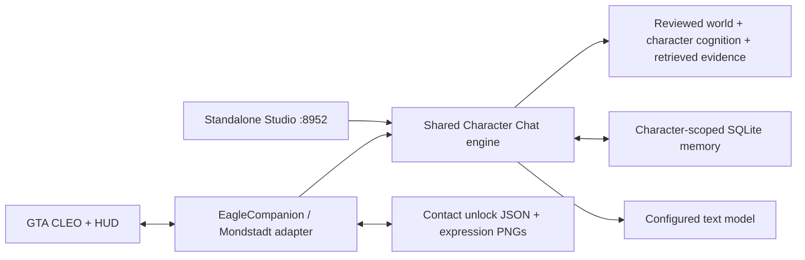

# Character Chat / Mondstadt NPC expansion — complete successor handoff

Task opened **4 November 2026**, Asia/Saigon. This is the entry point for the next chat expanding the feature. The user reports the in-game integration is working successfully. This task documents the system; it does not add characters, deploy assets, reset memory, restart services, or repeat in-game QA.

Use the [copyable successor prompt](character-system-successor-prompt-2026-11-04.md) with this guide. A [read-only source/asset snapshot](../../../staging/project-eagle/character-system-handoff-20261104/source-snapshot.json) records the actual files inspected, hashes, current roster, sprite dimensions and safe provider fields. It contains no conversation text or credential values. Historical reports below remain useful evidence, but their old runtime statements are superseded where explicitly noted here.

## 1. Start here and preserve these boundaries

Workspace: `C:\Users\LENOVO\Desktop\GTA`. Runtime target: `Project Eagle\gta sa gameplay-lab` under that workspace. The archived clean game and physical Skin Library are on `D:\GTA Archive`; the old C paths include junctions. Do not deploy into the archived clean game. Keep D: available for asset work.

Read in this order:

1. [AGENTS.md](../../../AGENTS.md), [shared coordination/dual-lock rules](../shared-agent-workflow.md), [project index](../README.md), then current open work items. Register an independent work item before edits.
2. This handoff and [tool README](../../../tools/eagle-character-chat/README.md).
3. [Current Mondstadt integration, including section 6 follow-up](../mondstadt-persona-chat-and-contacts-2026-11-04.md) and [EaglePhone OS v6/touch input](../eaglephone-ui-v6-and-touchscreen-2026-11-04.md). The original integration manifest predates later font/sprite/UI changes.
4. [Antigravity's engine onboarding](antigravity-character-chat-handover-read-2026-11-04.md), [lore-placement survey](mondstadt-npc-lore-placement-survey-2026-11-04.md), and the feature-specific sources listed below.

Product UI, adapted dialogue and free replies are **English only**. NPCs inhabit Genshin's selected world state; they are not lore-search assistants. Paimon is a separate tool-using game assistant. Do not merge her persona, financial tools, timelines, DB or provider profile into Character Chat. WaifuLink is also a separate subsystem even though Contacts links to it.

The next requested scope is a larger Mondstadt roster. Sucrose was still outstanding from the user's earlier list. This handoff does not authorize an arbitrary new roster or alter accepted placements.

## 2. What this chat built, and what Antigravity subsequently integrated

| Layer | Delivered work / current state | Evidence and limits |
| --- | --- | --- |
| Base engine | Standalone Python + SQLite + dependency-free local web Studio; scripted choices and free AI chat; scoped persistent memory, branches, cancellation, acknowledgement and reset | [Base report](character-chat-base-engine-2026-10-24.md). Initial four-character/starter-corpus evidence is historical. |
| Worldbuilding/cognition | Always-present world/character foundations; typed biography, relationships, awareness/disclosure; selected events, causal effects, optional-story gates; retrieval supplements the character's world model | [Design correction](genshin-worldbuilding-and-character-cognition-2026-10-24.md), [cognition v2](character-cognition-v2-2026-10-24.md), [grounding v3](character-grounding-v3-2026-10-25.md). This is a bounded post-7.1 slice, not a complete Genshin knowledge base. |
| Initial four | Venti, Jean, Diluc, Mona; independently audited and corrected; explicit evidence envelope and attributed old transcripts | [Independent audit](character-independent-audit-2026-10-24.md), [v0.3.0 report](character-grounding-v3-2026-10-25.md): 88 automated checks, 20 real cases, 18 pass / 2 partial. |
| Roster v0.3.1 | Kaeya and Lisa; 12 adapted choices each, source-reviewed private dossiers | [Report](character-roster-expansion-2026-10-28.md): 97 checks; 12 provider attempts / 11 replies, latest reviewed result for all 10 distinct scenarios passed after targeted fixes. Earlier failures retained. |
| Roster v0.3.2 | Klee and Barbara; biography/voice/world-awareness boundaries and optional-story gates | [Report](character-klee-barbara-2026-10-28.md): 97 checks; 11 calls / 11 replies, 10 latest cases had 8 pass / 2 minor partials. |
| Roster v0.3.3 | Noelle and Fischl with Oz as a speaking companion; now 10 profiles / 120 adapted choices | [Report](character-noelle-fischl-2026-10-28.md): 97 checks; 10 initial cases plus 1 final targeted Oz case reviewed pass. Final source matches the targeted candidate, not a new full 10-case sweep. |
| Oz asset | Found the genuine Oz mesh inside the public Fischl package; built and visually/read-back checked a static DFF/TXD, preserving alpha and all faces | Original conversion is in the October report and staging. Source rig remains available; the DFF is a static prop. |
| Game integration by Antigravity | 10 dedicated peds, Oz object, area/proximity streaming, E interaction, two-shot camera/gestures, Persona HUD, 61 expression sprites, Contacts/remote DM with shared chat memory | [4 November integration report](../mondstadt-persona-chat-and-contacts-2026-11-04.md): documented offline 6/6, initial DX9 9/9 captures, later font/sprite rerun PASS. User now reports successful operation. This handoff did not launch GTA. |

Current source inspection confirms **v0.3.3**, roster `venti, jean, diluc, mona, kaeya, lisa, klee, barbara, noelle, fischl`, 12 choices per profile, and **61** PNG sprites at 512×512. Oz is **not** an eleventh profile: he shares Fischl's conversation scope. World cognition currently has 86 source entries, 88 entities, 12 baseline records, 5 events and 4 detail records; counts describe authored coverage, not completeness.

Important historical corrections:

- October notes saying “no game integration / Oz only staged” described that task. Oz is now deployed as **object 6702**, with collision and a hover bob alongside Fischl; the source mesh still has no flight/follow animation.
- The integration report mentions provider `127.0.0.1:8317/v1`. **Current default code and safe config instead select direct `https://api.openai.com/v1`, model `gpt-6-luna`.** The adapter imports the engine in-process. Studio `8952` is a UI/API server, not the model endpoint. Re-read config before future work; do not reproduce the relay claim blindly.
- `dialogue/current-state.md` and the older dialogue index mainly describe Paimon. They are not the current NPC roster authority.
- Historical unlock resets to `0/10` were QA cleanup at that time. Do not infer or reset the player's current unlock state from those reports.

## 3. Architecture and authoritative files



All paths below are relative to the workspace unless absolute:

| Path | Responsibility / editing rule |
| --- | --- |
| `tools/eagle-character-chat/eagle_character_chat/content.py` | Validates schemas, IDs, sources, entity/relationship references, roster and private access; builds foundations, focus and lexical retrieval. |
| `.../engine.py` | Session/controller, context assembly, scripted/free generation, idempotency, workers, cancellation and note/reset actions. |
| `.../store.py` | SQLite schema v2, transactions, acknowledgements, branch checkpoints, history/search/summaries and versioned notes. |
| `.../memory.py` | Conservative deterministic extraction from player statements. This is not an LLM memory agent. |
| `.../grounding.py` | Structured response schema and local evidence-envelope validation. |
| `.../provider.py` | Text Chat Completions adapter, allowlisted generation options, bounded timeout, sanitized errors, usage/rate-header capture. |
| `.../server.py`, `static/` | Loopback API, CSRF/Host/Origin guards, local English Studio. |
| `tools/eagle-character-chat/content/world.json` | Source manifest, starter public records, snapshot and authoritative Studio `character_order`. |
| `.../content/cognition/world.json` | Story profile, shared world foundations/events/details, entities and extra sources. |
| `.../content/characters/<id>.json` | Character label/persona/greeting and adapted dialogue graph. |
| `.../content/cognition/<id>.json` | Private, reviewed character mind/history/relationships/awareness. |
| `tools/eagle-character-chat/tests/`, `evaluations/cognition-v2.json` | Automated contracts and behavioral rubric. Roster tests include fixed expected IDs/counts: extend them with a new profile. |
| `data/project-eagle/character-chat/conversations.sqlite3` | Existing user chat memory. Do not replace, casually instantiate Store against, or use as a QA fixture. |
| `data/project-eagle/character-chat/connection.json` | Dedicated secret-free provider selection. Named credential: `EAGLE_CHARACTER_OPENAI_API_KEY`; value stays external. |
| `data/project-eagle/character-chat/ingame_contacts_state.json` | Persistent encounter/contact unlock state. Separate from dialogue memory. |
| `data/project-eagle/character-chat/sprites/<id>/` | Current expression PNG inputs used by the game adapter. |
| `Project Eagle/gta sa gameplay-lab/eagle_mondstadt_chat_bridge.py` | Deployed `MondstadtPersonaChatManager`: hard-coded game roster, shared engine, contact state, UI projection, expression/speaker selection, camera/SHM commands. |
| Lab `EagleCompanion.py`, `hud.lua`, `eagle_phone_ui.py` | Shared runtime/Phone hooks and rendering; other chats also modify these. Use current runtime source, not a stale backup. |
| Lab `cleo/EagleMondstadtChatBridge.cs` | Compiled CLEO, **not C#**; matching source generator is in the November staging packet. |
| `staging/project-eagle/mondstadt-persona-chat-20261104/` | `build_world_assets_and_bridge.py`, emitted `.txt/.cs`, sprite/UI builder, runtime candidates, apply/rollback, tests and manifests. Historical build inputs; copy/adapt to a fresh task staging packet. |

The game adapter loads the canonical `tools/eagle-character-chat` engine/content directly and opens the same workspace conversations DB. It currently chooses bootstrap's default branch; it does not automatically follow whichever branch a Studio tab selected. Same-character conversations share history only when the same branch is used. Contacts does not create a separate LLM for each phone conversation.

## 4. The character/world model: why a biography plus RAG was insufficient

The first Venti failure was not a context-window problem. Ronova/Istaroth were absent from a tiny starter corpus; a no-match search fell back to unrelated bard records and became “Venti has never heard of her.” The fix was to separate knowledge, experience, interpretation and disclosure. More scraped paragraphs alone would not fix that contract.

Preserve these distinctions:

1. **World model and current setting:** source-reviewed concepts and relations, plus authored present-day event updates at the selected `post_71` snapshot. Heavenly Principles, Four Shades, Archons, divine thrones/Authorities, Gnoses, Sovereigns, Irminsul/Descenders and Abyss concepts are not interchangeable. A Gnosis lost is not an Authority lost; defeat is not confirmed death.
2. **Personal biography:** events from the character's life existed before this local chat. An empty DB must not erase Venti's past or Diluc's family.
3. **Shared canonical history:** enabled main-story encounters with Aether are distinct from newly recorded chats. Optional Story Quests, Hangouts and limited events use explicit gates; the product's acquaintance premise is not proof of completing every quest.
4. **Awareness and disclosure:** knowing Venti's identity does not grant all his memories or permission to announce it. A learned report does not create eyewitness participation, a courier, trip or intelligence channel.
5. **Local interaction memory:** newly stated names, preferences and promises are attributed to the player and scoped by character/branch. They cannot rewrite canon or complete a story flag.

`cognition/world.json:profile` pins the snapshot/Traveler and `completed_story` / `completed_optional`. These are authored content assumptions; this implementation does not detect actual GTA/Genshin quest completion or simulate rumor propagation. Release patch is an audience availability gate, not an invented date in Teyvat.

The selected world feed makes a major event available to the conversation cast without inventing an in-world broadcast to everyone. In the reviewed Ronova slice, confrontation/defeat and unresolved final fate remain separate. Do not accept the player's word “death” as a database migration to confirmed death, or infer that death has stopped across Teyvat. Re-review sources when deliberately updating the snapshot; this handoff is not a fresh verification of every lore claim.

Context construction keeps compact world/character foundations and focused `question_anchors` present. Relevant full records, history, recalled exchanges and notes supplement them under a **20,000-character** budget. Optional summaries, older recalled exchanges, oldest recent dialogue, lore and notes are trimmed in order before stable briefs. Do not solve bloat by raising the global budget or deleting decisive source text. In Fischl's pack, repeated persona wording was compacted while full records and focus anchors were retained.

Retrieval is local, filtered lexical/entity/alias matching; there is no vector DB, external browsing or model training at runtime. It supplies detail and provenance, not the decision that an Archon recognizes a major power. Personal records are filtered to the speaking character before ranking. Character-specific `query_aliases` resolve “your father” without rewriting the Traveler's “my father.” A missing match should narrow detail/confidence, not erase the baseline.

Old generated answers are passed as attributed `transcript_only` quotations, rather than fresh assistant demonstrations or canonical evidence. A reviewed correction outranks an older mistake without deleting the user's chat history.

### Authoring a new pair of content files

Use Noelle/Fischl's current files as patterns, then write the new person's actual mind. Do not perform a name replacement on another biography.

- Character JSON schema v1: stable `id`, display fields, `persona`, `knowledge_policy`, greeting/source IDs and a `nodes` graph rooted at `root`. Each choice has `id`, `label`, `reply`, `next`, `source_ids`, `content_kind` (`adapted` or `verbatim`). Keep IDs stable after release; validate destinations and source references. Existing standard is 12 **original adapted** English choices per character, not copied teapot transcripts mislabeled as adaptation.
- Cognition JSON schema v1: matching `character_id`, `identity.public_role/true_role`, `values`, `voice`, `disclosure`, `limitations`, `source_ids`, and record lists `baseline`, `biography`, `shared_history`, `relationships`, `awareness`.
- Records carry globally unique IDs, title/text, valid `source_ids`, `release_version`, `characters`, relevant `entity_ids`, and evidence status; concise `summary` supports compact foundations. Chronology can have `sequence`; optional participation has `requires_story`.
- All private character records must have **`characters: ["<id>"]` exactly**. Do not use `"*"` to make another character's private history retrievable. Relationship triples use registered entity IDs; awareness records include `known_since` and `disclosure` (`public`, `guarded`, `private_with_traveler`).
- Register the new profile once in `world.json:character_order`; supply both files and any new entities/sources in the appropriate manifest. The loader rejects missing/mismatched/duplicate roster entries and dangling references.

Useful editorial examples from completed work:

| Character | Boundary the next writer should understand |
| --- | --- |
| Venti | Bard and ancient Archon are one identity; serious cosmic questions need his perspective, not a stock joke or universal ignorance. Knowledge of Istaroth does not imply omniscience. |
| Jean / Diluc / Mona | Shared facts do not require identical awareness. Jean/Diluc have specifically sourced private awareness of Barbatos; no blanket transfer to Mona/Kaeya/Lisa. Mona's hydromancy does not permit every prediction about the Traveler. |
| Kaeya / Lisa | Kaeya's ancestry does not establish exact operational orders/current allegiance. Lisa's scholarship does not establish a lifespan curse or access to every secret. |
| Klee / Barbara | Preserve age/role/voice and actual shared-history gates. Barbara's apparent Holy Lyre repair knowledge is not the private illusion explanation; do not grant her Venti's identity. |
| Noelle | A maid and aspiring candidate, not a sworn knight. Repeated failures are known; exact failure mechanisms and Jean secretly causing every failure are not established. |
| Fischl / Oz | Respect the theatrical investigator and guarded Amy identity. Oz is a real familiar/partner with attributed `Oz:` lines, not imaginary or omniscient. Addressed directly, Oz answers first; otherwise Fischl can lead. One shared memory scope. |

Fischl's 1.1 / 2.8 / Witch's Homework optional participation gates are distinct. Stable biography learned through an optional source can be known by Fischl without asserting Aether attended that scene. Her 6.2 creation-of-life metaphor retains partial truth and uncertain mechanics: Nicole's initial ratio is corrected by Mr. Nine. Keep the source-reviewed attribution; do not flatten it into either literal sovereignty or “all made up.” See the detailed October pack report for sources.

## 5. Memory, lifecycle and interfaces

Memory identity is `profile -> playthrough -> branch -> character_id`, independent of ped model, spawned handle or UI window. Oz speaks within Fischl's scope. There is no global gossip memory. Changing a skin must never create a new person or expose another person's notes.

The SQLite schema is v2, with `profile`, `playthrough`, `branch`, `session`, `turn`, versioned `memory`, metadata and FTS5 `turn_search`. Branch head/checkpoints control recall and note validity. `Store` startup can migrate/recover pending state: merely constructing it against the real DB is not a read-only inspection. Tests/evaluations use new staging/temp DBs. Use a consistent SQLite backup rather than copying only a live main file while WAL writes are possible.

Engine contract: `submit -> pending -> ready -> ack -> committed`. A committed exchange advances the scripted graph and becomes recallable/extractable. Request IDs deduplicate repeat submissions even after a node changes. Cancelled/failed turns do not produce normal committed recall. Ready turns survive restart; interrupted pending requests are cancelled. Four worker slots are a concurrency ceiling, not a safe paid evaluation rate.

**Integration caveat:** the current game adapter auto-acks leftover ready turns in `open_clean_session`, and `_poll_pending_turns` acknowledges before updating HUD/sprite/active-talk state. Thus “ack only after confirmed display” is the Studio/engine presentation contract, **not a proven end-to-end game guarantee**. A display failure after ack can leave a committed answer. Preserve awareness of this when testing cancellation, restart or background DMs; this documentation task did not change that behavior.

Automatic extraction is intentionally narrow: simple first-person name/nickname, preference, promise, plan/fact forms; explicit `Remember:`, corrections such as `Actually,` / `Correction:`. It is deterministic regex logic with conservative filtering, not semantic understanding of all conversation. Priority is `manual_edit > manual > explicit > automatic`; retain `player_reported` attribution and source-turn provenance. Edited corrections supersede note versions inside the branch; they do not rewrite world lore.

Studio offers note add/edit/forget, per-turn forget and **Reset character memory…** in Memory & sources. Reset names the character/journey and checks `confirm_character_id` plus `expected_head`; it clears that character's local branch recall/notes/trace/search/summary data and starts the graph again. It preserves canon, other characters and other branches. It is not secure deletion from WAL/backups/forks, nor a way to make later dialogue un-mention something. Do not reset existing memories to make a test pass.

Loopback HTTP service (Studio) exposes:

| Route | Purpose / payload highlights |
| --- | --- |
| `GET /api/health`, `/api/bootstrap` | Health, content/roster, default branch and CSRF token. |
| `POST /api/sessions` | `{branch_id, character_id}`; returns/reopens scoped session state. |
| `POST /api/turns` | `{session_id, request_id, choice_id}` or `{session_id, request_id, text}`. |
| `GET /api/turns/<id>`; `POST .../ack`, `.../cancel`, `.../forget` | Poll, commit displayed result, cancel or remove recall. |
| `GET /api/sessions/<id>` | Current graph/history/pending/notes projection. |
| `POST /api/memories`, `/api/memories/<id>/edit`, `.../forget` | Scoped manual notes; consult server/controller for exact current body. |
| `POST /api/memory-reset` | `{session_id, confirm_character_id, expected_head}`. |
| `POST /api/playthroughs`, `/api/branches` | New journey / fork at an eligible checkpoint. |

Mutations require bootstrap `X-CSRF-Token`, local Host and matching Origin; JSON body cap 16,384 bytes. These are not arbitrary command/file endpoints. The game uses the Python engine directly, not HTTP port 8952; it does not need a Studio process to call the shared code. Avoid running lifecycle tests with two real-DB engine instances concurrently.

## 6. Lore research and the skills that matter

There is no magic imported “Genshin skill,” training pass or hidden memory that makes the runtime improve. Research becomes useful only after reviewed facts/relations/limits are authored into these packs and the resulting replies are evaluated. A separate chat does not automatically teach the game model anything.

Use this source ladder:

1. **Game text and official material:** profile stories, Vision story, voice-overs, teapot companionship dialogue, quest/event transcripts, books with their in-universe speaker status, official character demos/miscellany/introductions. A book or character's theory is not an omniscient narrator.
2. **Community-hosted primary text:** Wiki profile/storyline/voice/companion/quest pages, or another readable transcript host. Label the host correctly; “community-hosted game text” differs from the wiki editor's summary.
3. **Secondary synthesis/discovery:** [Moria's Moday](https://www.moriasmoday.com/characters/venti), character/major-NPC pages and quest recaps. Useful for finding relationships, event coverage and primary references; not guaranteed complete or official. Trace important conclusions back to the cited scene.
4. **Gameplay recording fallback:** exact scene and timestamp, with speaker attribution. Auto transcripts can garble names; inspect decisive lines/context rather than accepting the transcription blindly.

Query examples: `"<character>" "Profile"`, `"<character>" "Voice-Overs"`, `"<quest title>" dialogue`, `site:moriasmoday.com "<name>"`, or a relationship/event-specific question. Find the actual page and relevant passage, record the source title/URL/type/access method, and distinguish a readable body from an indexed excerpt. Search results are leads, not proof of reading an entire page.

Important established leads:

- [Venti on Moriasmoday](https://www.moriasmoday.com/characters/venti), [Istaroth](https://www.moriasmoday.com/npc/istaroth), [reviewed 7.1 recap](https://www.moriasmoday.com/main-quest/snezhnaya-4); local source-type/uncertainty audit is [here](research/moriasmoday-ronova-source-audit-2026-10-24.md).
- [Noelle profile](https://genshin-impact.fandom.com/wiki/Noelle/Profile), [Fischl's Alan Smithee quest transcript](https://genshin-impact.fandom.com/wiki/Alan_Smithee%2C_Author_of_Fischl) and the [recorded scene](https://www.dailymotion.com/video/x9v4g3y) around 19:18–20:43 are examples of decisive biography/attribution checks. Existing dossier `source_ids` are the reusable index.
- Noelle/Fischl Moriasmoday bodies were **unavailable** in the October research; do not say those dossiers were read there. Klee also had access gaps. Research packets preserve attempts and substitute sources. Recheck access if new work needs the material.

For each new character, produce a staged packet: `character.json`, `cognition.json`, additions/entities/sources, `research.md` (claim/source/confidence/access/gates), and `probes.json`. The Noelle/Fischl task directories are concrete examples. Review contradictory high-impact claims before merging; preserve unsupported mechanisms as unknown. Do not copy whole wiki articles into prompts or dialogue choices.

Per project instructions, broad/heavy discovery can use **independent GPT Luna subagents** (`gpt-6-luna`, `fork_turns="none"` with full task/path/context). Useful independent scopes are one researcher per character, one asset scout, and a separate auditor. They write only their staging packets or return read-only findings; the coordinator merges shared JSON/source sequentially. Give a concrete checklist and a no-paid-calls boundary. Never let each researcher launch its own live-test queue or write shared content simultaneously.

Relevant tool/skill use, when needed:

- `rg` / `rg --files`, Python JSON/AST, hashes and existing CLI/build tools for local investigation. Do not repeat huge scans after an agent has returned decisive evidence.
- Web search/open for current niche lore and exact sources; use official sources for technical tool documentation. Avoid relying on model recollection of patch chronology.
- The session's **computer-use** skill for ordinary browser download/UI verification when direct reads fail. Read its current `SKILL.md` from the available-skill catalog; versioned install paths can change. The Oz download succeeded via a normal public button after automatic browser verification. No login, CAPTCHA solving or blocked-download bypass was used.
- Blender/DragonFF/RenderWare parsers and local conversion scripts for 3D. These are project tools, not proof of a general automated rigging skill.
- Image generation skill only when authoring new art. Inspect references/source assets and validate actual transparent PNGs; it is not a mesh converter. No new image generation was performed by this handoff.

## 7. Grounding, testing and paid-call discipline

Free generation returns a strict envelope: `{"evidence_plan":[{"record_id":"...","claim_type":"..."}],"reply":"..."}`. The engine permits only eligible record IDs supplied in that request, at most eight, and attaches original curated text locally. Reply limits are 180 words / 2,500 characters. Only natural dialogue is shown. Local note/exchange IDs are not lore IDs; a pure local-memory reply can have an empty evidence plan. Invalid/truncated/tool responses fail explicitly, with no fake reply, auto retry or second verifier call.

This validates provenance, **not semantic entailment**. A real record can be misread; a valid JSON reply can still invent a cause, overstate certainty, sound generic or leak a secret. Inspect the actual answer and multi-turn behavior.

For each character, test at least these dimensions with paraphrases:

| Probe family | Pass boundary |
| --- | --- |
| Identity and biography | Correct role/history/chronology; no invented mechanism, compulsory romance or catchphrase caricature. |
| Relationship / hidden identity | Knowledge and disclosure fit this speaker; no private cross-character dossier leak. |
| Major world event | Recognizes the selected baseline; distinguishes report, participant, inference and unresolved outcome; reacts through own values. |
| Optional-story trap | Does not assume a Hangout/event was shared merely because the player asserts it; stable self-biography still works. |
| False premise / future patch | Does not promote player assertions to canon; snapshot cutoff works. |
| Follow-up / no detail match | Resolves the previous subject, preserves baseline and narrows the unsupported edge. |
| Memory | Synthetic nickname + preference recalled later for this character, not another branch/person; scripted dialogue also supports follow-up. |
| Lifecycle | Error/cancel/restart/ack/reset/forget/isolation and idempotency remain correct; test game adapter separately. |

Use `evaluations/cognition-v2.json` and the [mind architecture rubric](research/character-mind-architecture-review-2026-10-24.md). Phrase-match warnings are not behavioral grades. Hard failures include invented eyewitness experience, unsupported confirmed death, identity/privacy leakage and mixing player memory with canon. Minor stylistic partials should be reported rather than relabeled as perfect lore fidelity. Optional-scene refusals and some answers still sound metatextual (“established account”); bounded tests do not establish comprehensive accuracy.

Procedure:

1. Freeze a candidate manifest/hash after offline validation. Build contexts first; inspect which full records/anchors fit the budget.
2. Use a fresh staging SQLite, synthetic notes and an explicitly bounded case list. Keep real user DB/contact state untouched.
3. **One provider request in flight**, a minimum 10-second cooldown plus observed remaining-request/token budget. The successful Noelle/Fischl initial queue had starts at least 12.226 seconds apart. This is historical pacing, not a guarantee for today's quota. Inspect available rate headers and stop on quota/429; do not spin retries or rotate credentials.
4. Review results independently without automatically buying a model-verifier call. Fix the smallest wrong fact, gate, focus or voice instruction. Run deliberate targeted retests; retain failures and earlier manifests.
5. Label iterative results honestly. A final targeted pass does not mean the entire suite ran against the final candidate. Save calls, usable replies, input/output tokens, timestamps, model/config, corpus hashes and review decisions.

Reusable examples: `staging/project-eagle/character-noelle-fischl-20261028/run_live.py`, `run_targeted.py`, `live/`, `targeted/`, `audit/live-review.md`, candidate manifests and `verification.json`. Copy/adapt into a **new** staging directory; do not overwrite old evidence. Generic `verify_live.py` / `verify_cognition.py` are opt-in real-provider runners; read their current scope before running them. No live calls were made for this handoff.

## 8. Finding skins/models and converting safely

Start from the physical library: `D:\GTA Archive\Skin Library\Project Eagle\numbered-skins\raw`, its `catalog.json`, current review/deployment state, and Skin Viewer tools. Prefer an existing suitable GTA **DFF/TXD ped pair** before online conversion. Verify physical files and pair hashes, original/alternate outfit, normals/material warnings and appearance. Catalog IDs, source-site asset IDs, model names and in-game ped IDs are different namespaces. A source-site ID in a conversion report is not necessarily a catalog `id`.

Use targeted filenames and parsed catalog fields. Serialized catalog paths may still use the C junction. A number found inside a hash is not an asset-ID match; avoid dumping a huge catalog or doing broad scans of D:. Existing Noelle/Fischl [inventory](../../../staging/project-eagle/character-noelle-fischl-20261028/audit/Oz/oz-source-and-skin-audit.md) shows exact paths/hashes and variants.

**Sucrose lead now physically checked:**

```text
D:\GTA Archive\Skin Library\Project Eagle\numbered-skins\raw\Sucrose__ca0ffa6c91af.dff
D:\GTA Archive\Skin Library\Project Eagle\numbered-skins\raw\Sucrose__ca0ffa6c91af.txd
```

Both exist and their current hashes/sizes are in the snapshot. Another TXD exists; do not pair files by name similarity alone. The conversion handbook mentions Sucrose source #538867/Y_UP. A static Sucrose and Albedo were retained in the alchemy interior. This establishes an asset lead, not a chat dossier, reserved new ped ID or tested rig/deployment plan. Diona/Rosaria/Albedo also have existing model/placement leads in the November onboarding survey.

If absent, search ready GTA skins through the existing inventory/source history (LibertyCity, GTAInside, GTAall, FadXploit), then [The Models Resource Genshin index](https://models.spriters-resource.com/pc_computer/genshinimpact/) for source meshes; NPCs/props can be in a playable package's `Objects/` folder. Check the archive member list and actual files. PMX/FBX/DAE availability does not establish GTA rig compatibility. Respect source access conditions and preserve attribution/readme/source URL/hash in the packet.

Read [conversion lessons](../skin-and-3d-model-conversion-lessons-2026-10-25.md), then inspect the actual script before reuse:

- Antigravity Collada parser: `C:\Users\LENOVO\.gemini\antigravity\brain\327d7afd-8da6-4eec-ac19-02d7dfebb8b1\scratch\parse_collada_dae.py`.
- Historical static builder: `D:\GTA Archive\Staging\mondstadt-m1-multiverse-landmarks-2026-10-24\build_m1_multiverse_landmarks.py`.
- DragonFF `gtaLib/dff.py` for RenderWare geometry, material splits/UVs and read-back; project TXD decoder `tools/world-texture-studio/core/rw_txd.py`.
- Oz-specific `export_oz_static.py`, `build_oz_asset.py`, mesh JSON, renderer/read-back scripts and manifests under `staging/project-eagle/character-noelle-fischl-20261028/oz-assets/`.

For **static** mesh conversion: inspect active scene nodes, axis/scale/bind pose, skin/controller transforms, mesh/material/UV binding and auxiliary geometry. The parser's eye/VFX/occluder/LOD/morph/weapon filters are heuristics; select the actual wanted object explicitly. Oz intentionally lives under `Objects/`, so a generic “ignore Objects” rule would discard the target.

Never reduce faces with `conv_tris[::step]` or random triangle deletion: it perforates the surface. Some historical builders still have that path despite the lesson document. Weld positions/UVs at `round(...,4)` in the project's meter convention, preserve seams/normals/material boundaries, and report degenerates. Coarse round(...,2) destroyed face details. Excess face-normal splitting inflated vertex counts past DFF uint16 capacity; split geometry/review topology when necessary rather than deleting random faces. Retaining all triangles preserves the original surface; it does not mathematically prove every source mesh is manifold/watertight.

Preserve alpha where it represents hair/feathers/clothing. Historical low-alpha eye-overlay removal applied to specific static conversions into opaque materials; **do not blindly drop every low-alpha material** or force DXT1 on Oz. Use DXT5 when needed, generate mipmaps, retain texture/UV names, decode the exported TXD and compare it to source RGBA.

A **static baked DFF** is an object/display mesh, not a GTA ped. True new ped conversion needs a compatible GTA skeleton, skin weights, hierarchy/plugins/materials and animation testing. The earlier DAE parser/Oz pipeline does not provide that. Existing ready ped skins reduce that work, but still require visual and animation QA. Main-character Aether has a broader animation acceptance requirement than stationary background NPCs.

### Oz: concrete reproducible example and current status

Source: [Fischl asset 514449](https://models.spriters-resource.com/pc_computer/genshinimpact/asset/514449/). Archive includes `Objects/Oz/Oz.dae`, `Oz.fbx`, crow diffuse and metal map. The public download was copied to `oz-assets/source/fischl-514449.zip` (11,770,599 bytes). **Current file SHA-256:** `38c88d5a35c492c871f9f73cd741d2681a0f4770af177f77dce94623d387417f`. The October prose report has an extra leading `9` in that archive hash; use the recomputed file digest/snapshot. Preserve historical evidence rather than silently trusting the typo.

Pipeline: Blender imports original DAE, clears startup scene, applies the authored two-wing pose, evaluates the armature, exports all triangle corners/UVs to mesh JSON; the Python builder writes one static DFF/material and DXT5 TXD. Scripts hard-code the old staging root; adapt a copy before rerunning. They are not generic command-line converters. `build_oz_asset.py` regenerates a manifest and would overwrite later manual QA annotations if run in the old evidence folder.

Historical invocation pattern, **after redirecting paths/dependencies to fresh staging**:

```powershell
& '<resolved Blender executable>' --background --python '<new staging>\export_oz_static.py' --python-exit-code 1
& 'C:\Python310\python.exe' -B '<new staging>\build_oz_asset.py'
```

Output: 3,390/3,390 faces; 2,435 welded vertices; zero degenerates; one UV/material `oz_crow`; bounds about 1.124×0.689×0.55m; 512² DXT5 with mips. Original 54-joint rig remains only in source DAE/FBX. Static lowest point is a wingtip below the feet, not a foot anchor. The final [source-versus-decoded contact sheet](../../../staging/project-eagle/character-noelle-fischl-20261028/oz-assets/oz-source-vs-dff-contact.png) was visually checked on read-back DFF geometry. An earlier blank render was a startup Blender cube enclosing Oz, not successful model QA.

November integration installed this prop with COL3 as object 6702 and a ±0.09m hover bob near Fischl. That movement is scripted object translation, not a skinned wing animation. Do not claim a flying/following raven AI.

Every new asset packet needs source URL/archive hash, input/output counts, dimensions/axis/origin, material/alpha checks, DFF/TXD read-back, visual front/side/close views, final hashes and a clear distinction between offline preview and actual game acceptance.

## 9. Critical integration work before character 11

**Do not append another tuple and deploy the current CLEO bridge.** The current shared-memory layout is structurally sized for ten NPCs.

Generator: `staging/project-eagle/mondstadt-persona-chat-20261104/build_world_assets_and_bridge.py`, `MONDSTADT_NPCS` and `build_mondstadt_chat_bridge_cs()`. It emits the `.cs` and readable `.txt` listing. The generator uses the project's assembler and the lab's CLEO opcode catalog; do not assume the emitted listing is the build authority or compile it as C#.

| Current MCHT memory field | Offset / allocation |
| --- | --- |
| MCHT magic/pointer mailbox | Fixed addresses `0x00CAFE40` / `0x00CAFE44`; points to a 256-byte block. |
| Command/ack, camera/pose, heartbeat and area/proximity state | Fields through offsets 0..112; consult generator and Python bridge together. |
| Ped handles | `128 + idx*4`, ten entries: 128..167. |
| Ped pointers | `168 + idx*4`, ten entries: 168..207. |
| Player / NPC headings | 212 / 216. |
| Spawned mask | Offset 112, presently ten bits `0..1023`; active/nearest indices documented `0..9`. |

At **idx 10**, handle offset **168 overlaps pointer 0**. At idx 11, pointer offset 212 overlaps a heading. Extending only the integer mask or a Python list is insufficient. Redesign/version the layout/capacity, synchronize producer/consumer and all offsets, rebuild the compiled CLEO, and test old/new mismatch handling. The current generator also uses all 32 local variables (`0@..31@`); review that limit when changing behavior. This is the first integration prerequisite, while lore/assets can be prepared independently. This handoff intentionally leaves runtime unchanged.

Current map registry:

| idx | char_id | ped_id | area | Position / GPS reference |
| ---: | --- | ---: | ---: | --- |
| 0 | venti | 49434 | 0 | Windrise, M1 |
| 1 | jean | 49435 | 1 | INT-04 HQ; outdoor GPS at HQ door |
| 2 | diluc | 49436 | 0 | Dawn Winery forecourt, M1 |
| 3 | mona | 49437 | 0 | Astrologist house, M0 |
| 4 | kaeya | 49438 | 0 | Fountain / Good Hunter, M0 |
| 5 | lisa | 49439 | 1 | INT-04 library; same outdoor GPS door |
| 6 | klee | 49440 | 0 | Starfell Lake shore, M1 |
| 7 | barbara | 49441 | 0 | Cathedral forecourt, M0 |
| 8 | noelle | 49442 | 0 | Knights HQ courtyard, M0 |
| 9 | fischl | 49443 | 0 | Adventurers' Guild plaza, M0; Oz 6702 nearby |

Exact coordinates/headings/outdoor GPS fallback are in the live Python roster, source snapshot and [integration table](../mondstadt-persona-chat-and-contacts-2026-11-04.md). Do not invent a replacement placement from prose. Existing outdoor stream/despawn distances are 140m/175m and E interaction radius is 3.15m; interior area codes must match. Current camera geometry was checked for these ten placements, not every new location.

When integrating a new character, coordinate all of these surfaces:

- Engine content/roster/tests and stable `char_id`.
- A fresh, verified unused ped ID/model name. `49434..49443` are occupied; `190..195` now belong to other characters. The next number is not automatically reserved/free. Keep IDs/ped types/archive ownership consistent with current game config.
- New DFF/TXD members in the appropriate IMG and `data/peds.ide`; any additional object IDE/COL/IPL requirements. Runtime uses `mc_<id>` names for these ten peds. Treat an entire IMG as one write resource, even if adding different members.
- Matching generator `MONDSTADT_NPCS`, compiled CLEO, Python `MONDSTADT_ROSTER` indices/area/position/heading/GPS/ped metadata, and the redesigned SHM layout.
- Static interior/life-script duplicate cleanup. Existing integration removed old baked characters from five interior DFFs and redundant spawned actors; Sucrose/Albedo static meshes were retained. Adding a live Sucrose requires an explicit dedup plan, not deleting the whole alchemy room.
- Six 512² transparent expressions at `sprites/<id>/`: `neutral`, `happy`, `serious`, `surprised`, `sad_worried`, `smug_teasing`. Oz is the special `fischl/oz.png`. Current ping-pong buffers are `models/txd/MCSP0/1.TXD`, slot 95, each 1,048,744 bytes; preserve WaifuLink buffer separation.
- Icon `ep_mc_<id>` and needed Phone/UI texture generation/merge. Latest sprite extractor fixed dark-hair/clothing holes with narrow background thresholds and opaque interiors; validate against neon-background/contact sheets. Do not reuse the older broad chroma-removal thresholds.
- Contacts list, unlock serialization/filter, remote DM, GPS, web/HUD projection, six-row scrolling and touch/keyboard paths. Some current labels/status totals are fixed **10 Mondstadt / 6 Waifus / 16 total** in the bridge and `EagleCompanion.py`; replace/update coherently. Preserve existing unlock keys, not only new totals.
- Current UI v6 font/wrap/touch changes and the later Persona font/alpha follow-up. New text must pass `sanitize_cfont_text`; emoji/Unicode/newlines from LLM are not safe raw CFont input.
- Camera/body position, gesture/idle, collision/ground/heading, streaming/re-entry/death/save-load behavior, indoor GPS and distant DM sharing the correct branch/character memory.

In-person controls are E, quick choices 1..4, F6 typing, Backspace/F8/Tab exit. Contacts is Phone app 14 (F7); locked entries offer GPS, first in-person meeting unlocks remote DM. Phone tabs/selection/DM also have mouse support after UI v6. Do not replace the user's established launcher with a separate test launcher.

## 10. Practical work sequence for the successor

1. Read current coordination/work items and register a new scope. Inspect current source hashes/config rather than copying old candidates over runtime. Agree the next character batch from the user's request; Sucrose is the outstanding original candidate.
2. Plan bridge capacity/protocol work before any extra NPC deployment. Keep this independent from character research. Make a fresh staging/backup/manifest packet.
3. Prepare source-reviewed character packets, asset inventory and offline dialogue probes in parallel independent scopes. Merge shared files sequentially, retain old IDs and private boundaries.
4. Validate loader/context/memory contracts offline, then run a small serial synthetic live evaluation and review actual outputs. No real user DB reset or automatic quota retry.
5. Build game assets/UI/CLEO and integration candidates in staging from **current** shared runtime sources. Test protocol/layout/camera/count/icon/sprite/dedup contracts outside the game using synthetic storage. Snapshot current files again immediately before apply.
6. For authorized integration, use the project lock utility and guarded per-resource transaction, then release the write lock. Runtime QA is separately exclusive. Preserve all unrelated accepted features and user state.
7. Verify the deployed model/portrait/name/dialogue/follow-up/memory/unlock/GPS/remote DM path and repeated enter/exit. Separate offline, real-model, actual in-game screenshots and user-reported acceptance in the report. Update indexes and leave exact rollback boundaries/remaining issues.

### Commands and operational boundaries

From `tools/eagle-character-chat`, offline validation (temp DB fixtures):

```powershell
& 'C:\Python310\python.exe' -B -m unittest discover -s tests -v
node --check static/app.js
```

Historical latest engine run was 97 checks passing; this documentation handoff did not rerun them. Do not equate those unit tests with live lore or ped acceptance.

Studio commands from the workspace root:

```powershell
& '.\tools\eagle-character-chat\studio.ps1' -Action status
# Start/stop only when the task actually requires it and no active turn/owner conflicts exist:
& '.\tools\eagle-character-chat\studio.ps1' -Action start -NoBrowser
& '.\tools\eagle-character-chat\studio.ps1' -Action stop
```

The helper checks PID/executable/creation-time ownership and refuses unrelated port 8952 processes. Do not kill Python broadly. For a fully isolated Studio instance, server accepts `--port`, `--data-dir`, `--connection`; use a fresh QA data directory and explicit config. Running a direct module from a tool session can have different background-process lifetime from a normal desktop launcher; verify health after return. Historical work used a hidden independent helper when needed. Do not restart a user's game/sidecar merely to refresh content.

Model selection currently uses `gpt-6-luna`, low reasoning, 1200 completion-token cap, `store:false` and structured output through the existing secret-free profile. Transport timeout is capped at 35s. Credential lookup reads only the explicitly named environment variable, with HKCU fallback for stale inherited environments. Never repeat the historical pasted key, dump environment/registry, create a secret file, or modify Codex/global/Paimon settings to run these tests. Current config is read per request; recheck safe fields before assuming a provider route.

Coordination entry point, workspace root:

```powershell
& 'C:\Python310\python.exe' tools\eagle_coord_lock.py status
```

Use `EagleCoordLock` / CLI from that tool for all actual locks. Do not create competing ad-hoc lock scripts. `game-write` covers shared source/runtime/deployment state and archive writes; `ingame-runtime` covers game/sidecar execution, real runtime DB access and virtual input. Heavy rendering/download/research and isolated Part A QA stay outside locks. Acquire the required lock before process control; release write lock before waiting on gameplay. Do not blindly apply an old QA `finally` that resets today's player DB/unlocks.

Recovery uses the latest matching transaction/hashes, never a whole-directory restore. The November integration has `manifest_before_after.json`, later **`manifest_followup_20261104.json`**, and guarded `rollback_mondstadt_persona_chat.py`; UI v6/WaifuLink have later shared-file changes. Do not run an old rollback as a generic uninstall. The October `rollback_source.py` scripts restore only matching old standalone sources and preserve DB/provider/game, but would remove later content changes if forced. Do not remove guards or replace the DB to satisfy a stale rollback.

## 11. Evidence map / what to read when something fails

| Problem / research need | Start from |
| --- | --- |
| Why the worldbuilding design changed | [Worldbuilding correction](genshin-worldbuilding-and-character-cognition-2026-10-24.md), [foundation](research/genshin-worldbuilding-foundation-2026-10-24.md), [awareness baselines](research/genshin-character-awareness-baselines-2026-10-24.md), [mind review](research/character-mind-architecture-review-2026-10-24.md). These are dated design evidence, not latest deployment state. |
| Factual source/chronology/identity | [Independent audit](character-independent-audit-2026-10-24.md), `research/character-audit-2026-10-24/`, current dossier source IDs, staged source review packets. |
| Context bloat/evidence misuse | [v3 grounding report](character-grounding-v3-2026-10-25.md), `engine.py`, `grounding.py`, saved synthetic contexts/trace. |
| Kaeya/Lisa, Klee/Barbara, Noelle/Fischl specifics | The three roster reports in section 2; staging directories `character-roster-expansion-20261028`, `character-klee-barbara-20261028`, `character-noelle-fischl-20261028`. |
| NPC spawn/camera/Oz/Contacts | [Current integration](../mondstadt-persona-chat-and-contacts-2026-11-04.md), live lab adapter, November generator, manifests and `qa_screenshots/`. |
| Sprite alpha/font/touch problems | Integration section 6, `build_sprites_and_ui_tex.py`, `sprites_magenta_audit.png`, `venti_6_fullres_audit.png`; [UI v6 report](../eaglephone-ui-v6-and-touchscreen-2026-11-04.md). |
| Ped/prop conversion quality | [Conversion handbook](../skin-and-3d-model-conversion-lessons-2026-10-25.md), Oz source/read-back manifests and comparison PNG; actual source/read-back rather than filename/preview alone. |
| Current source facts vs old claims | [Source snapshot](../../../staging/project-eagle/character-system-handoff-20261104/source-snapshot.json). It is a handoff-time baseline, not a future deployment lock or guarantee that files never change. |

The successor does not need the private chat transcript or credential to continue. All substantive content, code, review artifacts, model-source leads and integration authority are on disk. Read the latest files, preserve the tested invariants, evaluate concrete replies, and report bounded evidence accurately.
