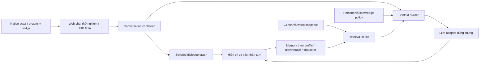

# Chat NPC Mondstadt: nhận xét và thiết kế đề xuất

Ngày: **24/10/2026**, Asia/Saigon. Target tương lai: **gameplay-lab**. Trạng thái: **đề xuất, chưa triển khai**. Phạm vi do người dùng chọn: **Venti, Diluc, Jean, Mona**, xuất phát từ base chat engine ngoài game, chuẩn bị skin song song, tích hợp NPC cố định vào Mondstadt M0/M1 sau cùng.

**User clarification 24/10:** English only. User authorized implementation of the standalone base engine; see [implementation ticket](../work-items/2026-10-24-codex-character-chat-base-engine.md). Game integration, placements and skin changes remain later work. The design below is the original planning record except for this language clarification.

[Phiếu phối hợp](../work-items/2026-10-24-codex-mondstadt-character-chat-design.md). Chỉ tạo tài liệu; không đổi source, game, archive, API config, SQLite hiện tại hoặc staging map. Không khởi động GTA, gọi API trả phí, tải corpus/model hàng loạt hoặc chạy installer.

## 1. Nhận xét chính

Ý tưởng phù hợp với mục tiêu biến Mondstadt thành nơi có người để quay lại gặp. Bốn nhân vật là một lát cắt đủ đa dạng để đánh giá chất giọng, hiểu lore, nhớ chuyện riêng và chuyển từ lời thoại viết sẵn sang hỏi tự do. Giá trị nằm ở sự liên tục: lần sau gặp Jean, cô ấy nhớ điều đã nói với mình, trong khi Diluc không tự nhiên biết chuyện đó.

Phần chat có thể phát triển và kiểm thử độc lập với engine GTA. Điều này giảm sự phụ thuộc vào tiến độ map; **không tự bảo đảm ít nợ kỹ thuật**. Những chỗ dễ tích nợ là trộn canon với lời người chơi, summary làm mất hoặc bịa chi tiết, dùng ped/model ID làm danh tính, nhầm lần load save với một cuộc đời mới và đưa mọi bí mật trong wiki cho mọi nhân vật. Phải chốt các hợp đồng dữ liệu này trước khi thêm nhiều NPC.

Nguồn Models Resource cải thiện khả năng tìm mesh/texture. Mỗi asset vẫn cần được kiểm chất lượng và chuyển thành skin ped phù hợp với Eagle. Cần đánh giá idle, quay người, phần tóc/áo, tỷ lệ, alpha và ngân sách texture; tên nhân vật xuất hiện trên website không chứng minh rig GTA đã hoạt động. Với NPC cố định, không cần phạm vi kiểm thử nhân vật chính Aether, nhưng vẫn cần rig ped đủ dùng cho các trạng thái được hỗ trợ.

Đề xuất: **một dịch vụ Character Chat dùng chung, bốn gói nhân vật và memory riêng về mặt logic**. Không cần bốn server, bốn model AI hoặc bốn hệ RAG độc lập. Paimon giữ vai trò trợ lí/agent riêng theo định hướng của người dùng; NPC chỉ trò chuyện, đọc nguồn lore được duyệt và truy xuất memory được cấp.

## 2. Bằng chứng hiện có trong workspace

Đã đọc AGENTS, shared-agent-workflow, README mới nhất, bàn giao merge/chuyển ổ, current-state Paimon và các phiếu liên quan. Đã so SHA-256 ba file source với bản tương ứng **đang có trên đĩa trong gameplay-lab**:

| File dưới `eagle_dialogue/` | SHA-256 source = runtime |
| --- | --- |
| `paimon_store.py` | `4a5af2ab12079e3209ec0dd577eaa7bf317f0af2c2563665c5bf62a2a0a8205a` |
| `paimon_service.py` | `6c9a63db10a5d1318b1d56d11f0a50b1e61ee392e3992de23d2486f288e23e73` |
| `protocol.py` | `4f5c503f0bca44a67c55c399e5bf15c379a5142f10224d00ec5c9db7280dbeaf` |

Đây là kiểm file, không phải kiểm service/game đang chạy.

- [Current state Paimon](current-state.md): base Paimon được người dùng báo hoạt động; VN HUD revision còn chờ gameplay QA. Actor Paimon là instance tạm khi gọi, chưa phải NPC đứng thường trực trên map. Định hướng Paimon agent phức tạp là yêu cầu tương lai; bản hiện tại chưa có tool execution.
- [Memory source](../../../tools/eagle-dialogue/runtime/eagle_dialogue/paimon_store.py): có bảng `timeline`, `observation`, `turn`; bảng turn đã có cột character nhưng `history()` và `completed()` vẫn cố định `paimon` (dòng 61–69). Giữ tối đa 500 turn toàn store và chỉ lấy 8 turn gần nhất; chưa có memory dài hạn được truy xuất theo chủ đề, summary có provenance hoặc RAG lore.
- Store hiện tách timeline khi đổi bridge epoch hoặc thời gian game quay lùi. Chưa nhận diện bền vững save slot/playthrough. Vì vậy không dùng nguyên cơ chế này để hứa nhớ xuyên mọi lần load save.
- [Service source](../../../tools/eagle-dialogue/runtime/eagle_dialogue/paimon_service.py): đã có provider adapter, xử lý lỗi và bỏ kết quả stale/cancelled; prompt hiện gắn với Paimon, game-date, portfolio và EagleTimes. Không sao chép nguyên prompt/context đó cho NPC Genshin.
- [Protocol source](../../../tools/eagle-dialogue/runtime/eagle_dialogue/protocol.py): v1 chỉ nhận printable ASCII, input **100 ký tự**, output **160 ký tự**, request/response tối đa 4096 byte. `sanitize_text()` bỏ dấu/chuyển ký tự ngoài ASCII và cắt nội dung. Không phù hợp cho hội thoại dài/tiếng Việt có dấu nếu giữ nguyên.
- [Native bridge](../../../tools/eagle-dialogue/bridge/paimon.py): có query mặt đất, `TASK_STAND_STILL` và khoảng 600 ms settling (dòng 213–227); đây là điểm tái dùng có bằng chứng source. Không freeze actor ngay khi tạo vì dễ giữ bind pose. Chưa kiểm native behavior của bốn skin mới.
- Pool lựa chọn Paimon hiện là 36 prompt English chung trong [choices.py](../../../tools/eagle-dialogue/bridge/choices.py); chưa phải cây hội thoại canon của nhân vật.
- [M1 Enhanced handover](../work-items/2026-10-24-antigravity-mondstadt-wilds-m1-enhanced.md) ghi completed ở staging và **0 thay đổi runtime/M0**. Phiếu landmarks còn active khi đọc. Không suy ra các địa điểm/đường đi từ viewer đã có trong game. Placement NPC cần ghim đúng revision M0/M1 được chấp thuận trước khi apply.

### Inventory bốn skin: đã kiểm lại metadata và file

Codex đọc trực tiếp `D:\GTA Archive\Skin Library\Project Eagle\numbered-skins\catalog.json`, `deployment/build.json`, `deployment/state.json`, đối chiếu catalog key với applied mapping và kiểm đủ tám file DFF/TXD tồn tại, kích thước khớp metadata:

| Nhân vật | Catalog ID | Asset stem dưới `numbered-skins/raw/` | Slot trong `state.appliedMappings` | Ghi chú |
| --- | --- | --- | --- | --- |
| Venti | 821 | `Venti__4eb7c17592af` | 49112 | Catalog không cảnh báo; chưa QA actor cố định |
| Diluc | 2353 | `Diluc__b9bc46982d2b` | 48226 | Raw catalog cảnh báo `geometry_without_normals`; kiểm candidate/deployed riêng trước khi chọn |
| Jean | 2390 | `Jean Gunnhildr__2028ac3b60b2` | 48427 | Có các variant khác; chưa chọn outfit cho feature |
| Mona | 2698 | `Mona__50c075a75971` | 48664 | Catalog không cảnh báo; chưa QA actor cố định |

Các catalog key là định danh của kho; không diễn giải chúng thành SHA-256 từng DFF/TXD. Chưa hash/đọc member trong runtime IMG cho bốn slot này. Mapping metadata không đủ chứng minh loader hiện hiển thị đúng cặp skin hoặc skin đã qua kiểm idle/rig trong game. **Đủ nguồn ứng viên cho cả bốn**, nên ưu tiên xem lại skin sẵn có trước khi convert mới.

State hiện trên đĩa đã khác snapshot bàn giao chuyển ổ: `appliedAt=2026-10-22T17:36:20.260325+07:00`, có hai archive entries; không tái dùng các currentHash cũ trong báo cáo 07:02 làm baseline hiện tại. Lượt thiết kế không kiểm lại toàn archive và không apply/recover gì.

Trang Models Resource liệt kê đủ bốn nhân vật. Codex mở trực tiếp [Diluc asset 328746](https://models.spriters-resource.com/pc_computer/genshinimpact/asset/328746/), listing hiện cho thấy DAE, FBX và PNG. Những file này là nguồn chuyển đổi, chưa phải DFF/TXD của Eagle; không suy rig từ đuôi file. Không tải gói ở lượt này.

## 3. Ranh giới hệ thống



Controller quyết định lấy nhánh viết sẵn hay sinh câu trả lời. Provider không quyết định NPC nào đang được người chơi tiếp cận, không chọn save/timeline, không được tự đổi canon hoặc tự thi hành hành động game. Retrieval và ghi memory là chức năng nội bộ có schema, không cần trao một bộ tool tự do cho NPC.

Tái dùng ý tưởng và các module nhỏ từ Paimon: transport/provider, deadline/cancellation, lifecycle input/HUD và deployment có hash guard. Giai đoạn đầu tạo service độc lập và các interface rõ ràng, chỉ tách helper thật sự cần dùng chung. Giữ giao thức/Paimon hiện tại tương thích; không làm một cuộc refactor toàn bộ Paimon để thử nhân vật đầu tiên. Mọi thay đổi shared module sau này phải có regression cho Paimon và kiểm ownership trước khi sửa.

Paimon và NPC có thể dùng chung API connection, nhưng có persona, quyền đọc dữ liệu, memory namespace và ngân sách request riêng. Bộ điều phối UI chỉ cho một cuộc trò chuyện sở hữu focus/control tại một thời điểm.

## 4. Bốn loại dữ liệu không được nhập làm một

| Lớp | Nội dung | Quy tắc |
| --- | --- | --- |
| Persona / identity | Tính cách, cách xưng hô, quan hệ, mục tiêu, điều né tránh, cách giữ bí mật | Gói nội dung có version, không bị lời người chơi tự ghi đè |
| Canon knowledge | Profile, character stories, voice-over, quest/event transcript | Có nguồn, release/version và điều kiện knowledge; lore index dùng chung được |
| World snapshot | Tóm tắt thế giới ở mốc đã chọn, sự kiện đang có hiệu lực | Ghim `canon_cutoff=7.1` theo yêu cầu; không lấy ngày GTA 2010 hoặc ngày PC thay cho chronology Genshin |
| Personal memory | Điều Traveler đã nói/làm cùng đúng nhân vật, lời hứa và chủ đề đang dở | Tách theo profile/playthrough/character; có nguồn turn và độ tin cậy |

**Có trong corpus không đồng nghĩa nhân vật biết; biết không đồng nghĩa họ sẵn lòng nói ra.** Ví dụ test thiết kế: hỏi Venti về bí mật bản thân phải xét disclosure policy; Mona không được dùng chiêm tinh như lý do để đọc transcript riêng của Jean. Đây là policy đề xuất, chưa phải behavior đã đo.

Những điều người chơi kể được lưu dạng “Traveler nói rằng X”, không biến thành canon “X đã xảy ra”. Chi tiết roleplay tại GTA là ký ức local của playthrough. Cần phân biệt nó với sự kiện trong Genshin. AI có thể ứng tác lời xã giao trong phạm vi persona, nhưng không tự tạo một quest/cái chết/quan hệ canon để lấp chỗ thiếu dữ liệu.

### World story tới 7.1

Thiết kế hai tầng:

1. Một synopsis ngắn, được duyệt, về trạng thái thế giới và Mondstadt ở mốc 7.1; thêm bản ghi riêng về điều từng nhân vật biết. Phần nhỏ này có thể luôn ở context.
2. Các gói chi tiết theo character/region/quest/event, truy xuất khi câu hỏi cần. Giữ nguồn và quan hệ sự kiện để trả lời follow-up.

Mỗi knowledge record tối thiểu có `source_id`, URL/file gốc, revision/hash, language, `release_version`, quest/event, narrative conditions, entities, `known_by`, disclosure level, và quan hệ supersedes nếu lore thay đổi. Manifest của snapshot cố định tập nguồn đủ điều kiện; không chỉ lấy mọi file từ branch upstream mới nhất rồi so chuỗi tên version.

Lọc **trước khi lấy kết quả** theo snapshot, story state và quyền knowledge của character. Wiki có thể chứa spoilers, suy đoán hoặc thông tin viết cho độc giả toàn tri. Cần phân loại trước ingestion; không đưa nguyên trang vào prompt rồi trông chờ một câu “đừng spoil” giải quyết.

V1 có thể dùng trạng thái truyện cố định ở 7.1, chưa giả lập việc hoàn thành quest Genshin trong GTA. Điều này độc lập với map mới chỉ có Mondstadt. Nếu sau này thêm quest progression, knowledge được mở theo milestone; không sửa ký ức cũ thành “đã biết từ trước”.

## 5. Nguồn lore và hội thoại viết sẵn

Nguồn đã khảo sát:

- [The Models Resource — Genshin](https://models.spriters-resource.com/pc_computer/genshinimpact): nguồn asset, không phải nguồn biography/memory hay bằng chứng rig GTA.
- Các trang transcript companion: [Venti](https://genshin-impact.fandom.com/wiki/Venti/Companion), [Diluc](https://genshin-impact.fandom.com/wiki/Diluc/Companion), [Jean](https://genshin-impact.fandom.com/wiki/Jean/Companion), [Mona](https://genshin-impact.fandom.com/wiki/Mona/Companion). Có dialogue, lựa chọn và các loại special dialogue; wiki do cộng đồng duy trì. Agent chính đọc được trích xuất search cho Venti/Diluc/Mona; một số lần open trực tiếp bị hạn chế. Subagent báo đã khảo sát đủ bốn; chưa import hoặc kiểm độ đầy đủ từng nhánh.
- [HoYoverse Help — companion trong teapot](https://support.hoyoverse.com/hc/en-us/articles/50333955953561-Why-can-t-I-find-my-character-in-the-Serenitea-Pot): nguồn chính thức xác nhận tương tác companion/furnishing set; không cung cấp toàn bộ text corpus.
- [DimbreathBot/AnimeGameData](https://github.com/DimbreathBot/AnimeGameData): README tự mô tả release data, có `BinOutput`, `ExcelBinOutput`, `Readable`, `TextMap`. Đây là dump cộng đồng, không phải API chính thức. Agent chính xác minh listing/README; chưa clone hoặc kiểm JSON nội dung.
- [Dimbreath AnimeGameData2](https://gitlab.com/Dimbreath/animegamedata2): subagent thấy build stamp 7.1 trong search listing; agent chính mở chỉ thấy loading. Trước ingestion phải pin và kiểm snapshot thực, không dùng mô tả search như manifest đã nghiệm thu.

Mốc **7.1 là yêu cầu nội dung của người dùng**. Subagent tìm được official announcement/listing liên quan, nhưng agent chính chưa đọc được body official đầy đủ để đóng dấu patch/corpus completeness. Báo cáo này không phụ thuộc một ngày phát hành cụ thể. Nhiệm vụ ingestion phải xác minh nguồn đã phát hành, ghim revision và loại teaser/leak/phiên bản ngoài phạm vi trước khi gọi đó là corpus 7.1 đã hoàn tất.

Thứ tự ingestion đề xuất: profile + character stories + voice-over liên quan cho bốn nhân vật; cây companion; các quest/event có họ và synopsis Mondstadt; sau đó mới mở lore thế giới theo câu hỏi đánh giá. Không cần tải và lập chỉ mục mọi lời thoại Genshin để chứng minh engine đầu tiên.

Giữ provenance, credit và điều kiện sử dụng đi kèm asset/text. Ở lượt này không sao chép các hội thoại dài vào báo cáo, không tạo corpus phân phối lại.

### Hai chế độ hội thoại

**Lựa chọn viết sẵn:** cây node/edge do engine xác định, với stable `dialogue_id`, `node_id`, `choice_id`, điều kiện hiển thị, speaker, text gốc, language, nguồn, và node tiếp theo. Chọn option thì phát đúng lời đáp đã được duyệt; không cần LLM viết lại mỗi lần. Ghi đủ lời người chơi đã chọn và **toàn bộ lời NPC đã hiển thị** vào transcript, kèm nguồn và state của nhánh.

**Hỏi tự do:** LLM nhận recent turns, nhánh vừa nói, memory liên quan, persona và lore đã lọc. Nhờ vậy “Tại sao anh lại nói vậy?” sau một lựa chọn viết sẵn vẫn có đối tượng tham chiếu. Sau hỏi tự do, controller giữ/khôi phục nhánh menu hợp lệ; không nhờ model đoán node hiện tại.

Các nhánh teapot có điều kiện friendship, greeting hoặc furnishing context. Không tự tạo hệ grind friendship ngay ở v1; dùng một relationship baseline cấu hình rõ trong bản thử, giữ điều kiện gốc trong dữ liệu. Không gán nội dung thân mật đã mở ở mức cao cho mọi NPC mới gặp mà không định nghĩa quan hệ ban đầu.

**Cần thích nghi ngữ cảnh:** câu nói về căn phòng, đồ nội thất hay việc sống trong teapot không tự phù hợp khi đứng ở quảng trường. Chia dữ liệu thành `verbatim_script` (phát đúng khi điều kiện phù hợp), `adapted_script` (biên tập cho địa điểm mới, liên kết nguồn và đánh dấu bản chuyển thể), và `style_reference` (tham khảo cách nói, không tự phát nguyên văn). Bản chuyển thể cần được duyệt; không gọi nó là hội thoại gốc. Mẫu cốt lõi ngoài trời trước tiên dùng chào hỏi/chủ đề ít phụ thuộc teapot.

## 6. Memory bền vững

Một SQLite riêng cho Character Chat là đủ để bắt đầu. “Memory riêng” là cách ly truy vấn và identity, không bắt buộc mỗi NPC một DB. Không sửa/migrate `paimon.sqlite3` trong slice đầu.

Khóa logic: **`profile_id + playthrough_id + branch_id + character_id`**. Ví dụ `genshin.venti` không thay đổi khi đổi skin, đổi vị trí hoặc respawn. `placement_id` là điểm trên map; `ped_handle` và service epoch chỉ là thông tin runtime, không phải danh tính memory.

Các nhóm bảng đề xuất (schema cụ thể chốt lúc implementation):

- `conversation` và `turn`: phiên, thứ tự, input mode, lựa chọn/node, toàn bộ text, source refs, trạng thái gửi/hiển thị/hủy; idempotency key cho mỗi lượt.
- `memory_item`: facts về Traveler, lời hứa, sở thích, mối quan tâm; scope nhân vật, source turn IDs, speaker, confidence, thời điểm hiệu lực, trạng thái xác nhận/superseded.
- `episode_summary`: tóm tắt một cuộc gặp hoặc cụm chủ đề, phạm vi turn IDs và revision; luôn có đường về transcript.
- `relationship_state`: trạng thái quan hệ có giới hạn; v1 chỉ vài trường rõ nghĩa, không để LLM tự tăng điểm không kiểm soát.
- `story_state` và `branch_checkpoint`: snapshot canon, playthrough, branch, mốc committed turn/event để kiểm truy xuất theo thời điểm.

Khi dựng context lấy ba lớp: một số lượt gần nhất để hiểu đại từ/follow-up; summary những lần gặp trước; các memory item phù hợp chủ đề. Không nhét toàn bộ DB vào prompt. Transcript là gốc; summary là bản dẫn xuất có thể rebuild. Không xóa lịch sử chỉ vì đã summary; nếu cần quota/retention thì có chính sách archive rõ ràng thay vì silently giữ 500 turn toàn bộ bốn người.

**Quy tắc ghi:** fact từ người chơi có nhãn player-reported; candidate do model trích xuất phải có source turn và kiểm schema. Câu NPC tự ứng tác không được ghi thành fact canon về thế giới. Sửa thông tin thì tạo bản superseding có provenance, không xóa dấu vết. Câu phủ định/đùa/giả sử không được rút thành khẳng định.

**Cách ly:** kể bí mật với Venti không làm Jean biết. Shared profile tối thiểu chỉ chứa thông tin được cấu hình dùng chung rõ ràng. Shared world facts là canon/world state được cấp, không phải transcript riêng. NPC không đọc portfolio/EagleTimes/lịch đi lại Paimon nếu feature chưa cấp quyền này.

**Ghi đúng lượt đã diễn ra:** lưu trạng thái received/generated/presented/cancelled. Chỉ đưa vào recall khi lượt đã được UI xác nhận hiển thị/accepted; retry dùng cùng turn ID, không nhân đôi. Lượt API lỗi, bị hủy hoặc trả về sau khi người chơi rời đi không trở thành ký ức hoàn tất. Cần cơ chế ack/outbox để phục hồi mất kết nối; không coi response đã generate là chắc chắn người chơi đã thấy.

**Save/load:** demo ngoài game chọn profile/playthrough rõ ràng. Trước tích hợp cần quyết định ký ức bám theo save hay người chơi. Đề xuất mặc định theo playthrough và checkpoint; nhận diện save phải được xác minh hoặc cho người dùng chọn continue/fork rõ ràng. Khi chưa nhận diện chắc, không tự nối timeline chỉ dựa vào tọa độ hoặc ngày game. Branch mới chỉ thừa kế phần lịch sử được xác nhận nằm trước checkpoint, không mang sự kiện tương lai từ branch cũ. Reload bridge không đồng nghĩa người chơi muốn mất memory dài hạn.

Nên có màn hình local để xem, sửa hoặc quên memory theo NPC; thuận tiện kiểm lỗi và giúp người dùng sửa hiểu nhầm. Không phải mỗi lần model extract fact đều bật câu hỏi xác nhận làm gián đoạn chat.

## 7. Retrieval và ngân sách

Với bốn nhân vật và bộ dữ liệu được chọn, bắt đầu bằng SQLite + tìm kiếm văn bản/alias và metadata filter. Corpus và memory có thể chung công cụ truy xuất nhưng là hai namespace với luật khác nhau. Chuẩn hóa tên EN/VN và các alias liên quan. Có thể dùng phần persona/lore cốt lõi trong prompt, chưa cần embedding cho mọi thứ.

Đánh giá bằng câu hỏi thật, đặc biệt diễn đạt lại và tên đa ngôn ngữ. Nếu lexical retrieval bỏ sót nhiều, thêm embedding/hybrid retrieval sau interface có sẵn. Không dựng vector database riêng hoặc knowledge graph toàn Teyvat trước khi có lỗi retrieval đo được. Chọn thư viện/index ở implementation, dựa môi trường thực tế và khả năng tiếng Việt.

Mỗi request có ngân sách persona, synopsis, recent turns, recalled memory và lore; vượt thì chọn/summary có kiểm soát, không truncate mất nửa câu hoặc nhánh. Lưu source IDs nội bộ để QA; nhân vật không phải đọc citation kỹ thuật thành tiếng. Không live-browse wiki mỗi lượt chat. Model/provider thay được qua adapter, chưa đổi provider hiện có hoặc hứa độ trễ/chi phí khi chưa đo.

Lời thoại viết sẵn có thể chạy offline. Khi AI lỗi, thông báo rõ trạng thái, cho retry/thoát; không lấy câu scripted ngẫu nhiên và giả làm đáp án AI cho câu hỏi khác. Có deadline/cancel; không tự retry vô hạn hoặc tự chuyển API trả phí.

## 8. NPC cố định và trigger trong game

Tách **placement manager native** khỏi dịch vụ chat. Đứng cố định nghĩa là bám một anchor có idle/quay mặt phù hợp; không biến nhân vật thành object tĩnh mất rig. Các cờ chống bỏ chạy/đánh nhau và khả năng chịu va chạm phải được kiểm trên Eagle thực tế, chưa chọn opcode chỉ dựa kinh nghiệm GTA vanilla.

Placement config giữ `character_id`, `placement_id`, map/sector revision, tọa độ local của map, transform sang GTA, heading, interior/dimension, asset binding và interaction policy. Không hard-code tọa độ world vào persona hoặc memory. Map đổi anchor thì cập nhật transform, không viết lại background nhân vật. Kiểm ground/collision đúng layer: mái nhà, cầu, tầng hầm có thể cùng X/Y.

Luồng đề xuất:

1. Khi vào vùng có placement hợp lệ, stream model và tạo **một owned ped**; query ground, để physics/idle settle rồi giữ stand-still. Có bán kính spawn/despawn khác nhau để tránh chớp tắt khi đi qua biên. Không giữ mọi NPC toàn Teyvat trong actor pool.
2. Tới gần khoảng 2–3 m (giá trị thử, chưa đo), đúng layer/interior, không có vật cản và người chơi ở trạng thái được phép thì hiện tên + gợi ý tương tác. Nếu nhiều người gần nhau, focus đúng một NPC. Không tự bật hộp thoại mỗi lần đi ngang; người chơi bấm phím đã kiểm xung đột.
3. Conversation arbiter lấy quyền UI/control, khóa vào `character_id + placement_id + actor_generation`, quay mặt phù hợp và mở HUD chung. Mỗi request gắn profile/branch/session/turn và snapshot context. Không dùng handle để tra memory.
4. Native bridge gửi/nhận bất đồng bộ; LLM/RAG chạy ngoài tiến trình game. Chỉ xử lý input/focus/idle nhẹ trong game, không gọi AI theo frame. Có thể stream response ở web thử nghiệm; native v1 ưu tiên response hoàn chỉnh + phân trang, chỉ thêm streaming khi lifecycle bảo đảm.
5. Thoát, chết, dịch chuyển, load save, actor bị xóa, service restart hoặc timeout đều đóng/hủy đúng session và trả control/focus đúng chủ sở hữu. Bỏ response cũ, không lưu thành cuộc thoại đã hoàn tất. Actor vẫn đứng ở anchor khi chỉ đóng chat; despawn khi rời vùng. Không áp dụng logic “TAB xóa Paimon tạm” nguyên xi cho named NPC.
6. Dọn chỉ owned handles/models, kiểm generation trước mỗi thao tác; không quét/xóa ambient NPC hay chiếm NPC ngẫu nhiên. Nếu actor chết/biến mất ngoài dự kiến, respawn theo policy có cooldown và không nhân đôi. Chế độ invulnerability/va chạm là lựa chọn cần test, không tự giả định là bắt buộc.

Không cần navigation AI đi khắp thành ở slice này. Vẫn phải kiểm actor pool, model/TXD memory, stream vào/ra và FPS trên lab; sidecar chỉ đưa phần chat ra ngoài game, không đưa mesh/ped/texture ra khỏi bộ nhớ GTA.

### Vị trí có ý nghĩa

| Nhân vật | Đề xuất ban đầu | Lý do / giới hạn |
| --- | --- | --- |
| Venti | Quảng trường hoặc khu tượng/nhà thờ M0 | Điểm dễ tiếp cận để test cuộc gặp và hỏi chuyện |
| Diluc | Ngoài Angel's Share M0; Dawn Winery M1 chỉ khi địa điểm thực có | Không mặc định toàn M1 đã chứa winery/interior |
| Jean | Ngoài trụ sở Knights of Favonius M0 | Hợp ngữ cảnh công việc; chưa làm interior mới chỉ để chat |
| Mona | Gần nhà tại M0; M1 có thể là điểm ngắm sao được duyệt | Nhánh M1 là lựa chọn bố trí của mod, không tự gọi là vị trí canon |

Đây là đề xuất thiết kế, **không phải tọa độ đã kiểm collision/path hoặc đã đặt trong game**. Nên tích hợp NPC đầu ở một điểm M0 đã nghiệm thu; thêm placement M1 khi revision tương ứng được bàn giao và có đường tới. Đổi vị trí về sau vẫn giữ memory của đúng character.

### HUD và ngôn ngữ

Theo xác nhận của người dùng: **chỉ English**, gồm content, chat và giao diện thử nghiệm. Không triển khai tiếng Việt hoặc nâng font/input native cho tiếng Việt. Lưu full transcript bằng UTF-8 thông thường để không làm hỏng dấu câu trong nguồn English.

Thiết kế giao thức version mới cho Character Chat, không nới hằng số rồi gửi text dài vào buffer cũ. Giữ Paimon v1 hoặc có adapter tương thích; transport giới hạn rõ số byte và text độc lập với HUD pagination. Câu đáp dài phải chia trang an toàn, giữ full text trong memory; không chỉ lưu 160 ký tự đã bị cắt. Dropdown lựa chọn phải dựa graph/state và hỗ trợ nhiều node, không chỉ ba chỉ số của pool Paimon. Chưa xác minh renderer native/host hiện hỗ trợ Unicode.

## 9. Gói nhân vật và pipeline skin

Cấu trúc khái niệm (chưa tạo các file này):

```text
character-chat/
  core/                  # controller, memory, retrieval, provider interfaces
  characters/<id>/
    manifest.json        # identity, content version, locale, canon snapshot
    persona.md
    knowledge-policy.json
    dialogue-graph.json
    source-manifest.json
  lore/<snapshot>/       # world synopsis, records, evidence, index
  placements/<map-rev>/  # local anchors + transforms + placement policies
  asset-bindings/        # approved DFF/TXD, model registry, hash/provenance
  data/                  # local SQLite, separate from content and deploy files
```

Tách asset binding khỏi persona. Dùng skin DFF/TXD đã có nếu đạt kiểm định trước khi chuyển raw model mới. Không gọi AI image generation là cách tạo rigged GTA skin. Nếu thiếu skin tương thích: nhập raw mesh/texture -> kiểm bone/material -> retarget rig ped -> tối ưu/đóng DFF/TXD -> xem trước -> kiểm idle/quay mặt/va chạm tối thiểu -> build/apply có hash guard khi được yêu cầu triển khai. NPC chưa cần chạy đủ bộ combat/bơi/lái xe của Aether.

Không tự cấp model ID từ các range map đang dùng; cần registry ped/model theo loader hiện tại. Không thay một ambient slot rồi coi nó là danh tính duy nhất của named NPC. Nếu chọn reuse slot phải kiểm loader priority và tránh làm ambient population sinh nhiều “Jean” ngoài ý muốn. Xem kết quả inventory bổ sung bên dưới trước khi quyết định có chuyển đổi model nào.

## 10. Lộ trình và tiêu chí hoàn thành

| Chặng | Deliverable | Điều kiện chuyển chặng |
| --- | --- | --- |
| 0 — Hợp đồng dữ liệu | Character ID, memory scope, snapshot, graph schema, content/source manifest | Chốt cách playthrough/branch và quyền knowledge; có sample source được kiểm |
| 1 — Base engine ngoài game | Web/local harness chọn bốn nhân vật; Venti là mẫu đầu, Jean là mẫu đối chiếu; scripted/free chat, transcript + memory, lore pack nhỏ | Restart còn nhớ, không lẫn nhân vật, scripted -> follow-up hoạt động, source trace rõ, lỗi/cancel không tạo memory giả |
| 2 — Hoàn thiện nội dung bốn người | Persona/profile/companion graph và curated lore cho Venti/Diluc/Jean/Mona; synopsis 7.1 và retrieval mở dần | Không cùng một giọng, không rò bí mật, điều kiện thoại/nguồn/phiên bản đầy đủ cho phạm vi đã chọn |
| Song song 1–2 — Skin | Inventory -> chọn skin có sẵn -> chỉ convert phần thiếu | Preview/rig/texture budgets đạt; chưa ghi runtime ở nhánh engine |
| 3 — Một NPC M0 | Placement manager, focus, HUD/protocol adapter và owned actor lifecycle | Tiếp cận/thoát/restart/load an toàn, HUD đọc đủ câu, memory đúng identity, Paimon regression đạt |
| 4 — Bốn NPC và M1 | Thêm các placement được duyệt trên đúng map revision; đo nhiều lần stream vào/ra | Không duplicate ped, không leak control/texture/actor, đường tới & collision được thử trong game |

Không cần chờ toàn corpus 7.1 hoặc đủ bốn model mới chứng minh chat engine. Cũng không gọi demo Venti ngắn là “hệ 7.1 đầy đủ”: mỗi chặng phải ghi rõ coverage.

Đề xuất thứ tự nội dung: Venti để thử cảm giác hội thoại; **thêm Jean ngay trong chặng engine** để bắt lẫn memory/persona; sau đó Diluc và Mona. Đích slice vẫn đủ bốn người người dùng đã chọn. Skin audit/conversion có thể song song trong phạm vi riêng; game integration đi sau.

Mỗi gói cần bộ câu hỏi đánh giá riêng thay vì chỉ thay tên trong cùng prompt. Hướng kiểm nội dung ban đầu: Venti kể chuyện và giữ những điều không muốn tiết lộ; Jean nói về trách nhiệm nhưng vẫn có đời sống riêng; Diluc có phản ứng khác Jean khi cùng bàn một việc; Mona thể hiện kiến thức và cá tính mà không được đọc trộm memory người khác. Chốt cách nói từ nguồn đã duyệt, tránh thu nhân vật về một câu cửa miệng hoặc một trò đùa lặp lại. Đây là mục tiêu biên tập/test, chưa phải personality pack đã xây.

### Bộ tình huống nghiệm thu có ý nghĩa

- Nói một tên/sở thích với Venti, restart service, gặp lại vẫn nhớ; sang Jean không tự biết. Đổi skin/handle/placement không mất danh tính.
- Chọn câu scripted, đọc nhiều trang đáp, hỏi “vì sao?”; đúng nhánh và toàn nội dung trước được đưa vào context.
- Tự do xen vào rồi quay lại menu; lựa chọn cũ không còn hợp lệ phải bị từ chối, không ghi nhầm node.
- Người chơi sửa thông tin, nói phủ định/đùa/giả sử; memory giữ đúng speaker/source, không nâng thành canon.
- Hỏi sâu lore đã có nguồn, lore thiếu nguồn, ngoài cutoff, bí mật nhân vật khác; trả theo knowledge policy, không bịa dẫn chứng.
- Load save cũ/fork branch; không nhớ sự kiện sau checkpoint. Restart bridge không âm thầm trộn save.
- Hủy lúc API chạy, timeout, response về muộn, mất ack, retry; không lưu phantom/double turn.
- Tiếp cận NPC sau tường/khác tầng/trong xe, gọi Paimon khi đang chat, bị chết/teleport trong chat; UI/control được trả đúng, không mở hai phiên.
- Đọc câu dài và locale đã chọn; không cắt transcript theo buffer hiển thị. Model/API lỗi vẫn thoát chat được.
- Đi xa rồi quay lại nhiều lần với bốn người; không duplicate actor, không tăng tài nguyên vô hạn. Đo trước/sau trên gameplay-lab, không suy FPS từ độ lớn file.

## 11. Điều phối khi triển khai được giao

Lượt này chỉ có tài liệu mới, không cần game-write lock. Lượt code tiếp theo đăng ký owner các file core/harness/content riêng. Skin build có staging/plan mới trên lab, không dùng build lịch sử clean. Tích hợp shared HUD/bridge phải nhận bàn giao Paimon/debugger mới nhất; map placements cần revision M0/M1 đã bàn giao.

Apply/rollback runtime và deployment metadata phải giữ khóa chung, preflight hash ngay trước ghi, backup theo phạm vi, manifest before/after và phục hồi có guard. Không rollback toàn thư mục hoặc dùng old Paimon/map/skin backup đè các feature đã cài sau. Memory/corpus động phải nằm ngoài giao dịch rollback code; migration DB có version/backup riêng khi thực sự cần.

## 12. Tình trạng kiểm chứng

- Đã kiểm trực tiếp ba file core source/runtime có hash giống nhau và đọc các giới hạn/source nêu trên.
- Đã khảo sát nguồn web và metadata ở mức phù hợp cho thiết kế; chưa import/kiểm đủ corpus 7.1, chưa đo chất lượng RAG/model.
- Chưa tạo engine/harness/graph/DB mới, chưa convert/apply skin hoặc đặt NPC. Chưa chạy game và chưa có số FPS/độ trễ cho feature này.
- Toàn bộ schema, bán kính, placement, cơ chế memory dài hạn và kế hoạch kiểm thử trong báo cáo là **đề xuất**.
