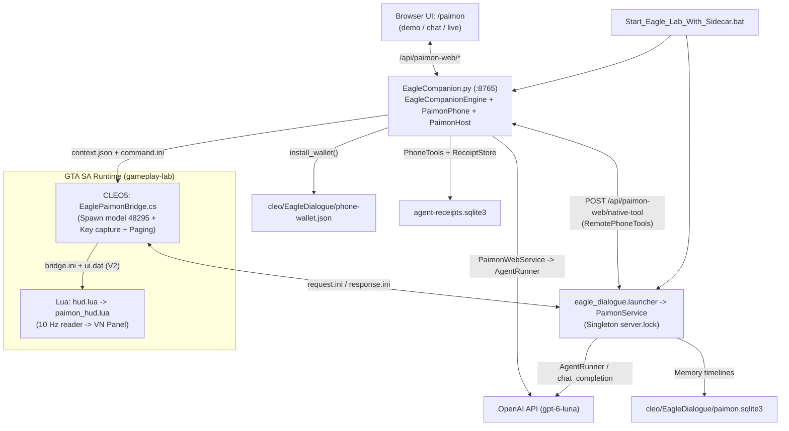

# Báo cáo tiếp nhận & Kiểm toán kỹ thuật tính năng Paimon (Codex -> Antigravity)

- **Ngày khảo sát:** `2026-11-04`
- **Thực hiện bởi:** Antigravity (`c085241b-6934-4712-b651-326276887445`)
- **Work-item:** `docs/project-eagle/work-items/2026-11-04-antigravity-paimon-feature-handover-survey.md`
- **Phạm vi:** Khảo sát chỉ đọc (`0` thay đổi runtime/code/archive/ví/SQLite) nhằm nắm toàn bộ kiến trúc, mã nguồn, giao thức, hệ thống Agent/Tool-Use, nguồn dữ liệu sâu và trạng thái thực tế trong `Project Eagle/gta sa gameplay-lab` trước khi Antigravity tiếp nhận phát triển tính năng Paimon.

---

## 1. Tóm tắt điều hành

Tính năng **Paimon** do Codex xây dựng qua **7 giai đoạn chính** từ `22/10/2026` đến `28/10/2026` đã tiến hóa từ một bản thử nghiệm hội thoại NPC đơn giản thành một **trợ lý cá nhân AI đa kênh (In-game Native VN HUD + EaglePhone App #11 + Browser `/paimon`) có khả năng đọc sâu trạng thái thế giới/tài chính và trực tiếp thực thi thao tác điện thoại cho người chơi**:

1. **Đa kênh giao tiếp đồng nhất:**
   - **Trong game (Native):** Gọi qua **EaglePhone App #11 (`11.Paimon`)** -> đóng điện thoại -> spawn ped Paimon (tận dụng model `48295` / `VC_DIAZ01` sẵn có trong `gameplay-lab`) -> mở **Visual Novel HUD** (`paimon_hud.lua` + CLEO5 `EaglePaimonBridge.cs`) với 3 gợi ý ngẫu nhiên từ bộ 36 câu (`paimon_choices.json`), gõ phím tự do tối đa `8,192` ký tự và phân trang phản hồi tối đa `16,384` ký tự (`75` trang × `220` ký tự).
   - **Trên trình duyệt (Web Test UI):** `http://127.0.0.1:8765/paimon` (`paimon_web.py` + `paimon_web.html`) hỗ trợ 3 chế độ: `demo` (Sample wallet cô lập `\$30,000`), `chat` (chỉ trò chuyện, tắt tool), và `live` (đọc/ghi trực tiếp vào phiên `gameplay-lab` đang mở).
2. **Paimon Agent & Hệ thống Tool-Use (`agent_runner.py` + `phone_tools.py`):**
   - Chạy vòng lặp tool tuần tự trên OpenAI **`gpt-6-luna`** (`MAX_ROUNDS = 6`, `MAX_TOOL_CALLS = 12`, `timeout = 100s`, `parallel_tool_calls = False`, ép `reasoning_effort = "none"` khi truyền `tools` để tương thích Chat Completions của `gpt-6-luna`).
   - Cung cấp **3 function tools** (`get_phone_state`, `list_phone_actions`, `execute_phone_action`) bao phủ **12 phân mục dữ liệu sâu** và **53 nhánh hành động `EagleCompanionEngine.handle_action`** đã được kiểm tra kiểu/giới hạn/số dư/chống trùng lặp bằng nhật ký biên nhận SQLite (`agent-receipts.sqlite3`).
3. **Nguồn dữ liệu sâu & Hàng rào chống lộ tương lai (2010 Lore/Temporal Gate):**
   - Đọc trực tiếp RAM/vị trí/nhu cầu sống, GG Map POIs, danh mục Spot/Futures, ngân hàng/khoản vay, vé số XSKT/Vietlott/Keno/Scratch, lịch thi đấu/bảng xếp hạng 5 giải thể thao, cài đặt & `EagleDebugSystem`, và báo `EagleTimes` đúng ngày game.
   - Chặn hai chiều (trước và sau khi gọi LLM) mọi câu hỏi/phản hồi vượt mốc ngày hiện tại trong game (`2010-01-01` mặc định), ẩn tài sản chưa niêm yết (`ETH`, `SOL`, `META`, `TSLA` trước IPO...) bằng bảng `KNOWN_AFTER` và bộ lọc `TOPICS`.
   - Bộ nhớ hội thoại SQLite (`paimon.sqlite3`) tự động **rẽ nhánh timeline mới** khi `bridge_epoch` đổi (load lại save/restart game) hoặc đồng hồ game quay lùi.
4. **4 phát hiện kỹ thuật quan trọng từ kiểm toán thực tế ngày `04/11/2026` (cần xử lý đầu tiên khi bắt đầu sửa code):**
   - **Lỗi #1 (Nghiêm trọng — Hỏng chế độ `demo` Sample Wallet & 20/189 unit tests lỗi):** `phone_sandbox.py` nạp AST lớp `EagleCompanionEngine` trong namespace tối giản chưa có stub cho `EagleRideManager` (App #12), `EagleDatingSimManager` (App #13) và `deque` mới thêm gần đây -> gây `NameError: name 'EagleRideManager' is not defined` khi tạo phiên `demo` mặc định trên `/paimon` (`HTTP 503`).
   - **Lỗi #2 (Nghiêm trọng — Chạy song song 2 script CLEO Bridge trong `cleo/`):** Cả `cleo/EagleDialogueBridge.cs` (v1, `23/10`) lẫn `cleo/EaglePaimonBridge.cs` (v2, `25/10`) đều đang nằm trong `cleo/` và cùng chạy trong game, tranh chấp `bridge.ini`, `command.ini`, `request.ini`, `response.ini` và ghi đè `ui.dat` về `EAGLE_DIALOGUE_UI_V1` (đã xác nhận thực tế trong `cleo/EagleDialogue/ui.dat` ở `bridge_epoch = 231801177`).
   - **Lỗi #3 (Trung bình — Ghi đè schema `paimon_status.json`):** File `cleo/EagleDialogue/paimon_status.json` đang chứa payload rút gọn `{"configured": true, "backend": "opencode2api", "ready": true, "last_error": ""}` thiếu `sampled_at` và `service_epoch`, khiến `PaimonPhone.tick()` coi kết nối hết hạn (`> 6s`).
   - **Lỗi #4 (Mở rộng & Drift sau `25/10`):** `EagleCompanion.py` và `hud.lua` đã tiến hóa lên 13 app (thêm **App #12 `EagleRide`** và **App #13 `WaifuLink`**, cộng icon riêng `ep_ic_paimon`). `phone_tools.py` hiện mới giới hạn `app` ở `0..11` và chưa có state/action cho `EagleRide` hay `WaifuLink`; đồng thời bài test `test_phone_patches_preserve_map_and_localization_guards` đang fail (`1/189`) do assert chuỗi cũ `ep_ic_life` và vòng lặp `1..11`.

---

## 2. Toàn bộ lịch sử các hạng mục Codex đã thực hiện (22/10 – 28/10/2026)

| Thứ tự | Ngày | Work-item / Báo cáo chính | Công cụ deploy / Staging | Nội dung đã hoàn thành |
| :--- | :--- | :--- | :--- | :--- |
| **1** | `22/10` – `23/10` | `2026-10-22-codex-ai-companions-discovery.md` `2026-10-22-codex-npc-dialogue-feasibility.md` `2026-10-22-codex-npc-dialogue-integration-plan.md` `2026-10-22-codex-dialogue-pilot.md` `2026-10-22-codex-dialogue-launcher-fix.md` `2026-10-23-codex-dialogue-user-validation.md` | `tools/eagle-dialogue/pilot_deploy.py` `staging/project-eagle/dialogue-pilot-20261022/` | Khảo sát khả thi, viết trình biên dịch bytecode CLEO5 riêng (`bridge/assembler.py`), giao thức IPC file nguyên tử v1 (`protocol.py`), `mock_server.py` (khóa byte `msvcrt` chống chạy trùng), tích hợp `eagle_dialogue.launcher` vào `Start_Eagle_Lab_With_Sidecar.bat`, sửa lỗi `03EE` từ chối mở hội thoại. Người dùng đã test PASS vòng lặp cơ bản trong game. |
| **2** | `23/10` | `2026-10-23-codex-opencode2api.md` `2026-10-23-codex-paimon-provider-setup.md` `docs/project-eagle/dialogue/opencode2api-handover.md` | `tools/opencode2api/provider_setup.py` `staging/opencode2api-20261023/` | Thử nghiệm `opencode2api` Go v1.4.3 trên `:18080` (bị chặn quota miễn phí 429) và dựng relay cục bộ `127.0.0.1:18082/v1` trỏ sang Groq (`openai/gpt-oss-120b`). *Hiện chỉ còn tính lịch sử/dự phòng sau khi chuyển sang `gpt-6-luna` ngày `25/10`.* |
| **3** | `23/10` | `2026-10-23-codex-paimon-companion.md` | `tools/eagle-dialogue/paimon_deploy.py` (15 đích) `staging/project-eagle/paimon-companion-20261023/` | Biến pilot thành **Paimon Companion v1**: thêm **App #11 (`Paimon`)** trên EaglePhone (4 dòng: *Call & talk*, *Portfolio*, *Activities*, *EagleTimes*), bỏ phím tắt `Y`/cheat cũ để gọi qua `command.ini`, spawn ped model `48295` (`VC_DIAZ01`) cách mặt người chơi 2m (dò mặt đất `02CE`, giữ đứng yên `05BA`, chờ ổn định 600ms), thêm `paimon_context.py`, `paimon_store.py`, `paimon_service.py`, `paimon_phone.py` và banner nhắc nợ/margin mỗi 60s. |
| **4** | `23/10` | `2026-10-23-codex-paimon-vn-hud.md` `docs/project-eagle/dialogue/vn-hud-2026-10-23.md` | `tools/eagle-dialogue/vn_hud_deploy.py` (5 đích) `staging/project-eagle/paimon-vn-hud-20261023/` | Thay phụ đề GTA mặc định bằng panel **Visual Novel HUD** màu xanh tím than / viền vàng (`eagle_dialogue/paimon_hud.lua` nạp qua `pcall(DrawEaglePaimonDialogue)` trong `hud.lua`), đọc `cleo/EagleDialogue/ui.dat` ở 10 Hz (`DeltaMS()`, TTL 1.5s), chọn ngẫu nhiên 3 câu không trùng từ bộ 36 câu (`paimon_choices.json`), điều hướng `UP/DOWN/ENTER/TAB` hoặc gõ phím tự do. |
| **5** | `24/10` | `2026-10-24-codex-paimon-web-test.md` `docs/project-eagle/dialogue/paimon-web-test-2026-10-24.md` | `tools/eagle-dialogue/paimon_web_deploy.py` (7 đích) `staging/project-eagle/paimon-web-test-20261024/` | Gắn giao diện web `/paimon` và `/api/paimon-web/*` trực tiếp lên `CompanionHTTPHandler` cổng `127.0.0.1:8765`, thêm nút **Try Paimon on web** trong App #11 (`eagle_phone_ui.py`), cơ chế chống CSRF (`X-Eagle-Paimon: 1` + kiểm tra Host/Origin), hàng đợi job bất đồng bộ (tối đa 2 luồng gọi AI song song, 32 session) và bước `ack` hiển thị trước khi ghi SQLite. |
| **6** | `25/10` | `2026-10-25-codex-paimon-luna.md` `docs/project-eagle/dialogue/paimon-luna-2026-10-25.md` | `tools/eagle-dialogue/luna_config.py` (3 đích) `staging/project-eagle/paimon-luna-20261025/` | Chuyển kết nối mặc định của Paimon sang OpenAI trực tiếp (`https://api.openai.com/v1`), model **`gpt-6-luna`**, đọc khóa từ biến môi trường `EAGLE_CHARACTER_OPENAI_API_KEY` (hoặc `HKCU\Environment`), cấu hình không chứa secret tại `data/project-eagle/paimon/connection.json` (hot-reload mỗi lượt gọi). |
| **7** | `25/10` – `28/10` | `2026-10-25-codex-paimon-agent.md` `2026-10-28-codex-paimon-install-verification.md` `docs/project-eagle/dialogue/paimon-agent-2026-10-25.md` | `tools/eagle-dialogue/paimon_agent_deploy.py` (19 đích) `staging/project-eagle/paimon-agent-20261025/` | Nâng cấp lớn thành **Paimon Agent**: bổ sung `agent_runner.py`, `phone_tools.py` (3 tools, 12 state sections, 53 actions, nhật ký biên nhận SQLite chống lặp), `paimon_host.py` (`RemotePhoneTools` dùng chung Engine cho cả Native & Web), `wallet_store.py` (lưu bền vững kinh tế vào `phone-wallet.json` + migrate ví cũ), `phone_sandbox.py` (ví mẫu cô lập), nâng cấp giao thức v2 văn bản dài (`8,192` in / `16,384` out / `75` trang × `220` ký tự) và biên dịch `cleo/EaglePaimonBridge.cs`. Kiểm chứng cài đặt lại ngày `28/10`. |
| *(Liên quan)* | `24/10` – `28/10` | `tools/eagle-character-chat/README.md` `docs/project-eagle/dialogue/character-noelle-fischl-2026-10-28.md` | Studio độc lập trên `127.0.0.1:8952` `staging/project-eagle/character-noelle-fischl-20261028/` | Studio hội thoại tiếng Anh độc lập cho 10 nhân vật Mondstadt (`Venti`, `Jean`, `Diluc`, `Mona`, `Kaeya`, `Lisa`, `Klee`, `Barbara`, `Noelle`, `Fischl + Oz`), 120 lựa chọn, dữ liệu nhận thức `content/cognition/*.json`, SQLite + FTS5 phân nhánh. Dùng chung biến `EAGLE_CHARACTER_OPENAI_API_KEY` (`gpt-6-luna`) nhưng **chưa gắn vào runtime GTA**. |

---

## 3. Kiến trúc tổng thể 6 tầng của Paimon trong `gameplay-lab`

### 3.1. Sơ đồ luồng dữ liệu & điều khiển

### 3.2. Nguồn sự thật mã nguồn vs. Bản chạy Runtime

- **Cây mã nguồn chuẩn để sửa và test (`tools/eagle-dialogue/`):**
  - `tools/eagle-dialogue/runtime/eagle_dialogue/*.py`, `*.lua`, `*.html`, `paimon_choices.json` — đồng bộ byte-for-byte với `Project Eagle/gta sa gameplay-lab/eagle_dialogue/` (đã kiểm chứng `17/19` file khớp SHA-256 trong `paimon_agent_deploy.py status`).
  - `tools/eagle-dialogue/bridge/assembler.py`, `pilot.py`, `paimon.py`, `choices.py` + `build_paimon.py` — trình sinh và biên dịch bytecode `.cs` CLEO5 (không phụ thuộc Sanny Builder bên ngoài).
  - `tools/eagle-dialogue/tests/test_*.py` — bộ `189` unit & integration tests.
- **Các điểm móc nối (hooks) trong `EagleCompanion.py` (`Project Eagle/gta sa gameplay-lab/EagleCompanion.py`):**
  - Khởi tạo trong `EagleCompanionEngine.__init__`: `self.paimon = PaimonPhone(base_dir)` và `install_wallet(self)` (bọc `_write_hud_dat` để tự lưu `phone-wallet.json`).
  - Mỗi nhịp đồng bộ: `self.paimon.tick(self)` xuất `cleo/EagleDialogue/context.json`, đọc `bridge.ini` + `paimon_status.json`, và đẩy thông báo nhắc nợ/margin quá hạn (giới hạn 60s/lần).
  - Thực thi dòng chọn trong App #11 (`_execute_active_row`): gọi `self.paimon.call(self, (row % 4) + 1)` ứng với 4 chế độ mở đầu (`1`: Call & talk, `2`: Portfolio, `3`: Activities, `4`: EagleTimes).
  - HTTP server: bọc `CompanionHTTPHandler` bằng `install_paimon_web_handler(CompanionHTTPHandler, ENGINE, BASE_DIR)` để phục vụ cả `/paimon` và endpoint nội bộ `/api/paimon-web/native-tool`.
- **Các điểm móc nối trong Lua & Web Phone UI:**
  - `hud.lua`: nạp `eagle_dialogue/paimon_hud.lua` và gọi `pcall(DrawEaglePaimonDialogue)` mỗi khung hình; vẽ trang App #11 trên màn hình điện thoại trong game.
  - `eagle_phone_ui.py`: trang `id="page-11"` hiển thị trạng thái Paimon, lời thoại gần nhất và nút mở `/paimon`.

---

## 4. Giải phẫu chi tiết hệ thống Paimon Agent & Tool-Use

### 4.1. Vòng lặp suy luận và gọi công cụ (`eagle_dialogue/agent_runner.py`)

- **Giới hạn vận hành:** `MAX_ROUNDS = 6`, `MAX_TOOL_CALLS = 12`, `timeout_seconds >= 100` (tự nâng từ `35s` của chế độ chat thường), `max_completion_tokens >= 4096`, `parallel_tool_calls = False`.
- **Quy tắc tương thích `gpt-6-luna` cực kỳ quan trọng:**
  - Trên endpoint `/v1/chat/completions`, `gpt-6-luna` trả lỗi `HTTP 400` nếu gửi đồng thời `tools` và `reasoning_effort != "none"`. Do đó `chat_completion_turn()` tự động ép `payload["reasoning_effort"] = "none"` bất cứ khi nào `tools` có mặt, và giữ `reasoning_effort = "low"` cho lượt chỉ trò chuyện.
- **Chính sách an toàn khi lỗi giữa chừng (No-Blind-Retry & Honest Receipt Fallback):**
  - Nếu một vòng gọi mạng lỗi *trước khi* bất kỳ hành động ghi nào được thực thi, lỗi được ném ra bình thường mà không ghi memory.
  - Nếu lỗi mạng, hủy lượt (`cancel.is_set()`), hết thời gian chờ, hoặc hết `MAX_ROUNDS` xảy ra *sau khi* ít nhất 1 `execute_phone_action` đã chạy, `AgentRunner` **tuyệt đối không tự gọi lại hành động** và chuyển sang `_fallback(recorded)` để tổng hợp câu trả lời trung thực dựa trên các biên nhận thực tế đã ghi (`completed` / `rejected` / `started` / `unknown`).
  - Lọc hậu kiểm `future_content(text, game_date)` vẫn áp dụng cho câu trả lời cuối cùng; nếu câu trả lời bị chặn *sau khi* đã có action thực thi, hệ thống vẫn ghép phần tóm tắt biên nhận hợp lệ để người chơi biết thao tác nào đã đổi tiền/vé.

### 4.2. Ba công cụ (`PhoneTools` trong `eagle_dialogue/phone_tools.py`)

1. **`get_phone_state(section)`** — Đọc dữ liệu có cấu trúc theo 12 phân mục (`SECTIONS`):
   - `overview`: Ngày giờ game, trạng thái gắn RAM, ví (`cash`, `bank`, `savings`, `loan`, `net_worth`), tóm tắt vị thế, nhắc nhở, vị trí và câu trả lời Paimon gần nhất.
   - `portfolio`: Tổng tài sản ròng, lãi/lỗ chưa thực hiện, danh sách chi tiết `spot_holdings`, `futures_positions` (entry, leverage, liquidation, margin) và cược thể thao đang mở.
   - `markets`: Toàn bộ bảng giá `STOCKS`, `COMMODITIES`, `CRYPTO` **đã qua bộ lọc `KNOWN_AFTER`** tại `game_date` (ẩn mọi mã chưa ra mắt tính đến ngày trong game).
   - `bank`: Số dư tiền mặt/ngân hàng/tiết kiệm, hạn mức vay tối đa (`\$50,000`), số ngày vay còn lại và cờ quá hạn.
   - `lottery`: Giá vé, giải thưởng tối đa và tối đa 40 vé đang chờ/đã dò của Scratch, XSKT, Vietlott, Keno.
   - `sports`: Giải đấu đang chọn, danh sách trận sắp đá (`fixtures` gồm `match_id`, tỷ lệ `odds_home`/`odds_draw`/`odds_away`, `kickoff`), bảng xếp hạng và 15 kết quả gần nhất của cả 5 giải (`EPL`, `LaLiga`, `SerieA`, `UCL`, `NBA`).
   - `life`: Máu, giáp, độ đói, năng lượng, khu vực, phương tiện đang lái và các địa điểm lân cận.
   - `map`: Trạng thái cầu nối dịch chuyển (`teleport_ready`), ghim hiện tại và danh sách địa điểm GG Map.
   - `settings`: Trạng thái mở điện thoại, `active_app`, `subpage`, ngôn ngữ (`EN`/`VI`), tốc độ thời gian (`time_scale`), tạm dừng thời gian và câm tiếng.
   - `debug`: Trạng thái chiếu `EagleDebugSystem` (`tabs`, `active_tab`, `items`, `recent_logs`).
   - `news`: Toàn văn các chuyên mục `EagleTimes` (`politics`, `finance`, `sports`, `crypto`) đã lọc đúng ngày game và chặn spoiler tương lai, kèm tối đa 8 biên nhận thao tác gần nhất (`recent_receipts`).
   - `all`: Gộp toàn bộ các phân mục trên trong một lần đọc.
2. **`list_phone_actions(domain)`** — Tra cứu danh mục công cụ và tham số hợp lệ theo miền (`all`, `bank`, `markets`, `lottery`, `sports`, `portfolio`, `life`, `map`, `settings`, `debug`).
3. **`execute_phone_action(action, arguments)`** — Thực thi có kiểm soát **53 nhánh hành động** trong bảng `ACTIONS`:
   - **Tài chính & Ngân hàng (4):** `bank_deposit`, `bank_withdraw`, `bank_save_transfer`, `bank_loan` (`borrow` / `repay`, kiểm tra trần vay `\$50,000` và tiền mặt trước khi gọi Engine).
   - **Giao dịch Spot & Futures (4):** `spot_order` (`BUY`/`SELL` theo `amount` USD), `futures_open` (`LONG`/`SHORT`, `margin` `\$10`–`\$5,000,000`, đòn bẩy `1`–`125x`), `futures_close`, `portfolio_close_all`. Kiểm tra mã tài sản có tồn tại ở `game_date` không trước khi khớp lệnh!
   - **Xổ số (4):** `buy_scratch` (`tier` `0..3`), `buy_xskt` (`6` chữ số hoặc `random_numbers=true`), `buy_vietlott` (`6` số không trùng `1..45` hoặc `random_numbers=true`), `buy_keno` (`1..5` số `1..80`, `bet` `\$10`–`\$50,000` hoặc `random_numbers=true`). **Quy tắc an toàn:** nếu người chơi không đọc số cụ thể, Agent bắt buộc phải truyền `random_numbers=true` để tránh tự bịa số ngầm.
   - **Thể thao (3):** `place_sport_bet` (kiểm tra `match_id` đang ở trạng thái `UPCOMING`, kiểm tra kèo hòa không áp dụng nếu `odds_draw <= 0` như bóng rổ NBA), `select_sport_league`, `set_sport_view`.
   - **Đời sống, Bản đồ & Điều hướng điện thoại (16):** `life_action` (`eat`, `drink`, `coffee`, `nap`), `call_paimon` (`1..4`, bị chặn khi đang ở trong lượt Agent để tránh đệ quy tự gọi chính mình!), `select_map_poi`, `teleport_to_poi` (`LIVE_ONLY`), `clear_map_pin`, `toggle_phone`, `set_phone_app` (`0..11`), `step_subpage`, `set_subpage`, `set_language`, `set_time_scale`, `toggle_time_pause`, `toggle_mute`, `run_crawler` (`ASYNC` + `LIVE_ONLY`), `reload_news` (`ASYNC` + `LIVE_ONLY`), `advance_day` (`LIVE_ONLY`).
   - **Debug & Kiểm thử hệ thống (22 — phần lớn `LIVE_ONLY`):** `debug_select_tab`, `debug_select_item`, `debug_adjust_item`, `debug_run_selected`, `debug_run_item`, `debug_set_value`, `debug_reset_tab`, `debug_reload_config`, `debug_export_snapshot`, `debug_run_smoke`, `debug_give_cash`, `debug_heal_player`, `debug_clear_wanted`, `debug_Weather_sunny` (`debug_weather_sunny`), `debug_spawn_nrg500`, `debug_skip_hours`, `debug_set_timescale`, `debug_teleport`, `debug_log_test`, `run_system_tests` (`ASYNC`), `run_e2e_test` (`ASYNC`), `fix_charset` (`ASYNC`).

### 4.3. Đồng bộ hóa, Idempotency & Ví bền vững

- **Đồng bộ luồng (`RLock` + `RemotePhoneTools`):**
  - Chỉ có duy nhất tiến trình `EagleCompanion.py` giữ đối tượng `ENGINE` sống. Khi Paimon chạy qua Native HUD (`PaimonService`), nó không tạo `EagleCompanionEngine` thứ hai mà dùng `RemotePhoneTools` (`paimon_host.py`) gọi `POST http://127.0.0.1:8765/api/paimon-web/native-tool` kèm `bridge_epoch` và `game_date` để kiểm tra độ tươi của phiên game trước khi thực thi dưới cùng một `RLock`.
- **Nhật ký biên nhận chống thực thi lặp (`ReceiptStore` — SQLite):**
  - Live lưu tại `cleo/EagleDialogue/agent-receipts.sqlite3`; Demo lưu riêng theo từng session tại `data/project-eagle/paimon-web/wallets/<session>/receipts.sqlite3` (giới hạn 10,000 bản ghi).
  - Trước khi gọi `engine.handle_action()`, `PhoneTools` ghi dòng `status = 'unknown'` với khóa `(turn_id, call_id)`. Sau khi chạy xong mới cập nhật `completed` / `applied` / `rejected` / `started` kèm chênh lệch ví `before` / `after` / `delta` và `last_toast`. Nếu cùng `(turn_id, call_id)` bị gửi lại với cùng tham số, biên nhận cũ được trả về (`replayed = True`); nếu khác tham số sẽ bị từ chối; nếu tiến trình sập ở trạng thái `unknown`, lệnh đó không bao giờ bị tự động chạy lại.
- **Lưu trữ kinh tế bền vững (`wallet_store.py`):**
  - `install_wallet(ENGINE)` nạp `cleo/EagleDialogue/phone-wallet.json` khi khởi động (khôi phục kiểu số nguyên cho các khóa `anchors`, dựng lại tờ `EagleTimes` theo `current_date`), và bọc `engine._write_hud_dat` để ghi nguyên tử trạng thái kinh tế sau mỗi thay đổi. Bản chụp di trú ban đầu được giữ tại `cleo/EagleDialogue/phone-wallet-migration.json`.

---

## 5. Nguồn dữ liệu sâu, Hàng rào thời gian 2010 & Bộ nhớ phân nhánh

1. **Hàng rào chống lộ tương lai (`paimon_context.py` & `phone_tools.py`):**
   - Thế giới `gameplay-lab` bắt đầu ở năm **2010** (`2010-01-01`).
   - **Lọc đầu vào & đầu ra (`future_content`):** Mọi năm có 4 chữ số `> current_year` (trong khoảng `2010..2099`), ngày ISO `YYYY-MM-DD > game_date`, hoặc từ khóa trong `TOPICS` chưa tới năm xuất hiện (`ethereum`/`eth` `< 2015`, `solana` `< 2020`, `dogecoin` `< 2013`, `chatgpt` `< 2022`, `covid`/`pandemic` `< 2020`, `ps5`, `tiktok`, `apple watch`...) đều bị chặn:
     - Nếu câu hỏi của người chơi vi phạm: trả ngay câu từ chối nhập vai *"Hey! No peeking beyond `<game_date>`, Traveler..."* mà **không gọi tốn API**.
     - Nếu phản hồi của LLM vô tình lọt thông tin tương lai: chặn phản hồi đó trước khi hiển thị/lưu memory.
   - **Ẩn tài sản chưa niêm yết (`KNOWN_AFTER` trong `phone_tools.py`):** Ví dụ ngày `2010-01-01`, bảng giá và lệnh `spot_order` / `futures_open` tự động ẩn và từ chối `TSLA` (`2010-06-29`), `META` (`2012-05-18`), `ETH` (`2015-08-07`), `ADA` (`2017-10-01`), `SOL` (`2020-04-10`)... chỉ để lộ `BTC` (`\$0.08`) và các cổ phiếu/hàng hóa đã giao dịch năm 2010.
2. **Bộ nhớ hội thoại phân nhánh theo save/thời gian (`paimon_store.py` -> `paimon.sqlite3`):**
   - Gồm 3 bảng: `timeline`, `observation`, `turn`.
   - `Memory.observe(context)` theo dõi `(bridge_epoch, game_date, clock)`. Nếu người chơi tiếp tục chơi tiến về phía trước trong cùng `bridge_epoch`, Paimon nối tiếp cùng `timeline_id` (lấy tối đa 16 sự kiện quan sát trong ngày và 8 cặp hội thoại gần nhất đưa vào prompt).
   - Ngay khi `bridge_epoch` thay đổi (khởi động lại game / nạp lại save) hoặc đồng hồ trong game quay ngược (`stamp < prev_stamp`), một `timeline_id` mới được tạo để Paimon không nhớ nhầm sự kiện của nhánh save đã bị bỏ!
   - Lượt hội thoại chỉ được ghi vào bảng `turn` khi native bridge gửi `commit=1` (xác nhận người chơi đã thấy câu trả lời) hoặc web UI gửi `/api/paimon-web/ack`.
3. **Giao thức văn bản dài v2 (`protocol.py` + `bridge/paimon.py` + `paimon_hud.lua`):**
   - Mở rộng giới hạn hội thoại từ `100` ký tự lên `8,192` ký tự đầu vào và `16,384` ký tự đầu ra.
   - Bytecode CLEO5 trong `bridge/paimon.py` vượt giới hạn chuỗi định dạng 510 byte của opcode `0AD9` bằng cách ghi trực tiếp bộ đệm con trỏ thô qua opcode `2302`, chia phản hồi thành tối đa `75` trang (`220` ký tự/trang, lật trang bằng phím `LEFT` / `RIGHT`), nâng thời gian chờ native từ `45s` lên `150s` và xuất định dạng 17 dòng `EAGLE_DIALOGUE_UI_V2` sang `ui.dat`.

---

## 6. Kết quả kiểm toán thực tế ngày `04/11/2026` & Các vấn đề cần xử lý trước khi phát triển tiếp

Qua kiểm tra trực tiếp cây thư mục `Project Eagle/gta sa gameplay-lab`, `tools/eagle-dialogue` và chạy bộ kiểm thử chỉ đọc (`168 PASS / 20 ERROR / 1 FAIL` trên tổng `189` tests), ghi nhận **4 vấn đề kỹ thuật cụ thể** cần giải quyết ngay ở phiên làm việc có quyền ghi tiếp theo:

### 6.1. Lỗi #1 (Ưu tiên P0): `phone_sandbox.py` thiếu stub cho App #12 (`EagleRide`) & App #13 (`WaifuLink`)

- **Hiện tượng:** Chạy `python -m unittest discover -s tools\eagle-dialogue\tests -p "test_*.py"` phát sinh **20 `ERROR`** tại `test_paimon_agent_integration.py`, `test_phone_tools.py` và `test_wallet_store.py` với ngoại lệ:
  `NameError: name 'EagleRideManager' is not defined` (tại dòng khởi tạo `self.ride_mgr = EagleRideManager(base_dir)` trong `EagleCompanionEngine.__init__`).
- **Tác động runtime:** Trang web `http://127.0.0.1:8765/paimon` mặc định mở ở chế độ **`demo` (Sample wallet)**. Khi tạo session `demo`, `PaimonWebService` gọi `create_sandbox()`, hàm này dùng `ast.parse` trích riêng class `EagleCompanionEngine` từ `EagleCompanion.py` rồi chạy trong một `namespace` cô lập. Do sau ngày `25/10` Antigravity đã tích hợp thêm `EagleRideManager`, `EagleDatingSimManager`, `deque` và `_ensure_waifulink_cg_txd_slots()` vào `EagleCompanionEngine.__init__`, mọi phiên `demo` hiện sẽ văng lỗi và trả `HTTP 503 ("Paimon web test storage is temporarily unavailable.")`.
- **Hướng sửa an toàn:** Bổ sung `deque` cùng các lớp stub nhẹ `_NoRideManager` và `_NoDatingSimManager` (và đảm bảo `_ensure_waifulink_cg_txd_slots` an toàn khi không có thư mục TXD thực) trong `eagle_dialogue/phone_sandbox.py` (đồng bộ cả ở `tools/eagle-dialogue/runtime/eagle_dialogue/phone_sandbox.py` và `Project Eagle/gta sa gameplay-lab/eagle_dialogue/phone_sandbox.py`).

### 6.2. Lỗi #2 (Ưu tiên P0): Xung đột chạy kép `EagleDialogueBridge.cs` (v1) và `EaglePaimonBridge.cs` (v2) trong `cleo/`

- **Bằng chứng thực tế:**
  - Trong `Project Eagle/gta sa gameplay-lab/cleo/` hiện tồn tại đồng thời **cả hai** file:
    1. `EagleDialogueBridge.cs` (`23,826` bytes — bản VN HUD v1 ngày `23/10`).
    2. `EaglePaimonBridge.cs` (`26,017` bytes — bản Paimon Agent v2 ngày `25/10`).
  - Trong `tools/eagle-dialogue/build_paimon.py` (dòng 60), chính Codex đã ghi cảnh báo *"Do not install alongside the old active bridge"*, nhưng `paimon_agent_deploy.py` chỉ thêm mới `cleo/EaglePaimonBridge.cs` mà chưa gỡ `cleo/EagleDialogueBridge.cs`.
  - Kiểm tra `cleo/EagleDialogue/bridge.ini` và `cleo/EagleDialogue/ui.dat` hôm nay xác nhận cả hai đã chạy chồng nhau ở `bridge_epoch = 231801177`, khiến `EagleDialogueBridge.cs` ghi đè `ui.dat` bằng header cũ `EAGLE_DIALOGUE_UI_V1` (14 dòng) thay vì `EAGLE_DIALOGUE_UI_V2` (17 dòng, có thông tin trang `page / page_count` và trạng thái chạy công cụ).
- **Hướng sửa an toàn:** Sao lưu `cleo/EagleDialogueBridge.cs` vào thư mục staging/backup riêng rồi gỡ khỏi `Project Eagle/gta sa gameplay-lab/cleo/` để chỉ còn duy nhất `EaglePaimonBridge.cs` hoạt động.

### 6.3. Lỗi #3 (Ưu tiên P1): `cleo/EagleDialogue/paimon_status.json` bị ghi đè thiếu trường thời gian sống

- **Bằng chứng thực tế:** File `cleo/EagleDialogue/paimon_status.json` (`95` bytes, sửa lúc `04/11/2026 05:41`) đang mang nội dung tĩnh `{"configured": true, "backend": "opencode2api", "ready": true, "last_error": ""}`, thiếu `service_epoch`, `sampled_at`, `game_date`, `model` và `last_reply`.
- **Tác động runtime:** `PaimonPhone.tick()` kiểm tra `time.time() - status.get("sampled_at", 0) < 6.0`; khi thiếu `sampled_at` (hoặc khi `PaimonService` chưa chạy nền từ `Start_Eagle_Lab_With_Sidecar.bat`), EaglePhone sẽ báo `"AI connection pending"`. Cần rà soát script/test nào ngoài luồng đã ghi trực tiếp vào `cleo/EagleDialogue/paimon_status.json` thay vì thư mục tạm, và đảm bảo khởi chạy qua `Start_Eagle_Lab_With_Sidecar.bat` để `PaimonService` cập nhật heartbeat định kỳ mỗi `2s`.

### 6.4. Lỗi #4 (Ưu tiên P1/P2): Cập nhật drift hệ thống 13 App (`EagleRide` #12 & `WaifuLink` #13) và nghiệm thu In-Game v2

- **Hiện trạng drift:**
  - `paimon_agent_deploy.py status` báo `17/19` file khớp `after`; 2 mục lệch duy nhất là `EagleCompanion.py` và `source:EagleCompanion.py` do các bản cập nhật hợp lệ sau ngày `25/10` (thêm icon riêng `ep_ic_paimon`, App #12 `EagleRide` và App #13 `WaifuLink`). **Lưu ý quan trọng:** Không bao giờ chạy `paimon_agent_deploy.py rollback` hay chạy lại hàm patch chuỗi cũ `integrate_paimon.engine()` đè lên `EagleCompanion.py` hiện tại!
  - Bài test `test_phone_patches_preserve_map_and_localization_guards` trong `tools/eagle-dialogue/tests/test_paimon_core.py` đang fail do kiểm tra cứng `(11, "ep_ic_life", "Paimon"` và `for idx = 1, 11 do`.
  - `phone_tools.py` hiện mới giới hạn `set_phone_app` / `step_subpage` / `set_subpage` ở `0..11`, chưa mở cho App `12` (`EagleRide`) và App `13` (`WaifuLink`), đồng thời Paimon chưa có khả năng xem/đặt xe hộ người chơi qua `EagleRide` hoặc xem lịch hẹn `WaifuLink`.
  - Lưu ý nhỏ về lọc tin tức `EagleTimes`: `clean_news_line()` trong `paimon_context.py` lọc theo số năm 4 chữ số `> current_year` và từ khóa `TOPICS`, nên nếu bản tin tổng hợp đầu tháng `01/01/2010` của `EagleTimes` nhắc sự kiện giữa năm 2010 (ví dụ chung kết C1 tháng 5 hoặc World Cup tháng 7/2010) mà không ghi số năm `2011+`, dòng tin đó vẫn đi vào `context.json` (đã thấy thực tế trong `cleo/EagleDialogue/context.json`).
  - Bản thân luồng Native v2 của `EaglePaimonBridge.cs` (lật trang `LEFT/RIGHT`, nhập dài `8,192` ký tự và thực thi tool trực tiếp từ hộp thoại VN trong game) vẫn đang ở trạng thái chờ nghiệm thu thực tế trong game (`pending user gameplay acceptance`).

---

## 7. Quy tắc vận hành bắt buộc khi Antigravity bắt đầu sửa hoặc mở rộng Paimon

1. **Quản lý khóa phối hợp (`tools/eagle_coord_lock.py`):**
   - Giữ `game-write` trước khi sửa bất kỳ file nào trong `Project Eagle/gta sa gameplay-lab/` (`eagle_dialogue/*`, `EagleCompanion.py`, `hud.lua`, `eagle_phone_ui.py`, `cleo/*`).
   - Giữ thêm `ingame-runtime` nếu cần khởi chạy GTA SA / sidecar để test Paimon live.
2. **Giữ đồng bộ hai cây mã nguồn:**
   - Mọi chỉnh sửa trong module `eagle_dialogue/` cần được thực hiện trên nguồn chuẩn `tools/eagle-dialogue/runtime/eagle_dialogue/` (và `tools/eagle-dialogue/bridge/` nếu sửa CLEO bytecode), chạy pass toàn bộ `unittest` trong `tools/eagle-dialogue/tests/`, tạo staging + manifest SHA-256 riêng rồi mới đồng bộ sang `Project Eagle/gta sa gameplay-lab/eagle_dialogue/`.
3. **Bảo toàn dữ liệu người chơi:**
   - Không ghi đè hoặc xóa `cleo/EagleDialogue/phone-wallet.json`, `cleo/EagleDialogue/paimon.sqlite3` hay `cleo/EagleDialogue/agent-receipts.sqlite3` khi deploy code.
4. **Cấu hình LLM (`gpt-6-luna`):**
   - Không bao giờ lưu API key vào repo/config; luôn đọc qua `api_key_env: "EAGLE_CHARACTER_OPENAI_API_KEY"` từ `data/project-eagle/paimon/connection.json`.
   - Luôn giữ quy tắc `reasoning_effort = "none"` khi truyền `tools` vào `/v1/chat/completions` của `gpt-6-luna`.
