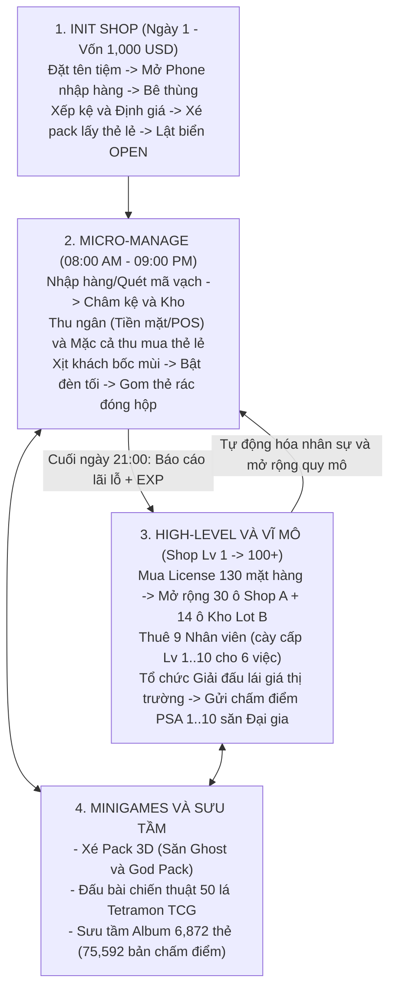
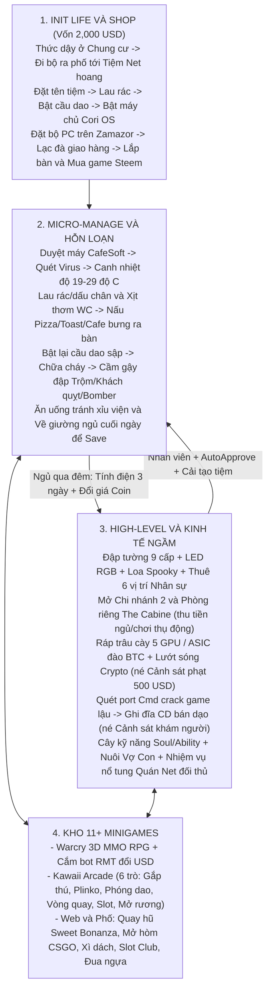

# Tổng Hợp Toàn Bộ Tính Năng & Luồng Gameplay Của `TCG Card Shop Simulator` (`TCSS`) & `Internet Cafe Simulator 2` (`ICS2`) Để Chọn Lọc Tích Hợp Vào `gameplay-lab`

- **Ngày lập:** `2026-11-11`
- **Hội thoại tổng hợp:** Antigravity `fce76ec3-c432-4a45-a1b1-d6737afe00d5` (dựa trên kết quả dịch ngược tĩnh `Assembly-CSharp.dll` từ `6a2335a6-d5d7-47e6-9128-fbc62404a3a8`, subagent TCSS `4f263562-4fc3-4de8-85f6-5960f871c389`, subagent ICS2 `aebb4843-55ab-4b4f-b52e-bac8e053a3fb` và kiểm chứng bổ sung trực tiếp trên CIL)
- **Tài liệu kiến trúc kỹ thuật đi kèm:** [`ics2-and-tcss-integration-technical-blueprint-2026-11-11.md`](ics2-and-tcss-integration-technical-blueprint-2026-11-11.md)
- **Phạm vi:** `100% Read-Only` — kiểm kê đầy đủ mọi tính năng và luồng chơi (`Init Shop -> Micromanagement -> High-Level/Macro -> Sự kiện ngầm -> Minigame`) để người dùng chốt danh mục **Giữ / Gộp / Tùy chọn (`Q1–Q8`) / Bỏ** trước khi bước vào Phase 1 thi công.

> [!NOTE]
> Cả 2 bản gốc đều **chỉ có chế độ Làm Chủ 1 Tiệm (Single-Shop Owner Mode)** ở góc nhìn thứ nhất, hoàn toàn không có tiệm của NPC để người chơi đóng vai khách hàng đi mua bài hay ngồi net. Khi tích hợp vào `gameplay-lab`, mọi tính năng được chọn giữ lại đều có thể tái sử dụng đối xứng cho cả **Tiệm của Aether** lẫn **Chuỗi Tiệm NPC trên bản đồ**.

---

## PHẦN 1 — GAME #1: `TCG Card Shop Simulator` (`OPNeonGames`)

### 1.1. Sơ Đồ Tổng Quan Vòng Lặp Gameplay (`TCSS`)

---

### 1.2. Flow 1 — Khởi Tạo Shop & Onboarding Ngày Đầu (`Init Shop Flow`)

1. **Trạng thái khởi điểm (`CPlayerData::CreateDefaultData`):**
   - **Vốn ban đầu:** `$1,000.00` tiền mặt.
   - **Cấp độ & Thời gian:** `Shop Level 1` (`0 EXP`), `Day 1`, đồng hồ dừng ở **`08:00 AM`** cho tới khi mở cửa lần đầu (`m_IsShopOpen = false`).
   - **Mặt bằng & Giấy phép sẵn có:** Chỉ có `1` gian nhỏ của **Shop A** (chưa mở ô phụ nào trong `30` ô lưới; khu **Kho Lot B** khóa cứng), chỉ mở sẵn duy nhất giấy phép nhập sỉ `Basic Card Pack` (`UnlockBasicCardBox`).
2. **Chuỗi 15 Bước Khởi Tạo Tiệm (`TutorialManager` / `ETutorialTaskCondition`):**
   - **Bước 1 — Đặt tên tiệm:** Tương tác bảng hiệu mặt tiền (`InteractableShopBillboard`) nhập tên cửa hàng.
   - **Bước 2 — Mua nội thất & lô hàng đầu tiên:** Mở điện thoại (`PhoneManager`) -> vào app `Furniture` mua kệ bán hàng (`Shelf`), bàn trưng thẻ lẻ (`CardTable`), bàn đấu bài (`PlayTable`) -> vào app `Restock` đặt thùng `Basic Card Box`.
   - **Bước 3 — Nhận hàng ngoài vỉa hè & Dựng kệ:** Chạy ra lề đường nhặt các thùng carton vật lý vừa rơi xuống (`PickupBox`), đem vào tiệm dựng kệ (`ShelfManager`) và chất từng gói pack lên ngăn kệ (`PutItemOnShelf`), vứt thùng rỗng vào `TrashBin`.
   - **Bước 4 — Định giá bán lẻ:** Bấm vào nhãn giá trên kệ (`InteractablePriceTag`) đối chiếu `Market Price` và đặt giá bán (`SetItemPrice`).
   - **Bước 5 — Tự xé Pack đầu tay & Bày thẻ lẻ:** Cầm pack trên kệ xé trực tiếp (`OpenPack` — **cơ chế bảo hiểm tân thủ:** nếu 6 lá đầu trượt Foil thì lá thứ 7 ép cứng `100%` nổ `Foil`), đem thẻ hiếm vừa mở đặt lên bàn kính (`PutCardOnShelf`) và gắn giá bán lẻ.
   - **Bước 6 — Mở bàn chơi tính giờ:** Đặt `PlayTable` và cấu hình mức phí thuê giờ / thể thức sự kiện (`SetGameEventScreen`).
   - **Bước 7 — Xoay biển `OPEN` đón khách:** Ra cửa chính lật biển `CLOSED -> OPEN` (`InteractableOpenCloseSign`) -> đồng hồ bắt đầu trôi từ `08:00 AM` tới `09:00 PM`, khách NPC đi bộ từ ngoài phố vào mua pack, mua thẻ lẻ (`SellCard`), ngồi đấu bài (`CustomerPlay`) và xếp hàng ở quầy (`CheckoutCustomer`) -> đủ EXP lên `Shop Level 2` (chính thức mở khóa tỷ lệ rớt thẻ `Ghost` và `God Pack`!).

---

### 1.3. Flow 2 — Vận Hành Vi Mô Hàng Ngày (`Micromanagement Flow: 08:00 – 21:00`)

| Nhóm việc vi mô | Chi tiết cơ chế trong game gốc (`Assembly-CSharp.dll`) |
| :--- | :--- |
| **1. Đặt hàng, Bê thùng & Quản lý Kho** | - Đặt sỉ qua 2 app trên điện thoại (`TCG/Accessories` & `Boardgame/Plushie/Manga`) **hoặc** cầm **Máy Quét Mã Vạch (`UI_BarcodeScannerScreen`)** bắn thẳng vào tem giá kệ đang trống để thêm nhanh vào giỏ. - Thùng hàng (`Small` / `Big`) spawn ngoài đường; bê tay không xếp lên kệ bán (`ShelfCompartment`) hoặc cất lên **Kệ Kho (`WarehouseShelf`)** có icon nhãn hàng. - Tủ cất thẻ lẻ (`CardStorageShelf`) có nút khóa `CanWorkerTake` để cấm nhân viên lỡ tay lấy nhầm thẻ quý của chủ tiệm đem bán! - Vỏ thùng rỗng xếp gọn vào `EmptyBoxStorage` (dùng khi muốn đóng thùng cất/bán lại kệ cũ lấy `50%` tiền) hoặc vứt vào `TrashBin`. |
| **2. Định giá Vi mô & Tâm lý Khách** | - Chỉnh giá từng ngăn hàng / từng lá bài lẻ (hỗ trợ nút tăng giảm `%` và làm tròn số lẻ). - **Xác suất khách chốt mua theo chênh lệch giá thị trường (`GetCustomerBuyItemChance`):** Giảm `-20%` -> `100%` mua; Đúng giá thị trường `0%` -> **`90%` mua**; Tăng `+10%` -> `75%`; `+20%` -> `60%`; `+30%` -> `45%`; `+40%` -> `15%`; `+50%` -> `5%`; **`> +60%` -> `0%` mua + ăn đánh giá 1 sao (`ItemPrice`)**! |
| **3. Đứng Quầy Thu Ngân (`Cashier Counter`)** | - Mỗi quầy thu ngân có bảng cài đặt riêng (`SetCashierCounterSettingScreen`): cho phép bật/tắt độc lập **Tính tiền (`CanCheckout`)** và **Đổi/Thu mua thẻ (`CanTradeCard`)** để tách quầy. - **Khách trả tiền mặt (`UI_CashCounterScreen`):** Nhặt từng tờ tiền giấy & đồng xu trả lại tiền thừa (thối lố `> $2.00` bị khóa nút chốt; trả toàn xu lẻ `Pennies` bị khách chê trên bảng Review `GiveManyChangePennies`!). - **Khách trả thẻ (`UI_CreditCardScreen`):** Nhập con số tổng tiền trên máy POS (sai số `<= $0.01`). |
| **4. Thu Mua & Đổi Thẻ Lẻ Tại Quầy (`Trade Card`)** | - Khách ngẫu nhiên mang 1 lá bài lẻ từ nhà tới quầy gạ giao dịch (`CustomerTradeCardScreen`): **`60%` gạ bán lấy tiền mặt**, **`40%` gạ đổi ngang lấy 1 lá bài khác** trong Album của bạn. - Có thanh kéo trả giá / mặc cả (`Haggle`) với 5 ngưỡng phản ứng (từ vui vẻ chốt kèo tới tức giận bỏ về). |
| **5. Trị Khách "Bốc Mùi" (`Smelly Customers`)** | - `2%–17%` khách bước vào người bốc khói xanh hôi thối (`m_SmellyMeter = 10`, tăng thêm vào buổi chiều/tối; khách hôi cố tình không bao giờ tự mua chai khử mùi trên kệ!). - **Hậu quả:** Mọi khách sạch đứng trong bán kính **`3.0m`** có xác suất `15% × số khách hôi` bịt mũi bỏ chạy khỏi tiệm ngay lập tức kèm review `-30` điểm (`SmellyCustomer`). - **Xử lý:** Cầm chai `Deodorant` (`20` nhát/chai) xịt trúng `2` phát, **hoặc** gắn **Máy Xịt Tự Động (`AutoCleanser 1..3`)** cảm biến chuyển động ở cửa ra vào (nhớ nạp bình xịt khi cạn). |
| **6. Công Tắc Đèn & Nhạc Ngày/Đêm (`LightManager`)** | - Tiệm có chu kỳ ánh sáng `Morning -> Afternoon -> Evening (18:00) -> Night` kèm nhạc nền chuyển pha `BGM_ShopDay <-> BGM_ShopNight`. - Trời sập tối nếu quên bật `InteractableLightSwitch` tiệm sẽ tối om và ăn review xấu `LightTurnedOff` (nhưng bật đèn lâu sẽ tính vào hóa đơn điện cuối ngày). |
| **7. Xử Lý Bài Rác & Máy Xé Pack Tự Động** | - **Bàn đóng hộp (`InteractableWorkbench`):** Gom `100` lá bài thường bị trùng (`số lượng > 4`, lọc theo trần giá `$0.01..$20.00`, mất `5s`) đóng thành hộp **Bulk Box** (`Base`, `HG`, `MG`, `PG`, `UG`) đem bán sỉ trên kệ. - **Thùng từ thiện (`BulkDonationBox`):** Đổ bài thường dư thừa cho khách nhặt miễn phí để câu điểm Review tốt (`BulkDonation`). - **Máy xé Pack tự động (`AutoPackOpener 1..3`):** Chứa `9` pack/lượt, tự xé trong `30s` gom bài vào ngăn kéo cho chủ tiệm lấy một thể. |
| **8. Đóng Cửa Cuối Ngày (`EndOfDayReportScreen`)** | - Tới **`09:00 PM`**, đồng hồ dừng ở `"Day End"`, khách mới ngừng vào. Sau khi khách cuối cùng rời tiệm, người chơi bấm qua ngày xem bảng tổng kết Lãi/Lỗ, Hóa đơn, tổng EXP lên cấp và lưu game. |

---

### 1.4. Flow 3 — Quản Trị Cấp Cao, Thị Trường & Progression (`High-Level Flow`)

1. **Mở Khóa `130` Mặt Hàng Bán Lẻ (`Licenses` theo `Shop Level`):**
   - **`35` mặt hàng TCG:** `9` dòng Pack lẻ, `9` thùng Booster Box (`32`/`64` gói), `8` hộp bài dựng sẵn `Starter Deck`, `10` hộp `Bulk Box`.
   - **`48` Phụ kiện:** Chai xịt thơm `Deodorant`, hộp bài `Deckbox`, xúc xắc `Dice`, bọc bài `Sleeves`, `22` thảm đấu `Playmat`, biển quảng cáo đứng và **`16` vật phẩm bản quyền chính hãng Ultra PRO** (`Binder`, `ProBinder`, `CollectorAlbum`, `Toploader`...).
   - **`21` Thú nhồi bông & Tượng Figure** (`PigniPlushie` .. `GiganiteStatue`) + **`20` Boardgame, Manga (`1..14`) & Comic (`1..12`)**.
2. **Mở Rộng Mặt Bằng Lưới & Kho Hàng (`Shop A` + `Lot B`):**
   - **Shop A:** Mở khóa dần thêm **`30` ô phòng** (chi phí tăng lũy tiến từ `$300` theo cấp tiệm).
   - **Lot B (Gian bên cạnh / Kho):** Mở ở `Shop Level 15` (`$5,000`) + mở rộng thêm **`14` ô phòng** qua 5 cửa kính. Có biển gạt **`WarehouseAllowEnterSign`** cho phép biến Lot B thành kho nội bộ kín hoặc mở thông thành sảnh trưng bày/đấu giải thứ 2!
3. **Xây Dựng Tự Do & Trang Trí Tăng Trần Khách (`63` Kệ/Máy + `183` Đồ Decor):**
   - Đặt đồ tự do kèm cơ chế **Hút từ tính mép cạnh `0.30m` (`EvaluateSnapping`)** giúp xếp dãy kệ thẳng tắp không lệch pixel; có `PersonalShelf` để trưng thẻ quý khoe khách (không bán).
   - `183` món trang trí (`72` Poster, `35` Tượng lớn, `13` Đèn Neon, `8` Cây cảnh, `55` Tranh cộng đồng) + đổi gạch sàn/tường/trần riêng cho Shop A & Lot B. **Số lượng đồ trang trí & kệ độc nhất cộng thẳng vào giới hạn khách tối đa trong tiệm (`3 -> 30` khách cùng lúc)!**
4. **Hệ Thống `9` Nhân Viên & Cày Kỹ Năng RPG (`WorkerManager`):**
   - Thuê từ `Zackery Cole` (`Lv 10`, phí `$500`, lương `$50/ngày`, đúng giờ là về) tới `Axel Charleton` (`Lv 45`, phí `$10,000`, lương `$700/ngày`, chịu tăng ca tối).
   - Giao **Việc Chính + Việc Phụ** trong `6` đầu việc: (1) Đứng quầy thu ngân, (2) Châm kệ hàng, (3) Châm tủ thẻ lẻ, (4) Cầm máy đi cập nhật giá theo `%` thị trường, (5) Thay bình xịt khử mùi, (6) Nạp pack vào máy xé tự động.
   - Mỗi đầu việc có thanh **EXP riêng từ `Lv 1 -> Lv 10`** (mỗi cấp giảm `7%` thời gian thao tác & tăng `3%` tốc độ đi bộ) + thưởng lương `Salary Bonus`.
5. **Tổ Chức Giải Đấu & Đầu Cơ Lái Giá Thị Trường (`Tournaments & Price Bubbles`):**
   - Mở giải đấu nhánh `8` người (`HostTournamentScreen`) hoặc sự kiện bàn chơi theo `12` thể thức (`Standard`, `Pauper`, `4 Cúp Nguyên Tố`, `1stEd`, `Silver`, `Gold`, `EX`, `FullArt`, `Foil`), đặt phần thưởng lên kệ `TournamentPrizeShelf` (nếu treo giải ảo không đủ giá trị sẽ bị khách đánh bom 1 sao `TournamentReviewBomb`!).
   - **Cơ chế lái giá (`PriceChangeManager`):** Tổ chức giải thể thức nào sẽ kích hoạt xu hướng tăng giá thị trường cho đúng dòng thẻ đó vào các ngày kế tiếp (xem biểu đồ nến/đường trên app `ItemPriceGraphScreen`)! Khi giá lệch quá `±25%`, mỗi ngày mới có xác suất **Nổ bong bóng (`Price Crash`)** kéo giá sập về mốc cân bằng.
6. **Chấm Điểm Thẻ Bài (`Card Grading TCG 1..10`) & Săn Đại Gia (`Ultra-Whales`):**
   - Bộ sưu tập gồm **`6,872` thẻ gốc** chia làm `7` bộ (`Tetramon`, `Destiny`, `Ascension`, `Ghost` đen/trắng, `Megabot`, `FantasyRPG`, `CatJob`) -> nhân với `10` bậc chấm điểm thành **`75,592` trạng thái sưu tầm**.
   - Gửi tối đa `8` thẻ/đơn qua web `GradeCardWebsiteUIScreen` với 4 gói dịch vụ: `Value` (`$10` / 12 ngày), `Standard` (`$40` / 7 ngày), `Express` (`$200` / 4 ngày), `Premium` (`$1,500` / 2 ngày). Tỷ lệ ra điểm tuyệt đối **`TCG 10` = `38.40%`**, `TCG 9` = `23.04%`; cho phép **đập hộp chấm lại (`Crack & Re-grade`)** (`30%` tăng `+1` bậc, `41%` giữ nguyên, `29%` tụt `-1` bậc).
   - Khoảng **`0.2% – 2.0%` khách hàng là Đại Gia (`Ultra-Whale`)** bước vào tiệm với ngân sách cộng thêm **`+$50,000` đến `+$1,000,000`**, sẵn sàng mua đứt các lá `Ghost Foil TCG 10` trưng trên tủ kính!
7. **Hóa Đơn, Hệ Thống Review `14` Lý Do & Điện Thoại `15` Tiện Ích:**
   - Hóa đơn Tiền thuê nhà + Điện + Lương nhân viên (`RentBillScreen`, ân hạn 8 ngày, quá 13 ngày tự cưỡng chế trừ tiền).
   - App `CustomerReviewScreen` hiển thị bình luận khen/chê cụ thể theo 14 tiêu chí (đa dạng hàng, giá hàng, giá thẻ, độ hiếm thẻ, giá bàn chơi, khách hôi, kẹt lối đi `BlockedStore`, chủ tiệm đứng xé pack trước mặt khách `OwnerOpenPack`, trả nhiều xu lẻ, thùng từ thiện, tắt đèn, lỗi giải đấu).
   - Điện thoại còn có cả **App Chụp Ảnh (`CameraPhoneScreen`)** & **Thư Viện Ảnh (`CameraPhotoGalleryScreen`)** + hệ thống **`113` Thành tựu (`EAchievementID`)**.

---

### 1.5. Flow 4 — Hệ Thống Minigame Trong `TCSS`

1. **Minigame Xé Pack 3D (`CardOpeningSequence`):**
   - Giữ chuột kéo rách mép vỏ bạc (thả sớm vết cắt tự đàn hồi tụt lại), tung `7` lá bài 3D và lật từng lá (tự khựng hiệu ứng ánh sáng Holo khi lật trúng thẻ `>= $10`).
   - Tỷ lệ thực tế trên mỗi lá: `Foil` **`5.0%`**; viền `FullArt` **`0.25%`**, `EX` **`0.9975%`**, `Gold` **`3.95%`**, `Silver` **`7.58%`**, `1stEd` **`17.44%`**; thẻ `Ghost` **`0.10%–0.20%`** (`ShopLevel > 1`); **`God Pack` = `1.888%`** cả 7 lá đều nổ hiếm (đỉnh nhất là *Foil Ghost God Pack* `0.001%` = `1/100,000`).
2. **Minigame Đấu Bài Chiến Thuật 3D `Tetramon TCG` (`PlayTableGame` + `DeckEditScreen`):**
   - **Xây bộ bài (`Deck Builder`):** Lắp bộ bài chuẩn **`50` lá** từ kho thẻ đang sở hữu (tối đa `4` bản sao mỗi loài quái, hỗ trợ copy/paste mã bộ bài, kèm kho bộ bài mẫu theo chiến thuật cho AI).
   - **Luật đấu trực tiếp trên bàn 3D:** Mỗi Tamer có **`500 HP`**, rút `5` lá đầu trận (có `Mulligan` đổi bài), đặt `4` lá **Khiên Hộ Vệ (`Guardian Cards`)** úp xuống bàn (vỡ 1 lá mỗi khi mất `100 HP`). Trên bàn có **`4` Ô Nguyên Tố** để triệu hồi quái `Basic` và chồng bài tiến hóa `EvoStage1 -> EvoStage2`, kích hoạt kỹ năng tìm bài trong bộ, hồi bài từ mộ, đóng băng quái đối thủ, tạo giáp hoặc buff sát thương toàn sân.
   - Đấu giao hữu với khách ngồi bàn xong được tặng ngay **`1–4` gói Booster Pack miễn phí** trên mặt bàn; hoặc trực tiếp ghi danh đánh nhánh 8 người trong Giải đấu của chính tiệm mình!
3. **Minigame Tính Tiền Mặt / POS & Mặc Cả Đổi Thẻ Tại Quầy** *(như mô tả ở Flow 2)*.

---
---

## PHẦN 2 — GAME #2: `Internet Cafe Simulator 2` (`Cheesecake Dev — v1.2.5`)

### 2.1. Sơ Đồ Tổng Quan Vòng Lặp Gameplay (`ICS2`)

---

### 2.2. Flow 1 — Khởi Tạo Đời Sống & Dựng Tiệm Net Đổ Nát (`Init Shop Flow`)

1. **Cấu hình Đầu Game & Trạng Thái Khởi Điểm (`GameManager`):**
   - Cho phép gạt công tắc Bật/Tắt 3 cơ chế phụ: **`Character Stats`** (thanh Đói / Ngủ / Năng lượng), **`Family`** (Vợ & Con trai ở chung cư), **`Saboteur`** (kẻ đánh bom `Bomberman`).
   - **Vốn ban đầu:** `$2,000.00` (lưu ý: ICS2 **không có Ngân hàng cho vay vốn**; thiếu tiền phải đi cầm đồ, đào coin, đánh bạc hoặc làm nhiệm vụ chợ đen).
   - **Điểm xuất phát:** Thức dậy trong căn hộ chung cư có thang máy (`OldElevator`), đi bộ qua khu phố sống động (có xe chạy, tiệm cầm đồ, quán net đối thủ, hộp đêm, cảnh sát đi tuần) để tới **Tiệm Internet bỏ hoang (`MyCafe`)**.
2. **Chuỗi `11` Bước Dựng Quán Đầu Tiên (`TutorialHelper`):**
   - **Bước 1–3 (Dọn dẹp & Mở điện):** Đặt tên quán -> cầm cây lau nhà `Mop` quét sạch rác bẩn ban đầu -> mở **Cầu dao điện tổng (`ElectricalSwitch`)** và bật đèn (`LightSwitch`).
   - **Bước 4–5 (Khởi động `Cori OS` & Mua sắm):** Ngồi vào bàn **Máy Chủ Quản Trị (`PlayerComputer`)**, bật nút nguồn nghe tiếng `beep` BIOS -> mở trình duyệt `WWW` vào sàn **`Zamazor`** đặt mua `1` bộ máy tính đầu tiên (`Bàn + Ghế + Vỏ Case PC + Màn hình + Phím + Chuột`).
   - **Bước 6–7 (Nhận hàng Lạc Đà & Ráp Trạm):** Sau **`60s`**, con **Lạc đà giao hàng (`Camel`)** chở các thùng `CargoBox` thả trước cửa tiệm -> bê từng món (hoặc cất tối đa `10` món vào **`Backpack`**) đặt lên bàn và xoay ghế thẳng góc với màn hình (`lệch < 10°`) để bàn hiện tích xanh **`pcReady`**!
   - **Bước 8–11 (Cài App, Mua Game & Đón Khách):** Vào `AppsManager` tải `CafeSoft` & `Steem` -> mua ít nhất `1` tựa game bản quyền trên `Steem` -> mở cửa tiệm (`Door::OpenDoor`) -> duyệt yêu cầu thuê máy đầu tiên trên `CafeSoft` và thu tiền!

---

### 2.3. Flow 2 — Vận Hành Vi Mô, Bếp Ăn & Xử Lý Hỗn Loạn (`Micromanagement Flow`)

| Nhóm việc vi mô | Chi tiết cơ chế trong game gốc (`Assembly-CSharp.dll`) |
| :--- | :--- |
| **1. Ghép Bộ 3 Hệ Trạm Chơi Game + Máy Thùng** | - *Không lắp từng thanh RAM/CPU lẻ bên trong thùng máy:* mỗi thùng `Pc_Case_a..h` là 1 khối hoàn chỉnh có điểm sao `itemValue` (`0.5 .. 5.0`). - **Hệ 1 — Bàn PC (`6` món):** `Bàn + Ghế + Case PC + Màn hình + Phím + Chuột` (chia trung bình `5` món). - **Hệ 2 — Bàn Console (`6` món):** `Bàn + Ghế + TV + Máy Console + 2 Tay cầm` (chia trung bình `5` món). - **Hệ 3 — Bàn VR (`5` món, đứng chơi):** `Bàn VR + Case PC + Kính VR + 2 Tay cầm VR` (chia trung bình `4` món). - **Hệ 4 — Máy Thùng `ArcadeMachine`:** Đặt độc lập thu tiền lẻ của khách. - **Công thức giá thuê giờ:** `hourPrice = (tablePoint * 2.0) * (slider * 0.6) * (max(2.0, globalReviewStars) * 0.7)` với thanh trượt 5 mức từ `Very Cheap` tới `Very Expensive`. |
| **2. Duyệt Giờ `CafeSoft`, Diệt Virus & Thu Ngân** | - Khách chọn gói `0.5h (20s)` .. `4h (160s)`, ngồi xem Phim, lướt Web, chơi Game hoặc lén mở web đen `ZornHub`! Phải bấm duyệt trên `CafeSoft` trước khi khách hết kiên nhẫn bỏ về. - Khách lướt web bẩn làm máy dính **Virus (`tableVirusCouht`)** -> mở `VirusScanner` quét dọn (hoặc mua gói **Premium `$50` / 5 ngày** tự bảo vệ). - Thu tiền qua máy quẹt thẻ `PosTerminal`, hộp tiền lẻ `CashRegister`, hũ tiền boa `TipBox`, kệ tạp hóa `MarketTable` (tự cộng `$10–$15` mỗi `200s`), máy bán nước `VendingMachine` và xe xúc xích `hotDogCart`. |
| **3. Nấu Bếp & Bưng Đồ Ăn Tận Bàn (`Kitchen`)** | - `70%` khách ngồi `>= 40s` (trừ bàn VR) sẽ đặt đồ ăn/nước uống (`OrderRequest` báo đỏ trên máy chủ; hủy đơn sẽ ăn chửi!). - Tự tay vào bếp chế biến: Đút bánh **`Pizza`** vào lò **`Oven` (`5s`)**, bỏ lát bánh mì **`Bread`** vào máy kẹp **`Toaster` (`7s`)** ra `Toast`, đặt bình **`CoffeeJug`** vào **`CoffeeMachine`** pha `1,500 ml` cà phê, lấy nước ngọt từ **`Fridge`** rồi bưng ra đúng bàn máy đã gọi! |
| **4. Nhiệt Độ Phòng, Lau Sàn & Nhà Vệ Sinh** | - **Nhiệt độ (`Thermometer`):** Giữ mức lý tưởng **`19°C – 29°C` (`Warm`)** bằng Quạt `Fan` và Máy lạnh `AirConditioner` (dàn đào coin làm tăng nhiệt, còn 10 kiểu thời tiết Mưa/Tuyết ngoài trời làm giảm nhiệt). - **Rác & Bùn đất:** Mỗi khách vào có `50%` để lại dấu chân bẩn + `50%` xả rác (`>= 10` rác sẽ ăn review `"badtrash"`). Phải cầm cây `Mop` lau sạch. - **WC & Mùi hôi:** Khách dùng `Toilet`/`Urinal` làm bẩn bồn cầu (`PoopDetector`) và tụt chỉ số thơm `globalCafeSmell` -> ăn review `"badsmell"` nếu không cầm bình `Deodarant` xịt hoặc gắn máy `AutoSpray`. |
| **5. Sự Cố Điện, Hỏa Hoạn & Đánh Đuổi Tội Phạm** | - **Sập cầu dao (`ElectricalSwitch`):** Cứ `350s` có `50%` xác suất nhảy cầu dao mất điện toàn tiệm. - **Cháy nổ (`Fire` + `SmokeDetector`):** Máy quá nhiệt bốc cháy -> còi báo khói hú -> cầm **Bình cứu hỏa (`Extinguisher`)** dập trước khi nổ hỏng dàn máy. - **Khách quỵt tiền (`nopayescape`):** Chơi xong chạy trốn qua cửa -> còi `HomeAlarm` hú -> đuổi theo đấm tay không (`Punch`), vụt **Gậy bóng chày (`BaseballBat` có thanh độ bền)** hoặc bắn **`WaveGun`** đòi tiền. - **Trộm đội thùng carton (`Robber`):** Từ ngày 3, mỗi `600s` (`55%`) lẻn vào tháo cắp màn hình/thùng PC. - **Đánh bom cảm tử (`Bomberman`):** Từ ngày 4, mỗi `800s` (`40%`) lao vào tiệm nổ tung bàn máy. |
| **6. Sinh Tồn Cá Nhân & Ngủ Qua Đêm** | - Mỗi giờ trôi qua làm giảm thanh **Đói (`Hunger`)**, **Ngủ (`Sleep`)** và **Năng lượng (`Energy`)**; kiệt sức sẽ ngất xỉu nhập **Bệnh viện (`hospitalPoint`)**. - Cuối ngày phải đóng cửa tiệm, về giường ngủ để chốt ngày mới (`DailyChanges`) và **lưu game (`SaveManager::SleepingChanges`)**. |

---

### 2.4. Flow 3 — Quản Trị Cấp Cao, Kinh Tế Đen – Trắng & Mở Rộng (`High-Level Flow`)

1. **Cải Tạo Tiệm Chính & Tự Động Hóa Bằng `6` Vị Trí Nhân Sự:**
   - **Mở rộng & Tân trang (`MyCafe`):** Đập tường mở rộng `9` giai đoạn (`upgradeWall1..9`), mở phòng Bếp, mở phòng WC, lắp cửa kính trượt / cửa cuốn garage, gắn dàn đèn **LED RGB đổi màu (`$100`)**, lắp loa `speaker1..3` phát nhạc qua app **`Spooky`**, đổi gạch Tường/Sàn/Trần, và nuôi **Mèo (`Cat`) / Chó (`Dog`)** đi dạo trong tiệm.
   - **Thuê `6` Nhân sự chuyên biệt (`EmployeeManager`):**
     1. **`Employee` (Thu ngân):** Tự duyệt máy `CafeSoft` và thu tiền.
     2. **`Chef` (Đầu bếp):** Tự nấu mọi món khách gọi trong bếp.
     3. **`Maid` (Phục vụ bàn):** Tự bưng khay đồ ăn từ bếp ra tận bàn máy khách ngồi.
     4. **`Cleaner` & Robot `VacuumCleaner`:** Tự động tìm và hút sạch rác trên sàn.
     5. **`Bouncer` (Bảo vệ cao to):** Đứng gác cửa, tự động lao ra đá gục Trộm thùng carton, Khách bùng tiền và Kẻ đánh bom.
     6. **`Mascot` (Hoạt náo viên thú bông):** Đứng nhảy múa trước cửa tiệm từ `10:00 – 20:00` kéo thêm khách vãng lai!
2. **Mở Chi Nhánh 2 & Kinh Doanh Phòng Đôi Khép Kín `"The Cabine"` (`SecondCafeManager`):**
   - Bỏ `$2,000` mua đứt **Chi nhánh Quán Net thứ 2**, thuê Quản lý riêng (`$2,000`), lắp đèn (`$500`) và sơn sửa tường/sàn/trần.
   - Mua thêm các **Phòng Riêng Tư `"The Cabine"` (`$999`/phòng)**, nâng cấp nội thất `Upgrade 1 ($499)` & `Upgrade 2 ($999)` để khách vào ngồi chơi hoặc ngủ qua giờ, mang về doanh thu thụ động **`$10–$50` / `$50–$100` / `$80–$150` mỗi giờ**!
   - Mở thêm **Phòng Nữ Streamer (`StreamerRoom`)** nhảy múa/livestream câu khách.
3. **Đào Bitcoin Lậu, Lướt Sóng Crypto & Đối Phó Cảnh Sát Đột Kích:**
   - Tìm phòng bí mật `miner` ngoài phố lấy mã kích hoạt `MinerApp`, mua khung **`MinerRigCase`** gắn tối đa **`5` card đồ họa `RigGraphicCard` (`50.25 MH/s`, `3.54 Kw/s`/card)** hoặc máy đào chuyên dụng **`BtcMiner` ASIC (`75.25 MH/s`, `10.62 Kw/s`)** — cứ `7s` sinh ra BTC thật.
   - Đem BTC lên sàn **`CryptoPage`** đầu cơ theo nhịp biến động `-9% .. +8%` mỗi ngày.
   - **Cái giá phải trả:** Hóa đơn tiền điện gửi về mỗi `3` ngày tăng vọt theo số Kw/s (quá hạn 4 ngày bị phạt gấp đôi `2x Penalty`), cộng thêm **Cảnh sát đột kích quán (`30%/ngày` lúc `17:00–21:00`)**: nếu phát hiện tổng công suất đào `>= 5 MH/s` sẽ phạt nóng **`$500` (`"Police illegal miner!"`)**! *(Mẹo lách luật: mua tin mật `$100` từ hacker **`Ghost`** để biết trước đúng giờ Cảnh sát tới mà tắt cầu dao dàn trâu cày!).*
4. **Đường Dây Bẻ Khóa Game Lậu (`Cmd`), Ghi Đĩa CD Bán Dạo & Truy Nã Ngoài Phố:**
   - Thay vì mua game bản quyền đắt đỏ trên `Steem`, vào web ngầm `CrackManager` lấy IP mục tiêu -> mở **`Cmd`** chơi minigame quét cổng port (`easy/medium/hard`, trượt bị phạt chờ `50s`) để bẻ khóa game miễn phí cho quán.
   - Dùng ổ ghi **`ZeroCdWriter`** chép game crack ra đĩa trắng **`"disc"`** -> nhận đơn đặt hàng ngầm mỗi giờ -> chạy ra hẻm giao đĩa tận tay **`PirateGamer`** (chờ tối đa `300s`) thu tiền tươi!
   - **Rủi ro:** Đi ngoài phố gặp Cảnh sát tuần tra (`40%` xác suất bị chặn khám túi đồ `5s`) -> nếu có đĩa lậu trong người sẽ bị tịch thu hết + phạt `$75/đĩa + $10/sao`; bỏ chạy sẽ kích hoạt **Truy Nã 1–5 Sao** rượt đuổi gắt gao!
5. **Hacker Dark-Web `Ghost`, Tiệm Cầm Đồ Cũ & Trình Duyệt Web Thật:**
   - **`Ghost`:** Bán giờ Cảnh sát kiểm tra (`$100`), bơm Review 5 sao giả (`$100`), mở khóa tính năng tự động duyệt máy **`AutoApprove` (`$500`)**.
   - **Tiệm Cầm Đồ (`SecondHandShop`):** Xoay tua bán đồ PC cũ giá rẻ mỗi ngày và nhận thâu lại thiết bị cũ của bạn với giá **`65%` giá gốc**.
   - **Ứng dụng phụ trên `Cori OS`:** Email (`MailManager`), Mạng xã hội (`FacebookManager`), Trình nghe nhạc (`MusicPlayerCore`), Trình duyệt nhúng Chromium mở Google thật (`cheesecakeweb` — nặng `153 MB`), Đổi hình nền dàn máy khách (`Wallpapers`), Thời tiết (`Weather`), Quản lý file/ảnh/video.
6. **Cây Kỹ Năng Đôi, Thời Trang, Gia Đình & Chuỗi Nhiệm Vụ Phá Hoại Đối Thủ:**
   - **`CharacterSkill` (nâng bằng điểm `Entrepreneurial Soul`):** Giảm tỉ lệ trộm (`55% -> 20%`), giảm tỉ lệ bị cảnh sát xét người (`40% -> 30% -> 15%`), tăng tiền TipBox 2 bậc, hoàn `25%` tiền khi thua bạc (`skillgambling`).
   - **`Ability` (`+1` điểm/ngày):** Tăng Sức mạnh, Năng lượng, Chống đói, Chống buồn ngủ, Tốc độ chạy + `ClothesPanel` đổi `10` bộ tay áo/găng tay.
   - **Gia đình (`FamilyManager`):** Mua đồ ăn bỏ tủ lạnh nhà nuôi **Vợ (`Wife`)** & **Con trai (`Boy`)**, nâng cấp căn hộ (`$1,000`), cử vợ/con đi làm kiếm tiền thụ động mỗi ngày và sinh thêm con (`MakeChild`).
   - **Chuỗi 6 Nhiệm vụ Ăn Mày (`Beggar`):** Nhiệm vụ 3 (`$200`) giúp **chấm dứt vĩnh viễn lỗi sập cầu dao ngẫu nhiên**; Nhiệm vụ 6 (`$1,500`) thuê đặt bom **thổi bay Quán Net Đối Thủ (`RivalInternetCafe`)**!
   - **Chuỗi 5 Nhiệm vụ Lão Vô Gia Cư (`Hobo`):** Trả `$25,000` ở cuối chuỗi để nhận siêu súng trọng lực **`WaveGun`**.

---

### 2.5. Flow 4 — Kho `11+` Minigames Chơi Được Trong `ICS2`

| # | Tên Minigame | Nơi chơi | Luật chơi & Phần thưởng |
| :-: | :--- | :--- | :--- |
| 1 | **`Warcry` (3D Action-RPG MMO)** | App trên Máy chủ | Điều khiển nhân vật 3D đánh 6 loài quái (`Slime..Golem`), nhặt đồ bán hoặc cường hóa 6 món giáp ở Thợ rèn, cài bản hack cắm chuột tự đánh **`WarCryHack`**, đổi vàng MMO ra tiền mặt (`1 mmocoin = $0.10`). |
| 2 | **`Kawaii`: Gắp Thú Bông (`ClawMachine`)** | App `Kawaii` | Điều khiển cần cẩu vật lý 2D gắp quà đổi `KawaiiCoin` -> quy đổi ra USD. |
| 3 | **`Kawaii`: Thả Xu Plinko (`DropGame`)** | App `Kawaii` | Thả đồng xu rơi qua rừng chốt đinh vào các ô hệ số nhân thưởng. |
| 4 | **`Kawaii`: Vòng Quay (`FortuneWheel`)** | App `Kawaii` | Quay bánh xe may mắn 8 ô nhận `KawaiiCoin`. |
| 5 | **`Kawaii`: Phóng Dao (`HitReward`)** | App `Kawaii` | Canh nhịp phóng dao cắm vào khúc gỗ xoay tròn sao cho không chạm dao trước. |
| 6 | **`Kawaii`: Slot 3 Cột (`SlotMachine`)** | App `Kawaii` | Quay máy xèng 3 cột biểu tượng Xu & Kim cương. |
| 7 | **`Kawaii`: Đào Kho Báu (`TreasureHunt`)** | App `Kawaii` | Dùng chìa khóa mở các ô rương bí ẩn trên lưới (mua thêm chìa giá `$15`). |
| 8 | **`FruitSlot` (Nổ Hũ Kẹo Ngọt)** | Web `WWW` | Slot 6 cột sụp đổ kiểu *Sweet Bonanza*, có bom nhân `2x..100x` và nút Mua Free Spins (`100x` tiền cược). |
| 9 | **`SkinCase` (Mở Hòm Súng CS:GO)** | Web `WWW` | Quay dải roulette mở 3 hạng hòm (`$99` / `$299` / `$499`) săn skin vũ khí hiếm bán lấy lời. |
| 10 | **Xì Dách (`Blackjack`)** | Sòng bài ngoài phố | Đánh bài 21 điểm trực tiếp với Dealer (cược `$10 – $10,000`; có perk hoàn `25%` tiền thua). |
| 11 | **Slot Cần Gạt 3D & Cá Cược Đua Ngựa** | Hộp đêm `RabbitClub` & Trường đua phố | Kéo cần gạt máy Slot 3D trong hộp đêm (ăn tới `$2,000`) & đặt cược ngựa đua chạy 3D (ăn `5x`). |

---
---

## PHẦN 3 — BẢNG ĐỀ XUẤT PHÂN LOẠI `GIỮ / GỘP / TÙY CHỌN / BỎ` ĐỂ CHỐT PHƯƠNG ÁN

Vì `gameplay-lab` hiện đã có sẵn hệ sinh thái rất mạnh (**nhân vật 3D Aether**, **6 bạn gái `WaifuLink`**, **`EaglePhone OS v6.3`**, ngân hàng **`NeoBank`**, chứng khoán & tiền ảo **`EagleWallStreet`**, cá cược **`EagleBet` / `EagleLotto`**, vũ khí & truy nã gốc của GTA SA), dưới đây là bảng phân loại gợi ý để chốt phạm vi tích hợp:

### Nhóm A — Tinh Hoa Độc Bản Khuyên **GIỮ NGUYÊN 100%** (Và Mở Rộng Cho Cả `Mode Khách Hàng`)
- **[TCSS-1] Trọn bộ Sưu tầm `6,872` Thẻ bài (`7` bộ), Xé Pack tương tác (có `Ghost` & `God Pack`), Sổ Binder & Tủ trưng bày thẻ quý.**
- **[TCSS-2] Hệ thống Chấm điểm thẻ `TCG 1..10` (4 gói chờ 2–12 ngày, đập hộp chấm lại) + Khách Đại Gia `Ultra-Whale` (ví `$50k–$1M`).**
- **[TCSS-3] `130` mặt hàng bán lẻ (Pack, Box, Ultra PRO, Plushie, Figure, Manga, Boardgame), Bàn đóng hộp bài rác `Workbench` & Máy xé pack tự động `AutoPackOpener`.**
- **[TCSS-4] Đặt nội thất 3D tự do có Nam châm hút cạnh `0.30m` + Bê thùng hàng ngoài vỉa hè + Thuê nhân viên cày cấp `Lv 1..10` + Tổ chức Giải đấu lái giá thị trường.**
- **[ICS2-1] Ghép 3 hệ trạm (`PC RGB`, `Console`, `VR`) + `Arcade` + Phòng đôi riêng tư `"The Cabine"` + quản lý máy `CafeSoft` & Virus.**
- **[ICS2-2] Chuỗi kinh tế ngầm đậm chất GTA:** Ráp giàn trâu cày `5` GPU / ASIC đào BTC + Hacker `Ghost` báo tin mật + Cảnh sát kiểm tra định kỳ; Tiệm cầm đồ linh kiện cũ (`65%`).
- **[ICS2-3] Kho Minigame giải trí đặc sắc chưa có trên EaglePhone:** Bộ 6 trò `Kawaii` (đặc biệt là **Gắp thú bông `ClawMachine`** — gắp trúng thú nhồi bông đem trưng hoặc tặng bạn gái `WaifuLink`!, `Plinko`, `Knife Hit`), **Mở hòm `CS:GO SkinCase`**, và **Nổ hũ kẹo ngọt `FruitSlot`**.
- **[GTA-NEW] Chế độ Khách Hàng (`Customer Mode`) + Tiệm Lai (`Otaku Cyber & TCG Lounge`):** Cho phép Aether (đi một mình hoặc dắt bạn gái `WaifuLink`) bước vào `~20–24` tiệm bài & quán net có sẵn khắp Los Santos, San Fierro, Las Venturas, Akihabara `WIBU-01`, Bắc Chicago `INLAND-03A`, Mondstadt để mua pack, đấu bài, thuê phòng đôi `"The Cabine"`, gắp thú và gọi đồ ăn; đồng thời cho phép thuê mặt bằng `"FOR LEASE"` tự mở Tiệm Bài, Tiệm Net hoặc **Tổ hợp Lai cả hai**!

---

### Nhóm B — Tính Năng Trùng Với Hệ Thống GTA Sẵn Có -> Khuyên **GỘP / ĐẤU NỐI THẲNG** (Không Làm Trùng)
- **[MERGE-1] Điện thoại `PhoneManager` của TCSS -> Gộp thành 1 App `SimShop / EagleBiz` trên `EaglePhone OS v6.3`** (không đẻ thêm chiếc điện thoại thứ 2; bỏ hẳn Camera điện thoại riêng của TCSS).
- **[MERGE-2] Sàn `CryptoPage` của ICS2 -> Đấu nối thẳng vào sàn Crypto sẵn có trên `EaglePhone` (`EagleWallStreet`)**: BTC đào được từ dàn trâu cày trong tiệm net chảy thẳng vào ví Crypto thật của Aether!
- **[MERGE-3] Hóa đơn Điện / Mặt bằng / Lương (`RentBillScreen` & `BillManager`) -> Thanh toán trực tiếp qua `NeoBank`** (và lưu đồng bộ theo đúng slot save `GTAPEsf{N}.b`).
- **[MERGE-4] Vật phẩm hành động (`Deodorant`, `Extinguisher`, `BaseballBat`, Cảnh sát rượt đuổi) -> Dùng thẳng Vũ khí & Hệ thống Wanted Stars gốc của GTA SA** (`WEAPON_SPRAYCAN` xịt khách hôi, `WEAPON_FIREEXTINGUISHER` chữa cháy dàn trâu cày, `WEAPON_BAT` đập trộm thùng carton & khách bùng tiền!).
- **[MERGE-5] Sòng bài `Blackjack` & Cá cược `HorseBet` ngoài phố của ICS2 -> Bỏ bản rời của ICS2**, dùng thẳng Casino Las Venturas gốc của GTA SA và app `EagleBet` / `Inside Track` đã có.

---

### Nhóm C — Các Điểm Cần Quyết Định (**Giữ Đầy Đủ / Rút Gọn / Bỏ**)

| Mã | Tính năng gốc | Lựa chọn 1 (Giữ sâu / Đầy đủ) | Lựa chọn 2 (Rút gọn / Biến tấu hợp GTA) | Lựa chọn 3 (Bỏ hẳn) |
| :-: | :--- | :--- | :--- | :--- |
| **Q1** | **Engine Đấu Bài `Tetramon TCG` 50 lá** (`TCSS`) | Port đầy đủ luật `50` lá (`4` ô nguyên tố, tiến hóa 3 cấp, `4` khiên, Deck Builder) để Aether trực tiếp đấu giải | Rút gọn thành minigame đấu bài nhanh `15–20` lá (`3` ô, ván `60–90s`) đỡ tốn thời gian học luật | Chỉ giữ bàn cho NPC ngồi cày tiền giờ & tự mô phỏng kết quả giải đấu |
| **Q2** | **Đứng Quầy Thu Ngân & Mặc Cả Đổi Thẻ** (`TCSS`) | Giữ đủ minigame nhặt từng tờ tiền thối / gõ số POS + thanh kéo mặc cả đổi thẻ lẻ | Có nút **"Thu ngân nhanh 1 chạm"** song song với thối tiền tay; giữ trọn màn hình Mặc cả đổi thẻ quý | Giao 100% việc thu tiền cho POS tự động / Nhân viên |
| **Q3** | **Bếp Nấu Ăn Thủ Công (`Oven / Toaster / CoffeeJug`)** (`ICS2`) | Cho phép Aether tự nướng Pizza `5s` / kẹp Toast `7s` / rót Cafe đầu game trước khi thuê `Chef` + `Maid` | Không bắt Aether đứng bếp lắt nhắt: mở quầy F&B + thuê `Chef`/`Maid` là tự động phục vụ kiếm lời | Bỏ mảng bếp ăn, chỉ đặt máy bán nước tự động `VendingMachine` |
| **Q4** | **Quét Port `Cmd` Crack Game & Ghi Đĩa CD Bán Dạo** (`ICS2`) | Giữ trọn vẹn: quét port trên máy chủ -> ghi đĩa `ZeroCdWriter` -> ra hẻm giao cho `PirateGamer` (cảnh sát GTA khám xét!) | Chỉ giữ cơ chế **Crack game lậu vs. Mua bản quyền `Steem`** ngay trong quán (bỏ khâu ghi đĩa CD chạy đi bán dạo) | Bỏ hẳn mảng game lậu, mua game tự động theo cấp quán |
| **Q5** | **Minigame `Warcry` 3D MMO & Cắm Bot RMT** (`ICS2`) | Chuyển thành **2.5D Auto-Battler RPG trên màn hình PC** + cài `WarCryHack` treo máy cày vàng RMT đổi USD (hoặc cổng **Đấu trường VR** cho Aether vào chém quái 3D) | Chỉ giữ dưới dạng **Phần mềm treo Bot cày vàng RMT** trên dàn máy trống ban đêm (quản lý rủi ro bị ban acc / nhiễm virus) | Bỏ hẳn `Warcry` |
| **Q6** | **Sự Kiện Hỗn Loạn (`Khách Hôi`, `Sập Cầu Dao`, `Cháy Máy`, `Trộm Carton`, `Khách Bùng Tiền`, `Bomberman`)** | Giữ đủ cả 6 sự kiện (có `AutoCleanser`, `SmokeDetector`, `Bouncer` để khắc chế khi giàu) | Giữ `Khách Hôi`, `Cháy Dàn Đào Coin`, `Trộm Carton` & `Khách Bùng Tiền`; **bỏ `Bomberman` nổ tung bàn** và giảm tần suất sập cầu dao đỡ phiền | Tắt toàn bộ sự kiện phá hoại, thuần quản lý kinh tế chill |
| **Q7** | **Chuỗi Quest Phá Hoại Quán Đối Thủ & Vũ Khí `WaveGun`** (`ICS2`) | Chuyển thành chuỗi nhiệm vụ ngầm trong GTA (thuê giang hồ phá quán net đối thủ để chiếm thị phần khu vực!) | Chỉ giữ nhiệm vụ nâng cấp tủ điện chống sập cầu dao, bỏ đặt bom & `WaveGun` | Bỏ toàn bộ quest `Beggar` / `Hobo` |
| **Q8** | **Hệ Thống `Vợ & Con Trai` Ở Chung Cư (`Wife & Boy`) + Thanh Đói/Ngủ Bắt Về Ngủ** (`ICS2`) | — *(Xung đột mạnh với nhân vật Aether & dàn 6 bạn gái `WaifuLink`)* | Thay `StreamerRoom` / khách VIP bằng sự kiện **Mời bạn gái `WaifuLink` tới tiệm phụ giúp / livestream câu khách**! | **Khuyên BỎ HẲN** `Wife/Boy` và cơ chế bắt đi ngủ mới được Save của ICS2 |

---

### Nhóm D — Rác Kỹ Thuật Khuyên **LOẠI BỎ NGAY TỪ ĐẦU**
1. **Trình duyệt nhúng Chromium `libcef.dll` (`153 MB` — `cheesecakeweb` mở Google thật):** Quá nặng cho tiến trình 32-bit của GTA SA và không có giá trị gameplay.
2. **Bản cache dịch máy Google Translate (`_AutoGeneratedTranslations.txt` — `488` dòng lỗi dịch thô của ICS2):** Bỏ hoàn toàn, dùng chuẩn Tiếng Anh sạch đồng bộ `EaglePhone` hoặc render Tiếng Việt chuẩn từ đầu.
3. **Web người lớn nhại `ZornHub` trên màn hình khách (`ICS2`):** Đổi thành khách mở trình duyệt/xem anime/meme lành mạnh, vẫn giữ nguyên cơ chế làm máy nhiễm Virus để quét `VirusScanner`.
