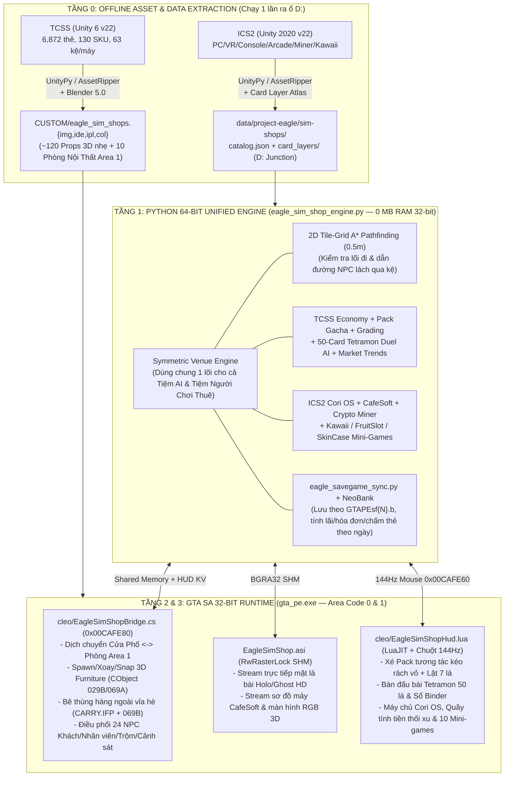

# Báo Cáo Khảo Sát Dịch Ngược & Thiết Kế Kiến Trúc Tích Hợp `Internet Cafe Simulator 2` + `TCG Card Shop Simulator` Vào GTA San Andreas (`gameplay-lab`)

- **Ngày lập báo cáo:** `2026-11-11`
- **Agent thực hiện:** Antigravity (`6a2335a6-d5d7-47e6-9128-fbc62404a3a8`)
- **Subagents khảo sát chuyên trách:**
  - [TCSS Reverse Engineer](conversation://4f263562-4fc3-4de8-85f6-5960f871c389) — Khảo sát & dịch ngược `D:\GTA Archive\Integration Part 2\[tamhongame.com]_TCSS\TCG Card Shop Simulator`
  - [ICS2 Reverse Engineer](conversation://aebb4843-55ab-4b4f-b52e-bac8e053a3fb) — Khảo sát & dịch ngược `D:\GTA Archive\Integration Part 2\[topgamepc.com]_ICS2TC v1.2.5 Viet Hoa`
- **Phiếu công việc:** [`work-items/2026-11-11-antigravity-ics2-and-tcss-integration-research.md`](work-items/2026-11-11-antigravity-ics2-and-tcss-integration-research.md)
- **Chế độ khảo sát:** `100% READ-ONLY` (không chạy `.exe` của 2 game, không sửa bất kỳ file nào trong `D:\GTA Archive` hay `Project Eagle`).

---

## 1. Phần I — Kiểm Tra & Giải Phẫu Kỹ Thuật 2 Thư Mục Game Nguồn

Cả hai thư mục trong `D:\GTA Archive\Integration Part 2` đều là **game góc nhìn thứ nhất (First-Person 3D Simulator) viết trên Unity 64-bit (`PE32+` `x86_64`)** và — **tin cực vui cho việc tích hợp** — cả hai đều biên dịch bằng **Mono `.NET` (`MonoBleedingEdge`, KHÔNG phải `IL2CPP`, `0%` obfuscation)** kèm kho tài nguyên `SerializedFile v22` **không nén, không mã hóa**. Toàn bộ mã nguồn logic C#, công thức toán học, bảng tỷ lệ rớt đồ và mô hình 3D đều đọc và trích xuất được `100%`.

### 1.1. Bảng So Sánh Tổng Quan Kỹ Thuật Hai Bộ Game

| Tiêu chí kỹ thuật | 1. TCG Card Shop Simulator (`OPNeonGames`) | 2. Internet Cafe Simulator 2 (`Cheesecake Dev — v1.2.5 Việt Hóa`) |
| :--- | :--- | :--- |
| **Đường dẫn gốc** | `...\[tamhongame.com]_TCSS\TCG Card Shop Simulator` | `...\[topgamepc.com]_ICS2TC v1.2.5 Viet Hoa\Internet Cafe Simulator 2...` |
| **Dung lượng đĩa** | **`4.64 GiB`** (`233` files; `sharedassets2.resS` = `3.51 GiB`) | **`6.69 GiB`** (`2,068` files; `sharedassets1.resS` = `4.55 GiB`) |
| **Unity Engine** | **Unity 6 LTS (`6000.0.66f2`)**, 64-bit, Built-in RP, D3D11/D3D12 | **Unity `2020.2.2f1`**, 64-bit, Built-in RP + Bakery GPU Lightmap, D3D11 |
| **Mã nguồn Game Logic** | `Assembly-CSharp.dll` (**`1.41 MiB`**, `954` TypeDefs, `6,791` hàm) | `Assembly-CSharp.dll` (**`2.90 MiB`**, `1,282` top-level types) + `FileBasedPrefs.dll` |
| **Middleware đặc biệt** | `AstarPathfindingProject` (NavMeshCut động), `ToonyColorsPro2`, `GA.AnimationInstancing` (tối ưu đám đông GPU bởi General Arcade) | `Vuplex.WebView` nhúng trình duyệt Chromium thật (`libcef.dll` `153 MiB`), `EnviroSky`, `BepInEx 5.4.21` + `XUnity.AutoTranslator` |
| **Bản chất lớp "Việt Hóa"** | Không cài mod Việt Hóa (có bảng `I2Languages` đa ngôn ngữ gốc `3.79 MiB`). | **Phát hiện quan trọng:** KHÔNG có bảng dịch thủ công! Chỉ cài `XUnity.AutoTranslator` gọi Google Translate tự động; file `_AutoGeneratedTranslations.txt` chỉ mới lưu cache **`488` dòng dịch máy thô** (`SPACE = KHÔNG GIAN`, `Resolution = Nghị quyết`). |
| **Cơ chế Save Game** | JSON nguyên tử (`savedGames_Release{0..3}.json`, `165` trường trong `CGameData`) + bản sao `.gd`. | `save-data.save` (`FBPPFileModel` JSON được XOR ký tự với khóa cứng `"my-secret"`). |
| **3D Meshes & Materials** | `976` meshes: **`82.5%` chỉ có `1` submesh**, tối đa toàn game là **`9` submeshes** (`<< 136` trần GTA SA). Kệ/bàn cực nhẹ (`44–1,304` tris)! | `2,939` meshes: **`86.9%` có `1` submesh**, `100%` đồ tiệm net có **`1–6` submeshes** (`68–4,794` tris; trừ tản nhiệt GPU `FinStack1` `25,489` tris cần gộp hộp). |
| **Định dạng Texture2D** | `2,012` textures: **`88.8%` đã là `DXT5` (`954`) + `DXT1` (`833`)** chuẩn native của GTA SA `.txd`! | `9,345` textures: **`39.8%` `DXT1`/`DXT5` gốc** + **`51.8%` `DXT1Crunched`** (giải nén 1 bước bằng `UnityPy`/`AssetRipper`). |

---

### 1.2. Giải Phẫu Sâu #1: `TCG Card Shop Simulator` Có Gì Bên Trong?

Dịch ngược `Assembly-CSharp.dll` và các ScriptableObject (`SO_MonsterData` `PathID=102121`, `StockItemData_Optimized` `PathID=102138`) cho thấy trò chơi có độ sâu sưu tầm & kinh tế cực kỳ bài bản:

1. **Hệ thống Thẻ bài & Vật phẩm Sưu tầm (`6,872` thẻ gốc / `75,592` trạng thái chấm điểm):**
   - **7 Bộ Mở Rộng (`ECardExpansionType`):** `Tetramon` (`1,452` thẻ), `Destiny` (`1,452` thẻ), `Ascension` (`1,452` thẻ), `Ghost` (`80` thẻ hiếm Trắng/Đen FullArt), `Megabot` (`1,356` thẻ), `FantasyRPG` (`600` thẻ), `CatJob` (`480` thẻ).
   - **6 Cấp Viền (`ECardBorderType`):** `Base`, `FirstEdition`, `Silver`, `Gold`, `EX`, `FullArt` × `2` trạng thái `Non-Foil / Foil`.
   - **Chấm điểm Thẻ (`Card Grading TCG 1..10` — giống PSA ngoài đời):** Gửi tối đa `8` thẻ/lần qua 4 gói (`Value $10 / 12 ngày`, `Standard $40 / 7 ngày`, `Express $200 / 4 ngày`, `Premium $1,500 / 2 ngày`). Tỷ lệ ra **`TCG 10` = `38.40%`**, `TCG 9` = `23.04%`, hỗ trợ đập hộp slab chấm lại (`Crack & Re-grade`: `30%` tăng `+1` điểm, `41%` giữ nguyên, `29%` tụt `-1` điểm).
   - **Danh mục Hàng hóa Bán lẻ (`130` SKUs):** `35` mặt hàng TCG (9 loại Pack lẻ, 9 thùng Booster Box 32/64 gói, 8 Starter Deck, 10 hộp Bulk Box đóng gói từ thẻ rác tại `Workbench`), `48` Phụ kiện (chai xịt khử mùi `Deodorant`, hộp đựng bài, xúc xắc, bọc bài, thảm đấu `Playmat` và **16 sản phẩm bản quyền Ultra PRO**), `21` Thú bông & Mô hình (`PigniPlushie`..`GiganiteStatue`), `20` Boardgame, Manga & Comic.
   - **Nội thất & Máy móc (`63` loại `EObjectType` + `183` đồ trang trí `EDecoObject`):** Kệ hàng 1–2 mặt, Tủ kính trưng thẻ lẻ (`CardTable`, `CardDisplayCabinet`), Bàn đấu bài (`PlayTable`), Quầy thu ngân (`CashierCounter 1..3`), Kệ kho (`WarehouseShelf`), Bàn đóng hộp thẻ thường (`Workbench`), Máy xé pack tự động (`AutoPackOpener 1..3`, chứa 9 pack/lượt), Máy xịt thơm tự động cảm biến chuyển động (`AutoCleanser 1..3`).
2. **Xé Pack (`CardOpeningSequence`) & Tỷ lệ Gacha chính xác từ IL:**
   - Mỗi pack có `7` lá: tỷ lệ `Foil` = **`5.0%`/lá**; viền `FullArt` = **`0.25%`**, `EX` = **`0.9975%`**, `Gold` = **`3.95%`**, `Silver` = **`7.58%`**, `1stEd` = **`17.44%`**.
   - **Thẻ Ghost (`ShopLevel > 1`):** `0.10%` (`1/1,000`) ở bộ Tetramon, `0.20%` (`1/500`) ở bộ Destiny/Ascension.
   - **God Pack (`GetGodPackRollIndex`):** Tổng xác suất **`1.888%`** cả 7 lá trong gói đều cùng bậc hiếm (hiếm nhất là *Foil Ghost God Pack* `0.001%` = `1/100,000`!).
3. **Kinh tế Cửa hàng, Khách hàng "Bốc Mùi" & Nhân viên:**
   - **Đường cong độ nhạy giá của khách (`GetCustomerBuyItemChance`):** Bán giảm `-20%` so với giá thị trường -> `100%` mua; đúng giá thị trường (`0%`) -> **`90%` mua**; tăng `+20%` -> `60%`; tăng `+40%` -> `15%`; tăng **`> +60%` -> `0%` mua + ăn đánh giá 1 sao**!
   - **Đại gia Săn Thẻ Hiếm (`Ultra-Whale Roll`):** Có `0.2%–2.0%` khách bước vào mang ví **`+$50,000 .. $1,000,000`** sẵn sàng mua đứt thẻ Ghost FullArt `TCG 10` trưng trong tủ kính!
   - **Khách Thu Mua / Đổi Thẻ Lẻ (`CustomerTradeCardScreen`):** Khách mang thẻ lẻ tới quầy gạ bán hoặc đổi thẻ (`40%` đổi bài, `60%` bán lấy tiền mặt, có mặc cả).
   - **Khách Bốc Mùi (`SmellyCustomer`):** `2%–17%` khách tỏa khói hôi xanh (`m_SmellyMeter = 10`, cần xịt 2 nhát khử mùi); mọi khách sạch đứng trong bán kính **`3.0m`** có `15% × số khách hôi` xác suất bỏ về ngay lập tức và trừ `-30` điểm review!
   - **9 Nhân viên thuê được (`Zackery Cole` .. `Axel Charleton`, lương `$50–$700/ngày`)** có hệ thống cày cấp `Lv 1..10` giảm `7%` thời gian thao tác/cấp.
4. **Đấu Bài `Tetramon TCG` Thực Thụ Đã Có Sẵn Trong Code (`PlayTableGame`):**
   - Không chỉ cho NPC ngồi cày tiền giờ! Trò chơi có **Engine đấu bài 50 lá hoàn chỉnh** (`DeckBuilderScreen` tối đa `4` bản sao/quái, `500 HP` mỗi Tamer, rút `5` lá mở màn + Mulligan, đặt `4` lá Khiên Hộ Vệ úp, `4` ô Nguyên Tố triệu hồi `Basic -> EvoStage1 -> EvoStage2`, kỹ năng tìm bài/đóng băng/buff và tặng `1–4` gói pack miễn phí sau trận), cộng thêm tính năng **Tổ chức Giải Đấu Tại Tiệm (`HostTournamentScreen`, nhánh 8 người)** làm đẩy giá thị trường của đúng dòng thẻ đang thi đấu vào ngày hôm sau!

---

### 1.3. Giải Phẫu Sâu #2: `Internet Cafe Simulator 2` Có Gì Bên Trong?

Dịch ngược `Assembly-CSharp.dll` (`2.90 MiB`) cho thấy ICS2 pha trộn quản lý tiệm net với yếu tố "giang hồ đường phố" cực kỳ hợp chất GTA:

1. **Cấu trúc Trạm Máy & Công thức Tính Tiền Giờ (`TableController`):**
   - **Lắp máy kiểu Ghép Bộ Trên Bàn (KHÔNG phải lắp từng thanh RAM/CPU trong thùng như PC Building Sim):** Thùng máy (`Pc_Case_a..h`) là khối hoàn chỉnh có điểm `itemValue` (`0.5 .. 5.0`). Một bàn trạm hoạt động (`CheckPcIsReady`) thuộc 1 trong 3 hệ:
     1. **PC Thường (`6` món):** `Bàn` + `Ghế` + `Thùng PC` + `Màn hình` + `Bàn phím` + `Chuột` -> Điểm sao `tablePoint = TB cộng 5 món linh kiện`.
     2. **Trạm Console (`6` món):** `Bàn` + `Ghế` + `TV` + `Máy Console` + `Tay cầm 1` + `Tay cầm 2`.
     3. **Trạm VR (`5` món):** `Bàn` + `Thùng PC` + `Kính VR` + `2 Tay cầm VR`.
   - Ngoài ra còn có **Máy thùng `ArcadeMachine`**, **Phòng Riêng VIP `"The Cabine"`** (khách thuê ngủ/chơi trả thụ động `$10–$150/giờ`), **Phòng Nữ Streamer (`StreamerRoom`)**, và **Dàn Đào Bitcoin (`MinerRigCase` gắn tối đa `5` card đồ họa `RigGraphicCard` `50.25 MH/s`/card + máy `BtcMiner` ASIC `75.25 MH/s`)**.
   - **Công thức giá thuê giờ:** `hourPrice = (tablePoint * 2.0) * (slider * 0.6) * (max(2.0, globalReviewStars) * 0.7)`.
2. **Hệ điều hành Chủ Tiệm `"Cori OS"` & Chuỗi Kinh Doanh Đen – Trắng:**
   - Mua sắm thiết bị trên **`Zamazor`** (giao thùng hàng `CargoBox` sau `60s` tới cửa tiệm) hoặc săn đồ cũ giá rẻ / cầm đồ `65%` giá gốc tại **Tiệm Cầm Đồ (`SecondHandShop`)**.
   - Quản lý khách qua **`CafeSoft`**, quét mã độc **`VirusScanner`**, mua bản quyền game hợp pháp trên **`Steem`** — HOẶC mở **`Cmd`** quét cổng IP để **bẻ khóa game lậu (`CrackManager`)**, ghi ra đĩa CD trắng bằng ổ **`ZeroCdWriter`** đem ra phố bán lén cho `PirateGamer`!
   - Mua tin mật từ hacker **`Ghost`** (`$100` báo trước giờ Cảnh sát kiểm tra trong ngày, `$100` bơm review 5 sao ảo, `$500` mở khóa duyệt máy tự động `AutoApprove`).
   - **Bếp ăn & Nhân sự:** `70%` khách ngồi `>= 40s` sẽ gọi đồ ăn/nước uống (`FoodOrder`); có thể tự nấu (`tủ lạnh / lò vi sóng / máy nướng / máy pha cafe`) hoặc thuê **Đầu bếp (`Chef`)**, **Thu ngân (`Employee`)**, **Lao công (`Maid` + Robot hút bụi)** và **Bảo vệ (`Bouncer`)**.
3. **Hệ thống Hỗn Loạn, Nhiệt Độ, Cháy Nổ & Đụng Độ Cảnh Sát:**
   - **Nhiệt độ phòng (`Thermometer`):** Lý tưởng `19–29°C` (phải lắp máy lạnh `AirConditioner` / quạt `Fan`, nhất là khi chạy dàn đào coin tỏa nhiệt!).
   - **Sập cầu dao (`ElectricalSwitch` mỗi `350s`) & Cháy thiết bị (`Fire` + bình chữa cháy `Extinguisher`)**.
   - **Tội phạm & Quỵt tiền:** Khách chơi xong bỏ chạy không trả tiền (`Civil.nopayescape` -> hú còi `HomeAlarm` để `Bouncer` hoặc người chơi cầm **Gậy bóng chày `BaseballBat`** đuổi đánh đòi tiền!), **Trộm đội thùng carton (`Robber.cardboard`)** lẻn vào bê trộm màn hình/PC, **Kẻ đánh bom (`Bomberman`)** lao vào phá bàn máy!
   - **Cảnh sát Đột kích (`Policeman` `17:00–21:00`):** Đi vào tiệm kiểm tra — nếu phát hiện dàn đào coin lậu (`miningPower >= 5`), lập biên bản phạt **`$500`**; ngoài đường còn khám người tịch thu đĩa game lậu (`disc`) và rượt bắt `1–5 Sao` nếu bỏ chạy!
4. **Kho `11` Mini-Game Chơi Được Trực Tiếp:**
   - Gồm `6` trò Arcade đổi thưởng trong hệ **`Kawaii`** (**Gắp thú bông `ClawMachine`**, **Thả xu Plinko `DropGame`**, **Vòng quay `FortuneWheel`**, **Phóng dao `HitReward`**, **Slot 3 cột**, **Mở rương `TreasureHunt`**), **`FruitSlot`** (nổ hũ kẹo ngọt kiểu Sweet Bonanza), **Mở hòm skin CS:GO (`SkinCasePanel`)**, **Xì dách `Blackjack`**, **Cá cược Đua ngựa**, và **`Warcry`** (game 3D RPG đánh quái cày vàng đổi ra tiền thật `1 mmocoin = $0.10` + phần mềm cắm chuột lậu `WarCryHack`).

---

## 2. Phần II — Lựa Chọn Kiến Trúc Đưa Vào Engine GTA San Andreas (`gameplay-lab`)

### 2.1. Tại sao KHÔNG chạy ngầm file `.exe` Unity bên ngoài rồi nhúng cửa sổ?

Nếu mở `Card Shop Simulator.exe` (`Unity 6 D3D11/12`) hoặc `Internet Cafe Simulator 2.exe` (`Unity 2020 + Chromium CEF`) chạy song song với `gta_pe.exe`, chúng ta sẽ vấp phải **4 bức tường chết**:
1. **Tràn VRAM & RAM vật lý:** Máy có `GTX 1650 (4 GB VRAM)` và `16 GB RAM`. Bản thân `gta_pe.exe` đã dùng `~2.2–3.0 GB RAM` + `1.5–2.2 GB VRAM`; bật thêm 1 tiến trình Unity 64-bit nạp `3.5–4.7 GB .resS` sẽ gây tràn `4 GB VRAM` và giật lag nặng.
2. **Đứt gãy hoàn toàn nhân vật Aether & Thế giới GTA:** Cả 2 game gốc đều khóa cứng góc nhìn thứ nhất không có thân người trên một con phố giả bé xíu. Người chơi mất nhân vật **Aether (`model_id = 0`)**, không thể dẫn bạn gái **WaifuLink** đi xé pack/ngồi net đôi, không dùng được vũ khí/xe cộ/cảnh sát của GTA.
3. **Bản gốc của cả 2 game KHÔNG HỀ CÓ "Mode Khách Hàng"!** Trong TCSS và ICS2 gốc, bạn chỉ có thể làm chủ 1 tiệm duy nhất — hoàn toàn không có các tiệm của NPC để bạn bước vào làm khách mua bài, thuê máy net tính giờ hay gọi mì tôm.
4. **Không gắn kết được với 20 vùng lãnh thổ của `gameplay-lab`** (`Los Santos`, `San Fierro`, `Las Venturas`, `Liberty City`, `Vice City`, `Chicago`, `INLAND-03A`, `WIBU-01 Akihabara`, `Mondstadt`...).

---

### 2.2. Kiến Trúc Đề Xuất: **Unified Native Sim-Shop Architecture (`Asset Rip + Python 64-bit Core + Dynamic GTA 3D CObject + ASI/Lua Thin-Client`)**

Chúng ta đưa **100% trải nghiệm của cả 2 game vào chạy NATIVE ngay bên trong engine GTA SA (`gameplay-lab`)** bằng cách kết hợp 4 tầng công nghệ đã được chứng minh thực chiến trên `EagleWallStreet` và `Cinema & Library`:

---

## 3. Phần III — Thiết Kế Chi Tiết 2 Chế Độ Chơi Trong Thế Giới GTA

Điểm đột phá lớn nhất của kiến trúc này là **Tính Đối Xứng Chủ – Khách (Symmetric Venue Model)**: cả Tiệm của NPC lẫn Tiệm do Aether thuê đều chạy trên cùng một cấu trúc dữ liệu `ShopVenue` (chứa danh sách nội thất 3D `placed_objects[]`, tồn kho `shelf_stock[]`, dàn máy `stations[]`, nhân viên `staff[]`, bảng giá và điểm uy tín `1.0★–5.0★`).

### 3.1. Chế Độ Khách Hàng (`Customer Mode` — ~`20–24` Shop Rải Rác Toàn Bản Đồ)

Đặt **`12` Tiệm Thẻ Bài (TCG Shops)** và **`12` Tiệm Internet / Cyber-Arcade** trải đều khắp các thành phố lớn (`Los Santos`, `San Fierro`, `Las Venturas`, `Liberty City`, `Vice City`, `Chicago`, `Bullworth`, `INLAND-03A` Bắc Chicago, `WIBU-01` Đảo Nhật Bản và `Mondstadt`), tận dụng ngay các tòa nhà 3D cực đẹp có sẵn trong kho `Mod Donor Library` (như **`radio_kaikan`**, **`asobitcity_hobby`** cho tiệm bài Akihabara; **`gigo`**, **`tsukumo_support`**, **`takarajima24`** cho Cyber Cafe / Linh kiện PC):

1. **Trải nghiệm tại Tiệm Thẻ Bài của NPC (Customer Mode):**
   - Bước qua cửa `[E]` vào nội thất 3D đông vui (có nhân viên thu ngân Anime, khách đứng lựa pack, cặp NPC ngồi đấu bài):
   - **Mua & Xé Pack ngay tại chỗ:** Lựa các loại Booster Pack / Booster Box (`Tetramon`, `Destiny`, `Ascension`, `Megabot`, `FantasyRPG`, `CatJob`) theo tồn kho và biến động giá trong ngày của từng vùng (ví dụ thánh địa **Akihabara `WIBU-01`** hay có hộp *Destiny Legendary* và tủ kính bán lẻ thẻ **Ghost / FullArt `TCG 10`** đắt giá; tiệm nhỏ ở Bullworth/Palomino bán nhiều *CatJob* / *Starter Deck* giá mềm).
   - **Giao dịch tại Quầy:** Bán lại thẻ trùng vừa xé được cho chủ tiệm lấy tiền mặt ngay, trả phí gửi thẻ quý đi **Chấm điểm `TCG 1..10`** (nhận thông báo trên `EaglePhone` sau `2–12` ngày game!), hoặc mua Binder/Playmat Ultra PRO.
   - **Ngồi Bàn Đấu Bài (`Play Table`) & Giải Đấu Tuần:** Đóng phí bàn hoặc vé giải đấu `8` người (`Standard`, `Pauper`, `Foil`, `FullArt`) để trực tiếp đánh ván bài **50 lá Tetramon TCG** với các bài thủ NPC (hoặc **rủ bạn gái `WaifuLink` đi hẹn hò xé pack & đấu bài đôi**!). Thắng giải nhận tiền thưởng + Pack hiếm + Cúp trưng bày.
2. **Trải nghiệm tại Tiệm Net / Cyber-Arcade của NPC (Customer Mode):**
   - Bước vào quầy lễ tân chọn thuê **Máy Thường (`$4/h`)**, **Dàn VIP RGB (`$12/h`)**, **Trạm VR**, hoặc **Phòng Đôi Khép Kín `"The Cabine"` (`$25/h` — có thể vào nghỉ ngơi hồi máu/qua giờ hoặc ngồi chơi riêng tư cùng Waifu!)**.
   - **Ngồi vào ghế máy tính / máy thùng Arcade bấm `[E]`:**
     - Chơi trực tiếp trọn bộ **10+ Mini-games**: Gắp thú bông `Kawaii Claw Machine` (gắp trúng thú bông Tetramon/Anime mang về đặt trang trí trong tiệm riêng hoặc tặng bạn gái!), thả xu `Plinko`, phóng dao `Knife Hit`, quay hũ `FruitSlot`, mở hòm `CS:GO SkinCase`, đánh `Warcry` cày vàng RMT.
     - **Gọi đồ ăn / nước tăng lực tại máy (`FoodOrder`):** Bấm gọi Ramen / Burger / Cà phê trên màn hình máy trạm -> NPC Đầu bếp/Phục vụ bưng khay 3D tới tận bàn hồi thể lực & buff may mắn!
     - **Góc Ngầm ("Shady Cyber Gameplay"):** Tại các quán net cỏ ở hẻm Ganton / Carcer City, Aether có thể lén cắm USB chạy `Cmd` bẻ khóa game hoặc cài trộm mã đào coin lên máy quán net (coi chừng chủ quán/bảo vệ phát hiện cầm gậy bóng chày rượt!), hoặc gặp NPC `PirateGamer` / Hacker `Ghost`.

---

### 3.2. Chế Độ Chủ Tiệm (`Shop Owner Mode` — Thuê Mặt Bằng, Tự Xếp Đồ 3D & Vận Hành Chuỗi)

1. **Đi Thuê Mặt Bằng Thực Tế Trên Bản Đồ (`10–15` Mặt Bằng `"FOR LEASE"` Phân Hạng):**
   - Dọc các con phố có sẵn các mặt bằng treo biển 3D **`"COMMERCIAL SPACE FOR LEASE"`** (cùng ứng dụng **Bất Động Sản Thương Mại** trên `EaglePhone` hiển thị vị trí GPS, diện tích, lưu lượng khách qua lại, tỷ lệ khách Đại gia `Whale %` và mức độ an ninh):
     - *Hạng Khởi Nghiệp (Tier S — Garage / Hẻm Idlewood, Đông LS, Bullworth):* Giá thuê rẻ (`$80/ngày`), diện tích nhỏ (`1` phòng mở rộng lên `3` phòng), khách bình dân, dễ gặp **Trộm thùng carton (`Robber`)**, khách quỵt tiền và cúp cầu dao.
     - *Hạng Trung Cấp (Tier M — Phố thương mại San Fierro Queens, Downtown Chicago, North Chicago `INLAND-03A`):* Giá thuê vừa (`$250–$450/ngày`), mặt bằng 2 gian + kho sau (`Lot B`), lượng khách ổn định.
     - *Hạng Đế Chế (Tier L — Đại lộ Vinewood, Las Venturas Strip, Thánh địa **Akihabara `WIBU-01`**):* Giá thuê đắt (`$1,200+/ngày`), mặt bằng đại sảnh 2 tầng cực rộng, tỷ lệ xuất hiện **Khách Đại Gia (`$50,000–$1,000,000`)** săn thẻ Ghost `TCG 10` và khách thuê phòng VIP `"The Cabine"` cao gấp 5 lần!
   - Khi thuê, người chơi được chọn giấy phép kinh doanh: **(1) Tiệm Thẻ Bài TCG**, **(2) Tiệm Internet & Arcade**, hoặc **(3) Tổ Hợp Lai `Otaku Cyber & TCG Lounge`** (một nửa sàn đặt dàn PC/Cabin chơi game, một nửa đặt kệ Booster Pack, tủ kính thẻ hiếm và bàn đấu giải — sự kết hợp cực kỳ ăn khớp của cả 2 game!).

2. **Vận Chuyển Thùng Hàng Ngoài Vỉa Hè & Đặt Nội Thất 3D Tự Do Trong GTA:**
   - **Đặt hàng `Zamazor` / `TCG Wholesale`:** Đặt mua bàn ghế, dàn PC, kệ bài, thùng Booster Box 64 gói... Sau `30–60s`, xe tải giao hàng đỗ ngay lề đường thật (`dropoff_pos`) trước cửa tiệm vừa thuê và thả các kiện **`CargoBox` 3D** trên vỉa hè.
   - **Bê thùng vào tiệm (Góc nhìn thứ 3 của Aether):** Aether chạy ra vỉa hè bấm `[E]` nhấc thùng hàng trên tay (dùng đúng bộ animation bê thùng nguyên bản **`CARRY.IFP` (`liftup` -> `crry_prtial` -> `putdwn`)** + opcode `069B ATTACH_OBJECT_TO_CHAR` của GTA SA!), đi vào trong tiệm để khui thùng lắp kệ hoặc chất hàng đầy lên các ngăn kệ! *(Khi giàu có thể thuê nhân viên Bốc vác/Kho tự bê hàng từ vỉa hè vào kho `WarehouseShelf`).*
   - **Chế độ Xây Dựng Nội Thất 3D (`Build / Decor Mode`):**
     - Bấm phím mở Build Mode trong tiệm: camera nâng góc nhìn chéo (hoặc giữ góc nhìn tự do), hiển thị mô hình Ghost 3D của Kệ bài / Bàn PC / Máy thùng / Máy lạnh / Máy xịt thơm di chuyển mượt theo tia chuột, xoay bằng `Con lăn chuột` / `Q,E`, tự động **hút khít mép `0.30m` (Magnetic Snapping)** giống hệt TCSS!
     - Các linh kiện trên mặt bàn (`Vỏ Case RGB`, `Màn hình`, `Phím Chuột`, `Ghế` hoặc `5 Card VGA` trong giàn đào coin) tự động **khóa ngàm chính xác (`Socketed Attachment` `069A`)** vào mặt bàn ngay khi gắn — đẹp mắt 100% và không bao giờ rơi lệch.

3. **Vận Hành Trực Tiếp vs. Tự Động Hóa & Thông Báo Qua `EaglePhone`:**
   - **Khi Aether đứng trong tiệm:** Có thể tự đứng quầy thu ngân (thối tiền mặt / bấm máy POS như TCSS), tự duyệt máy `CafeSoft`, tự cầm **Bình xịt (`WEAPON_SPRAYCAN`)** xịt khách bốc mùi, cầm **Bình cứu hỏa (`WEAPON_FIREEXTINGUISHER`)** dập lửa dàn trâu cày quá nhiệt, cầm **Gậy bóng chày (`WEAPON_BAT`)** đập tên trộm núp thùng carton hoặc khách bùng tiền nét, và đón tiếp Cảnh sát đi tuần kiểm tra dàn đào coin/game lậu!
   - **Khi Aether lái xe đi chơi xa (Chạy nền thông minh):** Hệ thống nhân sự đã thuê (`Thu ngân`, `Xếp kệ`, `Đầu bếp`, `Lao công`, `Bảo vệ`) tự động vận hành tiệm theo chỉ số kỹ năng `Lv 1..10`, trừ tồn kho thật từng giờ và cộng tiền lãi ròng vào tài khoản doanh nghiệp trên `NeoBank`! Nếu tiệm hết sạch pack trên kệ, sập cầu dao hoặc bị cảnh sát phạt đào coin lậu, app **`EagleBiz` trên `EaglePhone`** nhắn tin báo động ngay để Aether đặt thêm hàng từ xa hoặc phóng xe về xử lý.

---

## 4. Phần IV — Phân Tích Thẳng Thắn: DỄ Ở ĐÂU & KHÓ Ở ĐÂU?

### 4.1. Những Hạng Mục DỄ & RẤT THUẬN LỢI (`Low Risk / High Feasibility`)

| Hạng mục | Vì sao DỄ trong kiến trúc hiện tại của `gameplay-lab`? |
| :--- | :--- |
| **1. Đọc & chuyển thể toàn bộ Logic Kinh tế / Gacha / Giá thị trường / Đấu bài** | Cả 2 file `Assembly-CSharp.dll` đều là `.NET` CIL sạch `100%` không mã hóa. Mọi công thức toán học (xác suất pack, chấm điểm `TCG 1..10`, biến động giá, điểm sao máy trạm, đào BTC, lương nhân viên) đã trích xuất rõ từng hằng số và chạy cực nhẹ trên Python Sidecar 64-bit (`< 0.5 ms/tick`). |
| **2. Trích xuất 3D Props (Kệ bài, Bàn PC RGB, Ghế, Arcade, ASIC) sang `.dff/.txd`** | Lưới 3D gốc cực kỳ tối ưu (`44 – 4,794` tris, `1 – 6` vật liệu `<< 136`), không có bundle mã hóa, và đa số texture đã ở sẵn định dạng nén phần cứng `DXT1`/`DXT5` đúng chuẩn RenderWare D3D9. |
| **3. Không lo chạm trần RAM 32-bit hay trần ID của GTA SA** | Toàn bộ gói chỉ tốn **~`120` Model ID** (trên **`17,408` ID `.COL3` còn trống**, chưa tới `0.7%`!) và `1` file `.img` riêng. Đồ nội thất động (`CObject`) chỉ spawn khi Aether bước vào phòng `Area Code = 1` (`40–120` vật thể trên tổng `70,000` slot `ObjectPool`) và xóa sạch `100%` ngay khi bước ra phố -> **`0 MB` RAM tăng thêm khi chạy xe ngoài thế giới mở!** |
| **4. Cơ chế Bê thùng, Xịt khử mùi, Chữa cháy, Đánh trộm & Cảnh sát** | Trùng khớp kỳ lạ với vũ khí & animation gốc có sẵn của GTA SA (`CARRY.IFP`, `Spraycan ID 41`, `Fire Extinguisher ID 42`, `Baseball Bat ID 5`, hệ thống `Wanted Stars` & `CPed` combat) — thậm chí mượt và "đã tay" hơn bản gốc Unity! |
| **5. Chuột cảm ứng 144Hz, Ngân hàng, Lịch ngày tháng & Save theo Slot** | Đã xây xong hoàn chỉnh qua `EaglePhone OS v6.3` (`0x00CAFE60` + `0x00CAFE78`), `NeoBank` và `eagle_savegame_sync.py`. Không phải làm lại từ đầu. |

---

### 4.2. Những Hạng Mục KHÓ & Giải Pháp Kỹ Thuật Triệt Để (`Hard Bottlenecks & Engineering Solutions`)

| Điểm KHÓ thực tế | Nguyên nhân gốc trong Engine GTA SA (2004) | Giải pháp kỹ thuật giải quyết triệt để |
| :--- | :--- | :--- |
| **KHÓ #1 (Khó nhất): AI Khách hàng tìm đường đi quanh các kệ/bàn do Chủ tiệm tự đặt tự do** | Unity có `AstarPathfindingProject` tự cắt NavMesh thời gian thực khi đặt kệ. GTA SA **không có NavMesh động trong nội thất** — lệnh `TASK_GO_STRAIGHT_TO_COORD` chỉ đi thẳng, nếu người chơi đặt kệ chắn ngang NPC sẽ đâm đầu vào kệ đi bộ tại chỗ. | **Lưới Ô Vuông `0.5m` + A\* Trên Python 64-bit:** Chia sàn phòng `Area 1` thành ma trận ô `0.5m × 0.5m` trong Python. Khi người chơi rê chuột đặt kệ 3D, Python chạy kiểm tra liên thông BFS tức thì (nếu bít kín lối đi tới quầy/cửa thì hiện Ghost đỏ không cho đặt). Khi NPC di chuyển, Python giải A\* (`< 0.08 ms`) và cấp chuỗi tọa độ góc rẽ `(x, y)` qua Shared Memory cho CLEO dẫn NPC đi vòng qua mọi dãy kệ mượt mà! |
| **KHÓ #2: Vật lý chồng đồ nhỏ lên mặt bàn (Phím, Chuột, Màn hình, Hộp bài lẻ)** | Trong ICS2, linh kiện thả rơi tự do bằng PhysX Rigidbody. Trong GTA SA, chồng nhiều dynamic `CObject` nhỏ có va chạm lên nhau sẽ bị rung, nổ vật lý hoặc lọt xuyên mặt bàn. | **Cơ chế Ngàm Khóa Cứng (`Socketed Composite Attachment` `069A`):** Người chơi đặt tự do **Bàn / Kệ gốc**; còn linh kiện PC hoặc hàng hóa trên kệ tự động bắt dính vào tọa độ ngàm con `(dx, dy, dz)` gắn liền với Bàn/Kệ gốc và tắt va chạm rời (`0382 false`). Vừa nhìn thấy rõ từng món đồ 3D nâng cấp trên bàn/kệ, vừa ổn định tuyệt đối 100%. |
| **KHÓ #3: TCSS không có sẵn `6,872` file ảnh thẻ bài hoàn chỉnh + Hiệu ứng Xé Pack 3D & Foil cầu vồng** | TCSS ghép động các lớp ảnh (Quái + Nền hệ + Viền + Foil shader + Chữ) lúc chạy và uốn cong vỏ pack bằng `SkinnedMeshRenderer`. Nếu xuất sẵn `6,872` thẻ ra `.txd` sẽ tốn hàng ngàn slot và phình đĩa. | **On-Demand Python Compositor + `ASI RwRasterLock`:** Chỉ trích xuất bộ lớp gốc (`~333` hình quái + `6` khung viền + `8` nền hệ, tổng `< 90 MB` trên ổ `D:`). Khi xé pack hoặc mở Binder/Bàn đấu, Python ghép lá bài nét cao trong `< 4 ms` rồi stream thẳng vào RAM GPU qua `EagleSimShop.asi` (kèm hiệu ứng dải sáng Holo lướt theo chuột 60 FPS). Xé pack dùng cơ chế kéo vệt cắt chuột tương tác + âm thanh gốc `"SFX_OpenPack"`. |
| **KHÓ #4: Nhúng trình duyệt `libcef.dll` (`153 MB`) và thế giới con 3D `Warcry MMO` của ICS2** | Nhét Chromium vào tiến trình 32-bit `gta_pe.exe` sẽ ngốn sạch không gian địa chỉ ảo `4 GiB VAS`. Sub-world 3D `Warcry` của Unity có shader/map riêng không cần thiết khi đã ở trong thế giới 3D của GTA. | **Bỏ hoàn toàn `libcef.dll`**, xây mạng nội bộ `Cori OS` (`Zamazor`, `Steem`, `Ghost`, `Card Grading Web`) native 100% bằng `LuaJIT`. Port trọn vẹn **10/11 mini-games 2D/Arcade (`Kawaii`, `FruitSlot`, `SkinCase`...) + Đấu bài `Tetramon 50 lá`** lên Canvas 1080p (cho phép bấm `[E]` chơi ngay trên cả máy thùng Arcade!). Riêng `Warcry` chuyển thành **2.5D Dungeon Raid + Bot Cày Vàng RMT** trên màn hình PC (hoặc **Đấu Trường VR 3D** cho Aether vào chém quái thật!). |
| **KHÓ #5: Dữ liệu Việt Hóa của ICS2 thiếu & lỗi dịch máy (`488` dòng) + Giới hạn `CFont` GTA** | File `_AutoGeneratedTranslations.txt` trong bản ICS2 là bản dịch tự động Google Translate dở dang; còn `CFont` gốc của GTA SA chỉ nhận ASCII 7-bit. | Giữ chuẩn Tiếng Anh sạch trên HUD giống `EaglePhone OS v6.3` (trích từ bảng `I2Languages` gốc của 2 game), HOẶC nếu muốn hiển thị **Tiếng Việt có dấu sắc nét** trên màn hình máy chủ `Cori OS` và thẻ bài thì render bằng `Pillow` TrueType Unicode trong Python rồi đẩy qua buffer `BGRA32` của `EagleSimShop.asi` (không chạm `CFont` nên `0%` nguy cơ crash). |

---

## 5. Phần V — Lộ Trình Triển Khai Đề Xuất Theo Từng Giai Đoạn (Modular Phases)

Để đảm bảo mỗi bước đều kiểm thử chắc chắn (`Part A Offline` + `Part B Live DirectX 9`) và người chơi có thể trải nghiệm sớm ngay từ giai đoạn đầu, lộ trình tối ưu chia làm **4 Phase độc lập**:

1. **Phase 1 — Trích Xuất Tài Nguyên (`D:\GTA Archive`) & Lõi Engine Đôi (`TCSS + ICS2 Core Offline`):**
   - Viết bộ công cụ Python tự động trích xuất từ `Integration Part 2` (chỉ đọc): toàn bộ Database `6,872` thẻ bài + lớp ảnh quái/khung/pack, `130` SKU hàng hóa, danh mục linh kiện PC/VR/Console/Arcade/Miner, âm thanh `.ogg`/`.wav` và bộ ~`100–120` mô hình 3D chuẩn hóa sang RenderWare `.dff/.txd/.col`.
   - Xây dựng và kiểm thử 100% offline `eagle_sim_shop_engine.py`: mở pack Gacha, chấm điểm `TCG 1..10`, biến động giá thị trường, đấu bài `Tetramon 50 lá`, quản lý trạm `CafeSoft`, đào BTC và `10` mini-games giải trí.
2. **Phase 2 — Triển Khai `Mode Khách Hàng` (`24` Shop Hoạt Động Trên Toàn Bản Đồ `gameplay-lab`):**
   - Đặt `12` Tiệm Thẻ Bài + `12` Tiệm Cyber-Arcade trải khắp 20 vùng lãnh thổ (đặc biệt là cụm Akihabara `WIBU-01`, `INLAND-03A`, Los Santos, San Fierro, Las Venturas, Chicago, Liberty City, Mondstadt) kèm 4 mẫu nội thất `Area Code = 1`, cầu `EagleSimShopBridge.cs` (`0x00CAFE80`), plugin màn hình động `EagleSimShop.asi` và `EagleSimShopHud.lua`.
   - Người chơi có thể đi khắp bản đồ mua/xé pack, sưu tầm sổ Binder, gửi chấm điểm thẻ, ngồi bàn đấu bài `Tetramon`, thuê máy net/phòng `"The Cabine"`, gọi đồ ăn và chơi toàn bộ máy gắp thú / mini-games!
3. **Phase 3 — Triển Khai `Mode Chủ Tiệm` (`12–15` Mặt Bằng Cho Thuê + Đặt Đồ 3D + Bê Thùng Hàng + Nhân Sự):**
   - Mở khóa hệ thống thuê mặt bằng `"FOR LEASE"` (nhiều phân khúc giá/vùng miền, cho phép mở Tiệm Bài, Tiệm Net hoặc Tổ hợp Lai).
   - Tích hợp **Chế độ Đặt Nội Thất 3D Tự Do + Hút Từ Tính + Lưới A\* Dẫn Đường NPC**, giao thùng hàng ngoài vỉa hè (`CARRY.IFP`), quầy thu ngân thối tiền, thuê nhân viên Anime (`Lv 1..10`), tổ chức giải đấu TCG tại tiệm và **App Quản Lý Từ Xa trên `EaglePhone`**.
4. **Phase 4 — Sự Kiện Giang Hồ Đường Phố & Tích Hợp Chéo (`WaifuLink` + `EagleCapitalEngine`):**
   - Bổ sung trọn vẹn chất "hỗn loạn" đặc trưng: Khách hôi + Bình xịt, Sập cầu dao, Cháy dàn đào coin + Bình cứu hỏa, Trộm thùng carton, Khách bùng tiền nét, Cảnh sát kiểm tra định kỳ `17:00–21:00`.
   - Đấu nối hẹn hò `WaifuLink` (dẫn bạn gái đi xé pack hiếm, gắp thú bông Kawaii tặng quà cộng tim `♥`, ngồi phòng đôi `"The Cabine"`) và cho phép đưa chuỗi cửa hàng lên thành công ty con khi nối với `EagleCapitalEngine` (`Capitalism Lab + WSR`)!
