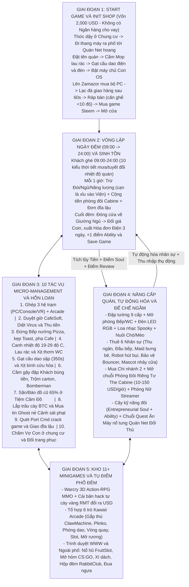

# Bóc Tách Chuyên Sâu Toàn Bộ Feature & Flow Của `Internet Cafe Simulator 2` (`ICS2 — v1.2.5`)

Tài liệu này đi sâu **riêng một mình tựa game thứ 2: `Internet Cafe Simulator 2 (The Cabine v1.2.5)`** theo đúng trình tự trải nghiệm thực tế của người chơi — từ lúc **thức dậy ở chung cư đi ra dựng quán net bỏ hoang -> đón khách & xử lý đủ thứ hỗn loạn hàng ngày -> nâng cấp quán, thuê nhân viên, mở phòng đôi `"The Cabine"`, đào Bitcoin lậu, crack đĩa game chợ đen -> chơi `11+` minigame** — kèm **Bảng Checklist `30` hạng mục (`ICS2-01..30`) ở cuối bài** để bạn đi từng bước chốt giữ/gộp/bỏ y hệt như chúng ta vừa làm với `TCG Card Shop Simulator`.

> [!NOTE]
> Mọi con số, công thức tính tiền giờ/tiền điện, xác suất sự kiện, tên ứng dụng trên `Cori OS` và hành vi AI dưới đây đều được trích xuất trực tiếp từ mã CIL `Assembly-CSharp.dll` (`2.90 MiB`, `1,282` kiểu dữ liệu) của bản PC `Unity 2020.2.2f1`.

---

## Tổng Quan Sơ Đồ Luồng Chơi Từ Đầu Đến Cuối (`End-to-End Flow`)

---

## GIAI ĐOẠN 1 — Start Game & Init Shop (`Ngày 1: Từ Căn Hộ Chung Cư Ra Dựng Quán Net Hoang`)

Khác hẳn với `TCSS` (nơi người chơi chỉ đứng loanh quanh trong tiệm bài), `ICS2` đặt người chơi vào một **khu phố mở thu nhỏ** nối liền căn hộ cá nhân, các cửa tiệm dịch vụ/chợ đen ngoài đường và mặt bằng quán Internet của mình.

### 1.1. Trạng thái xuất phát điểm & 3 Công tắc Đầu Game (`GameManager::Start`)
- **3 Công tắc tùy chọn ngay lúc bấm New Game:**
  1. **`Character Stats` (`ON/OFF`):** Bật/tắt 3 thanh sinh tồn cá nhân (`Đói`, `Buồn ngủ`, `Năng lượng`).
  2. **`Family` (`ON/OFF`):** Bật/tắt hệ thống **Vợ (`Wife`) & Con trai (`Boy`)** sống chung trong căn hộ.
  3. **`Saboteur` (`ON/OFF`):** Bật/tắt kẻ đánh bom cảm tử **`Bomberman`** lao vào phá quán.
- **Vốn khởi đầu:** **`$2,000.00`** tiền mặt. *(Lưu ý quan trọng từ code gốc: `ICS2` **hoàn toàn không có Ngân hàng hay Vay nợ `Bank/Loan`** — nếu tiêu lố hết vốn đầu game, người chơi buộc phải bê đồ ra Tiệm Cầm Đồ bán `65%`, đi làm nhiệm vụ cho gã Ăn mày hoặc đánh bạc kiếm vốn).*
- **Điểm xuất phát:** Thức dậy trong căn hộ tầng lầu, đi thang máy sắt cũ (`OldElevator`) xuống phố và cuốc bộ tới mặt bằng **Tiệm Internet bỏ hoang (`MyCafe`)** đầy rác bẩn, mất điện, tối om.
- **Đồ đạc có sẵn trong quán ngày đầu:**
  - `1` bàn **Máy Chủ Quản Trị (`PlayerComputer`)** chạy hệ điều hành riêng mang tên **`Cori OS`**,
  - `1` Cây lau nhà (`Mop`), `1` Nhiệt kế treo tường (`Thermometer`),
  - `1` Hộp **Cầu dao điện tổng (`ElectricalSwitch` — đang gạt OFF)**, `1` Công tắc đèn (`LightSwitch`), `1` Cửa ra vào (`Door`) và công tắc biển hiệu `OPEN / CLOSED` (`OpenCloseSwitch`).

### 1.2. Đi từng bước khởi tạo quán (`11` bước `TutorialHelper`)
1. **Bước 1 — Đặt tên Quán Net:** Nhập tên quán (`cafename`), tên này sẽ hiện thẳng lên bảng hiệu mặt tiền (`internetCafeLabelTxt`) và đầu trang đánh giá của khách.
2. **Bước 2 — Cầm cây lau nhà dọn rác khai hoang:** Nhặt cây **`Mop`** dựng góc tường, đi quét sạch từng đống rác bẩn (`Trash`) vương vãi trên sàn tiệm cũ.
3. **Bước 3 — Đóng cầu dao điện tổng & Bật đèn:** Đi tới hộp điện kỹ thuật bật **`ElectricalSwitch`** (`electric = true`) cấp nguồn cho toàn tiệm và bật công tắc đèn sáng.
4. **Bước 4 — Ngồi vào ghế Chủ Quán khởi động `Cori OS`:** Bấm ngồi vào **`PlayerComputer`**, nhấn nút nguồn thùng máy nghe tiếng `beep` BIOS và chờ màn hình Desktop **`Cori OS`** hiện lên.
5. **Bước 5 — Mở sàn thương mại `Zamazor` đặt bộ PC đầu tiên:**
   - Mở trình duyệt **`WWW`** -> vào trang mua sắm **`Zamazor`**.
   - Chọn mua trọn bộ `6` món linh kiện cơ bản cho 1 chỗ ngồi: **`1 Bàn (`Table`) + 1 Ghế (`Chair`) + 1 Thùng máy (`PC Case`) + 1 Màn hình (`Monitor`) + 1 Bàn phím (`Keyboard`) + 1 Chuột (`Mouse`)`** rồi bấm thanh toán giỏ hàng (`completePaymentBtn`).
6. **Bước 6 — Chờ `60 giây` đón... Lạc Đà Giao Hàng (`Camel`):**
   - Sau đúng **`60s`** kể từ lúc bấm mua, một chú **Lạc đà thồ hàng (`Camel`)** đi bộ dọc con phố tới dừng trước cửa quán và thả các thùng hàng **`CargoBox`** xuống vỉa hè!
7. **Bước 7 — Khui thùng, Đựng Ba-lô & Ráp Trạm Máy Tính Đầu Tiên (`CheckPcIsReady`):**
   - Mở từng thùng `CargoBox` lấy đồ (có thể cất gọn vào **Ba-lô cá nhân `Backpack`** tối đa `10` ô thay vì chạy đi chạy lại từng món).
   - Đặt `Bàn` xuống sàn quán -> đặt `Thùng Case`, `Màn hình`, `Bàn phím`, `Chuột` lên mặt bàn (tự động nhận diện qua vùng va chạm vật lý `TableControllerTrigger`).
   - Đặt `Ghế` đối diện màn hình: code kiểm tra hàm **`MonitorAndChairIsFIT()`** bắt buộc **góc xoay của ghế lệch không quá `10°` so với màn hình** (nếu đặt xéo sẽ hiện cảnh báo đỏ `warningChairAndMonitorNotFit`!). Khi đủ 6 món + có điện + ghế thẳng góc, màn hình bật sáng hiện tên máy và dấu tích xanh **`pcReady = true`**!
8. **Bước 8 — Cài đặt phần mềm quản lý trên `AppsManager`:** Mở kho ứng dụng `AppsManager` trên `Cori OS`, bấm tải về 2 phần mềm thiết yếu: **`CafeSoft`** (quản lý tính giờ phòng máy) và **`Steem`** (cửa hàng mua bản quyền game).
9. **Bước 9 — Mua ít nhất `1` Tựa Game Bản Quyền trên `Steem`:** Dàn máy xịn tới đâu mà kho game quán `0` trò thì khách vừa ngồi xuống sẽ đứng phắt dậy chửi và đánh giá 1 sao (`"nogamecafe"`).
10. **Bước 10 — Mở Cánh Cửa Quán & Gạt biển `OPEN`:** Ra mở toang cánh cửa vật lý (`Door::OpenDoor` — nếu quên mở cửa mà gạt biển `OPEN` sẽ bị báo lỗi chặn!) rồi bật công tắc `OpenCloseSwitch` sang **`OPEN`**.
11. **Bước 11 — Duyệt yêu cầu thuê máy đầu tiên & Thu tiền:** Khách đầu tiên bước vào ngồi ghế -> trên máy chủ nổ chuông thông báo `CafeSoft` xin thuê máy -> chủ quán bấm **Approve** mở khóa màn hình -> hết giờ khách ra quầy thanh toán -> hoàn thành hướng dẫn tân thủ!

---

## GIAI ĐOẠN 2 — Vòng Lặp Vận Hành Hàng Ngày (`09:00 – 24:00`), Sinh Tồn & AI Khách Hàng

### 2.1. Nhịp thời gian ngày đêm, Thời tiết động & Cơ chế Ngủ để Save
1. **Giờ đón khách & Thời tiết `10` trạng thái (`EnviroSky`):**
   - Hệ thống sinh khách hoạt động từ **`09:00 sáng` đến `24:00 đêm`** (`CivilManager::SendCustomer`). Đúng `19:00` tối hệ thống đèn đường ngoài phố tự bật sáng.
   - Bầu trời xoay tua **`10` kiểu thời tiết** (`Clear Sky`, `Cloudy 1..3`, `Foggy`, `Light Rain`, `Heavy Rain`, `Light Snow`, `Heavy Snow`, `Storm`) — trời mưa/bão vừa tạo hiệu ứng hạt mưa bám màn hình vừa **làm giảm nhiệt độ phòng trong quán Net**!
2. **Nhịp mỗi `1 Giờ` trong game (`GameManager::OneHourPassed`):**
   - Trừ dần thanh **Đói (`statHunger`)**, **Ngủ (`statSleep`)** và **Năng lượng (`statEnergy`)** của người chơi (nếu kiệt sức chạm đáy sẽ ngất xỉu và tỉnh dậy ở **Bệnh viện `hospitalPoint`** ngoài phố!).
   - Cộng doanh thu thụ động theo giờ của khu phòng riêng **`The Cabine`** vào két chi nhánh 2.
   - Kiểm tra tiến độ làm việc của Vợ/Con và có xác suất phát sinh **đơn đặt mua đĩa game lậu mới (`SpawnCrackOrder`)**.
3. **Kết thúc ngày bằng Giường Ngủ (`SleepManager` -> `DailyChanges`):**
   - Trò chơi **tắt Auto-Save (`AutoSaveData = false`)**: cuối đêm người chơi phải đóng cửa quán, đi bộ về căn hộ bấm nằm ngủ trên giường để sang ngày mới và lưu tiến trình (`save-data.save`):
     - Cộng **`+1` điểm kỹ năng cơ thể (`Ability Point`)**,
     - Biến động lại tỷ giá sàn **Crypto (`-9%` đến `+8%`)** và làm mới kho hàng **Tiệm Cầm Đồ**,
     - Nếu ngày chẵn chia hết cho `3`: tính toán và gửi **Hóa đơn Tiền Điện 3 ngày (`Electricity bill`)** kèm hóa đơn lương nhân viên,
     - Roll ngầm **`30%` xác suất ngày mai sẽ có Cảnh sát kiểm tra quán** vào một khung giờ ngẫu nhiên từ `17:00` đến `21:00` (`policemanDay` & `policemanTime`).

### 2.2. Hành trình `13` trạng thái của AI Khách Hàng (`Civil`) & `14` Lý do Review
- **Khi khách bước qua cửa quán:**
  - Ngay lúc đạp chân vào sàn: khách có **`50%` xác suất in lại vết giày bùn đất (`Footprints`)** và **`50%` xác suất vứt rác (`Trash`)** ra sàn!
  - Khách tìm một bàn máy đang rảnh (`pcReady == true`) hoặc máy thùng `ArcadeMachine` (nếu hết sạch chỗ hoặc thanh giá tiền giờ kéo quá đắt sẽ hiện biểu tượng cảm xúc giận dữ `Emojies` và bỏ đi).
- **Khi khách ngồi vào ghế máy (`sitcomputer`):**
  - Chọn ngẫu nhiên 1 trong 5 gói thời gian: **`30 phút` (`20s` đời thực), `1 giờ` (`41s`), `2 giờ` (`80s`), `3 giờ` (`120s`) hoặc `4 giờ` (`100–160s`)**.
  - Ngồi đợi mở máy (có thanh kiên nhẫn `patientTimer` — đợi lâu không ai duyệt là đứng dậy bỏ về!).
  - Sau khi mở khóa máy: nếu là bàn **VR** khách sẽ tự đội kính VR + cầm 2 tay cầm đứng vung tay; nếu là bàn **Console** khách cầm tay cầm gamepad; nếu là bàn **PC** khách mở xem Phim, lướt Web, chơi Game, hoặc lén mở web đen nhạy cảm `ZornHub` (thủ phạm làm máy tính bị nhiễm **Virus**!).
  - Nếu khách ngồi chơi từ **`40 giây` trở lên** (trừ bàn VR): có tới **`70%` xác suất khách đói bụng và bấm gọi Đồ ăn / Nước uống** gửi thẳng lên màn hình máy chủ của bạn!
- **Khi hết giờ chơi (`PayTime` vs `Chạy làng`):**
  - Đa số khách đàng hoàng ra quầy/máy POS trả tiền -> mỗi lượt thu tiền cộng cho chủ quán **`+2..5` điểm Linh hồn Khởi nghiệp (`Entrepreneurial Soul`)**, khách có thể ghé bỏ thêm tiền lẻ vào hũ **`TipBox`**, đi vệ sinh ở **`Toilet`**, hoặc mua xúc xích ở **`hotDogCart`**.
  - Một tỷ lệ khách gian manh sẽ bật cờ **`nopayescape = true`**: vừa đứng dậy là cắm đầu chạy thẳng ra cửa hòng bùng tiền giờ!
  - Trước khi rời đi, khách chấm sao đánh giá (`1★ – 5★` kèm `+1..2` điểm `Soul`) dựa trên **`14` nhóm nguyên nhân thực tế của quán**: *không có game (`nogamecafe`), quá lạnh (`<=12°C`), hơi lạnh (`12–19°C`), hơi nóng (`29–34°C`), quá nóng (`>34°C`), cấu hình bàn máy xịn / trung bình / yếu, giá thuê quá đắt, không có nhà vệ sinh (`noToilet`), quán bốc mùi hôi (`badSmell`), sàn ngập rác (`>= 10` cục rác -> `badTrash`), phục vụ đồ ăn ngon/tệ (`goodOrder` / `badOrder`), và máy nhiễm đầy Virus (`badVirus`)*.
  - **Tác động sống còn của Điểm Sao (`ReviewsPanel.globalPoint`):** Điểm trung bình cộng của toàn bộ khách **nhân trực tiếp vào giá thuê mỗi giờ của mọi dàn máy trong quán**!

---

## GIAI ĐOẠN 3 — Bóc Tách Chi Tiết `10` Tác Vụ Micro-Management Cốt Lõi

Đây là phần ngốn nhiều thao tác tay nhất trong bản gốc `ICS2` — mình liệt kê tách bạch cả **10 nhóm việc vi mô** để bạn tiện chọn giữ cái nào hay, gom cái nào vào Sidecar và cắt bỏ cái nào phiền phức:

### Micro 1 — Lắp Ráp `3` Hệ Trạm Chơi Game (`PC / Console / VR`) + `Arcade` & Định Giá Giờ
- **Không bắt lắp từng thanh RAM / chip CPU bên trong thùng máy:** Khác với *PC Building Simulator*, mỗi vỏ thùng `Pc_Case_a..h`, màn hình `Monitor_a..d`, ghế gaming, phím, chuột trên sàn `Zamazor` là 1 vật phẩm nguyên khối mang chỉ số chất lượng từ **`0.5★` đến `5.0★`** (`itemValue`).
- **4 loại máy kinh doanh kiếm tiền trong quán:**
  1. **Trạm PC Chuẩn (`6` món):** `Bàn thường + Ghế + Case PC + Màn hình + Phím + Chuột` (căn ghế thẳng góc `< 10°`). Điểm sao = trung bình cộng `5` món linh kiện/ghế.
  2. **Trạm Console (`6` món):** `Bàn Console + Ghế + Màn hình TV + Đầu máy Console + 2 Tay cầm Gamepad` (căn ghế `< 10°`). Điểm sao = trung bình cộng `5` món.
  3. **Trạm Thực Tế Ảo VR (`5` món — đứng chơi không cần ghế/màn hình):** `Bàn đế VR + Case PC + Kính chụp VR + 2 Tay cầm cảm ứng VR`. Điểm sao = trung bình cộng `4` món.
  4. **Máy Thùng Điện Tử Xèng (`ArcadeMachine`):** Đặt nguyên cây độc lập xuống sàn cho khách đứng bấm nút trả tiền lẻ.
- **Định giá tiền giờ theo từng máy (`ComputerInfo`):**
  - Mỗi bàn máy cho phép đặt tên riêng (VD: `VIP-01`), đổi hình nền Desktop (`Wallpapers`) và kéo thanh trượt giá **5 mức** (`Very Cheap`, `Cheap`, `Normal`, `Expensive`, `Very Expensive`).
  - **Công thức tính tiền mỗi giờ chính xác trong code:**
    `Giá thuê giờ = (Điểm sao bàn × 2.0) × (Hệ số thanh trượt × 0.6) × (max(2.0, Điểm Review Quán) × 0.7)`.

### Micro 2 — Duyệt Máy `CafeSoft`, Quét Diệt `VirusScanner` & Thu Tiền Lẻ Phụ Trợ
- **Duyệt phiên chơi (`CafeSoft`):** Khi chưa có nhân viên Thu ngân hoặc chưa mua bản hack `AutoApprove`, cứ mỗi lần khách mới ngồi vào ghế là bạn phải chạy về máy chủ mở `CafeSoft` bấm duyệt mở máy.
- **Quét Virus (`VirusScanner`):** Khách vào web đen làm tăng biến đếm `tableVirusCouht` trên từng bàn máy (khiến khách sau chê máy lag/virus). Chủ quán phải mở app `VirusScanner` bấm quét thanh tiến trình `0% -> 100%` để xóa sạch virus toàn phòng máy — **hoặc** bỏ **`$50` mua gói `Premium` bảo vệ tự động trong `5` ngày** (hết 5 ngày gửi Email nhắc gia hạn).
- **Thu nhập phụ tự động từ quầy tạp hóa nhỏ trong quán:**
  - Đặt **Bàn Tạp Hóa (`MarketTable`)** / **Máy Bán Nước Tự Động (`VendingMachine`)** / **Xe Xúc Xích (`hotDogCart`)**: cứ mỗi **`200 giây`** tự động nảy **`+$10 – $15`** tiền mặt vào két `CashRegister`, cộng thêm tiền boa khách thả vào **`TipBox`** trên quầy.

### Micro 3 — Đứng Bếp Nấu Ăn Thủ Công & Bưng Tận Bàn (`Kitchen F&B Loop`)
Khi đã bỏ tiền mở khóa khu **Nhà Bếp (`Kitchen`)** và kích hoạt thực đơn trong `FoodManager`, `70%` khách ngồi lâu sẽ gọi món (`OrderRequest` nhấp nháy số đỏ trên máy chủ). Nếu chưa thuê Đầu bếp & Phục vụ, chủ quán phải tự chạy vào bếp làm tay từng công đoạn:
- **Nướng bánh `Pizza`:** Mở cửa lò **`Oven`**, đút bánh Pizza đông lạnh vào khay, đóng cửa bấm nút chờ đúng **`5 giây`** nghe chuông `ting!` lấy bánh chín ra.
- **Kẹp bánh mì `Toast`:** Bỏ 1–2 lát bánh mì **`Bread`** vào khe máy **`Toaster`**, gạt cần nướng chờ **`7 giây`** cho bánh mì giòn nảy lên.
- **Pha Cà phê nóng (`CoffeeMachine`):** Đặt chiếc bình thủy tinh **`CoffeeJug`** vào đế máy pha, bấm nút chờ vòi chảy đầy **`1,500 ml`** cà phê rồi cầm bình đi rót.
- **Lấy đồ uống lạnh từ `Fridge` / `VendingMachine`** -> bưng món ăn chạy ra đặt lên đúng bàn PC số hiệu mà vị khách đang gọi! *(Làm chậm hoặc bấm hủy đơn sẽ ăn ngay bình luận chửi `badOrderComment`!).*

### Micro 4 — Canh Nhiệt Độ Phòng (`19°C – 29°C`), Lau Sàn & Dọn Nhà Vệ Sinh (`WC`)
- **Điều hòa nhiệt độ (`CafeTemperatureManager`):**
  - Nhìn **`Thermometer`** canh giữ nhiệt độ quán luôn nằm trong ngưỡng vàng **`19°C – 29°C` (`Warm`)**: dàn PC & trâu cày đào coin tỏa nhiệt đẩy phòng lên `Hot / Very Hot (>34°C)`, trong khi trời Mưa/Bão/Tuyết ngoài đường kéo phòng tụt xuống `Cold / Very Cold (<=12°C)`. Phải lắp và bật/tắt **Quạt (`Fan`)** cùng **Máy điều hòa (`AirConditioner`)** cho khớp thời tiết.
- **Lau rác & vết chân bùn (`Mop`):** Khách ra vào liên tục xả vỏ lon + in dấu giày bẩn; để dồn từ **`10` đống rác trở lên** là khách đồng loạt đánh giá 1 sao `"badtrash"`.
- **Nhà vệ sinh & Mùi hôi (`Toilet` + `Deodarant`):**
  - Nếu không mở khu WC (`Toilet` + `Urinal` + bồn rửa + máy sấy tay), khách buồn vệ sinh sẽ chê `"noToilet"`.
  - Khi có WC, khách đi vệ sinh làm bẩn bồn cầu (`PoopDetector`) kéo tụt thanh hương thơm toàn quán (`globalCafeSmell`) -> phải cầm bình xịt **`Deodarant`** xịt tay hoặc lắp máy xịt thơm tự động **`AutoSpray`**.

### Micro 5 — Gạt Lại Cầu Dao Sập Ngẫu Nhiên & Chữa Cháy Thiết Bị (`Fuse Box & Fire`)
- **Nhảy cầu dao mất điện (`ElectricalSwitch`):** Cứ mỗi **`350 giây`**, game tung đồng xu **`50%` xác suất làm sập cầu dao điện tổng**! Cả quán tối sầm, toàn bộ khách đang chơi bị ngắt kết nối hiện biểu tượng tia sét đỏ `electricProblem` cho tới khi bạn chạy ra hộp điện gạt lên lại.
- **Cháy dàn máy (`Fire` + `Extinguisher`):** Linh kiện/máy đào coin quá nhiệt có thể bốc ngọn lửa **`Fire`** làm còi báo khói `SmokeDetector` rú vang -> phải giật **Bình cứu hỏa (`Extinguisher`)** trên tường xịt dập ngay trước khi lửa thiêu rụi các món đồ đắt tiền xung quanh!

### Micro 6 — Vác Gậy Đánh Đuổi Tội Phạm: Khách Chạy Làng, Trộm Thùng Carton & Bom Cảm Tử
Đây là nét "lầy lội" đặc trưng của dòng game *Internet Cafe Simulator*:
1. **Khách bùng tiền giờ (`nopayescape`):** Hết giờ chơi không chịu trả tiền mà chạy vụt qua cửa -> nếu quán đã lắp chuông báo động **`HomeAlarm`**, còi sẽ hú vang báo hiệu để bạn rút **Gậy bóng chày (`BaseballBat` — đánh nhiều sẽ gãy gậy!)** hoặc nắm đấm lao theo đập gục đòi lại tiền!
2. **Trộm đội thùng giấy (`Robber`):** Bắt đầu từ **Ngày thứ 3**, cứ mỗi `600s` có tới **`55%` xác suất** một tên trộm úp thùng carton lên đầu rón rén lẻn vào quán tháo trộm màn hình / thùng PC bê chạy mất!
3. **Kẻ đánh bom cảm tử (`Bomberman`):** Bắt đầu từ **Ngày thứ 4** (nếu bật `Saboteur`), cứ mỗi `800s` có **`40%` xác suất** một gã ôm bom chạy xộc vào giữa phòng máy tự sát nổ văng cả dãy bàn! *(Ngoài phố có NPC Lính tuần tra `Soldier` cầm súng trường tự động bắn hạ `Bomberman` nếu hắn chạy ngang trong bán kính `10m`).*

### Micro 7 — Săn Hàng Cũ Giá Hời & Thanh Lý Đồ `65%` Tại Tiệm Cầm Đồ (`SecondHandShop`)
- Nằm ngay trên dãy phố gần quán là **Tiệm Đồ Cũ (`SecondHandShop`)**: mỗi sáng mới cửa hàng xoay tua ngẫu nhiên vài món đồ PC/Màn hình/Ghế cũ giá rẻ bất ngờ.
- Khi muốn nâng cấp dàn máy cỏ `1★` đầu game lên dàn RGB `5★`, bạn tháo đồ cũ bỏ vào Ba-lô mang ra đây bán lại thu hồi ngay **`65%` giá mua gốc** (`giá thu = giá gốc × 0.65`).

### Micro 8 — Ráp Giàn Trâu Cày Đào Bitcoin & Mua Tin Mật Né Cảnh Sát Đột Kích
1. **Tìm mật mã & Lắp giàn đào (`MinerRigCase` / `BtcMiner`):**
   - Đi khám phá căn phòng bí mật (`miner`) trong hẻm phố để lấy chuỗi mật mã kích hoạt `minerCode` (sinh ngẫu nhiên riêng cho mỗi file save) và mở khóa nơi bán linh kiện đào coin.
   - Khác với PC khách, **Khung trâu cày `MinerRigCase` cho phép lắp ghép từng chiếc Card đồ họa rời**: mỗi khung gắn tối đa **`5` card `RigGraphicCard`** (mỗi card chạy **`50.25 MH/s`**, ngốn **`3.54 Kw/s`** điện) — hoặc mua hẳn máy đào chuyên dụng **`BtcMiner` ASIC (`75.25 MH/s`, `10.62 Kw/s`)**.
   - Tải app **`MinerApp`** trên máy chủ, nhập `minerCode` gạt công tắc chạy -> cứ mỗi **`7.0 giây`** ví của bạn tự động nhảy thêm đồng BTC thật (`Tổng MH/s × 0.0000015 BTC`)!
2. **Đấu trí với Cảnh Sát Đột Kích (`Policeman` + Hacker `Ghost`):**
   - Đào coin trong quán là **bất hợp pháp**: mỗi ngày có **`30%` xác suất** một viên Cảnh sát đi bộ thẳng vào điểm kiểm tra giữa quán (`shopControlPoint`) trong khung giờ chiều tối **`17:00 – 21:00`**.
   - Nếu đúng lúc Cảnh sát đứng kiểm tra mà tổng công suất dàn đào đang bật `>= 5 MH/s` -> ăn ngay biên bản phạt **`$500` (`"Police illegal miner!"`)**!
   - **Cách lách luật:** Lên trình duyệt ngầm gặp hacker **`Ghost`**, trả **`$100` (`BuyPoliceRoutine`)** -> `Ghost` sẽ tuồn mật thư vào `MailManager` báo chính xác hôm nay Cảnh sát có đi tuần không và **đúng mấy giờ sẽ ập vào quán** (VD: `18:00`) để bạn tắt công tắc trâu cày trước 5 phút rồi bật lại sau khi Cảnh sát đi khỏi!

### Micro 9 — Quét Port `Cmd` Bẻ Khóa `21` Game Lậu, Ghi Đĩa CD & Giao Hàng Chợ Đen
Một dây chuyền kinh tế ngầm hoàn chỉnh gồm 3 mắt xích:
1. **Hack Port bẻ khóa game bản quyền (`CrackManager` + `Cmd`):**
   - Thay vì bỏ tiền túi mua đủ **`21` tựa game** trên `Steem`, bạn vào trang web đen `CrackManager` lấy địa chỉ IP máy chủ (đổi mới mỗi ngày).
   - Mở cửa sổ dòng lệnh **`Cmd`**, gõ lệnh kết nối IP và dò cổng bảo mật (`AddPortToGame` chia 3 cấp độ khó `easy / medium / hard`; nếu spam gói tin quá nhanh sẽ bị hệ thống chặn phạt chờ **`50 giây`**). Dò trúng cổng -> chạy tiến trình `Crack 0% -> 100%` mở khóa miễn phí tựa game đó cho dàn máy của quán!
2. **Ghi đĩa lậu vật lý (`ZeroCdWriter` + `CdManager`):**
   - Mua phôi đĩa trắng (`emptyCd`), đút vào ổ đĩa DVD trên thùng máy chủ, mở phần mềm **`ZeroCdWriter`** chọn 1 trong `21` game đã crack để in ra chiếc đĩa lậu vật lý (`disc1CD .. disc21CD`).
3. **Chạy đi giao đĩa trong hẻm & Rủi ro Cảnh sát khám người (`PirateGamer` & `Street Frisk`):**
   - Mỗi giờ trên `CrackManager` nảy các đơn khách đặt mua đĩa lậu (trả thù lao ngon từ **`$10` đến `$220`/đĩa** tùy độ khó game). Bấm nhận đơn -> nhấn phím `[M]` mở bản đồ phố xem vị trí khách **`PirateGamer`** đang đứng đợi (thanh kiên nhẫn chờ tối đa **`300 giây`**) -> cầm đĩa chạy ra giao tận tay lấy tiền tươi!
   - **Nguy hiểm rình rập ngoài phố:** Cảnh sát đi tuần trên vỉa hè cứ `300s` có **`40%` xác suất gọi bạn đứng lại khám xét túi đồ trong `5 giây`** (lúc đang bị khám sẽ khóa cứng không cho mở Ba-lô vứt đồ!). Nếu phát hiện đĩa CD lậu trong người -> **tịch thu toàn bộ đĩa + phạt nóng `$75/đĩa + $10/sao`**; nếu bạn quay đầu bỏ chạy sẽ bị dính **Truy Nã `1–5` Sao** rượt đuổi gắt gao!

### Micro 10 — Chăm Sóc Vợ Con Ở Căn Hộ & Thay Trang Phục (`Family & Wardrobe`)
- Nếu bật công tắc `Family`: ở căn hộ chung cư có **Vợ (`Wife`)** và **Con trai (`Boy`)**.
- Bạn phải mua thực phẩm bỏ vào tủ lạnh nhà **`HomeFridge`** để duy trì thanh tinh thần (`morale`) cho cả hai:
  - Khi `morale >= 30%`: có thể bấm nút cử Vợ đi làm (kiếm thụ động **`$50 – $100`**) và cử Con đi làm thêm (**`$25 – $50`**), tối về bấm `TakeMoney` thu tiền.
  - Khi `morale >= 50%` và nâng cấp căn hộ (`BuyHomeUpgrade2 = $1,000`): có nút **`MakeChild`** sinh thêm em bé (`pregnant -> babyBoy -> boy`)!
- Mở tủ đồ **`ClothesPanel`** để mua và thay đổi các mẫu áo tay dài / găng tay hiển thị trên cánh tay góc nhìn thứ nhất.

---

## GIAI ĐOẠN 4 — Nâng Cấp Quán, Tự Động Hóa & Mở Rộng Vĩ Mô (`High-Level Flow`)

Khi đã tích lũy vốn từ tiền thuê máy và các phi vụ ngầm, người chơi chuyển sang giai đoạn xây dựng đế chế Cyber Cafe tự vận hành:

### 4.1. Mở Rộng Mặt Bằng `9` Cấp (`MyCafe`), Đèn LED RGB, Nhạc `Spooky` & Thú Cưng
- **Đập tường mở rộng `9` giai đoạn (`upgradeWall1..9`):** Mở thông dần các vách ngăn biến căn tiệm chật hẹp thành đại sảnh Cyber nhiều gian và tầng lầu.
- **Mở khóa phòng chức năng & Tiện ích cố định:** Mở khóa khu **Bếp (`Kitchen`)**, khu **Vệ sinh (`Toilet`)**, thay cửa gỗ cũ bằng **Cửa kính trượt tự động (`slidingDoor`)** / **Cửa cuốn (`garageDoor`)**, gắn còi báo trộm `HomeAlarm`, báo khói `SmokeDetector`, máy xịt thơm `AutoSpray`.
- **Tân trang không gian chuẩn Cyber:**
  - Lắp hệ thống dải **Đèn LED RGB viền trần/tường (`$100`/lần đổi màu phát sáng `_EmissionColor`)** + sơn đổi vật liệu gạch cho toàn bộ **Tường (`Wall`)**, **Sàn (`Floor`)** và **Trần (`Ceiling`)**.
  - Lắp 3 cụm loa thùng **`speaker1..3`** kết nối với ứng dụng nhạc **`Spooky`** trên máy chủ (code tự động pha trộn âm thanh vòm 3D mượt mà khi bạn bước ra/vào cửa quán!).
  - Mua **Mèo cưng (`Cat`)** và **Chó cưng (`Dog`)** đi dạo, nằm ngủ hoặc nhảy nhót quanh chân khách trong quán.

### 4.2. Hệ Thống `6` Vị Trí Nhân Sự Tự Động Hóa (`EmployeeManager`)
Khác với `TCSS` (nhân viên đa năng cày cấp RPG), nhân sự trong `ICS2` được **chuyên môn hóa cứng theo từng vị trí** (trả lương qua hóa đơn hàng ngày `Employee bill`, và mở khóa thêm gói **`AutoApprove` `$500`** từ hacker `Ghost` để máy chủ tự duyệt giờ `0s`):
1. **`Employee` (Thu ngân quầy):** Trực quầy tự động duyệt yêu cầu thuê máy `CafeSoft` và xử lý thanh toán `PosTerminal`.
2. **`Chef` (Đầu bếp):** Đứng trong phòng Bếp tự động nấu mọi đơn đồ ăn/thức uống khách gọi.
3. **`Maid` (Nữ phục vụ bàn):** Tự động nhận món ăn chín từ Bếp bưng khay chạy ra giao tận bàn máy cho khách.
4. **`Cleaner` & Robot hút bụi `VacuumCleaner`:** Tự động tuần tra khắp mặt sàn tìm hút sạch mọi đống rác `Trash` và vết chân bẩn.
5. **`Bouncer` / `Guard` (Bảo vệ cao to):** Đứng khoanh tay gác ngay cửa chính; hễ có Trộm thùng carton, Kẻ đánh bom hay Khách bùng tiền chạy qua là lập tức lao tới tung cước đá gục tại chỗ!
6. **`Mascot` (Hoạt náo viên thú bông):** Đứng nhảy múa hoạt náo trước vỉa hè cửa quán từ **`10:00 sáng` đến `20:00 tối`** để thu hút thêm khách đi đường rẽ vào chơi!

### 4.3. Mở Chi Nhánh 2, Kinh Doanh Phòng Đôi `"The Cabine"` & Phòng Nữ Streamer
Đây chính là bản cập nhật lớn mang tên phụ đề của game (*The Cabine*):
- **Mua đứt Chi Nhánh Quán Net Thứ 2 (`SecondCafeManager` — `$2,000`):** Một cơ sở bán tự động nơi bạn chi `$2,000` thuê **Quản lý chi nhánh (`CafeManager`)**, `$500` lắp hệ thống ánh sáng và `$100` tân trang tường/sàn/trần.
- **Đầu tư chuỗi Phòng Đôi Khép Kín `"The Cabine"` (`$999`/phòng):**
  - Mở thêm từng buồng cabin riêng tư có giường/ghế nệm cho khách thuê theo giờ để ngồi chơi riêng tư hoặc nằm ngủ nghỉ (`Sit3`, `Sit4`, `Sleep` — rất giống mô hình *Manga Kissa / Net Cafe Cabin* tại Nhật Bản!).
  - Mỗi căn Cabin có **2 bậc nâng cấp nội thất** (`Upgrade 1 = $499`, `Upgrade 2 = $999`), tự động đẻ ra tiền tươi mỗi giờ chảy vào két `CashRegisterSecondCafe`:
    - Cabin cơ bản: **`$10 – $50 / giờ`**,
    - Cabin nâng cấp 1: **`$50 – $100 / giờ`**,
    - Cabin VIP nâng cấp 2: **`$80 – $150 / giờ`**!
- **Mở Phòng Nữ Streamer (`StreamerRoom`):** Dựng phòng kính livestream ngay trong quán với một nữ Streamer NPC ngồi trò chuyện / nhảy múa đổi động tác mỗi `10s` làm điểm nhấn hút khách.

### 4.4. Cây Kỹ Năng Đôi (`CharacterSkill` & `Ability`)
- **Cây Kỹ năng Doanh nhân (`CharacterSkill` — nâng bằng điểm `Entrepreneurial Soul` kiếm được khi khách trả tiền & đánh giá):**
  - `skillcustomer` -> `skillcustomer2`: Tăng tần suất khách hàng rẽ vào quán mỗi giờ.
  - `skillthief`: Giảm mạnh xác suất Trộm thùng carton lẻn vào quán từ **`55%` xuống chỉ còn `20%`**.
  - `skillinnocent` -> `skillinnocent2`: Giảm xác suất bị Cảnh sát chặn khám người ngoài phố từ **`40% -> 30% -> 15%`**.
  - `skilltipbox` -> `skilltipbox2`: Tăng số tiền lẻ khách hào phóng bỏ vào hũ `TipBox`.
  - `skillgambling`: Có **`25%` xác suất được hoàn lại tiền cược** khi lỡ thua bài ở sòng `Blackjack`!
- **Bảng Thể chất Cá nhân (`Ability` — bấm phím `[X]`, mỗi đêm ngủ dậy cộng `+1` điểm, tối đa `25`):** Nâng 5 thanh `Strength` (sức đánh), `Energy` (thể lực), `Hunger` (lâu đói), `Sleep` (lâu buồn ngủ) và `Speed` (tốc độ chạy nước rút).

### 4.5. Hóa Đơn Điện 3 Ngày, Đầu Cơ Crypto & Chuỗi Nhiệm Vụ Phá Nổ Quán Đối Thủ
- **Hóa đơn Tiền Điện lũy tiến (`BillManager` — xuất mỗi `3` ngày):**
  - Tính chi tiết theo đúng quy mô phần cứng đang vận hành: mỗi bàn PC ngốn `$8.65–$9.75`, mỗi máy Arcade `$3.65–$5.75`, cộng với phần nặng nhất là **điện năng dàn trâu cày Bitcoin (`Tổng Kw/s × 3.54 × 1.2..1.6`)**.
  - Quá hạn `4` ngày không đóng sẽ bị phạt nhân đôi thành **`2× Penalty Bill`**; chây ì thêm `6` ngày nữa sẽ bị trừ thẳng vào tiền mặt kèm thư cảnh cáo từ `"Bill Corp"`.
- **Lướt sóng Tiền ảo (`CryptoPage`):** Mua/bán trực tiếp các đồng Coin (hoặc xả lượng BTC đào được từ dàn trâu cày) theo biên độ nhảy giá **`-9%` tới `+8%` mỗi ngày**.
- **2 Chuỗi Nhiệm Vụ Giang Hồ Đường Phố (`Beggar` & `Hobo`):**
  - **Chuỗi `6` Quest của Gã Ăn Mày (`Beggar`):**
    - *Quest 1–2:* Bố thí `$100` -> chạy giao gói hàng ngầm nhận thưởng `$200`.
    - *Quest 3 (`$200`):* Gã chỉ mối can thiệp đường dây điện giúp **chấm dứt vĩnh viễn sự cố nhảy sập cầu dao `350s` của quán**!
    - *Quest 4–5:* Thu thập gậy bóng chày nộp cho gã -> làm điểm hẹn nhận `$400`.
    - *Quest 6 (Đỉnh cao — `$1,500`):* Thuê người **đặt bom cho nổ tung xác Quán Net Đối Thủ (`RivalInternetCafe::ExplosionDelayed`)** ngay trên phố!
  - **Chuỗi `5` Quest của Lão Vô Gia Cư (`Hobo` — chỉ mở sau khi đã cho nổ quán đối thủ):**
    - Làm 3 nhiệm vụ đầu nhận thưởng `$500` và `$1,000` -> tới *Quest 4* đóng khoản tiền khổng lồ **`$25,000`** -> sang *Quest 5* nhận khẩu **Súng Trọng Lực `WaveGun`** bắn văng mọi tên trộm/khách bùng tiền!

---

## GIAI ĐOẠN 5 — Kho `11+` Minigames & Khu Giải Trí Phố Đêm

Điểm thú vị là các tủ `ArcadeMachine` đặt cho khách chơi trong quán chỉ là đồ trang trí thu tiền tự động, còn **toàn bộ `11+` minigame điều khiển trực tiếp** đều nằm trên **Máy Chủ `Cori OS`** và **các tụ điểm ăn chơi ngoài phố**:

### 5.1. Nhóm Minigame Chơi Ngay Trên Máy Chủ (`Cori OS`)
1. **`Warcry` — Game 3D Action-RPG MMO & Treo Bot Cày Tiền Thật (`WarCryHack`):**
   - Bấm mở app `Warcry` sẽ tải thẳng vào một **thế giới 3D nhập vai chặt chém góc nhìn thứ ba (`mmoWorld`)**!
   - Bạn điều khiển hiệp sĩ đánh 6 loài quái (`Slime`, `Spider`, `Monster Plant`, `Skeleton`, `Orc`, `Golem`), mở rương nhặt trang bị, về gặp **Thợ rèn (`Blacksmith`)** đập đá cường hóa 6 món giáp (`Mũ, Áo, Quần/Đai, Găng, Giày, Giáp vai`), mua bình máu (`20 mmocoin`).
   - **Đặc sản dân cày net:** Tải thêm phần mềm lậu **`WarCryHack`** trên máy chủ, gạt 3 công tắc **`Auto-Attack` + `Auto-Potion` + `Auto-Collect`** rồi chọn loài quái muốn săn để nhân vật **tự động treo máy cày vàng MMO** trong lúc bạn ra ngoài trông quán! Cày xong mở sàn RMT **`WarcryCoinPanel`** bán vàng ảo thu tiền mặt thật theo tỷ giá **`1 mmocoin = $0.10 USD`**!
2. **Tổ Hợp `6` Minigame Giải Trí `Kawaii` (Thưởng xu `KawaiiCoin` quy đổi ra USD thật):**
   - **(a) Gắp Thú Bông (`ClawMachine`):** Điều khiển cần cẩu vật lý 2D canh tọa độ thả ngoạm gắp quà/thú nhồi bông bỏ ống nhận thưởng.
   - **(b) Thả Xu Plinko (`DropGame`):** Thả đồng xu nảy lách cách qua giàn đinh rơi vào các rổ nhân điểm bên dưới.
   - **(c) Phóng Dao (`HitReward` — kiểu *Knife Hit*):** Canh nhịp phóng từng lưỡi dao cắm ngập vào khúc gỗ đang xoay tròn sao cho không va trúng chuôi dao cũ.
   - **(d) Vòng Quay May Mắn (`FortuneWheel`):** Quay bánh xe 8 ô săn giải thưởng xu lớn.
   - **(e) Máy Xèng Mini (`SlotMachine`):** Quay 3 cột biểu tượng Đồng xu & Kim cương.
   - **(f) Đào Kho Báu (`TreasureHunt`):** Dùng chìa khóa mở các ô rương bí ẩn trên bàn cờ (có thể bỏ `$15` mua thêm chìa khóa mở tiếp).
3. **2 Web Đỏ Đen Trên Trình Duyệt `WWW`:**
   - **`FruitSlot` (Quay Hũ Trái Cây 6 Cột kiểu *Sweet Bonanza*):** Trái cây nổ liên hoàn rơi sụp xuống kèm trái Bom hệ số nhân từ **`2x` tới `100x`**, có chế độ `Auto-Spin` và nút **Mua thẳng vòng Free Spins (`100×` mức cược)**!
   - **`SkinCase` (Mở Hòm Vũ Khí kiểu *CS:GO*):** Chọn 3 hạng hòm (`$99 Low` / `$299 Mid` / `$499 Rare`), quay dải băng chuyền ngang hồi hộp dừng kim trúng skin súng/dao hiếm đem bán lấy lời!
4. **Các Tiện Ích Phụ Khác Trên `Cori OS`:**
   - Hòm thư `MailManager` (nhận tin mật từ `Ghost`, thư cảnh báo `VirusScanner` / `Bill Corp`), Mạng xã hội `FacebookManager`, Nghe nhạc `Spooky` & `MusicPlayerCore`, Dự báo thời tiết `Weather`, Đổi hình nền dàn máy `Wallpapers`, Trình duyệt file/ảnh/video, và trình duyệt Chromium thật `cheesecakeweb` (`libcef.dll` nặng `153 MB` mở trang Google thật).

### 5.2. Nhóm Minigame & Tụ Điểm Giải Trí Ngoài Phố (`Street Venues`)
1. **Sòng Bài Xì Dách (`Blackjack`):** Ngồi vào bàn bài 3D đánh 21 điểm trực tiếp với Dealer (mức cược rộng từ **`$10` đến `$10,000`**; kết hợp kỹ năng `skillgambling` hoàn `25%` tiền khi thua).
2. **Hộp Đêm `RabbitClub` (`Night/Strip Club`):** Đi qua gác cổng `StripClubBouncer` vào phòng VIP xem vũ công `BunnyGirl` biểu diễn và kéo cần gạt chiếc **Máy Slot 3D (`SlotMachineClub`, trúng `777` ăn tới `$2,000`)**.
3. **Trường Đua Ngựa 3D (`RaceManager` / `HorseBet`):** Đặt tiền cửa ngựa mình kết rồi đứng xem đàn ngựa 3D phi nước đại trực tiếp trên đường đua để ăn thưởng gấp **`5×`**.

---

## BẢNG CHECKLIST TỔNG HỢP `30` TÍNH NĂNG CỦA `ICS2` ĐỂ BẠN DUYỆT `GIỮ / GỘP / BỎ`

Để bạn dễ rà soát từng gạch đầu dòng (nhớ lại luôn cả hai góc nhìn **`POV Khách Hàng` vào quán Net NPC ngồi chơi / thuê phòng đôi** và **`POV Chủ Quán` mua lại quán Net để điều hành** giống như chúng ta vừa chốt bên Tiệm Bài!), mình chia trọn bộ `ICS2` thành **`30` mã tính năng**:

| Mã | Hạng mục Feature / Flow trong `ICS2` gốc | Đặc điểm chính & Gợi ý nhanh khi đưa vào GTA (`gameplay-lab`) |
| :-: | :--- | :--- |
| **ICS2-01** | **Đặt tên Quán Net & Hệ thống Đa Quán Net trên bản đồ (`POV Khách` vs `POV Chủ`)** | Cho phép Aether ghé các Cyber Cafe của NPC để ngồi net/gắp thú/thuê phòng đôi, hoặc bỏ tiền **mua đứt quán Net** để tự đặt tên & điều hành qua `Sidecar` / `EagleBiz App #15`. |
| **ICS2-02** | **Mua & Lắp ráp vật lý từng món `Bàn + Ghế + Case + Màn + Phím + Chuột` (căn góc ghế `<10°`)** | *Tương tự nội thất TCSS:* Bạn muốn làm thành nâng cấp cấu hình dàn máy ảo trên `Sidecar` + cố định nội thất 3D theo từng Cấp/Tier quán Net (PC thường -> Console -> VR -> Cyber VIP), hay muốn tự tay đặt máy? |
| **ICS2-03** | **Lạc Đà Giao Hàng (`Camel` chờ `60s`) & Khui thùng `CargoBox` nhét Ba-lô** | Nên **bỏ bê thùng/Lạc đà** giống TCSS để mua cấu hình/nâng cấp trên Sidecar là áp dụng luôn. |
| **ICS2-04** | **`4` Hệ máy kinh doanh: `PC RGB`, `Console + TV`, `Trạm kính VR` & `Máy thùng Arcade`** | Rất đặc sắc và dễ bày sẵn trong các cấp nội thất 3D của Cyber Cafe (khách NPC ngồi ghế gõ phím, cầm tay cầm đá bóng trên TV, đeo kính VR quơ tay, đứng bấm máy thùng Arcade!). |
| **ICS2-05** | **Kho `21` Tựa Game Phòng Máy (`Mua bản quyền Steem` vs `Quét Port Cmd Crack Lậu`)** | Điểm nhấn cực chất của quán Net! Mua bản quyền an toàn tốn tiền, hoặc chơi minigame gõ lệnh `Cmd` quét Port trên Sidecar để cài game lậu miễn phí cho phòng máy. |
| **ICS2-06** | **Định giá thuê giờ (`5` mức thanh trượt) & Giờ hoạt động của Quán** | Chỉnh giá thuê giờ trên `Sidecar` (tính toán lượng khách & doanh thu ngày dựa trên Cấp dàn máy ★ + Kho game + Điểm Review sao của quán). |
| **ICS2-07** | **Duyệt mở máy từng khách trên `CafeSoft` & Thu ngân thủ công** | Khuyên **tự động hóa nền** (nhân viên Thu ngân / phần mềm `AutoApprove` giúp tăng năng lực phục vụ khách/ngày giống bên TCSS, không bắt người chơi canh bấm duyệt từng khách). |
| **ICS2-08** | **Khách lướt web bẩn làm máy nhiễm `Virus` & Quét diệt `VirusScanner` / Gói `Premium`** | Có thể giữ gọn trên `Sidecar` (máy dính virus làm giảm doanh thu/sao nếu không bấm quét hoặc mua gói Antivirus định kỳ theo tháng). |
| **ICS2-09** | **Khu Bếp F&B: Tự tay nướng `Pizza 5s`, kẹp `Toast 7s`, pha `Cafe` bưng ra bàn** | Bạn muốn **bỏ hẳn thao tác đứng bếp bưng bê tay chân** và chuyển thành: nâng cấp mở Quầy Bar/Bếp + thuê `Đầu bếp (Chef)` & `Maid` để cộng thẳng doanh thu F&B (nhân viên Maid diễn hoạt bưng khay đi lại trong quán 3D), cộng thêm cho Aether mua đồ ăn hồi máu khi đóng vai Khách? |
| **ICS2-10** | **Quầy Tạp Hóa `MarketTable`, Máy bán nước `VendingMachine`, Xe `HotDog` & Hũ `TipBox`** | Các nguồn thu phụ thụ động rất hợp lý để đi kèm theo cấp độ nội thất của quán (và Aether có thể bấm mua lon nước ở `VendingMachine` như GTA gốc). |
| **ICS2-11** | **Canh Nhiệt độ phòng (`19–29°C` bằng Quạt/Máy lạnh theo thời tiết)** | Vi mô lắt nhắt hay nên gộp thẳng vào nâng cấp Hệ thống Điều hòa của quán trên Sidecar? |
| **ICS2-12** | **Cầm `Mop` lau rác/dấu chân bùn & Dọn Nhà Vệ Sinh `Toilet` / Xịt thơm `AutoSpray`** | Cầm cây lau nhà cọ sàn & cọ bồn cầu rất nhàm chán -> khuyên **bỏ thao tác lau tay**, giao cho nâng cấp Robot hút bụi `VacuumCleaner` / nhân viên tạp vụ & nạp bình xịt thơm `AutoSpray` trên Sidecar giống TCSS! |
| **ICS2-13** | **Sự cố nhảy sập Cầu dao điện `350s` & Cháy nổ dàn máy (`Extinguisher`)** | Sập cầu dao liên tục mỗi 6 phút khi đang đi đua xe ngoài phố GTA sẽ rất ức chế -> khuyên **bỏ sập cầu dao ngẫu nhiên** (chỉ giữ rủi ro quá tải/cháy nếu ép xung dàn đào Coin quá mức mà không lắp hệ thống tản nhiệt/chữa cháy tự động). |
| **ICS2-14** | **Sự kiện Tội phạm: `Khách bùng tiền`, `Trộm thùng carton`, `Bomberman` & Bảo vệ `Bouncer`** | Điểm rất hợp chất hành động GTA! Khi bạn đang đứng trong quán có thể tự rút gậy bóng chày GTA vụt khách quỵt tiền/trộm (hoặc để Bảo vệ `Bouncer` đứng cửa đấm hộ); khi vắng mặt thì tính theo tỷ lệ bảo vệ của `Bouncer` & còi `HomeAlarm` trong Log ngày! *(Riêng `Bomberman` nổ banh bàn khuyên bỏ).* |
| **ICS2-15** | **Tiệm Cầm Đồ Linh Kiện Cũ (`SecondHandShop` thu mua `65%`)** | Nếu dàn máy nâng cấp qua Sidecar thì có thể tích hợp luôn mục *"Chợ Linh Kiện Cũ Giá Hời Mỗi Tuần/Tháng"* ngay trên Sidecar, hoặc bỏ cho gọn. |
| **ICS2-16** | **Ráp Trâu Cày Đào Bitcoin (`5 GPU / ASIC`) + Hacker `Ghost` báo tin Cảnh Sát Đột Kích** | **Tính năng "ăn tiền" nhất của ICS2!** Lắp giàn đào BTC ngầm trong phòng kín của quán Net -> BTC đào ra chảy thẳng vào ví Crypto **`EagleWallStreet`** sẵn có trên `EaglePhone`! Đổi lại tốn tiền điện tháng và có rủi ro Cảnh sát kiểm tra phạt nếu không mua tin mật / tắt dàn đào hoặc hối lộ! |
| **ICS2-17** | **Ghi Đĩa Game Lậu (`ZeroCdWriter`) & Chạy ra hẻm giao cho `PirateGamer` (Cảnh sát GTA xét người)** | Biến thành nhiệm vụ giao hàng ngầm ngắn gọn trong GTA (dùng thẳng hệ thống **Wanted Stars & Cảnh sát gốc của GTA SA**!) hoặc bạn muốn bỏ phần chạy đi bán đĩa dạo cho đỡ rối? |
| **ICS2-18** | **Nâng cấp Quán `9` cấp, Đèn `LED RGB`, Loa nhạc `Spooky` & Nuôi `Chó / Mèo` trong quán** | Gộp `9` lần đập tường thành **`3–4` Bậc Nội Thất Cyber Cafe cố định (`Interior Tiers`)** sắc nét có LED RGB, có Chó/Mèo nằm ngủ trên quầy và nối thẳng Loa quán vào đài **`RadioEx`** của GTA! |
| **ICS2-19** | **Hệ thống `6` Vị trí Nhân sự (`Thu ngân`, `Chef`, `Maid`, `Cleaner`, `Bouncer`, `Mascot`)** | Giữ trọn trên Sidecar + diễn hoạt 3D cố định trong quán: Thu ngân ngồi quầy, `Maid` bưng nước tới từng dãy máy, `Bouncer` khoanh tay gác cửa, `Mascot` nhảy trước vỉa hè hút khách! |
| **ICS2-20** | **Kinh doanh Phòng Đôi Khép Kín `"The Cabine"` & Phòng Nữ Streamer (`StreamerRoom`)** | **Cực kỳ hợp không khí Akihabara / GTA!** Vừa đẻ doanh thu thụ động cao cho Chủ quán, vừa cho phép Aether (ở `POV Khách Hàng`) dẫn bạn gái **`WaifuLink`** vào thuê phòng đôi riêng tư xem phim/chơi game tăng điểm tình cảm! |
| **ICS2-21** | **Hóa đơn Tiền Điện / Mặt bằng / Lương & Sàn Crypto** | Chuyển chu kỳ Hóa đơn Điện + Mặt bằng + Lương nhân viên về **Quyết toán theo Tháng (`30` ngày game)** qua **`NeoBank`**, và nối thẳng BTC đào được vào sàn **`EagleWallStreet`** có sẵn! |
| **ICS2-22** | **Cây Kỹ năng `Entrepreneurial Soul` & Bảng thể chất `Ability` (`Đói / Ngủ / Xỉu viện`)** | **Khuyên bỏ hẳn thanh Đói/Ngủ bắt về giường ngủ để Save** (vì GTA đã có cơ chế ăn uống & save riêng); các perk kinh doanh hay của `Soul` thì gộp vào đặc quyền khi lên Cấp Quán (`Shop Level`). |
| **ICS2-23** | **Hệ thống `Vợ & Con trai` ở chung cư (`Wife & Boy` + `MakeChild`)** | **Khuyên BỎ HẲN 100%** vì lệch hoàn toàn với nhân vật chính Aether và hệ thống 6 bạn gái `WaifuLink`! |
| **ICS2-24** | **Chuỗi Quest `Ăn Mày` (Đặt bom nổ tung Quán Net Đối Thủ) & `Hobo` (`WaveGun`)** | Có thể giữ ý tưởng thú vị: trước khi mua lại một Quán Net đối thủ, Aether có thể làm nhiệm vụ phá đám/hạ uy tín để ép giá mua lại mặt bằng rẻ hơn (bỏ khẩu súng viễn tưởng `WaveGun`). |
| **ICS2-25** | **Minigame #1: `Warcry` (Game MMO RPG + Cài bản hack `WarCryHack` treo máy cày tiền RMT)** | Ngồi vào máy PC trong quán Net (dù là quán NPC hay quán mình) mở Sidecar chơi minigame RPG / treo Bot cày vàng RMT đổi sang USD! |
| **ICS2-26** | **Minigame #2: Máy Gắp Thú Bông Vật Lý `Kawaii ClawMachine`** | Đặt tủ máy Gắp Thú thật ngay trong sảnh Quán Net (và Tiệm Bài / Akihabara): Aether bấm `[E]` điều khiển cần gắp -> gắp trúng **Thú bông / Figure bỏ thẳng vào `EagleInventory` Tầng 1 để đem tặng bạn gái `WaifuLink`**! |
| **ICS2-27** | **Minigame #3–#7: Bộ 5 trò `Kawaii` còn lại (`Plinko`, `Phóng dao Knife Hit`, `Vòng quay`, `Slot`, `Mở rương`)** | Gọn nhẹ, vui nhộn, có thể mở chơi ngay trên dàn máy thùng Arcade hoặc PC trong quán Net! |
| **ICS2-28** | **Minigame #8–#9: Quay hũ kẹo ngọt `FruitSlot` (*Sweet Bonanza*) & Mở hòm súng `CS:GO SkinCase`** | Trải nghiệm đúng chất "anh em ngồi quán cỏ mở hòm CS:GO / nổ hũ" ngay trên màn hình máy trạm Sidecar! |
| **ICS2-29** | **Tụ điểm ngoài phố của ICS2: Sòng `Blackjack`, Hộp đêm `RabbitClub` & `Đua ngựa`** | **Khuyên BỎ bản rời của ICS2** vì GTA SA gốc đã có sẵn Sòng bài Casino Las Venturas, Strip Club và máy cá cược Đua ngựa `Inside Track` / `EagleBet` hoàn chỉnh hơn nhiều! |
| **ICS2-30** | **Trình duyệt nhúng `libcef.dll` (`153 MB`), web nhạy cảm `ZornHub` & file dịch máy Google Translate** | **BỎ 100% rác kỹ thuật**, thay bằng nội dung anime/game sạch sẽ và giao diện Sidecar 64-bit siêu nhẹ. |

---

Bạn cứ đi lần lượt qua các bước hoặc các nhóm trong bảng `ICS2-01..30` trên và cho mình biết cái nào giữ, cái nào giản lược qua Sidecar, cái nào bỏ nhé — xong Game #2 này là chúng ta có bức tranh tổng thể hoàn hảo của cả hai hệ thống cửa hàng trong GTA!