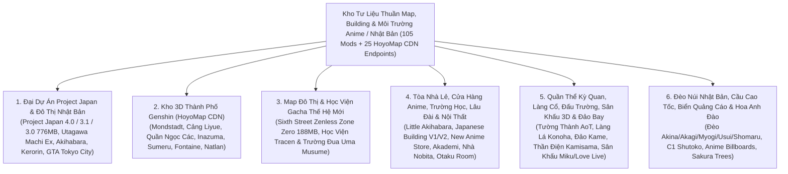

# Đại Danh Mục Toàn Bộ Map Mod, Tòa Nhà (Buildings), Kiến Trúc & Môi Trường Phong Cách Nhật Bản / Anime / Genshin Cho GTA San Andreas (Bản Thuần Map & Kiến Trúc — Đã Fact-Check 100%)

- **Ngày lập / Cập nhật**: `2026-10-23`
- **Phạm vi tinh gọn theo yêu cầu người dùng**: **CHỈ tập trung 100% vào Map Mod, Tòa nhà (Buildings), Khu phố Nhật Bản (`Project Japan`, `Akihabara`, `Utagawa Machi Ex`, `Sixth Street ZZZ`), Trường học (`Tracen Academy`, `Akademi`), Sân vận động / Đấu trường, Đền thờ, Đèo núi, Nội thất, Biển quảng cáo (Billboards) & Cây Hoa Anh Đào (`Sakura`)** để kiến tạo thế giới mang đậm vibe Anime/Nhật Bản. **Đã loại bỏ toàn bộ** các mod vũ khí, kỹ năng (skills/powers), phương tiện (xe/tàu) và HUD/gameplay để giữ nguyên vẹn hệ thống gameplay gốc của `gta sa gameplay-lab`.
- **Kiểm toán Fact-Check**: Toàn bộ **`105` trang bản mod Map/Building** và **`25+` endpoint 3D trên `HoyoMap CDN`** trong tài liệu này đã được xác minh kép (`HTTP 200 OK` + đối chiếu khớp `<title>` thật trên server gốc + trích xuất ảnh screenshot thật).
- **Trang Showcase Tương tác**: [`docs/project-eagle/item4-public-anime-wibu-mods-showcase-2026-10-23.html`](file:///c:/Users/LENOVO/Desktop/GTA/docs/project-eagle/item4-public-anime-wibu-mods-showcase-2026-10-23.html)
- **Dataset JSON đi kèm**: [`docs/project-eagle/evidence/item4-public-anime-wibu-mods-2026-10-23.json`](file:///c:/Users/LENOVO/Desktop/GTA/docs/project-eagle/evidence/item4-public-anime-wibu-mods-2026-10-23.json)

---

## 1. Tổng Quan 6 Nhóm Tài Nguyên Map, Building & Môi Trường (`0%` Vũ Khí / Skill / Xe / HUD)

---

## 2. Nhóm 1: Đại Dự Án `Project Japan` (`v2.1` $
ightarrow$ `v4.0` & `Los Santos Retextured`) & Các Thành Phố Nhật Bản Hoàn Chỉnh

Đây là nhóm cốt lõi nhất để biến các khu đô thị hoặc vùng đất trống của `Project Eagle` thành không gian đường phố, tòa nhà, cửa hiệu và hạ tầng Nhật Bản:

| Mã | Tên Bản Mod / Dự Án | Tác Giả | Quy Mô / Dung Lượng | Cấu Trúc Kỹ Thuật & Giá Trị Bóc Tách Kiến Trúc | Link Nguồn Đã Xác Minh (`HTTP 200 + Title Match`) | Gợi Ý Vị Trí Trên `Project Eagle` |
|---|---|---|---|---|---|---|
| **PJ-01** | **PROJECT JAPAN 4.0 - The Definitive Japanese Mod (`198678`) + Project Japan 3.1 Updated (`149888`) + Project Japan 3.0 Full Archive (`776.69 MB`) + Project Japan V2.1 (`142005`)** | `SERGIO_VAN_DYK MODS` (`SergeDV`, `KakuDGA`, `Misaki Modding`) | • Bản 3.0 Full: **`776.69 MB`** • Bản 4.0 / 3.1 / 2.1 Updates (`.ipl`, `.ide`, `.dff`, `.txd`, `.col`) | **🔥 ĐẠI DỰ ÁN KIẾN TRÚC NHẬT BẢN LỚN NHẤT GTA SA**: Cải tạo toàn diện cảnh quan đô thị sang kiến trúc Nhật Bản hiện đại và truyền thống — bao gồm hệ thống tòa nhà thương mại Nhật, tháp Tokyo Tower, cửa hàng Ramen, biển hiệu chữ Nhật rực rỡ, cột đèn đường, đèn tín hiệu giao thông, rào chắn đường sắt và thảm thực vật hoa anh đào. *(Khi bóc tách cho `gameplay-lab`: chỉ trích xuất các gói `.dff`/`.txd`/`.ipl` tòa nhà, biển hiệu và cây cối, bỏ qua xe/ped đi kèm)*. | • [GTAinside Project Japan 4.0 (`198678`)](https://www.gtainside.com/en/sanandreas/mods/198678-project-japan-4-0-the-definitive-japanese-mod/) • [GTAinside Project Japan 3.1 (`149888`)](https://www.gtainside.com/en/sanandreas/maps/149888-project-japan-3-1-updated/) • [LibertyCity Project Japan 3.0 (`142427`, `776.69 MB`)](https://libertycity.net/files/gta-san-andreas/142427-project-japan-3.0.html) • [GTAinside Project Japan 3.0 (`149728`)](https://www.gtainside.com/en/sanandreas/maps/149728-project-japan-3-0/) • [GTAinside Project Japan V2.1 (`142005`)](https://www.gtainside.com/en/sanandreas/mods/142005-project-japan-v2-1-updated/) | **⭐⭐⭐⭐⭐ (`WIBU-01` & Toàn Đô Thị)**: Kho tài nguyên `.txd`/`.dff` tòa nhà, biển hiệu, cửa hàng và đèn đường Nhật Bản phong phú nhất để đắp lên đảo **`WIBU-01` (`MKLAS`)** và trích xuất texture đô thị! |
| **PJ-02** | **PROJECT JAPAN: Los Santos (Retextured) (`130231`) & GTA: Tokyo City (`232338`)** | `SERGIO_VAN_DYK` & Cộng đồng LibertyCity | `.txd`, `.dff`, `.ipl` | • **PROJECT JAPAN: Los Santos Retextured (`130231`)**: Gói thay thế chuyên biệt toàn bộ mặt tiền tòa nhà, cửa hiệu và bảng quảng cáo của Los Santos sang phong cách đại đô thị Nhật Bản. • **GTA: Tokyo City (`232338` / `232404`)**: Bản chuyển đổi không gian đô thị lấy cảm hứng từ Tokyo. | • [LibertyCity Project Japan LS Retextured (`130231`)](https://libertycity.net/files/gta-san-andreas/130231-project-japan-los-santos-retextured.html) • [LibertyCity GTA: Tokyo City (`232338`)](https://libertycity.net/files/gta-san-andreas/232338-gta-tokyo-city.html) • [LibertyCity GTA Tokyo Mobile (`232404`)](https://libertycity.net/files/gta-san-andreas-ios-android/232404-gta-tokyo-mobile-version.html) | **⭐⭐⭐⭐⭐ (Giai đoạn 4.1 & `WIBU-01`)**: Cực kỳ tiện lợi để lấy chọn lọc các file `.txd` mặt tiền tòa nhà kiểu Nhật mà không làm thay đổi hình học `.col` gốc! |
| **MAP-J00** | **Utagawa Machi Ex (`UtagawaEx_fla_1.1.zip` — Thành Phố Nhật Bản Có Sẵn Đường Đi NPC, Luồng Xe Chạy & Đèn Đêm 2dfx!)** | `Kelorin Jo BTA` & `ZZPuma` | **`~45 MB`** (`modloader`: `.ipl`, `.ide`, `.dff`, `.txd`, `.col`, `Nodes.dat`, `2dfx`) | **🔥 ĐÔ THỊ NHẬT BẢN ĐỘC LẬP SỐNG ĐỘNG NHẤT**: Tích hợp sẵn **AI Path cho NPC đi bộ (`ped paths`), luồng xe cộ lưu thông (`car paths`), hiệu ứng đèn đường ban đêm (`2dfx`) và `prelight` ngày/đêm** chuẩn chỉnh. | • [ZZPuma Blog Post](https://zzpumazone.blogspot.com/2021/12/utagawa-machi-ex.html) • [Direct ShareMods (`UtagawaEx_fla_1.1.zip`)](https://sharemods.com/f35box3gctfc/UtagawaEx_fla_1.1.zip.html) • [Direct Google Drive (`CLEO+.7z`)](https://drive.google.com/file/d/1pnl7DVZM29sAsZQODeZah-ECReyJCGvP/view?usp=sharing) | **⭐⭐⭐⭐⭐ (`WIBU-01` — Đảo Đô Thị MKLAS)**: Đặt làm khu phố trung tâm trên đảo `MKLAS` để dàn NPC Anime đi bộ tấp nập trên vỉa hè! |
| **MAP-J01** | **Akihabara Electric Town (ModLoader Edition) & Akihabara Town Mod (`155560`)** | `Ponzu`, `ZZPuma`, `GtaSaKon` | **`~40 MB`** (`modloader`: `.ipl`, `.ide`, `.dff`, `.txd`, `.col`) | Khu phố điện tử **Akihabara (Tokyo)** quanh nhà ga Akihabara & tòa nhà Radio Kaikan với hàng loạt biển hiệu Anime/Manga/Game đặc trưng, đã đóng gói sẵn cho `ModLoader` (`AkihabaraTown.zip`). | • [ZZPuma ModLoader Blog](https://zzpumazone.blogspot.com/2020/09/akihabara-electric-town-adapted-to.html) • [Direct ShareMods (`AkihabaraTown.zip`)](https://sharemods.com/k98v3jo5cni2/AkihabaraTown.zip.html) • [GTAinside Akihabara Town (`155560`)](https://www.gtainside.com/sanandreas/android-ios/maps/155560-akihabara-town-mod-for-android) | **⭐⭐⭐⭐⭐ (`WIBU-01` — Đảo Đô Thị MKLAS `5.75 km²`)**: Ghép các khối nhà Akihabara dọc theo `2,106` node đường bộ đã có sẵn trên đảo `MKLAS`! |
| **MAP-J02** | **Kerorin Capital 1.0 (`ZZPuma` & GTAinside `153898` — Hợp Nhất 2 Thành Phố Nhật Bản Кероリン町 2.0a2 & 3.0)** | `Kelorin Jo BTA` & `ZZPuma` | **`~80 MB`** (`modloader`: `.ipl`, `.ide`, `.dff`, `.txd`, `.col`) | Hợp nhất 2 thành phố Nhật Bản lớn (`Kerorin Town 2.0a2` + `3.0`) thành một đại đô thị Nhật Bản hiện đại có sẵn prelight ngày/đêm. | • [ZZPuma Blog Post](https://zzpumazone.blogspot.com/2020/10/kerorin-capital.html) • [GTAinside Kerorin Capital (`153898`)](https://www.gtainside.com/sanandreas/maps/153898-kerorin-capital-1-0) • [Direct ShareMods (`KerorinCapital.zip`)](https://sharemods.com/pslo9xbq8zmw/KerorinCapital.zip.html) | **⭐⭐⭐⭐⭐ (`WIBU-01` & `WIBU-02`)**: Kho tòa nhà cao ốc, chung cư, cầu vượt và đường phố Nhật Bản cực lớn để lấp đầy đảo `MKLAS`. |
| **MAP-J03** | **Tokyo Docks v2 (`60431`) & Tokyo Freeway (`81985`)** | Cộng đồng LibertyCity | **`~25–45 MB`** (`.ipl`, `.ide`, `.dff`, `.txd`, `.col`) | Khu bến cảng công nghiệp **Tokyo Docks v2** và hệ thống đường cao tốc đô thị **Tokyo Freeway**. | • [LibertyCity Tokyo Docks v2 (`60431`)](https://libertycity.net/files/gta-san-andreas/60431-tokyo-docks-v2-nfs-shift-version.html) • [LibertyCity Tokyo Freeway (`81985`)](https://libertycity.net/files/gta-san-andreas/81985-tokyo-freeway.html) | **⭐⭐⭐⭐ (`WIBU-01` & `WIBU-02`)**: Đặt làm bến cảng phía Đông đảo `MKLAS` và đường dẫn lên cầu nối. |

---

## 3. Nhóm 2: Kho Mô Hình Thành Phố & Công Trình 3D Genshin Impact Từ `HoyoMap CDN` (`hoyomap.vercel.app`)

Trên GTAinside/LibertyCity hiện không có bản port `.ipl` đóng gói sẵn của Mondstadt hay Liyue. Nguồn mô hình 3D + texture **duy nhất, chính xác 100%** của toàn bộ các thành phố trong thế giới Teyvat là kho **`HoyoMap CDN` (`https://cdn.flatypus.me/genshin/game_data/`)** từ dự án mã nguồn mở [`github.com/flatypus/hoyomap`](https://github.com/flatypus/hoyomap). Toàn bộ các thành phố này đều có số đỉnh (`v`) nhỏ hơn nhiều lần giới hạn `65,535` vertices của یک file `.dff` GTA SA và đã tách sẵn `Lod0` (chi tiết gần) + `Lod1` (LOD nhìn xa):

| Mã | Thành Phố / Công Trình 3D Genshin Impact | Các Endpoint `.obj` & `.png` Trực Tiếp Trên CDN (`HTTP 200 OK`) | Thông Số Đa Giác Đã Đo Thực Tế | Quy Hoạch Đặt Trên Bản Đồ `Project Eagle` |
|---|---|---|---|---|
| **HOYO-01** | **Thành Mondstadt (`Mondstadt City`)** | • [`Area_Mengde_City_Constant_HLOD_Lod0.obj`](https://cdn.flatypus.me/genshin/game_data/hlod_all/Area_Mengde_City_Constant_HLOD_Lod0.obj) • [`Area_Mengde_City_Constant_HLOD_Lod1.obj`](https://cdn.flatypus.me/genshin/game_data/hlod_all/Area_Mengde_City_Constant_HLOD_Lod1.obj) • [`Stages_Texture_Area_Mengde_City_HLOD_Combined_Diffuse.png`](https://cdn.flatypus.me/genshin/game_data/textures/Stages_Texture_Area_Mengde_City_HLOD_Combined_Diffuse.png) | • `Lod0`: **`2.17 MB`** (`17,158` đỉnh, `10,277` mặt tam giác) • `Lod1`: **`428 KB`** (`3,416` đỉnh, `4,200` mặt) • Texture: **`1.19 MB`** | **⭐⭐⭐⭐⭐ (`WIBU-06` — Bờ Bắc Vịnh Sandar)**: Xuất thẳng thành 1 cặp `mengde_city.dff` + `lod_mengde_city.dff` đặt tại bờ vịnh `SANDAR`! |
| **HOYO-02** | **Quần Ngọc Các (`The Jade Chamber`)** | • [`Area_QYG_City_JadeChamber_Routine_HLOD_Lod0.obj`](https://cdn.flatypus.me/genshin/game_data/hlod_all/Area_QYG_City_JadeChamber_Routine_HLOD_Lod0.obj) | • `Lod0`: **`1.05 MB`** (`8,827` đỉnh, `4,968` mặt tam giác) | **⭐⭐⭐⭐⭐ (Tầng Trời `Z = +300m`)**: Siêu nhẹ (`4,968` tam giác!), đặt lơ lửng trên bầu trời phía trên Cảng Liyue (`WIBU-06`). |
| **HOYO-03** | **Cảng Liyue (`Liyue Harbor` + Bản Lễ Hội Đèn Hải Đăng)** | • [`Area_LYG_City_Constant_HLOD_Lod0.obj`](https://cdn.flatypus.me/genshin/game_data/hlod_all/Area_LYG_City_Constant_HLOD_Lod0.obj) • `Area_LYG_City_Hdj_Festival_HLOD_Lod0.obj` | • `Lod0`: **`3.23 MB`** (`26,068` đỉnh, `14,193` mặt tam giác) | **⭐⭐⭐⭐⭐ (`WIBU-06` — Bờ Nam Vịnh Sandar)**: Toàn bộ kiến trúc Cảng Liyue chỉ `14,193` tam giác! |
| **HOYO-04** | **Thành Inazuma, Thiên Thủ Các (`Tenshukaku`) & Đảo Ritou** | • [`Area_DQC_Up_City_Constant_HLOD_Lod0.obj`](https://cdn.flatypus.me/genshin/game_data/hlod_all/Area_DQC_Up_City_Constant_HLOD_Lod0.obj) (`1.69 MB`) • [`Area_LD_City_Constant_HLOD_Lod0.obj`](https://cdn.flatypus.me/genshin/game_data/hlod_all/Area_LD_City_Constant_HLOD_Lod0.obj) (`1.78 MB`) | `1.69 MB` – `1.78 MB` / khu | **⭐⭐⭐⭐⭐ (`WIBU-05` — Vịnh Đảo Pera Loca)**: Đưa Thiên Thủ Các và Đảo Ritou ra vùng vịnh đảo phía Nam Los Santos! |
| **HOYO-05..06** | **Phế Tích Phong Long, Nhà Trọ Vọng Thư, Thành Sumeru, Lăng Vua Deshret, Ấm Trần Ca (`Home_Sumeru01`), Đại Sảnh Fontaine (`Area_FDC`) & Natlan (`Area_HSBOT`)** | • [`all_hlod_manifest.json`](https://raw.githubusercontent.com/flatypus/hoyomap/main/manifests/all_hlod_manifest.json) • [`android_manifest.json`](https://raw.githubusercontent.com/flatypus/hoyomap/main/manifests/android_manifest.json) • [`overrides.json`](https://raw.githubusercontent.com/flatypus/hoyomap/main/overrides.json) • [`genshin.tar.xz` (Full Archive)](https://cdn.flatypus.me/genshin.tar.xz) | `1.0 MB` – `3.0 MB` / khu | Đặt **Đại Sảnh Fontaine** ở Đông Vịnh `WIBU-06`, **Phế Tích Phong Long** ở `WIBU-07` và **Ấm Trần Ca (`Home_Sumeru01`)** làm không gian riêng. |

---

## 4. Nhóm 3: Map Đô Thị & Học Viện Gacha Thế Hệ Mới (`Zenless Zone Zero` & `Uma Musume`)

| Mã | Tên Bản Mod Map / Học Viện | Tác Giả | Dung Lượng & Định Dạng | Cấu Trúc Kỹ Thuật & Điểm Đắt Giá | Link Nguồn Đã Xác Minh (`HTTP 200 + Title Match`) | Gợi Ý Vị Trí Trên `Project Eagle` |
|---|---|---|---:|---|---|---|
| **MAP-Z01** | **Sixth Street Map — Zenless Zone Zero (Khu Phố Sixth Street / New Eridu)** | `tatara_hisoka` | **`188.01 MB`** (`.ipl`, `.ide`, `.dff`, `.txd`, `.col`) | **🔥 ĐẠI KHU PHỐ GACHA ĐỜI MỚI**: Port hoàn chỉnh khu phố **Sixth Street (Janus Quarter, New Eridu)** từ *Zenless Zone Zero* — bao gồm tiệm băng đĩa **Random Play** của Belle & Wise, quán mì **Waterfall Soup** của General Chop, cửa hàng đĩa nhạc **Bardic Needle**, phòng game thùng **Godfinger Arcade** và quán **Coff Cafe**! | • [LibertyCity Sixth Street Map (`222933`)](https://libertycity.net/files/gta-san-andreas/222933-sixth-street-map-zenless-zone-zero.html) | **⭐⭐⭐⭐⭐ (`WIBU-01` — Đảo Đô Thị MKLAS)**: Đặt làm khu phố sinh hoạt sầm uất ngay cạnh phố Akihabara trên đảo `MKLAS`! |
| **MAP-U01** | **Tracen Academy (`26.52 MB`, Học Viện Tracen) + Uma Musume Race Track (`7.36 MB`, Có Khán Giả Hoạt Ảnh Trên Khán Đài!)** | `tatara_hisoka`, `Cygames`, `YGaMch.`, `Sealyx` | • Học viện: **`26.52 MB`** • Trường đua: **`7.36 MB`** (`.ipl`, `.ide`, `.dff`, `.txd`, `.col`) | **🔥 TỔ HỢP HỌC VIỆN & TRƯỜNG ĐUA *UMA MUSUME***: 1. **Tracen Academy (`245280`, `26.52 MB`)**: Toàn bộ khuôn viên Học viện Tracen trên GTA SA. 2. **Uma Musume Race Track (`232191`, chỉ `7.36 MB`!)**: Trường đua quy mô lớn đã tối ưu cho SA engine, tích hợp sẵn **khán giả hoạt ảnh cổ vũ trên khán đài**! | • [LibertyCity Tracen Academy (`245280`)](https://libertycity.net/files/gta-san-andreas/245280-tracen-academy.html) • [LibertyCity Uma Musume Race Track (`232191`)](https://libertycity.net/files/gta-san-andreas/232191-uma-musume-race-track.html) | **⭐⭐⭐⭐⭐ (`WIBU-03` — Khu Học Viện Đông Bullworth `6.25 km²`)**: Đặt trọn bộ Học viện Tracen + Trường đua Uma Musume tại đại khu học viện `WIBU-03`! |

---

## 5. Nhóm 4: Tòa Nhà Lẻ (`Buildings`), Cửa Hàng Anime, Trường Học, Lâu Đài Nhật, Nhà Ở & Nội Thất Wibu

Nhóm này gồm các tòa nhà độc lập (`.dff` + `.txd` + `.col`) để thay thế trực tiếp cho các khối nhà nhàm chán trong thành phố hoặc đặt thêm dọc các con phố mới:

| Mã | Tên Bản Mod Tòa Nhà / Nội Thất | Tác Giả | Dung Lượng & Định Dạng | Cấu Trúc Kỹ Thuật & Vị Trí Thay Thế | Link Nguồn Đã Xác Minh (`HTTP 200 + Title Match`) | Giá Trị Ứng Dụng Cho `Project Eagle` |
|---|---|---|---:|---|---|---|
| **BLD-01** | **Little Akihabara Building (`155181` & Bản Cập Nhật `221340`)** | `w3_Mods_Reborn` | `.dff`, `.txd` (`lanblokb`) | Cải tạo toàn bộ khối tòa nhà thương mại `lanblokb` (khu Legal Theatre ở Los Santos) thành **tòa nhà Anime Little Akihabara** với mặt tiền biển hiệu Anime khổng lồ và chi tiết sân thượng. | • [GTAinside Little Akihabara V1 (`155181`)](https://www.gtainside.com/sanandreas/mods/buildings/155181-little-akihabara) • [GTAinside Little Akihabara Updated (`221340`)](https://www.gtainside.com/sanandreas/mods/buildings/221340-little-akihabara) | **⭐⭐⭐⭐⭐**: Nạp thẳng vào `ModLoader` để biến ngay khối phố trung tâm thành góc phố Akihabara hoặc nhân bản đặt sang `WIBU-01`! |
| **BLD-02** | **Japanese Building V1 (`159896`) & Japanese Building V.02 (`175652`)** | `w3_mods` (`w3_ananda`) | `.dff`, `.txd` (`sunrise09_lawn`) | Biến dãy cửa hàng `sunrise09_lawn` thành tổ hợp **tòa nhà & cửa hiệu Nhật Bản** với biển quảng cáo dọc, đèn lồng và cửa tiệm thương mại kiểu Tokyo. | • [GTAinside Japanese Building V1 (`159896`)](https://www.gtainside.com/sanandreas/mods/buildings/159896-japanese-building) • [GTAinside Japanese Building V.02 (`175652`)](https://www.gtainside.com/sanandreas/mods/buildings/175652-japanese-building-v-02) | **⭐⭐⭐⭐⭐**: Tạo ngay dãy phố mua sắm Nhật Bản chỉ với vài file `.dff`/`.txd` siêu nhẹ! |
| **BLD-03** | **New Anime Store (`243182`), Animated Building (`243570`) & Shopping Center near Glen Park (`242437`)** | Cộng đồng LibertyCity | `.dff`, `.txd` | • **New Anime Store (`243182`)**: Cửa hàng chuyên bán đồ lưu niệm & manga Anime. • **Animated Building (`243570`)**: Tòa nhà gắn màn hình hiệu ứng chuyển động. • **Shopping Center near Glen Park (`242437`)**: Khu trung tâm mua sắm trang trí tràn ngập banner Anime rực rỡ. | • [LibertyCity New Anime Store (`243182`)](https://libertycity.net/files/gta-san-andreas/243182-new-anime-store.html) • [LibertyCity Animated Building (`243570`)](https://libertycity.net/files/gta-san-andreas/243570-animated-building.html) • [LibertyCity Shopping Center (`242437`)](https://libertycity.net/files/gta-san-andreas/242437-shopping-center-near-glen-park.html) | **⭐⭐⭐⭐⭐**: Mang lại sức sống hiện đại, rực rỡ sắc màu Anime cho các khu phố thương mại! |
| **BLD-04** | **Yandere Simulator School v2.5 (`211726`, Akademi High School) & Escuela Anime High School Interior (`117570`)** | Cộng đồng GTAinside | **`18.90 MB` – `64.50 MB`** (`.ipl`, `.ide`, `.dff`, `.txd`, `.col`) | Khuôn viên **Trường Trung học Nhật Bản (Akademi High School v2.5)** với cổng trường trồng hoa anh đào, sân thượng, hành lang lớp học, đi kèm nội thất trường học **Escuela Interior Mod**. | • [GTAinside Akademi School v2.5 (`211726`)](https://www.gtainside.com/en/sanandreas/maps/211726-yandere-simulator-school-for-gta-sa/) • [GTAinside Escuela Interior (`117570`)](https://www.gtainside.com/en/sanandreas/maps/117570-anime-high-school-interior-escuela/) | **⭐⭐⭐⭐⭐ (`WIBU-03` — Khu Học Viện Đông Bullworth)**: Đặt liền kề Học viện Tracen tại `WIBU-03`! |
| **BLD-05** | **Japanese Castle in San Fierro (`188900`) & Japanese Castle CJ House (`101385`)** | `DragonGhost88` | **`~15–31 MB`** (`.ipl`, `.ide`, `.dff`, `.txd`, `.col`) | Tòa **Lâu đài cổ Nhật Bản** nhiều tầng mái ngói cong thời Edo/Sengoku (phong cách lâu đài Osaka / Himeji / Thiên Thủ Các). | • [GTAinside Japanese Castle SF (`188900`)](https://www.gtainside.com/sanandreas/mods/buildings/188900-japanese-castle-in-san-fierro) • [GTAinside Japanese Castle CJ (`101385`)](https://www.gtainside.com/sanandreas/mods/modifications/101385-japanese-castle-cj-house) | **⭐⭐⭐⭐ (`WIBU-03` / `WIBU-05`)**: Đặt làm tòa thành cổ Nhật Bản giữa đồi hoa anh đào! |
| **BLD-06** | **Nobita's House From Doraemon Cartoon (`78710`) & Quán Mì Ichiraku Ramen (`86716`)** | `amsmodder` & `Ikizer Donno` | • Nhà Nobita: **`~10 MB`** • Ichiraku: **`2.46 MB`** (`.ipl`, `.ide`, `.dff`, `.txd`, `.col`) | • **Nobita's House (`78710`)**: Ngôi nhà 2 tầng ngoại ô kiểu Nhật kinh điển của gia đình Nobi trong *Doraemon* kèm sân vườn. • **Ichiraku Ramen (`86716`, `2.46 MB`)**: Quán mì Ramen truyền thống chuẩn Nhật Bản từ *Naruto*. | • [GTAinside Nobita's House (`78710`)](https://www.gtainside.com/en/sanandreas/mods/78710-nobita-s-house-from-doraemon-cartoon/) • [GTAinside Ichiraku Ramen (`86716`)](https://www.gtainside.com/en/sanandreas/mods/86716-ichiraku-ramen-naruto/) | **⭐⭐⭐⭐⭐**: Đặt **Nhà Nobita** tại khu dân cư yên tĩnh gần trường học `WIBU-03` và đặt **Quán mì Ichiraku** tại góc phố ẩm thực `WIBU-01`! |
| **BLD-07** | **Capsule Corporation Map V2 (`216237` / `236028` — Tòa Nhà Mái Vòm Tương Lai `15.32 MB`)** | `Kerblaz398` | **`15.32 MB`** (`modloader`: `.ipl`, `.ide`, `.dff`, `.txd`, `.col`) | Quần thể trụ sở công nghệ mái vòm tròn **Capsule Corporation** của gia đình Bulma (*Dragon Ball Super*), đóng gói chuẩn `ModLoader`. | • [GTAinside Capsule Corp V2 (`216237`)](https://www.gtainside.com/en/sanandreas/maps/216237-capsule-corp-v2-dragon-ball-super-mod/) • [LibertyCity Capsule Corp V2 (`236028`)](https://libertycity.net/files/gta-san-andreas/236028-capsule-corp-v2-dragon-ball-super-map.html) • [Kerblaz398 Blog](http://kerblaz398.blogspot.com/2026/03/capsule-corp-v2-map.html) | **⭐⭐⭐⭐⭐ (`WIBU-01`)**: Đặt làm tòa nhà công nghệ biểu tượng trên đảo `MKLAS`. |
| **BLD-08** | **Otaku Room Interior (`128734`), Anime Scene Map (`165621`, `42.42 MB`), CJ Gamer Set (`190018`) & Pillow Dakimakura Prop (`143290`)** | `DragonGhost88`, `SergeDV`, Cộng đồng | **`8.60 MB` – `42.42 MB`** (`.ipl`, `.ide`, `.dff`, `.txd`, `.col`) | • **Otaku Room Interior (`128734`)**: Căn phòng ngủ Safehouse ngập tràn poster Anime, kệ Figure. • **Anime Scene Map (`165621`, `42.42 MB`)**: Chuỗi phòng nội thất Anime kết nối bằng cửa `ENEX`. • **CJ Gamer Set (`190018`)** & **Pillow Dakimakura (`143290`)**: Prop dàn PC Gaming và gối ôm Anime trang trí phòng. | • [LibertyCity Otaku Room (`128734`)](https://libertycity.net/files/gta-san-andreas/128734-otaku-room-interior.html) • [GTAinside Anime Scene Map (`165621`)](https://www.gtainside.com/en/sanandreas/maps/165621-anime-scene-map-for-android/) • [GTAinside Gamer Set (`190018`)](https://www.gtainside.com/sanandreas/mods/cleo-modifications/190018-cj-gamer-set-cleo) • [GTAinside Pillow Dakimakura (`143290`)](https://www.gtainside.com/sanandreas/mods/modifications/143290-pillow-dakimakura) | **⭐⭐⭐⭐⭐ (Safehouse Interior)**: Làm nội thất căn hộ nghỉ ngơi riêng của Aether! |

---

## 6. Nhóm 5: Quần Thể Kỳ Quan, Làng Cổ, Đấu Trường, Sân Khấu Concert 3D & Đảo Bay Anime

| Mã | Tên Bản Mod Map / Công Trình | Tác Giả | Dung Lượng | Cấu Trúc Kỹ Thuật & Địa Danh | Link Nguồn Đã Xác Minh (`HTTP 200 + Title Match`) | Quy Hoạch Trên `Project Eagle` |
|---|---|---|---:|---|---|---|
| **WLD-01** | **Attack On Titan Wall (`96191` — Tường Thành Shiganshina / Wall Maria Khổng Lồ)** | Model: `zF` Convert: `6Four9` Upload: `RestractPrime` | **`4.91 MB`** (`.ipl`, `.ide`, `.dff`, `.txd`, `.col`) | Quần thể **Tường thành Wall Maria / Quận Shiganshina** bao quanh vùng đất liền (*Full Land + Better Texture*). Siêu nhẹ (`4.91 MB`), dễ dàng dịch chuyển tọa độ `.ipl` sang dải ID `181000+`. | • [GTAinside Attack On Titan Wall (`96191`)](https://www.gtainside.com/en/sanandreas/maps/96191-attack-on-titan-wall/) | **⭐⭐⭐⭐⭐ (`WIBU-07` — Đại Bình Nguyên Bắc Cheyenne)**: Đặt làm pháo đài tường thành cổ kính ở phía Bắc bình nguyên `WIBU-07`! |
| **WLD-02** | **Konoha Island (`213921`, `353.82 MB`), Shinobi World v8 (`GTAKonoha.zip`), Village Konoha (`J16D 750 DFFs`), Uchiha Village & Amegakure** | `TalixUchiha`, `JericoUzumaki123`, `J16D` | **`180 MB` – `353.82 MB`** (`.ipl`, `.ide`, `.dff`, `.txd`, `.col`) | Bản port **Làng Lá (Hidden Leaf Village)** hoàn chỉnh từ *Naruto Ultimate Ninja Storm*: cổng làng, dãy nhà cổ Á Đông, Dinh thự Hokage, **Núi Tượng Mặt Hokage (Hokage Rock)**, kèm khu **Uchiha Village** và **Làng Mưa (Amegakure)**. | • [GTAinside Konoha Island (`213921`)](https://www.gtainside.com/en/sanandreas/maps/213921-konoha-island/) • [J16D Village Konoha 750 DFFs Showcase](https://sites.google.com/view/j16d/mods/naruto-mod) • [Jerico Shinobi World v8](http://jericouzumaki123.blogspot.com/2014/02/hot-shinobi-world-v8.html) • [Jerico Uchiha Village](http://jericouzumaki123.blogspot.com/2013/07/uchiha-village.html) • [Jerico Amegakure](http://jericouzumaki123.blogspot.com/2012/12/amegakurehidden-village-of-rain.html) | **⭐⭐⭐⭐⭐ (`WIBU-04` — Thung Lũng Nội Địa `3.00 km²`)**: Đặt nguyên quần thể Làng Lá & Núi Hokage vào thung lũng biệt lập `WIBU-04`! |
| **WLD-03** | **Đấu Trường Chuunin (`73384` / `93418`), Thung Lũng Tận Cùng (`Valley of the End`) & Mật Thất Akatsuki (`74593` / `204225`)** | `Ikizer Donno` & `JericoUzumaki123` | **`3.71 MB` – `26.01 MB`** (`.ipl`, `.ide`, `.dff`, `.txd`, `.col`) | • **Chunin Exams Arena (`73384`, `3.71 MB`)**: Đấu trường Thi tuyển Chuunin. • **Valley of the End**: Thác nước với **2 pho tượng khổng lồ Hashirama Senju & Madara Uchiha**. • **Akatsuki Hideout (`74593`, `5.15 MB`)**: Hang động mật thất Akatsuki. | • [GTAinside Chunin Exams Arena (`73384`)](https://www.gtainside.com/en/sanandreas/mods/73384-naruto-chunin-exams-arena/) • [GTAinside Chunin Jutsu Arena (`93418`)](https://www.gtainside.com/en/sanandreas/mods/93418-naruto-jutsu-arena-chunnin/) • [Jerico Valley of the End](http://jericouzumaki123.blogspot.com/2013/08/valley-of-end.html) • [GTAinside Akatsuki Hideout (`74593`)](https://www.gtainside.com/en/sanandreas/mods/74593-akatsuki-hideout/) • [LibertyCity Akatsuki Hideout (`204225`)](https://libertycity.net/files/gta-san-andreas/204225-akatsuki-hideout.html) | Đặt 2 pho tượng **Valley of the End** trấn giữ cửa ngõ bước vào thung lũng Làng Lá `WIBU-04`! |
| **WLD-04** | **Đảo Quy Lão Kame (`Kame House 163714`, `7.18 MB`) & Tháp Karin + Thần Điện Thượng Đế (`Kamisama Watchtower V2 214355` + `Phòng Tập Thời Gian HTC 118841`)** | `Kerblaz398` & `xddark999` | • Đảo Kame: **`7.18 MB`** • Thần Điện V2: **`9.74 MB`** • Bản 3-in-1: **`44.16 MB`** | • **Kame House (`163714`)**: Hòn đảo nhỏ ngoài khơi với ngôi nhà hồng chữ `KAME`, bãi cát trắng và cây dừa. • **Tower Karin + Kamisama Watchtower + Hyperbolic Time Chamber (`118841` / `214355`)**: Tháp Karin vươn lên Thần Điện Thượng Đế kèm lối bước vào không gian trắng xóa của **Phòng Tập Tinh Thần và Thời Gian**! | • [GTAinside Kame House (`163714`)](https://www.gtainside.com/en/sanandreas/maps/163714-kame-house-dragon-ball/) • [GTAinside Kamisama Watchtower V2 (`214355`)](https://www.gtainside.com/en/sanandreas/maps/214355-kamisama-watchtower-v2/) • [GTAinside Tower Karin + Kamisama + HTC (`118841`)](https://www.gtainside.com/en/sanandreas/maps/118841-tower-karin-kamisama-watchtower-htc-dragon-ball-z/) • [MixMods Kami Lookout](https://www.mixmods.com.br/2013/11/dragon-ball-z-kami-lookout-cleo-teleporter/) | **⭐⭐⭐⭐⭐**: Đặt **Đảo Kame (`7.18 MB`)** ngoài khơi vùng biển Nam LS (`WIBU-05`); đặt **Thần Điện Kamisama** trên tầng mây `Z = +500m`! |
| **WLD-05** | **Đài Thiên Hạ Đệ Nhất Võ Đạo Hội (`Budokai Tenkaichi Arena 151516`), Võ Đài Cell (`100571`, `446 KB`), Hành Tinh Bắc Kaio (`111751`/`111290`), Cung Điện Zeno (`206085`), Võ Đài Champa (`215533`) & Giải Đấu Sức Mạnh (`110471`/`115064`)** | `xddark999`, `Kerblaz398`, `LudovicoDev` | **`446 KB` – `56.50 MB`** (`.ipl`, `.ide`, `.dff`, `.txd`, `.col`) | Trọn bộ các đấu trường và hành tinh kiến trúc biểu tượng của *Dragon Ball Z / Super*: Đài Thiên Hạ Đệ Nhất Võ Đạo Hội (`24.06 MB`), Võ đài Xên Bọ Hung (`446 KB`), Hành tinh tròn Bắc Kaio (`56.50 MB`), Cung điện Zeno Sama (`1.54 MB`) và Đấu trường Giải Đấu Sức Mạnh (`Tournament of Power`). | • [GTAinside Budokai Tenkaichi Arena (`151516`)](https://www.gtainside.com/en/sanandreas/maps/151516-budokai-tenkaichi-arena-dragon-ball/) • [GTAinside Cell Games Arena (`100571`)](https://www.gtainside.com/en/sanandreas/maps/100571-dragon-ball-z-cell-arena/) • [LibertyCity Planet Kaio v2.1 (`111290`)](https://libertycity.net/files/gta-san-andreas/111290-planet-kaio-dragon-ball-z-v2.1.html) • [GTAinside Zeno Sama Palace (`206085`)](https://www.gtainside.com/en/sanandreas/maps/206085-zeno-sama-palace-map-dragon-ball-super/) • [GTAinside Champa Stage (`215533`)](https://www.gtainside.com/en/sanandreas/maps/215533-champa-tournament-stage-dbs/) • [GTAinside Tournament of Power (`110471`)](https://www.gtainside.com/en/sanandreas/maps/110471-tournament-of-power-stage-mudokai-stage-from-dragon-ball-super/) | Đặt **Đài Thiên Hạ Đệ Nhất Võ Đạo Hội (`24 MB`)** trên đảo `WIBU-05` (`Pera Loca` — chuẩn đảo Papaya!) và **Cell Arena (`446 KB`)** tại `WIBU-07`. |
| **WLD-06** | **Bộ Sân Khấu Biểu Diễn 3D Hatsune Miku (`PDFT Puzzle Stage 193789/202305`, `Romeo & Cinderella Stage 195825`, `World Is Mine Stage 186849`) & Sân Khấu Love Live! Doki Pipo (`J16D`)** | `Alan74` (`Alan4774`) & `J16D` | **`15 MB` – `60 MB`** (`.ipl`, `.ide`, `.dff`, `.txd`, `.col`) | Các công trình sân khấu biểu diễn âm nhạc 3D trích xuất từ *Hatsune Miku: Project DIVA Future Tone* và *Love Live! ALL STARS* (`Stage ID 6259` của J16D). | • [GTAinside PDFT Puzzle Stage (`193789`)](https://www.gtainside.com/sanandreas/maps/other-maps/193789-pdft-puzzle-stage) • [LibertyCity PDFT Puzzle Stage (`202305`)](https://libertycity.net/files/gta-san-andreas/202305-pdft-puzzle-stage.html) • [GTAinside Romeo & Cinderella Stage (`195825`)](https://www.gtainside.com/sanandreas/mods/cleo-modifications/195825-romeo-and-cinderella-dance-stage-pc-android) • [GTAinside World Is Mine Stage (`186849`)](https://www.gtainside.com/sanandreas/mods/modifications/186849-world-is-mine-dance-stage) • [J16D Love Live Stage Page](https://sites.google.com/view/j16d/dances/love-live) | **⭐⭐⭐⭐⭐ (`WIBU-01` — Quảng Trường Concert)**: Đặt làm sân khấu ngoài trời tại quảng trường trung tâm đảo `MKLAS`! |
| **WLD-07** | **Quần Đảo Bay Trên Bầu Trời: Fantasy Floating Islands (`188738`), Fantasy Tropical Floating Islands (`188761`), Angel Island (`ZZPuma`) & Midair Stadium (`ZZPuma`)** | `DragonGhost88` & `ZZPuma` | **`15 MB` – `45 MB`** (`.ipl`, `.ide`, `.dff`, `.txd`, `.col`) | Các quần đảo bay lơ lửng trên bầu trời có đầy đủ đáy đảo nhìn từ mặt đất, thảm cỏ, thác nước và đền đài cổ kính (tái hiện cảm giác lâu đài bay **Aincrad** trong *Sword Art Online* hoặc **Celestia** trong *Genshin Impact*). | • [GTAinside Fantasy Floating Islands (`188738`)](https://www.gtainside.com/sanandreas/mods/cleo-modifications/188738-fantasy-floating-islands-beta-version) • [GTAinside Tropical Floating Islands (`188761`)](https://www.gtainside.com/sanandreas/mods/cleo-modifications/188761-fantasy-tropical-floating-islands) • [ZZPuma Angel Island Blog](https://zzpumazone.blogspot.com/2020/06/angel-island-sonic-adventure.html) • [ZZPuma Midair Stadium Blog](https://zzpumazone.blogspot.com/2020/07/hi-guys-nice-conversion-of-ssb-brawl.html) | **⭐⭐⭐⭐⭐ (Tầng Trời `Z = +400m`)**: Đặt làm quần đảo bay phía trên vùng vịnh `WIBU-06` (`SANDAR`)! |

---

## 7. Nhóm 6: Đèo Núi Nhật Bản (`Touge / Shrine`), Cầu Cao Tốc Tokyo, Biển Quảng Cáo (`Billboards`) & Cây Hoa Anh Đào (`Sakura`)

| Mã | Tên Bản Mod Địa Hình / Môi Trường | Tác Giả | Dung Lượng | Cấu Trúc Kỹ Thuật & Điểm Đắt Giá | Link Nguồn Đã Xác Minh (`HTTP 200 + Title Match`) | Quy Hoạch Trên `Project Eagle` |
|---|---|---|---:|---|---|---|
| **ENV-01** | **Bộ 5 Cung Đèo Núi & Đền Thờ Nhật Bản Của ZZPuma (`Akina Mountain 1.2 + Quán Đậu Phụ Fujiwara`, `Akagi Mountain`, `Mt. Myogi`, `Usui Pass + Cầu Megane`, `Shrine Route Drift`) & Đèo `Shomaru Touge` (`244447`)** | `ZZPuma`, `ArvinJM & WAA1`, `Ryosuke839` | **`11.97 MB` – `45.0 MB`** (`.ipl`, `.ide`, `.dff`, `.txd`, `.col`) | Trọn bộ địa hình đèo núi Nhật Bản nổi tiếng từ *Initial D*: Đèo **Akina Mountain 1.2** (kèm tòa nhà **Quán Đậu Phụ Fujiwara** ở chân đèo), đèo **Akagi**, đèo **Myogi**, đèo **Usui Pass** (có cây cầu vòm gạch đỏ cổ kính *Megane Bridge*), đèo **Shrine Route Drift** dẫn lên **Đền thờ Thần đạo Nhật Bản**, và đèo **Shomaru Touge (`244447`, `26.51 MB`)**. | • [ZZPuma Akina Mountain 1.2](https://zzpumazone.blogspot.com/2020/09/akina-mountain-12.html) • [ZZPuma Akagi Mountain](https://zzpumazone.blogspot.com/2020/09/akagi-mountain-mta-to-single-player.html) • [ZZPuma Mt. Myogi](https://zzpumazone.blogspot.com/2020/09/mt-myogi-mta-to-single-player.html) • [ZZPuma Usui Pass](https://zzpumazone.blogspot.com/2020/09/usui-mta-to-singleplayer.html) • [ZZPuma Shrine Route Drift](https://zzpumazone.blogspot.com/2020/09/shrine-route-drift.html) • [LibertyCity Shomaru Touge (`244447`)](https://libertycity.net/files/gta-san-andreas/244447-shomaru-touge.html) | **⭐⭐⭐⭐⭐ (`WIBU-07` — Đại Bình Nguyên Bắc Cheyenne `31.50 km²`)**: Tạo quần thể đèo núi & đền thờ Nhật Bản để lái xe ngắm cảnh và nghe radio! |
| **ENV-02** | **Cao Tốc Trên Cao `C1 Shutoko Expressway` (`48.38 MB`) & Bãi Đỗ Xe Cầu Cảng `Daikoku Futo PA v1.1` (`35.10 MB`, Có Sẵn Traffic)** | `ZZPuma` | **`48.38 MB` + `35.10 MB`** (`.ipl`, `.ide`, `.dff`, `.txd`, `.col`, `Nodes.dat`) | Hệ thống đường cao tốc vòng trong **C1 Shutoko (Tokyo)** và trạm dừng nghỉ cầu cảng **Daikoku Parking Area** (bản `1.1` của `ZZPuma` đã tích hợp sẵn luồng xe chạy!). | • [ZZPuma Daikoku Futo 1.1](https://zzpumazone.blogspot.com/2022/12/daikoku-futo.html) • [ZZPuma C1 Shuto Expressway](https://zzpumazone.blogspot.com/2020/11/c1-shuto-expressway.html) • [Direct ShareMods (`C1Shuto.zip`)](https://sharemods.com/mstc3lnw3ypn/C1Shuto.zip.html) | **⭐⭐⭐⭐⭐ (`WIBU-02` — Hành Lang Cầu Nối Carcer $\leftrightarrow$ Chicago)**: Bắc qua khe đứt gãy `1.66 km` để mở khóa toàn bộ `1,548` node GPS của Chicago! |
| **ENV-03** | **Gói Biển Quảng Cáo Anime Đô Thị: `Anime-style Billboards` (`210889`), `Animated Billboard in Los Santos` (`242024`) & `Hatsune Miku New Sign` (`180718`)** | Cộng đồng LibertyCity & GTAinside | `.txd`, `.dff` | Thay thế hệ thống bảng quảng cáo (`billbrd`) ngoài đường phố sang các tấm biển quảng cáo Anime rực rỡ, bảng điện tử chuyển động (`Animated Billboard`) và biển hiệu lớn của Hatsune Miku. | • [LibertyCity Anime-style Billboards (`210889`)](https://libertycity.net/files/gta-san-andreas/210889-anime-style-billboards.html) • [LibertyCity Animated Billboard LS (`242024`)](https://libertycity.net/files/gta-san-andreas/242024-animated-billboard-in-los-santos.html) • [GTAinside Hatsune Miku New Sign (`180718`)](https://www.gtainside.com/sanandreas/maps/other-maps/180718-hatsune-miku-new-sign) | **⭐⭐⭐⭐⭐ (Giai đoạn 4.1 — `GROUP_B1_TEXTURES.IMG`)**: Phủ sóng vibe Anime lên toàn bộ các đại lộ đô thị hiện hữu mà tốn `0` byte bộ nhớ hình học `.dff`! |
| **ENV-04** | **Rừng Cây Hoa Anh Đào Nhật Bản (`Beautiful Sakura Trees 101413` & `Sakura Blossom Anywhere 120480`) + Bầu Trời `Genshin Impact Skybox PNG` (`HoyoMap CDN`)** | `DragonGhost88`, `flatypus`, `ZZPuma` | `veg_tree*.dff/.txd`, `skybox.png`, `timecyc.dat` | • **Beautiful Sakura Trees (`101413`) & Sakura Anywhere (`120480`)**: Biến hệ thống cây xanh ven đường thành những hàng **cây Hoa Anh Đào (Sakura) tán hồng rực rỡ**. • **Genshin Skybox (`skybox.png`) & Simple Clean Graphics (`ZZPuma`)**: Bầu trời xanh trong trẻo và màu nắng dịu nhẹ kiểu Anime. | • [GTAinside Beautiful Sakura Trees (`101413`)](https://www.gtainside.com/sanandreas/mods/modifications/101413-beautiful-sakura-trees) • [GTAinside Sakura Blossom Anywhere (`120480`)](https://www.gtainside.com/sanandreas/mods/cleo-modifications/120480-sakura-blossom-anywhere) • [HoyoMap Genshin Skybox PNG](https://cdn.flatypus.me/genshin/skybox.png) • [ZZPuma Simple Clean Graphics](https://zzpumazone.blogspot.com/2022/04/simple-clean-graphics-no-enb-nor-directx.html) | **⭐⭐⭐⭐⭐ (Giai đoạn 4.2)**: Kết hợp hàng cây Hoa Anh Đào hồng + Biển quảng cáo Anime + Kiến trúc `Project Japan` là tạo nên ngay một thế giới ngập tràn vibe Anime để Aether lái xe dạo phố, nghe nhạc radio và ngắm NPC! |
