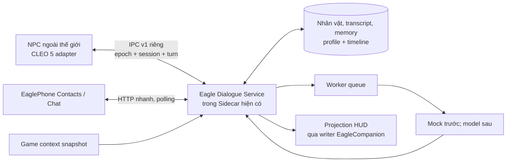

# Kế hoạch tích hợp hội thoại và companions vào Eagle

Ngày: **22/10/2026 (Asia/Saigon)**. Target duy nhất: `Project Eagle/gta sa gameplay-lab`.

**Trạng thái: nghiên cứu và thiết kế; chưa cài/chạy mod hoặc gọi AI.** Người dùng đã chốt **hội thoại bằng tiếng Anh** trong lúc khảo sát. Các yêu cầu tiếng Việt trong đề xuất trước là lịch sử, không còn là yêu cầu của bản thử. Người dùng đang cân nhắc chuyển toàn bộ data sang tiếng Anh; lượt này chưa triển khai chuyển đổi dữ liệu toàn game.

## Quyết định đề xuất

Xây một module **Eagle Dialogue** dùng Sidecar hiện có, một cầu nối game nhỏ và một kho nhân vật chung cho hội thoại ngoài phố/EaglePhone. Chọn lọc từ các mod theo vai trò:

| Nguồn | Phần hữu ích | Cách tích hợp đề xuất |
| --- | --- | --- |
| [SAtella](https://github.com/ne-ogoz/SAtella) | Vòng hội thoại trực tiếp, input, bubble, audio tại NPC, backend giả | Tham khảo cấu trúc; port phần nhỏ sang môi trường Eagle. Không chạy launcher hoặc đưa toàn bộ daemon vào lab |
| [GTA SA AI NPC Companion](https://github.com/bio-colab/gta-sa-ai-companion) | Theo cùng người chơi, context/events, persona và SQLite | Chọn lọc ý tưởng/module sau audit; thay identity/session/IPC, không mang các tác động gameplay đi kèm vào bản chat đầu |
| [Talk with people like RDR2](https://www.gtainside.com/sanandreas/mods/cleo-modifications/188771-talk-with-people-like-in-rdr2) | Thao tác bắt chuyện và thái độ giao tiếp | Dùng làm mẫu trải nghiệm: Greet / Talk / Leave. Chưa có source đã xác minh để hứa tái sử dụng code |
| EaglePhone / EagleCompanion | UI, game telemetry, state → HUD, launcher hiện tại | Là host chung cho contact, phiên hội thoại và backend mới |

**Bản triển khai đầu tiên phải chứng minh hội thoại trong game với câu trả lời cố định/backend giả.** Phone-only chat không thay thế bài kiểm này. Sau khi native dialogue đạt mới nối model, memory và hành vi companion.

## 1. Vì sao cần adaptation thay vì cài nguyên các gói

### Loader và tên executable

Lab chạy `gta_pe.exe` qua `Start_Eagle_Lab_With_Sidecar.bat`; `cleo5.dll` và loader log xác nhận CLEO 5.0.3. Hai dự án JS dùng CLEO Redux. [Tài liệu cài đặt chính thức Redux](https://re.cleo.li/docs/en/installation.html) nói runtime/installer nhận diện host theo tên exe và liệt kê các tên SA thông dụng, không có `gta_pe.exe`. Đây là **compatibility gate**, chưa phải bằng chứng Redux không thể thích nghi bằng bất kỳ cách nào. Chưa thử hoặc xác minh giải pháp host override trên Eagle.

[Tài liệu quan hệ CLEO/Redux](https://re.cleo.li/docs/en/relation-to-cleo-library.html) cho biết classic SA dùng Redux như addon của CLEO Library. Cài Redux không đồng nghĩa được thay CLEO đang có. Không đổi tên executable hoặc thay loader chỉ để chạy một ví dụ upstream mà chưa đánh giá PECore, launcher và các script hiện tại.

| Hướng | Đánh giá hiện tại |
| --- | --- |
| Port adapter nhỏ sang CLEO 5 đang cài + Sidecar chung | **Ưu tiên.** Cần viết/test adapter nhưng có thể tận dụng các plugin đã có và giảm thay đổi loader |
| Thêm Redux có kiểm soát, fork script upstream | Có thể nghiên cứu dự phòng. Phải giải quyết host/exe, tương thích phiên bản, plugin và kiểm hồi quy riêng |
| Cài nguyên launcher/daemon của nhiều mod cùng lúc | Không chọn làm phương án tích hợp: trùng input/session, side effects và ownership; không dùng chung EaglePhone một cách tự nhiên |

### Những phần đã có bằng chứng trong lab

Ngoài các lệnh target/text/audio đã ghi trong [khảo sát trước](npc-dialogue-feasibility-2026-10-22.md), đã kiểm thêm:

- `cleo/.config/sa.json` định nghĩa `0EA7 GET_ANY_CHAR_NO_SAVE_RECURSIVE` cho duyệt handle ped; log `cleo.log:387` ghi opcode này đã đăng ký. Đây là hướng thử lấy ped qua API, thay cho tự đọc pool theo stride cố định. **Chưa thực thi opcode trong bài test của agent.**
- Log đăng ký `0AF4/0AF5` đọc/ghi chuỗi INI (`:185-186`), `0B02 MOVE_FILE` (`:211`) và kiểm phím `0AB0` (`:43`). Vẫn cần kiểm ngữ nghĩa, encoding và publish file trên runtime thực.
- Có builder source nhỏ `staging/project-eagle/gameplay-lab-poc/build_eagle_life_poc.py:14-73` với `ScmAssembler`. Nó chỉ là nền emit opcode; chưa có compiler đầy đủ được xác minh. `main()` của script cũ ghi thẳng vào lab (`:129-135`), vì vậy **không chạy lại builder cũ** cho thử nghiệm này. Build mới phải xuất candidate riêng trong staging.

## 2. Kết quả audit source upstream ảnh hưởng thiết kế

Snapshot chỉ gồm source/tài liệu, không thực thi. Sáu file SAtella ở commit `1b905248099c661f039fa0233253ef7572f80b4d`; 17 file Companion ở commit `eeb6761f763a52b4ca17a38e020038b79ca0f180`. Manifest chứa URL, commit và SHA-256 từng file tại `staging/project-eagle/npc-dialogue-integration-research-20261022/upstream-manifest.json`.

| Điểm kiểm | Bằng chứng source | Quyết định cho Eagle |
| --- | --- | --- |
| Ped selection SAtella | [JS](https://github.com/ne-ogoz/SAtella/blob/1b905248099c661f039fa0233253ef7572f80b4d/cleo/SAtella_sa%5Bfs%5D%5Bmem%5D.js), `:66-70,131-188` đọc pool/stride và tự dựng handle | Ưu tiên script opcode/handle; kiểm lại trước mỗi lần dùng, không sao chép raw scan mặc định |
| Input English | SAtella JS `:49-64,418-479` dùng bảng virtual-key; Companion JS `:1400-1505` có command bar | Phù hợp để port một input English cơ bản; vẫn cần modal input ownership, wrap và giới hạn buffer |
| Ped lifecycle | SAtella JS `:193-209,282-287` giữ handle qua wait và cleanup task | Thêm guard, hủy khi target mất hiệu lực; POC dùng NPC do adapter sở hữu |
| IPC SAtella | JS `:889-913` ghi request trực tiếp; [daemon](https://github.com/ne-ogoz/SAtella/blob/1b905248099c661f039fa0233253ef7572f80b4d/SAtella_daemon.py) `:472-493,586-643` dùng một request/reply path | Namespace riêng, session/epoch, publish hoàn chỉnh, cancellation và stale-result rejection |
| Mock phụ thuộc voice | Daemon `:428-444` có stub, nhưng `:582-584` vẫn prewarm voice models | Tạo mock riêng không khởi tạo STT/TTS hoặc mạng |
| Charset | Daemon `:491-493` ghi CP1251 | Với English ASCII không còn là blocker ngôn ngữ. Service/store vẫn UTF-8; game display được chuẩn hóa và giới hạn riêng |
| Identity | [memory_db.py](https://github.com/bio-colab/gta-sa-ai-companion/blob/eeb6761f763a52b4ca17a38e020038b79ca0f180/AINPC/memory_db.py) `:113-121,196-237` tra/ghi theo model_id | Dùng character UUID; nhiều ped cùng skin không được tự chia sẻ memory |
| Reply đổi target | [bridge.py](https://github.com/bio-colab/gta-sa-ai-companion/blob/eeb6761f763a52b4ca17a38e020038b79ca0f180/AINPC/bridge.py) `:415-468` queue prompt/result thiếu binding phiên; JS áp lên activePed | Mọi kết quả và lệnh phải gắn đúng epoch/session/target generation và bị loại khi target đổi |
| Process detection | Bridge `:31-47` chỉ nhận các tên GTA SA thông dụng | Dùng process đã được EagleCompanion nhận diện; không thêm detector cạnh tranh |
| Gameplay side effects | Companion JS có healing/combat/weapons/drive/emote; [llm_brain.py](https://github.com/bio-colab/gta-sa-ai-companion/blob/eeb6761f763a52b4ca17a38e020038b79ca0f180/AINPC/llm_brain.py) có action/mode dispatch | Bản chat đầu chỉ trả text; thêm từng hành vi sau test, game adapter giữ quyền quyết định |

Đây là phân tích đường đi source và các tình huống có thể gây lỗi, chưa phải kết quả tái hiện trên Eagle. Đặc biệt stale reply có thể xuất hiện khi đổi companion lúc backend còn chờ; cần test tình huống ấy thay vì chỉ test happy path.

SAtella có GPL-3.0; Companion có MIT. Snapshot giữ LICENSE. Khi triển khai phải chọn rõ phần chỉ tham khảo thiết kế và phần chép/sửa code, giữ attribution/license tương ứng. Không mặc định gom code GPL vào một module được tuyên bố MIT.

## 3. Kiến trúc tích hợp đề xuất

### Trong game

Adapter chỉ chọn/kiểm NPC, xử lý input English, vẽ transcript ngắn, phát audio và thực thi những hành vi được cho phép. Không gọi mạng hoặc database trong render/tick. POC bắt đầu bằng một actor thử nghiệm do adapter sở hữu, có handle rõ ràng; target selection là chọn actor này khi đứng gần, không phải giả lập bằng browser.

Sau khi POC đạt, hỗ trợ pedestrian môi trường bằng iterator/target handle đã kiểm, lọc khoảng cách, nội thất, trạng thái chết/xe và ownership. Không mặc định có thể nhận diện an toàn mọi mission ped chỉ từ tên model. Nếu chưa chứng minh được guard, chỉ hỗ trợ actor do hệ thống quản lý hoặc ped được người chơi chọn trong phạm vi thử.

Không copy việc clear toàn bộ task của upstream vào mọi target. Với actor do hệ thống sở hữu có thể quản lý task rõ ràng; với ped tự nhiên, ưu tiên tác vụ phụ/nhìn về người chơi hoặc hủy khi họ rời đi. Những trường hợp phải thay primary task cần thiết kế phục hồi riêng.

### Trong Sidecar

Service giữ session, transcript, queue và character registry. Lấy snapshot game dưới lock ngắn; worker gọi backend ngoài engine lock; chỉ commit kết quả nếu session/generation còn đúng. `HTTPServer` hiện đồng bộ nên POST phải trả nhanh, không giữ kết nối chờ model. Mock không cần API key, thư viện ASR hoặc TTS.

Lời thoại model và event thật là hai loại dữ liệu riêng. Chỉ ghi “đã cùng đi xe/đã gặp” khi adapter xác nhận kết quả. Khi thêm action, schema hẹp và bộ kiểm game local quyết định thực thi; model không gửi opcode, địa chỉ RAM hoặc tên lệnh tùy ý.

### EaglePhone và HUD

Một `character_id` dùng cho contact lẫn actor. Nhắn tin và nói trực tiếp có conversation/session riêng nhưng dùng chung persona và các ký ức được phép biết. Khi một cuộc trò chuyện đang chạy, đổi kênh phải có quy tắc kết thúc/chuyển phiên rõ ràng.

Phone đang có 10 app; Contacts/Chat dự kiến app 11 sau khi core native dialogue đạt. App mới cần phối hợp Python registry, browser page và HUD list/body/navigation; thêm một web form không tự tạo app trong game. Đường state HUD tiếp tục có **một writer EagleCompanion**, không để worker/module thứ hai tự ghi các file buffer hiện tại.

Mailbox RAM 24 byte `0x00CAFE00` đã thuộc phone (`EagleCompanion.py:2191-2201`, `hud.lua:728-755`). Không dùng lại hoặc tự mở rộng nó cho hội thoại. Bản đầu dùng IPC file riêng, hoặc kênh khác sau khi có ownership/layout được kiểm chứng.

## 4. Giao thức và quản lý vòng đời cần làm

Thiết kế dự kiến, chưa có implementation:

- Envelope: `protocol_version`, `game_epoch`, `service_epoch`, `session_id`, `request_id`, `turn_seq`, `target_generation`, `deadline` và kiểu message. ID phải phân biệt được cả restart script lẫn Sidecar; không chỉ là counter khởi đầu từ 0.
- Target binding: `{character_id hoặc encounter_id, runtime_handle, generation, model_id}`. Handle/model chỉ là thông tin runtime, không được dùng thay identity bền.
- Chỉ một turn đang xử lý cho một conversation; queue có giới hạn. Reply mang lại đủ ID của request, trạng thái và text. Deadline/cancel khiến service bỏ kết quả đến muộn kể cả provider chưa hủy được request mạng.
- Publish request/response vào thư mục riêng, ví dụ `cleo/EagleDialogue/ipc/`. Writer hoàn tất temp rồi publish bằng move/replace có kiểm tra; reader đóng handle sớm, chỉ đọc bản đã commit và xác minh ID/length. Kiểm hành vi rename/file-sharing của CLEO trên Windows trong POC trước khi chốt transport. Có thể dùng commit marker cuối nếu rename không đáp ứng, nhưng phải kiểm nhất quán payload và version.
- Service và worker dùng UTF-8. Đường game display đầu tiên giới hạn English printable ASCII, chuẩn hóa smart punctuation và escape format code `~`; cap theo **byte buffer**, wrap theo UI. Không ghi trực tiếp văn bản model vào FXT/Lua/INI mà không escape.
- Audio dùng file theo request, publish xong mới gửi `audio_ready`; adapter chỉ phát nếu session/target còn đúng. Hủy/đổi target phải stop và giải phóng stream của phiên đó. Audio cố định trước TTS; positional audio chưa đồng nghĩa lip-sync.
- Heartbeat/process epoch phát hiện bridge mất kết nối. New Game/Load Game không thể suy ra chỉ từ PID; cần reset handshake bằng game-side lifecycle trước khi persistence phụ thuộc save. Nếu chưa có lifecycle signal tin cậy, POC giới hạn một session test và yêu cầu reset rõ ràng sau load, không tự tiếp tục target cũ.

Input có một owner: game bình thường, phone, NPC dialogue hoặc menu pause. Khi chat modal bật, Sidecar phải ngừng diễn giải các phím nhập như điều hướng phone. Thu hồi control khi cancel/error/timeout; không bật lại control vốn đang bị nhiệm vụ/mod khác giữ. Không khẳng định phím Q/Y/H/E đang trống vì chưa kiểm mọi script biên dịch. T cũng có ngữ cảnh waypoint trong game. Phím bắt chuyện được chọn sau rà binding thực tế; không hardcode F6 vốn đã thuộc phone keypad.

## 5. Danh tính, memory và ngôn ngữ

Hai nhóm được hỗ trợ từng bước:

- **Nhân vật thường gặp/bạn bè/bạn gái:** UUID bền, contact, persona và binding vào actor do hệ thống quản lý. Có thể gặp lại đúng người và biết khi nào actor bị respawn.
- **Ped ngẫu nhiên:** encounter ID theo game epoch và vòng đời entity; memory ban đầu chỉ trong lần gặp. Nếu muốn lưu thành contact, thao tác promote phải tạo/ghép identity rõ ràng. Không ghép tự động bằng model + khu vực hoặc tọa độ gần giống.

Schema mới dự kiến có `characters`, `conversations`, `turns`, `facts`, `events`, `runtime_bindings`, namespace theo `profile_id`/`timeline_id`. Lưu nguồn và thời điểm của facts/events; không nhập nguyên schema model_id upstream. Script save/load Eagle chưa được nối với kho này. POC có profile test độc lập và công khai giới hạn; trước memory có hậu quả/quan hệ phải xác minh save snapshot và rollback timeline.

Girlfriend trong upstream có persona/emote code, chưa chứng minh toàn bộ tiến trình quan hệ phù hợp Eagle. Nền của chúng ta cần tách dialogue persona khỏi quan hệ gameplay, lịch sinh hoạt, mốc thân thiết và event. Không tự mang các hiệu ứng healing/vũ khí/combat khi chỉ muốn một người bạn đi dạo.

**English-first:** lời thoại mẫu, persona, prompt, UI mới và dữ liệu nhân vật mới dùng tiếng Anh. Transcript gốc giữ Unicode trong service/store; native display POC có phạm vi ASCII để tận dụng font/input sẵn có. Việc chuyển data hiện tại sang English là tác vụ riêng: inventory UI/FXT/GXT/news/POI/lore trước, phân biệt label hiển thị với ID, key, đường dẫn, selector và game symbol. Không thay chuỗi hàng loạt trong binary/data hoặc dịch ID dùng để liên kết.

## 6. File và điểm sửa dự kiến khi triển khai

Các tên dưới đây là **đề xuất**, chưa tạo code:

| Phạm vi | File / điểm nối |
| --- | --- |
| Source adapter mới | `tools/eagle-dialogue/bridge/EagleDialogueBridge.sc` và builder chỉ xuất staging; deploy candidate thành `cleo/EagleDialogueBridge.cs` |
| Core Python mới | Package `eagle_dialogue/`: service, protocol, mock/backend adapter, storage; source có ownership riêng dưới `tools/eagle-dialogue/src/` |
| Host nhỏ | `EagleCompanion.py:646-658` tạo service; `:2453` nối action; `:4475-4522` thêm API nhanh; `:4538-4558` khởi tạo worker/lifecycle |
| Web Contacts/Chat | `eagle_phone_ui.py:1167-1176` action transport; `:1288-1324` home UI; `:1806-1815` polling. Thêm textarea, transcript, pending/cancel/error |
| App registry/HUD | `HOME_APPS` tại `EagleCompanion.py:151-162`, `_open_app:1394-1404`; `hud.lua:1125-1135` home, `:1200+` body, bounded dialogue state qua writer `:4351-4369` |
| Input arbitration | `EagleCompanion.py:1437+` và adapter; chỉ một nơi giữ quyền nhập cho mỗi mode |
| IPC/state mới | Namespace riêng của Eagle Dialogue; không dùng `EagleLifeState.ini`, ledger cũ hay mailbox phone làm DB/command bus mới |
| Launcher | Ban đầu tiếp tục launcher Eagle hiện có, service nằm trong cùng Sidecar; chỉ sửa nếu cần config bật/tắt, không khởi động hai daemon upstream |

Line refs là snapshot đọc ngày khảo sát; kiểm lại hash và source mới nhất trước sửa. Không lấy file engine cũ ở staging để ghi đè runtime đã cập nhật.

## 7. Các mốc triển khai và tiêu chí đạt

| Mốc | Nội dung | Chỉ chuyển bước khi |
| --- | --- | --- |
| A — Native dialogue | Một actor fixture, target rõ, input English trong game, câu trả lời cố định, hai lượt, send/cancel | Điều khiển trở lại đúng sau đóng/lỗi; ped mất hiệu lực được xử lý; không cần browser để giả lập cuộc nói chuyện |
| B — Sidecar loop | Cùng UI game gửi câu tới mock worker ngoài game rồi nhận lại | Delay/timeout/cancel/restart không đưa lời cũ vào NPC mới; API/phone vẫn phản hồi; không cần model hoặc mạng |
| C — Audio và phone chung | WAV cố định tại ped; Contacts/Chat English dùng cùng registry/session rules | Hủy stream đúng; app/state/HUD không xung đột; cùng nhân vật có thể dùng cả hai kênh |
| D — Model text | Thay mock bằng backend được chọn, giới hạn context và độ dài | Đo chất lượng English, latency/cost, lỗi mạng; game không chờ mạng trên tick/lock; chưa mở action tùy ý |
| E — Memory / companion | UUID, persistence/timeline, gặp lại; sau đó đi theo/lên xe và quan hệ | Identity/save lifecycle được kiểm; event dựa trên kết quả thật; mỗi action có bài kiểm và quyền sở hữu task rõ |

Các thử nghiệm đặc biệt cần có: gửi rồi đổi target; load save khi pending; restart một phía; NPC chết/stream-out; message dài/format code; kích phím phone khi chat; mở menu; backend ngừng trả lời; playback trùng radio/thoại game; Aether đi bộ/lái xe và các mod gameplay hiện có. Báo cáo phải tách mức source/API, đăng ký loader và hành vi đã thử trong game; chưa cam kết latency/FPS trước đo.

## 8. Apply và rollback dự kiến

Khi có yêu cầu triển khai: đăng ký work item mới, tạo candidate và offline checks trong staging riêng, snapshot/hash đúng các file sẽ đổi. Dùng shared game-write.lock trong lúc apply/runtime-deployment metadata, kiểm lại hash ngay trước thay và ghi manifest before/after cùng backup. Các file mới có ownership riêng; restore chỉ phạm vi đó, chặn nếu currentHash đã đổi bởi tác vụ khác. Không phục hồi toàn bộ thư mục game hoặc transaction merge cũ để gỡ dialogue. Không giữ khóa trong lúc chờ người dùng thử.

Ưu tiên mốc A/B giữ loader/executable/archive hiện có; nếu phải thêm Redux hoặc ASI input/font mới, tách thành compatibility work item thay vì lồng vào cùng một patch lớn.

## Bàn giao của lượt nghiên cứu

- Đã đọc source từ hai commit upstream và source/definition/log của Eagle; Luna chia ba phạm vi độc lập, Codex xác minh các điểm quyết định.
- Source upstream chỉ nằm trong staging riêng; không chạy launcher/script/import hoặc cài dependency. Không đọc credential, gọi provider hay thay mod.
- Có manifest 23 source files upstream và baseline hash 11 file runtime/điểm nối; baseline không bao phủ toàn game/archive.
- Kiểm cuối: 23/23 source files khớp manifest; 11/11 file baseline giữ hash, các tài liệu UTF-8 không có replacement character, link nội bộ tồn tại. Kết quả ở `staging/project-eagle/npc-dialogue-integration-research-20261022/research-verification.json`.
- Chỉ tạo báo cáo/phiếu và liên kết từ báo cáo feasibility. Chưa có build/demo/runtime acceptance.
