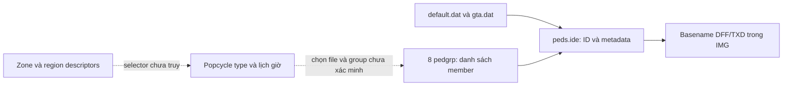

# Project Eagle: danh mục ped và kế hoạch thay ngoại hình NPC

Ngày khảo sát: **13/10/2026**. Trạng thái: **khảo sát và đề xuất; chưa cài skin NPC, chưa mở game**.

**Cập nhật sau khảo sát:** người dùng đã yêu cầu cài thử và chọn vai trò cảnh sát/quân đội để gọi bằng truy nã. Đã cài bộ thử `lapd1/swat/army` cho Los Santos/mainland; [biên bản cài đặt và phục hồi](npc-law-enforcement-installed.md). Các đề xuất dân thường và catalog bên dưới là snapshot của giai đoạn lập kế hoạch trước cài.

Game mục tiêu: `C:\Users\LENOVO\Desktop\GTA\Project Eagle\gta sa clean\gta sa clean`. Các đường dẫn game tương đối bên dưới lấy thư mục này làm gốc. Underground chỉ là nguồn asset cũ được đọc; không phải cơ sở để suy ra ID, population hay cách nạp của Eagle.

## Kết luận để xem trước

Đề xuất bắt đầu với **BFYST — ID 13** và **WFYST — ID 93**. Đây là hai model `CIVFEMALE`, cùng có trong `CASUAL_AVERAGE` của `data/pedgrp.dat:32`, có DFF/TXD riêng trong `COMPONENTPEDS.img`. **WFYRI — ID 91** là lựa chọn mở rộng thứ ba, thuộc các nhóm Business/Clubbers/Casual Rich trong file cơ sở. Thay appearance giữ nguyên pedtype, voice, animation group và danh sách population; không cần chỉnh `pedgrp` hoặc `popcycle`.

Ba asset sẵn có mang nhãn lịch sử `ReiAyanami2`, `senjo`, `hanekawa` qua kiểm tra tĩnh cơ bản và nhẹ hơn các mẫu Ganyu/ZeroTwo đã đo. Chúng chỉ là **ứng viên kỹ thuật cho phép thử**. Tên trong bảng đổi tên cũ chưa chứng minh hình ảnh nhân vật; danh sách nhân vật cuối cùng vẫn do người dùng chọn.

**Đường ModLoader thay DFF/TXD rời hiện chưa dùng được với cấu hình đang giữ:** `modloader/.data/plugins/plugins.ini:14` đặt `gta3.std.stream=0`. Log lưu sẵn xác nhận plugin bị bỏ qua và các file AETHER rời không có handler. Vì vậy không thể hứa rằng thả `bfyst.dff/txd` vào một thư mục modloader sẽ thay NPC. Phương án giữ loader nguyên trạng là thử một cặp qua bản staging của **`custom/custom_mods.img` đã được mount**, có backup và kiểm tra precedence trước khi mở rộng. Precedence của archive này với `COMPONENTPEDS.img` chưa được thử.

Khu quan sát đề xuất là **Los Santos, quanh zone MARKST và đường lân cận**. Có bằng chứng hình học zone thuộc vùng LS; **chưa có bảng nối được xác minh từ zone MARKST tới popcycle type rồi tới pedgrp row**. Đây là địa điểm lấy mẫu phù hợp cho phép thử nhỏ, không phải cam kết BFYST/WFYST chắc chắn spawn ở đó. Báo cáo này là catalog cấu hình và kế hoạch kiểm chứng, **không phải bản đồ phân bố runtime toàn thế giới**.

## 1. Phạm vi danh mục đã bao phủ

Đã parse các chỉ thị IDE/IMG không bị comment trong **`data/default.dat` và `data/gta.dat` hiện tại**, rồi đọc section `peds` của từng IDE được khai báo và directory của từng IMG được khai báo. Không lấy mọi IDE hiện diện trên đĩa làm active.

| Hạng mục | Kết quả | Ý nghĩa |
| --- | ---: | --- |
| IDE declarations / file duy nhất | 188 / 186 | Không thiếu file được khai báo; chỉ `DATA/PEDS.IDE` có record trong section `peds` |
| IDE hiện diện nhưng không được hai manifest khai báo | 9 / 195 file hiện diện | Không nhập các file này vào danh mục active theo manifest |
| IMG declarations / archive duy nhất | 62 / 61 | Đọc được toàn bộ chỉ mục VER2, không báo lỗi index |
| Ped records / ID / model name duy nhất | 1.687 / 1.687 / 1.687 | Không có ID hoặc model basename trùng trong tập định nghĩa này |
| Ped có cả basename DFF và TXD trong IMG được khai báo | 1.676 | Đây là asset-index match, chưa chứng minh từng model đã được stream trong game |
| Shared TXD groups | 2 | `generic` và `lcs_chauff` cần xử lý riêng |
| Basename asset trùng giữa các IMG được kiểm kê | 0 | Không có tình huống cần chọn một trong nhiều match hiện tại |

`default.dat:14-18` khai báo các core IDE; `:18` là `DATA/PEDS.IDE`. Log lưu sẵn `modloader/modloader.log:113-122` ghi nạp hai manifest và `peds.ide`. Log là bằng chứng của phiên đã chạy trước đó; lượt khảo sát này không xác minh live load của từng record.

Chín IDE không được hai manifest khai báo là `data/maps/txd.ide`, `data/maps/leveldes/leveldes.ide`, `S&S/txd.ide`, bốn IDE `diaz/marty/reni/ship` dưới `S&S/Cdimages/vice`, cùng `SAMP/CUSTOM.ide` và `SAMP/SAMP.ide`. Các manifest thay thế như `gta4.dat`, `gta_quick.dat` không được dùng để gộp thêm nội dung vào catalog của cấu hình đã chọn.

Mỗi record trong [ped-catalog.json](evidence/ped-catalog.json) giữ **ID, model, TXD, pedtype, stat, anim group/file, vehicle mask, flags, radio metadata, hai voice fields, raw IDE row, file/dòng nguồn, archive/virtual path/sector của tất cả DFF/TXD match**. Các subtype và mức tin cậy được giữ cùng record.

### Vai trò và các trường hợp đặc biệt

| Nhóm nhận diện từ metadata | Số record | Giới hạn diễn giải |
| --- | ---: | --- |
| `CIVMALE` / `CIVFEMALE` | 1.105 | Metadata dân sự; có thể được script nhiệm vụ sử dụng |
| Criminal / Prostitute ambient | 31 / 42 | Tách khỏi dân thường phổ thông để chọn pilot đúng vai trò |
| Gang | 324 | Pedtype gang; không suy ra địa bàn của gang chỉ từ tên |
| Police / emergency | 136 | Nhận diện bằng pedtype; chưa truy mọi cơ chế model variation |
| Player-coded models có asset | 38 | `PLAYER1/PLAYER2` không có nghĩa tất cả là placeholder hoặc nhân vật đang chơi |
| Player placeholder ID 0 | 1 | Model `null`, TXD `generic` |
| Special character slots 290–299 | 10 | `PED_TYPE_SPC`, `STAT_STD_MISSION`, comment `special character slots` tại `peds.ide:335` |

Người dùng đã chỉ định một bộ sưu tập skin tự chọn làm nguồn ứng viên cho vai trò prostitute về sau. Bằng chứng hash/member, provenance và các trường hợp chưa ghép được ghi riêng trong [pool skin vai trò prostitute](prostitute-npc-skin-pool-2026-10-17.md); tag vai trò độc lập với rating và chưa gán vào ped ID. Asset có danh tính/tuổi chưa rõ vẫn ở inventory trung tính; không đưa nhân vật dưới 18 tuổi vào vai trò tình dục.

11 record không có cặp basename đầy đủ là ID 0 và `special01`–`special10`. Các slot special không phải 10 NPC dân thường bị thiếu tài nguyên; tài nguyên được script nạp vào slot chưa được truy vết. Catalog **không kiểm kê toàn bộ actor được main.scm/CLEO tạo lúc chạy, model nạp vào special slots hoặc diễn viên chỉ thuộc cutscene archive**. Ped nhiệm vụ có thể dùng metadata dân sự, nên không thể phân loại toàn bộ actor nhiệm vụ bằng bảng IDE này.

`generic` được tham chiếu bởi ID 0 và 290–299. `lcs_chauff` dùng chung cho IDs 49229/49236. Đây là liên kết dùng chung TXD, không phải ID trùng. Các biến thể như `BFYST`, `SBFYST`, `VCS_BFYST`, `VC_BFYST` là model/ID khác nhau; thay `BFYST` không tự thay những biến thể này. Ba target pilot không chia sẻ TXD với record khác trong catalog.

## 2. Population và vùng: đã xác nhận tới đâu

Đã parse **8 file pedgrp, đủ 456 dòng dữ liệu**, kể cả dòng chỉ có một member. Tổng có **3.557 member occurrences**, **708 tên model khác nhau**; 698 tên khớp model IDE active, 10 tên chưa khớp. Các token lặp được giữ nguyên, không chuyển thành xác suất.

| File cấu hình | Dòng danh sách | Member occurrences | Tên model duy nhất trong file | Gắn vào region runtime |
| --- | ---: | ---: | ---: | --- |
| `data/pedgrp.dat` | 57 | 470 | 218 | File cơ sở; có nhãn SF/VEGAS, chưa kiểm chứng selector Eagle |
| `data/pedgrp_at.dat` | 57 | 396 | 198 | Chưa xác minh |
| `data/pedgrp_bw.dat` | 57 | 308 | 188 | Chưa xác minh |
| `data/pedgrp_cc.dat` | 57 | 477 | 226 | Chưa xác minh |
| `data/pedgrp_cm.dat` | 57 | 396 | 198 | Chưa xác minh |
| `data/pedgrp_lc.dat` | 57 | 465 | 195 | Chưa xác minh |
| `data/pedgrp_mll.dat` | 57 | 358 | 181 | Chưa xác minh |
| `data/pedgrp_vc.dat` | 57 | 687 | 206 | Chưa xác minh |

Tên hậu tố gợi ý nguồn/vùng nhưng không đủ chứng minh runtime chọn file đó. Một số file vẫn giữ các nhãn SF/VEGAS trong comment; chúng không tự chứng minh những dòng đó áp vào San Fierro/Las Venturas khi nằm trong file hậu tố khác.

| Nhóm trong file cơ sở | Ví dụ và dòng nguồn | Kết luận cấu hình |
| --- | --- | --- |
| Workers / Business | `pedgrp.dat:8,12` | Danh sách nghề/người đi làm; có các biến thể dòng |
| Clubbers / Casual Rich | `:16,28` | Có WFYST trong Clubbers; WFYRI trong cả hai nhóm |
| Casual Average | `:32` | Có BFYST và WFYST; phù hợp chọn hai model dân sự cho pilot |
| Casual Poor | `:36` | Cũng có BFYST/WFYST, nên thay appearance ảnh hưởng cả nhóm này |
| Beachfolk / Parkfolk | `:22,24` | Membership được giữ riêng; không suy ra đường đi của từng ped |
| Criminals / gang / Dealers | `:45,69–89` | Giữ ngoài pilot dân sự này |
| Shopkeepers / Office workers / Husbands / Wives | `:91–97` | Có các vai trò riêng; WFYST còn có membership Wives |

10 tên group member chưa khớp IDE là `AT_BMYBUK`, `AT_OMMBU`, `AT_WMMBU`, `AT_WMOBU`, `AT_WMYBUK`, `AAP1`, `AAP2`, `AAP3`, `BGVC01`, `BGVC02`. Chưa kết luận chúng là typo, alias runtime hay lỗi spawn. 989 model IDE không có membership trong tám file cũng **không** đồng nghĩa chỉ dùng cho nhiệm vụ hoặc không thể spawn.

### Điều kiện giờ và vùng

`data/popcycle.dat:1-13` tự mô tả lịch **12 khung giờ mỗi 2 giờ**, tách weekday/weekend. Đã parse đủ **20 type blocks × 24 rows = 480 rows**, mỗi dòng 24 trường theo header nguồn; không có anomaly về số trường. Các type gồm Business, Desert, Entertainment, Countryside, Residential Rich/Average/Poor, Gangland, Beach, Shopping, Park, Industry, hai Busy types, Shopping Posh, Residential Rich Secluded, Airport, Golf Club, Out-of-Town Factory và Airport Runway. JSON lưu từng giá trị và source line.

Các cột Dealers/Gang/Cops/Other được comment mô tả là hệ số riêng; các cột thành phần `Other` là trọng số nhóm. Không dùng chúng như phần trăm xuất hiện của **một model cụ thể**. Chưa xác minh type nào được chọn tại MARKST hoặc một khu phố Eagle cụ thể, nên báo cáo không gán phần trăm hay giờ spawn chắc chắn cho BFYST/WFYST.

`gta.dat:295-297` mount **`S&S/ZON/map.zon`, `info.zon`, `weather.zon`**; log ModLoader `:309-311` có dấu vết nạp chúng. `data/map.zon`, `data/info.zon`, `data/weather.zon` chỉ là file hiện diện đối với manifest đã chọn; hai file đầu được alternate manifests tham chiếu. Catalog đánh dấu riêng trạng thái này.

| Vùng có dữ liệu cấu hình | Nguồn | Điều đã đọc được |
| --- | --- | --- |
| Los Santos | `S&S/ZON/map.zon:14-15` | LA01/LA02, trường region 1 và các hộp tọa độ |
| San Fierro / Las Venturas / Desert | `map.zon:18-26` | SF01–03 / Vegas / DES01, region fields 2/3/4 |
| Các vùng mở rộng | Các dòng tiếp theo trong `map.zon` | Có block và region fields; đầy đủ raw records trong JSON |
| MARKST | `S&S/ZON/info.zon:330` | x 787.461–866.009, y -1410.93–-1310.21; nằm trong hộp LS LA01/LA02 theo tọa độ |

Quan hệ hình học MARKST nằm trong hộp LS là đối chiếu tọa độ, **không phải liên kết population type**. Không dùng z của hộp zone làm tọa độ teleport an toàn.

`PECore.ini:21` bật ZoneEx; `:33-34` bật ModelVariation/PedColors; `:119` đặt `PedPopulationMult=1.5`. Log core có ZoneEx initialized. Các số zone của GangWars là index của hệ gang, không phải số ped hay tần suất dân cư. Không có dòng `pedcols` gọi chính xác BFYST/WFYST; các biến thể VCS có dòng riêng. Không thấy tên chính xác hai target trong `variation.dat`/`model_special_features.dat`, nhưng chưa truy mọi nhánh code của core.

Changelog PE 1.3 mô tả pedestrian groups theo area và cập nhật density/popcycle. Đây là mô tả hỗ trợ; chưa cung cấp bảng nối cho từng khu phố. [Nguồn chính thức PE 1.3](https://www.projecteaglemod.games/changelog/pe-1.3.0).

## 3. Asset cũ có thể dùng để thử

Reuse tài liệu [Underground modding](../gta-underground-modding.md), `docs/evidence/ped-archive-audit.json` và `workbook-audit.json`. Mapping bên dưới được đọc chọn lọc từ **JSON audit workbook cũ**, không mở/sửa workbook trong lượt này. Bộ nguồn lịch sử có 1.721 cặp, tên khớp năm custom IMG; chỉ **11 cặp** được trích vào staging và kiểm tra payload/tài nguyên lần này, không kiểm tra rig toàn bộ bộ skin.

11/11 cặp mẫu trích từ `gtaug.rar` khớp byte/SHA với payload trong custom IMG Underground khi đọc đúng chiều dài nguồn và bỏ sector padding; CRC tính lại khớp metadata RAR trong audit. Không sửa RAR hoặc IMG Underground. Staging: `C:\Users\LENOVO\Desktop\GTA\staging\project-eagle\npc-reuse-survey`.

| Nhãn nguồn lịch sử | Cặp nguồn RAR | DFF + TXD | Vertices / triangles | Texture | Đánh giá cho lượt đầu |
| --- | --- | ---: | ---: | --- | --- |
| `ReiAyanami2` | `gtaug/gtaug2/DNB3.*` | 136.298 B | 1.553 / 1.601 | 2×128×128 DXT1 | Ưu tiên thử nạp; rất nhẹ, độ chi tiết thấp cần xem trước |
| `senjo` | `gtaug/gtaug5/WFYBE.*` | 377.322 B | 3.154 / 3.696 | 1×512×512 DXT1 | Ưu tiên thứ hai; nhẹ trong mẫu anime đã đo |
| `hanekawa` | `gtaug/gtaug5/VIMYELV.*` | 372.770 B | 3.113 / 3.622 | 1×512×512 DXT1 | Ứng viên thứ ba nếu mở rộng |

Mapping lịch sử: Sheet2 `D122/H122`, `D137/H137`, `D83/H83` tương ứng ba dòng trên. Không có URL tác giả/nguồn gốc trong các mapping này. Không gọi tên nhãn là nhận diện hình ảnh đã được xác nhận, cũng không lấy ID/tên DNB3/WFYBE/VIMYELV Underground làm target Eagle.

Ba mẫu có **33 frame, 32 bone**, cùng bảng HAnim/bone IDs và quan hệ bone cha gần nhất với chính BFYST/WFYST/WFYRI Eagle. Không báo bone index sai, vertex không trọng số, NaN/Inf/trọng số âm, tổng trọng số lệch tolerance, thiếu material texture, noncanonical header hay trailing bytes trong phạm vi decoder đã đọc. Điều đó hỗ trợ phép thử NPC cơ bản; chưa chứng minh hình ảnh đúng nhân vật, biến dạng khi chạy/ngã/ngồi xe, độ trong suốt hay chất lượng hiển thị trong Eagle.

Các mẫu khác: Alita 674.810 B/6.659 triangles có mismatch max-influence header; REM 1.432.227 B/11.836 triangles có 68 vertex lệch tổng trọng số, nên không đưa raw assets này vào lượt đầu. `shinobu` và `nadeko` còn trailing data chưa giải thích, tạm giữ để kiểm tra thêm. `bkisshot`/Itsuwa/Ganyu/ZeroTwo lần lượt khoảng 13.568/17.360/21.244/16.867 triangles, không ưu tiên khi đã có mẫu nhẹ hơn. Không sửa rig hoặc tối ưu skin trong giai đoạn khảo sát.

Chi tiết hash, textures, weights, source paths và giới hạn decoder: [npc-reuse-audit.json](evidence/npc-reuse-audit.json), [báo cáo asset](evidence/npc-reuse-summary.md). Đây là kiểm tra RenderWare tĩnh với parser được tái sử dụng từ khảo sát Aether; parse thành công không thay thế kiểm tra render/animation.

## 4. Mapping pilot đề xuất

| Bước | Target Eagle / ID | IDE, animation và voice giữ nguyên | Nhóm cấu hình | Asset thử tạm thời | File appearance dự kiến |
| --- | --- | --- | --- | --- | --- |
| 1 | **BFYST / 13** | `peds.ide:51`; CIVFEMALE; `woman`; `VOICE_GEN_BFYST` | Casual Average/Poor | `ReiAyanami2` | `bfyst.dff`, `bfyst.txd` |
| 2 | **WFYST / 93** | `peds.ide:131`; CIVFEMALE; `sexywoman`; `VOICE_GEN_WFYST` | Casual Average/Poor, Clubbers, Wives | `senjo` | `wfyst.dff`, `wfyst.txd` |
| Mở rộng tùy chọn | **WFYRI / 91** | `peds.ide:129`; CIVFEMALE; `sexywoman`; `VOICE_GEN_WFYRI` | Business/Clubbers/Casual Rich | `hanekawa` | `wfyri.dff`, `wfyri.txd` |

Mỗi cặp gốc có đúng một match trong **`S&S/Cdimages/default/COMPONENTPEDS.img`**, được mount tại `gta.dat:25`; TXD name bằng model name và không dùng chung với model khác. Skeleton đã được đối chiếu với đúng ba cặp này.

Hai cặp đầu tổng **513.620 B và 5.297 triangles**, so với cặp BFYST/WFYST gốc **457.438 B và 2.348 triangles**. Tổng bytes chỉ tăng khoảng 12%, nhưng tổng triangles tăng khoảng 2,26 lần. Riêng senjo có nhiều tam giác hơn WFYST gốc khoảng 3,4 lần. Đây là lý do chỉ thử hai model trước: bytes nhỏ không bảo đảm FPS; nhiều NPC cùng xuất hiện vẫn tăng chi phí render. Rei dùng texture 128×128 nên cần cân nhắc ngoại hình khi nhìn gần.

Thay một model là thay appearance **mọi nơi dùng đúng model đó**, không giới hạn theo khu pilot. BFYST có 16 membership rows/16 token occurrences; WFYST có 32 membership rows/40 token occurrences trong cả tám file (có token lặp). Các file/nhóm phụ và WFYRI được liệt kê đầy đủ trong [npc-plan-selection.json](evidence/npc-plan-selection.json). Mission/script cũng có thể dùng các model này; chưa kiểm kê hết. Giọng vẫn là giọng NPC Eagle theo metadata, không tự thành giọng nhân vật anime.

## 5. Đường nạp và phục hồi khi được yêu cầu triển khai

### Điều đang có bằng chứng

- Profile Default không tắt toàn bộ ModLoader (`modloader.ini:4-9`), nhưng plugin **stream** bị tắt riêng (`plugins/plugins.ini:14`). Tài liệu local `plugins/gta3/std.stream.md:10-22` mô tả chính plugin này xử lý DFF/TXD và IMG. Log `:33-35`, `:64-69` phù hợp với cấu hình hiện tại. Log còn ghi gói Aether-Autoload đã gỡ, nên không dùng mục cũ đó để khẳng định gói vẫn tồn tại.
- Changelog PE 1.3 mô tả hỗ trợ ModLoader và giải mã componentpeds; điều đó không phủ định cấu hình tắt stream trong bộ cài đang dùng. [Changelog Eagle](https://www.projecteaglemod.games/changelog/pe-1.3.0). ModLoader có thiết kế thay tài nguyên lúc chạy theo tài liệu dự án, nhưng plugin cụ thể vẫn cần hoạt động. [Nguồn ModLoader](https://github.com/thelink2012/modloader).
- `custom/custom_mods.img` hiện có **101 members, 19.169.280 B**, được khai báo tại `default.dat:5` và `gta.dat:10`. Nó chưa chứa basename của ba target. Việc được mount **chưa chứng minh** thêm basename trùng tại đây sẽ thắng cặp gốc trong COMPONENTPEDS.
- `modloader/modloader.img` hiện có hai member `AETHER.dff/txd`; `default.dat:6` mount archive này. Giữ nó cùng cặp RZL-Skin và trainer nguyên trạng. Cách F2 đã được người dùng báo hoạt động, không suy rộng thành generic NPC overlay.

### Phương án nhỏ, giữ loader nguyên trạng

Sau yêu cầu triển khai NPC tiếp theo, chuẩn bị **một bản staging của custom_mods.img**, không rebuild archive đang chạy trực tiếp. Sao nguyên 101 payload hiện tại; chỉ thêm cặp đã đổi basename thành **bfyst.dff/txd**. Kiểm tra header/directory/offset, số sector/biên file, duplicate names và hash từng payload gốc. Bản thử một model có 103 entries; khi mở rộng hai model là 105, ba model là 107. Không lấy archive Underground thay cho archive Eagle.

Trước khi đưa bản staging vào game: game phải tắt; chụp hash/config và lưu **backup byte-for-byte của `custom/custom_mods.img`** dưới `backups/project-eagle/npc-pilot-<timestamp>`, cùng manifest xác định file gốc/candidate. Khi thử giữ cấu hình hiện tại, **file game duy nhất dự kiến đổi là custom_mods.img**, chứa thêm DFF/TXD appearance và directory/sector metadata tương ứng. Không đổi IDE, pedgrp, popcycle, default/gta.dat, loader, trainer, Aether, core, script, audio hoặc save.

Thử **một model BFYST** để kiểm chứng đường nạp trước. Nếu không thấy asset mới ở một NPC được xác định đúng ID, chưa kết luận archive override thành công và chưa mở rộng. Kiểm tra log/streaming evidence rồi phục hồi archive gốc; không tự bật std.stream hay chuyển sang sửa COMPONENTPEDS. Đường nạp chưa xác minh là phần cần giải quyết trong phép thử triển khai, không phải một chức năng đã nghiệm thu.

Nếu sau này xác minh được cách ModLoader overlay hoạt động phù hợp Eagle, có thể dùng gói riêng `modloader/NPC-Pilot/` với bốn file appearance, và sáu file nếu thêm target thứ ba. **Với cấu hình hiện tại, đây chưa phải đường cài có thể hứa hoạt động.** Bật lại plugin stream làm thay đổi loader và cần kiểm tra tương thích riêng; không nằm trong giả định “chỉ thêm skin” của kế hoạch này.

Phục hồi phương án archive: tắt game, đối chiếu hash bản đang thử, đặt lại đúng backup `custom_mods.img`, kiểm tra SHA-256 bằng baseline. Nếu file đã bị thay bởi tác vụ khác sau đó, dừng để đối chiếu thay vì ghi đè. Gỡ file overlay riêng chỉ là cách phục hồi của nhánh overlay khi nhánh đó được xác nhận. Giữ save thử tách biệt; không ghi đè slot đang chơi.

## 6. Cách quan sát và tiêu chí thử sau này

1. **Chọn nhân vật và xem asset trước:** người dùng cung cấp danh sách hoặc đồng ý dùng mẫu kỹ thuật. Đối chiếu hình dạng thực tế của ba nhãn lịch sử, nhất là Rei texture thấp; kiểm tra tên vật liệu/TXD sau đổi basename. Chưa chốt nhân vật cuối bằng workbook.
2. **Lấy baseline ở cùng điều kiện:** Los Santos quanh MARKST/đường lân cận; giữ resolution/settings và mật độ hiện tại. Ghi giờ, ngày, khu, model quan sát được, FPS/frame time và stutter trên một lượt đi bộ/lái xe ngắn. Chưa sửa population để ép spawn.
3. **Xác định đúng NPC:** nếu trainer hiện tại có chức năng tạo **NPC** bằng ID, kiểm tra menu đó rồi tạo ID 13/93 để thử nạp; chưa xác nhận menu spawn trong lượt này. Change Player/F2 thành skin không được tính là kiểm tra NPC spawn. Nếu không có công cụ xác định/khởi tạo đúng ID, quan sát ambient và đối chiếu model gốc; ghi rõ phần chưa nhận diện, không coi “không thấy nhân vật” là chắc chắn thất bại loader. Nếu BFYST/WFYST không hiện tại điểm lấy mẫu, chọn một điểm khác có baseline quan sát được hoặc xem lại selector; không tự sửa pedgrp/popcycle.
4. **Thử một target trước:** kiểm tra texture ngày/đêm, gần/xa, các góc camera; đi bộ/chạy, quay người, phản ứng/ngã và lên/xuống xe nếu NPC được quan sát làm những hành động này. Đạt khi không crash, không mất texture, không mesh kéo giãn hoặc kẹt pose. NPC không cần checklist đầy đủ như Aether; vẫn cần rig cơ bản hoạt động.
5. **Mở rộng tới cặp rồi tùy chọn target thứ ba:** so lại cùng tuyến baseline, quan sát nhiều instance, vào/ra vùng streaming và restart. Nếu stutter hoặc frame time xấu rõ và lặp lại ở cùng điều kiện, giảm scope/đổi asset hoặc phục hồi. Chưa đặt một mức FPS bảo đảm từ kiểm tra tĩnh.
6. **Nghiệm thu phục hồi:** đặt lại backup, xác minh hash và nhìn đúng NPC gốc; xác nhận Aether qua F2 vẫn theo cách hiện tại. Chỉ lưu vào slot test nếu cần, không sửa save gốc. Nhiệm vụ/cutscene và multiplayer chưa được nghiệm thu; nếu muốn áp rộng cần thử phạm vi tương ứng riêng.

## 7. Bằng chứng và phần còn thiếu

| Artifact | Nội dung |
| --- | --- |
| [ped-catalog.json](evidence/ped-catalog.json) / [summary](evidence/ped-catalog-summary.md) | Toàn bộ 1.687 records, nguồn/dòng, metadata, manifests, asset paths, subtype/aliases |
| [population-catalog.json](evidence/population-catalog.json) / [summary](evidence/population-summary.md) | Đủ tám nhóm file, 456 rows, 480 lịch giờ, zone presence/manifest status và các membership |
| [npc-reuse-audit.json](evidence/npc-reuse-audit.json) / [summary](evidence/npc-reuse-summary.md) | 11 mẫu nguồn, hash/CRC/payload checks, rig/mesh/texture và limits |
| [npc-plan-selection.json](evidence/npc-plan-selection.json) | Mapping thử tạm thời, full membership của ba target, unmatched group names và loader snippets |
| [npc-plan-protected-state.json](evidence/npc-plan-protected-state.json) | Hash các file bảo vệ và đối chiếu metadata toàn cây game trước/sau khảo sát |

Scripts tái tạo catalog nằm trong `evidence`; script audit asset ở `staging/project-eagle/npc_reuse_inspect.py`. Không tải skin mới, không launch game, không dùng Discord trong lượt này vì cấu hình cục bộ đủ để xác định giới hạn của kế hoạch. Không gửi tin nhắn hoặc thao tác với cộng đồng.

Phần chưa truy vết: **zone → popcycle type → pedgrp filename/row runtime**, cơ chế xử lý các group names chưa khớp IDE, script/special-slot/cutscene actor coverage, precedence của custom IMG, nhận diện hình ảnh/tác giả của skin cũ và tác động performance thực tế. Các giới hạn này được giữ làm điều kiện kiểm chứng của lượt triển khai; không che bằng giả định từ SA vanilla hay Underground.

Đối chiếu cuối lượt: **16/16 hash được theo dõi khớp**, gồm 12 file bàn giao từ rollback Aether và bốn file thêm vào tập bảo vệ (custom IMG, modloader IMG, plugins.ini, PECore.ini). Bốn hash bổ sung được chụp sau khi khảo sát chỉ đọc đã bắt đầu; metadata đã có từ đầu. **1.700 file game được kiểm kê không có thay đổi về path, byte length hoặc UTC LastWriteTime** trước/sau. Đây không phải full-content hash của toàn bộ cây game. Gói Aether-Autoload vẫn vắng mặt; cặp AETHER và archive RZL hiện có được giữ nguyên.

**Trạng thái bàn giao:** giữ Aether chọn F2 như hiện tại, thử nghiệm tự nạp vẫn đã gỡ. Chỉ có tài liệu/evidence và các bản asset trích vào staging ngoài game được tạo trong lượt này. Chờ yêu cầu triển khai tiếp theo trước khi cài hoặc thử NPC trong game.
