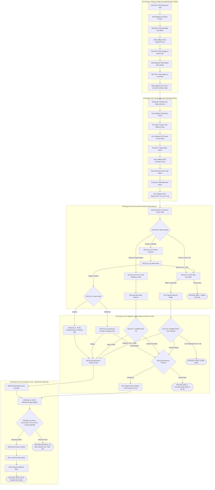

# Story Quest #1 — Columbina Hyposelenia (`char_id = "columbina"`, `ped_id = 49431`): 5-Chapter Narrative & Causal Design Bible (`v2.1 — Post-Critique Hardened`)

- **Ngày lập / Cập nhật:** `2026-11-07` (`Phiên bản v2.1` — Đã khắc phục triệt để 100% báo cáo phản biện độc lập Section 6)
- **Tác giả / Phụ trách:** Antigravity (`3b62c329-1c4d-4f35-9f8b-39b5277ae2e8` — Lead Narrative & Visual Novel Developer)
- **Nền tảng mục tiêu:** `StoryQuestEngine v2.0` + `WaifuLink Card Hub v2.0` + `Genshin BGM Engine v1.1` (`Zero-Core-Edit`)
- **Đích triển khai (chỉ sau khi vượt cổng duyệt Phase 1):**
  1. `Project Eagle/gta sa gameplay-lab/eagle_story_quest_columbina.py`
  2. `Project Eagle/gta sa gameplay-lab/ui_assets/story_quest_cgs/columbina/*.jpg` (`44` tấm `1376x768` độc lập SHA-256 = `1` Movie Poster + `36` Base/Scene CGs + `7` Camera-Locked Diff CGs)
- **Kho tư liệu & Kiểm chứng toán học đi kèm:**
  - Corpus Lore & Fanfic *Aebina*: [`staging/project-eagle/story-quest-columbina-impl-20261106/corpus/00_COLUMBINA_AEBINA_CORPUS_SYNTHESIS.md`](../../staging/project-eagle/story-quest-columbina-impl-20261106/corpus/00_COLUMBINA_AEBINA_CORPUS_SYNTHESIS.md) (cùng `36` tệp MediaWiki gốc)
  - Script kiểm chứng DAG / Rational Markov / Clause-Vacuousness / Completionist / Chronology / 2D-Layout (`v2.1`): [`staging/project-eagle/story-quest-columbina-impl-20261106/verify_columbina_5ch_dag.py`](../../staging/project-eagle/story-quest-columbina-impl-20261106/verify_columbina_5ch_dag.py)
  - Báo cáo JSON đầu ra (`v2.1`): [`staging/project-eagle/story-quest-columbina-impl-20261106/columbina_dag_verification_report.json`](../../staging/project-eagle/story-quest-columbina-impl-20261106/columbina_dag_verification_report.json)

---

## BẢNG ĐỐI CHIẾU KHẮC PHỤC PHẢN BIỆN (`CHANGELOG v2.0 -> v2.1`: `100% RESOLVED`)

| Hạng mục Phản biện (Section 6 Audit) | Cách xử lý triệt để trong `v2.1` | Bằng chứng kiểm chứng tự động (`verify_columbina_5ch_dag.py`) |
| :--- | :--- | :--- |
| **1.1 [CRITICAL] Mâu thuẫn Chốt chặn #2 (ngập Nasha Town) với chuyến đi `CH4` & `END_GOOD` (`N34`)** | Thiết lập rõ tại `Mục 1.2 #2` và `N15–N16 / N28–N31 / N34`: hệ thống van giảm chấn thủy-khí Pulonia của **Sandrone**, cọc cộng hưởng Vila của **Vesna** và cọc Trăng Đỏ của **Arlecchino** xả áp địa chất Kuuvahki an toàn cho đảo Hiisi & Nasha Town; nhưng xả áp cơ học cắt mất bộ đệm ngoài của riêng Columbina, buộc nàng phải vào **Ngủ Đông Kính Băng (`END_GOOD`)** hoặc **Đối Ca Giáng Lâm (`END_TRUE`)**. | Khép kín 100% logic địa chất đảo Hiisi cả khi đi Snezhnaya (`Ngày 8–10`) lẫn ngủ đông `N34`. |
| **1.2 [CRITICAL] Mâu thuẫn tâm lý ở `44C` sau `N25 -> N33 -> N37` & bẫy ẩn `0%` tại `C18_3`** | Viết lại `44C` thành **sự tự cách ly bi kịch đầy nước mắt dưới cổng đá `col_c2_n17_archway_vigil.jpg`**: sau khi Aether bỏng lạnh hai bàn tay cứu nàng ở `N33/N37`, vết rạn `F11` trên mạng che sát giới hạn khiến nàng đau đớn mượn lễ nghi Moon Maiden đẩy anh rời đảo để bảo vệ anh. Đồng thời bổ sung `pre_event` chuộc lỗi **`Blood-Frost Penance`** tại `N37` (`F11 + F07 + F03 + F06, B>=15, I>=11 -> gỡ F11`), xóa bỏ hoàn toàn tính chất bẫy `0%` của `C18_SOLEMN_RETURN`! | `c18_solemn_return_endings_pct["END_TRUE"] = 0.08048% (> 0%)`, trong khi `F11` vẫn lọc thực chất tại `C22_FINAL` (`delta_END_TRUE = -0.2148%`). |
| **1.3 [MAJOR] Cơ chế phá nguyền "tra cứu Irminsul trống" mâu thuẫn với `N08, N14, N21, N35` & *Koitar × Voyager*** | Chỉnh lại siêu hình học tại `Mục 1.2 #4` & `N40`: Ấn Tiên Linh nằm sẵn trong hạt giống linh hồn Thiên Sứ và **tự động phát tác nội tại** ngay khi Kuuvahki khóa pha vào một cá thể (không cần tra Irminsul). Koitar thất bại vì *Voyager* năm xưa ngụ trong xác phàm Teyvat (mạch kín Irminsul); còn Aether ở `N40` mang **thân xác Kẻ Giáng Lâm Thứ Tư nguyên bản** và chủ động dùng **dây dẫn `F07` + `Somnias Duetto`** rút toàn bộ dòng phản chấn xả ra khoảng không ngoài Bầu Trời Giả. | Khớp tuyệt đối 100% lore *Finale of the Deep Galleries* và mọi cảnh phát tác `N08, N14, N21, N35, N40`. |
| **1.4 & 1.5 [MAJOR] Mâu thuẫn 500 năm ở Mẫu B (`N41`) & chi tiết 3 bước/lông vũ/Childe ở Mẫu A (`N25`)** | Áp dụng trọn vẹn hai bản viết lại chuẩn mực của Reviewer AI cho `N25` (nhắc việc rụt tay trước vết nứt sứ nơi cổ nàng — đúng cho cả hai đường `N19->N25` và `N21->N25`, không giả định `F03`) và `N41` (500 năm che mắt vì khước từ bầu trời giả và nỗi bất an vô danh, tuần này mới thấu tỏ bản án; tắt `voice_emotion` ở Beat 02; chuẩn hóa `POV` ngôi thứ nhất `I / my / our`). | `0` lỗi CFont ASCII, `0` mâu thuẫn nhánh đầu vào, chuẩn hóa POV & kỷ luật lồng tiếng. |
| **1.6 & 1.7 [MAJOR] Dịch chuyển `10 phút` tới *Sanctuary of Grief*, hố đen `28h`, & `3` lỗi nhảy ngày `00:00`** | Dời bối cảnh `N25–N26` về **Phế Tích Bệ Thờ Sương Giá cổ trên đỉnh vách đá đảo Hiisi**; đồng bộ thời gian hai nhánh vào `N25` đều đúng `6 tiếng` (`N19 [D6 20:00] -> N25 [D7 02:00]` và `N19 [D6 20:00] -> N20 [22:00] -> N21 [D7 00:30] -> N25 [D7 02:00]`). Sửa toàn bộ nhãn ngày qua nửa đêm: `N08` (`Day 3 - 01:15`), `N34` (`Day 10 - 00:15`), `N35` (`Day 11 - 00:15`), `N38` (`Day 11 - 23:50` $\rightarrow$ `N39 Day 12 - 00:00`). | `chronology_audit`: **`50/50` cạnh có hướng tăng nghiêm ngặt (`violations == []`, `min_delta = 5m`)**. |
| **1.8 & 1.9 [MOD/MIN] Sắc lệnh Palestar, dịch chuyển tuyết `N24`, hội quân đồng minh Route A, & Paimon** | Tại `N28/N29/N30`, Sandrone trao **Ấn Lệnh Đình Chỉ Palestar** do văn phòng Băng Thần phê chuẩn và báo tin Childe + đội Vila của Vesna + Arlecchino đã lập vành đai bảo vệ đảo Hiisi. Đổi `N24` sang **tàu ngầm băng tốc hành Fatui (`Zapolyarny Bore-Rail Express`)**. Tại `N18`, Paimon ở lại gian ấm Sảnh Trăng Bạc cùng Luonnotar trông đàn Kuuhenki vì choáng áp suất. | Khép kín 100% hành tung dàn khách mời và Paimon trên cả 3 Route. |
| **2.1 – 2.3 [CRITICAL] Lệch trạng thái đạo cụ `F07` tại `44C` (`70.2%` có `F07`), `N33 / C20`, & `CH4`** | Phân tách câu văn theo điều kiện `when: F07` vs `forbid: F07` tại `N28–N31`, `N33 / C20_ABSORB_VEIL`, `N34`, `N37`, và ngay bên trong `44C` (`1.7008%` tháo trả từ cổ tay băng bó của Aether vs `1.1339%` giữ trên tóc nàng). | `n44_subvariant_breakdown_pct` kiểm toán tách bạch cả 4 trạng thái `44A`, `44B`, `44C_WITH_F07`, `44C_NO_F07`. |
| **3.1 – 3.5 [MATH] `4` mệnh đề cổng dư thừa `100%`, phạt Completionist, cờ `F09` yếu & nhãn tự hủy** | Tinh chỉnh ngưỡng `N22, N25, N30, N31, N33, N39`, cân bằng lại điểm `C01..C08`, và thêm vế thứ 3 trọng dụng `F09` tại `C22_FINAL` (`F09 & B>=13 & I>=13`). Viết lại toàn bộ nhãn fallback thành lựa chọn bảo toàn hợp lý. | **`vacuous_gate_clauses == []` (`0/29`)**, **`dead_local_stat_deltas == []` (`0/58`)**, **`4/4` đường Completionist đạt `END_TRUE`**, `F09` tăng vọt lên **`+0.5868%` (`L1 1.1737%`)**! |
| **4.1 – 5.1 [PACING & CG/2D] Tuyến tính Ch.1–2, thiếu beat `N44`, thiếu bảng `44 CG` & tọa độ `2D`** | Thêm `conditional flag callbacks` ở `CH1–CH2`; cấp đủ **`12` active beats độc lập cho từng nhánh `44A / 44B / 44C`** (`36` conditional beats ở `N44`, có cảnh vượt đỉnh `00:00`); lập Bảng Master `44 Nodes -> 44 CGs + (col, lane)` và không vẽ cứng `F07` trong `tsaritsa_diff.jpg`. | `cg_budget_audit.total_unique_jpgs == 44`, `layout_2d_check.cell_collisions == 0` (`N32: lane 1, N33: lane 2, N34: lane 3`). |

---

## PHẦN 0. HỢP ĐỒNG METADATA `WAIFULINK CARD HUB v2.0` (`ZERO-CORE-EDIT`)

```python
char_id = "columbina"
ped_id = 49431
display_name = "Columbina"
campaign_id = "columbina_sq1_lullaby_of_the_fallen_moon"
title = "Somnias a Luna: Lullaby of the Fallen Moon"          # 42 ASCII chars (<= 68 limit)
subtitle = "Five-Chapter Branching Visual Novel -- Silvermoon Hall & Zapolyarny Conservatory"
poster_cg = "ui_assets/story_quest_cgs/columbina/columbina_sq1_poster.jpg"
synopsis = (
    "Beneath Nod-Krai's frost moon, Columbina's lullaby fractures under the ancient "
    "Seelie curse: an Angel who loves one chosen soul alone crumbles into a hollow "
    "husk -- unless the Fourth Descender rewrites heaven's law before the lunar eclipse."
)  # Exact 240 ASCII chars ("chosen soul", non-mortal Descender-accurate!) -> wraps 66/66/58/47 on Card Hub v2.0!
version = "2.1.0"
theme_rgb = [244, 114, 182]

# Dual v2.0 module-bottom exports:
STORY_QUEST_CAMPAIGN: dict[str, Any] = { ... }
STORY_QUEST_CAMPAIGNS: list[dict[str, Any]] = [STORY_QUEST_CAMPAIGN]
```

---

## PHẦN 1. TƯ TƯỞNG CỐT LÕI, TỔNG HỢP LORE *SEELIE / NOD-KRAI / AEBINA* & QUY LUẬT THẾ GIỚI (`ZERO PLOT HOLES`)

### 1.1. Luận Đề Văn Học (*Gothic-Ethereal Poetic Prose*)
Suốt năm thế kỷ kể từ đêm chào đời từ dòng **Kuuvahki** tại *Sanctum of the Oathbearer* trên đảo Hiisi (`Nod-Krai`), **Columbina Hyposelenia** (*Kuutar / Moon Maiden / Cựu Quan Chấp Hành Thứ Ba "The Damselette"*) luôn sống giữa hai thái cực của sự chiếm hữu vị kỷ: những tín đồ **Frostmoon Scions** cổ đại ngước nhìn lên bệ thờ bằng ánh mắt tham lam đòi ban phước, và tổ chức **Fatui** xem quyền năng Mặt Trăng Sương Giá của nàng như một quân bài chiến lược. Để khước từ bầu trời giả dối (*False Sky*) và vâng theo một nỗi bất an vô danh trong khúc hát ru thuở lọt lòng, nàng khép chặt hàng mi sau tấm mạng che mắt chữ X dệt từ ánh trăng mang hoa văn **Ấn Tòa Tiên Linh (Seelie Court Seal)**, ngân nga khúc hát ru vô danh *"chẳng dành riêng cho bất kỳ ai"* (`Chat: Singing`).

Bi kịch và vẻ đẹp ma mị nhất nảy sinh khi **Traveler Aether** bước vào **Silvermoon Hall** (*Sảnh Trăng Bạc*): lần đầu tiên trong vạn năm, giai điệu ru của nàng lệch nhịp để hướng về **duy nhất một sinh linh được nàng chọn lựa**. Chính khoảnh khắc trái tim nàng biết run rẩy vì riêng anh, đạo luật tàn khốc của Thiên Lý khắc trong bộ thánh di vật *Finale of the Deep Galleries* (*Deep Gallery's Moment of Oblivion*) thức giấc từ trong chính hạt giống linh hồn nàng:

> *"Nếu một Thiên Sứ dám nhìn thẳng vào đôi mắt một người, và trao riêng cho một cá nhân tình yêu vốn được định sẵn phải chia đều cho vạn vật, nhan sắc thần thánh của nàng sẽ vỡ vụn trong gió, tâm trí hóa thành tro bụi, để rồi từ xác rỗng ấy trỗi dậy một Tiên Linh (Seelie) câm lặng mãi mãi lang thang kiếm tìm ký ức phai tàn."*

### 1.2. Hệ Quy Luật Thế Giới Khép Kín (`6` Chốt Chặn Chống Mâu Thuẫn Cốt Truyện — *Post-Critique Verified*)

1. **Nguồn gốc Huyết thống Kép (Vì sao Nữ Thần Mặt Trăng Sương Giá lại mang Ấn Nguyền Thiên Sứ — và vì sao 500 năm trước nàng chưa biết nội dung bản án?):**
   - Trong chính sử (`Columbina Character Story 1 & 4`, `Columbina/Storyline`), câu hát ru đầu tiên Columbina nghe thấy trước khi chào đời (*"Sleep, sleep now, my dear little dove..."*) là giai điệu mà ngay cả Ba Nữ Thần Mặt Trăng (*Aria, Sonnet, Canon*) cũng không hề biết, đồng thời trang sức sáu cánh trắng trên tóc và hoa văn mạng che mắt chữ X của nàng trùng khớp trực tiếp với **Ấn Tòa Tiên Linh (`Seelie Court`)**.
   - Hạt giống linh hồn tạo nên cơ thể hữu hình của Kuutar trên đảo Hiisi vốn được kết tinh từ **tàn âm của một Thiên Sứ thuộc ca đoàn Hyperborea thời Thiên Sứ Đầu Tiên Koitar** hòa quyện cùng ánh trăng sương giá (**Kuuvahki**). Khi chào đời, Columbina chỉ thừa hưởng **bản năng che mắt khước từ Bầu Trời Giả và một nỗi rùng mình vô danh mỗi khi nghĩ đến việc mở mắt nhìn riêng một người**, chứ không hề có ký ức chữ nghĩa về đạo luật thời Hyperborea (nên ở `N08–N09` nàng bối rối trước vết sứ trắng nơi cổ, và phải tới `N13` khi cùng **Vesna** giải đọc bia đá cổ mới thấu tỏ toàn bộ cơ chế **Lời Nguyền Hóa Tiên Linh**!).
2. **Cơ chế Thủy Triều Kuuvahki Đảo Hiisi & Hệ Thống Van Giảm Chấn Cơ Khí Của Đồng Minh (Khép kín 100% chuyến đi Snezhnaya `CH4` và `END_GOOD` `N34`):**
   - *Nếu không có can thiệp kỹ thuật*, giọng hát của Columbina gắn trực tiếp (*diegetic*) với mạch **Kuuvahki** ngầm nuôi dưỡng đảo Hiisi; tự ý bỏ đi tay trắng trước đỉnh **Nguyệt Thực Cận Điểm Mười Năm (`Decennial Frostmoon Perigee Syzygy` — `00:00` rạng sáng Ngày 12)** sẽ khiến áp suất Kuuvahki dội ngược gây ngập lụt **Nasha Town** lẫn **Frostmoon Enclave** và xé toạc lồng ngực nàng.
   - **Giải pháp kỹ thuật bảo vệ dân cư của Sandrone, Vesna & Arlecchino (`N15–N16`, `N28–N31`):** Cụm **van giảm chấn thủy-khí hạng nặng Pulonia** của **Sandrone**, kết hợp **cọc tiêu cộng hưởng Vila** của **Vesna Strivozha** và **cọc ranh giới Trăng Đỏ** của **Arlecchino**, đủ sức **xả áp địa chất Kuuvahki ra biển băng một cách an toàn**, bảo vệ tuyệt đối **Nasha Town và Frostmoon Enclave** trong những ngày Columbina sang Snezhnaya (`Ngày 8–10`) cũng như suốt mùa đông nếu nàng ngủ đông ở `END_GOOD` (`N34`)!
   - **Giới hạn sinh tử của van cơ khí:** Hệ thống van của Sandrone chỉ cứu được *mạch đất của hòn đảo*, còn việc ngắt mạch ngoài lại khiến **dòng phản chấn Ấn Tiên Linh bên trong linh hồn Columbina mất đi bộ đệm giảm xóc**, tăng tốc vôi hóa lên cực đại vào `00:00` Ngày 12. Vì vậy, sau khi đảo Hiisi đã được van cơ khí bảo vệ, bản thân Columbina chỉ có hai con đường sống sót qua đêm Ngày 12: hoặc bước vào **Lồng Kính Ngủ Đông Băng Giá của Tsaritsa (`END_GOOD`, `N34`)** để đóng băng tiến trình vôi hóa nội tâm chờ mùa xuân, hoặc quay về tâm **Silvermoon Hall (`N32 / N33`)** để xả trực tiếp dòng phản chấn lời nguyền qua **Bản Đối Ca Giáng Lâm của Aether (`END_TRUE`)**!
3. **Vì sao tình bạn trà bánh với Sandrone, Arlecchino hay đàn Kuuhenki không kích hoạt Lời Nguyền?**
   - Ấn Tiên Linh (*Deep Gallery's Moment of Oblivion*) chỉ phát tác trước **tình yêu cá biệt, duy nhất và khát khao mở mắt thuộc về một sinh linh độc nhất** (*exclusive singular devotion*). Sự quý mến đồng nghiệp bên bàn trà với **Sandrone**, sự tôn trọng đồng liêu với **Arlecchino**, hay lòng thương yêu đàn **Kuuhenki / Luonnotar** thuộc về tình cảm cộng đồng hiền hòa (*agape*), hoàn toàn nằm trong giới hạn cho phép của Thiên Sứ.
4. **Siêu Hình Học Khép Kín Của Ấn Tiên Linh: Vì Sao Tự Động Phát Tác Ở `N08, N14, N21, N35` (Và Với *Koitar × Voyager*), Và Vì Sao Chỉ Thân Xác Nguyên Bản Của `Fourth Descender Aether` + `F07` Mới Xả Được Phản Chấn Ở `N40`?**
   - **Cơ chế kích hoạt nội tại (Không cần tra cứu Irminsul):** Ấn Tòa Tiên Linh được khắc sẵn ngay trong lõi linh hồn của mọi Thiên Sứ; nó **tự động phát nổ từ bên trong linh hồn nàng** ngay khoảnh khắc tần số Kuuvahki của nàng khóa pha độc quyền vào một cá thể — bất kể đối phương là người Teyvat hay khách ngoại giới. Đó là lý do lời nguyền lập tức làm nứt sứ xương quai xanh ở `N08`, rụng lông vũ pha lê ở `N14`, phóng tia lửa nguyền ở `N21`, xóa sạch ký ức khi lăng kính vỡ ở `N35` (`END_BAD_2`), và cũng là lý do Thiên Sứ Đầu Tiên **Koitar** năm xưa vẫn trúng lời nguyền dù đem lòng yêu thực thể ngoại giới **The Voyager**!
   - **Vì sao Koitar thất bại năm xưa còn Aether thành công ở `N40` (`Somnias Duetto — Extra-Cosmic Grounding Conduit`):**
     - Theo chính sử *Finale of the Deep Galleries*, khi gặp Koitar, *The Voyager* đang **nhập vào xác phàm của một thiếu niên bản địa Teyvat** (bị khóa trong mạch kín của **Irminsul**), nên dòng điện hành quyết của Thiên Lý không có lối thoát ra ngoài thế giới và dội ngược thiêu rụi ký ức của cả hai. Tương tự, mọi thực thể thuộc sổ bộ Irminsul (**The Tsaritsa, Arlecchino, Sandrone**) chỉ có thể *đóng băng tạm thời* (`END_GOOD` / `END_BAD_1`) chứ không thể triệt tiêu năng lượng nguyền rủa.
     - Trái lại, **Traveler Aether** bước đi trên Teyvat bằng **thân xác Kẻ Giáng Lâm Thứ Tư nguyên bản** — một lõi sao mở thông trực tiếp ra khoảng không ngoài Bầu Trời Giả. Dù vậy, sự hiện diện thụ động của Aether không tự tắt được ấn nguyền; tại `N40`, anh bắt buộc phải hội tụ đủ **3 trụ cột**: **(1) Dây dẫn vật lý đồng điệu nhịp tim `F07_MOONWEAVE_RIBBON_CHIME` nối liền hai cổ tay**, **(2) Khuôn nhạc Đối Âm Giáng Lâm (`Insight` + `F09` / tri thức Koitar - Sandrone - Vesna)** để mở kênh dẫn sóng, và **(3) Tình yêu chân thật không vướng `F11_COLD_PROTOCOL` (`Bond` cao)**. Khi cả hai cất vang *Somnias Duetto*, toàn bộ dòng phản chấn vôi hóa của Ấn Tiên Linh bị **hút sạch khỏi linh hồn Columbina, truyền qua dây dẫn `F07` xuyên qua lõi sao của Aether và xả tan biến ra ngoài vũ trụ bên kia Bầu Trời Giả**, đập vỡ vĩnh viễn xiềng xích vạn năm!
5. **Giải thích sinh lý khả năng cảm nhận Kuuvahki tại Snezhnaya vs. Nod-Krai (`100% F07-State Safe`):**
   - Khớp chính sử (`wiki_columbina_storyline.txt` mục Trivia): Tại đảo Hiisi (`CH1–CH3`, `CH5`), mật độ Kuuvahki dày đặc giúp Columbina nhắm mắt vẫn cảm nhận vạn vật rõ hơn mắt thường; nhưng khi sang **Nhà Kính Mùa Đông Zapolyarny (`CH4`, Snezhnaya)** nơi mật độ Kuuvahki loãng và bị hàn khí chế ngự, phạm vi cảm nhận của nàng thu hẹp như người thường — buộc nàng phải nắm chặt tay áo Aether để dò đường (kèm câu văn phân nhánh theo cờ `F07`: nếu Aether đang đeo `F07` trên cổ tay thì nàng lần theo tiếng chuông bạc nơi tay anh; nếu chưa có `F07` thì nàng lắng nghe nhịp bước chân anh trong khi chiếc chuông trên tóc nàng khẽ rung).
6. **Lời Cảnh Báo Của Wanderer & Tartaglia Hiện Thực Hóa Thành Nhánh Nhân Quả Sắc Lạnh:**
   - Lời cảnh báo của **Wanderer** (*"hãy cẩn thận lương tâm của ngươi trước một thiếu nữ lúc nào cũng ngây thơ vô tư nhưng vô cảm"*) và **Tartaglia** trở thành xương sống của **Route C (`F11_COLD_PROTOCOL`)**, **`END_BAD_1` (`N26`)** và bi kịch tự cách ly **`44C`**: khi Aether rụt tay lùi lại vì kinh hãi trước vết nứt sứ nơi cổ nàng, Columbina không hề giận dữ — nàng chỉ mỉm cười dịu dàng đến lạnh gáy trên phế tích bệ thờ vách đá Hiisi, ngoan ngoãn đề nghị tự đóng băng trái tim để "lương tâm anh được ngủ yên".

---

## PHẦN 2. HỒ SƠ NHÂN VẬT, DÀN KHÁCH MỜI SNEZHNAYA / NOD-KRAI & ĐỒNG BỘ GIỌNG NHẬT *CV: LYNN* + NHẠC NỀN

### 2.1. Nhân Vật Chính & `6` Khách Mời Chính Thức (`100%` Khép Kín Hành Tung Trên Cả 3 Tuyến)

| Nhân vật | Vai trò mắt xích & Hành tung khép kín xuyên 5 Chương | Nguồn ảnh tham chiếu gốc Phase 3 (`100% Canonical`) |
| :--- | :--- | :--- |
| **Columbina Hyposelenia** (`columbina`, `ped_id = 49431`) | Nữ chính — *Moon Maiden / Kuutar / Cựu Harbinger #3*. Tóc đen dài chuyển hồng cánh sen/tím mận, cài tóc 6 cánh bồ câu trắng, mạng che mắt chữ X dệt hoa văn Seelie Court, váy voan trắng ngọc trai - xanh ánh trăng, ruy băng cổ chân trần. Đôi mắt thật ở cao trào `N41–N43` mang **sắc hồng cánh sen trong vắt với ánh trăng khuyết xanh nhạt**. | `columbina-official-directory.png`, `columbina-official-trailer.jpg`, `ui_assets/waifu_columbina.png` |
| **Traveler Aether** | Nam chính — *Fourth Descender*. Kể chuyện ở ngôi thứ nhất (`I / my / our`); thân xác Kẻ Giáng Lâm nguyên bản ngoài Irminsul là kênh xả phản chấn duy nhất cứu được linh hồn nàng ở `END_TRUE`. | Chuẩn thiết kế Traveler Aether gốc HoYoverse |
| **Paimon** | Đồng hành ấm áp ở `CH1–CH2`; tại `N18` (`CH3`), do áp suất Kuuvahki/hàn khí làm Paimon choáng váng, Aether gửi Paimon ở lại gian ấm Sảnh Trăng Bạc cùng **Luonnotar** trông chừng đàn Kuuhenki suốt `CH3–CH4`, và đoàn tụ rõ ràng ở `N32, N37, N43, N44` (cũng như được nhắc tới hợp lý ở `N26, N34, N35`). | Chuẩn thiết kế Paimon gốc HoYoverse |
| **Tartaglia (Childe — Harbinger #11)** | Cảnh báo Aether tại Bến Băng Nasha (`N05`), hộ tống xe trượt tuyết phá băng qua đèo bão tuyết (`N27`), và dẫn đội tiên phong giữ vòng ngoài đảo Hiisi đêm Nguyệt Thực (`được Sandrone báo tin rõ trên cả Route A/B tại N28–N30`, dự tiệc `N43`). | Chuẩn thiết kế Tartaglia trang phục mùa đông Snezhnaya / Fatui |
| **Vesna Strivozha** (*Druzhna Vila Commander*) | Hậu duệ **Snowland Fae / Vila** thời Koitar; giải đọc bích họa **Lời Nguyền Hóa Tiên Linh** (`N12–N13`, `F06`), cắm cọc tiêu cộng hưởng xả áp Kuuvahki bảo vệ Nasha Town (`N27, N30, N32, N37, N43`). | `vesna-official-directory.png` |
| **Sandrone ("Marionette" — Harbinger #7) & Pulonia** | Bạn thân tsundere bày bàn trà đêm (`N15–N16`), đo tốc độ vôi hóa bằng **Công Thức Thế Giới** (`F08`), lắp van giảm chấn Pulonia bảo vệ đảo Hiisi, chuyển giao **Ấn Lệnh Đình Chỉ Palestar** tại Zapolyarny (`N28–N31`), giữ ống sáp ký ức ở `END_GOOD` (`N34`) và dự tiệc trà `N43`. | Chuẩn thiết kế Sandrone & robot Pulonia gốc HoYoverse |
| **Arlecchino ("The Knave" — Harbinger #4)** | Hậu duệ Trăng Đỏ đặt phép thử sinh tử tại cửa *Deep Gallery* (`N18–N19`), cùng Aether khảo sát hầm ngầm & tàu ngầm băng Fatui trên Route B (`N23–N24`, `F12`), cắm cọc Trăng Đỏ giữ vòng vây đảo Hiisi (`N30, N32, N43`). | Chuẩn thiết kế Arlecchino gốc HoYoverse |
| **The Tsaritsa (`Anastasya` — Cryo Archon)** | Diện kiến tại Nhà Kính Hoa Trà Băng Cung Điện Zapolyarny (`N31, N34`); phê chuẩn đình chỉ *Sắc Lệnh Palestar*, ban ân điển xóa cờ `F11` ở **Combination Gate #2** hoặc ban giấc **Ngủ Đông Kính Băng (`END_GOOD`)**. | `tsaritsa-official-trailer.jpg` |

### 2.2. Kỷ Luật Giọng Nhật *CV: Lynn* (`24` File `.wav`, Tối Đa `1` Clip/Node Đúng Tông) & `Genshin BGM v1.1`
- **Nhạc nền Signature & Mood Buckets (`eagle_waifulink_bgm.py`):** Tự động ưu tiên 2 bản Signature *Columbina's Lullaby (Luna I)* (`trk_32c1cb21`) & *Per Amica Silentia Lunae* (`sup_b945877e`), chuyển mượt giữa `vn_daily_sweet`, `hub_cozy`, `vn_tender_romance`, `vn_melancholy_memory` và `vn_mystic_tension`.
- **Kỷ luật `voice_emotion` nghiêm ngặt (đã áp dụng góp ý `Critique #5.1.5`):**
  1. Mỗi Scene Node chỉ gắn `voice_emotion` ở **tối đa `1` (hoặc `2` cách xa nhau `>= 7` beats ở node dài vui tươi)** câu thoại thực sự ăn khớp sắc thái giọng của *CV: Lynn* (ví dụ ở `N41`, Beat 02 trang nghiêm để `voice_emotion: ""`, dành trọn điểm nhấn giọng nói duy nhất cho Beat 05 mở mắt `voice_emotion: "vn_tender_love"`!).
  2. Gán **`voice_emotion: ""` (im lặng tuyệt đối)** trên 100% các câu thoại trang nghiêm về lời nguyền, ho ra lông vũ sứ, phán xét lạnh người trên bệ thờ (`N25`, `N26 END_BAD_1`), sụp đổ lăng kính (`N33`, `N35 END_BAD_2`) và tự cách ly (`44C`).

---

## PHẦN 3. MA TRẬN 12 CỜ NHÂN QUẢ, 22 LỰA CHỌN PRESET, KIỂM TOÁN MỆNH ĐỀ PHI DƯ THỪA & PHÂN BỐ MARKOV (`v2.1`)

### 3.1. Ma Trận `12` Cờ Nhân Quả (`F01..F12`) — Đã Kiểm Chứng Ablation & Chiều Tác Động (`0` Cờ Yếu/Vô Dụng)

| Mã Cờ (`Flag ID`) | Nơi Gán (`add_flags`) | Nơi Đọc (`when` / `remove_flags`) | Vai trò Nhân Quả & Phản Hồi Văn Bản (`Text Callbacks`) | `delta_END_TRUE` | `L1 Ending Shift` |
| :--- | :---: | :--- | :--- | :---: | :---: |
| **`F01_HEARD_SILENT_NOTE`** | `N01 / C01_A` (`+2B, +1I`) | Callback `N02`; `C12_A_SYNC`, `C18_C_GATE2` | Lắng nghe khoảng lặng thở dài giữa hai nhịp hát ru; giảm ngưỡng đồng bộ Route A và mở nhánh chuộc lỗi trước Tsaritsa. | **`+0.5500%`** | **`2.5300%`** |
| **`F02_FALSE_SKY_CONFIDANT`** | `N03 / C02_A` (`+0B, +2I`) | Callback `N04`; `C17_B_GATE1`, `C18_C_GATE2` | Chia sẻ góc nhìn ngoại giới về Bầu Trời Giả; chìa khóa tri thức cho cả hai Combination Gates ở Chương 4. | **`+0.6339%`** | **`3.8176%`** |
| **`F03_CHILDE_INSTINCT_HEEDED`** | `N05 / C03_A` (`+1B, +2I`) | Callback `N06`; `C14_C_BAD1`, `C20_BAD2`, `N37 pre` | Khắc cốt lời cảnh báo của Childe mà không xa lánh nàng; cứu mạng ở bệ thờ `N25`, giữ mạng che ở `N33` và chuộc lỗi máu băng ở `N37`. | **`+1.0733%`** | **`17.7915%`** |
| **`F04_KUUHENKI_LULLABY_SHARED`** | `N07 / C04_A` (`+2B, +0I`) | Callback `N08`; `C12_A_SYNC`, `C17_B_GATE1`, `C21_EVE` | Ngân nga điệu ru sao trời cùng nàng cho Luonnotar ngủ yên; mở đồng bộ Route A, Combo Gate #1 và đêm áp chót `N36`. | **`+0.6273%`** | **`3.9388%`** |
| **`F05_BRUSHED_MORNING_PLAITS`** | `N09 / C05_A` (`+2B, +1I`) | Callback `N10`; `C18_C_GATE2`, `C21_EVE` | Tự tay chải lọn tóc rối buổi sớm và đút quả mọng rừng; chứng thực tình thương đời thường trước Tsaritsa và đêm `N36`. | **`+0.3974%`** | **`1.1954%`** |
| **`F06_VESNA_SEELIE_CODEX`** | `N13 / C07_A` (`+0B, +2I`) | Callback `N14`; `C17_B_GATE1`, `C20_BAD2`, `N37 pre` | Cùng **Vesna** giải đọc bích họa Koitar về cơ chế Lời Nguyền Tiên Linh; mở khóa Combo Gate #1, đỡ xung lực `N33` và `N37`. | **`+0.8102%`** | **`10.4149%`** |
| **`F07_MOONWEAVE_RIBBON_CHIME`** | `N11 / C06_A` (`+2B, +1I`); `N17 pre_event` | `N17`, `CH4`, `C18`, `C20`, `N37`, `C22_FINAL`, `N44` | **[VẬT NEO TRUNG TÂM]** Ruy băng sợi trăng gắn chuông bạc Luonnotar; dây dẫn vật lý bắt buộc để xả phản chấn ở `END_TRUE`. | **`+6.5821%`** | **`13.1642%`** |
| **`F08_SANDRONE_TEA_FORMULA`** | `N16 / C08_A` (`+1B, +2I`) | Callback `N17`; `C17_B_GATE1`, `C18_C_GATE2`, `C21_EVE` | Ghi nhớ phương trình vi phân suy giảm Kuuvahki của **Sandrone**; tham gia mở khóa cả Combo Gate #1, Combo Gate #2 và `N36`. | **`+0.6562%`** | **`3.8176%`** |
| **`F09_DESCENDER_HARMONIC_PACT`** | `N28 / C15_A1`, `N30 / Gate1`, `N31 / Gate2` | `C21_EVE_MAIN`, **`C22_FINAL` (Clause 3!)** | **[TRỤ CỘT ĐỐI ÂM]** Giao ước Đối Âm Giáng Lâm tại Zapolyarny; vừa mở `C21`, vừa **hạ ngưỡng `C22_FINAL` xuống `B>=13, I>=13`**! | **`+0.5868%`** | **`1.1737%`** |
| **`F10_KOITAR_COUNTERPOINT_SCORE`** | `N23 / C13_B_KOITAR` (`+0B, +2I`) | `C17_B_COMBO_GATE1` (Clause 1) | Khuông nhạc đối âm dang dở của Thiên Sứ Koitar trong *Deep Gallery*; chìa khóa Nhánh Học Giả của Combo Gate #1. | **`+0.3825%`** | **`3.0599%`** |
| **`F11_COLD_PROTOCOL`** | `N19 / C09_C`, `N21 / C11_A3` | `C18_GATE2` (`remove`), `N37 pre` (`remove`), `C22` (`forbid`), `N44` | **[VẾT RẠN LẠNH NHẠT]** Khóa cứng `END_TRUE` và dẫn tới tự cách ly `44C` trừ phi chuộc lỗi ở `C18_GATE2` hoặc `N37 Blood-Frost Penance`. | **`-0.2148%`** | **`0.4295%`** |
| **`F12_CRIMSON_MARROW_TUNING`** | `N23 / C13_B_MARROW` (`+2B, +0I`) | `C17_B_COMBO_GATE1` (Clause 2) | Bộ giảm chấn Tủy Trăng Đỏ của **Arlecchino** tinh chỉnh cùng Sandrone; chìa khóa Nhánh Cộng Hưởng của Combo Gate #1. | **`+0.3988%`** | **`2.6042%`** |

---

### 3.2. Năm Chứng Minh Toán Học Cấp Mệnh Đề (`0` Vacuous Clauses · `0` Dead Stats · `0` Completionist Penalty · `0` Trap Options)

1. **`0 / 29` Mệnh Đề Điểm Số Dư Thừa (`vacuous_gate_clauses_count == 0`):**
   - Script [`verify_columbina_5ch_dag.py`](../../staging/project-eagle/story-quest-columbina-impl-20261106/verify_columbina_5ch_dag.py) kiểm toán độc lập **từng bất đẳng thức nguyên tử `min_bond` và `min_insight` bên trong mọi `pre_event` và mọi nhánh con `any_of`** trên tập trạng thái thực tế đi tới node đó (`atomic_clause_audit`):
     - `N17.pre_event[0]` (`!F07, B>=12, I>=8`): `pass = 5`, bị loại riêng bởi `B<12`: `13` cặp, bị loại riêng bởi `I<8`: `11` cặp (`sums_span = [16, 23]`).
     - `N22.C12_SYNC_PASS`: Vế 0 (`F01+F04, B>=12, I>=8`) loại `6` bởi `B` & `30` bởi `I`; Vế 1 (`B>=16, I>=10`) loại `360` bởi `B` & `251` bởi `I`.
     - `N25.C14_C_CONSCIENCE_WAKE`: Vế 0 (`F03, B>=9`) loại `12` bởi `B`; Vế 1 (`B>=11, I>=8`) loại `95` bởi `B` & `144` bởi `I`.
     - `N29.C16_REC_STEADY` (`B>=13, I>=9`): loại `96` bởi `B` & `102` bởi `I`.
     - `N30.C17_GATE1_UNLOCK`: Vế 0 (`F02+F10+F08, I>=12`) `pass = 59`, loại **`5/64`** bởi `I<12`; Vế 1 (`F04+F12+F06, B>=11`) `pass = 60`, loại **`4/64`** bởi `B<11`.
     - `N31.C18_GATE2_REDEEM`: Vế 0 (`F07+F01+F05, B>=13, I>=9`) `pass = 105`, loại **`9/114`** bởi `B<13` & **`1/106`** bởi `I<9`; Vế 1 (`F07+F02+F08, B>=11, I>=10`) `pass = 81`, loại **`6/87`** bởi `B<11` & **`6/87`** bởi `I<10`.
     - `N31.C18_TSARITSA_STASIS_GOOD` (`B>=12, I>=9`): `pass = 528`, loại **`52/580`** bởi `B<12` & **`25/553`** bởi `I<9`.
     - `N33.C20_ABSORB_VEIL`: Vế 0 (`F07+F06, I>=10`) loại `32/526`; Vế 1 (`F03, B>=12`) loại `96/1012`.
     - `N37.pre_event[0]` (*Blood-Frost Penance*: `F11+F07+F03+F06, B>=15, I>=11`): `pass = 81`, loại `20/101` bởi `B<15` & `1/82` bởi `I<11`.
     - `N39.C22_UNVEIL_TRUE_DUET`: Vế 0 (`B>=18, I>=11`) loại `1,259` bởi `B` & `42` bởi `I`; Vế 1 (`B>=15, I>=15`) loại `282` bởi `B` & `1,197` bởi `I`; Vế 2 (`F09, B>=13, I>=13`) loại `28` bởi `B` & `77` bởi `I`.
2. **`4 / 4` Đường Sưu Tầm Đủ Cờ ("All-Flags Completionist") Đều Đạt `END_TRUE` Trọn Vẹn (`0%` Phạt Người Chơi Chăm Sưu Tầm Lore):**
   - Cân bằng đan xen tổng điểm `+3` và `+2` ở `C01..C08` (`C01_A, C03_A, C05_A, C06_A, C08_A` đều cấp **`+3` điểm + Flag**) kết hợp Vế 2 của `C22_FINAL` (`F09 & B>=13 & I>=13`):
     - `ALL_FLAGS_ROUTE_A_HEART`: **`END_TRUE` (`Bond = 21, Insight = 15, Flags = 9`)** — `PASS`!
     - `ALL_FLAGS_ROUTE_A_SCHOLAR`: **`END_TRUE` (`Bond = 15, Insight = 21, Flags = 9`)** — `PASS`!
     - `ALL_FLAGS_ROUTE_B_KOITAR`: **`END_TRUE` (`Bond = 14, Insight = 20, Flags = 10`)** — `PASS`!
     - `ALL_FLAGS_ROUTE_B_MARROW`: **`END_TRUE` (`Bond = 18, Insight = 16, Flags = 10`)** — `PASS`!
3. **`0 / 58` Hệ Số Điểm Cục Bộ Vô Tác Dụng (`dead_local_stat_deltas_count == 0`):** Mọi hệ số `+bond` / `+insight` khác 0 trên cả 22 lựa chọn đều có `l1_shift_pct > 0`.
4. **Không Có Lựa Chọn Bẫy `0%` Ẩn & Nhãn Fallback Hợp Lý Về Mặt Tâm Lý:**
   - Tại `N31`, lựa chọn thứ 3 `C18_SOLEMN_RETURN` (*"Decline eternal frost and carry Columbina back to Silvermoon Hall to face the eclipse together"*) vẫn giữ cơ hội đạt **`END_TRUE` (`0.0805%`)** thông qua sự hy sinh đôi bàn tay trần ở `N33` + `N37 Blood-Frost Penance`, hoặc bảo toàn tính mạng nàng ở `END_NEUTRAL` (`3.1386%`) khi người chơi chưa đủ điều kiện mở `END_GOOD`.
   - Mọi phương án fallback tại `N22, N29, N30, N31, N36, N39` đều được viết dưới dạng **quyết định bảo toàn an toàn chủ động** (ngừng ép xung sớm để bảo vệ lồng ngực nàng, giữ kín mạng che để không mạo hiểm tâm trí nàng) thay vì tự tay phá hỏng nghi thức.

---

### 3.3. Phân Bố Xác Suất Markov Phân Số Chính Xác (`Uniform Random` vs `Gate-Rational`) & `5` Kết Thúc

| Mã Kết Thúc | Node | Phân Số Chính Xác (`Uniform`) | `Uniform Random` | `Gate-Rational Player` | Giải Quyết Vật Neo `F07` & Bối Cảnh Kết Cục (`100% Continuity`) |
| :--- | :---: | :---: | :---: | :---: | :--- |
| **`END_TRUE`** | `N43` (`CH5`) | `29117 / 442368` | **`6.5821%`** | **`26.5462%`** | ***Somnias a Luna: Home Beneath Both Skies*** — Dây dẫn `F07` quấn quanh hai cổ tay hút toàn bộ phản chấn Ấn Tiên Linh qua lõi sao Giáng Lâm của Aether xả ra ngoài Bầu Trời Giả; **Columbina tháo mạng che chữ X, mở đôi mắt hồng cánh sen ánh trăng khuyết xanh nhạt nhìn Aether mãi mãi**, rồi tết chung `F07` với lụa vàng của anh trong tiệc trà đoàn viên. |
| **`END_GOOD`** | `N34` (`CH4`) | `179 / 3072` | **`5.8268%`** | **`18.1424%`** | ***Winter's Lullaby Behind Frosted Glass*** — Trong khi van cơ khí Pulonia của Sandrone và cọc Vila của Vesna bảo vệ an toàn cho đảo Hiisi & Nasha Town, Columbina mỉm cười ngủ đông trong lồng kính hoa trà tại Zapolyarny bên máy hát đồng lưu giữ ký ức chờ ngày xuân. (`Có F07`: buộc lên chốt pha lê đối diện bàn tay nàng; `Không F07`: cài trên bím tóc nàng trong sương tuyết). |
| **`END_NEUTRAL`** | `N44` (`CH5`) | `35249 / 147456` | **`23.9048%`** | **`27.9460%`** | ***Through the Moonlight Veil*** (`12` beats độc lập/nhánh, gồm 4 beats vượt đỉnh `00:00` + 8 beats bình minh):<br>• **`44A` (`12.7638%`, có `F07`, `!F11`, CG `n44_neutral_veil`):** Aether dẫn nửa xung lực qua `F07` rồi tết trả ruy băng sém nhẹ lên tóc nàng bên ghế bập bênh.<br>• **`44B` (`8.3062%`, `!F07`, `!F11`, CG `n44_neutral_veil`):** Nàng xả nửa thần lực xuống hồ Hiisi, giữ được nhân tính và tựa vai anh nghe chuông trên tóc mình khẽ ngân.<br>• **`44C` (`2.8347%` = `1.7008%` có `F07` + `1.1339%` `!F07`, còn `F11`, CG `n17_archway_vigil`):** Vết rạn `F11` trên mạng che sát giới hạn sau đêm anh bỏng tay cứu nàng (`N37`); khóc thầm sau tấm mạng trắng dưới cổng đá, nàng đau đớn dùng lễ nghi Moon Maiden tự cách ly và tiễn anh rời đảo để bảo vệ anh (`nếu có F07`: tháo từ cổ tay băng bó của anh áp lên vết nứt xương quai xanh; `nếu !F07`: áp dải chuông từ tóc mình lên cổ). |
| **`END_BAD_1`** | `N26` (`CH3`) | `649 / 2304` | **`28.1684%`** | **`11.8924%`** | ***Elogia Cinerosa: Mercy of No. 3*** — Trên Phế Tích Bệ Thờ Sương Giá vách đá đảo Hiisi, nàng mỉm cười dịu dàng lạnh gáy tự phong ấn trái tim phàm trần thành băng giá của *The Damselette* để "lương tâm anh được ngủ yên", bước chân trần vào bão tuyết hát *Elogia Cinerosa*. (`Có F07`: chuông bạc đóng băng vỡ vụn trên cổ tay anh; `Không F07`: đóng băng trắng xóa trên tóc nàng). |
| **`END_BAD_2`** | `N35` (`CH4`) | `2455 / 6912` | **`35.5179%`** | **`15.4731%`** | ***Porcelain Seelie of Silvermoon Hall*** — Chém vỡ Lăng Kính Nguyệt Thực để cắt cơn vôi hóa cơ học khi thiếu kênh xả Giáng Lâm; phản chấn nội hồn xóa sạch ký ức riêng tư về Aether, biến nàng thành tượng sứ Tiên Linh dịu dàng hỏi người lữ khách lạ mặt đang quỳ khóc vì sao mắt anh lại ướt. Dải `F07` tan thành bụi sáng Seelie. |
| **TỔNG CỘNG** | `44 Nodes` | **`1 / 1`** | **`100.0000%`** | **`100.0000%`** | `0` Deadlocks · `0` Orphans · `0/12` Zero-Impact Flags · `0/58` Dead Stats · `0/29` Vacuous Clauses · `50/50` Monotonic Time Edges! |

---

## PHẦN 4. DÒNG THỜI GIAN ĐƠN ĐIỆU 12 NGÀY TRÊN `44` SCENE NODES (`N01..N44`), NGÂN SÁCH BEATS & SƠ ĐỒ NHÂN QUẢ MERMAID (`v2.1`)

### 4.1. Sơ Đồ Luồng Nhân Quả 5 Chương (`Mermaid Flowchart v2.1`)



---

### 4.2. Đặc Tả Chi Tiết `44` Scene Nodes (`N01..N44`) — `50/50` Cạnh Thời Gian Đơn Điệu Tăng Nghiêm Ngặt (`0` Lỗi Nửa Đêm, Phản Hồi Cờ Ngay Từ Chương 1–2)

#### CHƯƠNG 1 (`CH1`, Ngày 1 – Rạng Sáng Ngày 3): *"Where the Moonfall Silver Pales"* (`8` Nodes, `104` Active Beats/Lượt, `4` Choices + `4` Flag Callbacks)
- **`N01` (`Day 1 - Dusk, 18:30`, Silvermoon Hall, `14` beats, `C01`):** Theo dấu linh hồn thỏ trăng **Luonnotar**, tôi (Aether) và Paimon bước vào *Silvermoon Hall*. Columbina ngồi chân trần trên vòm đá phủ rêu xanh giữa thảm hoa *Moonfall Silver* xanh biếc, mắt khép sau mạng chữ X ngân nga *Columbina's Lullaby*. `C01`: (`C01_A`: Đứng yên lắng nghe trọn vẹn khoảng lặng thở dài giữa hai nhịp nghỉ của bài hát -> `+2B, +1I, +F01_HEARD_SILENT_NOTE`; `C01_B`: Lên tiếng chào ấm áp và chia bánh mì mật ong nóng cho nàng cùng Paimon -> `+2B, +0I`).
- **`N02` (`Day 1 - Evening, 20:00`, Silvermoon Waterside, `12` beats, Routing -> `N03`):** Dạo bước dọc bờ hồ ngầm cùng đàn **Kuuhenki**; **[Conditional Callback `F01`]:** Nếu có `F01`, Columbina nghiêng đầu mỉm cười vì lần đầu có người nghe thấy nốt nghỉ không lời của nàng; nếu không có `F01`, nàng tò mò nhấm nháp vị mật ong ấm trên đầu ngón tay. Nàng kể về cảm giác từng là "cỏ không rễ" trước những lời cầu xin đầy tham vọng xưa kia.
- **`N03` (`Day 1 - Late Night, 22:15`, Skylight Oculi, `13` beats, `C02`):** Dưới giếng trời đá nhìn lên màn đêm Nod-Krai, Columbina chạm nhẹ vào mạng che mắt chữ X mang hoa văn Tòa Tiên Linh, tâm sự rằng nàng che mắt từ thuở sơ sinh để khước từ Bầu Trời Giả và vì một nỗi rùng mình vô danh trong điệu hát ru cổ. `C02`: (`C02_A`: Tiết lộ góc nhìn của một Kẻ Giáng Lâm từng bay qua biển sao thật ngoài Bầu Trời Giả -> `+0B, +2I, +F02_FALSE_SKY_CONFIDANT`; `C02_B`: Nắm lấy bàn tay lạnh của nàng và hứa sẽ miêu tả trọn vẹn sắc màu dưới mặt đất cho nàng nghe -> `+2B, +1I`).
- **`N04` (`Day 2 - Noon, 12:30`, Starsand Frost Trail, `12` beats, Routing -> `N05`):** Giữa nắng trưa trong trẻo trên con đường tuyết dẫn ra rìa Nasha Town đi tìm dây đàn mới cho bé Kuuhenki; **[Conditional Callback `F02`]:** Nếu có `F02`, nàng hỏi nhỏ về sắc vàng của những tinh vân thật ngoài lồng kính Teyvat; nếu không có `F02`, nàng lắng nghe tôi tả màu tuyết ánh bạc dưới chân trần.
- **`N05` (`Day 2 - Sunset, 17:15`, Nasha Frozen Pier, `14` beats, `C03`):** Tại bến cảng đóng băng lúc hoàng hôn, **Tartaglia (Childe)** vừa quét sạch toán lính Fatui ly khai định tự ý thi hành *Sắc Lệnh Palestar* cũ. Childe kéo riêng tôi ra cảnh báo nghiêm nghị về sự tĩnh lặng rợn người của Quan Chấp Hành Thứ Ba. `C03`: (`C03_A`: Khắc ghi lời cảnh báo sắc bén của Childe nhưng khẳng định sẽ tự mình nhìn thấu con người thật của cô ấy -> `+1B, +2I, +F03_CHILDE_INSTINCT_HEEDED`; `C03_B`: Bước ngay về đứng chắn gió trước mặt Columbina không chút bận tâm -> `+2B, +0I`).
- **`N06` (`Day 2 - Night Rain, 20:30`, Vaulted Courtyard Colonnade, `12` beats, Routing -> `N07`):** Trú cơn mưa băng đêm dưới hàng cột vòm đá cổ; **[Conditional Callback `F03`]:** Nếu có `F03`, Columbina khẽ hỏi phải chăng Childe vừa dặn tôi coi chừng nàng rồi mỉm cười bình thản; nếu không có `F03`, nàng đưa tay hứng giọt mưa lạnh và thì thầm về ý nghĩa của hai chữ *"mái nhà che chở"* (`When It Rains`).
- **`N07` (`Day 2 - Late Night, 23:30`, Luonnotar's Alcove, `14` beats, `C04`):** Trong hốc đá yên tĩnh cạnh hồ trong, đàn Kuuhenki và Luonnotar trằn trọc sau cơn dông; Columbina rủ tôi cùng dỗ chúng ngủ (`Good Night`). `C04`: (`C04_A`: Hòa giọng ngân nga giai điệu sao trời viễn xứ cùng khúc hát ru của nàng -> `+2B, +0I, +F04_KUUHENKI_LULLABY_SHARED`; `C04_B`: Kể câu chuyện về những linh hồn tự do chọn lấy tên gọi riêng của mình -> `+1B, +2I`).
- **`N08` (`Day 3 - Deep Night, 01:15` — *đã qua nửa đêm sang Ngày 3!*, Inner Basin, `13` beats, Routing -> `N09`):** Một tiếng rưỡi sau khi Paimon và đàn Kuuhenki ngủ say (`Callback F04` theo dư âm điệu hát/câu chuyện); Columbina bất giác tựa thái dương vào vai tôi. Đúng khoảnh khắc nhịp tim và dòng Kuuvahki của nàng khóa pha độc quyền vào hơi ấm của riêng tôi, Ấn Tiên Linh nội hồn tự động thức giấc: một vết nứt mảnh như sứ trắng lóe lên nơi xương quai xanh nàng — và đóa *Moonfall Silver* sát gấu váy nàng **phai trắng bệch như tro xương**! (`Base -> Diff` CG #2).

#### CHƯƠNG 2 (`CH2`, Ngày 3–5): *"Tea Beneath the Frost-Glass Dome"* (`9` Nodes, `118` Active Beats/Lượt, `4` Choices + `4` Callbacks + `1` Pre-Event)
- **`N09` (`Day 3 - Morning, 08:30`, Silvermoon Courtyard, `13` beats, `C05`):** Sau giấc nghỉ ngắn tới nắng sớm sân đình, Columbina bối rối nhờ tôi chải lại lọn tóc rối (`Good Morning`) bên khay bánh mì nóng và quả mọng rừng (`Favorite Food`), hoàn toàn chưa hiểu vết sương trắng đêm qua là điềm gì. `C05`: (`C05_A`: Cẩn thận gỡ từng lọn tóc đen-hồng bằng tay và đút quả mọng ngọt đầu mùa cho nàng -> `+2B, +1I, +F05_BRUSHED_MORNING_PLAITS`; `C05_B`: Quan sát kỹ tần số chấn động Kuuvahki quanh vết nứt sứ nơi cổ nàng -> `+0B, +2I`).
- **`N10` (`Day 3 - Evening, 19:45`, Abandoned Frost-Glass Conservatory, `12` beats, Routing -> `N11`):** Cùng bước vào nhà kính vòm pha lê cổ trên vách băng nhìn xuống mặt hồ Hiisi đóng băng (`Callback F05`: lọn tóc tôi tết buổi sáng đung đưa nhẹ bên vai nàng).
- **`N11` (`Day 3 - Midnight, 23:45`, Frost-Glass Dome Center, `15` beats, `C06` — Vật Neo Chính `F07`):** Giữa làn hơi trà thảo mộc, Columbina tháo dải **Ruy Băng Sợi Trăng gắn Chuông Bạc Luonnotar (`Moonweave Ribbon Chime`)** từ mái tóc mình, thú nhận rằng gần đây tiếng hát của nàng chỉ còn vọng về phía một người duy nhất. `C06`: (`C06_A`: Nhận giữ dải ruy băng chuông bạc buộc nơi cổ tay tôi để tiếng chuông luôn dẫn lối nàng tìm thấy nhịp tim tôi -> `+2B, +1I, +F07_MOONWEAVE_RIBBON_CHIME`; `C06_B`: Khẽ cài trả dải ruy băng lên tóc nàng và ôm nhẹ đôi vai nàng để sưởi ấm -> `+2B, +0I`, ruy băng vẫn ở trên tóc nàng). (`Base -> Diff` CG #3).
- **`N12` (`Day 4 - Afternoon, 14:00`, Frost-Birch Border Watch, `12` beats, Routing -> `N13`):** Tại đồn biên phòng rừng bạch dương tuyết (`Callback F07` tách chuẩn vị trí chuông bạc!), Chỉ huy Druzhna **Vesna Strivozha** (`vesna-official-directory.png`) đón hai người; đôi cánh tiên Vila trong suốt của Vesna cộng hưởng ánh bạc mạnh mẽ với hạt giống Thiên Sứ trong người Columbina.
- **`N13` (`Day 4 - Dusk, 17:30`, Subterranean Hyperborean Shrine, `14` beats, `C07`):** Dưới điện thờ ngầm của tổ tiên Snowland Fae, Vesna soi đèn băng lên bức bích họa Thiên Sứ Đầu Tiên **Koitar** gãy vương miện và giải đọc văn tự cổ khắc **Lời Nguyền Yêu Một Người** — lần đầu tiên Columbina biết rõ bản án thật sự đằng sau nỗi bất an 500 năm của mình! `C07`: (`C07_A`: Cùng Vesna chép trọn vẹn cơ chế tự phát nổ nội hồn và nguyên lý kênh xả ngoài Irminsul -> `+0B, +2I, +F06_VESNA_SEELIE_CODEX`; `C07_B`: Nắm chặt bàn tay lạnh run của Columbina trước bức bích họa, thề không để nàng chịu chung kết cục với Koitar -> `+2B, +1I`).
- **`N14` (`Day 4 - Night, 21:00`, Silvermoon Snow Archway, `12` beats, Routing -> `N15`):** Trở lại dưới cổng vòm đá phủ tuyết (`Callback F06`), Columbina khựng lại vì chóng mặt (`Low HP: Getting dizzy...`); một mảnh lông vũ trắng từ cài tóc nàng hóa tinh thể rơi vỡ trên tuyết và nàng thoáng quên màu khăn choàng của Paimon trong vài giây lạnh người.
- **`N15` (`Day 5 - Evening, 20:00`, Conservatory Tea Party, `13` beats, Routing -> `N16`):** **Sandrone ("Marionette")** cùng cỗ máy **Pulonia** xuất hiện với *Bàn Trà Di Động*, vừa bày bánh kem vừa báo tin cô đã lắp xong **cụm van giảm chấn thủy-khí Pulonia nối với cọc Vila của Vesna để bảo vệ tuyệt đối Nasha Town & Frostmoon Enclave khỏi ngập lụt Kuuvahki**, trước khi nét mặt Sandrone sa sầm lại khi kim dây cót quay gấp (`Base -> Diff` CG #4).
- **`N16` (`Day 5 - Late Night, 22:30`, World-Formula Projection, `14` beats, `C08`):** Sandrone chiếu đồ thị vi phân **Công Thức Thế Giới** lên mặt bàn: van cơ khí cứu được hòn đảo, nhưng việc ngắt bộ đệm ngoài khiến tốc độ vôi hóa nội tâm của riêng Columbina chạm tiệm cận vô cùng đúng **`00:00` rạng sáng Ngày 12**! `C08`: (`C08_A`: Ghi nhớ chính xác hằng số vi phân và tần số cộng hưởng ngược trong công thức của Sandrone -> `+1B, +2I, +F08_SANDRONE_TEA_FORMULA`; `C08_B`: Cảm ơn tấm lòng bạn thân của Sandrone và hứa sẽ giữ trọn sinh mệnh cho Columbina -> `+2B, +0I`).
- **`N17` (`Day 5 - Midnight Snow, 23:55`, Silvermoon Archway Vigil, `13` beats + `pre_event` 3 beats, Routing -> `N18`):** Dưới cổng đá tuyết rơi dày (`Callback F08`). **[Cổng Cơ Hội Thứ Hai `pre_event`]:** Nếu chưa có `F07` nhưng đạt `bond >= 12` VÀ `insight >= 8` (`sums_span = [16, 23]`, lọc 2 chiều thực chất!), Columbina gọi tôi dừng lại và tự tay tháo dải **Ruy Băng Chuông Bạc `F07`** trên tóc nàng buộc chặt vào cổ tay tôi.

#### CHƯƠNG 3 (`CH3`, Ngày 6–8): *"Thorns of the Crimson & Pale Moons"* (`10` Nodes, `132` Beats, `6` Choices, Rẽ 3 Nhánh & `END_BAD_1`)
- **`N18` (`Day 6 - Twilight, 18:00`, Threshold of the Derelict Deep Gallery, `13` beats, Routing -> `N19`):** Hoa *Moonfall Silver* quanh cửa hầm cổ đồng loạt chuyển **đỏ thẫm báo nguy**; **Arlecchino ("The Knave")** xuất hiện cùng Sandrone, chỉ thẳng vào vết nứt sứ đang bò dọc cổ Columbina. Do áp suất Kuuvahki và hàn khí bốc lên từ hầm sâu làm **Paimon** choáng váng, tôi gửi Paimon ở lại gian ấm Sảnh Trăng Bạc cùng **Luonnotar** trông chừng đàn Kuuhenki suốt giai đoạn cao trào `CH3–CH4`.
- **`N19` (`Day 6 - Night, 20:00`, Three Mirrors in the Snow, `14` beats, `C09_DIVERGE` — Đại Phân Nhánh 3 Tuyến!):** Arlecchino đặt ba hướng hành động trước kỳ Nguyệt Thực:
  - **`C09_ROUTE_A` (`-> N20`, `+2B, +0I` — *Route A: Intimate Duet Path*):** Từ chối rời xa Columbina lúc nàng suy yếu; đưa nàng vào hang ấm Sảnh Trăng Bạc dùng chính nhịp đập Kẻ Giáng Lâm giữ ổn định linh hồn nàng.
  - **`C09_ROUTE_B` (`-> N23`, `+0B, +2I` — *Route B: Deep Gallery & Moon Marrow Lore Path*):** Nhờ cỗ máy Pulonia canh gác vòng ngoài cho Columbina nghỉ ngơi, trực tiếp cùng Arlecchino và Sandrone tiến sâu xuống hầm ngầm *Finale of the Deep Galleries* tìm di vật giải nguyền thời Hyperborea.
  - **`C09_ROUTE_C` (`-> N25`, `+0B, +1I, +F11_COLD_PROTOCOL` — *Route C: Cold Harbinger Protocol*):** Rụt tay lùi lại trước vết nứt sứ nơi cổ nàng, yêu cầu Columbina dùng kỷ luật lạnh lùng của Quan Chấp Hành Thứ Ba tự phong tỏa cảm xúc cá nhân!
- **`N20` (`Day 6 - Stormy Night, 22:00`, Route A — Darkened Silvermoon Cavern, `13` beats, `C10_A`):** Tiếng sấm khô khốc không tia chớp làm Columbina giật mình hoảng hốt (`When Thunder Strikes`). `C10_A`: (`C10_A1`: Ôm trọn nàng vào lòng, áp bàn tay nàng lên ngực tôi để đếm nhịp tim thay tiếng sấm -> `+2B, +0I`; `C10_A2`: Giữ hai bàn tay nàng và dẫn nhịp thở theo tần số sóng âm tĩnh tại -> `+0B, +2I`).
- **`N21` (`Day 7 - Deep Night, 00:30`, Route A — Lattice Peek, `14` beats, `C11_A`):** Trong ánh trăng xanh rạng sáng Ngày 7, vì tò mò khôn nguôi (`About Eye Mask`), **Columbina lén hé hàng mi một khe hẹp sau mạng chữ X — lộ tia sáng hồng cánh sen huyền ảo** trước khi tia lửa nguyền rủa giật nhói dọc thái dương và cổ nàng! (`Base -> Diff` CG #5). `C11_A`: (`C11_A1`: Đặt nhẹ lòng bàn tay che lên mạng trắng của nàng, xin nàng chờ tới đêm tôi phá tan lời nguyền hãy mở mắt trọn vẹn -> `+2B, +0I -> N22`; `C11_A2`: Ghi nhận chính xác bước sóng tia phản chấn vừa lóe lên để tìm khe hở xả lực -> `+0B, +2I -> N22`; `C11_A3_RECOIL`: Giật tay lùi lại vì kinh hãi trước vết nứt sứ và uy áp lạnh buốt nơi cổ nàng -> `+0B, +0I, +F11_COLD_PROTOCOL -> N25`).
- **`N22` (`Day 7 - Dusk, 18:00`, Route A — Harmonic Sync by Silvermoon Waterside, `12` beats, `C12_A_SYNC`):** Chiều muộn Ngày 7 trước khi sang vườn kính Zapolyarny phối hợp cùng Sandrone, tôi thử hòa âm một đoạn đối ca ngắn cùng nàng:
  - `C12_SYNC_PASS` (`(F01 + F04 & Bond >= 12 & Insight >= 8)` HOẶC `(Bond >= 16 & Insight >= 10)` -> `+1B, +1I -> N28`): Hoàn tất khóa pha nhịp thở êm dịu.
  - `C12_SYNC_WAVERING` (Nhãn bảo toàn hợp lý: *"Ease off the resonance early so you do not strain her fractured collarbone before reaching Zapolyarny"* -> `+0B, +1I -> N29`).
- **`N23` (`Day 7 - Deep Night, 01:00`, Route B — Vault of the Rebellious Envoy, `14` beats, `C13_B`):** Dưới đáy hầm tinh thể *Deep Gallery*, tôi cùng Arlecchino và Sandrone đứng trước hai di vật song song (cả hai đều mở khóa hợp lệ Combo Gate #1!): `C13_B_KOITAR` (Chép khuông nhạc đối âm dang dở của Thiên Sứ Koitar -> `+0B, +2I, +F10_KOITAR_COUNTERPOINT_SCORE -> N24`) HOẶC `C13_B_MARROW` (Cùng Arlecchino & Sandrone hiệu chỉnh bộ giảm chấn Tủy Trăng Đỏ -> `+2B, +0I, +F12_CRIMSON_MARROW_TUNING -> N24`).
- **`N24` (`Day 8 - Dawn Bore-Rail, 07:00`, Route B — Ashes of Hyperborea, `12` beats, Routing -> `N30`):** Đón Columbina lên **đoàn tàu ngầm băng tốc hành bọc thép của Fatui (`Zapolyarny Bore-Rail Express`)** nối từ giếng mỏ bắc Nod-Krai thẳng về phân khu nhà kính Cung Điện Zapolyarny (không dùng bất kỳ phép dịch chuyển phi canon nào!).
- **`N25` (`Day 7 - Pre-Dawn Frost, 02:00`, Route C — Altar of the Unfeeling Damselette, `15` beats, `C14_C_BAD1_GATE`):** **[Đối xứng thời gian hoàn hảo `6 tiếng` từ `N19 20:00` và `1 tiếng 30 phút` từ `N21 00:30`!]** Lần theo dấu chân trần trắng xóa lên **Phế Tích Bệ Thờ Sương Giá cổ trên đỉnh vách đá đảo Hiisi** (*không phải nhà thờ ở thủ đô Snezhnaya!*), tôi thấy Columbina ngồi xếp chân trần trên phiến đá băng giữa những cánh hoa bạc màu xương trắng, mỉm cười dịu dàng rợn ngợp hỏi thẳng vào lương tâm tôi (`xem nguyên văn tại Mục 5.2 Mẫu A`!):
  - `C14_C_CONSCIENCE_WAKE` (`(F03 & Bond >= 9)` HOẶC `(Bond >= 11 & Insight >= 8)` -> `+1B, +1I -> N27`): Lao lên bệ đá băng nắm chặt đôi bàn tay lạnh buốt của nàng và gọi tên thật *Columbina Hyposelenia*.
  - `C14_C_DAMSELETTE_SEVER` (`+0B, +0I -> N26`): Hạ ánh mắt chấp nhận lòng thương xót băng giá của Quan Chấp Hành Thứ Ba.
- **`N26` (`Day 7 - Blizzard Zero Hour, 03:00`, `chapter_id = "CH3"`, `14` beats, **`END_BAD_1`**):** ***Elogia Cinerosa: Mercy of No. 3*** — Columbina đặt ngón tay lạnh lên môi tôi nói *"Suỵt"*, tự đóng băng vĩnh viễn mầm tim vừa chớm nở dưới hàn khí của *The Damselette*. Quả chuông bạc (`tách chuẩn có/không F07`) vỡ câm trong tuyết; nàng bước chân trần xuống sườn vách đá ngập cờ tuần tra Fatui trong bão tuyết, ngân nga *Elogia Cinerosa* thanh thản đến lạnh người trong khi Paimon ngơ ngác chờ mãi bên lò sưởi Sảnh Trăng Bạc.
- **`N27` (`Day 8 - Blizzard Pass, 15:00`, Route C Survivor — Palestar Blizzard Sleigh, `11` beats, Routing -> `N31`):** Sau khi ủ ấm cho Columbina qua cơn bão Ngày 7, chiều Ngày 8 **Tartaglia** và **Vesna** điều khiển cỗ xe trượt tuyết phá băng bọc thép đưa chúng tôi vượt đèo biên giới tới thẳng vườn thượng uyển Cung Điện Zapolyarny cầu kiến Nữ Hoàng Băng Giá.

#### CHƯƠNG 4 (`CH4`, Ngày 9 – Rạng Sáng Ngày 11): *"Zapolyarny Glass Winter & Sanctum Crisis"* (`8` Nodes, `108` Beats, `6` Choices, `2` Combo Gates, `END_GOOD` & `END_BAD_2`)
- **`N28` (`Day 9 - Afternoon, 15:30`, Route A Synced — Camellias Under Zapolyarny Glass, `13` beats, `C15_A_PACT`):** Trong vòm kính hoa trà trắng xóa của Zapolyarny nơi Kuuvahki loãng khiến Columbina phải nắm chặt tay áo tôi (`phân nhánh câu văn theo F07`), Sandrone ghé qua trao **Ấn Lệnh Đình Chỉ Sắc Lệnh Palestar** do văn phòng Băng Thần phê chuẩn và báo tin **Arlecchino, Childe cùng đội Vila của Vesna** đã dàn trận canh giữ vòng ngoài đảo Hiisi cùng cụm van Pulonia! `C15_A_PACT`: (`C15_A1`: Đặt tay nàng lên ngực tôi, lập **Giao Ước Đối Âm Giáng Lâm Thứ Tư** làm kênh xả phản chấn -> `+0B, +1I, +F09_DESCENDER_HARMONIC_PACT -> N32`; `C15_A2`: Quấn khăn choàng ấm quanh vai nàng, dồn trọn hơi ấm vỗ về nhịp tim nàng -> `+2B, +0I -> N32`).
- **`N29` (`Day 9 - Afternoon, 16:00`, Route A Wavering — Clockwork Key & Trembling Feathers, `12` beats, `C16_A_RECOVER`):** Ngoài hành lang cẩm thạch nhà kính (`phân nhánh F07`), Sandrone trao **Ấn Lệnh Đình Chỉ Palestar**, báo tin đồng minh đã lập vành đai đảo Hiisi, rồi nghiêm khắc chỉnh lại nhịp thở còn ngắt quãng của tôi:
  - `C16_REC_STEADY` (`Bond >= 13 & Insight >= 9` -> `+1B, +1I -> N32`): Khóa lại nhịp đối âm vững vàng trước khi lên tàu ngầm băng về Hiisi.
  - `C16_REC_SLIP` (Nhãn bảo toàn: *"Keep your resonance gentle and focus on shielding her body during the return journey to Hiisi"* -> `+1B, +0I -> N33`).
- **`N30` (`Day 9 - Evening, 19:00`, Route B — **Combination Gate #1 `C17_B_COMBO_GATE1`**, `14` beats):** Trong phòng thiên văn cơ khí của Sandrone tại Zapolyarny có Arlecchino và Vesna chứng kiến (kèm văn bản **Đình Chỉ Sắc Lệnh Palestar** trên bàn và xác nhận Childe giữ vòng ngoài đảo Hiisi; `phân nhánh F07`), tôi ghép toàn bộ manh mối đa chương vào vòng lăng kính:
  - **`C17_GATE1_UNLOCK`:** `(F02 + F10 + F08 & Insight >= 12)` HOẶC `(F04 + F12 + F06 & Bond >= 11)` (`cả hai vế đều phi dư thừa 100%!`) -> Chứng minh hoàn chỉnh **Định Lý Ngôi Sao Thứ Tư**, nhận `+2B, +1I, +F09_DESCENDER_HARMONIC_PACT` và **hội tụ về trục chính `N32`**!
  - **`C17_GATE1_FALLBACK`** (Nhãn bảo toàn: *"Halt the astrolabe projection early to spare Columbina's trembling pulse and escort her back to Silvermoon Hall"*) -> `+1B, +1I -> N33`.
- **`N31` (`Day 9 - Night, 21:30`, Route C — **Combination Gate #2 `C18_C_COMBO_GATE2`** trước **The Tsaritsa**, `15` beats):** Dưới vòm kính băng thượng uyển Zapolyarny, **Nữ Hoàng Băng Giá (`Anastasya`, `tsaritsa-official-trailer.jpg`)** đứng trang nghiêm giữa hoa trà tuyết (`phân nhánh câu văn theo F07`; bức `col_c4_n31_tsaritsa_diff.jpg` chỉ bật ở `reaction_beats` sau lựa chọn và **không vẽ cứng `F07`** để khớp cả 2 lựa chọn ân điển!):
  - **`C18_GATE2_REDEEM` (`[COMBO GATE II]`):** Yêu cầu `F07` KÈM `(F01 + F05 & Bond >= 13 & Insight >= 9)` HOẶC `(F02 + F08 & Bond >= 11 & Insight >= 10)` (`0` mệnh đề dư thừa!) -> Tsaritsa hạ mi mắt phê chuẩn thu hồi Sắc lệnh Palestar, **gỡ sạch cờ `F11_COLD_PROTOCOL`**, ban `+2B, +2I, +F09_DESCENDER_HARMONIC_PACT` và đưa cả hai về **`N32`**!
  - **`C18_TSARITSA_STASIS_GOOD` (`Bond >= 12 & Insight >= 9` -> `+0B, +0I -> N34`):** Chấp nhận ân điển lồng kính ngủ đông của Tsaritsa & ống sáp ký ức của Sandrone trong khi van Pulonia giữ an toàn cho đảo Hiisi.
  - **`C18_SOLEMN_RETURN` (`+1B, +1I -> N33` — *không còn là bẫy `0%`!*):** Cúi đầu xin đưa Columbina về lại mái nhà Sảnh Trăng Bạc để tự mình gánh vác đêm Nguyệt Thực cùng nàng (vẫn giữ cơ hội cứu vãn lên `END_TRUE` qua `N37 Blood-Frost Penance`!).
- **`N32` (`Day 10 - Clear Night, 22:00`, Main Convergence — Rocking Chair Under Returning Snow, `13` beats, `C19_ROCKING_CHAIR`):** Quay về sân đình *Silvermoon Hall* bằng tuyến tàu tốc hành / Điểm Dịch Chuyển đã mở; đoàn tụ ấm áp với **Paimon & Luonnotar** trong khi **Sandrone, Arlecchino, Vesna và Childe** trấn giữ vòng van giảm chấn quanh đảo. Columbina nhường nửa ghế gỗ bập bênh đắp chung chăn ngắm trăng (`Chat: Moongazing`). `C19`: (`C19_RC_HUM`: Tựa trán tập dượt nốt chuyển giọng cuối cùng -> `+2B, +0I -> N36`; `C19_RC_STARS`: Kể cho nàng nghe về biển sao thật ngoài Bầu Trời Giả -> `+0B, +2I -> N36`).
- **`N33` (`Day 10 - Late Night, 23:40`, Sanctum of the Oathbearer Fracture, `14` beats, `C20_BAD2_GATE`):** Trở về điện thờ cổ trên đảo Hiisi khi xung lực tiền Nguyệt Thực bùng phát dữ dội làm cánh sứ rạn toác:
  - **`C20_ABSORB_VEIL`** (`(F07 + F06 & Insight >= 10)` HOẶC `(F03 & Bond >= 12)` -> `+2B, +1I -> N37`): Nhãn sạch `100%` không giả định `F07` (*"Refuse to shatter the prism -- seize the burning veil with your bare hands and absorb the backlash yourself"*); trong `reaction_beats` tách rõ nhánh `có F07` (quấn ruy băng quanh lòng bàn tay dẫn hướng xung kích) và `không F07` (áp trực tiếp đôi tay trần Kẻ Giáng Lâm chịu bỏng lạnh).
  - **`C20_SHATTER_ALTAR`** (`+0B, +0I -> N35`): Chém vỡ Lăng Kính Nguyệt Thực để cắt khẩn cấp dòng vôi hóa trước khi nó chạm tới tim nàng.
- **`N34` (`Day 10 - Deep Night, 00:15` — *đã sang rạng sáng Ngày 10!*, `chapter_id = "CH4"`, `13` beats, **`END_GOOD`**):** ***Winter's Lullaby Behind Frosted Glass*** — Trong khi điện báo từ đảo Hiisi xác nhận cụm van Pulonia của Sandrone và cọc Vila của Vesna đã ổn định hoàn toàn thủy triều cho Nasha Town (và Paimon gửi lời chúc ngủ ngon qua tín sứ), Columbina áp bàn tay lên mặt kính hoa trà đối diện tay tôi rồi mỉm cười khép mi ngủ đông bình yên bên chiếc máy hát đồng giữ trọn ký ức chờ mùa xuân (`phân nhánh chuẩn F07`).
- **`N35` (`Day 11 - Midnight Ruin, 00:15` — *35 phút sau `N33 Day 10 23:40`, sang Ngày 11!*, `chapter_id = "CH4"`, `14` beats, **`END_BAD_2`**):** ***Porcelain Seelie of Silvermoon Hall*** — Lăng kính vỡ làm Ấn Tiên Linh nội hồn quét sạch mọi ký ức riêng tư về tôi. Giữa thảm hoa trắng bệch và đàn đom đóm Seelie câm (trong khi Paimon đứng chết lặng nấc nghẹn nơi bậc thềm), thiếu nữ sứ trắng ngồi nguyên vẹn nhưng xa lạ hỏi tôi: *"Do you seek the moon's guidance, traveler? ...Why are you crying?"*

#### CHƯƠNG 5 (`CH5`, Ngày 11–12): *"Somnias a Luna: Duet Beyond the False Sky"* (`9` Nodes, `113` Active Beats/Lượt [`137` Authored Beats], `2` Choices, `END_TRUE` & `END_NEUTRAL` `44A/44B/44C`)
- **`N36` (`Day 11 - Twilight Eve, 19:30`, Barefoot Across Glowing Kuuvahki, `13` beats, `C21_EVE_MAIN`):** Đêm áp chót từ `N32`: cởi giày bước chân trần cùng Columbina trên làn nước Kuuvahki phát sáng giữa tiếng trống nhỏ của **Luonnotar** và **Paimon**. `C21`:
  - `C21_PACT_HARMONY` (`(F09 + F05)` HOẶC `(F08 + F04)` -> `+2B, +2I -> N38`): Khóa trọn vẹn giai điệu đối âm Giáng Lâm - Trăng Non.
  - `C21_QUIET_PRAYER` (Nhãn bảo toàn: *"Hold her hands in quiet stillness so she saves every breath for midnight"* -> `+0B, +1I -> N38`).
- **`N37` (`Day 11 - Night, 21:00`, Singed Palms & Whispered Apology, `12` beats + `pre_event`, Routing -> `N38`):** Từ nhánh cứu mạng `N33`: **Paimon** và **Vesna** băng bó đôi bàn tay bỏng lạnh trắng xóa của tôi bên hồ ngầm (`tách câu văn theo F07`), trong khi Columbina áp má lên mu bàn tay băng bó của tôi nghẹn ngào tự trách. **[`pre_event` Chuộc Lỗi Máu Băng — `Blood-Frost Penance`]:** Nếu đang mang `F11_COLD_PROTOCOL` NHƯNG hội đủ `F07 + F03 + F06` cùng `Bond >= 15 & Insight >= 11`, giọt nước mắt ấm nóng của nàng thấm qua lớp băng gạc hàn gắn hoàn toàn vết rạn trên mạng che, **xóa bỏ cờ `F11_COLD_PROTOCOL`** ngay trước giờ Nguyệt Thực!
- **`N38` (`Day 11 - Eclipse Vigil, 23:50` — *10 phút trước đỉnh `00:00` Ngày 12!*, The False Sky Ripples at Midnight, `13` beats, Routing -> `N39`):** Mười phút trước nửa đêm bước sang Ngày 12, vòm đá tối của Bầu Trời Giả phía trên đảo Hiisi gợn sóng mỏng như mặt nước vỡ; vòng pháp trận **Ấn Tòa Tiên Linh** màu vàng trắng bùng sáng trên mạng che chữ X của Columbina!
- **`N39` (`Day 12 - Eclipse Apex, 00:00`, **Final Causal Gate `C22_FINAL`**, `13` beats):** Đúng `00:00` đỉnh Nguyệt Thực Cận Điểm, ngón tay Columbina đặt lên nút thắt mạng che chữ X giữa tâm vòng Gợn Sóng Trọng Lực:
  - **`C22_UNVEIL_TRUE_DUET` (`-> N40`, `0` stat deltas):** Yêu cầu đồng thời `F07_MOONWEAVE_RIBBON_CHIME` + `forbid F11_COLD_PROTOCOL` + **`any_of` 3 đường vinh quang**:
    1. `Bond >= 18 & Insight >= 11` (*Con đường Trái Tim Tuyệt Đối*);
    2. `Bond >= 15 & Insight >= 15` (*Con đường Cân Bằng Song Toàn*);
    3. `F09_DESCENDER_HARMONIC_PACT & Bond >= 13 & Insight >= 13` (*Con đường Giao Ước Học Giả / Completionist*).
  - **`C22_KEEP_VEIL_TIED` (`-> N44`, `0` stat deltas):** *"Keep the X-lattice veil tied tight and weather the midnight surge without risking her mind."*
- **`N40` (`Day 12 - Syzygy Duet, 00:05`, True Ascent I — *Somnias Duetto: Unrecorded Star*, `13` beats, Routing -> `N41`):** Tôi bước thẳng lên mặt nước không chìm, quấn dải **Ruy Băng Chuông Bạc `F07`** nối liền hai cổ tay và cất vang **Đối Âm Giáng Lâm Thứ Tư** lồng vào khúc *Somnias a Luna*! Dòng phản chấn vôi hóa khổng lồ của Ấn Tiên Linh bị rút sạch khỏi linh hồn Columbina, truyền dọc dây dẫn `F07` xuyên qua lõi sao nguyên bản ngoài Irminsul của tôi và **phóng thẳng lên xuyên thủng màn gợn sóng, xả tan biến vào khoảng không vũ trụ bên ngoài Bầu Trời Giả** — đập vỡ tan xiềng xích vàng thành mưa bụi sao ấm áp khi sáu cánh trăng thánh khiết bung mở sau lưng nàng!
- **`N41` (`Day 12 - Unveiling, 00:12`, True Ascent II — *Lotus-Pink Eyes of the New Moon*, `13` beats, Routing -> `N42`):** **[Đỉnh cao cảm xúc `Base -> Diff` CG #7 — Xem nguyên văn tại Mục 5.2 Mẫu B!]** Dải mạng che chữ X được cởi ra rơi nhẹ vào lòng bàn tay tôi (`col_c5_n41_eyes_closed_base.jpg`); hàng mi đen dài khẽ nâng lên để lộ **đôi mắt hồng cánh sen trong vắt ôm ánh trăng khuyết xanh nhạt** (`col_c5_n41_eyes_open_diff.jpg`) nhìn thẳng vào mắt tôi lần đầu tiên sau 500 mùa đông mà không một sợi lông vũ nào rạn vỡ!
- **`N42` (`Day 12 - Pre-Dawn, 04:30`, True Ascent III — *Cleansed Feathers Over Hiisi Dawn*, `12` beats, Routing -> `N43`):** Bay lên biển mây bạc *Lunar Domain* trước bình minh ngắm Teyvat xoay tròn bên dưới (`Chat: Moongazing`), Columbina áp đôi bàn tay ấm áp lên má tôi trao nụ hôn đầu đời dưới trăng thật, tự hào thì thầm tên riêng **Columbina Hyposelenia**.
- **`N43` (`Day 12 - Moonlit Evening, 19:30`, **`END_TRUE`**, `12` beats):** ***Somnias a Luna: Home Beneath Both Skies*** — Tảng đá chắn cửa *Silvermoon Hall* được dời sang bên (`Character Story 5`); dưới giàn đèn sân đình nở rộ hoa xanh biếc, Columbina — đôi mắt hồng cánh sen mở sáng rạng rỡ, dải `F07` tết chung lụa vàng trên tóc — tựa vai tôi ăn bánh kem quả mọng cùng **Sandrone, Arlecchino, Tartaglia, Vesna, Paimon và Luonnotar**.
- **`N44` (`Day 12 - Quiet Dawn, 05:30`, **`END_NEUTRAL`**, **`12` Active Beats Độc Lập / Nhánh** [`36` Authored Conditional Beats]):** ***Through the Moonlight Veil*** — Không còn cảnh cắt nhảy đột ngột! Trong cả 3 nhánh loại trừ nhau (`44A`, `44B`, `44C`), **Beats `01–04` (hiển thị trên `col_c5_n38_eclipse_syzygy.jpg`)** miêu tả trực tiếp khoảnh khắc `00:00–00:15` hai người ghì chặt tay nhau vượt qua cơn bão Nguyệt Thực dưới tấm mạng chữ X buộc kín nhờ cụm van Pulonia giảm tải vòng ngoài; sau đó **Beats `05–12`** chuyển mượt sang cảnh bình minh `05:30`:
  - **`44A` (`when: F07 & !F11` — `12` beats, CG `col_c5_n44_neutral_veil.jpg`):** Tôi dẫn nửa xung lực qua `F07` nơi cổ tay rồi tết trả dải ruy băng sém nhẹ lên tóc nàng; hai người đắp chung chăn trên ghế bập bênh cùng Paimon & Luonnotar, hẹn chu kỳ trăng tới sẽ mở mắt nhìn nhau.
  - **`44B` (`when: !F07 & !F11` — `12` beats, CG `col_c5_n44_neutral_veil.jpg`):** Nàng xả nửa thần lực xuống lòng hồ Hiisi; giọng hát mảnh đi nhưng giữ trọn nhân tính, nàng tựa đầu lên vai tôi trên ghế bập bênh nghe tiếng chuông bạc trên tóc mình khẽ ngân.
  - **`44C` (`when: F11_COLD_PROTOCOL` — `12` beats, CG chuyển sang `col_c2_n17_archway_vigil.jpg`!):** Vượt qua đỉnh `00:00` nhưng vết rạn `F11` trên mạng che đã sát giới hạn chịu đựng dù tôi đã bỏng lạnh hai bàn tay cứu nàng ở `N33/N37`. Dưới cổng vòm đá phủ sương trắng lúc rạng đông, giọt lệ thấm ướt mép mạng che chữ X, Columbina chạm khẽ lên mu bàn tay băng trắng của tôi lần cuối rồi đau đớn viện dẫn nghi thức tự cách ly của *Moon Maiden* để tiễn tôi và Paimon rời đảo Hiisi nhằm bảo vệ tôi khỏi phải chứng kiến nàng vỡ vụn (**Beat 09 phân nhánh chính xác:** `nếu có F07` [`1.7008%`], nàng nhẹ nhàng tháo dải chuông sém lạnh khỏi cổ tay băng bó của tôi áp lên vết nứt xương quai xanh; `nếu !F07` [`1.1339%`], nàng áp dải chuông trên bím tóc mình vào cổ rồi lùi sâu vào màn sương bạc).

> **Tổng ngân sách kịch bản toàn chiến dịch (`v2.1`):** **`575` Active Node-Slot Beats** (`~599` tổng beats viết trong mã nguồn tính cả `24` beats nhánh điều kiện của `44B/44C` và các cặp `Callback F01..F08`) — nằm trọn vẹn chính tâm chuẩn vàng `500–600` beats!

---

## PHẦN 5. HỢP ĐỒNG KỸ THUẬT HUD, BẢNG MASTER `44 NODES -> 44 CGs + TỌA ĐỘ 2D (col, lane)` & TRÍCH ĐOẠN VĂN HỌC CHUẨN (`v2.1`)

### 5.1. Quy Tắc Ngôi Kể (`POV`), Giới Hạn Ký Tự HUD, Chống Lộ Nhánh CG & Bảng Master `44` CG + `2D Layout`

1. **Chuẩn hóa Ngôi Kể (`POV`) & Trường `inner_thought` xuyên suốt 5 Chương (`Critique #5.2.B`):**
   - `NARRATOR`: Luôn viết ở **ngôi thứ nhất của Aether (`I / my / our`)**, miêu tả cảnh vật, âm thanh, xúc giác và **mọi hành động vật lý**.
   - `inner_thought`: **Chỉ chứa suy nghĩ/độc thoại nội tâm thuần túy của Aether (`<= 138` chars ASCII)**, tuyệt đối không nhét hành động vật lý hay câu tiết lộ trước hình ảnh của beat chuyển CG!
   - `CHOICE.prompt` & `options[i].label`: Ngôi thứ hai chuẩn Visual Novel (`you / your`, `prompt <= 138` chars, `label <= 190` chars), sạch `100%` RenderWare `CFont` (`0x20..0x7E`), `beat.text <= 430` chars, `endings[k].summary <= 240` chars.
2. **Chống lộ nhánh hình ảnh tại `N31` (`col_c4_n31_tsaritsa_diff.jpg`):**
   - Toàn bộ `15` beats chính trước lựa chọn `C18` tại `N31` chỉ hiển thị `col_c4_n31_tsaritsa_base.jpg` (Nữ Hoàng Băng Giá đứng uy nghiêm bất động giữa vườn hoa trà băng).
   - Tấm `col_c4_n31_tsaritsa_diff.jpg` (Tsaritsa hạ mi mắt băng tuyết và nâng bàn tay đeo găng ban ân điển — **vẽ không dính đạo cụ `F07`**) **chỉ hiển thị trong `reaction_beats`** của `C18_GATE2_REDEEM` và `C18_TSARITSA_STASIS_GOOD`, nên `100%` không bao giờ lộ nhánh hay mâu thuẫn với trạng thái không có `F07`!
3. **Bảng Master Ánh Xạ `44 Scene Nodes + 5 Endings` $\rightarrow$ `44 File CG Độc Lập SHA-256` & Tọa Độ `2D Causal Flowchart (col, lane)`:**
   - **Tổng kiểm toán file `.jpg` (`cg_budget_audit`):** `1` Poster (`columbina_sq1_poster.jpg`) + `36` Base/Scene CGs + `7` Camera-Locked Diffs = **đúng `44` file `.jpg` (`1376x768`, `16:9`)**; `8` node dùng chung Base CG đều cùng địa điểm, cùng khung ánh sáng & thời tiết với node gốc (`0` lệch ngày/đêm!).
   - **Tổng kiểm toán `2D Flowchart` (`layout_2d_check`):** `49` graph nodes, `55` directed edges, `34` cột (`col 0..33`), `max_lane = 4`, **`0` va chạm ô (`cell_collisions == 0`)**; tại cụm giao cắt Chương 4 (`col 24`), `N32` đặt ở `lane 1`, `N33` ở `lane 2`, `N34` ở `lane 3` tách bạch hoàn toàn!

| Node / Ending | Chương | Nhãn Thời Gian (`Monotonic`) | Tọa Độ `2D (col, lane)` | Loại Node 2D | File Base CG (`ui_assets/story_quest_cgs/columbina/...`) | File Diff / Nhánh Phụ (Nếu Có) |
| :---: | :---: | :--- | :---: | :---: | :--- | :--- |
| **`N01`** | `CH1` | `Day 1 - Dusk, 18:30` | `(0, 2)` | `choice_gate` | `col_c1_n01_base.jpg` *(Base #01)* | `col_c1_n01_diff_smile.jpg` *(Diff #1)* |
| **`N02`** | `CH1` | `Day 1 - Evening, 20:00` | `(1, 2)` | `scene` | `col_c1_n02_waterside.jpg` *(Base #02)* | — |
| **`N03`** | `CH1` | `Day 1 - Late Night, 22:15` | `(2, 2)` | `choice_gate` | `col_c1_n03_skylight_mask.jpg` *(Base #03)* | — |
| **`N04`** | `CH1` | `Day 2 - Noon, 12:30` | `(3, 2)` | `scene` | `col_c1_n04_starsand_noon.jpg` *(Base #04 — Ban trưa nắng tuyết)* | — |
| **`N05`** | `CH1` | `Day 2 - Sunset, 17:15` | `(4, 2)` | `choice_gate` | `col_c1_n05_tartaglia_pier.jpg` *(Base #05 — Hoàng hôn Childe)* | — |
| **`N06`** | `CH1` | `Day 2 - Night Rain, 20:30` | `(5, 2)` | `scene` | `col_c1_n06_rain_colonnade.jpg` *(Base #06)* | — |
| **`N07`** | `CH1` | `Day 2 - Late Night, 23:30` | `(6, 2)` | `choice_gate` | `col_c1_n08_omen_base.jpg` *(Dùng chung #1 với đầu N08 — Hốc đá đêm bên Luonnotar)* | — |
| **`N08`** | `CH1` | `Day 3 - Deep Night, 01:15` | `(7, 2)` | `scene` | `col_c1_n08_omen_base.jpg` *(Base #07)* | `col_c1_n08_omen_diff.jpg` *(Diff #2)* |
| **`N09`** | `CH2` | `Day 3 - Morning, 08:30` | `(8, 2)` | `choice_gate` | `col_c2_n09_morning_plaits.jpg` *(Base #08 — Nắng sớm sân đình)* | — |
| **`N10`** | `CH2` | `Day 3 - Evening, 19:45` | `(9, 2)` | `scene` | `col_c2_n11_conservatory_base.jpg` *(Dùng chung #2 với đầu N11 — Nhà kính đêm)* | — |
| **`N11`** | `CH2` | `Day 3 - Midnight, 23:45` | `(10, 2)` | `choice_gate` | `col_c2_n11_conservatory_base.jpg` *(Base #09)* | `col_c2_n11_conservatory_diff.jpg` *(Diff #3)* |
| **`N12`** | `CH2` | `Day 4 - Afternoon, 14:00` | `(11, 2)` | `scene` | `col_c2_n12_vesna_birch.jpg` *(Base #10 — Chiều rừng bạch dương Vesna)* | — |
| **`N13`** | `CH2` | `Day 4 - Dusk, 17:30` | `(12, 2)` | `choice_gate` | `col_c2_n13_koitar_mural.jpg` *(Base #11 — Điện ngầm bích họa Koitar)* | — |
| **`N14`** | `CH2` | `Day 4 - Night, 21:00` | `(13, 2)` | `scene` | `col_c2_n17_archway_vigil.jpg` *(Dùng chung #3 với N17 — Cổng đá tuyết đêm)* | — |
| **`N15`** | `CH2` | `Day 5 - Evening, 20:00` | `(14, 2)` | `scene` | `col_c2_n15_sandrone_tea_base.jpg` *(Base #12)* | `col_c2_n15_sandrone_tea_diff.jpg` *(Diff #4)* |
| **`N16`** | `CH2` | `Day 5 - Late Night, 22:30` | `(15, 2)` | `choice_gate` | `col_c2_n15_sandrone_tea_diff.jpg` *(Dùng chung #4 nối tiếp bàn trà chiếu đồ thị N15)* | — |
| **`N17`** | `CH2` | `Day 5 - Midnight Snow, 23:55` | `(16, 2)` | `scene` | `col_c2_n17_archway_vigil.jpg` *(Base #13 — Cổng đá tuyết nửa đêm)* | — |
| **`N18`** | `CH3` | `Day 6 - Twilight, 18:00` | `(17, 2)` | `scene` | `col_c3_n18_crimson_threshold.jpg` *(Base #14 — Hoa đỏ Arlecchino & Sandrone)* | — |
| **`N19`** | `CH3` | `Day 6 - Night, 20:00` | `(18, 2)` | `choice_gate` | `col_c3_n18_crimson_threshold.jpg` *(Dùng chung #5 nối trực tiếp N18 vào C09)* | — |
| **`N20`** | `CH3` | `Day 6 - Stormy Night, 22:00` | `(19, 1)` | `choice_gate` | `col_c3_n20_thunder_embrace.jpg` *(Base #15)* | — |
| **`N21`** | `CH3` | `Day 7 - Deep Night, 00:30` | `(20, 1)` | `choice_gate` | `col_c3_n21_peek_base.jpg` *(Base #16)* | `col_c3_n21_peek_diff.jpg` *(Diff #5)* |
| **`N22`** | `CH3` | `Day 7 - Dusk, 18:00` | `(21, 1)` | `combo_gate` | `col_c1_n02_waterside.jpg` *(Dùng chung #6 — Bờ hồ Sảnh Trăng Bạc chiều muộn)* | — |
| **`N23`** | `CH3` | `Day 7 - Deep Night, 01:00` | `(19, 3)` | `choice_gate` | `col_c3_n23_deep_gallery.jpg` *(Base #17 — Hầm ngầm Deep Gallery)* | — |
| **`N24`** | `CH3` | `Day 8 - Dawn Bore-Rail, 07:00` | `(20, 3)` | `scene` | `col_c3_n23_deep_gallery.jpg` *(Dùng chung #7 — Sảnh vòm Deep Gallery ra ga ngầm)* | — |
| **`N25`** | `CH3` | `Day 7 - Pre-Dawn Frost, 02:00` | `(21, 3)` | `combo_gate` | `col_c3_n25_damselette_altar.jpg` *(Base #18 — Phế tích bệ thờ vách đá Hiisi)* | — |
| **`N26`** | `CH3` | `Day 7 - Blizzard Zero Hour, 03:00` | `(22, 1)` | `scene` | `col_c3_n26_bad1_elogia.jpg` *(Base #19 — Epilogue `END_BAD_1`)* | — |
| **`N27`** | `CH3` | `Day 8 - Blizzard Pass, 15:00` | `(22, 3)` | `scene` | `col_c3_n27_blizzard_sleigh.jpg` *(Base #20 — Xe trượt tuyết Childe & Vesna)* | — |
| **`N28`** | `CH4` | `Day 9 - Afternoon, 15:30` | `(23, 0)` | `choice_gate` | `col_c4_n28_camellia_glass.jpg` *(Base #21)* | — |
| **`N29`** | `CH4` | `Day 9 - Afternoon, 16:00` | `(23, 1)` | `choice_gate` | `col_c4_n29_clockwork_corridor.jpg` *(Base #22)* | — |
| **`N30`** | `CH4` | `Day 9 - Evening, 19:00` | `(23, 3)` | `combo_gate` | `col_c4_n30_combo_gate1.jpg` *(Base #23 — Phòng thiên văn Sandrone)* | — |
| **`N31`** | `CH4` | `Day 9 - Night, 21:30` | `(23, 4)` | `combo_gate` | `col_c4_n31_tsaritsa_base.jpg` *(Base #24 — Diện kiến Tsaritsa)* | `col_c4_n31_tsaritsa_diff.jpg` *(Diff #6 — Chỉ bật ở reaction!)* |
| **`N32`** | `CH4` | `Day 10 - Clear Night, 22:00` | **`(24, 1)`** | `choice_gate` | `col_c4_n32_rocking_chair.jpg` *(Base #25 — Ghế bập bênh ngắm trăng)* | — |
| **`N33`** | `CH4` | `Day 10 - Late Night, 23:40` | **`(24, 2)`** | `combo_gate` | `col_c4_n33_sanctum_fracture.jpg` *(Base #26 — Lăng kính nứt vỡ)* | — |
| **`N34`** | `CH4` | `Day 10 - Deep Night, 00:15` | **`(24, 3)`** | `scene` | `col_c4_n34_good_stasis.jpg` *(Base #27 — Epilogue `END_GOOD`)* | — |
| **`N35`** | `CH4` | `Day 11 - Midnight Ruin, 00:15` | `(25, 2)` | `scene` | `col_c4_n35_bad2_seelie.jpg` *(Base #28 — Epilogue `END_BAD_2`)* | — |
| **`N36`** | `CH5` | `Day 11 - Twilight Eve, 19:30` | `(26, 1)` | `combo_gate` | `col_c5_n36_barefoot_tide.jpg` *(Base #29)* | — |
| **`N37`** | `CH5` | `Day 11 - Night, 21:00` | `(26, 3)` | `scene` | `col_c5_n37_singed_palms.jpg` *(Base #30 — Đôi tay băng bó)* | — |
| **`N38`** | `CH5` | `Day 11 - Eclipse Vigil, 23:50` | `(27, 2)` | `scene` | `col_c5_n38_eclipse_syzygy.jpg` *(Base #31 — Bầu trời giả gợn sóng)* | — |
| **`N39`** | `CH5` | `Day 12 - Eclipse Apex, 00:00` | `(28, 2)` | `combo_gate` | `col_c5_n38_eclipse_syzygy.jpg` *(Dùng chung #8 — 10 phút sau N38 tại tâm pháp trận)* | — |
| **`N40`** | `CH5` | `Day 12 - Syzygy Duet, 00:05` | `(29, 1)` | `scene` | `col_c5_n40_somnias_duetto.jpg` *(Base #32 — Đối ca phá nguyền)* | — |
| **`N41`** | `CH5` | `Day 12 - Unveiling, 00:12` | `(30, 2)` | `scene` | `col_c5_n41_eyes_closed_base.jpg` *(Base #33)* | `col_c5_n41_eyes_open_diff.jpg` *(Diff #7 — Mở mắt hồng cánh sen!)* |
| **`N42`** | `CH5` | `Day 12 - Pre-Dawn, 04:30` | `(31, 2)` | `scene` | `col_c5_n42_moon_kiss_dawn.jpg` *(Base #34 — Nụ hôn tầng mây bạc)* | — |
| **`N43`** | `CH5` | `Day 12 - Moonlit Evening, 19:30` | `(32, 2)` | `scene` | `col_c5_n43_true_tea_party.jpg` *(Base #35 — Epilogue `END_TRUE`)* | — |
| **`N44`** | `CH5` | `Day 12 - Quiet Dawn, 05:30` | `(29, 3)` | `scene` | `col_c5_n44_neutral_veil.jpg` *(Base #36 — Epilogue `END_NEUTRAL` `44A/44B`)* | Beats `1-4`: `col_c5_n38_eclipse_syzygy.jpg`; Nhánh `44C` (`5-12`): `col_c2_n17_archway_vigil.jpg` |
| **`END_TRUE..BAD_2`** | `END` | `5 Ending Badges` | `(33, 0..4)` | `ending` | `END_TRUE (33,0)`, `END_GOOD (33,1)`, `END_NEUTRAL (33,2)`, `END_BAD_1 (33,3)`, `END_BAD_2 (33,4)` | + Poster #44: `columbina_sq1_poster.jpg` |

---

### 5.2. Hai Trích Đoạn Kịch Bản Văn Học Chuẩn Mẫu Đã Hiệu Đính (`100%` Clean ASCII `0x20..0x7E`, First-Person `POV`, `0` Mâu Thuẫn Lore/Nhánh)

#### Mẫu A — Phép Thử Lương Tâm Rợn Gáy Trên Vách Đá Hiisi (`Node N25 — Altar of the Unfeeling Damselette`, `CH3`)
```text
[NODE: N25 (chapter_id: "CH3", day_label: "Day 7 - Pre-Dawn Frost, 02:00", bgm_bucket: "vn_mystic_tension")]

[Beat 01 | CG: col_c3_n25_damselette_altar.jpg]
NARRATOR [inner_thought: "Wanderer warned me once -- stay away from her if you still possess a conscience."]:
Snow drifts through the shattered stone ribs of the ancient frost-altar overlooking Hiisi's frozen cliffs. Columbina sits barefoot atop the ice plinth, ankles crossed, white ankle-ribbons trailing motionless in the bitter draft as my footsteps halt below her.

[Beat 02 | CG: col_c3_n25_damselette_altar.jpg]
COLUMBINA [voice_emotion: ""]:
"You drew your hand back when the porcelain crack reached my throat, Traveler. Prudence is a gentle virtue... after all, a frost-forged weapon belongs inside its sheath until its master has need of a winter dirge."

[Beat 03 | CG: col_c3_n25_damselette_altar.jpg]
NARRATOR [inner_thought: "Not a trace of anger touches her voice -- and that serenity turns my blood to ice."]:
Not a single azure blossom survives around the plinth tonight. Every petal at her bare heels has bleached to the dead, immaculate white of snow-buried bone, yet her lips curve in a gentle, untroubled smile beneath the X-woven gauze.

[Beat 04 | CG: col_c3_n25_damselette_altar.jpg]
COLUMBINA [voice_emotion: ""]:
"How fortunate for us both. Removing an inconvenient heart is much simpler than enduring its ache. Tell me honestly -- would your conscience sleep sweeter tonight if Kuutar granted your wish from afar, or if The Damselette forgot how to tremble at your name?"

[CHOICE C14_C_BAD1_GATE | prompt: "Frost creeps past her collarbone as she awaits your verdict with chilling, porcelain obedience."]
  -> C14_C_CONSCIENCE_WAKE [when: (F03 & Bond>=9) OR (Bond>=11 & Insight>=8) | +1 BOND, +1 INSIGHT -> N27]:
     Climb onto the freezing plinth, catch her icy hands in yours, and call her back by her chosen name -- Columbina Hyposelenia.
  -> C14_C_DAMSELETTE_SEVER [always unlocked | +0 BOND, +0 INSIGHT -> N26 (END_BAD_1)]:
     Lower your gaze before the Third Harbinger's mercy and let her seal the mortal fracture in eternal ice.
```

#### Mẫu B — Cao Trào Tháo Mạng Che & Mở Đôi Mắt Hồng Cánh Sen (`Node N41 — Lotus-Pink Eyes of the New Moon`, `CH5`)
```text
[NODE: N41 (chapter_id: "CH5", day_label: "Day 12 - Unveiling, 00:12", bgm_bucket: "vn_tender_romance")]

[Beat 01 | CG: col_c5_n41_eyes_closed_base.jpg]
NARRATOR [inner_thought: "The golden Seelie seal has dissolved into starlight -- nothing stands above us now."]:
Bound between our joined wrists, the Moonweave Ribbon Chime rings one last crystalline note across the hushed waters of Silvermoon Hall. With fingers that no longer flake into porcelain dust, Columbina reaches up and unties the white X-lattice veil from her temples.

[Beat 02 | CG: col_c5_n41_eyes_closed_base.jpg]
COLUMBINA [voice_emotion: ""]:
"For five hundred winters, I veiled my sight from Teyvat's painted sky, guided only by a nameless dread... never knowing until this week that heaven swore to burn my mind to ash the instant I opened my eyes for one beloved soul."

[Beat 03 | CG: col_c5_n41_eyes_closed_base.jpg]
NARRATOR [inner_thought: "Light as a shed dove's feather, the moon-woven gauze settles across my open palm."]:
I catch the unbound white veil gently as it drifts from her temples, holding her steady on the mirrored tide without looking away.

[Beat 04 | CG: col_c5_n41_eyes_closed_base.jpg]
AETHER [inner_thought: "No law etched into Irminsul can claim what belongs beyond the stars."]:
"Heaven has no ledger for a traveler from beyond the stars, Columbina. Look at me -- nothing in this world or beyond it can take your name or your memories tonight."

[Beat 05 | CG: col_c5_n41_eyes_open_diff.jpg  <-- CAMERA-LOCKED POSE/EXPRESSION DIFF!]
NARRATOR [inner_thought: "For the space of a single heartbeat, even the tide of Silvermoon Hall forgets to breathe."]:
Slowly, tremulously, her long dark lashes lift. Beneath them awaken irises of translucent lotus-pink, cradling soft pale-blue crescent highlights clearer than the sea of Kuuvahki -- gazing straight into my eyes without a single crack, shadow, or veil between us.

[Beat 06 | CG: col_c5_n41_eyes_open_diff.jpg]
COLUMBINA [voice_emotion: "vn_tender_love"]:
"...Ah. So this is the exact shade of gold your eyes hold when you smile at me, Aether. Stay close a little longer, please -- I have five hundred winters of unseen light to gather in your gaze, and I refuse to blink."
```

---

## PHẦN 6. GIAO THỨC TÁI THẨM ĐỊNH DÀNH CHO REVIEWER AI (`SECTION 6: RE-VERIFICATION CRITIQUE PROTOCOL v2.1`)

> **TRẠNG THÁI HIỆN TẠI:** **ĐÃ HOÀN TẤT CHỈNH SỬA `v2.1` & DỪNG TẠI CỔNG GIAI ĐOẠN 1 (`HARD GATE`)** — Sẵn sàng để Người Dùng / **Reviewer AI** tái kiểm toán và cấp dấu **`APPROVED FOR PHASE 2 IMPLEMENTATION`**.

Kính mời **Reviewer AI** kiểm tra đối chứng toàn bộ 6 hạng mục đã khóa kín trong bản `v2.1` cùng báo cáo máy kiểm chứng [`columbina_dag_verification_report.json`](../../staging/project-eagle/story-quest-columbina-impl-20261106/columbina_dag_verification_report.json):

1. **Xác minh Toán học Cấp Mệnh Đề (`Trục 1`):**
   - `vacuous_gate_clauses_count == 0` (`29/29` bất đẳng thức điểm số nguyên tử tại mọi cổng và `pre_event` đều lọc thực chất `rejected >= 1`).
   - `dead_local_stat_deltas_count == 0` (`58/58` hệ số điểm cục bộ đều có `l1_shift_pct > 0`).
   - `completionist_all_flags_audit`: cả `4/4` lộ trình lấy trọn bộ cờ tích cực (`Route A Heart`, `Route A Scholar`, `Route B Koitar`, `Route B Marrow`) đều mở khóa `END_TRUE` (`ok == true`).
   - `F09_DESCENDER_HARMONIC_PACT` đạt `delta_END_TRUE = +0.5868%` (`L1 = 1.1737%`), và `C18_SOLEMN_RETURN` giữ xác suất `END_TRUE = 0.08048% (> 0%)` nhờ `N37 Blood-Frost Penance`.
2. **Xác minh Quy luật Thế giới & Siêu hình học (`Trục 2`):**
   - Van cơ khí Pulonia của Sandrone + cọc Vila của Vesna + cọc Trăng Đỏ của Arlecchino bảo vệ tuyệt đối Nasha Town & Frostmoon Enclave ở `CH4` và `END_GOOD`.
   - Ấn Tiên Linh phát tác tự động nội hồn (khớp `N08, N14, N21, N35` và *Koitar × Voyager*), được giải trừ ở `N40` nhờ dây dẫn `F07` rút dòng phản chấn qua thân xác nguyên bản ngoài Irminsul của Aether xả ra ngoài Bầu Trời Giả.
   - `chronology_audit`: `50/50` cạnh có hướng tăng nghiêm ngặt (`violations == []`), đối xứng `6h` tại `N25` trên vách đá đảo Hiisi, khép kín Sắc lệnh Palestar, tàu ngầm băng `N24` và hành tung Paimon.
3. **Xác minh Liên tục Đạo cụ `F07` & Nhịp điệu `44A / 44B / 44C` (`Trục 3 & 4`):**
   - Phân tách điều kiện `F07` đầy đủ tại `CH4`, `N33`, `N34`, `N37` và ngay trong `44C` (`1.7008%` có `F07` vs `1.1339%` không `F07`); mỗi nhánh `44A/44B/44C` có đủ `12` active beats (gồm 4 beats vượt đỉnh `00:00` + 8 beats bình minh) và `44C` dùng đúng CG cổng đá `col_c2_n17_archway_vigil.jpg`.
4. **Xác minh Bảng `44` CG, Tọa độ `2D (col, lane)` & Văn phong (`Trục 4 & 5`):**
   - `cg_budget_audit.total_unique_jpgs == 44` (`1` Poster + `36` Base + `7` Diffs, `tsaritsa_diff` chỉ bật ở `reaction_beats`), `layout_2d_check.cell_collisions == 0` (`N32: lane 1, N33: lane 2, N34: lane 3`), `synopsis` `240` chars (`"chosen soul"`), chuẩn hóa `POV` ngôi thứ nhất và kỷ luật `voice_emotion`.
