# HỒ SƠ THIẾT KẾ CỐT TRUYỆN & ĐỒ THỊ NHÂN QUẢ TOÀN PHẦN (`NARRATIVE & CAUSAL DESIGN BIBLE — v2.0 REVISED FOR ROUND 2 SIGN-OFF`)
## Dự Án: `Story Quest #1 — Furina de Fontaine` (Full-Length Pure Branching Visual Novel)

- **Mã Chiến Dịch (`campaign_id` — Tương thích sẵn Multi-Campaign):** `"furina_sq1_unscripted_encore"` (`char_id = "furina"`, `ped_id = 49428`)
- **Tựa Tiếng Anh trong game:** ***Unscripted Encore*** *(Phụ đề: Scene 182,377 Beyond the Fountain of Tears)*
- **Cặp nhân vật trung tâm:** **Traveler Aether × Furina de Fontaine** (*Regina of All Waters trong 500 năm quá khứ; hiện là Đạo diễn & Ngôi sao Sân khấu tự do tại khu phố Quartier Lyonnais, Đại Sảnh Fontaine*)
- **Ngôn ngữ hiển thị trong game:** **Literary English** (`100%` bảng mã ASCII sạch chuẩn RenderWare `CFont` `0x20..0x7E`: cấm tuyệt đối `~`, `|`, `*`, `—`, `–`, `…`, ngoặc kép cong và ký tự Pháp có dấu như `î`/`é` — viết chuẩn `Maitre Renaud`, `Celine`, `L'Etoile d'Eau`; dùng nháy đơn `'...'` bên trong câu thoại; đồng bộ tự nhiên với giọng Nhật *CV: Inori Minase* `"Ahem!"` / `"Kohon'!"`, `"Hehe"`, `"Hmph"`, và bắt buộc để `voice_emotion = ""` im lặng ở các nhịp bi thương/khóc thật để tránh lệch tông dating-sim).
- **Định dạng & Quy mô chuẩn xác (`v2.0`):** **Thuần Visual Novel (`Pure Branching Visual Novel`)** — `100%` lựa chọn có sẵn viết tay (`Preset Literary Options`, **không dùng AI sinh thoại**):
  - **Cấu trúc đồ thị:** **5 Chương lớn** đánh nhãn `chapter: 1..5` tường minh trên **`44` Phân cảnh đánh số liên tục `N01..N44`** / **`22` Điểm lựa chọn `C01..C22`** + **`1` Cơ chế Trao Bù Ghim Sao tự động tại `N17`** / **`12` Cờ nhân quả `F01..F12`** / **`2` Cổng Kết Hợp Đa Chương `Combination Gates` + `1` Cổng Khắc Hòa Âm Song Chứng** / **`5` Kết thúc hoàn chỉnh**.
  - **Tổng dung lượng kịch bản (`Total File Volume` vs. `Single Playthrough`):** Toàn file `eagle_story_quest_furina.py` gồm **`~590–620` Beats văn học** phủ đều toàn bộ `44` nodes (`trung bình ~13.5 beats/node`, không dồn ép Chương 3–4), trong đó **một lượt chơi đơn lẻ (`Single Playthrough` qua `26–27` nodes)** dài **`~360–390` Beats** trải dài xuyên suốt **12 Ngày Liên Hoàn (Khuya Ngày 1 đến Khuya Ngày 12)**.
- **Trạng thái kiểm chứng toán học (`v2.0` — Đã khắc phục `32/32` điểm kiểm toán Vòng 1 của Reviewer AI):** Đã kiểm chứng vét cạn cả cấp toàn cục lẫn **triệt tiêu cục bộ từng hệ số điểm trên từng nhánh lựa chọn (`Per-Option Local Stat-Delta Ablation`)** bằng [`verify_furina_5ch_dag.py`](../../staging/project-eagle/story-quest-furina-impl-20261106/verify_furina_5ch_dag.py) và xuất báo cáo [`furina_dag_verification_report.json`](../../staging/project-eagle/story-quest-furina-impl-20261106/furina_dag_verification_report.json):
  - **`44/44` Scene Nodes (`N01..N44`)** phủ kín `100%` (`0` node mồ côi, `0` deadlock, gắn `chapter: 1..5` chuẩn xác không nhảy banner chương sai thời điểm);
  - **Báo cáo minh bạch song song 3 thước đo:** **`5,467` lộ trình quyết định cốt lõi (`Core Decision Trajectories`, trước nhánh biểu cảm cuối `C19/C20`)**, **`6,494` lộ trình tương tác đầy đủ (`Full Interactive Trajectories`)**, và **`9,290` lộ trình cây mở (`Open-Choice Tree`)**;
  - **Xác suất Markov chính xác (`Exact Uniform Choice Probability`)** tổng đúng **`100.0000%`**, phân bố cân bằng tự nhiên trên cả 5 kết thúc (`END_TRUE 25.4991%`, `END_NEUTRAL 25.7704%`, `END_GOOD 20.6380%`, `END_BAD_2 16.7643%`, `END_BAD_1 11.3281%`);
  - **Xóa bỏ 100% bẫy chết oan ở `C13_B_SLUICES`:** Nâng `C13_B_SLUICES` thành nhánh đối xứng gài cờ thứ 12 **`F12_SLUICE_CADENCE`** (`418 / 1,024 = 40.8%` lộ trình vượt qua Gate #1 và `284` lộ trình chạm đích `END_TRUE`; tỷ lệ Bad End của Route B giảm từ `77.15%` xuống mức công bằng **`50.29%`**);
  - **`0 / 48` Hệ Số Điểm Dư Thừa (`dead_local_stat_deltas_count == 0`):** Kiểm định triệt tiêu cục bộ chứng minh **toàn bộ `48/48` hệ số `+BOND` và `+INSIGHT` khác `0` trên mọi lựa chọn** (bao gồm `C21_B_TEAR_SIPHON` `+1B, +2I` và các điểm `+1 INSIGHT` ở Chương 4 nhờ cổng kép `BOND >= 16 OR (BOND >= 14 AND INSIGHT >= 14)` tại `C22_FINAL`) đều tạo ra dịch chuyển kết thúc thực tế (`30 <= L1_shift <= 1,383`), và **toàn bộ `12/12` cờ nhân quả (`F01..F12`)** đều đạt `|delta_END_TRUE| >= 83`, `L1_shift >= 162`!

---

## NHẬT KÝ NÂNG CẤP `v2.0` (GIẢI QUYẾT TRIỆT ĐỂ `32/32` ĐIỂM KIỂM TOÁN VÒNG 1 CỦA REVIEWER AI)

1. **Trục 1 — Khắc phục 100% Lỗi Đồ Thị, Bẫy Lựa Chọn & Hệ Số Điểm Thừa (`7/7` mục `1.1–1.7`):**
   - **[1.1] Xóa bẫy chết 100% ở `C13_B_SLUICES`:** Cấp cờ nhân quả chính thức **`F12_SLUICE_CADENCE`** cho `C13_B_SLUICES` (`+2 BOND`) và mở nhánh giải mã thứ hai tại **Gate #1 (`C15_B_COMBO_UNLOCK`)** khi có `F07 + F12_SLUICE_CADENCE + INSIGHT >= 10 + >=2 manh mối trong [F03, F05, F08, F11]` (giúp `418` lộ trình qua cổng, `284` lộ trình đạt `END_TRUE`).
   - **[1.2] Xóa sạch `10/10` Dead Stat Deltas (`0/48` vacuous modifiers):** Bổ sung điều kiện mở khóa kép tại `C22_FINAL`: **`BOND >= 16 OR (BOND >= 14 AND INSIGHT >= 14)`**, nâng `C21_B_TEAR_SIPHON` thành `(+1 BOND, +2 INSIGHT)` không bị `C21_A (+2B)` lấn át (`47.9%` vs `45.0%` `END_TRUE`), bỏ số cộng giả tạo ở các nút chuyển thẳng sang kết thúc (`C11_A2`, `C11_A3`, `C18_C_GOOD`, `C22_TRUE`), và tích hợp vòng lặp `assert l1_shift > 0` cho từng option trong `verify_furina_5ch_dag.py`.
   - **[1.3 & 1.4 & 5.2#5] Phá bất biến `BOND + INSIGHT == 16`, triệt tiêu lấn át cặp Chương 1–2 & sửa thuật ngữ `N17`:** Các lựa chọn mang cờ ở `C01..C08` cho tổng điểm `+2` kèm `Flag`, còn các lựa chọn không cờ thưởng tổng điểm `+3` (`+2B/+1I`, `+1B/+2I`, hoặc `+3B`), giúp tổng điểm đầu vào `N17` trải rộng trên **8 mức (`16..23`)**, xóa hoàn toàn thế lấn át cặp (`C04_B` & `C06_B` đạt `25.1%` `END_TRUE` so với `29.4%`), và biến điều kiện dự phòng `N17` (`BOND >= 11 AND INSIGHT >= 7`) thành bất đẳng thức 2 chiều thực thụ qua **12 cặp `(BOND, INSIGHT)` khác nhau** — cứu **`60/128` (`46.9%`) tiền tố Chương 1–2 của nhánh `C07_B`** (**`1,539` lộ trình đầy đủ / `689` lộ trình `END_TRUE`**).
   - **[1.5] Gài tín hiệu thị giác công bằng cho `C07` tại `N13`:** Mô tả rõ trong văn cảnh và CG `N13` hai lỗ kim bạc nhỏ trên dải ruy băng mũ trống trơn cùng ánh xanh sapphire lấp ló trong cổ tay áo đăng ten của Furina trước khi bước vào `C07`.
   - **[1.6 & 1.7] Tách bạch bộ đếm `Core` vs `Full` & khóa điều kiện `F02` ở `C20_B`:** Gắn cờ biến thể văn chương riêng cho `C19`/`C20`, báo cáo song song `5,467` lộ trình cốt lõi cạnh `6,494` lộ trình đầy đủ, và khóa câu thoại `C20_B_RECALL_KITCHEN` theo `if F02_MACARONI_RULE` (nhắc câu nội quy bàn ăn) vs `else` (nhắc nồi nui sốt cà chua nửa đêm và 5 vỏ đường nâu).
2. **Trục 2 — Khóa Chặt Thế Giới Quan, Địa Lý Fontaine & Dòng Thời Gian (`7/7` mục `2.1–2.7`):**
   - **[2.1] Chặn lỗ hổng *"Sao không rút phích cắm Đại Phong Cầm?"*:** Xác lập rõ từ `N06` và `N15`: hai cú thử âm trầm Ngày 1 & Ngày 7 đã làm **rạn nứt phong ấn Indemnitium 500 năm**, khiến bể ngầm Erinnyes rơi vào trạng thái **cộng hưởng tự kích hoạt không thể đảo ngược với Thủy Triều Đông Chí Fontinalia (`Solstice Hydro-Tide`) đạt đỉnh lúc `23:00 Đêm Ngày 9` bất kể Đại Phong Cầm có chơi hay bị ngắt điện!** Ngắt đàn đồng nghĩa để bể ngầm nổ tung mù quáng lúc `23:00`; dùng chính ống dẫn âm của Đại Phong Cầm để hát khúc Cadenza đảo pha (kèm Aether hút áp lực) là **phương pháp phẫu thuật duy nhất** ngoài hạ sách đóng băng cả móng nhà hát 90 ngày (`END_GOOD`).
   - **[2.2] Đồng bộ tuyệt đối `END_BAD_1` với quả bom nổ chậm 90 ngày của `END_GOOD`:** Ở `END_BAD_1` (`N22_BAD1_2`), sáng Ngày 9 Neuvillette buộc phải hủy đêm Gala và thi triển **chính Hàn Thủy Trầm Phong Ấn 90 ngày** đóng băng móng nhà hát y hệt `END_GOOD` (khiến nhà hát đóng cửa mùa đông và tay phải/vị ngọt của Furina vẫn tê lạnh). Không chịu nổi cảnh chạm mặt Aether bên sân khấu đóng băng trước ngày anh đi Natlan, Furina lên tàu ở **Cảng Lumidouce** đi lưu diễn cố vấn mùa đông **`90` ngày tại Cảng Dornman** — định bụng một mình quay về chịu trận khi băng tan vào Xuân Phân lúc Aether đã rời Fontaine!
   - **[2.3] Bảo toàn tính cách Y tá trưởng Sigewinne ở `F11_SUGAR_TIN_CLUE`:** Đổi `F11` thành hộp trà thảo mộc dưỡng thanh quản thông thường do Sigewinne tặng trước kỳ tập, trên vỏ hộp chính **Furina tự tay ghi nguệch ngoạc rồi gạch xóa bằng bút máy**: *"Gói đường nâu thứ 5 -- sao vẫn nhạt như nước lã thế này?! Đầu ngón tay phải tê buốt từ đêm ở Lucine. TUYỆT ĐỐI không được để Sigewinne hay Ngài Neuvillette biết trước Đêm Gala!!"*
   - **[2.4] Chuẩn hóa 100% bản đồ địa lý Fontaine:** (a) Đêm `N01` (`00:45 AM`), Furina gọi thuyền ca đêm của đoàn kịch / chuyến tàu muộn **Đường Dây Navia** đưa Aether từ đảo Erinnyes về Đại Sảnh Fontaine, nhờ một **nữ cảnh sát Melusine ca đêm** chuyển thư nhắn tới **Khách sạn Debord** cho Paimon, và ở `N25_B3` Aether mở cửa căn hộ bằng **chìa khóa đồng dự phòng của Trợ lý Đạo diễn**; (b) `C13_B_SLUICES` gia cố 6 cửa cống bảo vệ **Ga Marcotte, Quảng trường Lucine & trụ cầu Đường Dây Navia** trên đảo Erinnyes; (c) Bến tàu đi Cảng Dornman ở `N22_BAD1_2` đặt chuẩn tại **Cảng Lumidouce** (đi qua Đường Dây Navia); (d) Cảnh ngắm cảnh đêm `N08` đặt trên **Đài Ngắm Cảnh Tường Thành Ngoài cuối Hành Lang Vasari** nhìn ra biển nội địa trước khi xuống căn hộ tầng trệt Quartier Lyonnais.
   - **[2.5] Khớp mốc khóa màn nước `22:55` giữa Route B & Route C:** Đặt Ấm Trần Ca trên vách đồi bách xanh cạnh Đài Phun Nước Lucine ở `N26_C1` để ở Route C (`N34 -> N36`), hai người bước qua ngưỡng cửa trong của bể gương lúc **`22:45` (`10` phút trước khi 3 Đèn Chiếu Meks dựng màn chắn nước khóa vòng trong lúc `22:55` bịt kín cả thang nâng sân khấu lẫn chân cầu thang bảo trì của Clorinde!)**.
   - **[2.6] Chuẩn hóa niên đại vở *La Derniere Vaguelette* & thị lực của `Maitre Renaud`:** Vở ca kịch Pháp *La Derniere Vaguelette* được chính chàng nhạc công trẻ **Maitre Renaud** chuyển soạn **50 năm trước** từ một khúc đá cổ không lời ở Erinnyes, rồi tự tay rút cất khóa hòa âm Hồi IV khi phát hiện nốt trầm làm rung bể tinh thể dưới sân khấu; các tờ giấy cháy dở ở `N25_B3` là **bản nháp Cadenza độc diễn do chính Furina mới viết lại sau Ngày 5**. Bỏ hoàn toàn chi tiết "mù", giữ chuẩn Renaud **sáng mắt nhưng bị điếc tiến triển do vôi hóa ốc tai**.
   - **[2.7] Thêm hệ quả vật lý rõ rệt ở Chương 5 khi Route A không khắc `TUNED_DUET_CHORD` (`C12_A2`):** Nếu đi từ `C12_A2_GREENROOM_VIGIL`, đợt sóng xung kích đầu tiên lúc `23:00` ở `N36` đánh bật thanh kiếm cùn làm mảnh băng sương cứa rách cẳng tay trái Aether và khiến cơn sốt quá tải thần kinh ở `N39` nặng nề hơn hẳn nhánh đã khắc rãnh đảo pha `C12_A1`.
3. **Trục 3 & Trục 4 — Tâm Lý Nhân Vật, Ký Ức Canon & Luật Hoàn Trả Tín Vật `F07` (`10/10` mục):**
   - **Celine & Renaud (`3.1`, `3.2`):** Ở `N10`, chính Renaud nhờ Aether mở ngăn kéo lấy túi âm thoa `A-440` nên tình cờ thấy ống nghe đồng & thư nháp (`0%` lục lọi bất lịch sự); ở `C06_B`, Aether thuyết phục Celine nhận hộp đàn mở xem trên tàu Aquabus (nên hai thầy trò vẫn hóa giải hiểu lầm và Celine vẫn hát trên sân khấu Ngày 12 ở `N40`, chỉ thiếu khoảnh khắc mở nắp tức thì và cái tựa đầu của Furina ở `F06`).
   - **Chuông thạch anh của Freminet (`3.3`):** Chuông dò **mạch ký ức Địa Mạch Teyvat** (bắt nhịp với cả người Fontaine lẫn du khách ngoại quốc như Chiori); khi trượt rỗng qua ngực Aether, Freminet ngỡ dây cót đồng hồ bị trượt nhịp cuối, giữ trọn tính độc nhất **Fourth Descender** của Aether.
   - **Paimon, lý do ngủ lại 3 đêm & `Realm Dispatch` (`3.4`, `3.5`):** Sáng Ngày 2 (`N02–N03`), Paimon bay vù tới kiểm tra tai trái của Aether trước tiên; Aether ngủ lại ghế trường kỷ phòng khách Đêm 2–4 với tư cách *"Cận vệ Đêm kiêm Biên tập Kịch bản"* vì lịch sửa tổng phổ kéo quá nửa đêm và Furina thú nhận tiếng ống nước rên rỉ ban đêm làm cô mất ngủ từ sau sự cố Lucine, trong khi Paimon yên tâm theo Navia về **Poisson** dự Tiệc Thử Bánh Đêm Lễ Hội. Bổ sung thẻ **Realm Dispatch** cho Chiori & Paimon ở `N27_C2`, và giải thích ở `N42` rằng chiếc **Ghim Đôi** được Furina đặt Chiori chiều Ngày 7 trong một phút yếu lòng định bụng **bỏ vào phong bì vĩnh biệt** nếu cô mất giọng.
   - **Sửa triệt để lỗi đạo cụ `F07` & Ký ức `END_BAD_2` (`4.1`, `4.2`):** Đảo đúng chiều mô tả vành mũ ở `N44`; bổ sung cảnh **Aether trao trả tận tay `L'Etoile d'Eau` (`F07`)** qua lan can ở `END_NEUTRAL`, đặt lên rương hành lý ở `END_BAD_1`, và trao lại như *"chiếc ghim tiểu thư đánh rơi đêm Gala"* ở `END_BAD_2`; chia `N44` thành **3 tiểu biến thể Boolean rạch ròi** (`44A`, `44B`, `44C`); xác định rõ *Le Voile d'Oubli* ở `END_BAD_2` chỉ xóa **ký ức thân mật gắn với "Người Chứng Kiến Trong Giọt Nước Mắt" từ `Scene 182,376` đến Đêm Ngày 9**, giữ nguyên ký ức công chúng từ Màn I–V để Furina chào anh lễ phép như *"Ngài Lữ Hành danh tiếng của Fontaine"*.
4. **Trục 5 — Quy Chuẩn HUD, Bảng Mã ASCII, Voice Im Lặng Bi Kịch & Khóa Góc Máy CG (`N33_C3` Benchmark):**
   - Phân tách rõ giới hạn ký tự HUD (`text` hộp thoại chính + dẫn truyện `<= 430` ký tự vs `inner_thought` / `choice.prompt` `<= 138` ký tự), chuẩn hóa ASCII tên Pháp (`Maitre Renaud`, `Celine`), quy định `voice_emotion = ""` cho các beat bi thương, khóa chặt ngân sách **`44` CG (`24` Base + `20` Same-Camera Diff)** không bao giờ dùng `diff` khi đổi cỡ cảnh, và áp dụng trọn vẹn bản viết lại chuẩn mực cho **`Node N33_C3`** tại Mục 5.2!

---

## PHẦN 1. TRỤC TƯ TƯỞNG, BỐN QUY TẮC THẾ GIỚI & LỊCH TRÌNH 12 NGÀY (`v2.0`)

### 1.1. Xung Đột Cốt Lõi Hậu *Masquerade* & *The Little Oceanid*: *Chiếc Mặt Nạ 182.376 Cảnh Diễn vs. Bức Tường Kính Của Khán Giả Số Một*

- **Điểm nối trực tiếp từ Chính sử HoYoverse (`Scene 182,376 -> Scene 182,377`):** Sau khi Aether bước vào giọt nước mắt của Furina ở Màn V (*Masquerade of the Guilty*) với tư cách người giữ **Vé Ghế Số Một** trong `Scene 182,376`, và sau khi Furina nhận Vision Thủy thật sự trong *The Little Oceanid* rồi dọn về căn hộ tầng trệt tại **Quartier Lyonnais**, hai người đã có nhiều tháng thân thiết bên những buổi trà chiều và tập kịch.
- **Nỗi sợ bị thương hại của Furina (*The Pity Complex*):** Mang phản xạ 500 năm chỉ được phép tồn tại nếu diễn trọn vai, Furina luôn sợ rằng sự dịu dàng của Aether chỉ là **lòng thương cảm dành cho cô gái khóc nức nở ở `Scene 182,375`**. Khi chứng tê vị ngọt `Lucine Rime` ập tới đe dọa giọng hát và thần kinh của cô, cô chọn bắt chước chiếc mặt nạ kiêu hãnh để tự gánh màn độc diễn cuối cùng và đẩy anh lên đường sang Natlan nhẹ lòng.
- **Bức tường kính của Aether (*The Spectator's Glass Wall*):** Mang mặc cảm tội lỗi vì từng đứng ở bục nguyên cáo phiên tòa năm xưa cộng với nỗi ngần ngại của kẻ trường sinh trước tuổi thọ hữu hạn của phàm nhân, Aether luôn giữ mình an toàn ở **Ghế Khán Giả Số Một** — cho tới khi biến cố 12 ngày buộc anh quyết định có dám bước qua dải đèn chân sân khấu (*footlights*) để làm **Bạn Diễn Đồng Hành (`Co-Star`)** trọn đời của cô hay không.

### 1.2. Bốn Quy Tắc Thế Giới Khóa Chặt Logic Hậu Phán Quyết ("Zero Plot Holes")

1. **Bể Cộng Hưởng Nước Mắt Erinnyes, Thủy Triều Đông Chí Tự Kích Hoạt & Chứng Tê Vị Ngọt `Lucine Rime`:**
   Hậu *Finale*, người dân Fontaine đã có máu thịt con người thực sự nhờ Thủy Long Vương **Neuvillette** (không còn ai bị hòa tan), và Nhà hát Opera Epiclese vận hành bằng năng lượng **Pneumousia**. Sâu dưới hố dàn nhạc nối ngầm sang đáy **Đài Phun Nước Lucine** trên đảo Erinnyes tồn tại một **Bể Cộng Hưởng Âm Học Cổ (`Erinnyes Acoustic Cistern`)** xây bằng đá tinh thể **Indemnitium** cũ, nơi suốt 500 năm (`182,375` đêm) nước mắt thầm lặng của Furina đã kết tinh thành một biển áp lực tâm thức khổng lồ.
   - **Cơ chế không thể "rút phích cắm đàn" (`Irreversible Solstice Tide Coupling`):** Hai đợt thử tần số trầm của **Đại Phong Cầm Pneumousia** vào Khuya Ngày 1 (`N01`) và Tối Ngày 7 (`N15`) đã làm **nứt vỡ lớp niêm phong Indemnitium cổ**, khiến bể tinh thể khóa pha trực tiếp vào **Mạch Thủy Triều Đông Chí Tự Nhiên của Lễ Hội Fontinalia (`Solstice Hydro-Tide`)** sẽ tự động chạm đỉnh bùng nổ lúc **`23:00 Đêm Ngày 9` ngay cả khi Đại Phong Cầm bị tắt nguồn hay tháo rời hoàn toàn!** Nếu tắt đàn bỏ mặc, toàn bộ 500 năm thủy triều bi thương sẽ nổ mù quáng lúc `23:00`, dội ngược theo liên kết tâm thức xé nát thần kinh và đốt cạn giọng nói của Furina. Mỗi lần tiếp xúc hơi sương rò rỉ, cổ tay phải Furina đóng vệt **Sương Muối Tinh Thể (`Lucine Rime`)** lạnh buốt và **tê liệt hoàn toàn vị giác ngọt (`Sweet-Taste Hypogeusia`)**. Cách duy nhất để giải phóng tận gốc mà không đóng băng cả nhà hát là dùng chính ống dẫn âm của Đại Phong Cầm và khúc Cadenza Hồi IV của vở ca kịch Pháp 50 năm tuổi ***La Derniere Vaguelette*** để gom sóng lệ về một điểm đảo pha.
2. **Định Luật Song Chứng & Cái Giá Thần Kinh Của Người Ngoại Giới Thứ Tư (`Dual-Witness Law & Descender Cost`):**
   Đúng **`22:55` Đêm Ngày 9**, ba trụ **Đèn Chiếu Meks (*"Shackles"* & *"Chains"*)** dưới đáy bể tự động dựng **Màn Chắn Nước Indemnitium Vòng Trong**, khóa chết đồng thời cả bàn nâng dưới sân khấu lẫn chân cầu thang bảo trì từ Đài Phun Nước Lucine; bất kỳ tâm trí bản địa Teyvat nào bước lên mặt nước gương đều bị cuốn chìm vào vòng lặp `Scene 182,375`.
   - **Phối hợp bắt buộc:** Furina phải hát khúc Cadenza Hồi IV để hội tụ `182,375` mảnh lệ tinh thể, và đúng tích tắc sóng tâm thức dội ngược, chỉ **Aether (`Fourth Descender` nằm ngoài Địa Mạch Irminsul, chủ nhân tấm Vé Ghế Số 1 từng bước vào giọt nước mắt Màn V)** mới có thể đâm xuyên màn thác lệ để **hút và khuếch tán toàn bộ áp lực tâm thức 500 năm qua hệ thần kinh Ngoại Giới**.
   - **Chuỗi sinh học nhất quán `N01 -> N02 -> N39`:** Chắn luồng xung âm nhỏ ở miệng cống đêm `N01` khiến Aether bị **ù tai pha lê bên trái và cạn thể lực tức thời** mà nội tạng không hề nhiễm độc; hút trọn lõi bể 500 năm ở `N38` khiến anh **vỡ mao mạch thái dương trái, điếc tạm thời tai trái và sốt quá tải thần kinh mê man suốt 48 giờ** tại căn hộ Quartier Lyonnais (`N39`).
3. **Giới Hạn Cổ Long Của Neuvillette & Cái Giá Đóng Băng 90 Ngày Đồng Nhất Giữa `END_GOOD` và `END_BAD_1`:**
   - Khi bể ngầm đã mở lúc `23:00 Ngày 9` (`Route B`), tinh thể Indemnitium đan chặt vào mạng thần kinh của Furina nên Neuvillette không thể giáng thủy lực Cổ Long phá hủy lõi bể mà không nghiền nát trí nhớ/giọng nói của cô.
   - Trước khi bể mở (sáng Ngày 9 ở `END_BAD_1` hoặc `20:15` tối Ngày 9 ở `END_GOOD`), Neuvillette chỉ có thể hủy đêm Gala và thi triển **Hàn Thủy Trầm Phong Ấn (`Deep Hydro-Stasis`)** đóng băng toàn bộ móng nhà hát từ bên ngoài trong đúng **`90` ngày cho tới Thủy Triều Xuân Phân (`Spring Equinoctial Tide`)** — buộc **Opera Epiclese phải đóng cửa niêm phong suốt mùa đông**, để lại cổ tay phải và vị ngọt của Furina vẫn tê lạnh chờ tìm cách giải cứu thật sự trước mùa xuân.
4. **Địa Lý Đảo Erinnyes – Đường Dây Navia, Lịch Trình Của Paimon & Chuông Địa Mạch Của Freminet:**
   - Tôn trọng chính xác bản đồ Fontaine: Đảo **Erinnyes** (`Opera Epiclese`, `Đài Phun Nước Lucine`, `Ga Marcotte`, `Cảng Lumidouce` đi phương Bắc) nối với **Đại Sảnh Fontaine** (`Quartier Lyonnais`, `Khách sạn Debord`, `Hành Lang Vasari`, `Điện Mermonia`) qua tàu thủy và **Đường Dây Navia**.
   - Sáng Ngày 2 (`N02–N03`), **Paimon** nhận lời **Navia & Charlotte** làm *Giám khảo Bánh Ngọt Lễ Hội Fontinalia*, tối Đêm 2–4 về **Poisson** dự tiệc nướng bánh đêm cùng phái Spina, trong khi Aether ở lại ngủ trên ghế trường kỷ phòng khách căn hộ Quartier Lyonnais với tư cách *"Cận vệ Đêm kiêm Biên tập Kịch bản"* cho Furina.
   - Ở `N24_B2`, chiếc chuông thạch anh của **Freminet** dò **sợi ký ức Địa Mạch Teyvat** (ngân vang trên cả người Fontaine lẫn du khách ngoại quốc như Chiori); khi trượt rỗng qua ngực Aether, Freminet tưởng nhầm **lò xo dây cót bị trượt nhịp cuối**, giữ kín bí mật **Fourth Descender** cho riêng Aether suy luận.

### 1.3. Lịch Trình 12 Ngày Liên Hoàn & Phân Bổ Dung Lượng Beat Chuẩn Xác

| Chương (`chapter`) | Mã Nodes (`44` Nodes) | Lịch trình chuẩn xác (`12 Ngày`) | Dung lượng Beats (`Toàn File` vs `1 Lượt Chơi`) | Tư liệu HoYoverse & Fanfic *Aerina* hợp nhất |
|---|---|---|---|---|
| **Chương 1** (`chapter: 1`) | `N01 – N08` (`8` Nodes) | **Khuya Ngày 1 (`00:45`) – Khuya Ngày 4** | **`~105` Beats** *(1 lượt: `~105`)* | Fanfic ***Only Acting*** (`Snrub`) + *The Little Oceanid* + *Character Story 4–5* |
| **Chương 2** (`chapter: 2`) | `N09 – N17` (`9` Nodes) | **Sáng Ngày 5 – Nửa đêm Ngày 7** | **`~120` Beats** *(1 lượt: `~120`)* | *Animula Choragi* + Fanfic ***A Human's Resolve*** (`Purple Touch`) + Tuyến gương `Maitre Renaud & Celine` |
| **Chương 3** (`chapter: 3`) | `N18 – N27` (`10` Nodes trên 3 tuyến + `Bad 1`) | **Sáng Ngày 8 – Khuya Ngày 8 (`23:55`)** | **`~125` Beats tổng** *(1 lượt: `~40–50`)* | **3A:** *Masquerade Act V* (`Scene 182,375`) \| **3B:** 7 Cửa Cống Erinnyes & Căn hộ trống \| **3C:** ***The World Is Our Stage*** (`XtraDices`) |
| **Chương 4** (`chapter: 4`) | `N28 – N35` (`8` Nodes trên 3 tuyến + `Bad 2`, `Good`) | **Rạng sáng Ngày 9 (`02:30`) – Đêm Gala Ngày 9 (`23:00`)** | **`~115` Beats tổng** *(1 lượt: `~35–45`)* | Cơ chế **Multi-Chapter Flag Combination** (`Gate #1` khóa vòng trong `22:55` & `Gate #2` lúc `20:00`) |
| **Chương 5** (`chapter: 5`) | `N36 – N44` (`9` Nodes) | **Đêm Ngày 9 (`22:45`) – Khuya Ngày 12** | **`~125` Beats tổng** *(1 lượt: `~85–95`)* | *La Vaguelette* + ***The Journey Beyond the Curtain Call*** (`piano2099`) |
| **TỔNG CỘNG** | **`N01 – N44` (`44` Nodes)** | **12 Ngày Khép Kín (`0` đứt gãy)** | **Toàn file: `~590` Beats** *(trung bình `13.4` beats/node; 1 lượt chơi: `~385` Beats)* | `22` Choices (`C01..C22`) + `N17` Backup Pin, `12` Flags (`F01..F12`), `5` Endings |

---

## PHẦN 2. MA TRẬN BIẾN TRẠNG THÁI & `12` CỜ NHÂN QUẢ (`ZERO ORPHAN FLAGS, ZERO DEAD DELTAS`)

Chiến dịch vận hành trên **2 biến đếm thực chất** (`BOND` và `INSIGHT`, khởi tạo `0`) cùng **`12` cờ nhân quả Boolean (`F01..F12`)**. Mọi hệ số điểm và điều kiện dưới đây khớp **1:1 tuyệt đối** với [`verify_furina_5ch_dag.py`](../../staging/project-eagle/story-quest-furina-impl-20261106/verify_furina_5ch_dag.py) (`v2.0`):

| Mã Cờ | Nút Gài & Điểm | Tiểu tiết gài cắm trong văn cảnh (`Planting`) | Thu hoạch Văn học & Cơ chế Nhân quả (`Mechanical + Literary Payoff`) |
|---|---|---|---|
| **`F01_TEAR_RIME_CHILL`** | `N02 / C01_A` *(+0B, +2I)* | Sáng Ngày 2 tại căn hộ Quartier Lyonnais, Aether giữ nhẹ cổ tay phải của Furina trước khi cô rụt vào tay áo đăng ten và phát hiện **mạch cổ tay phải cô lạnh buốt như phủ muối sương (`Lucine Rime`)**, trái hẳn bàn tay trái ấm. *(Nhánh `C01_B` thưởng `+2B, +1I`).* | 1) **Cơ học (`d_TRUE = -83`, `L1 = 204`):** 1 trong 5 Neo Ký Ức mở **Gate #2 (`C18_C_GATE2`)**.<br>2) **Văn học (`N41_ROYAL_BOX_DAWN`):** Khi Furina bịt mắt Aether từ sau lưng chiều Ngày 12, anh nhận ra ngay *cả hai lòng bàn tay trần của cô đều đã ấm nóng sức sống*. |
| **`F02_MACARONI_RULE`** | `N04 / C02_A` *(+2B, +0I)* | Khuya Ngày 3 bên nồi nui sốt cà chua húng quế, Aether chia đôi muỗng sốt cuối cùng và nghe Furina dõng dạc tuyên bố nội quy bàn ăn: *"Savory first, sweet to close -- nobody leaves Furina de Fontaine's table without sweetness on their tongue!"* | 1) **Cơ học (`d_TRUE = -98`, `L1 = 162`):** 1 trong 5 Neo Ký Ức mở **Gate #2 (`C18_C_GATE2`)**.<br>2) **Văn học (`N32_BAD2_2`, `N33_C3`, `N42`):** Khóa chặt câu thoại đối chất lúc `02:30` sáng (`N33_C3`) và lời thì thầm chia tay ở `C20_B` (`END_BAD_2`). |
| **`F11_SUGAR_TIN_CLUE`** | `N04 / C02_B` *(+0B, +2I)* | Khi Furina quay đi tráng nồi đồng, Aether thấy **5 vỏ gói đường nâu Demerara rỗng** cạnh tách trà nguội sánh đặc vị đường, cùng hộp trà thảo mộc dưỡng họng thông thường do **Sigewinne** tặng mà trên nhãn giấy **chính Furina viết vội rồi gạch xóa**: *"5th Demerara packet -- still tastes like plain water?! DO NOT tell Sigewinne or Monsieur Neuvillette before Gala Night!!"* | 1) **Cơ học (`d_TRUE = -324`, `L1 = 648`):** Bằng chứng Y học mở khóa **Gate #2 (`C18_C_GATE2`)** VÀ là 1 trong 4 mảnh ghép chuyên sâu cho nhánh Cửa Cống `F12` tại **Gate #1 (`C15_B_GATE1`)**!<br>2) **Văn học (`N25_B3` & `N33_C3`):** Bảo toàn tuyệt đối tính cách Sigewinne và giải thích vì sao Neuvillette chưa biết bệnh tình của cô ở `N06`. |
| **`F03_LUCINE_CONDUIT`** | `N06 / C03_A` *(+0B, +2I)* | Chiều muộn Ngày 4 tại Điện Mermonia, Aether hỏi sâu **Neuvillette** về cấu trúc **Bể Cộng Hưởng Erinnyes** và lý do lớp niêm phong Indemnitium bị nứt đã khóa pha tự kích hoạt vào **Thủy Triều Đông Chí lúc `23:00 Ngày 9`** bất kể tắt hay bật đàn. *(Nhánh `C03_B` thưởng `+2B, +1I`).* | **Cơ học (`d_TRUE = -293`, `L1 = 586`):** Bắt buộc để khắc **Hòa Âm Song Chứng (`C12_A1`, `+2B, +1I`)** ở Route A VÀ là manh mối cội nguồn mở **Gate #1 (`C15_B_GATE1`)** trên cả hai nhánh `F10` lẫn `F12` ở Route B! |
| **`F04_ROOFTOP_ENCORE`** | `N08 / C04_A` *(+2B, +0I)* | Khuya Ngày 4 trên Đài Ngắm Cảnh Tường Thành Ngoài cuối Hành Lang Vasari nhìn ra biển nội địa, Aether nắm mu bàn tay đeo găng của Furina lập **"Giao Ước Hai Diễn Viên"**: cấm tự ý viết lại hồi kết một mình. *(Nhánh `C04_B` thưởng `+1B, +2I`).* | 1) **Cơ học (`d_TRUE = -137`, `L1 = 240`):** Neo Ký Ức mở **Gate #2 (`C18_C_GATE2`)**.<br>2) **Văn học (`N42–N43`):** Được Furina nhắc lại nguyên văn trước nụ hôn dưới Đài Phun Nước Lucine ở `END_TRUE`. |
| **`F05_LUTIST_SCORE`** | `N10 / C05_A` *(+0B, +2I)* | Khi cựu nhạc trưởng **Maitre Renaud** nhờ Aether mở ngăn kéo giá nhạc lấy túi âm thoa `A-440`, Aether tình cờ thấy ống nghe đồng trị điếc vôi hóa ốc tai và **bức thư nháp thú nhận Renaud đã cố tình đóng kịch kiêu ngạo 5 năm trước để đuổi học trò `Celine` đi** nhằm giấu tật điếc. *(Nhánh `C05_B` thưởng `+2B, +1I`).* | **Gương phản chiếu 1:1 xuyên 3 Tuyến (`d_TRUE = -266`, `L1 = 644`):** Bóc trần ý định độc diễn của Furina ở Route A (`N28_A4`), giải mã bản nháp Cadenza cháy dở & mở **Gate #1** ở Route B (`N25_B3`, `N30_B5`), và vạch trần xấp phong bì xanh dán sáp mở **Gate #2** ở Route C (`N33_C3`, `N34_C4`). |
| **`F06_HARMONICA_MERCY`** | `N12 / C06_A` *(+2B, +0I)* | Hoàng hôn Ngày 6 trên bến tàu Đường Dây Clementine, không trái lệnh cấm "nói lời bào chữa" của Renaud, Aether khẽ bật chốt hộp đàn để **Celine** thấy ngay **chiếc kèn harmonica đồng thời thơ ấu**; Furina lặng lẽ tựa thái dương vào vai Aether ba nhịp thở trên đường về. *(Nhánh `C06_B` thuyết phục Celine mở hộp trên tàu, thưởng `+1B, +2I`).* | 1) **Cơ học (`d_TRUE = -137`, `L1 = 240`):** Neo Ký Ức mở **Gate #2 (`C18_C_GATE2`)**.<br>2) **Văn học (`N37` & `N40`):** Tiếng kèn đồng ấm áp ngân vang trong sương lệ `Scene 182,377`, và Ngày 12 Renaud đích thân ngồi hàng ghế cuối cầm ống nghe đồng thưởng thức Celine hát trên sân khấu! |
| **`F07_SAPPHIRE_PIN`** | `N14 / C07_A` *(+1B, +1I)*<br>*hoặc `N17` Backup (`B>=11 & I>=7`)* | Sau khi thấy hai lỗ kim bạc trên dải ruy băng mũ trống trơn ở `N13`, Aether chỉ đúng vị trí thiếu vắng ở `N14` (hoặc được cô dúi bù vào tay ở `N17` trên `60/128` tiền tố `C07_B` = `1,539` lộ trình đầy đủ / `689` lộ trình `END_TRUE`!), nhận giữ **Ghim Sao Lông Vũ Sapphire (`L'Etoile d'Eau`)**. *(Nhánh `C07_B` thưởng `+3B, +0I`).* | **Tín vật trung tâm (`d_TRUE = -1,768`, `L1 = 3,206`):**<br>1) Khóa chặt đạo cụ xuyên suốt `44` nodes: mũ trống ghim sao từ `N13..N41` khi `F07 == True`, và **luôn được hoàn trả rõ ràng** ở cả `END_TRUE` (`N42`), `END_NEUTRAL` (`N44`), `END_BAD_1` (`N22`) lẫn `END_BAD_2` (`N32`)!<br>2) Bắt buộc cho **Gate #1**, **Gate #2**, và **`END_TRUE`**. |
| **`F08_CRYSTAL_TEAR_SEEN`** | `N16 / C08_A` *(+0B, +2I)* | Đêm Ngày 7 sau chấn động ở Opera Epiclese, Aether lách qua màn nhung cánh gà bắt gặp **những tinh thể sương muối băng (`Crystal Tear Rime`)** lấp lánh trên khăn tay ren trắng của Furina khi giọng cô khàn đặc đi một nhịp. *(Nhánh `C08_B` thưởng `+2B, +1I`).* | **Cơ học (`d_TRUE = -431`, `L1 = 929`):** Manh mối cội nguồn mở **Gate #1 (`C15_B_GATE1`)** ở Route B, VÀ là bằng chứng y học trực diện mở **Gate #2 (`C18_C_GATE2`)** ở Route C. |
| **`F09_COSTAR_VOW`** | `N20_A3 / C11_A1` *(+2B, +1I)* | Khuya Ngày 8 dưới đáy bể gương Erinnyes (Route A), Aether bước qua vạch đèn chân sân khấu lên bục đá của Furina lập **"Lời Thề Bạn Diễn Phàm Trần"** thay vì chém vỡ lăng kính từ ghế khán giả (`C11_A2`, `INSIGHT >= 7`). | **Cơ học (`d_TRUE = -110`, `L1 = 220`):** Điều kiện bắt buộc để khắc **Hòa Âm Song Chứng (`C12_A1`)** VÀ tránh cờ `DETACHED_SPECTATOR_NO_DUET` chặn cửa **`END_TRUE`** trên Route A. |
| **`F10_BLANK_TUNING_CRYSTAL`** | `N24_B2 / C13_B_CRYSTAL` *(+0B, +2I)* | Chiều Ngày 8 tại Quảng trường Lucine (Route B), khi chuông dò Địa Mạch của **Freminet** trượt rỗng qua ngực Aether, anh xin giữ lại **viên Thạch Anh Âm Thoa Trắng** lệch pha Địa Mạch ấy. | **Cơ học (`d_TRUE = -328`, `L1 = 1,200`):** Mở nhánh khóa lệch pha Ngoại Giới tại **Gate #1 (`C15_B_GATE1`)** chỉ cần `1` manh mối gốc (`600` lộ trình qua cổng!). |
| **`F12_SLUICE_CADENCE`** | `N24_B2 / C13_B_SLUICES` *(+2B, +0I)* | Chiều tối Ngày 8 (Route B), Aether cùng **Clorinde** và đội Spina của **Navia** đi gia cố 6 van xả áp quanh **Ga Marcotte & Quảng trường Lucine**, nắm trọn nhịp xả áp ngược của mạch cống ngầm nối vào bể gương. | **Cơ học (`d_TRUE = -284`, `L1 = 836`):** Xóa bỏ hoàn toàn bẫy chết ở `C13_B`! Khi kết hợp với `>= 2` manh mối sâu trong `[F03, F05, F08, F11]` và `INSIGHT >= 10`, mở nhánh đảo áp thủy đạo vượt **Gate #1 (`C15_B_GATE1`)** (`418` lộ trình qua cổng, `284` lộ trình đạt `END_TRUE`!). |

---

## PHẦN 3. ĐỀ CƯƠNG CHI TIẾT `5` CHƯƠNG & `44` PHÂN CẢNH ĐÁNH SỐ CHUẨN (`NODES N01 – N44`)

### CHƯƠNG 1 (`chapter: 1`): *THE DIRECTOR OF QUARTIER LYONNAIS* *(Khuya Ngày 1 đến Khuya Ngày 4 | `8` Nodes: `N01..N08`, `~105` Beats)*

- **`N01` (`chapter: 1`) — *Midnight by the Fountain of Tears* (Khuya Ngày 1 rạng Ngày 2, `00:45 AM`):**
  - Tại quảng trường **Đài Phun Nước Lucine** trên đảo Erinnyes, đợt thử nốt trầm đầu tiên của Đại Phong Cầm Pneumousia trong Opera Epiclese làm rạn lớp niêm phong cổ dưới lòng đất, phụt một luồng xung âm sương tinh thể từ khe cống dưới chân Furina. Aether lao tới dùng tay không đón trọn và phân tán luồng sóng: cơ thể **Fourth Descender** giữ nội tạng anh nguyên vẹn nhưng đổi lại bằng tiếng chuông pha lê chói gắt bên tai trái và cơn suy kiệt thể lực tức thời.
  - Furina hoảng hốt gọi **Surintendante Chevalmarin** và **Gentilhomme Usher** đỡ anh lên **thuyền ca đêm của đoàn kịch theo Đường Dây Navia** vượt biển nội địa về căn hộ tầng trệt của cô tại **Quartier Lyonnais**, đồng thời nhờ một **nữ cảnh sát Melusine tuần đêm** tại bến tàu chuyển thư tay tới **Khách sạn Debord** báo tin an toàn cho **Paimon**.
- **`N02` (`chapter: 1`) — *Chaise Longue & Velvet Curtains* (Sáng Ngày 2, `08:30 AM` — `Choice C01`):**
  - Aether tỉnh dậy trên ghế trường kỷ nhung xanh trong phòng khách của Furina (`Crabaletta` ngủ gật bên chân ghế); **Paimon** bay vù vào đầu tiên kiểm tra tai trái của anh rồi mới thở phào. Furina quầng mắt hơi thâm vì thức canh anh nhưng lập tức hắng giọng *"Ahem!"* đưa tay kiểm tra trán anh.
  - **`C01`:** `C01_A` (Giữ nhẹ cổ tay phải lạnh sương muối của cô: `+F01_TEAR_RIME_CHILL`, `+0B, +2I`) vs. `C01_B` (Mỉm cười hùa theo vai chủ nhà cao quý & cảm ơn tấm chăn ấm: `+2B, +1I`) $\rightarrow$ `N03`.
- **`N03` (`chapter: 1`) — *The Torn Fourth Act of Erinnyes* (Chiều Ngày 2 đến Chiều tối Ngày 3):**
  - **Navia**, **Clorinde** và **Charlotte** ghé thăm mang theo tháp bánh Fontinalia và trao cho **Paimon** thẻ *Giám khảo Bánh Ngọt Lễ Hội* (tối Đêm 2–4 Paimon theo Navia về **Poisson** dự hội nướng bánh đêm lễ hội). Furina công bố cô làm Tổng Đạo Diễn Đêm Bế Mạc Fontinalia (`23:00 Ngày 9`), phục dựng vở ca kịch Pháp 50 năm tuổi ***La Derniere Vaguelette*** bị xé mất khóa hòa âm Hồi IV. Vì lịch sửa tổng phổ kéo quá nửa đêm và Furina đỏ mặt thú nhận tiếng ống nước rên rỉ ngoài hành lang làm cô sợ bóng tối từ sau đêm ở Lucine, cô chính thức "thuê" Aether ngủ lại ghế trường kỷ phòng khách làm *Cận vệ Đêm kiêm Biên tập Kịch bản* suốt 3 đêm đầu.
- **`N04` (`chapter: 1`) — *Midnight Macaroni & The Crossed-Out Tea Label* (Khuya Ngày 3, `23:45 PM` — `Choice C02`):**
  - Đêm thứ ba ở Quartier Lyonnais: Furina đeo tạp dề viền đăng ten khuấy nồi nui sốt cà chua húng quế lúc nửa đêm.
  - **`C02`:** `C02_A` (Chia đôi muỗng sốt cuối & nghe nội quy *"Savory first, sweet to close"*: `+F02_MACARONI_RULE`, `+2B, +0I`) vs. `C02_B` (Thấy 5 vỏ đường nâu rỗng cạnh tách trà nguội đặc quánh và dòng chữ bút máy Furina tự ghi rồi gạch xóa trên hộp trà dưỡng họng của Sigewinne: `+F11_SUGAR_TIN_CLUE`, `+0B, +2I`) $\rightarrow$ `N05`.
- **`N05` (`chapter: 1`) — *Matinee Tea at Cafe Lutece* (Trưa Ngày 4):**
  - Nghỉ trưa tại **Cafe Lutece** cùng **Paimon**, **Lyney**, **Lynette** và **Freminet**. Lyney tinh ý nhận ra Furina luôn giữ bàn tay phải bất động trong găng trắng; Freminet kể rằng khi lặn kiểm tra móng cống đảo Erinnyes sáng nay, mũ lặn của cậu bắt được tiếng ngân thương cảm phát ra từ vách đá tinh thể dưới nhà hát.
- **`N06` (`chapter: 1`) — *Rain Against Palais Mermonia's Glass* (Chiều muộn Ngày 4 — `Choice C03`):**
  - Aether lên Điện Mermonia gặp **Neuvillette** giữa cơn mưa chiều.
  - **`C03`:** `C03_A` (Hỏi sâu về **Bể Cộng Hưởng Erinnyes** và biết được vết nứt niêm phong Ngày 1 đã khóa pha bể ngầm vào **Thủy Triều Đông Chí tự kích hoạt lúc `23:00 Ngày 9`** bất kể tắt hay bật đàn: `+F03_LUCINE_CONDUIT`, `+0B, +2I`) vs. `C03_B` (Đàm đạo về nhịp sống phàm nhân bình dị và lòng tự trọng sau ánh đèn của Furina: `+2B, +1I`) $\rightarrow$ `N07`.
- **`N07` (`chapter: 1`) — *Shared Umbrella Along Vasari Passage* (Tối Ngày 4):**
  - Mưa tạnh dần khi Aether che chung ô xanh đưa Furina đi dọc Hành Lang Vasari; trước khi rẽ xuống con dốc về căn hộ tầng trệt Quartier Lyonnais, Furina dẫn anh lên **Đài Ngắm Cảnh Tường Thành Ngoài (`Outer Seawall Overlook`)** cao thoáng nhìn ra mặt biển nội địa.
- **`N08` (`chapter: 1`) — *Overlook Above the Terrestrial Sea* (Khuya Ngày 4 — `Choice C04`):**
  - Từ đài cao nhìn thấy cả mái vòm rực sáng của Opera Epiclese phía Đông lẫn rặng núi xa phía Tây Nam hướng sang Natlan, Furina tựa lan can ướt mưa nói nhẹ bẫng rằng khách lữ hành rồi cũng rời rạp khi vãn tuồng.
  - **`C04`:** `C04_A` (Nắm mu bàn tay đeo găng lập **"Giao Ước Hai Diễn Viên"**: `+F04_ROOFTOP_ENCORE`, `+2B, +0I`) vs. `C04_B` (Lắng nghe và thấu cảm ẩn dụ về nữ danh ca khép màn trước khi vỡ giọng: `+1B, +2I`) $\rightarrow$ `N09`.

---

### CHƯƠNG 2 (`chapter: 2`): *THE DEAFENED LUTIST & THE BARE HATBAND* *(Sáng Ngày 5 đến Nửa đêm Ngày 7 | `9` Nodes: `N09..N17`, `~120` Beats)*

- **`N09` (`chapter: 2`) — *The Workshop of Maitre Renaud* (Sáng Ngày 5):**
  - Lần theo chữ ký tác giả chuyển soạn vở ***La Derniere Vaguelette*** 50 năm trước, Furina và Aether tìm tới gác đàn của cựu concertmaster **Maitre Renaud** (mắt vẫn tinh anh nhưng sống khép kín sau vụ cãi vã đuổi học trò cưng là nữ danh ca soprano **Celine** đi 5 năm trước).
- **`N10` (`chapter: 2`) — *The Rosewood Stand & The Unsent Draft* (Chiều đến Đêm Ngày 5 — `Choice C05`):**
  - Trong lúc Furina thử phím đàn clavecin, **chính Maitre Renaud nhờ Aether mở ngăn kéo trên của giá nhạc gỗ hồng sắc lấy túi âm thoa `A-440`**.
  - **`C05`:** `C05_A` (Lấy túi âm thoa và nhìn thấy ngay cạnh đó ống nghe đồng trị điếc vôi hóa ốc tai cùng **bức thư nháp thú nhận Renaud cố tình đóng kịch ngạo mạn 5 năm trước để đuổi Celine đi** khỏi cảnh thầy điếc đặc: `+F05_LUTIST_SCORE`, `+0B, +2I`) vs. `C05_B` (Mang âm thoa lại ngay rồi ngồi xuống đánh đệm clavecin bốn tay cùng Furina làm mềm lòng vị nhạc sư: `+2B, +1I`). Tối Ngày 5, hai người thức khuya ở Quartier Lyonnais đối chiếu khóa hòa âm vừa nhận được trước giờ tàu chiều hôm sau của Celine $\rightarrow$ `N11`.
- **`N11` (`chapter: 2`) — *Clementine Dock at Sunset* (Chiều Ngày 6):**
  - Đổi lấy trọn bộ ký âm Hồi IV (kèm lời cảnh báo của Renaud rằng 50 năm trước ông phải giấu Hồi IV vì nốt trầm làm rung bể đá dưới nhà hát), hai người mang hộp đàn luýt cổ ra Bến Tàu Đường Dây Clementine tiễn **Celine**, giữ lời hứa không nói lời biện hộ thay cho Renaud.
- **`N12` (`chapter: 2`) — *The Brass Tuning-Harmonica* (Hoàng hôn Ngày 6 — `Choice C06`):**
  - **`C06`:** `C06_A` (Khẽ gẩy chốt đồng để nắp hộp hé lộ **chiếc kèn harmonica đồng thời thơ ấu** khiến Celine òa khóc quay lại gác đàn; tối đó dưới vòm đèn khí, Furina lặng lẽ tựa thái dương vào vai Aether ba nhịp thở: `+F06_HARMONICA_MERCY`, `+2B, +0I`) vs. `C06_B` (Thuyết phục Celine tin vào sức nặng của hộp đàn và mở xem khi tàu Aquabus rời bến — hai thầy trò vẫn hóa giải hiểu lầm sau đó, và Furina trầm ngâm bàn về lòng tự trọng nghệ sĩ cùng Aether: `+1B, +2I`) $\rightarrow$ `N13`.
- **`N13` (`chapter: 2`) — *Chioriya Boutique & The Two Silver Pinholes* (Chiều Ngày 7):**
  - Tại **Chioriya Boutique**, **Chiori** giúp Furina thử áo choàng nhung xanh đạo diễn. Sau bình phong lụa, Furina tháo **Ghim Sao Lông Vũ Sapphire (`L'Etoile d'Eau`)** khỏi mũ giấu vào cổ tay áo phải. **Tín hiệu thị giác rõ ràng trong văn cảnh & CG:** Khi cô bước ra xoay người hỏi Aether điểm khác biệt, nắng chiều chiếu rõ **hai lỗ kim bạc nhỏ xíu trên dải ruy băng mũ xanh trống trơn** và một tia sáng sapphire lấp ló nơi cổ tay áo đăng ten cô đang giấu sau lưng!
- **`N14` (`chapter: 2`) — *L'Etoile d'Eau on the Cobblestones* (Chiều muộn Ngày 7 — `Choice C07`):**
  - **`C07`:** `C07_A` (Chỉ thẳng vào hai lỗ kim nhỏ trên dải ruy băng mũ trống sao $\rightarrow$ Furina đỏ bừng mặt trao **Ghim Sao Lông Vũ Sapphire `L'Etoile d'Eau`** ấm ánh sáng Vision Thủy cho Aether giữ hộ tới lúc hạ màn: `+F07_SAPPHIRE_PIN`, `+1B, +1I`) vs. `C07_B` (Khen ngợi đôi mắt hai màu xanh biển của cô nổi bật rực rỡ trên nền áo nhung mới của Chiori: `+3B, +0I`) $\rightarrow$ `N15`.
- **`N15` (`chapter: 2`) — *Sub-Stage Tremor at Opera Epiclese* (Tối Ngày 7, `20:30 PM`):**
  - Tổng duyệt âm thanh kín tại **Opera Epiclese** cùng **Clorinde**. Cú đạp thử bàn đạp trầm theo khóa nhạc mới làm vết nứt niêm phong dưới móng nhà hát toạc rộng hoàn toàn, đẩy luồng sương muối lạnh buốt mùi nước Lucine tràn lên sàn gỗ và khóa chặt bể ngầm vào nhịp đếm ngược Thủy Triều Đông Chí `23:00 Ngày 9`.
- **`N16` (`chapter: 2`) — *Behind the Crimson Wing-Curtain* (Đêm Ngày 7, `21:15 PM` — `Choice C08`):**
  - **`C08`:** `C08_A` (Lách qua màn nhung cánh gà bắt gặp **những hạt sương lệ kết tinh muối băng** trên chiếc khăn tay ren trắng Furina áp lên môi khi giọng cô khàn đi: `+F08_CRYSTAL_TEAR_SEEN`, `+0B, +2I`) vs. `C08_B` (Đứng chắn cửa hậu trường cùng Clorinde bảo vệ thể diện cho cô và đưa cốc nước chanh ấm khi cô bước ra: `+2B, +1I`) $\rightarrow$ `N17`.
- **`N17` (`chapter: 2`) — *Crossroads at Lucine Midnight* (Nửa đêm Ngày 7, `48` giờ trước Gala — `pre_event: N17_SECOND_CHANCE_PIN` + `Choice C09`):**
  - **Cơ chế Trao Bù Công Bằng (`N17_SECOND_CHANCE_PIN`):** Nếu `F07 == False` nhưng đạt đồng thời **`BOND >= 11` VÀ `INSIGHT >= 7`** (trên không gian tổng điểm `16..23`, mở qua **12 cặp `(BOND, INSIGHT)` khác nhau**, cứu **`60/128` tiền tố `C07_B` = `1,539` lộ trình đầy đủ / `689` lộ trình `END_TRUE`**), Furina cắn môi rút **Ghim Sao Lông Vũ Sapphire** từ cổ tay áo nhét vào tay Aether trước khi chia ngả! Nếu sau `N17` mà `F07 == False`, cô lặng lẽ cài lại ghim sao lên mũ trước khi bước đi.
  - **`C09` (Đại Phân Nhánh 3 Tuyến):**
    - `C09_ROUTE_A` (`+ROUTE_A`, `+1B, +0I` $\rightarrow$ `N18_A1`): Chuẩn bị trang bị ban ngày rồi tối Ngày 8 cùng Furina xuống thẳng Hành Lang Gương Erinnyes.
    - `C09_ROUTE_B` (`+ROUTE_B`, `+0B, +1I` $\rightarrow$ `N23_B1`): Rà soát 7 Cửa Cống Erinnyes và hồ sơ Điện Mermonia tìm phương án kỹ thuật.
    - `C09_ROUTE_C` (`+ROUTE_C`, `+1B, +0I` $\rightarrow$ `N26_C1`): Áp lệnh nghỉ dưỡng thanh đới 48h trong Ấm Trần Ca đặt trên đồi bách đảo Erinnyes.

---

### TUYẾN A (CHƯƠNG 3A – 4A): *BENEATH THE SUNKEN SPOTLIGHTS OF ERINNYES* *(`6` Nodes: `N18_A1..N22_BAD1_2` [`chapter: 3`] & `N28_A4` [`chapter: 4`])*

- **`N18_A1` (`chapter: 3`) — *Dusk Descent at the Lucine Grate* (Ngày 8 ban ngày chuẩn bị, `20:00 PM` tối Ngày 8 mở cống):**
  - Sáng–chiều Ngày 8, hai người chốt sơ đồ sân khấu ban ngày và chuẩn bị đèn bão, lương khô cùng **Clorinde**. Đúng `20:00` tối Ngày 8, Clorinde mở khóa cổng bảo trì bên hông Đài Phun Nước Lucine (hẹn trưa mai quay lại tiếp tế ở miệng cống); bộ ba **Salon Solitaire** soi đường xuống cầu thang cẩm thạch dẫn vào nhà hát lật ngược bằng tinh thể Indemnitium.
- **`N19_A2` (`chapter: 3`) — *Gallery of 182,375 Masks* (Đêm Ngày 8, `21:30 PM` — `Choice C10_A`):**
  - **`C10_A`:** `C10_A1` (Đo bước sóng âm học giữa 3 trụ Đèn Chiếu Meks *"Shackles"* & *"Chains"*: `+0B, +2I`) vs. `C10_A2` (Choàng áo khoác hành trình qua vai Furina và ngân nga giai điệu clavecin át tiếng xì xầm phán xét: `+2B, +0I`) $\rightarrow$ `N20_A3`.
- **`N20_A3` (`chapter: 3`) — *The Glass Wall at the Footlights* (Khuya Ngày 8, `23:30 PM` — `Choice C11_A`):**
  - Sương mù tâm thức chiếu thẳng ảo ảnh hàng ghế nhung trống trải ngàn năm sau trước mắt Aether và nỗi sợ "chỉ được thương hại" trước mắt Furina.
  - **`C11_A`:**
    - `C11_A1_COSTAR_VOW`: Bước qua đèn chân sân khấu đan chặt tay cô lập **"Lời Thề Bạn Diễn Phàm Trần"** (`+F09_COSTAR_VOW`, `+2B, +1I` $\rightarrow$ `N28_A4`).
    - `C11_A2_CRITIC_SEVER` *(Mở khóa khi `INSIGHT >= 7`)*: Đứng ngoài vạch đèn dùng sống kiếm chém vỡ lăng kính bằng lý trí lạnh lùng, giữ nguyên bức tường kính Khán giả – Diễn viên (`+DETACHED_SPECTATOR_NO_DUET`, `+0B, +0I` $\rightarrow$ `N28_A4`; chặn `END_TRUE` về biến thể `44B` của `END_NEUTRAL`).
    - `C11_A3_RETREAT_AISLE`: Chùn chân lùi nửa bước về phía Ghế Số Một (`+0B, +0I` $\rightarrow$ `N21_BAD1_1`).
- **`N21_BAD1_1` (`chapter: 3`) $\rightarrow$ `N22_BAD1_2` (`chapter: 3`, `Choice C19_BAD1`) $\rightarrow$ `END_BAD_1`: *"Seat Number One, Empty Stage"*:**
  - *`N21_BAD1_1` (`00:15` Rạng sáng Ngày 9):* Thấy Aether lùi bước, Furina bật cười kiêu kỳ đóng sập cánh cửa lòng; **Neuvillette** (được Clorinde báo động ngoài miệng cống) tách màn nước rìa ngoài đưa cả hai lên mặt đất. Sáng sớm Ngày 9, để ngăn thảm họa Thủy Triều Đông Chí tối đó, Neuvillette buộc phải hủy đêm Gala và thi triển **Hàn Thủy Trầm Phong Ấn `90` ngày** đóng băng toàn bộ móng Opera Epiclese (khiến nhà hát đóng cửa suốt mùa đông và cổ tay phải/vị ngọt của Furina vẫn tê lạnh).
  - *`N22_BAD1_2` (Chiều mưa phùn Ngày 9 tại **Cảng Lumidouce** qua **Đường Dây Navia**):* Không chịu nổi cảnh ở lại nhìn Aether bên nhà hát đóng băng trước ngày anh đi Natlan, Furina cầm cao chiếc **ô lụa xanh hải quân** lên tàu thủy đi phương Bắc nhận hợp đồng cố vấn kịch nghệ **`90` ngày mùa đông tại Cảng Dornman** (âm thầm định một mình quay về chịu trận khi băng tan vào Xuân Phân). *Nếu `F07 == True`:* Aether đặt chiếc túi nhung đựng **`L'Etoile d'Eau`** trả lại ngay ngắn trên nắp rương hành lý của cô.
  - **`C19_BAD1`:** `C19_A_LEAVE_BELL` (`+BAD1_BELL_LEFT`: Đặt thêm nhành hoa Lumidouce Belle cạnh rương mà không lột mặt nạ kiêu hãnh của cô) vs. `C19_B_CALL_FURINA` (`+BAD1_NAME_CALLED`: Gọi vang tên thật của cô qua tiếng còi tàu hơi nước) $\rightarrow$ mỗi nhánh mở đoạn kết văn học riêng trong **`END_BAD_1`**.
- **`N28_A4` (`chapter: 4`) — *Noon Supply Drop & Vigil Under the Organ Pipes* (Trưa đến `22:15` Đêm Ngày 9 — `Choice C12_A`):**
  - Sau giấc nghỉ sáng trong buồng âm khô ráo và buổi tiếp tế lương thực lúc giữa trưa của **Clorinde** tại miệng cống trên cao, tối Ngày 9 Aether đối chiếu bức thư nháp của Maitre Renaud (`nếu có F05`) khiến Furina thú nhận ý định tự đốt thanh đới lúc `23:00`.
  - **`C12_A` (`priority_unlock: True`):**
    - `C12_A1_HARMONIC_WARD` *(`F09_COSTAR_VOW + F03_LUCINE_CONDUIT + INSIGHT >= 9`)*: Khắc **Rãnh Đảo Pha Song Chứng** lên trụ âm thoa trung tâm trước giờ khóa bể (`+TUNED_DUET_CHORD`, `+2B, +1I` $\rightarrow$ `N36_CH5_CONVERGE`).
    - `C12_A2_GREENROOM_VIGIL` *(Fallback)*: Cầm kiếm cùn đứng canh bên rìa bục gương không có rãnh giảm chấn (`+0B, +1I` $\rightarrow$ `N36_CH5_CONVERGE`, chịu thêm vết thương cứa sương băng ở `N36` & sốt nặng hơn ở `N39`).

---

### TUYẾN B (CHƯƠNG 3B – 4B): *THE SEVEN SLUICE-VALVES & PALAIS MERMONIA RAIN* *(`7` Nodes: `N23_B1..N25_B3` [`chapter: 3`] & `N29_B4..N32_BAD2_2` [`chapter: 4`])*

- **`N23_B1` (`chapter: 3`) — *Emergency Briefing at Palais Mermonia* (Sáng Ngày 8):**
  - Họp khẩn tại Điện Mermonia cùng **Neuvillette**, **Navia**, **Clorinde**, **Charlotte** và **Paimon** rà soát bản vẽ **7 Van Xả Áp Thủy Đạo Erinnyes** quanh móng Opera Epiclese trước giờ Thủy Triều Đông Chí `23:00 Ngày 9`.
- **`N24_B2` (`chapter: 3`) — *Freminet's Ley-Line Quartz Bell at Lucine Plaza* (Chiều Ngày 8 — `Choice C13_B` Đối Xứng Hai Cờ):**
  - **Freminet** (cùng chim cánh cụt *Pers*) và **Lynette** thử chuông thạch anh dò **sợi ký ức Địa Mạch Teyvat** (bắt nhịp ổn định trên cả người dân Fontaine lẫn du khách ngoại quốc). Khi tia dò trượt rỗng qua lồng ngực Aether như không khí, Freminet xin lỗi vì ngỡ **dây cót đồng hồ bị trượt nhịp cuối**, trong khi Aether nhận ra ngay dấu ấn **Fourth Descender** nằm ngoài Irminsul.
  - **`C13_B` (Cả hai nhánh đều có đường sống qua Gate #1!):**
    - `C13_B_CRYSTAL`: Xin Freminet giữ lại **viên Thạch Anh Âm Thoa Trắng** lệch pha Địa Mạch để nghiên cứu (`+F10_BLANK_TUNING_CRYSTAL`, `+0B, +2I` $\rightarrow$ `N25_B3`).
    - `C13_B_SLUICES`: Cùng **Clorinde** và đội Spina của **Navia** đi gia cố 6 van xả áp quanh **Ga Marcotte, Quảng trường Lucine & trụ cầu Đường Dây Navia** trên đảo Erinnyes, nắm vững chu kỳ đảo áp ngược của đường cống ngầm nối thẳng vào bể gương (`+F12_SLUICE_CADENCE`, `+2B, +0I` $\rightarrow$ `N25_B3`).
- **`N25_B3` (`chapter: 3`) — *The Spare Brass Key at 11:30 PM* (Khuya Ngày 8, `23:30 PM`):**
  - Quay về Quartier Lyonnais kiểm tra và thấy căn hộ tối đèn (Furina ngủ lại phòng tập kín của nhà hát trên đảo Erinnyes), Aether dùng **chiếc chìa khóa đồng dự phòng của Trợ lý Đạo diễn** mở cửa vào kiểm tra: trên bàn viết nằm lại **mấy tờ nháp Cadenza độc diễn do chính Furina mới viết bị đốt cháy dở bên lò sưởi**, 5 vỏ gói đường nâu (`gợi nhớ F11`) và biên lai đóng trước 6 tháng tiền nhà hệt sổ sách của Maitre Renaud (`gợi nhớ F05`).
- **`N29_B4` (`chapter: 4`) — *Chalice of Love on the Opera Promenade* (Chiều tà Ngày 9, `19:30 PM` — `Choice C14_B`):**
  - Trước giờ mở cửa đón khách Gala, Furina trao Aether tờ **Chương Trình Đêm Gala Ghế Số 1** mạ vàng trên cầu đá cẩm thạch và nâng ly nước nho đọc lời chúc (*"Hear Me -- Let Us Raise the Chalice of Love!"*).
  - **`C14_B`:** `C14_B1` (Đối chiếu số ô nhịp Hồi IV trên tờ chương trình với chu kỳ Thủy Triều Đông Chí: `+0B, +2I`) vs. `C14_B2` (Nắm chặt đôi bàn tay đeo găng lạnh ngắt của cô áp lên ngực mình trước giờ vào hậu trường: `+2B, +0I`) $\rightarrow$ `N30_B5_GATE1`.
- **`N30_B5_GATE1` (`chapter: 4`) — *10:55 PM Inner-Ring Lockdown — CỔNG COMBINATION #1* (`Choice C15_B_GATE1`, `exclusive_rescue_gate: True`):**
  - Đúng **`22:55`**, khi Furina vừa hạ bàn nâng nhạc trưởng xuống đáy bể một mình, 3 Cỗ Máy Đèn Chiếu Meks dựng **Màn Chắn Nước Indemnitium Vòng Trong** khóa chết đồng thời cả giếng thang nâng dưới sân khấu lẫn chân cầu thang bảo trì Lucine của Clorinde!
  - **`C15_B_GATE1` (`exclusive_rescue_gate: True`):**
    - `C15_B_COMBO_UNLOCK` — Mở khóa khi có **`F07_SAPPHIRE_PIN`** KÈM **1 TRONG 2 LỘ TRÌNH GIẢI MÃ**:
      1. *Khóa Lệch Pha Thạch Anh (`600` lộ trình):* `F10_BLANK_TUNING_CRYSTAL` + `INSIGHT >= 11` + `>= 1 manh mối trong [F03, F05, F08]` (ép ánh sáng Vision của `F07` vào viên đá Ngoại Giới `F10` xé màn nước từ giếng trung tâm); **HOẶC**
      2. *Đảo Áp Thủy Đạo Marcotte (`418` lộ trình):* `F12_SLUICE_CADENCE` + `INSIGHT >= 10` + `>= 2 manh mối sâu trong [F03, F05, F08, F11]` (phối hợp cùng Clorinde mở van đảo áp số 7 kết hợp tín hiệu Vision từ `F07` phá góc khuất màn chắn!).
      $\rightarrow$ Lao thẳng xuống bục gương đỡ lấy eo Furina kịp đúng `23:00`! (`+COMBO1_CLEARED`, `+2B, +1I` $\rightarrow$ `N36_CH5_CONVERGE`).
    - `C15_B_FAIL_RUSH` *(Fallback)*: Bổ kiếm tuyệt vọng vào cửa đồng khóa chết cho tới khi đồng hồ điểm `23:00` bùng sáng trắng xóa (`+0B, +0I` $\rightarrow$ `N31_BAD2_1`).
- **`N31_BAD2_1` (`chapter: 4`) $\rightarrow$ `N32_BAD2_2` (`chapter: 4`, `Choice C20_BAD2`) $\rightarrow$ `END_BAD_2`: *"The Girl Who Forgot the Rain"*:**
  - *`N31_BAD2_1` (`23:00` Đêm Ngày 9):* Khoảnh khắc sóng lệ 500 năm chực đánh vỡ thần kinh Furina, tia ân điển bảo hộ cuối cùng của **Focalors** bung mở **Bức Màn Lãng Quên Dịu Dàng (*Le Voile d'Oubli*)** — gột trôi toàn bộ **ký ức thân mật riêng tư gắn với "Người Chứng Kiến Trong Giọt Nước Mắt" từ `Scene 182,376` (`Chiếc Hộp Ma Thuật`) tới Đêm Ngày 9** về lại Đài Phun Nước Lucine để cứu mạng sống và giọng nói của cô, chỉ để lại trong cô **ký ức công chúng xa cách từ Màn I–V về Nhà Lữ Hành Tóc Vàng nổi tiếng của Fontaine**.
  - *`N32_BAD2_2` (Chiều nắng mưa bụi Ngày 12 bên Đài Phun Nước Lucine):* Furina khỏe mạnh mỉm cười lễ phép chào anh: *"Xin chào, Ngài Lữ Hành -- vị khách danh dự của Fontaine cũng ghé thăm Lucine sao?"* *Nếu `F07 == True`:* Nhìn dải ruy băng mũ trống trơn của cô, Aether rút **`L'Etoile d'Eau`** trao trả với lời nói dối dịu dàng *"Tôi nhặt được chiếc ghim tiểu thư đánh rơi ngoài sảnh nhà hát đêm Gala"*; cô mừng rỡ cài lại chiếc ghim "thất lạc" lên mũ mà không hiểu sao một giọt nước mắt nóng hổi lại tự động lăn dài trên má khi nghe giọng anh.
  - **`C20_BAD2`:** `C20_A_RETURN_PLAYBILL` (`+BAD2_PLAYBILL`: Trao lại tờ Chương Trình Gala với tư cách một khán giả hâm mộ) vs. `C20_B_RECALL_KITCHEN` (`+BAD2_KITCHEN_ECHO`: `Nếu F02 == True` khẽ đọc câu *"Savory first, sweet to close"*; `nếu F02 == False` khẽ nhắc mùi nui sốt cà chua nửa đêm và 5 gói đường nâu ở Quartier Lyonnais khiến tay cô chạm nhẹ lên ngực đầy bâng khuâng) $\rightarrow$ **`END_BAD_2`**.

---

### TUYẾN C (CHƯƠNG 3C – 4C): *PRIVATE DRESS REHEARSAL IN THE SERENITEA POT* *(`5` Nodes: `N26_C1..N27_C2` [`chapter: 3`] & `N33_C3..N35_GOOD_1` [`chapter: 4`])*

- **`N26_C1` (`chapter: 3`) — *Mandatory Vocal Rest on Erinnyes Bluff* (Trưa Ngày 8):**
  - Được **Navia**, **Charlotte** và **Paimon** đồng thanh hậu thuẫn, Aether đặt **Ấm Trần Ca** trên vách đồi bách xanh kín đáo ngay sát **Đài Phun Nước Lucine** trên đảo Erinnyes và đưa Furina vào Biệt Thự Fontaine nghỉ dưỡng thanh đới 48 giờ.
- **`N27_C2` (`chapter: 3`) — *The Salon Solitaire Contract Tribunal* (Chiều đến Tối Ngày 8 — `Choice C16_C`):**
  - Trao thẻ thông hành **Realm Dispatch (`Ấm Linh Thông Hành`)** để **Paimon** và **Chiori** ghé vào dùng trà chiều trước khi ra ngoài lúc chạng vạng; bộ ba **Salon Solitaire** mở "Phiên Tòa Thương Thảo Hợp Đồng 99 Điều Khoản" hài hước trong khi Furina luôn khéo léo giấu cổ tay phải trong tay áo đăng ten.
  - **`C16_C`:** `C16_C1` (Đọc kỹ Điều khoản 49 ẩn ý nghỉ phép dài hạn & quan sát cổ tay phải cô: `+0B, +2I`) vs. `C16_C2` (Ký tên thật kêu và tung hứng màn kịch ứng tác làm Furina cười khịt mũi đáng yêu: `+2B, +0I`) $\rightarrow$ `N33_C3`.
- **`N33_C3` (`chapter: 4`) — *Two-Thirty on the Villa Terrace* (Rạng sáng Ngày 9, `02:30 AM` — `Choice C17_C`, Cảnh Mẫu Mục 5.2):**
  - Bên hiên bếp đá mùa xuân dịu mát trong Ấm Trần Ca lúc `02:30` sáng: `5` vỏ gói đường nâu Demerara vứt nhầu nhĩ cạnh tách cacao của chính Furina nhưng cô nhấp thử vẫn nhíu mày múc thêm một thìa đường đầy nữa, quét xấp **phong bì xanh dán sáp** vào túi áo cardigan khi thấy Aether, rồi lúc bưng tách thứ hai đưa cho anh thì cổ tay phải tê cứng làm cacao sôi tràn đỏ rát mu bàn tay mà mắt không hề chớp!
  - **`C17_C` *(Đặt ngay sau Beat 03 trước khi mở lời đối chất!)*:** `C17_C1` (Đỡ ngay tách nóng khỏi tay cô & hỏi thẳng về xấp phong bì xanh cùng đống vỏ đường: `+0B, +2I`) vs. `C17_C2` (Đặt tách sang bên rồi ấp cả hai lòng bàn tay ấm quanh cổ tay phải lạnh buốt của cô trước khi nói một lời: `+2B, +0I`) $\rightarrow$ Beat 04–05 đối chất (`nhánh F02` vs `nhánh F11/else`) $\rightarrow$ `N34_C4_GATE2`.
- **`N34_C4_GATE2` (`chapter: 4`) — *8:00 PM Day 9: Three Hours Before Curtain Up — CỔNG COMBINATION #2* (`Choice C18_C_GATE2`, `priority_unlock: True`):**
  - Đúng **`20:00` Tối Ngày 9** (3 tiếng trước đỉnh Thủy Triều Đông Chí `23:00`), Furina định chạm vào Ấm Linh lẻn ra ngoài một mình.
  - **`C18_C_GATE2` (`priority_unlock: True`):**
    - `C18_C_COMBO_UNLOCK` *(`F07_SAPPHIRE_PIN` + `[F08 HOẶC F11]` + `INSIGHT >= 8` + `>= 2 Neo Ký Ức trong [F01, F02, F04, F05, F06]`)*: Bị chặn lại bởi chính ngôi sao `F07`, bằng chứng mất vị ngọt và những giao ước chung, **Furina bật khóc nói ra Định Luật Song Chứng trước**, giúp Aether ghép nối ngay cơ địa **Fourth Descender** từ đêm `N01`. Hai người rời Ấm trên đồi Erinnyes lúc **`22:30`** và nắm tay bước qua ngưỡng cửa trong của bể gương lúc **`22:45`** (`10` phút trước khi màn chắn khóa lúc `22:55`!) (`+COMBO2_CLEARED`, `+2B, +1I` $\rightarrow$ `N36_CH5_CONVERGE`).
    - `C18_C_GOOD_INTERMISSION` *(Fallback)*: Khóa quyền rời Ấm và cấp báo **Neuvillette** lúc `20:15` để hủy Gala, thi triển **Hàn Thủy Trầm Phong Ấn `90` ngày** từ bên ngoài (`+0B, +0I` $\rightarrow$ `N35_GOOD_1` $\rightarrow$ **`END_GOOD`: *"Intermission Under Winter Glass"*** — nhà hát đóng cửa suốt mùa đông, hai người ăn nui sốt cà chua dưới chăn len ấm và còn 90 ngày mượn được để tìm lời giải thật sự trước Xuân Phân).

---

### CHƯƠNG 5 (`chapter: 5`): *SCENE 182,377 — UNSCRIPTED ENCORE* *(Đêm Ngày 9 `22:45` đến Khuya Ngày 12 | `9` Nodes: `N36_CH5_CONVERGE..N44`, `~125` Beats)*

- **`N36_CH5_CONVERGE` (`chapter: 5`) — *Curtain Up on the Mirror-Stage* (`3` Biến Thể Hội Tụ Chuẩn Xác Từng Phút):**
  - *Từ `ROUTE_A`:* Đứng sẵn bên trụ âm thoa trung tâm (`nếu có TUNED_DUET_CHORD`: rãnh khắc vàng-lam chia tải êm ái đợt xung kích đầu; `nếu KHÔNG có TUNED_DUET_CHORD` từ `C12_A2`: sóng âm `23:00` đánh bật thanh kiếm cùn, mảnh sương băng cứa rách cẳng tay trái Aether chảy máu trước khi anh gượng dậy giữ nhịp bên cô!).
  - *Từ `ROUTE_B` (`COMBO1_CLEARED` lúc `22:59`):* Xé màn chắn nước vòng trong đáp thẳng xuống bục gương đỡ lấy eo Furina ngay trước hợp âm `23:00`.
  - *Từ `ROUTE_C` (`COMBO2_CLEARED` lúc `22:45`):* Đã nắm tay bước qua ngưỡng cửa trong từ cầu thang Lucine 10 phút trước khi màn nước `22:55` khép lại phía sau lưng.
- **`N37` (`chapter: 5`) — *La Derniere Vaguelette & The Smile in the Foam*:**
  - Furina cất giọng hát khúc Cadenza Hồi IV không lời của ***La Derniere Vaguelette*** (`voice: vn_tender_love`) gom 500 năm (`182,375` đêm) lệ tinh thể về một hợp âm duy nhất; sương lệ làm nhòe cảm thức thời gian trong vài nhịp thở, hiện lên **dư ảnh nụ cười tự hào cuối cùng của Focalors** (hòa cùng tiếng kèn đồng ấm của thầy trò Renaud nếu có `F06_HARMONICA_MERCY`) trước khi vương miện cũ tan thành bọt biển.
- **`N38_CURTAIN_GRASP` (`chapter: 5`) — *Piercing the Five-Hundred-Year Cascade* (`Choice C21_CH5` Cân Bằng Tuyệt Đối):**
  - Đúng tích tắc đại hồng thủy tâm thức dội ngược về phía Furina, Aether đâm xuyên đôi tay trần qua màn thác lệ *(dẫn lối bởi ánh sapphire `F07` hoặc bụi sao vàng kim Ngoại Giới nếu đi từ Route A với `F07 == False`)*.
  - **`C21_CH5`:**
    - `C21_A_COSTAR_CALL`: Kéo chặt Furina vào ngực gọi tên phàm nhân của cô — *"Về Quartier Lyonnais thôi, Furina -- Cảnh 182.377 là của hai chúng ta!"* (`+2B, +0I` $\rightarrow$ `N39_LYONNAIS_WAKE`, đạt `47.9%` `END_TRUE`).
    - `C21_B_TEAR_SIPHON`: Đồng bộ hoàn hảo mạch nguyên tố Ngoại Giới với tần số trầm Pneumousia, dẫn lưu và đốt sạch từng giọt áp lực Indemnitium 500 năm thành sương sớm tinh khiết (`+1B, +2I` $\rightarrow$ `N39_LYONNAIS_WAKE`, đạt `45.0%` `END_TRUE` nhờ mở nhánh `INSIGHT >= 14` ở `C22_FINAL`!).
- **`N39_LYONNAIS_WAKE` (`chapter: 5`) — *Forty-Eight Hours in Quartier Lyonnais* (Bình minh Ngày 12):**
  - Trả sòng phẳng cái giá sinh học: Aether vỡ mao mạch thái dương trái, ù điếc tạm thời tai trái và sốt quá tải thần kinh suốt **48 giờ (`Đêm 9 -> Bình minh 12`)** dưới sự chăm sóc của **Sigewinne** và sự canh thức hai đêm trắng của Furina (`nếu đi từ C12_A2 thiếu TUNED_DUET_CHORD`: thêm dải băng trắng quấn vết thương cẳng tay trái!). Mở mắt trong căn phòng ngập nắng ở Quartier Lyonnais, anh thấy Furina gục ngủ bên giường, **nắm chặt tay anh bằng cả hai bàn tay trần ấm nóng không còn sương băng**.
- **`N40` (`chapter: 5`) — *The First Bite of Sweetness & The Phantom Overture* (Sáng đến Chiều Ngày 12):**
  - **Paimon** òa khóc nhào vào gối Aether cùng **Navia**, **Charlotte**, **Lyney**, **Lynette**. Charlotte hào hứng kể lại **cầu nối khán giả đêm Gala Ngày 9**: lúc `23:00` đêm đó, khúc Cadenza của Furina dưới bể ngầm đã ngân vang ngược lên các ống Đại Phong Cầm tạo thành một *"Khúc Dạo Đầu Huyền Ảo Không Bóng Người (`Phantom Overture`)"* làm cả rạp hát rúng động rơi lệ trước khi **Neuvillette** lịch thiệp thông báo dời buổi công diễn chính thức sang chiều Ngày 12 (nơi **Celine** hát vai soprano hỗ trợ — có **Maitre Renaud** cầm ống nghe đồng ngồi vỗ tay ở hàng ghế cuối nếu `F06 == True`!). Khi Furina cắn thử chiếc macaron dâu tây, cô bật khóc hạnh phúc (`voice: vn_sweet_happy`): **vị ngọt dâu tây đã trở lại trọn vẹn trên đầu lưỡi!**
- **`N41_ROYAL_BOX_DAWN` (`chapter: 5`) — *Twilight in the Empty Royal Box* (Hoàng hôn Ngày 12 — `Choice C22_FINAL`):**
  - Sau buổi công diễn chiều Ngày 12 đại thắng, Furina dẫn Aether lên **Lô Khán Giả Hoàng Gia** vắng lặng (`nếu F07 == True`: chiếc mũ chóp cao đặt trên lan can nhung **vẫn trống ghim sao**; `nếu F07 == False`: ghim sao lấp lánh trên mũ). Cô bịt mắt anh từ sau lưng bằng đôi tay ấm nóng (`thu hoạch F01`) và hỏi anh chọn vai gì khi trang kịch bản cũ đã khép.
  - **`C22_FINAL` (`priority_unlock: True`):**
    - `C22_TRUE_CONFESS` — Mở khóa khi có **`F07_SAPPHIRE_PIN`** + **`KHÔNG MANG DETACHED_SPECTATOR_NO_DUET`** + **`[BOND >= 16 HOẶC (BOND >= 14 VÀ INSIGHT >= 14)]`**: Bước qua lan can nhung rời bỏ Ghế Số Một mãi mãi, nâng mũ cô lên cài trả **Ghim Sao Lông Vũ (`F07`)** cùng lời tỏ tình làm Bạn Diễn Trọn Đời (`+TRUE_ENCORE_SEALED`, `+0B, +0I` $\rightarrow$ `N42`).
    - `C22_NEUTRAL_OVATION` *(Fallback)*: Giữ ranh giới dịu dàng phía bên kia lan can nhung (`+0B, +0I` $\rightarrow$ `N44`).
- **`N42` (`chapter: 5`) $\rightarrow$ `N43` (`chapter: 5`) $\rightarrow$ `END_TRUE`: *"Unscripted Encore for Two"*:**
  - *`N42`:* Aether tự tay cài **`L'Etoile d'Eau`** trở lại vành mũ của Furina (`khôi phục ghim mũ từ N42!`), nhắc lại câu nội quy bàn ăn (`nếu F02`) và giao ước tường thành (`nếu F04`). Đỏ bừng mặt (`voice: vn_shy_blush`), Furina rút ra **chiếc Ghim Cài Áo Lông Vũ Đôi Lam-Vàng** cài lên khăn choàng ngực trái Aether — thú nhận cô đã lén đặt **Chiori** làm từ chiều Ngày 7 trong một phút yếu lòng, vốn định **niêm phong vào phong bì vĩnh biệt gửi anh** nếu cô mất giọng, chẳng ngờ hôm nay được tự tay cài lên trái tim đang đập của anh!
  - *`N43`:* Khuya Ngày 12 bên **Đài Phun Nước Lucine** ngập ánh sao (với bộ ba **Salon Solitaire** lịch sự đứng quay lưng che người qua đường), Furina nhón chân nghiêng nhẹ vành mũ trao Aether nụ hôn đầu ngọt vị macaron dưới màn bụi nước ngân hà (`voice: vn_tender_love` $\rightarrow$ **`END_TRUE`**).
- **`N44` (`chapter: 5`) $\rightarrow$ `END_NEUTRAL`: *"Standing Ovation from Seat Number One"* (`3` Tiểu Biến Thể Boolean Rạch Ròi + Hoàn Trả Đầy Đủ `F07`):**
  - *Quy tắc hoàn trả tín vật bắt buộc (`nếu F07 == True`):* Trước khi vỗ tay tạm biệt, Aether mở lòng bàn tay **trao trả trang trọng `L'Etoile d'Eau` vào tay Furina qua thanh chắn nhung** đúng lời hứa *"giữ hộ tới lúc hạ màn"* (đối lập sắc nét với `N42` nơi anh bước qua thanh chắn tự tay cài lên mũ cô!). *Nếu `F07 == False`:* Ngón tay Furina khẽ chạm lên chiếc ghim sao đang cài sẵn trên vành mũ mình (sửa triệt để lỗi đảo ngược đạo cụ!).
  - **Tiểu biến thể `44A` (`NOT DETACHED_SPECTATOR_NO_DUET` VÀ `BOND >= 14` — thiếu `F07` hoặc thiếu `INSIGHT < 14` khi `BOND = 14..15`):** Ngập tràn luyến tiếc lãng mạn chưa nói thành lời — *"Giữ ấm Tấm Vé Ghế Số Một giúp tôi qua ngọn lửa Natlan nhé... biết đâu mùa diễn sang năm, tôi sẽ đủ can đảm viết tên anh lên thẳng sân khấu."*
  - **Tiểu biến thể `44B` (`DETACHED_SPECTATOR_NO_DUET == True` — hệ quả trực tiếp của nhát kiếm lý trí `C11_A2`):** Sự trân trọng thanh tao qua bức tường kính do chính Aether chọn giữ lại — Furina cúi chào vị khán giả tỉnh táo và đáng tin cậy nhất của mình từ phía ánh đèn sân khấu trong khi Aether vỗ tay từ lối đi tối.
  - **Tiểu biến thể `44C` (`NOT DETACHED_SPECTATOR_NO_DUET` VÀ `BOND < 14`):** Tình bạn tri kỷ trong trẻo rạng rỡ — hẹn ngày anh quay lại Quartier Lyonnais ăn nồi nui sốt cà chua mới.

---

## PHẦN 4. SƠ ĐỒ ĐỒ THỊ NHÂN QUẢ TOÀN CỤC (`MERMAID CAUSAL DAG v2.0`) & BẢNG KIỂM TOÁN BA THƯỚC ĐO

```mermaid
flowchart TD
    subgraph CH1["CHƯƠNG 1 (chapter: 1): The Director of Quartier Lyonnais (N01-N08 | 8 Nodes)"]
        N01["N01-N02: Chắn xung âm Lucine -> Tàu đêm Navia Line về Lyonnais"] --> C01{"C01: Bắt mạch cổ tay"}
        C01 -->|"C01_A: Giữ cổ tay phải lạnh sương (+F01_RIME, +2I)"| N03["N03-N04: Hồi IV 50 năm & Bếp nui Đêm 3"]
        C01 -->|"C01_B: Hùa vai chủ nhà (+2B, +1I)"| N03
        N03 --> C02{"C02: Bữa khuya 23:45"}
        C02 -->|"C02_A: Nội quy Ngọt Cuối Bữa (+F02_RULE, +2B)"| N05["N05-N06: Cafe Lutece & Điện Mermonia"]
        C02 -->|"C02_B: 5 gói đường & Chữ viết tay trên hộp trà (+F11_SUGAR, +2I)"| N05
        N05 --> C03{"C03: Hỏi Neuvillette"}
        C03 -->|"C03_A: Bể Erinnyes khóa pha Thủy Triều Đông Chí (+F03_CONDUIT, +2I)"| N07["N07-N08: Đài Ngắm Cảnh Tường Thành Ngoài"]
        C03 -->|"C03_B: Đời thường của Furina (+2B, +1I)"| N07
        N07 --> C04{"C04: Giao ước trước biển nội địa"}
        C04 -->|"C04_A: Ngoắc tay Hai Diễn Viên (+F04_ENCORE, +2B)"| N09_ENTRY
        C04 -->|"C04_B: Thấu cảm ẩn dụ khép màn (+1B, +2I)"| N09_ENTRY
    end

    subgraph CH2["CHƯƠNG 2 (chapter: 2): The Deafened Lutist & Bare Hatband (N09-N17 | 9 Nodes)"]
        N09_ENTRY["N09-N10: Gác đàn Maitre Renaud nhờ lấy túi âm thoa"] --> C05{"C05: Ngăn kéo giá nhạc"}
        C05 -->|"C05_A: Ống nghe đồng & Thư nháp giấu bệnh điếc (+F05_SCORE, +2I)"| N11["N11-N12: Bến Clementine cùng Celine"]
        C05 -->|"C05_B: Đệm clavecin bốn tay (+2B, +1I)"| N11
        N11 --> C06{"C06: Hộp đàn luýt cổ"}
        C06 -->|"C06_A: Hé chốt lộ kèn harmonica cũ (+F06_MERCY, +2B)"| N13["N13-N14: Chioriya Boutique (2 lỗ kim trên mũ trống)"]
        C06 -->|"C06_B: Khuyên Celine mở hộp trên tàu (+1B, +2I)"| N13
        N13 --> C07{"C07: Điểm khác trên mũ"}
        C07 -->|"C07_A: Nhận Ghim Sao L'Etoile d'Eau (+F07_PIN, +1B, +1I)"| N15["N15-N16: Vết nứt Opera tối Ngày 7"]
        C07 -->|"C07_B: Khen đôi mắt hai màu (+3B)"| N15
        N15 --> C08{"C08: Sau màn nhung cánh gà"}
        C08 -->|"C08_A: Thấy lệ muối băng trên khăn (+F08_TEAR, +2I)"| N17["N17: Lucine nửa đêm (Backup F07: B>=11 & I>=7 qua 8 mức tổng 16..23)"]
        C08 -->|"C08_B: Chắn cửa cùng Clorinde (+2B, +1I)"| N17
        N17 --> C09{"C09: ĐẠI PHÂN NHÁNH 48H TRƯỚC GALA"}
    end

    subgraph CH3_4["CHƯƠNG 3 (N18-N27) & CHƯƠNG 4 (N28-N35): 3 Tuyến & 2 Combination Gates (18 Nodes)"]
        %% ROUTE A
        C09 -->|"Route A (+1B): Tối Ngày 8 mở cống Lucine"| RA1["N18-N19 (ch3): 3 Đèn Chiếu Meks (C10_A: +2I vs +2B)"]
        RA1 --> C11A{"C11_A (N20_A3): Bức tường kính Ghế Số 1"}
        C11A -->|"C11_A1: Bước qua đèn chân thề Bạn Diễn (+F09_VOW, +2B, +1I)"| RA2["N28_A4 (ch4): Clorinde tiếp tế trưa 9 & Buồng âm"]
        C11A -->|"C11_A2 [I>=7]: Chém vỡ lăng kính từ ghế khán giả (+DETACHED)"| RA2
        C11A -->|"C11_A3: Lùi nửa bước"| BAD1_N["N21-N22 (ch3): Ấn băng 90 ngày & Cảng Lumidouce đi Dornman (trả F07, C19_BAD1)"]
        BAD1_N -->|"C19_A / C19_B"| BAD1["END_BAD_1: Seat Number One, Empty Stage"]
        RA2 --> C12A{"C12_A: Trước 22:55"}
        C12A -->|"C12_A1 [F09 + F03 + I>=9]: Khắc Hòa Âm Song Chứng (+TUNED, +2B, +1I)"| CH5_ENTRY
        C12A -->|"C12_A2: Canh gác không rãnh giảm chấn (+1I, chịu sẹo sương băng)"| CH5_ENTRY

        %% ROUTE B
        C09 -->|"Route B (+1I): Điều tra 7 Cửa Cống"| RB1["N23-N24 (ch3): Điện Mermonia & Chuông Địa Mạch Freminet"]
        RB1 --> C13B{"C13_B: Hai hướng đối xứng"}
        C13B -->|"C13_B_CRYSTAL: Giữ Thạch Anh Trắng (+F10_CRYSTAL, +2I)"| RB2["N25_B3 (ch3): Chìa đồng mở căn hộ 23:30 & Nháp Cadenza cháy"]
        C13B -->|"C13_B_SLUICES: Gia cố 6 cống Marcotte (+F12_SLUICE, +2B)"| RB2
        RB2 --> RB3["N29_B4 (ch4): Cầu cẩm thạch & Vé Gala (C14_B: +2I vs +2B)"]
        RB3 --> GATE1{"GATE #1 (N30 / C15_B): 22:55 Khóa vòng trong!"}
        GATE1 -->|"ĐỦ F07 + [(F10 & I>=11 & >=1 Clue) HOẶC (F12 & I>=10 & >=2 Clues)] (+2B, +1I)"| CH5_ENTRY
        GATE1 -->|"THIẾU TỔ HỢP"| BAD2_N["N31-N32 (ch4): Xóa ký ức thân mật hậu Scene 182,376 (trả F07, C20_BAD2 khóa F02)"]
        BAD2_N -->|"C20_A / C20_B"| BAD2["END_BAD_2: The Girl Who Forgot the Rain"]

        %% ROUTE C
        C09 -->|"Route C (+1B): Ấm Trần Ca trên đồi Erinnyes"| RC1["N26-N27 (ch3): Thẻ Realm Dispatch & Tòa Hợp Đồng Salon (C16_C)"]
        RC1 --> RC2["N33_C3 (ch4): 02:30 AM Hiên bếp, 5 vỏ đường & Cacao bỏng tay (C17_C trước Beat 04)"]
        RC2 --> GATE2{"GATE #2 (N34 / C18_C): 20:00 Tối Ngày 9!"}
        GATE2 -->|"ĐỦ [F07 + (F08|F11) + I>=8 + >=2 Neo]: Qua ngưỡng bể lúc 22:45! (+2B, +1I)"| CH5_ENTRY
        GATE2 -->|"PHONG ẤN TẠM"| GOOD["N35_GOOD_1 (ch4) -> END_GOOD: Intermission Under Winter Glass (Đóng băng 90 ngày)"]
    end

    subgraph CH5["CHƯƠNG 5 (chapter: 5): Scene 182,377 -- Unscripted Encore (N36-N44 | 9 Nodes)"]
        CH5_ENTRY["N36-N38: Cadenza Hồi IV, Nụ cười Focalors & Xuyên thác lệ (C21_A +2B vs C21_B +1B+2I)"] --> N39["N39-N41: 48h sốt ở Lyonnais, Khúc Dạo Đầu Huyền Ảo & Lô Hoàng Gia (mũ trống sao nếu F07)"]
        N39 --> C22{"C22_FINAL: Lời đáp trong Lô Hoàng Gia"}
        C22 -->|"ĐỦ F07 + NOT DETACHED + [B>=16 HOẶC (B>=14 & I>=14)]"| TRUE_END["N42-N43 -> END_TRUE: Unscripted Encore for Two (Cài trả F07 & Ghim Đôi)"]
        C22 -->|"Fallback"| NEUT_END["N44 -> END_NEUTRAL: Standing Ovation (Trao trả F07 qua lan can | 3 biến thể 44A/44B/44C)"]
    end
```



### Bảng Kiểm Toán Toán Học Ba Thước Đo (`verify_furina_5ch_dag.py` v2.0 — `100% PASS`)

| Chỉ tiêu kiểm toán (`44` Nodes `N01..N44` / `22` Choices / `12` Flags) | Quyết Định Cốt Lõi (`Core Pre-C19/C20`) | Tương Tác Đầy Đủ (`Full Rational`) | Xác Suất Markov Chính Xác (`Uniform Walk %`) | Chứng Minh Nhân Quả & Triệt Tiêu Cục Bộ (`0% Dead Code`) |
|---|---|---|---|---|
| **Tổng quy mô không gian trạng thái** | **`5,467` lộ trình** | **`6,494` lộ trình** *(Open Tree: `9,290`)* | **`100.0000%`** | `44/44` Nodes phủ kín; `0` deadlock; **`0 / 48` hệ số điểm dư thừa**. |
| **`END_TRUE` (*Unscripted Encore for Two*)** | `1,768 / 5,467` (**`32.34%`**) | `1,768 / 6,494` (**`27.23%`**) | **`25.4991%`** | Mở qua `F07 + !DETACHED + [B>=16 OR (B>=14 & I>=14)]`; lọc thực trên cả 3 tuyến (`Route A` chặn `138/752`, `Route B` chặn `406/1,018`, `Route C` chặn `238/780`). |
| **`END_NEUTRAL` (*Standing Ovation from Seat No. 1*)** | `2,038 / 5,467` (**`37.28%`**) | `2,038 / 6,494` (**`31.38%`**) | **`25.7704%`** | Chia 3 biến thể Boolean rạch ròi (`44A`, `44B`, `44C`); hoàn trả đầy đủ `F07` qua lan can. |
| **`END_GOOD` (*Intermission Under Winter Glass*)** | `634 / 5,467` (**`11.60%`**) | `634 / 6,494` (**`9.76%`**) | **`20.6380%`** | Phong ấn 90 ngày đóng cửa nhà hát mùa đông (đồng bộ quy luật với `END_BAD_1`). |
| **`END_BAD_2` (*The Girl Who Forgot the Rain*)** | `515 / 5,467` (**`9.42%`**) | `1,030 / 6,494` (**`15.86%`**) | **`16.7643%`** *(50.3% của Route B)* | Giảm từ `77.15%` xuống `50.29%` trên Route B nhờ nhánh `F12_SLUICE_CADENCE` (`418` lộ trình vượt Gate #1!). |
| **`END_BAD_1` (*Seat Number One, Empty Stage*)** | `512 / 5,467` (**`9.37%`**) | `1,024 / 6,494` (**`15.77%`**) | **`11.3281%`** *(34.0% của Route A)* | Nằm gọn trong `chapter: 3` (`N21–N22`), không kích hoạt nhầm banner Chương 4. |
| **Triệt tiêu `12/12` Cờ & `48/48` Hệ số Điểm Cục bộ** | `ablate(INSIGHT): +391`<br>`ablate(BOND): +1,764` | **`48/48` Option Stat Deltas có `L1_shift >= 30`** | **Mọi cờ `F01..F12` đều có `\|d_TRUE\| >= 83`** | `F01(-83)`, `F02(-98)`, `F03(-293)`, `F04(-137)`, `F05(-266)`, `F06(-137)`, `F07(-1768)`, `F08(-431)`, `F09(-110)`, `F10(-328)`, `F11(-324)`, `F12(-284)`. |

---

## PHẦN 5. QUY CHUẨN KỸ THUẬT HUD, `CFONT` ASCII, GIỌNG NHẬT *INORI MINASE* & HÌNH ẢNH `BASE CG + DIFF` (`v2.0`)

### 5.1. Quy Tắc Kỹ Thuật HUD, Âm Thanh & Khóa Góc Máy CG (`44` Tấm Duy Nhất SHA-256)
1. **Phân tách rạch ròi giới hạn ký tự HUD (`build_hud_kv` trong `eagle_story_quest.py`):**
   - **Hộp thoại chính & Dẫn truyện (`beat.text` cho cả `speaker: "Narrator"`, `"Aether"`, `"Furina"` và khách mời):** Tối đa **`430` ký tự ASCII** (engine tự động ngắt dòng `width=120` trên tối đa `4` dòng thoáng đẹp, `0%` cắt chữ `...`).
   - **Dòng suy nghĩ ngắn trên viền trên & Câu hỏi lựa chọn (`beat.inner_thought` và `choice.prompt`):** Tối đa **`138` ký tự ASCII** (hiển thị gọn trên `1` dòng tiêu đề phụ).
   - **Nhãn từng phương án chọn (`choice.options[i].label`):** Tối đa **`190` ký tự ASCII** (`2` dòng ở `width=102`).
2. **Chuẩn Bảng Mã RenderWare `CFont` (`0x20..0x7E`) & Kỷ Luật Giọng Lồng Tiếng (`Voice Tonal Discipline`):**
   - Cấm tuyệt đối mọi ký tự ngoài `0x20..0x7E` (`~`, `|`, `*`, `—`, `–`, `…`, ngoặc cong, và chữ Pháp có dấu — bắt buộc viết **`Maitre Renaud`**, **`Celine`**, **`Cafe Lutece`**, **`La Derniere Vaguelette`**, **`L'Etoile d'Eau`**).
   - Chỉ gắn `voice_emotion` thuộc 8 bucket của `eagle_waifulink_voice.py` khi cảm xúc câu văn khớp tự nhiên với file `.wav` tiếng Nhật của *CV: Inori Minase* (`"Ahem!"`, `"Hehe"`, `"Hmph"`). **Ở toàn bộ các câu thoại bi kịch, bỏng tay, nghẹn khóc hoặc nghiêm trang (`như N16, N20_A3, N21–N22, N31–N32, N33_C3 Beat 05`), bắt buộc để `voice_emotion: ""` (im lặng)** để tuyệt đối không phát clip dating-sim vui nhộn gây lệch tông cảm xúc!
3. **Ngân sách `44` CG `1376x768` (`24` Base Scene CGs + `20` Camera-Locked Expression/Pose Diffs) & Luật Đạo Cụ `F07`:**
   - **Luật Khóa Cứng Góc Máy (`Strict Camera-Lock Rule`):** Một bức `diff` chỉ được phép thay đổi biểu cảm gương mặt hai màu mắt **Heterochromia** hoặc cử chỉ tay/đầu trên **cùng một cỡ cảnh và góc máy y hệt bức `base`**. Mọi cú chuyển cỡ cảnh (ví dụ từ Trung-Toàn cảnh `Medium-Wide` sang Cận cảnh Đôi `Close Two-Shot` có bàn tay Aether bước vào khung hình ở `N33_C3` Beat 04) **bắt buộc phải khởi tạo một bức `Base CG` mới**! Với phân bổ trung bình `1` CG đặc trưng cho các node chuyển tiếp và `2` CG (`Base + Diff` hoặc `Wide Base + Close Base`) cho các node cao trào, tổng số file ảnh trên đĩa khớp chuẩn **`44` tấm độc lập SHA-256** (`ui_assets/story_quest_cgs/furina/*.jpg`), `100%` vẽ bằng `image-generator` nội bộ truyền ảnh gốc HoYoverse (`furina-official-directory.png`, `waifu_furina.png`, `clorinde-official-directory.png`, `chiori-official-directory.png`).
   - **Luật Nhất Quán Ghim Sao Trên Mũ (`F07_SAPPHIRE_PIN`):** Có trên mũ ở `N01..N12` $\rightarrow$ Trống ghim sao (lộ hai lỗ kim nhỏ trên dải ruy băng) cho mọi lộ trình ở `N13..N17` $\rightarrow$ Nếu `F07 == False` sau `N17`, ghim sao trở lại trên mũ từ `N18..N44`; nếu `F07 == True`, vành mũ giữ nguyên trống sao suốt tới `N41` (hoặc cảnh Furina không đội mũ), được trao trả qua lan can ở `N44` / đặt trên rương ở `N22` / trao lại bên đài phun nước ở `N32`, và chỉ được Aether cài trả lên mũ cô sóng đôi cùng Ghim Đôi của Chiori ở **`N42–N43` (`END_TRUE`)**!

### 5.2. Trích Đoạn Kịch Bản Mẫu Đã Hiệu Đính Chuẩn `v2.0` (`Node N33_C3 — Route C, 02:30 AM`, `100%` ASCII `0x20..0x7E`, Khớp Góc Máy & Đặt `C17_C` Trước Beat 04)

```text
[NODE: N33_C3 (chapter: 4) -- TWO-THIRTY ON THE VILLA TERRACE]

[Beat 01 | CG: ch4c_terrace_base_01 (Medium-wide 16:9: Mild starlit Fontainian stone terrace inside the Serenitea Pot with blooming Lumidouce Belles; warm lamp over a marble counter; five crumpled brown-sugar wrappers lie beside a half-empty porcelain cup and a small stack of wax-sealed navy envelopes as hatless Furina, in a lace-cuffed cream-and-sapphire cardigan, stirs spiced cocoa with her left hand)]
NARRATOR [text <= 430]:
Inside the Realm Within, the night air never cools past a mild spring, yet my pocket watch on the nightstand ticks past two-thirty in the morning. Drawn out by the faint clink of a silver spoon, I find warm vanilla steam drifting across the quiet stone terrace.

[Beat 02 | CG: ch4c_terrace_diff_02_startled (Same medium-wide camera framing & lighting; Furina startles at the footsteps, sweeping the wax-sealed navy envelopes into her cardigan pocket with her left sleeve before lifting her chin in a grand theatrical pose)]
FURINA [voice_emotion: "vn_playful_tease"]:
"Ahem! Caught in the middle of an unscheduled intermission, I see! Wipe that tragic third-act crease from your brow, my dear assistant -- a director of my stature requires midnight cocoa while drafting blocking notes, and I graciously brewed enough for two!"

[Beat 03 | CG: ch4c_terrace_diff_03_spill (Same medium-wide camera framing; Furina sips her own cup beside the five crumpled Demerara wrappers, frowns faintly, tips yet another heaping spoonful of brown sugar into her mug, then lifts the second steaming cup toward Aether with both hands; her right wrist locks and scalding cocoa sloshes across her bare pale right knuckles without her blinking)]
NARRATOR [text <= 430]:
Five empty Demerara wrappers already litter the marble beside her own mug, yet she sips it, frowns faintly, and stirs in one more heaping spoonful without blinking. When she lifts the second steaming cup toward me, her right wrist locks; scalding cocoa sloshes across her pale knuckles, raising an angry red flush -- and her eyelashes do not even twitch.

[CHOICE C17_C | prompt <= 138: "Scalding cocoa clings to her numb right knuckles, and those wax-sealed navy envelopes are still jutting from her pocket."]
  -> C17_C1 (+0 BOND, +2 INSIGHT): Take the hot cup from her numb hand at once and ask directly about the sealed envelopes and the sugar wrappers.
  -> C17_C2 (+2 BOND, +0 INSIGHT): Set the cup aside and wrap both warm palms around her freezing right wrist before saying a single word.

[Beat 04 -- post-choice convergence | CG: ch4c_terrace_close_base_01 (New Close Two-Shot Base CG: Aether's warm palms cradle Furina's ice-cold right wrist beside the set-aside cup on the marble counter; Furina's stage smile fractures)]
AETHER [when: all_flags=["F02_MACARONI_RULE"]]:
"On my third night in Quartier Lyonnais, you stood in your kitchen and declared a house rule. 'Savory first, sweet to close -- nobody leaves Furina de Fontaine's table without sweetness on their tongue.' ...How long has it been since you tasted anything sweet at all, Furina?"
AETHER [when: forbid_flags=["F02_MACARONI_RULE"]]:
"Five empty sugar wrappers beside your mug tonight, just like the five empty packets in your kitchen in Quartier Lyonnais -- and your right hand did not even feel that burn. How long have you been hiding the numbness from me, Furina?"

[Beat 05 | CG: ch4c_terrace_close_diff_02_avert (Same Close Two-Shot camera framing; Furina bites her lower lip, white-and-blue bangs veiling her trembling heterochromatic eyes as her numb right fingers curl weakly inside Aether's warm palms)]
FURINA [voice_emotion: ""]:
"...Unfair. Truly unfair of my Seat Number One witness to catch every missed cue I try to hide. If the leading lady admits the sugar tastes like plain rainwater tonight... will you still stay until the curtain comes down?"
```

---

## PHẦN 6. ĐỀ NGHỊ KIỂM TRA CHỐT DUYỆT VÒNG 2 (`ROUND 2 VERIFICATION BRIEF FOR REVIEWER AI`)

Kính mời **Reviewer AI** kiểm tra lại bản nâng cấp **`v2.0`** đối chiếu trực tiếp với danh mục `32` điểm kiểm toán Vòng 1 trên 4 câu hỏi chốt hạ trước khi mở khóa **Giai đoạn 2 (`eagle_story_quest_furina.py`)** và **Giai đoạn 3 (`44` CG `1376x768`)**:

1. **Toán Học Đồ Thị & Triệt Tiêu Cục Bộ `0% Dead Code` (`Axis 1`):**
   - Nhánh mới `F12_SLUICE_CADENCE` tại `C13_B_SLUICES` (`418/1,024` vượt Gate #1, đưa Bad End của Route B về `50.29%`), cổng kép `BOND >= 16 OR (BOND >= 14 AND INSIGHT >= 14)` tại `C22_FINAL` kích hoạt toàn bộ `48/48` hệ số điểm cục bộ (`dead_local_stat_deltas_count == 0`), dải tổng điểm `16..23` phá bỏ bất đẳng thức ẩn ở `N17`, và bảng đối chiếu song song `Core (5,467)` vs `Full (6,494)` vs `Markov (100.00%)` trong [`verify_furina_5ch_dag.py`](../../staging/project-eagle/story-quest-furina-impl-20261106/verify_furina_5ch_dag.py) đã khép kín hoàn toàn mọi lỗ hổng cơ học chưa?
2. **Logic Thế Giới, Địa Lý Đảo Erinnyes – Đường Dây Navia & Dòng Thời Gian 12 Ngày (`Axis 2 & Axis 3`):**
   - Cơ chế **khóa pha Thủy Triều Đông Chí tự kích hoạt lúc `23:00 Ngày 9` bất kể tắt hay bật đàn**, sự đồng bộ **ấn đóng băng 90 ngày mùa đông** giữa `END_BAD_1` (lưu diễn mùa đông từ Cảng Lumidouce đi Cảng Dornman) và `END_GOOD`, dòng ghi chú viết tay của chính Furina trên hộp trà của Sigewinne (`F11`), mốc bước qua ngưỡng bể lúc `22:45` trước giờ khóa `22:55`, niên đại 50 năm của *La Derniere Vaguelette*, cùng chuông dò Địa Mạch của Freminet đã giải quyết trọn vẹn `100%` các mâu thuẫn thế giới quan chưa?
3. **Tính Nhất Quán Đạo Cụ `F07` & Chiều Sâu 5 Kết Thúc (`Axis 4`):**
   - Quy tắc hoàn trả **`L'Etoile d'Eau` (`F07`)** trên mọi kết thúc (`N42`, `N44`, `N22`, `N32`), sửa chiều mô tả vành mũ ở `N44`, phân hoạch 3 tiểu biến thể Boolean `44A / 44B / 44C` của `END_NEUTRAL`, và phạm vi xóa ký ức thân mật hậu `Scene 182,376` của *Le Voile d'Oubli* ở `END_BAD_2` còn bất kỳ kẽ hở liên tục nào không?
4. **Kỹ Thuật HUD, Bảng Mã ASCII `CFont`, Kỷ Luật Voice & Khóa Góc Máy CG (`Axis 5`):**
   - Phân bổ tổng dung lượng `~590` beats (`~13.4` beats/node trên `N01..N44`), giới hạn ký tự HUD (`430` vs `138`), chuẩn hóa tên ASCII (`Maitre Renaud`, `Celine`), quy định `voice_emotion: ""` cho các beat bi thương, và đoạn mẫu `Node N33_C3` tại Mục 5.2 đã đủ tiêu chuẩn vàng để xác nhận **`APPROVED FOR PHASE 2 IMPLEMENTATION`** chưa?
