# HỒ SƠ THIẾT KẾ CỐT TRUYỆN & ĐỒ THỊ NHÂN QUẢ TOÀN PHẦN (`NARRATIVE & CAUSAL DESIGN BIBLE — v2.1 APPROVED`)
## Dự Án: `Story Quest #1 — Hu Tao` (Full-Length Pure Branching Visual Novel)
- **Tựa Tiếng Anh trong game:** ***Where the Papilio Rests*** *(Phụ đề: Where the Plum Blossom Crosses the Mist)*
- **Cặp nhân vật trung tâm:** **Traveler Aether × Hu Tao** (*77th Director of the Wangsheng Funeral Parlor*, kế thừa 76 thế hệ tiền nhân họ Hồ)
- **Ngôn ngữ hiển thị trong game:** **Literary English** (`100%` ASCII sạch chuẩn RenderWare `CFont`: không dùng `~`, `|`, `*`, `—`, `…`, ngoặc kép cong; nháy đơn `'` cho từ trích dẫn bên trong chuỗi; đồng bộ thuật ngữ Genshin Impact bản quốc tế & nhịp cảm thán Nhật ngữ *CV: Rie Takahashi* `"Oya? Oyaoya..."` không lệch phụ đề)
- **Định dạng Gameplay:** **Thuần Visual Novel (`Pure Branching Visual Novel`)** — `100%` lựa chọn có sẵn viết tay (`Preset Literary Options`, **không dùng AI sinh thoại**), chia **5 Chương lớn (`44` Phân cảnh `N01..N42` / `~650–670` Beats văn học / `22` Điểm lựa chọn `C01..C22` + `1` Cơ chế Trao Bù Nhánh Mai tự động tại `N17` / `11` Cờ nhân quả `F01..F11` / `2` Cổng `Flag Combination` liên chương + `1` Cổng Khắc Ấn Dẫn Lưu / `5` Kết thúc hoàn chỉnh)** trải dài trên lịch trình **12 Ngày Liên Hoàn (Đêm Ngày 1 đến Đêm Ngày 12)**.
- **Trạng thái kiểm chứng toán học (`v2.1` — Đã vượt qua Kiểm toán Vòng 2 của Reviewer AI `100% PASS`):** Đã kiểm chứng vét cạn và kiểm toán triệt tiêu từng biến (`Causal Ablation Audit`) bằng [`verify_hutao_5ch_dag.py`](../../staging/project-eagle/story-quest-hutao-research-20261105/verify_hutao_5ch_dag.py):
  - **`44/44` Scene Nodes** đều được đi qua (`0` node mồ côi, `0` deadlock);
  - **`6,311` lộ trình hợp lý (`Unlocked-Priority Rational Trajectories`)** / **`8,566` lộ trình cây tổ hợp mở rộng (`Full Open-Choice Tree`)**;
  - **Xác suất Markov chính xác (`Exact Uniform Choice Probability`)** tổng đúng **`100.00%`**, cân bằng tự nhiên trên cả 5 kết thúc (`END_TRUE 18.29%`, `END_NEUTRAL 22.14%`, `END_GOOD 21.71%`, `END_BAD_1 12.14%`, `END_BAD_2 25.72%`);
  - **`0%` Dead Code / `0%` Vacuous Thresholds:** Kiểm định Ablation chứng minh cả `INSIGHT` (`delta = +410`), `BOND` (`delta = +1,416`, lọc thực chất trên **cả 3 nhánh A/B/C** tại `C22_FINAL`), `STOIC_BYPASS_NO_VOW` (hạ `C11_A2` xuống `INSIGHT >= 6` mở ra nhánh bi kịch Stoic `BOND = 14..15`), và **toàn bộ `11/11` cờ nhân quả (`F01..F11`)** đều tạo ra biến thiên số lượng kết thúc từ `56` đến `1,278` lộ trình!

---

## NHẬT KÝ CẬP NHẬT `v2.0` (PHẢN HỒI TOÀN DIỆN KIỂM TOÁN VÒNG 1 CỦA REVIEWER AI)

1. **Khắc phục triệt để 4 lỗi toán học đồ thị (`Section 0`):**
   - Biến `INSIGHT` thành biến suy luận sống còn trên cả 3 nhánh: mở khóa Khắc Ấn Dẫn Lưu Đào Đô ở Route A (`C12_A1`, `INSIGHT >= 7`), mở khóa **Cổng Combination #1** ở Route B (`C15_B_GATE1`, `INSIGHT >= 10`), mở khóa **Cổng Combination #2** ở Route C (`C18_C_GATE2`, `INSIGHT >= 6`), và đồng điều kiện cho cơ chế Trao Bù Nhánh Mai tại `N17` (`BOND >= 10 AND INSIGHT >= 6`).
   - Xóa bỏ điểm `+1 BOND` miễn phí ở các lựa chọn thụ động; chuyển toàn bộ các lựa chọn nhị phân Chương 1–3 sang thế **Đánh Đổi Đối Xứng (`+2 BOND` vs. `+2 INSIGHT + Flag`)** và nâng ngưỡng `C22_FINAL` lên **`BOND >= 14`** (cô lập kiểm chứng trên từng nhánh khi đã đủ cờ: Route A chặn `17.8%`, Route B chặn `46.6%`, Route C chặn `31.1%` — hoàn toàn phi suy biến).
   - Đồng bộ `1:1` tuyệt đối từng điểm cộng `BOND`/`INSIGHT`/`Flags` giữa văn bản Phần 3, sơ đồ Mermaid Phần 4 và `verify_hutao_5ch_dag.py`.
   - Viết đầy đủ nội dung văn học cho `C19_BAD1` và `C20_BAD2`, khóa `C15_B_FAIL_SPRINT` thành nhánh fallback chỉ chạy khi Gate #1 chưa mở, và bổ sung bảng **Xác suất Markov chính xác (`Exact Markov Probability %`)** miễn nhiễm với hệ số nhân nhánh cuối.
2. **Vá kín 100% các lỗ hổng Logic Thế Giới & Liên Tục (`Checklist #1`):**
   - **`END_GOOD` (*Borrowed Spring*):** Đặt `C18_C_GATE2` vào **Giờ Dậu Ngày 9 (`3` tiếng trước khi đại trận khai hỏa lúc Giờ Hợi)** nên 7 cổng phụ chưa chịu phản phệ. Ấn Tiên Gia của Zhongli & Tam Tiên không thanh tẩy được tử khí mà chỉ **đóng băng tạm thời mạch Đào Đô đúng `60` ngày tới tiết Thanh Minh (`Qingming`)**, khiến sườn bắc Đồi Vô Vọng phải cách ly, cư dân nhiễm hàn không có bướm lửa chữa lành ngay, và cổ tay phải của Hu Tao vẫn còn sợi hàn khí âm ỉ — giải thích hoàn hảo vì sao ở Route B không ai chọn hạ sách đè nén tạm bợ này làm Plan A!
   - **Độc tính Tử Khí `N01 -> N02/N04 -> N38`:** Biến `N01` thành phục bút sinh học: Aether ngất ở `N01` vì thể chất Người Ngoại Giới **tự động hút cạn và đốt sạch một túi Tử Khí Đào Đô rò rỉ** để cứu toán tuần tra, khiến kinh mạch cạn sạch thể lực nhưng **tạng phủ không hề bị ăn mòn Địa Mạch** (làm Hu Tao và Baizhu kinh ngạc ở `N02/N04`). Ở `N38`, sau khi hút toàn bộ biển tử khí Tử Môn, cánh tay phải Aether bị **bỏng lạnh kinh mạch nặng từ cổ tay lên vai**, sốt mê man 48 giờ châm cứu chứ không còn "chỉ mệt thuần túy".
   - **Giải thích hợp lý hành vi của Ningguang, Lan Yan & Zhongli ở Route B:** Lan Yan và Ningguang tưởng dây mây xuyên ngực Aether chỉ vì bùa cỏ linh Trầm Ngọc Cốc không bắt mạch người ngoại quốc; Zhongli không thể chạm vào Tử Môn khi trận pháp **đã khai mở** (`END_BAD_2`) vì thần lực Nham Vương sẽ kích nổ oán niệm Ma Thần của Đào Đô hủy diệt Địa Mạch Liyue (khác với `END_BAD_1` chiều Ngày 8 khi đại trận chưa mở, ông chỉ phá lớp sương ranh giới bên ngoài).
   - **Đồng bộ Hội tụ Chương 5 (`N34–N36`):** Tách rõ khoảng cách không gian (Route A/C đứng sát vòng đá ngoài Tử Môn nên nắm tay trực tiếp; Route B ở xa dưới cảng nên cần Hình Nhân Mây không dây `F10_UNLINKED_RATTAN` làm la bàn xé không gian). Sửa trình tự thoại `C18_C_COMBO_UNLOCK` (Hu Tao bật khóc nói ra quy luật xóa sổ Địa Mạch trước $\rightarrow$ Aether mới ghép nối thể chất Ngoại Giới). Bổ sung hiệu ứng *sương mù xóa sổ làm mờ nhận thức thời gian* ở `N35` và tách biến thể đạo cụ `N36` khi `F07 == False` (tia bụi sao vàng kim thay vì cánh hoa mai).
   - **Tuyến phụ của Paimon & Lịch trình 12 ngày chuẩn xác:** Paimon nhận việc "chuyên gia nếm thử & kiểm đơn Tết Hải Đăng" ban ngày ở Vạn Dân Đường cùng Chú Mao – Xiangling, vẫn xuất hiện hợp lý ở chiều Ngày 4 (`N05`), sáng Ngày 8 (`N22_B1`), trưa Ngày 8 (`N26_C1`) và `N38`. Sửa lỗi `76` đời tiền nhân (`77th Director`), chính tả `Keqing`, và kéo giãn lịch trình rõ từng buổi từ **Đêm Ngày 1 đến Đêm Ngày 12** (thêm hẳn Node mới **`N24A_B3` Thư phòng Vãng Sinh Đường** lấp kín khoảng trống 36 giờ ở Route B!).
3. **Làm sắc nét Gương Phản Chiếu Old Lin, Cân Bằng Lựa Chọn & Đánh Bóng Văn Chương (`Checklists #2–#6`):**
   - Cờ `F05_CARPENTER_LEDGER` tiết lộ Old Lin **cố tình đóng kịch cãi vã đuổi con gái đi** khi chớm bệnh phổi để con không chôn vùi tuổi xuân bên giường bệnh — phản chiếu 1:1 cách Hu Tao đẩy Aether đi ở `N17` và `END_BAD_1`, đồng thời được thu hoạch ở cả Route A (`N21_A4`), Route B (`N24A_B3`, Gate #1) và Route C (`N28_C3`, Gate #2).
   - Gắn cờ mới **`F11_BUBU_HERBS`** cho `C02_B`, sửa `C06_B` thành lựa chọn triết lý `+2 INSIGHT`, bỏ độc quyền tuyệt đối của `C07_A` nhờ cơ chế **Trao Bù Nhánh Mai tại `N17`**, viết lại `C11_A` thành 3 lựa chọn sâu sắc đúng tâm lý sợ mất mát của Aether, sửa dáng đứng cầm ô giấy dầu đen đầy kiêu hãnh của Hu Tao ở `END_BAD_1`, thêm chi tiết **Địa Mạch xóa sạch ký ức người dân phố cảng về Đường Chủ đời 77** ở `END_BAD_2`, thêm biến thể **`[High BOND + Missing F07]`** ở `END_NEUTRAL`, giữ mũ Hu Tao trống nhánh mai suốt `N39` cho tới `N40`, và biên tập lại toàn bộ đoạn mẫu Tiếng Anh ở Mục 5.2!

---

## PHẦN 1. TRỤC TƯ TƯỞNG, QUY TẮC THẾ GIỚI & CƠ CHẾ KHÓA LOGIC ("ZERO PLOT HOLES")

### 1.1. Xung Đột Cốt Lõi Trên Nền Tảng Nhiều Năm Đồng Hành: *Ngôi Sao Ngàn Năm vs. Đốm Lửa Mười Chín Tuổi*

- **Nền tảng quan hệ có chiều sâu thời gian (*Years of Unspoken History*):** Câu chuyện không bắt đầu từ hai người xa lạ. Aether và Hu Tao đã có nhiều năm gắn bó qua biến cố biên cảnh Vô Vọng Pha (*Papilio Charontis*), những bàn tiệc thơ Tết Hải Đăng cùng Zhongli – Venti – Xiao, và những buổi chiều Aether ghé hậu viện Vãng Sinh Đường uống trà Tùng La nghe cô ứng tác vè cổ quái. Tình cảm giữa họ đã âm thầm tích tụ như mạch nước ngầm sau lớp vỏ "Đường Chủ tinh nghịch – Lữ Khách khách quý"; mười hai ngày sinh tử này chính là khoảnh khắc **con đập cảm xúc ấy vỡ tung**.
- **Vết thương ngầm của Aether (*The Immortal's Hesitation*):** Đi qua vô số thế giới lụi tàn, Aether mang phản xạ phòng vệ tinh vi của kẻ trường sinh: anh sẵn sàng chắn kiếm trước mặt Hu Tao để bảo vệ cô, nhưng luôn vô thức chùn lại nửa bước trước ngưỡng cửa thề ước trọn đời, vì kinh hoàng trước viễn cảnh một ngàn năm sau chỉ còn mình anh đứng trước tấm bia đá khắc tên cô.
- **Nghịch lý sống của Hu Tao (*The 77th Director's Mask*):** Kế thừa chức Đường Chủ đời thứ 77 từ năm mười ba tuổi sau đám tang Ông Nội (*Old Hu*) cùng gánh nặng của **76 thế hệ tiền nhân**, Hu Tao nhìn thấu sinh tử rõ nhất Liyue. Cô ồn ào, hay trêu ghẹo không phải vì vô tâm, mà vì cô tin rằng cái chết càng tất yếu thì từng khắc còn sống càng phải rực rỡ. Khi biết mình phải bước vào Tử Môn ở tuổi mười chín, nỗi đau duy nhất làm bàn tay cầm Trượng Hộ Ma của cô run lên là phải rời xa Aether — nên cô chọn bắt chước chiếc mặt nạ vô tâm để đẩy anh ra ngoài vùng sát thương.

### 1.2. Bốn Quy Tắc Thế Giới Khóa Chặt Logic Cốt Truyện

1. **Nghịch lý Mỏ Neo Phàm Nhân của *Bát Kỳ Luyện Đào Đô* (`The Mortal Anchor Paradox`):**
   Cổ thần Đào Đô (*Tao Dou*) bị Nham Thương của Morax trấn sát từ thời Ma Thần Chiến, tàn khu hóa thành ranh giới âm dương dưới Đồi Vô Vọng. Khi tử khí (*Fetor*) trào ngược dịp giao thời, đại trận *Thất Tinh Bát Môn* (`Seven-and-Eight-Gates Qimen Array`, khai mở đúng **Giờ Hợi đêm Giao Thừa Ngày 9**) đòi hỏi người đứng tại **Tử Môn (`Gate of Death`)** bắt buộc phải là **một phàm nhân có sinh mệnh ghi trong Địa Mạch Liyue và nắm giữ bí pháp Hộ Ma** để gom toàn bộ tử khí phân tán về một điểm duy nhất.
   - *Hệ quả cốt tử:* Aether **không thể** đứng thế chỗ Hu Tao ngay lúc mở trận (vì Địa Mạch không ghi nhận Người Ngoại Giới, nếu anh cầm Hộ Ma mở cổng, tử khí mất mỏ neo sẽ phát tán hủy diệt cả Cảng Liyue). Cách duy nhất để cứu tận gốc vừa giữ trọn đại lễ là **để Hu Tao khởi phát hội tụ tử khí trước**, rồi đúng vào **khe hở vài nhịp thở của quá trình "Xóa Sổ Danh Tính" (`Ley Line Obfuscation`)**, Aether mới vươn tay xuyên ranh giới **hút ngược và đốt sạch tử khí qua cơ thể Ngoại Giới** không thể bị Địa Mạch xóa sổ của mình.
2. **Cơ chế Hấp Thụ & Cái Giá Kinh Mạch Của Thể Chất Ngoại Giới (`Descender Purification & Meridian Burn`):**
   Khác với người bản địa Teyvat (khi hít phải tử khí Đào Đô sẽ bị Địa Mạch ăn mòn phế phủ thành tro đen và xóa nhòa sự tồn tại), cơ thể Aether từng thanh tẩy độc huyết Dvalin và tàn dư nghiệp chướng Ma Thần nên có khả năng **hấp thụ rồi đốt rỗng tử khí bên ngoài quy luật Địa Mạch** — nhưng phải trả giá bằng **cơn suy kiệt nguyên khí tức thời** (với liều nhỏ ở `N01`) hoặc **bỏng lạnh kinh mạch dữ dội kéo dài nhiều ngày** (khi nuốt trọn lõi Tử Môn ở `N36–N38`).
3. **Tại sao Tiên Pháp Cưỡng Chế Không Thể Là Phương Án Chính (`Why Adepti Cannot Simply Seal It`):**
   - **Trước khi đại trận mở (như ở `END_GOOD` chiều tối Ngày 9):** Nếu Zhongli và Tam Tiên cưỡng chế đóng băng khe nứt từ bên ngoài, ấn Tiên Gia **không thanh tẩy được tử khí** mà chỉ đè nén miệng núi lửa được đúng **60 ngày (tới tiết Thanh Minh)**, khiến sườn bắc Đồi Vô Vọng phải phong tỏa và mầm bệnh âm hàn tiếp tục tích tụ gấp đôi. Vì thế ở Route B, cả Hu Tao, Ningguang lẫn Zhongli đều bác bỏ hạ sách trì hoãn này để thực hiện đại lễ Hộ Ma trị tận gốc cho bách tính.
   - **Sau khi Tử Môn đã khai mở lúc Giờ Hợi (`Route B / END_BAD_2`):** Thần lực Nham Vương của Zhongli chính là khắc tinh từng giết Đào Đô; nếu Zhongli bước vào lõi Tử Môn đang vận hành, xung đột giữa Nham Thần Lực và oán niệm Đào Đô sẽ **kích nổ toàn bộ Địa Mạch Liyue ngay lập tức**. (Ngược lại, ở `END_BAD_1` chiều Ngày 8, đại trận chưa mở nên Zhongli vẫn có thể giáng thiên tinh phá lớp sương mù vòng ngoài để cứu mạng Aether và Hu Tao).
4. **Tại sao Ningguang, Lan Yan và Hu Tao không tự suy ra lỗ hổng Ngoại Giới:**
   Người dân Liyue hoàn toàn không biết về sự kiện Cây Thế Giới Irminsul ở Sumeru hay khái niệm *Descender*. Khi sợi tơ Địa Mạch của Lan Yan xuyên qua ngực Aether ở `N23_B2`, cả Lan Yan lẫn Ningguang đều hiểu theo lẽ thường phương thuật rằng *"bùa mây cỏ linh Trầm Ngọc Cốc chỉ bắt mạch người sinh ra trên đất Nham Vương"*. Chỉ một mình Aether nắm đủ ký ức liên quốc gia để lật ngược hiện tượng ấy thành chìa khóa phá giải Tử Môn.

### 1.3. Lịch Trình 12 Ngày Liên Hoàn & Hợp Nhất Tinh Hoa Fanfic

| Chương | Lịch trình chuẩn xác (`12 Ngày`) | Nguồn Fanfic & Kịch bản gốc hợp nhất | Vai trò trong đại tự sự |
|---|---|---|---|
| **Chương 1** (`8` Nodes, `125` Beats) | **Đêm Ngày 1 – Khuya Ngày 4** *(4 ngày trọn vẹn)* | Fanfic ***Stars within the Afterlife*** (`Obsidian_Matriarch`) + *Papilio Charontis* | Cú ngất do hút túi tử khí rò rỉ (`N01`); 4 ngày tịnh dưỡng & làm trợ lý tại Vãng Sinh Đường làm vỡ con đập tình cảm nhiều năm; gài các triệu chứng hàn khí cổ tay phải (`F01`) và thang thuốc phổi bí ẩn (`F11`). |
| **Chương 2** (`9` Nodes, `140` Beats) | **Sáng Ngày 5 – Chạng vạng Ngày 7** *(3 ngày cận lễ)* | Fan VN ***Hu Tao Route*** (`@pai-pomlofi`) + *Friendships, Wishes, and Regrets* | Vụ ủy thác của lão thợ mộc **Old Lin** cố tình đóng kịch đuổi con gái đi để giấu bệnh phổi (`F05`) — tấm gương phản chiếu 1:1 kế hoạch đẩy Aether ra xa của Hu Tao; trao Nhánh Mai trên mũ (`F07`), cơn địa chấn làm nứt xà nhà thật (`N15`) và vệt tro đen (`F08`). |
| **Chương 3** (`8` Nodes, `~95` Beats/nhánh) | **Đêm Ngày 7 – Đêm Ngày 8** *(Đại Phân Nhánh 3 Tuyến)* | **3 Tuyến Độc Lập:**<br>• **3A:** *Where the Papilio Fluttered* (Sương mù tâm thức)<br>• **3B:** *5.3 Act II* + Thư phòng trống Vãng Sinh Đường<br>• **3C:** Fanfic ***Burn His House Down*** (`DRSM` nâng tầm tâm lý) | Đối diện ảo ảnh bia đá 1,000 năm trong sương mù (A); điều tra Bát Môn trên Ngọc Kinh Đài & đọc bản nháp thơ cháy dở trong thư phòng vắng (B); hoặc 48h nghỉ phép hợp pháp trong Ấm Trần Ca chờ Giờ Hợi Ngày 9 (C). |
| **Chương 4** (`10` Nodes, `~90` Beats/nhánh) | **Rạng sáng Ngày 9 – Khuya Giao Thừa Ngày 9** | Cơ chế **Multi-Chapter Flag Combination** (*Inkle's The Intercept* & *Steins;Gate*) | Khắc ấn dưới rễ Đào Đô (4A), cầu đá Đồng Tiền Rex & **Gate #1** lúc Đèn Minh Tiêu cháy (4B), bát chè 3 giờ sáng & **Gate #2** lúc Giờ Dậu (4C) — quyết định hội tụ vào Chương 5 hay rẽ sang 3 kết thúc riêng (`Bad 1`, `Bad 2`, `Good`). |
| **Chương 5** (`9` Nodes, `150–160` Beats) | **Nửa Đêm Ngày 9 – Đêm Ngày 12** *(Cao trào & Hậu truyện)* | Cao trào ***5.3 Swirling Butterflies*** + Hậu truyện lãng mạn *AeTao* | Nghi thức Tử Môn, nắm tay xuyên màn xóa sổ, 48h trị bỏng lạnh kinh mạch ở Nhà Thuốc Bubu, lan can bình minh Ngày 12 và lời thề hoa mai đôi bên sông Bích Thủy (`True End` vs `Neutral End`). |

---

## PHẦN 2. MA TRẬN BIẾN TRẠNG THÁI & 11 CỜ NHÂN QUẢ (`ZERO ORPHAN FLAGS`)

Trò chơi vận hành trên **2 biến đếm thực chất** (`BOND`: gắn kết tình cảm, khởi tạo `0`; `INSIGHT`: thấu hiểu y lý hàn độc, cổ sử Đào Đô & cơ chế Địa Mạch, khởi tạo `0`) và **11 cờ nhân quả Boolean (`F01..F11`)**. Kiểm định Ablation chứng minh **mọi biến và mọi cờ đều tạo ra thay đổi thực sự lên tập kết thúc**:

| Mã Cờ | Nút Gài & Điểm | Tiểu tiết gài cắm trong văn cảnh (`Planting`) | Thu hoạch Văn học & Cơ chế Nhân quả (`Mechanical + Literary Payoff`) |
|---|---|---|---|
| **`F01_COLD_PULSE`** | `N02 / C01_A` *(+0B, +2I)* | Khi Hu Tao bắt mạch kiểm tra vì sao kinh mạch Aether sạch bóng độc tố sau đêm `N01`, Aether giữ nhẹ cổ tay phải cô lại và phát hiện **mạch cổ tay phải cô lạnh buốt như băng ngầm**, trái ngược với bàn tay trái ấm. | 1) **Cơ học (`Delta = -61`):** 1 trong 5 Neo Tâm Lý mở **Gate #2 (`C18_C_GATE2`)**.<br>2) **Văn học (`N39`):** Khi Hu Tao bịt mắt Aether lúc bình minh Ngày 12, anh nhận ra *cả hai lòng bàn tay cô áp lên má mình đều đã ấm nóng sự sống*. |
| **`F02_SHARED_BOWL`** | `N04 / C02_A` *(+2B, +0I)* | Đêm Ngày 3, Aether chia đôi viên chè hoa quế cuối cùng với cô sau bát thuốc bổ khí. Hu Tao đọc gia quy tự chế: *"Bitter first, sweet last -- nobody leaves Wangsheng's table with bitterness on their tongue."* | 1) **Cơ học (`Delta = -56`):** 1 trong 5 Neo Tâm Lý mở **Gate #2 (`C18_C_GATE2`)**.<br>2) **Văn học (`N28_C3` & `N40`):** Lúc 3h sáng trong Ấm, Aether nhắc nguyên văn câu này để vạch trần bát chè tiễn biệt của cô. |
| **`F11_BUBU_HERBS`** | `N04 / C02_B` *(+0B, +2I)* | Khi Hu Tao quay đi tráng ấm, Aether đọc nhãn thang thuốc thứ hai của Nhà Thuốc Bubu giấu dưới khăn: ***Nội Hàn Nhập Phế*** (trị hàn độc ăn sâu vào phổi — trong khi Aether chỉ uống thang bổ khí!). | 1) **Cơ học (`Delta = -170`):** Đóng vai trò **Bằng chứng Y học** thay thế hoặc bổ trợ cho `F08` để mở khóa **Gate #2 (`C18_C_GATE2`)**!<br>2) **Văn học (`N24A_B3` & `N29_C4`):** Đối chiếu bã thuốc giấu sau thư phòng Vãng Sinh Đường. |
| **`F03_WUWANG_LORE`** | `N06 / C03_A` *(+0B, +2I)* | Bên bàn trà Nhai Chihu chiều Ngày 4, Aether hỏi sâu Zhongli về cổ thần Đào Đô dưới rễ núi và cái giá tuổi thọ của 76 đời Đường Chủ tiền nhiệm. | 1) **Cơ học (`Delta = -153`):** Điều kiện bắt buộc để mở khóa **Khắc Ấn Dẫn Lưu Đào Đô (`C12_A1`, `+3 BOND`)** ở Route A VÀ là 1 trong 3 manh mối cội nguồn mở **Gate #1 (`C15_B_GATE1`)** ở Route B! |
| **`F04_ROOF_PROMISE`** | `N08 / C04_A` *(+2B, +0I)* | Khuya Ngày 4 trên mái ngói Vãng Sinh Đường, trước câu nói buồn bã của Hu Tao rằng Lữ Khách rồi cũng đi qua như gió mùa, Aether nắm mu bàn tay cô bắt cô hứa không tự gánh chuyện một mình. | 1) **Cơ học (`Delta = -106`):** Neo Tâm Lý mở **Gate #2 (`C18_C_GATE2`)**.<br>2) **Văn học (`N41`):** Được Hu Tao nhắc lại nguyên văn trước nụ hôn bên sông Bích Thủy ở `True Ending`. |
| **`F05_CARPENTER_LEDGER`** | `N10 / C05_A` *(+0B, +2I)* | Khám xưởng mộc của lão thợ mộc **Old Lin**, Aether tìm thấy vết máu khô trên nan đèn gỗ mai, biên lai gửi Mora qua trung gian và **bức thư nháp thú nhận ông cố tình đóng kịch cãi vã đuổi con gái đi** khi chớm bệnh phổi để con không khổ vì mình. | **Thu hoạch xuyên cả 3 Tuyến (`Delta = -109`):**<br>• **Route A (`N21_A4`):** Bóc trần ý định đẩy Aether về cảng của Hu Tao.<br>• **Route B (`N24A_B3` & `Gate #1`):** Nhận ra bản nháp thơ cháy dở & đồng tiền Rex của Zhongli lặp lại đúng kịch bản Old Lin (mở **Gate #1**).<br>• **Route C (`N28_C3` & `Gate #2`):** Vạch trần xấp thư đỏ dán sáp lúc 3h sáng (mở **Gate #2**). |
| **`F06_MERCY_LANTERN`** | `N12 / C06_A` *(+2B, +0I)* | Lách nhẹ qua lề quy tắc không can thiệp của Vãng Sinh Đường, Aether chỉ vào vết khắc chim én dưới đáy đèn giúp cô con gái **Lin Wan** giữ lại di vật của cha; Hu Tao tựa thái dương vào vai anh ba nhịp thở trong hẻm tối. | 1) **Cơ học (`Delta = -106`):** Neo Tâm Lý mở **Gate #2 (`C18_C_GATE2`)**.<br>2) **Văn học (`N35`):** Giữa mặt nước đen âm giới, ngọn đèn chim én của cha con họ Lâm thắp sáng dẫn bước chân Hu Tao. |
| **`F07_PLUM_BRANCH`** | `N14 / C07_A` *(+1B, +1I)*<br>*hoặc `N17` Backup (`B>=10, I>=6`)* | Aether nhận ra khoảng trống trên vành chiếc mũ *Harmony Hexagram Hat* của Hu Tao (hoặc được cô dúi bù vào tay lúc chia tay ở `N17` nếu cân bằng sâu sắc cả tình cảm lẫn sự tinh ý), nhận lấy nhánh hoa mai đỏ thật mang sinh khí của cô. | **Mắt xích trung tâm (`Delta = -1,278`):**<br>1) Đổi toàn bộ CG từ sau khoảnh khắc trao nhành mai tới hết `N39` sang **mũ Hu Tao không còn nhánh mai**.<br>2) Bắt buộc cho **Gate #1**, **Gate #2**, và **`TRUE ENDING` (`C22_FINAL`)**. |
| **`F08_ASH_COUGH_SEEN`** | `N16 / C08_A` *(+0B, +2I)* | Sau cơn địa chấn làm nứt xà nhà tối Ngày 7, Aether bước theo vào bóng tối đèn lồng bất chấp lời cô cản và bắt gặp **vệt tàn tro đen cháy sém trên chiếc khăn lụa trắng** cô vừa che miệng ho. | **Cơ học (`Delta = -274`):** 1 trong 3 manh mối cội nguồn mở **Gate #1 (`C15_B_GATE1`)** ở Route B, VÀ là bằng chứng y học trực diện mở **Gate #2 (`C18_C_GATE2`)** ở Route C. |
| **`F09_MORTAL_VOW`** | `N20_A3 / C11_A1` *(+2B, +1I)* | Giữa Bờ Cõi Đơn Sắc ở Chương 3A, Aether đan chặt tay vào tay Hu Tao cử hành *"Tang lễ chôn cất nỗi sợ vạn năm"* thay vì lùi lại hoặc chỉ dùng kiếm chém vỡ ảo ảnh bằng lý trí lạnh lùng (`C11_A2`). | **Cơ học (`Delta = -105`):** Điều kiện bắt buộc để khắc Ấn Dẫn Lưu Đồng Tâm (`C12_A1`) VÀ là điều kiện tiên quyết để người chơi đi từ Route A có thể mở khóa **`TRUE ENDING` (`C22_FINAL`)** (nếu vượt sương bằng `C11_A2` không thề ước sẽ bị chặn về `END_NEUTRAL`). |
| **`F10_UNLINKED_RATTAN`** | `N23_B2 / C13_B_RATTAN` *(+0B, +2I)* | Khi sợi tơ Địa Mạch xuyên thẳng qua ngực Aether trên Ngọc Kinh Đài, anh chủ động xin Lan Yan giữ lại **con Hình Nhân Mây chưa kết nối Địa Mạch** để nghiên cứu cấu trúc dẫn hồn. | **Cơ học (`Delta = -250`):** Vật dẫn định vị tầm xa bắt buộc của **Cổng Combination #1 (`C15_B_GATE1`)** để xé khe nứt không gian từ giữa Cảng Liyue lao thẳng tới Tử Môn! |

---

## PHẦN 3. ĐỀ CƯƠNG CHI TIẾT TỪNG CHƯƠNG & `44` PHÂN CẢNH (`NODES N01 – N42`)

### CHƯƠNG 1: *THE PARLOR'S UNPAID CONSULTANT* *(Vị Cố Vấn Bất Đắc Dĩ Của Vãng Sinh Đường — Đêm Ngày 1 đến Khuya Ngày 4, `8` Nodes, `125` Beats)*

> **Tông màu & Nền tảng tâm lý:** Khởi đầu bằng chất *Hurt/Comfort* ấm áp pha hài hước tinh quái từ fanfic *Stars within the Afterlife* (`Obsidian_Matriarch`) trên nền nhiều năm quen biết sẵn có giữa hai người. Mọi lựa chọn đều cân bằng đối xứng giữa **Sự Gắn Kết Trái Tim (`+2 BOND`)** và **Sự Nhạy Bén Điều Tra (`+2 INSIGHT`)**.

- **`N01` — *Túi Tử Khí Rò Rỉ Giữa Rừng Trúc Đêm Sương* (`Đêm Ngày 1`, `16 beats`):**
  Trong lúc giúp Thiên Nham Quân dọn ổ ma vật bị kích động ở sườn bắc Khinh Sách Trang (ngay trên rễ phụ cổ thần Đào Đô), một túi **Tử Khí Đào Đô rò rỉ sớm** bất ngờ phát nổ. Để cứu toán lính trẻ, Aether lao lên chắn mũi xung kích: thể chất Người Ngoại Giới của anh **tự động hút cạn và đốt rỗng luồng tử khí đen kịt chỉ trong hai nhịp tim**, nhưng cơn quá tải nguyên khí đột ngột khiến tầm mắt anh tối sầm giữa rừng trúc Vô Vọng Pha. Giữa tiếng chuông đồng leng keng trong sương lạnh, một cánh bướm lửa đỏ thẫm xòe ngang trước mặt anh cùng giọng ngân nga tinh nghịch quen thuộc: *"Oya? Oyaoya... Fancy meeting my favorite regular out in the bamboo mist! Looking for a midnight escort, Aether?"* Trước khi ngất lịm, anh chỉ kịp thấy đôi đồng tử hình hoa mai đỏ rực của Hu Tao cúi sát xuống gương mặt mình.
- **`N02` — *Mùi Gỗ Thông Đỏ & Mạch Cổ Tay Phải Lạnh Như Băng Ngầm* (`Trưa Ngày 2`, `18 beats` + `Choice C01`):**
  Aether tỉnh dậy vào trưa Ngày 2 trong hậu viện ngập nắng của Vãng Sinh Đường. Paimon để lại mẩu giấy nhắn hớn hở báo tin vừa được Chú Mao và Xiangling tuyển làm *"Chuyên gia nếm thử & kiểm đơn Tết Hải Đăng"* ban ngày ở Vạn Dân Đường với thù lao ăn thỏa thích. Bên mép giường, Hu Tao ngồi vắt vẻo cầm thước dây gỗ trêu muốn "đo vai đóng hòm dự phòng", rồi đặt hai ngón tay lên cổ tay Aether bắt mạch — đôi mắt cô thoáng lóe lên vẻ kinh ngạc khó hiểu khi thấy **kinh mạch một người vừa nuốt trọn tử khí Đào Đô như anh lại sạch bóng sự ăn mòn Địa Mạch**, chỉ thuần túy cạn sức.
  - **Lựa chọn `C01` (Đối xứng Tò mò Y lý vs. Thả lỏng Gắn kết):**
    - `C01_A` (*Catch her right wrist gently before she pulls back: "Your hand is colder than mine, Hu Tao."*): Aether nhạy bén giữ nhẹ cổ tay phải của cô — giữa trưa nắng ấm, bàn tay phải của cô lạnh toát như vừa ngâm dưới suối băng âm giới (do cô vừa dùng tay phải kết ấn Hộ Ma vá khe nứt nhỏ đêm qua), trái ngược hẳn với bàn tay trái đang bưng trà. Hu Tao khựng nụ cười nửa giây (*CG Diff*), vội rút tay giấu ra sau lưng dựng rào chắn cảnh giác bằng câu đùa nghề tang lễ. $\rightarrow$ **`+F01_COLD_PULSE`, `+0 BOND`, `+2 INSIGHT`**.
    - `C01_B` (*Play along with her measuring tape and request starlight lacquer on the lid to make her laugh.*): Aether nằm thẳng tắp mặc cả giá khách quen lâu năm; Hu Tao bật cười giòn tan hết vẻ căng thẳng đêm qua, lập tức tuyên bố giữ anh ở lại hậu viện làm "trợ lý nội trú bốn ngày để trừ tiền giường thuốc". $\rightarrow$ **`+2 BOND`, `+0 INSIGHT`**.
- **`N03` — *Hai Ngày Nội Trú Nơi Hậu Viện Bảy Mươi Bảy Đời* (`Chiều Ngày 2 – Chiều Ngày 3`, `20 beats`):**
  Hai ngày trọn vẹn sống chung dưới một mái hiên làm tan chảy mọi khoảng cách xã giao còn sót lại suốt những năm qua: Aether phơi giấy bản trầm hương ngoài sân trúc, cùng cô ôn lại kỷ niệm lần đầu tìm Ông Nội ở biên cảnh Vô Vọng Pha, bật cười nhìn cô cãi lý với các bô lão phố cảng, rồi lặng người ngắm sườn mặt trang nghiêm tuyệt đối của vị Đường Chủ đời thứ 77 khi cô lau sạch từng tấm bài vị của **76 thế hệ tiền nhân họ Hồ** trong từ đường.
- **`N04` — *Bát Thuốc Bổ Khí Đêm Ngày Ba & Nhãn Thuốc Giấu Dưới Khăn* (`Đêm Ngày 3`, `18 beats` + `Choice C02`):**
  Khuya Ngày 3, Hu Tao bưng khay thuốc bổ khí ấm nóng của Nhà Thuốc Bubu vào phòng cho Aether kèm bát chè trôi nước hoa quế cô tự tay nặn. Khi cô quay sang bàn nhỏ tráng lại ấm sứ, Aether thoáng thấy góc một gói thuốc thứ hai của Baizhu nằm khuất dưới tấm khăn lụa.
  - **Lựa chọn `C02`:**
    - `C02_A` (*Drink the bitter tonic in one go, then split the last osmanthus tangyuan with her.*): Aether xắn nửa viên trôi nước cuối cùng đưa tới bên môi cô. Hu Tao chớp mắt đỏ mặt nhận lấy, cười tít mắt đặt ra gia quy riêng: *"Bitter first, sweet last -- nobody leaves Wangsheng's table with bitterness on their tongue."* $\rightarrow$ **`+F02_SHARED_BOWL`, `+2 BOND`, `+0 INSIGHT`**.
    - `C02_B` (*Glance beneath the silk cloth while her back is turned to read the second Bubu prescription slip.*): Aether đọc rõ dòng chữ chẩn đoán của Baizhu đề gửi riêng Vãng Sinh Đường: ***Marrow-Frost Entering the Lungs*** (*Nội Hàn Nhập Phế* — phế phủ nhiễm hàn khí tử mạch cấp nặng, hoàn toàn không phải đơn bổ khí nhẹ của Aether!). $\rightarrow$ **`+F11_BUBU_HERBS`, `+0 BOND`, `+2 INSIGHT`**.
- **`N05` – `N06` — *Tuần Đèn Nhai Chihu & Chén Trà Của Cố Vấn Zhongli* (`Chiều Tối Ngày 4`, `28 beats` + `Choice C03`):**
  Chiều Ngày 4, Paimon ghé hậu viện khoe giỏ bánh bao nóng trước khi chạy về phụ ca tối ở Vạn Dân Đường. Lúc lên đèn, Hu Tao rủ Aether đi tuần các lồng đèn dẫn hồn dọc Nhai Chihu và bắt gặp **Zhongli** bên bàn trà lầu cao. Khi Hu Tao chạy sang quầy đối diện mua hạt dẻ rang đường, ánh mắt vàng trầm mặc của Zhongli dõi theo bóng lưng nhỏ nhắn của cô và nhắc tới truyền thuyết cổ thần **Đào Đô (`Tao Dou`)**.
  - **Lựa chọn `C03`:**
    - `C03_A` (*Ask Zhongli quietly why the border beneath Wuwang demands heavier tolls from Wangsheng Directors near the New Year.*): Zhongli tiết lộ rằng ranh giới âm dương vốn được khâu bằng hài cốt ma thần và tuổi xuân của 76 đời họ Hồ tiền nhiệm, và mạch đất năm nay đang rung chuyển dữ dội hơn mọi thập kỷ trước. $\rightarrow$ **`+F03_WUWANG_LORE`, `+0 BOND`, `+2 INSIGHT`**.
    - `C03_B` (*Excuse yourself from the solemn lore to join Hu Tao by the roasting-chestnut brazier and shield her from the sea wind.*): Aether bước sang ủ ấm túi giấy hạt dẻ trong bốn bàn tay đan hờ cùng cô giữa phố chợ rộn ràng. $\rightarrow$ **`+2 BOND`, `+0 INSIGHT`**.
- **`N07` – `N08` — *Mái Ngói Đêm Sương & Lời Hứa Trước Biển Đèn Thử* (`Khuya Ngày 4`, `25 beats` + `Choice C04`):**
  Khép lại Chương 1 trên mái ngói cong vút của Vãng Sinh Đường. Hai người ngồi sát vai nhau bóc hạt dẻ nóng ngắm những chiếc Tiêu Đăng thử nghiệm đầu tiên bay lên bầu trời đêm. Gió lạnh thổi bay hai bím tóc nâu sẫm của Hu Tao; cô nhìn sườn mặt ánh vàng của anh và khẽ nói: *"A thousand Lantern Rites from now, you'll still look just like tonight, won't you, Aether... Mortals like us are closer to fireworks. One bright burst against the dark, and poof -- back into smoke."*
  - **Lựa chọn `C04`:**
    - `C04_A` (*Cover the back of her hand on the cold tiles: "Stop talking like I'm passing weather, Hu Tao. Promise you won't shut me out when something weighs on you."*): Hàng mi cô khẽ run lên; cô gật đầu khẽ hứa nếu có chuyện lớn bằng trời sập sẽ để lại tín hiệu cho riêng anh. $\rightarrow$ **`+F04_ROOF_PROMISE`, `+2 BOND`, `+0 INSIGHT`**.
    - `C04_B` (*Follow the strange northward drift of the spirit-moths above the eaves and ask what is pulling them toward Wuwang Hill.*): Thay vì an ủi cảm tính, Aether chỉ ra đàn bướm dẫn hồn đang bay ngược gió hút thẳng về đỉnh Vô Vọng Pha; sự im lặng thoáng qua của Hu Tao xác nhận tâm chấn tai họa nằm ngay dưới rễ núi phía bắc. $\rightarrow$ **`+0 BOND`, `+2 INSIGHT`**.

---

### CHƯƠNG 2: *LANTERNS FOR THE UNSPOKEN* *(Ngọn Tiêu Đăng Cho Lời Chưa Nói — Sáng Ngày 5 đến Chạng Vạng Ngày 7, `9` Nodes, `140` Beats)*

> **Tông màu & Cấu trúc Gương Soi (`1:1 Psychological Mirror`):** Mở rộng sâu sắc cốt truyện của `@pai-pomlofi` *Hu Tao Route*. Vụ tang lễ của lão thợ mộc **Old Lin** soi chiếu trực diện tâm lý của Hu Tao: **vì quá thương nên mới cố tình đóng vai kẻ vô tâm đẩy người kia ra xa để một mình đi vào bóng tối**.

- **`N09` – `N10` — *Xưởng Mộc Hương Tuyết Tùng & Vở Kịch Của Người Cha Hấp Hối* (`Ngày 5`, `28 beats` + `Choice C05`):**
  Sáng Ngày 5, Vãng Sinh Đường tiếp nhận hậu sự của lão thợ mộc **Lâm Bá (`Old Lin`)** vừa mất lặng lẽ bên bàn bào gỗ. Ông đã đóng trước toàn bộ chi phí và ký ủy thác bảo mật tuyệt đối: nhờ Hu Tao giao một chiếc **Tiêu Đăng khung gỗ mai không đề tên** cho cô chủ tiệm thêu **Lâm Uyển (`Lin Wan`)** — đứa con gái đã từ mặt ông mười năm nay, cấm tiết lộ ông đã mất.
  - **Lựa chọn `C05`:**
    - `C05_A` (*Inspect the dried blood inside the plum-wood lantern joint and the unsent draft letter beneath Old Lin's workbench.*): Aether phát hiện xấp biên lai gửi Mora ẩn danh qua hiệu cầm đồ cùng bức thư nháp nhòe máu: hóa ra mười năm trước khi biết mình chớm mắc chứng *Hàn Phổi Thợ Đá* không sống thọ được, **chính Old Lin đã cố tình dựng lên một trận cãi vã tàn nhẫn để đuổi con gái ra riêng**, vì ông thà bị con hận là kẻ bạc bẽo còn hơn nhìn tuổi mười tám của con héo mòn bên giường bệnh của mình! Aether ngẩng lên và bắt gặp Hu Tao đang nhìn trang thư ấy bằng đôi mắt hoa mai **chấn động như bị nhìn thấu tâm can**. $\rightarrow$ **`+F05_CARPENTER_LEDGER`, `+0 BOND`, `+2 INSIGHT`**.
    - `C05_B` (*Stay beside Hu Tao to wash the cedar sawdust from Old Lin's calloused hands and light the guiding incense together.*): Không chút e dè tử khí, Aether phụ cô chỉnh lại vạt áo liệm cho người khuất; ánh mắt Hu Tao nhìn anh dịu lại đầy trân trọng vì hiếm có ai bước vào nghi lễ tĩnh lặng này cùng cô tự nhiên đến thế. $\rightarrow$ **`+2 BOND`, `+0 INSIGHT`**.
- **`N11` – `N12` — *Trước Lò Than Tiệm Thêu & Con Hẻm Chiều Tà* (`Ngày 6`, `30 beats` + `Choice C06`):**
  Chiều Ngày 6, hai người mang chiếc đèn tới tiệm thêu của **Lâm Uyển**. Vừa nhận ra nét vót tre quen thuộc của người cha từng đuổi mình khỏi nhà mười năm trước, Lâm Uyển đỏ hoe mắt định ném thẳng chiếc đèn vào lò than hồng. Hu Tao bị lời thề nghề nghiệp khóa chặt môi không được nói ông lão đã qua đời.
  - **Lựa chọn `C06` (Đánh đổi Lòng Trắc Ẩn Phá Lệ vs. Kỷ Luật Thấu Hiểu Sự Hy Sinh):**
    - `C06_A` (*Bend Wangsheng's non-interference rule: catch the frame above the brazier and point silently to the childhood swallow carved beneath its base.*): Không nói tên hay cái chết của ông lão, Aether chỉ vào hình chim én nhỏ nơi đáy đèn: *"The hands that carved this swallow won't trouble your doorway again. He only asked that one warm light reach the sky this year."* Lâm Uyển bật khóc ôm chặt chiếc đèn vào ngực. Lúc đi qua con hẻm vắng trở về, Hu Tao bất ngờ dừng bước, **tựa nhẹ thái dương vào bả vai Aether đúng ba nhịp thở**: *"You break rules too gently, Aether... Promise me you won't go digging through rough ledgers if this Director ever slips away."* $\rightarrow$ **`+F06_MERCY_LANTERN`, `+2 BOND`, `+0 INSIGHT`**.
    - `C06_B` (*Honor Old Lin's fierce pride and Wangsheng's strict vow: step back with Hu Tao and release the lantern for him ourselves at dusk.*): Giữ trọn ước nguyện để Lâm Uyển sống tiếp mà không mang gánh nặng tang tóc. Đứng bên bến nước nhìn ngọn đèn cô độc bay lên, Hu Tao buột miệng nói ra suy nghĩ sâu kín nhất của chính cô: *"Sometimes pushing someone away is the last kindness a dying person has left to give."* Câu nói ấy giúp Aether đọc vị hoàn toàn tâm thế tự hy sinh của cô! $\rightarrow$ **`+0 BOND`, `+2 INSIGHT`**.
- **`N13` – `N14` — *Bến Cảng Hoàng Hôn & Vành Mũ Trống Nhánh Mai Đỏ* (`Chiều Hoàng Hôn Ngày 7`, `30 beats` + `Choice C07`):**
  Hoàng hôn Ngày 7, hai ngày trước đêm chính hội. Dưới ráng chiều đỏ thẫm trên Cảng Liyue, Hu Tao khoác bộ lễ phục tân xuân sắc đỏ tuyết mai mới tinh Xiangling vừa may tặng, hai tay chắp sau lưng xoay nhẹ một vòng trước mặt Aether hỏi xem chiều nay anh thấy cô có gì khác mọi ngày.
  - **Lựa chọn `C07` (Thiết kế tinh tế, không lộ chữ "PLOT ITEM"):**
    - `C07_A` (*Look past the new crimson silk toward the bare dark brim of her Harmony Hexagram Hat: "Your crimson plum branch... where did it go?"*): Nụ cười tinh nghịch trên môi Hu Tao khựng lại, gò má ửng hồng dưới nắng chiều. Cô chậm rãi rút từ trong ống tay áo rộng ra chính cành hoa mai đỏ thẫm từ gốc cây cô tự trồng — vẫn tươi nguyên nhờ chút hơi ấm sinh mệnh cô truyền vào — đặt vào lòng bàn tay anh: *"Nothing gets past you, huh... Keep it safe for me, Aether. Everyone in Liyue gives you lucky coins, so I wanted you to carry the one thing no one else has."* $\rightarrow$ **`+F07_PLUM_BRANCH`, `+1 BOND`, `+1 INSIGHT`** *(từ giây phút này tới hết `N39`, mọi CG của Hu Tao đều mang chiếc mũ không còn nhánh mai!)*.
    - `C07_B` (*Smile warmly at her spin and tell her how bright the snow-plum crimson looks compared to her usual dark parlor coat.*): Một lời khen chân thành làm đôi mắt hoa mai của cô sáng bừng hạnh phúc, trong khi bàn tay giấu trong ống tay áo của cô khẽ nắm lại quanh nhánh mai chưa kịp trao đi. $\rightarrow$ **`+2 BOND`, `+0 INSIGHT`**.
- **`N15` – `N16` — *Xà Nhà Rạn Nứt & Vệt Tro Đen Trong Bóng Tối Đèn Lồng* (`Tối Chạng Vạng Ngày 7`, `26 beats` + `Choice C08`):**
  Khi hai người vừa về tới cổng Vãng Sinh Đường lúc chạng vạng, một **cơn địa chấn âm hàn thật sự** dội ngầm từ hướng Đồi Vô Vọng làm **nứt toác một thanh xà gỗ hiên sảnh chính** và rụng ngói xuống sân (**Yanfei** đang đi tuần kiểm định an toàn công trình trước lễ hội gần đó lập tức chạy tới lập biên bản niêm phong khu nhà chính 48 giờ để thợ gia cố — hoàn toàn đúng pháp luật Liyue!). Giữa lúc bụi ngói còn bay, Hu Tao lách nhanh vào góc hành lang khuất sáng, áp khăn lụa lên miệng ho khan và bảo Aether đứng ngoài sân chờ cô buộc lại nơ áo.
  - **Lựa chọn `C08` (Đánh đổi Ranh giới Tin cậy vs. Bằng chứng Sinh tử):**
    - `C08_A` (*Cross into the lantern shadow despite her request and catch sight of the handkerchief before she balls it up.*): Hu Tao giật thót người quay mặt đi vì bị xâm phạm khoảng giấu giếm, nhưng Aether đã kịp nhìn thấy rõ trên mặt lụa trắng không phải máu đỏ, mà là **một vệt tàn tro đen kịt bốc khói lạnh cháy xém sợi tơ** — dấu hiệu phế phủ người giữ cổng đang bị Tử Khí Đào Đô thiêu rụi từ bên trong! $\rightarrow$ **`+F08_ASH_COUGH_SEEN`, `+0 BOND`, `+2 INSIGHT`**.
    - `C08_B` (*Respect her boundary: stand guard facing the courtyard to block the cold draft and hand her a flask of warm tea when she steps out.*): Cảm nhận sự tử tế giữ thể diện cho mình, ánh mắt Hu Tao nhìn tấm lưng anh đầy lưu luyến dịu dàng. $\rightarrow$ **`+2 BOND`, `+0 INSIGHT`**.
- **`N17` — *Tín Vật Phút Chia Xa (`Second-Chance Trigger`) & NGÃ RẼ ĐẠI PHÂN NHÁNH (`Choice C09`, `26 beats`)*:**
  Chuông canh một từ Ngọc Kinh Đài ngân vang. Hu Tao viện cớ khu nhà chính đang niêm phong sửa xà gỗ nên tối nay cô phải lên kho phụ trên Đồi Vô Vọng kiểm kê lô nến sáp cuối cùng.
  - **Sự kiện Tự động Trao Bù Nhánh Mai (`N17_SECOND_CHANCE_PLUM` — Xóa bỏ thế độc quyền của `C07_A`):** Nếu ở `C07` người chơi đã chọn `C07_B` (chưa có `F07_PLUM_BRANCH`), **NHƯNG** suốt Chương 1–2 đã đạt sự cân bằng sâu sắc giữa tình cảm và sự quan sát (**`BOND >= 10` AND `INSIGHT >= 6`**, xảy ra trên `35/128` lộ trình chọn `C07_B`), ngay trước khi xoay người bước vào sương đêm, Hu Tao bỗng khựng chân, quay phắt lại nhét nhánh hoa mai đỏ từ ống tay áo vào lòng bàn tay Aether với đôi tai đỏ ửng: *"Here, dummy! You were so busy praising Xiangling's tailoring earlier you didn't even notice my hat was bare. Hold onto it until Lantern Rite ends -- Director's orders!"* $\rightarrow$ **Tự động nhận `+F07_PLUM_BRANCH`**! *(Ngược lại, nếu hết `N17` vẫn `F07 == False`, Hu Tao lặng lẽ rút nhánh mai từ ống tay áo cài trở lại lên vành mũ trước khi quay lưng đi).*
  - **Quyết Định Rẽ Nhánh Lớn Nhất Game (`Choice C09`):**
    - **`C09_ROUTE_A` (`[Route A — Beyond the Wuwang Veil]`):** Bước lên nắm cổ tay áo lạnh của cô: *"Stop hiding behind candle inventories, Hu Tao. Wherever the border is cracking tonight, I'm walking beside you."* $\rightarrow$ **Mở Chương 3A (`+ROUTE_A`, `+1 BOND`, `+0 INSIGHT`)**.
    - **`C09_ROUTE_B` (`[Route B — Seven Gates Over Liyue]`):** Kìm bước chân lại để cô không sinh nghi đổi hướng trốn sâu hơn, rồi lập tức lần theo manh mối từ Tổng Vụ Tư và thư phòng Vãng Sinh Đường. $\rightarrow$ **Mở Chương 3B (`+ROUTE_B`, `+0 BOND`, `+1 INSIGHT`)**.
    - **`C09_ROUTE_C` (`[Route C — Borrowed Spring in the Teapot]`):** Giơ tờ biên bản niêm phong sửa xà nhà 48 giờ hợp pháp của Yanfei ra cùng chiếc Ấm Trần Ca ấm sáng: *"The parlor roof is legally condemned until New Year's Eve, Director -- mandatory rest inside the Serenitea Pot!"* $\rightarrow$ **Mở Chương 3C (`+ROUTE_C`, `+1 BOND`, `+0 INSIGHT`)**.

---

### CHƯƠNG 3 & CHƯƠNG 4 — BA ĐẠI LỘ ĐỘC LẬP (`ĐÊM NGÀY 7 – KHUYA NGÀY 9`) & HAI CỔNG `FLAG COMBINATION`

---

#### NHÁNH A (CHƯƠNG 3A – 4A): *BEYOND THE WUWANG VEIL* *(Phía Sau Màn Sương Vô Vọng — `6` Nodes, `180` Beats Trục Chính + `40` Beats `END_BAD_1`)*

- **`N18_A1` – `N19_A2` — *Trạm Bùa Của Chongyun & Bước Rơi Vào Dòng Sương Chậm* (`Đêm Ngày 7 – Ngày 8`, `55 beats` + `Choice C10_A`):**
  Biết không thể giấu Aether được nữa, Hu Tao đành dẫn anh lên Đồi Vô Vọng kèm quy ước không được buông vạt áo cô. Qua vòng bùa trấn tà ngoài bìa rừng của **Chongyun**, một cơn sóng tử khí dội lên kéo sập mặt đất dưới chân hai người, cuốn cả hai rơi vào **Bờ Cõi Đơn Sắc (`The Monochrome Border`)** — tầng sương mù lệch pha thời gian nơi một đêm bên trong trôi bằng trọn một ngày đêm ngoài nhân thế, và mọi sắc màu đều bị rút cạn trừ ngọn lửa đỏ Hộ Ma cùng ánh kim nơi Aether.
  - **Lựa chọn `C10_A`:**
    - `C10_A1` (*Match your breathing to Hu Tao's brass bell cadence and decipher the rhythm of the border mist.*): **`+1 BOND`, `+1 INSIGHT`**.
    - `C10_A2` (*Drape your elemental aura across Hu Tao's shivering shoulders so she can weave her Homa seals unhindered.*): **`+2 BOND`, `+0 INSIGHT`**.
- **`N20_A3` — *Ảo Ảnh Bia Đá Ngàn Năm Sau & Ba Thái Độ Trước Sự Hữu Hạn* (`Ngày 8 trong sương`, `45 beats` + `Choice C11_A`):**
  Sương mù bờ cõi soi thẳng vào nỗi sợ sâu nhất trong tâm thức Aether: trước mắt anh hiện ra **Cảng Liyue của một ngàn năm sau** với những lầu gác xa lạ, và dưới gốc mai già sau Vãng Sinh Đường là tấm bia đá mòn vẹt khắc dòng chữ *Hồ Gia Đệ Thất Thập Thất Đại Đường Chủ*. Giữa ảo ảnh xám buốt, bàn tay thật của Hu Tao vươn ra từ vòng xoáy bướm lửa, giọng cô vang lên trong trẻo mà kiên cường: *"Aether, look at me! Stop staring at a stone from a thousand years away -- look at the girl standing right in front of you! Let's hold a proper Wangsheng funeral to bury that ten-thousand-year dread of yours right here, okay?"*
  - **Lựa chọn 3 Nhánh Tâm Lý Sâu Sắc `C11_A`:**
    - **`C11_A1_MORTAL_VOW` (*Step past the phantom headstone and lace all ten fingers through hers: accept a finite mortal lifetime over a painless eternity.*):** Ngọn lửa Hộ Ma hòa cùng ánh sao vàng kim xé toạc bầu trời đơn sắc! $\rightarrow$ **`+F09_MORTAL_VOW`, `+2 BOND`, `+1 INSIGHT`**, tiến tới **`N21_A4`**.
    - **`C11_A2_STOIC_SEVER` (`[Requires INSIGHT >= 6]` *Refuse the emotional vow, but recognize the mist's ley-memory structure and cleave the illusion apart with cold Descender willpower alone.*):** Cứu cả hai thoát khỏi sương mù bằng lý trí sắc lạnh để hoàn thành nhiệm vụ, **nhưng bóng ma tấm bia đá ngàn năm trong lòng Aether vẫn chưa được tháo gỡ**! $\rightarrow$ **`+STOIC_BYPASS_NO_VOW`, `+0 BOND`, `+2 INSIGHT`**, tiến tới **`N21_A4`** *(lưu ý nhân quả: ngay cả khi đạt `BOND = 14..15`, cờ `STOIC_BYPASS_NO_VOW` vẫn độc lập chặn `True Ending` ở `C22_FINAL`!)*.
    - **`C11_A3_HESITATE_FALL` (*Flinch half a step back from her outstretched hand in terror of outliving her: "Let me shield you from a safe distance, Hu Tao -- don't ask me to watch another light go out."*):** Đúng bản chất vết thương phòng vệ của kẻ bất tử — nhưng nửa bước lùi ấy làm vòng cộng hưởng Hộ Ma vỡ vụn, xiềng xích sương mù quấn chặt lấy cả hai! $\rightarrow$ **`-1 BOND`**, rẽ thẳng sang **`N30_BAD1_1` (`END_BAD_1`)**.
- **`N21_A4` — *Dưới Gốc Cổ Thụ Đào Đô & Đêm Canh Lửa Cuối Cùng Trước Giờ Hợi* (`Chiều Tà – Tối Giao Thừa Ngày 9`, `80 beats` + `Choice C12_A`):**
  Phá tan màn sương bước ra ngoài thì mặt trời chiều Giao Thừa Ngày 9 đã nhuộm đỏ sườn núi (lấp trọn mạch thời gian không hổng một giờ!). Dưới rễ cổ thụ Đào Đô, **Hu Tao giải thích *Nghịch lý Mỏ Neo Phàm Nhân* cùng quy tắc xóa sổ của Địa Mạch Liyue trước; từ đó chính Aether mới tự ghép nối cơ chế ngoài Irminsul / Người Ngoại Giới của mình để đề ra phương án phối hợp** *(kèm Callback `F05_CARPENTER_LEDGER`: Aether vạch trần việc tối Ngày 7 cô định bắt chước lão thợ mộc Old Lin đẩy anh về cảng để chịu đau một mình)*. Trong hai canh giờ chờ tới Giờ Hợi khai hội, hai người ngồi bên đống lửa nhỏ trên vách đá nhìn xuống vạn ánh đèn Cảng Liyue phía xa.
  - **Lựa chọn Tích Hợp Nhân Quả Chương 1–2 `C12_A`:**
    - **`C12_A1_SIPHON_WARD` (`[UNLOCKED: Requires F09_MORTAL_VOW + F03_WUWANG_LORE + INSIGHT >= 7]`):** Vận dụng cổ sử Đào Đô nghe từ Zhongli (`F03`) và các triệu chứng hàn khí đã quan sát để khắc sẵn **Ấn Dẫn Lưu Ngoại Giới** lên chuôi kiếm, chứng minh cho Hu Tao thấy anh có thể chia tải tử khí mà không nát mạch — trút bỏ nỗi sợ cuối cùng khiến cô an tâm tựa đầu vào vai anh chợp mắt trước giờ mở cổng! $\rightarrow$ **`+SIPHON_WARD_CARVED`, `+3 BOND`, `+1 INSIGHT`**, tiến thẳng vào **Chương 5 (`N34_CH5_CONVERGE`)**.
    - **`C12_A2_VIGIL_WARMTH` *(Luôn mở)*:** Giữ lửa và canh chừng chu vi vòng đá cổ thụ trong lặng lẽ để cô tịnh tâm chuẩn bị chú ngữ Hộ Ma trước giờ khai trận. $\rightarrow$ **`+0 BOND`, `+1 INSIGHT`**, tiến thẳng vào **Chương 5 (`N34_CH5_CONVERGE`)**.
- **Chuỗi Kết Thúc Sớm `N30_BAD1_1` $\rightarrow$ `N31_BAD1_2` (`Choice C19_BAD1`) $\rightarrow$ `END_BAD_1` (*"The Director's Black Umbrella" — `40 beats`*):**
  Chiều Ngày 8 (trước khi đại trận mở), khi sương mù sắp nuốt chửng cả hai sau cú lùi bước ở `C11_A3`, một cột thiên tinh vàng sẫm của **Zhongli** giáng xuống phá vỡ tầng sương ngoài cứu mạng hai người. Hu Tao và Aether được đưa về cảng với tâm mạch chấn động; suốt đêm Giao Thừa Ngày 9, Zhongli và Tam Tiên buộc phải hạ ấn phong tỏa tạm thời toàn bộ khu bắc Đồi Vô Vọng đầy di họa.
  **Sáng Mồng Một Tết (Ngày 10 — sau khi biên bản niêm phong sửa xà nhà 48 giờ từ tối Ngày 7 của Yanfei vừa hết hiệu lực)**, dưới màn mưa bụi đầu xuân trước bậc thềm Vãng Sinh Đường, cánh cửa sơn đỏ mở ra: **Hu Tao không hề trốn tránh yếu đuối — cô bước ra hiên trong trang phục Đường Chủ chỉnh tề, tay nâng chiếc ô giấy dầu đen viền hoa mai, nở nụ cười công việc hoàn hảo không một vết xước nhưng xa cách như nhìn người dưng**: *"Honorable Traveler, Wangsheng Funeral Parlor is closed for internal rites this month. Someone blessed with ten thousand tomorrows shouldn't linger under eaves steeped in parting. May your next road be clear, Traveler."*
  - **Lựa chọn Khép Màn `C19_BAD1`:**
    - `C19_A_LEAVE_TALISMAN` (*Set the protective talisman quietly upon the rain-wet stone step and bow back without forcing her mask to crack.*) $\rightarrow$ **`END_BAD_1`**.
    - `C19_B_CALL_HER_NAME` (*Call out 'Hu Tao' -- not 'Director' -- one last time across the falling rain as her black umbrella tilts down to hide her eyes.*) $\rightarrow$ **`END_BAD_1`**.

---

#### NHÁNH B (CHƯƠNG 3B – 4B): *SEVEN GATES OVER LIYUE HARBOR* *(Bảy Cổng Thành Liyue — `7` Nodes, `190` Beats Trục Chính + `45` Beats `END_BAD_2`)*

- **`N22_B1` – `N23_B2` — *Bí Mật Trên Ngọc Kinh Đài & Con Hình Nhân Mây Không Bắt Mạch* (`Ngày 8 Sáng – Chiều`, `55 beats` + `Choice C13_B`):**
  Sáng Ngày 8, không thấy Hu Tao quay về, Aether cùng Paimon tìm lên Ngọc Kinh Đài gặp **Ningguang**, **Keqing** và nghệ nhân đan mây **Lan Yan** (sau đó Paimon được Keqing nhờ dẫn đường phát bùa bình an ở bến tàu). Ningguang tiết lộ chiến dịch *Thất Tinh Bát Môn* khai mở lúc Giờ Hợi đêm mai (Keqing, Ganyu, Shenhe, Xiao, Baizhu, Beidou, Yelan giữ 7 cổng phụ; **Hu Tao một mình giữ Tử Môn**). Khi Lan Yan bấm quyết nối dây Địa Mạch chia tải vào các **Hình Nhân Mây**, sợi sáng xanh **xuyên thẳng qua ngực Aether như xuyên qua hư không**! Lan Yan và Ningguang thở dài tưởng rằng bùa cỏ linh bản địa Liyue không bắt mạch người ngoại quốc nên rút anh khỏi danh sách chia tải.
  - **Lựa chọn Chiến Thuật Ngang Giá `C13_B` (Không còn kiểu "Thông minh vs. Hoảng loạn"):**
    - **`C13_B_RATTAN` (*Ask Lan Yan if you may keep the 'defective' unlinked rattan figure anyway to examine how its spirit-weave responds to non-native elemental energy.*):** Giữ lại vật dẫn mây sạch Địa Mạch trong ngực áo và bắt đầu nghiền ngẫm sự tương đồng với Irminsul ở Sumeru! $\rightarrow$ **`+F10_UNLINKED_RATTAN`, `+0 BOND`, `+2 INSIGHT`**.
    - **`C13_B_SUBGATES` (*Offer your multi-elemental resonance to reinforce Keqing and Xiao's seven sub-gates so less fetor overflows toward Hu Tao's station.*):** Một quyết định hiệp nghĩa rất hợp lý về chiến thuật tuyến đầu, nhưng đánh mất con hình nhân mây chưa nhiễm Địa Mạch trên bàn của Lan Yan! $\rightarrow$ **`+2 BOND`, `+0 INSIGHT`**.
- **`N24A_B3` *(Node Mới Lấp Đầy 36 Giờ & Khôi Phục Chiều Sâu Cảm Xúc)* — *Đêm Trong Thư Phòng Vãng Sinh Đường & Bản Nháp Thơ Cháy Dở* (`Đêm Ngày 8 – Chiều Ngày 9`, `40 beats`):**
  Đêm Ngày 8, Aether một mình quay lại hậu viện Vãng Sinh Đường vắng bóng chủ nhân. Giữa căn thư phòng chỉ còn mùi gỗ mai và chén trà nguội ngắt *(Callback `F11_BUBU_HERBS`: anh phát hiện ấm sắc thuốc "Nội Hàn Nhập Phế" cạn đen giấu dưới gầm kệ trúc)*, Aether tìm thấy dưới đáy nghiên mực **nửa mảnh giấy tuyên châu cháy xém góc** mang nét chữ nghiêng bay bổng của Hu Tao — bản nháp bài thơ 5 tầng Cung Mệnh cô viết riêng gửi anh rồi lại tự tay châm lửa đốt đi, ở rìa giấy còn loang một vết nước tròn khô cứng *(Callback `F05_CARPENTER_LEDGER`: y hệt bức thư nháp không gửi dưới bàn bào của lão thợ mộc Old Lin!)*. Cảnh này giữ trọn sợi dây rung động da diết với Hu Tao ngay giữa lòng tuyến trinh thám!
- **`N24B_B4` — *Cây Cầu Đá Đêm Hoa Đăng, Đồng Tiền Rex & Ràng Buộc Nham Thần* (`Tối Giao Thừa Ngày 9`, `45 beats` + `Choice C14_B`):**
  Tối Ngày 9, sát giờ khai trận. Giữa biển đèn lồng và tiếng hát ca kịch của **Yun Jin**, **Zhongli** đứng đợi Aether trên cây cầu đá vắng người, trao lại **đồng tiền cổ Rex (`Rex Coin`)** mà Hu Tao nhờ ông gửi tặng anh. Trước ánh mắt chất vấn của Aether, Zhongli nói rõ vì sao thần lực Nham Vương của ông sẽ kích nổ oán niệm cổ thần Đào Đô nếu chạm vào Tử Môn đang mở, rồi trầm giọng đọc nối câu thơ Cung Mệnh thứ 6 (*"The lone butterfly left, but not without a trace... A fragrance remained, her Butterfly's Embrace"*) kèm câu hỏi gợi mở: *"The array erases only what the Ley Lines record. Knowing what you are, Traveler... what door remains unlocked to you alone?"*
  - **Lựa chọn `C14_B`:**
    - `C14_B1` (*Connect Zhongli's question to Irminsul and the Natlan Night Kingdom: Ley Line erasure cannot touch someone never written into Teyvat's roots!*): **`+1 BOND`, `+2 INSIGHT`**.
    - `C14_B2` (*Clench the still-warm Rex Coin against your palm and demand the exact coordinates of the hidden Wuwang altar before the incense burns out.*): **`+2 BOND`, `+0 INSIGHT`**.
- **`N25_B5_GATE1` — *CỔNG COMBINATION #1 (`Choice C15_B_GATE1`, `Khuya Ngày 9`, `50 beats`)*:**
  Giờ Hợi điểm! Đại đăng Minh Tiêu bùng sáng rực trời, nhưng ngay trước mặt Aether, các hình nhân chia tải nứt toác và khí tức của Đường Chủ Hồ phụt tắt!
  - **Nhánh Mở Khóa Vàng Kim `C15_B_COMBO_UNLOCK` — YÊU CẦU TỔ HỢP: `F07_PLUM_BRANCH` `AND` `F10_UNLINKED_RATTAN` `AND` `INSIGHT >= 10` `AND` Ít nhất 1 Manh Mối Cội Nguồn (`F03_WUWANG_LORE` `OR` `F05_CARPENTER_LEDGER` `OR` `F08_ASH_COUGH_SEEN`):**
    > **`[⚡ COMBINATION UNLOCKED]`** *Press Hu Tao's living plum branch into the unlinked rattan figure and cleave a Descender rift straight from the harbor bridge to Tao Dou's root!*
    Sinh khí còn lưu trên cành hoa mai (`F07`) cộng hưởng với con hình nhân chưa nhiễm Địa Mạch (`F10`) hóa thành la bàn lửa đỏ xé toạc không gian ngay trước mắt Zhongli! **Bẻ lái ngoạn mục nhập thẳng vào Chương 5 (`+COMBO1_CLEARED`, `+3 BOND`, `+1 INSIGHT` $\rightarrow$ `N34_CH5_CONVERGE`)**!
  - **Nhánh Khóa Trượt Bi Kịch `C15_B_FAIL_SPRINT` *(Chỉ kích hoạt khi thiếu điều kiện mở khóa Gate #1)*:**
    Không đủ vật dẫn hoặc chưa ghép nối kịp quy luật Ngoại Giới trong tích tắc sinh tử, Aether chỉ có thể lao đi bằng đôi chân trần ngược dòng người đang reo hò xem pháo hoa để chạy lên Đồi Vô Vọng... $\rightarrow$ **`N32_BAD2_1`**.
- **Chuỗi Kết Thúc Bi Kịch Đỉnh Cao `N32_BAD2_1` $\rightarrow$ `N32B_BAD2_2` (`Choice C20_BAD2`) $\rightarrow$ `END_BAD_2` (*"Next Year's Crimson Butterfly" — `45 beats`*):**
  Khi Aether lao qua cổng phố cảng rực ánh đèn để chạy ngược lên núi, một cơn ớn lạnh kinh hoàng bóp nghẹt lồng ngực anh: những người dân phố cảng và cả các tạp dịch đứng treo đèn trước cổng Vãng Sinh Đường đang cười nói vui vẻ mừng bệnh dịch tan biến, miệng lẩm bẩm thắc mắc *"Kỳ lạ thật, Vãng Sinh Đường nhà mình từ sau đời thứ 76 đến giờ đã tuyển Đường Chủ đời 77 bao giờ đâu nhỉ?"* **Phản phệ Tử Môn của Đào Đô đã dệt một màn sương nhận thức âm giới cục bộ (`Local Wuwang Yin-Mist Cognitive Shroud`) phủ lên toàn bộ tâm trí phàm nhân gắn với Địa Mạch Liyue — khác với sự xóa sổ toàn cầu của Cây Thế Giới Irminsul, khế ước khắc trong đá gốc thần thánh của Zhongli và linh hồn Người Ngoại Giới của Aether không bị màn sương cục bộ này chạm tới!**
  Trên đỉnh Đồi Vô Vọng lạnh ngắt, dưới gầm trời chỉ còn **duy nhất Aether và Zhongli (lặng lẽ nghiêng chén rượu tế bên cầu đá phía xa)** còn nhớ cô từng tồn tại, cây **Trượng Hộ Ma cắm thẳng đứng đơn độc giữa đống tro xám**. Một con bướm lửa đỏ thẫm cuối cùng bay lên đậu xuống đầu ngón tay run rẩy của anh cùng tiếng thì thầm nhẹ như khói sương: *"Next Lantern Rite... if a crimson butterfly drifts past your window, don't pull such a tragic face, okay? That's just your Director dropping by..."*
  - **Lựa chọn Khép Màn `C20_BAD2`:**
    - `C20_A_CUP_BUTTERFLY` (*Cup both hands around the fading crimson butterfly until its last warm spark dissolves into your skin, swearing to carry her memory across every star.*) $\rightarrow$ **`END_BAD_2`**.
    - `C20_B_CARVE_STONE_NAME` (*Draw your Descender blade and carve 'Hu Tao -- 77th Director' deep into the altar rock where Liyue's Ley Lines can never shroud it.*) $\rightarrow$ **`END_BAD_2`**.

---

#### NHÁNH C (CHƯƠNG 3C – 4C): *BORROWED SPRING IN THE SERENITEA POT* *(Mùa Xuân Tạm Vay Trong Ấm Trần Ca — `5` Nodes, `175` Beats Trục Chính + `45` Beats `END_GOOD`)*

- **`N26_C1` – `N27_C2` — *Bốn Mươi Tám Giờ Nghỉ Phép Hợp Pháp & "Phiên Tòa Khế Ước 77 Năm"* (`Đêm Ngày 7 – Chiều Ngày 8`, `65 beats` + `Choice C16_C`):**
  Vì xà nhà Vãng Sinh Đường bị nứt thật ở `N15` và Tử Môn chỉ mở vào Giờ Hợi đêm Ngày 9 (Zhongli cũng khuyên cô nghỉ ngơi tích sức trước giờ lâm trận), Hu Tao danh chính ngôn thuận dọn vào biệt phủ mùa xuân trong Ấm Trần Ca của Aether suốt hai ngày mà không gây náo động Tổng Vụ Tư. Trưa Ngày 8, **Yanfei**, **Xiangling** và **Paimon** ghé vào ăn trưa; Hu Tao hứng khởi bày trò mở **"Phiên Tòa Khế Ước Tinh Hữu 77 Năm"**, ép Aether ký văn bản sáu trang quy định mỗi dịp xuân về phải nhớ tới Đường Chủ ít nhất ba lần!
  - **Lựa chọn `C16_C`:**
    - `C16_C1` (*Notice how the final stroke of Hu Tao's brush signature hooks and blurs because her right index finger has gone stiff.*): **`+0 BOND`, `+2 INSIGHT`**.
    - `C16_C2` (*Sign beside her name immediately, adding a rider clause requiring the 77th Director to collect the tea fee in person every spring.*): Hu Tao thoáng chớp mắt trước cụm từ *"in person every spring"* rồi cười lấp liếm. **`+2 BOND`, `+0 INSIGHT`**.
- **`N28_C3` — *Ba Giờ Sáng Hiên Xuân Ấm Trần Ca & Bát Chè Sánh Nước Đường Sôi* (`03:00 AM Rạng Sáng Ngày 9`, `45 beats` + `Choice C17_C`):**
  Chiếc đồng hồ cơ học Fontaine đầu giường điểm đúng ba giờ sáng. Bước ra sân viện Ấm Trần Ca **ấm dịu hương hoa đào nở trái mùa hoàn toàn không có sương giá**, Aether thấy ánh đèn vàng hắt ra từ bếp hiên: trên chiếc kỷ trà gỗ thấp cách xa bếp lửa là **một xấp phong thư đỏ dán kín sáp niêm phong**, còn Hu Tao đang múc chè trôi nước đường gừng hoa quế. Nghe tiếng bước chân, cô vội quét gọn xấp thư tuồn sâu vào trong ống tay áo rộng, cười tươi bưng bát sứ đưa cho anh — nhưng ngay giữa bàn, **gân cổ tay phải cô co cứng giữa không khí xuân ấm áp; nước đường sôi trào qua miệng bát làm nổi vệt bỏng đỏ ửng trên mu bàn tay trắng xanh mà hàng mi cô không hề nhúc nhích**! *(Callbacks tự động từ `F02_SHARED_BOWL` và `F05_CARPENTER_LEDGER`)*.
  - **Lựa chọn `C17_C`:**
    - `C17_C1` (*Set the scalding bowl down, hold her numb right wrist, and ask directly whom those wax-sealed red envelopes in her sleeve are addressed to.*): **`+1 BOND`, `+2 INSIGHT`**.
    - `C17_C2` (*Press a cool damp cloth gently over her burned knuckles without forcing a confession, pulling her cold frame against your chest.*): **`+2 BOND`, `+0 INSIGHT`**.
- **`N29_C4_GATE2` — *CỔNG COMBINATION #2 (`Choice C18_C_GATE2`, `Giờ Dậu Chiều Muộn Ngày 9 — 3 Tiếng Trước Giờ Khai Trận`, `65 beats`)*:**
  Chiều muộn Ngày 9 (Giờ Dậu, khi đại trận Thất Tinh Bát Môn vẫn chưa khai hỏa), bùa ngọc truyền tin ngoài cõi Ấm rung lên báo hiệu tử khí Đồi Vô Vọng chớm dâng. Hu Tao đứng bật dậy, nét cười tan biến sạch sẽ, bấm quyết định rời Ấm một mình lên Tử Môn.
  - **Nhánh Mở Khóa Vàng Kim `C18_C_COMBO_UNLOCK` — YÊU CẦU TỔ HỢP: `F07_PLUM_BRANCH` `AND` Bằng Chứng Y Học (`F08_ASH_COUGH_SEEN` `OR` `F11_BUBU_HERBS`) `AND` `INSIGHT >= 6` `AND` Ít nhất `2/5` Neo Tâm Lý (`F01`, `F02`, `F04`, `F05`, `F06`):**
    > **`[⚡ COMBINATION UNLOCKED]`** *Place her crimson plum branch beside the proof of her marrow-frost lungs and refuse to let her walk out behind another joke.*
    **Trình tự tâm lý chuẩn xác:** Bị Aether đặt toàn bộ bằng chứng bệnh phổi tử khí và lời hứa ra trước mặt, lớp mặt nạ kiêu hãnh của Hu Tao vỡ òa — cô vùi mặt vào ngực áo anh khóc nấc lên và **chính miệng cô giải thích quy luật Tử Môn cùng sự xóa sổ của Địa Mạch Liyue** (*"Anyone written into Liyue's Ley Lines who steps inside in my place will turn to ash while the array still shatters!"*). Nghe tới cụm từ *"written into Liyue's Ley Lines"*, đôi mắt Aether bừng sáng nhớ tới Irminsul và Dạ Vương Quốc: *"Teyvat's Ley Lines have no claim on me, Hu Tao -- their erasure cannot touch someone who was never written into them!"* Hai người lập tức định đoạt kế hoạch phối hợp trong–ngoài vòng đá và **nắm tay nhau bước ra khỏi Ấm, hợp lưu thẳng vào Chương 5 (`+COMBO2_CLEARED`, `+2 BOND`, `+1 INSIGHT` $\rightarrow$ `N34_CH5_CONVERGE`)**!
  - **Nhánh Phong Ấn Tạm Thời `C18_C_GOOD_SHELTER` *(Luôn mở)*:**
    Không nắm được cơ chế phá giải Tử Môn (hoặc không dám đánh cược mạng sống cô vào khe hở xóa sổ), Aether chọn đóng khóa không gian Ấm Trần Ca giữ chặt Hu Tao ở lại trước khi trận pháp mở, đồng thời phát tín hiệu khẩn cấp cho **Zhongli, Xianyun, Lý Thủy Điệp Sơn và Tước Nguyệt Trúc Dương** hợp lực tung ấn Tiên Gia đóng băng tạm thời miệng rãnh Đào Đô từ bên ngoài! $\rightarrow$ **`+2 BOND`, `+0 INSIGHT` $\rightarrow$ `N33_GOOD_1`**.
- **Nhánh Kết Thúc Ngọt Pha Chát `N33_GOOD_1` $\rightarrow$ `END_GOOD` (*"A Slumber Beneath Borrowed Eaves" — `45 beats`*):**
  Vì đại trận chưa kịp khai hỏa nên 7 cổng phụ không bị phản phệ, nhưng đúng như quy luật thế giới ở Mục 1.2: ấn Tiên Gia của Zhongli và Tam Tiên **không thể thanh tẩy tử khí** mà chỉ đóng băng cưỡng chế khe nứt Đào Đô được đúng **60 ngày tới tiết Thanh Minh (`Qingming`)**; sườn bắc Đồi Vô Vọng phải treo biển cấm địa và lễ hội năm nay thiếu vắng đàn bướm lửa chữa lành.
  Sáng Mồng Một Tết bên hiên Ấm rợp đào xuân, Hu Tao tỉnh dậy vừa dở khóc dở cười cốc trán Aether bên nồi lẩu sôi sùng sục cùng Yanfei, Xiangling và Paimon — nhưng dưới gầm bàn, khi Aether đan tay vào tay cô, anh vẫn cảm nhận rõ **một sợi hàn khí mảnh như tơ băng còn ngủ yên nơi cổ tay phải cô**. Hu Tao khẽ siết lại ngón tay anh, nháy mắt thì thầm: *"Sixty days of borrowed spring before Qingming, huh? Then my assistant had better help me find a real answer before the ice thaws."* **(Mở khóa `GOOD ENDING 3/5`)**.

---

### CHƯƠNG 5: *SWIRLING BUTTERFLIES & MATCHING PLUM BLOSSOMS* *(Bướm Lửa Vượt Bờ Cõi & Hoa Mai Đôi — Khuya Ngày 9 đến Đêm Ngày 12, `9` Nodes, `150–160` Beats)*

- **`N34_CH5_CONVERGE` — *Ba Lối Hội Tụ Riêng Biệt & Đại Lễ Hộ Ma Đỉnh Tử Môn* (`Khuya Ngày 9`, `24 beats`):**
  `12` beats mở đầu tách hoàn toàn thành **3 kịch bản riêng khớp ngữ cảnh 100%**:
  - *Từ Route A:* Aether đứng sát mép đá ngoài vòng Tử Môn (tay nắm chặt chuôi kiếm khắc Ấn Dẫn Lưu nếu có `SIPHON_WARD_CARVED`), gật đầu trao ánh mắt hẹn ước với Hu Tao khi cô bước vào tâm trận.
  - *Từ Route B (`Combo #1`):* Giữa lúc Hu Tao vừa cắm Trượng Hộ Ma trên đỉnh đồi cô độc mà ngỡ không một ai hay biết, một vết rách không gian ánh vàng kim xé toạc bầu trời đêm phía trên vòng đá nhờ la bàn Cành Mai + Hình Nhân Mây!
  - *Từ Route C (`Combo #2`):* Aether và Hu Tao xuất hiện từ ánh sáng Ấm Trần Ca ngay trước thềm đàn tế đúng Giờ Hợi, mười ngón tay chỉ vừa buông nhau ở rìa vạch đá sinh tử.
  Hu Tao xoay Trượng Hộ Ma cắm phập xuống tâm trận: *"There is no avoiding death, nor predicting its time -- the duty of Wangsheng, I now fulfill!"* Cột lửa đỏ vút lên hóa thành muôn vạn bướm lửa thanh tẩy sạch sành sanh tử khí trên khắp bầu trời Liyue!
- **`N35` — *Mặt Nước Đen Xóa Nhòa Ký Ức & Cuộc Gặp Trước Cổng Cuộn Tranh* (`22 beats`):**
  Linh hồn Hu Tao chìm xuống mặt nước đen tĩnh lặng. Quá trình **`Ley Line Obfuscation`** bắt đầu ăn mòn nhận thức thời gian: ở Route B cô ngỡ mình đã vĩnh biệt nhân gian; còn ở Route A/C, lớp sương xóa sổ cuốn phăng âm thanh bên ngoài làm cô hoảng hốt không còn định vị được hướng vòng đá nơi Aether đang đứng *(nếu có `F06_MERCY_LANTERN`, ánh sáng ấm áp từ ngọn đèn chim én của cha con Old Lin lướt qua mặt nước giữ bước chân cô không chệch xuống vực sâu)*. Trước Cổng Cuộn Tranh Âm Giới, **Cha và Ông Nội (`Old Hu`)** mỉm cười xoa đầu khen cô bé đời thứ 77 đã làm trọn vẹn sứ mệnh họ Hồ, rồi Ông Nội ngước nhìn vòm trời tối phía trên: *"Live in life, and die in death, little girl. Your time has not yet come... Look up. Someone refused to let the Ley Lines forget your name."*
- **`N36_BORDER_GRASP` — *Tín Hiệu Rơi Xuống & Cánh Tay Ngoại Giới Hút Ngược Tử Khí* (`24 beats` + `Choice C21_CH5`):**
  - *Biến thể Đạo cụ Khớp Cờ 100%:* Nếu `F07_PLUM_BRANCH == True`, một **cánh hoa mai đỏ ấm hơi người** rơi từ vết nứt phía trên xuống thẳng lòng bàn tay Hu Tao; nếu `F07_PLUM_BRANCH == False` (chỉ có ở một số nhánh Route A), một **hạt bụi sao vàng kim từ lưỡi kiếm Ngoại Giới** rơi xuống làm ngân vang nhánh hoa mai trên chính vành mũ cô!
  Ngay khoảnh khắc Hu Tao ngước mắt lên, **cánh tay rực sáng quang năng của Aether đã đâm xuyên qua màn xóa sổ nắm chặt lấy cổ tay cô!** Toàn bộ luồng tử khí đen đặc đang quấn quanh hồn phách Hu Tao bị hút ngược sang cánh tay phải của Aether rồi bị ngọn lửa Ngoại Giới thiêu rỗng bên ngoài Địa Mạch!
  - **Lựa chọn `C21_CH5`:**
    - `C21_A_HEART_CALL` (*"Don't look back at the scroll, Hu Tao! Everyone in Liyue is waiting for you -- and so am I!"*): **`+2 BOND`, `+0 INSIGHT`**.
    - `C21_B_SIPHON_ANCHOR` (*"Hold tight to my wrist! Let every drop of fetor pour into my arm before the Gate seals shut!"*): **`+1 BOND`, `+1 INSIGHT`**.
- **`N37_BUBU_WAKE` – `N38` — *Vết Bỏng Lạnh Kinh Mạch & Bốn Mươi Tám Giờ Không Rời Nửa Bước* (`Đêm Ngày 9 – Đêm Ngày 11`, `34 beats`):**
  Kéo được Hu Tao vọt ra trước gốc cây Đào Đô nở bung hoa trắng tinh khiết, cánh tay phải của Aether lập tức bốc khói lạnh xám ngắt — những đường gân bỏng lạnh tử mạch chạy dọc từ cổ tay lên bả vai làm anh khuỵu xuống thảm cỏ *(nhẹ hơn một bậc nếu đã khắc `SIPHON_WARD_CARVED`, nhưng vẫn khiến anh sốt mê man)*. Dưới ánh trăng tàn đêm Giao Thừa, đôi vai mảnh khảnh của Hu Tao bướng bỉnh cõng anh suốt con dốc đá dài từ Đồi Vô Vọng về tận Cảng Liyue, giọng cô khản đặc bên tai anh: *"Don't you dare fall asleep for good on my back, idiot... Wangsheng rejects your registration, you hear me?"*
  Đêm Ngày 11, Aether tỉnh lại trong phòng châm cứu của Nhà Thuốc Bubu với cánh tay phải quấn băng thảo dược ấm của Baizhu. Paimon rưng rưng kể rằng kinh mạch anh đã qua cơn nguy kịch nhờ không bị Địa Mạch ăn mòn, bạn bè đều ghé thăm rồi về — chỉ riêng **Hu Tao suốt 48 tiếng đồng hồ ngồi gục bên mép giường nắm chặt bàn tay lành lặn của anh không rời nửa bước**.
- **`N39_BALCONY_DAWN` — *Lan Can Bình Minh Ngày 12 & Lựa Chọn Định Đoạt Cuối Cùng (`Choice C22_FINAL`, `21 beats`)*:**
  Rạng sáng tinh mơ Ngày 12, Aether khoác áo bước ra lan can gỗ nhìn xuống Cảng Liyue rực nắng mai đầu năm. Bất chợt tầm mắt anh tối lại — **một đôi bàn tay nhẹ nhàng vòng từ phía sau che kín mắt anh** *(Callback đối xứng `F01_COLD_PULSE`: không còn cái lạnh đá ngầm của tử khí ở Chương 1 nữa, cả hai lòng bàn tay cô áp lên gò má anh lúc này đều ấm nóng sự sống!)*.
  Giọng nói tinh nghịch quen thuộc khẽ ngân dài sát vành tai anh: *"One more time... guess who?"*
  Khi cô xoay người tựa vào lan can cạnh anh *(nếu `F07_PLUM_BRANCH == True`, vành chiếc mũ Harmony Hexagram Hat của cô sáng nay **vẫn trống nhánh hoa mai**, chờ đợi câu trả lời từ anh!)*, Hu Tao ngâm tặng anh bài thơ về *"món quà được mở mắt sống lại thêm một bình minh mới mỗi ngày"*, rồi ngước đôi đồng tử hoa mai lấp lánh nắng sớm nhìn thẳng vào anh.
  - **Lựa chọn Cuối `C22_FINAL`:**
    - **`C22_TRUE_CONFESS` — MỞ KHÓA KHI `F07_PLUM_BRANCH == True` `AND` `BOND >= 14` `AND` `NOT STOIC_BYPASS_NO_VOW`:**
      > **`[🌺 TRUE VOW]`** *Catch her warm fingers, draw the crimson plum branch she entrusted to you from over your heart, and pin it back onto the bare brim of her hat.* $\rightarrow$ **`+TRUE_BOND_SEALED`, `+3 BOND` $\rightarrow$ `N40 -> N41 -> END_TRUE`**.
    - **`C22_NEUTRAL_PARTING` *(Luôn mở — tự động rẽ 2 sắc thái văn học theo trạng thái biến)*:** $\rightarrow$ **`N42 -> END_NEUTRAL`**.

---

### HAI KẾT THÚC CUỐI CỦA CHƯƠNG 5 (`TRUE ENDING` vs `NEUTRAL / BITTERSWEET ENDING`)

1. **`END_TRUE` (`N40` Nhánh Mai Thứ Hai & Yến Tiệc Trầm Ngọc Cốc $\rightarrow$ `N41` Bến Sông Bích Thủy) — *"Matching Plum Blossoms Beneath a Living Sky"* (`35 beats`):**
   Ngay khi Aether cài trả nhánh hoa mai đầu tiên lên vành mũ trống của Hu Tao ở `N40`, đôi mắt cô cong lên rạng rỡ — cô rút từ sau lưng ra **nhánh hoa mai đỏ thứ hai vừa tự tay cắt ngoài sân Vãng Sinh Đường lúc tinh mơ**, kiễng chân cài thẳng lên vạt khăn choàng trắng nơi ngực trái Aether: *"One on my brim, one over your heart. Now wherever my Traveler wanders across Teyvat, this Director holds an ironclad claim on his lapel!"*
   Đêm Ngày 12 sau bữa tiệc rộn rã tại Trầm Ngọc Cốc cùng nhóm Xiangling, Xingqiu, Chongyun, Lan Yan, Paimon và tiếng hát của Yun Jin *(có callback `F02_SHARED_BOWL` bên bát chè trôi nước ngọt ngào)*, hai người tách ra mũi cầu gỗ ngắm đèn hoa đăng trôi trên sông Bích Thủy. Nhắc lại lời hứa trên mái ngói Chương 1 (`F04`), Hu Tao tháo chiếc mũ xuống cầm trên tay, kiễng mũi hài đặt một nụ hôn ấm nóng lên khóe môi chàng Lữ Khách bất tử rồi thì thầm bằng đúng chất giọng vừa tinh quái vừa chân thành đến run người của riêng cô: *"I don't need ten thousand years like the stars, Aether. So long as the first person I get to pester every morning of this lifetime is you... Wangsheng's 77th Director calls that a bargain."* **(Mở khóa `TRUE ENDING 5/5`)**.

2. **`END_NEUTRAL` (`N42`) — *"One Lantern for the Unspoken"* (`25 beats` — Tích hợp 2 Biến thể Cảm xúc Tinh tế):**
   - **Biến thể A (`BOND >= 14` nhưng thiếu `F07_PLUM_BRANCH` — Tình sâu nhưng thiếu tín vật mở lời):** Dưới nắng bình minh, Aether bước lên nửa bước định ngỏ lời giữ cô ở lại trong đời mình, nhưng bàn tay anh chạm vào vạt áo trống không — không có nhánh hoa mai sinh mệnh làm cớ đáp lại bài thơ của cô, anh ngập ngừng mất nửa nhịp thở để lựa lời. Chính nửa giây im lặng ấy khiến Hu Tao (vốn luôn sợ mình trở thành dây trói chân Lữ Khách) hiểu lầm rằng anh đang khó xử trước ngày lên đường! Chưa để Aether kịp nói câu thứ hai, cô đã kéo sụp vành mũ che hàng mi, bật cười lanh lảnh đập bốp tấm thẻ gỗ mạ vàng *"50% Lifetime VIP Parlor Pass"* vào lòng bàn tay anh để chặn lời tỏ tình lại!
   - **Biến thể B (`BOND < 14` hoặc mang cờ `STOIC_BYPASS_NO_VOW` chưa vượt qua nỗi sợ bia đá ngàn năm):** Aether chỉ mỉm cười dịu dàng xoa trán đáp rằng mình làm tròn bổn phận *"trợ lý danh dự của Vãng Sinh Đường"*; đôi đồng tử hoa mai của Hu Tao thoáng chùng xuống một thoáng rất khẽ trước khi cô bật cười tặng anh tấm thẻ VIP 50% và chúc anh thượng lộ bình an.
   Ở cả hai biến thể, đêm cuối lễ hội, Aether đứng dưới phố xa nhìn lên mái ngói Vãng Sinh Đường: Hu Tao ngồi một mình dưới trăng, lặng lẽ thả một chiếc Tiêu Đăng nhỏ không đề tên bay lên trời — hệt như chiếc đèn của lão thợ mộc Old Lin ở Chương 2 — gói trọn lời yêu chưa nói gửi vào mây đêm. **(Mở khóa `NEUTRAL ENDING 4/5`)**.

---

## PHẦN 4. SƠ ĐỒ CÂY NHÂN QUẢ TOÀN CỤC (`MERMAID DAG v2.0`) & BẢNG KIỂM TOÁN TOÁN HỌC

```mermaid
flowchart TD
    subgraph CH1["CHƯƠNG 1: The Parlor's Unpaid Consultant (Ngày 1-4 | 8 Nodes)"]
        N01["N01-N02: Hút túi tử khí rò rỉ & Tỉnh dậy ở Vãng Sinh Đường"] --> C01{"C01: Bắt mạch cổ tay"}
        C01 -->|"C01_A: Giữ cổ tay phải lạnh buốt (+F01, +2I)"| N03["N03-N04: 2 ngày trợ lý (76 đời tiền nhân) & Thuốc đêm"]
        C01 -->|"C01_B: Đùa theo thước đo đóng hòm (+2B)"| N03
        N03 --> C02{"C02: Thuốc Bubu & Chè quế"}
        C02 -->|"C02_A: Chia nửa viên chè cuối (+F02, +2B)"| N05["N05-N06: Paimon ghé thăm & Trà chiều Zhongli"]
        C02 -->|"C02_B: Đọc đơn Nội Hàn Nhập Phế (+F11_HERBS, +2I)"| N05
        N05 --> C03{"C03: Cổ thần Đào Đô"}
        C03 -->|"C03_A: Hỏi sâu cái giá tuổi thọ họ Hồ (+F03, +2I)"| N07["N07-N08: Mái ngói đêm sương Ngày 4"]
        C03 -->|"C03_B: Qua quầy hạt dẻ chắn gió cùng cô (+2B)"| N07
        N07 --> C04{"C04: Lửa pháo hoa & Ngàn năm"}
        C04 -->|"C04_A: Bắt cô hứa không giấu chuyện (+F04, +2B)"| N09["Sang Chương 2 (Ngày 5)"]
        C04 -->|"C04_B: Soi đàn bướm hút về hướng Bắc (+2I)"| N09
    end

    subgraph CH2["CHƯƠNG 2: Lanterns for the Unspoken (Ngày 5-7 | 9 Nodes)"]
        N09 --> C05{"C05: Xưởng mộc Old Lin"}
        C05 -->|"C05_A: Thư nháp giả vờ đuổi con để giấu bệnh (+F05, +2I)"| N11["N11-N12: Tiệm thêu của Lin Wan"]
        C05 -->|"C05_B: Lau tay người khuất & thắp nhang (+2B)"| N11
        N11 --> C06{"C06: Chiếc đèn trước lò than"}
        C06 -->|"C06_A: Phá lệ chỉ vết khắc chim én (+F06, +2B)"| N13["N13-N14: Hoàng hôn bến cảng Ngày 7"]
        C06 -->|"C06_B: Giữ trọn di nguyện im lặng (+2I)"| N13
        N13 --> C07{"C07: Vành mũ Harmony Hexagram"}
        C07 -->|"C07_A: Hỏi nhánh mai biến mất trên mũ (+F07_PLUM, +1B, +1I)"| N15["N15-N16: Địa chấn nứt xà nhà thật & Yanfei niêm phong"]
        C07 -->|"C07_B: Khen bộ lễ phục tuyết mai mới (+2B)"| N15
        N15 --> C08{"C08: Góc tối hành lang"}
        C08 -->|"C08_A: Bắt gặp khăn lụa cháy tro đen (+F08_ASH, +2I)"| N17["N17: Trao bù F07 nếu (B>=10 & I>=6)"]
        C08 -->|"C08_B: Đứng chắn gió giữ ranh giới (+2B)"| N17
        N17 --> C09{"NGÃ RẼ ĐẠI PHÂN NHÁNH C09"}
    end

    subgraph CH34["CHƯƠNG 3 & 4: Ba Đại Lộ Độc Lập (Đêm Ngày 7 - Khuya Ngày 9 | 18 Nodes)"]
        %% ROUTE A
        C09 -->|"Route A (+1B): Cùng lên Đồi Vô Vọng"| RA1["N18-N19: Trạm Chongyun & Sương Đơn Sắc (C10_A: +1B+1I vs +2B)"]
        RA1 --> C11A{"C11_A: Ảo ảnh bia đá 1,000 năm"}
        C11A -->|"C11_A1: Nắm tay thề ước hữu hạn (+F09_VOW, +2B, +1I)"| RA2["N21_A4: Gốc Đào Đô & Đêm canh lửa Ngày 9"]
        C11A -->|"C11_A2 [I>=6]: Chém ảo ảnh bằng lý trí lạnh (+STOIC, +2I)"| RA2
        C11A -->|"C11_A3: Lùi nửa bước sợ mất mát (-1B)"| BAD1_N["N30-N31: Zhongli phá sương ngoài & Ô giấy dầu đen (C19_BAD1)"]
        BAD1_N -->|"C19_A / C19_B"| BAD1["END_BAD_1: The Director's Black Umbrella"]
        RA2 --> C12A{"C12_A: Trước giờ Hợi"}
        C12A -->|"C12_A1 [F09 + F03 + I>=7]: Khắc Ấn Dẫn Lưu (+3B, +1I)"| CH5_ENTRY
        C12A -->|"C12_A2: Canh lửa vòng đá (+1I)"| CH5_ENTRY

        %% ROUTE B
        C09 -->|"Route B (+1I): Điều tra Cảng Liyue"| RB1["N22-N23: Ngọc Kinh Đài & Dây mây xuyên ngực"]
        RB1 --> C13B{"C13_B: Hướng hành động"}
        C13B -->|"C13_B_RATTAN: Giữ hình nhân mây lỗi (+F10_RATTAN, +2I)"| RB2["N24A_B3: Thư phòng vắng & Nháp thơ cháy xém (Đêm 8)"]
        C13B -->|"C13_B_SUBGATES: Gia cố 7 cổng phụ (+2B)"| RB2
        RB2 --> RB3["N24B_B4: Cầu đá Đồng Tiền Rex & Thơ Cung Mệnh 6 (C14_B: +1B+2I vs +2B)"]
        RB3 --> GATE1{"GATE #1 (C15_B): Đèn Minh Tiêu cháy!"}
        GATE1 -->|"ĐỦ [F07 + F10_RATTAN + I>=10 + (F03|F05|F08)]: Xé khe nứt! (+3B, +1I)"| CH5_ENTRY
        GATE1 -->|"THIẾU TỔ HỢP (Fallback)"| BAD2_N["N32-N32B: Phố cảng quên tên cô & Trượng Hộ Ma tro lạnh (C20_BAD2)"]
        BAD2_N -->|"C20_A / C20_B"| BAD2["END_BAD_2: Next Year's Crimson Butterfly"]

        %% ROUTE C
        C09 -->|"Route C (+1B): Ấm Trần Ca 48h hợp pháp"| RC1["N26-N27: Phiên tòa 77 năm cùng Yanfei, Xiangling, Paimon (C16_C)"]
        RC1 --> RC2["N28_C3: 03:00 AM Hiên xuân & Nước đường sôi trên tay tê liệt (C17_C)"]
        RC2 --> GATE2{"GATE #2 (C18_C): Giờ Dậu Ngày 9 (3h trước khai trận)!"}
        GATE2 -->|"ĐỦ [F07 + (F08|F11) + I>=6 + >=2 Neo]: Cô khóc nói luật xóa sổ -> Hợp kích! (+2B, +1I)"| CH5_ENTRY
        GATE2 -->|"PHONG ẤN TẠM (+2B)"| GOOD["N33 -> END_GOOD: A Slumber Beneath Borrowed Eaves (Ấn băng 60 ngày tới Thanh Minh)"]
    end

    subgraph CH5["CHƯƠNG 5: Swirling Butterflies & Matching Plum Blossoms (Ngày 9-12 | 9 Nodes)"]
        CH5_ENTRY["N34-N36: Đại lễ Hộ Ma, Ông Nội tiễn cô & Cánh tay Ngoại Giới xuyên Tử Môn (C21_CH5: +2B vs +1B+1I)"] --> N37["N37-N39: Bỏng lạnh kinh mạch, 48h Bubu & Bịt mắt bình minh Ngày 12 (mũ trống mai)"]
        N37 --> C22{"C22_FINAL: Lời đáp trên lan can Cảng Liyue"}
        C22 -->|"ĐỦ [F07_PLUM + BOND>=14 + NOT STOIC]: Cài trả nhánh mai & Nhánh mai đôi (+3B)"| TRUE_END["N40-N41 -> END_TRUE: Matching Plum Blossoms Beneath a Living Sky"]
        C22 -->|"Thiếu F07 / BOND<14 / STOIC"| NEUT_END["N42 -> END_NEUTRAL: One Lantern for the Unspoken (2 biến thể High/Low BOND)"]
    end
```



### Bảng Kiểm Toán Toán Học & Phân Bố Markov (`verify_hutao_5ch_dag.py` v2.1)

| Chỉ tiêu kiểm toán (`44` Nodes / `22` Choices / `11` Flags) | Lộ trình Hợp Lý (`Unlocked-Priority`) | Xác Suất Markov Chính Xác (`Uniform Walk %`) | Chứng Minh Nhân Quả & Ablation (`Zero Dead Code`) |
|---|---|---|---|
| **Tổng quy mô không gian trạng thái** | **`6,311` lộ trình** *(Full Tree: `8,566`)* | **`100.00%`** *(bất biến với nhánh cuối)* | `44/44` Scene Nodes được phủ kín; `0` deadlock; `0` cờ mồ côi. |
| **`TRUE ENDING` (*Matching Plum Blossoms*)** | `1,278 / 6,311` (**`20.3%`**) | **`18.29%`** | Đòi hỏi cả tín vật `F07`, vượt ngưỡng `BOND >= 14` (chặn `17.8%` ở Route A, `46.6%` ở Route B, `31.1%` ở Route C) và không mang cờ `STOIC_BYPASS_NO_VOW`. |
| **`NEUTRAL ENDING` (*One Lantern for the Unspoken*)** | `1,762 / 6,311` (**`27.9%`**) | **`22.14%`** | `100%` đến từ các lộ trình thực sự thiếu `F07`, `BOND < 14`, hoặc né tránh lời thề `STOIC_BYPASS_NO_VOW` (kể cả khi `BOND = 14..15`). |
| **`GOOD ENDING` (*Borrowed Eaves — 60-Day Seal*)** | `667 / 6,311` (**`10.6%`**) *(Full: `1,024`)* | **`21.71%`** *(Full: `27.52%`)* | Cái giá phong ấn tạm thời 60 ngày tới tiết Thanh Minh giữ nguyên tính bức thiết của Tử Môn. |
| **`BAD ENDING 1` (*The Director's Black Umbrella*)** | `1,024 / 6,311` (**`16.2%`**) | **`12.14%`** | Hệ quả tâm lý trực tiếp khi Aether lùi nửa bước trước ảo ảnh tấm bia đá 1,000 năm (`C11_A3`). |
| **`BAD ENDING 2` (*Next Year's Crimson Butterfly*)** | `1,580 / 6,311` (**`25.0%`**) | **`25.72%`** | Hệ quả khi trượt **Gate #1** ở Route B; sương nhận thức âm giới cục bộ che mờ ký ức phố cảng trừ Aether và Zhongli. |
| **Kiểm định Triệt tiêu Biến (`Ablation Proof`)** | `ablate(INSIGHT): +410`<br>`ablate(BOND): +1,416` | **Mọi cờ `F01..F11` đều có `\|Delta\| >= 56`** | `F01(-61)`, `F02(-56)`, `F03(-153)`, `F04(-106)`, `F05(-109)`, `F06(-106)`, `F07(-1278)`, `F08(-274)`, `F09(-105)`, `F10(-250)`, `F11(-170)`. |

---

## PHẦN 5. QUY CHUẨN ĐỒNG BỘ VĂN CHƯƠNG TIẾNG ANH, `CFONT` ASCII & `BASE CG + POSE/EXPRESSION DIFFS`

### 5.1. Quy Tắc Đồng Bộ Hình Ảnh & Nhất Quán Đạo Cụ (`Visual Continuity Rules`)
1. **Cơ chế `Base Scene + Expression/Pose Diffs`:** Mỗi bối cảnh chính tạo **1 Khung Nền Gốc (`Base Scene CG` `16:9`, `1376x768`)**, sau đó truyền chính bức Base CG + ảnh tham chiếu gốc của Hu Tao vào `image-generator` nội bộ để sinh chuỗi `2–5` biến thể nét mặt/cử chỉ khớp từng nhịp văn bản.
2. **Ba quy luật nhất quán hình ảnh tuyệt đối xuyên suốt `44` Nodes:**
   - **Chiếc mũ *Harmony Hexagram Hat* của Hu Tao:** Có `1` nhánh mai đỏ từ **`N01` đến `N12`** $\rightarrow$ Từ **`N13` đến `N17`**, vành mũ của Hu Tao **trống nhánh mai cho MỌI lộ trình** (vì cô đã gỡ nhánh mai cất vào ống tay áo trước khi xoay người hỏi Aether ở `N13`; nếu hết `N17` mà `F07 == False`, cô lặng lẽ cài lại nhánh mai lên mũ trước khi đi) $\rightarrow$ Với mọi lộ trình mang `F07_PLUM_BRANCH == True`, mũ Hu Tao tiếp tục **trống nhánh mai xuyên suốt đến hết `N39`** (hoặc các cảnh dùng chung `N18–N38` chọn góc máy để mũ bên cạnh / không đội mũ) $\rightarrow$ Chỉ từ **`N40–N41` (`END_TRUE`)**, mũ cô mới có nhánh mai được Aether cài trả sóng đôi cùng nhánh mai thứ hai cô rút từ sau lưng cài lên ngực trái Aether!
   - **Ngôn ngữ cơ thể bàn tay phải:** Ở các cảnh che giấu hàn khí tử mạch (`N02`, `N16`, `N27`, `N28`), pose của cô luôn giấu bàn tay phải vào ống tay áo rộng hoặc sau lưng; ở `N37–N38`, cánh tay phải của Aether quấn băng thảo dược trắng.
   - **Luật sạch ký tự RenderWare `CFont` & Đồng bộ Voice Nhật ngữ:** `100%` văn bản hiển thị dùng ASCII sạch (không dùng `~` vì GTA SA đọc nhầm thành mã đổi màu chữ, không dùng `—` hay `…`, dùng nháy đơn `'` thay cho nháy kép lồng bên trong chuỗi); tiết chế tối đa dấu `--` (chỉ dùng khi ngắt nhịp hành động vật lý); câu thoại mở đầu có voice *CV: Rie Takahashi* dùng `"Oya? Oyaoya..."` hoặc `"Hehe..."` thay vì `"Aiya"` để khớp âm thanh Nhật ngữ.

### 5.2. Trích Đoạn Kịch Bản Mẫu Chuẩn Văn Phong Tiếng Anh (`v2.1 Benchmark Excerpt — Node N28_C3, Route C, 03:00 AM`)

```text
[NODE: N28_C3 -- THREE IN THE MORNING ON THE VERANDA]

[Beat 01 | CG: ch3c_veranda_base_01 (Wide 16:9: Mild, frostless spring courtyard inside the Serenitea Pot with out-of-season peach blossoms; warm amber kitchen lantern glowing through open cedar doors; a stack of wax-sealed red envelopes rests on a low tea stand well away from the hearth while Hu Tao, in a loose crimson cardigan, ladles ginger-osmanthus broth with her left hand)]
NARRATION:
Sub-space realms keep perpetual spring, yet my Fontainian pocket watch on the nightstand still ticks past three in the morning. When a soft clink of porcelain wakes me, the courtyard outside lies still and warm beneath the peach blossoms, and sweet ginger steam is curling from the outdoor hearth.

[Beat 02 | CG: ch3c_veranda_diff_02_startled (Same framing & lighting; Hu Tao spins halfway around at the sound of footsteps, eyes wide, her wide right sleeve sweeping the entire stack of wax-sealed red envelopes off the low tea stand and deep into her pocket before she flashes a bright, crooked grin)]
HU TAO [voice: vn_playful_tease]:
"Oyaoya, caught red-handed! Wipe that courtroom scowl off your face, Aether. A certain host barely touched dinner after Yanfei's six-page ambush, so yours truly took pity on your rumbling stomach."

[Beat 03 | CG: ch3c_veranda_diff_03_tremor (Medium close-up across the empty wooden counter: Hu Tao lifts a blue-and-white porcelain bowl toward Aether with both hands, forced smile still in place, when her frost-numbed right wrist locks in the warm spring air; scalding amber syrup sloshes over the rim, raising an angry red welt across her pale knuckles while her eyelashes do not even twitch)]
NARRATION:
She lifts the porcelain with her usual theatrical flourish. Halfway across the counter, the tendons in her right wrist lock. Scalding amber syrup sloshes over the rim, raising an angry crimson welt across her pale knuckles -- and her eyelashes do not even twitch.

[Beat 04 | CG: ch3c_veranda_diff_04_unmasked (Close two-shot: Aether takes the hot bowl from her hands and sets it aside, wrapping both warm palms around her ice-cold right wrist; Hu Tao's teasing smile fractures, scarlet flower-shaped pupils trembling as she stares at their joined hands)]
AETHER (if F02_SHARED_BOWL is set):
"Back on my third night at the parlor, you made up a house rule over a bowl just like this. 'Bitter first, sweet last -- nobody leaves Wangsheng's table with bitterness on their tongue.' ...Who are you saying goodbye to at three in the morning, Hu Tao?"

[Beat 05 | CG: ch3c_veranda_diff_05_avert (Same close two-shot; Hu Tao bites the inside of her lip, lowering her chin until her bangs shadow her eyes, her numb fingers curling weakly inside Aether's palms without pulling away)]
HU TAO [voice: vn_shy_blush]:
"...You have a wicked habit of hoarding every throwaway line I drop. Can't a girl steal a midnight bowl of sweet tangyuan without facing an inquest?"
```

---

## PHẦN 6. CÂU HỎI MỜI AI PHẢN BIỆN KIỂM TRA VÒNG 2 (`ROUND 2 VERIFICATION BRIEF`)

Đề nghị AI Phản Biện kiểm tra lại bản **v2.0** trên 4 câu hỏi chốt hạ trước khi chuyển sang Giai đoạn 2 viết trọn vẹn `~670` beats Tiếng Anh:
1. **Kiểm toán Toán học & Nhân quả (`Section 0` & `Part 4`):** Với việc `INSIGHT`, `BOND` (cô lập trên từng nhánh A/B/C), cơ chế Trao Bù `F07` tại `N17`, nút 3 nhánh `C11_A` và toàn bộ `11/11` cờ nhân quả đều đạt `|Delta| >= 56` trong `verify_hutao_5ch_dag.py` kèm phân bố Markov `13.5%–25.7%`, còn bất kỳ điểm mù cơ học hay lựa chọn lệch vế nào không?
2. **Độ kín kẽ của Logic Thế Giới & Liên Tục (`Checklist #1–#3`):** Cái giá phong ấn tạm thời 60 ngày tới tiết Thanh Minh ở `END_GOOD`, chuỗi phản ứng sinh học `N01 -> N02/N04 -> N38`, Node thư phòng mới `N24A_B3` lấp khoảng trống 36h ở Route B, và sự xuất hiện hợp lý của Paimon đã giải quyết triệt để 100% các mâu thuẫn vòng 1 chưa?
3. **Sức nặng Tâm lý của 5 Kết Thúc (`Checklist #5`):** Chiếc ô giấy dầu đen ở `END_BAD_1`, việc cả phố cảng bị Địa Mạch xóa ký ức về Đường Chủ đời 77 ở `END_BAD_2`, biến thể `[High BOND + Missing F07]` ở `END_NEUTRAL`, và quy tắc mũ trống mai đến hết `N39` ở `END_TRUE` đã đạt đỉnh cao cảm xúc chưa?
4. **Văn phong Tiếng Anh & Kỹ thuật HUD (`Checklist #6`):** Đoạn mẫu `v2.0` ở Mục 5.2 (không sương giá trong Ấm, quét thư vào ống tay áo, giảm gạch ngang, chuẩn `CFont` ASCII sạch không chứa `~`, đồng bộ `"Oyaoya"` với voice Rie Takahashi) đã đủ chuẩn mực để phê duyệt bước vào Giai đoạn 2 chưa?
