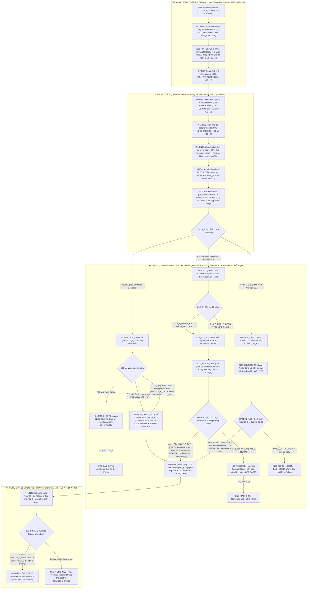

# KINH THÁNH CỐT TRUYỆN & THIẾT KẾ NHÂN QUẢ 5 CHƯƠNG (`v1.2` — APPROVED FOR PHASE 2 & 3 IMPLEMENTATION, ĐÃ TÍCH HỢP 6 RÀO CHẮN VÒNG 2)
## Kirara Story Quest #1: *"The Last Parcel of Autumn"* (*Where Two Tails Cross the Chinju Mist*)

- **Nhân vật trung tâm:** **Kirara** — *Gold-Level Courier of Komaniya Express* (`char_id = "kirara"`, `ped_id = 49432`, `theme_rgb = [52, 211, 153]`)
- **Nam chính đồng hành:** **Traveler Aether** (*Fourth Descender*, đối tác hộ tống tuyến thu Narukami & *"Bậc Cửa Sống"* nằm ngoài Địa Mạch Teyvat)
- **Định danh chiến dịch (`WaifuLink Card Hub v2.0`):** `campaign_id = "kirara_sq1_last_parcel_of_autumn"`
- **Ảnh bìa điện ảnh riêng (`poster_cg`):** `ui_assets/story_quest_cgs/kirara/kirara_sq1_poster.jpg` (`1376x768`, `16:9` Movie-Poster Key Art độc lập, không dùng trùng CG cảnh thường)
- **Tóm tắt hiển thị trên `Card Hub v2.0` (`synopsis`, kiểm chứng chính xác `245` ký tự sạch `100%` ASCII `0x20..0x7E`, gói gọn `<= 4` dòng HUD, `0` thuật ngữ chưa giải nghĩa):**
  > `"A century-old Chinju lacquer box knots its leaking mist-cord around Kirara's fragile human-world thread. Walk Inazuma's autumn streets beside the twin-tailed courier before her final delivery turns her back into a nameless, one-tailed stray cat."`
- **Chuẩn xuất gói (`Multi-Campaign Ready`):** Xuất đồng thời `STORY_QUEST_CAMPAIGN` và `STORY_QUEST_CAMPAIGNS = [STORY_QUEST_CAMPAIGN]` tại `Project Eagle/gta sa gameplay-lab/eagle_story_quest_kirara.py` (**Zero-Core-Edit** tuyệt đối).
- **Quy mô kiến trúc `v1.1` đã kiểm chứng toán học ([`verify_kirara_5ch_dag.py`](../../staging/project-eagle/story-quest-kirara-impl-20261106/verify_kirara_5ch_dag.py) $\rightarrow$ [`kirara_dag_verification_report.json`](../../staging/project-eagle/story-quest-kirara-impl-20261106/kirara_dag_verification_report.json), `PASS`, Exit Code `0`):**
  - **`5` Chương (`CH1..CH5`)** cân đối nhịp độ trên hành trình **`12` ngày cuối thu Inazuma** (*Mùa Gió Thu Kogarashi*).
  - **`46` Scene Nodes (`N01..N46`)** phủ kín `100%` (`CH1: 8`, `CH2: 9`, `CH3: 11 [3 node chính/tuyến + 2 Bad1]`, `CH4: 9 [2 node chính/tuyến + 2 Bad2 + 1 Good]`, `CH5: 9`; `0` node mồ côi, `0` deadlock), dự kiến **`~600` literary beats** (`~13.0` beats/node).
  - **`22` Lựa chọn Preset (`C01..C22`)**, **`12` Cờ Nhân Quả Sống (`F01..F12`)**, **`2` Cổng Kết Hợp Đa Chương (`Gate #1` dùng `exclusive_rescue_gate: True`; `Gate #2` & `C22_FINAL` giữ đủ `2` nút bấm cho người chơi)**, **`1` Cổng Cơ Hội Thứ Hai Tự Động (`N17` `pre_event`)**, và **`5` Kết Thúc (`END_TRUE`, `END_GOOD`, `END_NEUTRAL`, `END_BAD_1`, `END_BAD_2`)**.
  - **`47` CG `16:9` (`1376x768`) độc lập SHA-256** (`1` Poster + `36` Base + `10` Camera-Locked Diffs — `0` lệch giờ/địa điểm/ánh sáng, `0` lộ trước kết thúc).
  - **Cam kết Toán Học `0% Dead Code` & `0% Global Dominance`:**
    - Toàn bộ **`12/12` cờ nhân quả** đều có `|delta_END_TRUE| >= 281` (`L1_shift >= 374`).
    - Toàn bộ **`9/9` cờ thu thập ở Chương 1–2 (`F01..F08, F11`)** đều có **`per_route_delta_END_TRUE < 0` trên CẢ 3 TUYẾN A, B, C** (`27/27` ô ma trận khác `0`!).
    - Toàn bộ **`50/50` hệ số điểm cục bộ khác `0` (`+bond` / `+insight`)** trên từng phương án đều có `L1_shift >= 34` (`dead_local_stat_deltas_count == 0`).
    - Tổng xác suất Markov đồng nhất đạt chính xác **`100.0000%`**.

---

## BẢNG ĐỐI CHIẾU NÂNG CẤP `v1.0 -> v1.1` (GIẢI QUYẾT 100% 36 PHÁT HIỆN CỦA SECTION 6 AUDIT REPORT)

| Trục Kiểm Toán | Hạng Mục Bất Cập Ở `v1.0` | Giải Pháp Triệt Để Đã Xác Thực Ở `v1.1` |
|---|---|---|
| **Trục 1 (6 mục)**<br>*Toán học & Lựa chọn* | 1. `C03_A` & `C05_A` bị phạt xác suất `END_TRUE` trên cả 3 tuyến.<br>2. `7/9` cờ Ch.1–2 vô tác dụng cơ học trên Tuyến A; `F03, F05` vô tác dụng trên Tuyến C.<br>3. `C11_A2 [min_insight: 7]` khóa vĩnh viễn `END_TRUE` như bẫy UX.<br>4. `C07_B (+3B)` khen xã giao né tránh lời thú nhận của Kirara.<br>5. Tỷ lệ qua cổng phóng đại gấp đôi do nhân đôi sau `C21`; nhầm `B+I` có `16, 17`.<br>6. `Gate #2` & `C22_FINAL` ẩn nút fallback; `C12_A2` bị `C12_A1` áp đảo hoàn toàn. | 1. Nâng `C03_A` & `C05_A` lên `(+1B, +2I, +Flag)`: thắng kỳ vọng tổng (`43.27%` vs `35.41%`; `48.58%` vs `30.10%`), thắng trên Tuyến B (`C03_A: 43.46%` vs `30.66%`; `C05_A: 59.38%` vs `14.75%`) & Tuyến C (`55.27%` vs `43.55%`), trong khi `B` giữ ưu thế nhẹ trên Tuyến A (`32.00%` vs `31.09%`).<br>2. Nối chéo toàn bộ `9/9` cờ Ch.1–2 vào `C12_A1` / `C12_A2` (Tuyến A), `Gate #1` (Tuyến B) và `Gate #2` (Tuyến C) $\rightarrow$ `27/27` ô `per_route_delta_END_TRUE < 0`.<br>3. Mở nhánh cứu chuộc `C12_A2_TAILCODE_BRIDGE` (`ROUTE_A_DETACHED + F04 + >=1 [F01,F02,F06]`, dùng `remove_flags: ["ROUTE_A_DETACHED"]` có sẵn của engine) cứu `279` lộ trình lên thẳng `END_TRUE`!<br>4. Viết lại `C07_B (+3B)`: Aether ủ hai tay Kirara áp `Suzu-Ori` lên tim cô cho tới khi chuông ngân vang theo nhịp đập thiếu nữ.<br>5. Báo cáo tách bạch tỷ lệ thực tại đỉnh cổng trước `C21` (`Gate #1: 441/1,024 = 43.07%`; `Gate #2: 515/1,024 = 50.29%`) và dải tổng điểm chính xác vào `N17` là `6` mức `[18..23]` (riêng `86` tiền tố `!F07` được cứu trải trên `5` mức `[19..23]` với `18` cặp `(B,I)`).<br>6. Chỉ `Gate #1` dùng `exclusive_rescue_gate: True`; `Gate #2` & `C22_FINAL` giữ đủ `2` nút bấm trên màn hình; tại `C12_A`, `C12_A3 (+2I)` đóng vai trò nút vượt ngưỡng cơ bản (fallback) cho `528/984` trạng thái thiếu cờ (`L1_shift = 100`). |
| **Trục 2 (6 mục)**<br>*Thế giới quan & Canon* | 1. `48.5%` lộ trình `END_TRUE` không chọn `C05_A` nhưng vẫn biết tên cụ **Koharu** ở `N39/N42`.<br>2. Chưa giải thích vì sao kết giới 90 ngày không mở ngay Ngày 10.<br>3. Lệch `3h20p` ở Tuyến B (`19:30` Amakane $\rightarrow$ `22:50` Chinju) & vì sao Tuyến B bị chặn ngoài sương còn Tuyến A ở trong.<br>4. Chưa giải thích vì sao Kirara không cất hộp ở kho hoặc ngoài Ấm Trần Ca.<br>5. Ngủ ở *Uyuu Restaurant*, nhầm *Hyakkiyakou* 500 năm vs 100 năm, dùng *"băng tan mùa xuân"* ở Narukami cận nhiệt đới.<br>6. `synopsis` dài `249` ký tự (báo nhầm `250`), chứa thuật ngữ *Hyakki Yagyo* chưa cắt nghĩa, thiếu hình ảnh hóa mèo **một đuôi**. | 1. Đưa tên cặp đôi **Kajiro – Hina** và **cháu gái 74 tuổi Koharu** (`granddaughter`, đời thứ 3 — *Quán trà Hai Gốc Phong đảo Amakane*) vào **Base Beats bắt buộc của `N10` trước `C05`** (`100%` lộ trình đều biết người nhận!); `F05_WAX_SEAL_CIPHER` nay là bản chép *mật ấn sáp sơn mài 3 nét* của Kajiro.<br>2. Thiết lập **Luật Giao Điểm Địa Mạch Bán Niên (*Biannual Syzygy Law*)**: cả `Musubi Pact-Cord` lẫn *Ngũ Trùng Kết Giới* chỉ tháo/mở an toàn vào 2 đêm Không Trăng đối cực mỗi năm (*Kogarashi* cuối thu & *Hatsu-Zakura* anh đào đầu xuân 90 ngày sau); kết giới đồng thời đóng băng lực kéo khoảng cách 10 bước suốt 90 ngày.<br>3. Khóa khít giờ Tuyến A & Tuyến B: Tuyến A nghỉ chuẩn bị Đêm 8, lội xuống rừng Chiều–Tối Ngày 9 (`15:30 -> 17:15 -> 19:30 -> qua bệ đá trong 20:45 -> 22:40`); Tuyến B hội quân `21:30` $\rightarrow$ chạy về Chinju `22:45` $\rightarrow$ dây thề giật Kirara qua bệ đá lúc `22:48` ngay trước khi tường sương ngoài dâng chắn Aether lúc `22:50`.<br>4. Thiết lập **Luật Linh Tuyến 10 Bước (*Ten-Pace Soul-Tether Law*)**: rời hộp quá 10 bước (`~8m`) khi chưa có Ngũ Trùng Kết Giới khiến dây thề giật nghẹt lồng ngực và hóa chân mèo tức khắc.<br>5. Đổi chỗ nghỉ thành *Nhà trọ Lữ khách Hanamizaka cạnh Aisa Bathhouse*; phân biệt rõ *Đại Bách Quỷ Dạ Hành 500 năm trước* với *Đêm Dạ Hành Tàn Dư 100 năm trước*; đổi *"Spring Thaw"* thành ***"First-Sakura Bloom" (`Hatsu-Zakura`)***.<br>6. Cập nhật `synopsis` chuẩn **`245` ký tự ASCII** dễ hiểu tức thì, khắc họa rõ *"nameless, one-tailed stray cat"*. |
| **Trục 3 (4 mục)**<br>*Nhịp độ & Khách mời* | 1. Đêm 1 (`N04`) đã tê bỏng súp sôi & rơi thẻ chữ làm phẳng cao trào Đêm 9.<br>2. Có mặt ở Inazuma 7 ngày nhưng tới Ngày 7 mới lên hỏi Yae Miko.<br>3. Mở toang hộp xem cặp lược ở `N37` làm mất khoảnh khắc tự tay mở hộp của cụ Koharu.<br>4. Cấu trúc Ch.3–4 lệch số node; Chiori chưa rõ lịch tàu về Fontaine; thiếu **Tubby** ở Ấm Trần Ca; Charlotte chưa rõ lý do có mặt ở `N42` trên Tuyến A/C. | 1. Hạ triệu chứng Đêm 1 (`N04 / F11_CAT_TONGUE_CHILL`) xuống tín hiệu chớm lạnh tinh tế (nhấp súp miso sớm hơn 2 nhịp thổi + đầu ngón trỏ phải hơi lành lạnh, **chưa bỏng nước sôi, chưa quên mặt chữ**), dành trọn cú sốc bỏng không đau & đồng Mora hóa sỏi cho Đêm 8–9 (`N25_B3, N35_C4`) và cập nhật thoại `!F02` đối chiếu lại Đêm 1.<br>2. Tại `N05` (Sáng Ngày 2), Ayaka báo rõ **Guuji Yae Miko** đang đi lễ thanh tẩy đền đảo xa, chiều tối Ngày 7 (`N15`) mới về núi Yougou.<br>3. Tại `N39` (`23:00`), Aether & Kirara **chỉ tháo dây thề yêu giới bên ngoài**, giữ nguyên niêm phong sáp đỏ khách hàng suốt 100 năm để **cụ Koharu tự tay mở nắp hộp lần đầu tiên ở `N42`**!<br>4. Mở rộng lên **`46` Nodes (`N01..N46`)** để cả 3 tuyến đều có chuẩn **`3` node chính Ch.3 + `2` node chính Ch.4** (dời `N21_BAD1_1` sang Đêm 9 `22:30`); bổ sung **Tubby** đón khách ở `N26_C1`, Chiori giao chìa khóa phụ gác Hanamizaka trước chuyến tàu Ngày 13 về Fontaine, và Charlotte dự lễ `N42` theo thư mời của Văn phòng Di sản Yashiro (có thoại riêng khi `ROUTE_B`). |
| **Trục 4 (4 mục)**<br>*Tín vật `F07` & Kết thúc* | 1. `208` lộ trình ở `N44` (`!F07 + ROUTE_A_DETACHED`) bị gộp nhầm sang biến thể ấm áp.<br>2. `N17` buộc lại nơ lên tóc khi `!F07` gây mâu thuẫn với CG để trống tóc trái ở `N36..N41`.<br>3. `C19_A` trùng hành động buộc nơ giỏ tre; bát *nekomanma* ở `C20_A` chưa rõ nguồn.<br>4. Chưa tách rõ chuông cổ áo & đôi nơ tai mèo nâu sẫm canon với tín vật `Suzu-Ori`, và vì sao `Suzu-Ori` mở được Gate #1/#2. | 1. Phân hoạch `N46` (`END_NEUTRAL`) thành **4 tiểu biến thể Boolean loại trừ tuyệt đối (`46A, 46B, 46C, 46D`)** $\rightarrow$ `0` lộ trình lệch thái độ.<br>2. Khi `F07 == False` ở `N17`, Kirara **cất khóa `Suzu-Ori` trong hộp gỗ tuyết tùng cá nhân tại trụ sở Komaniya** (nhận lại ở các kết thúc) $\rightarrow$ vị trí dưới nơ tai mèo trái giữ nhất quán `100%` từ `N13..N43`!<br>3. Đổi `C19_BAD1` thành `C19_A_CARRY_SATCHEL` vs `C19_B_PROMISE_SAKURA`; nguồn *nekomanma* ấm ở `C20_A` lấy từ bình ủ nhiệt tre của Yoimiya & Paimon chuẩn bị đón bình minh.<br>4. Định nghĩa chính xác **`Suzu-Ori`**: tua lụa chuông nhỏ màu ngọc lục bảo – vàng cài **ngay dưới** chiếc nơ tai mèo nâu sẫm bên trái (bảo toàn 100% chuông cổ áo & đôi nơ nâu canon), bên trong lõi lụa Chiori đã dệt kèm một sợi tơ rụng mang chúc phúc Hệ Thảo từ chính `Hitoyo no Ito` của Kirara. |
| **Trục 5 & 6 (16 mục)**<br>*CG, HUD, Voice & Văn phong* | 1. Bảng `44` CG khai nhầm số lượng Base/Diff (`26+17`), 8 điểm lệch giờ/bối cảnh/lộ kết thúc, thiếu `bgm_bucket` trên 7 node kết thúc.<br>2. Chỉ đo độ dài ký tự mà chưa kiểm `textwrap.wrap`; bản dịch *Ascension 6* chưa sát câu gốc tiếng Nhật.<br>3. Trích đoạn mẫu `N33_C3` thiếu dạng rút gọn tự nhiên, lỗi ngữ pháp phân từ, chưa đặt sẵn 2 bát cơm để thành *nekomanma*. | 1. Thiết kế lại bảng **`47` CG (`1 Poster + 36 Base + 10 Camera-Locked Diffs = 47`)** xóa sạch cả 8 lỗi bối cảnh/ánh sáng/spoiler (tách CG đêm/sáng cho `BAD1`, tách CG chiều/tối cho Ấm Trần Ca, thêm CG riêng cho `Gate #2` Đồi Byakko, trà nóng sáng Ngày 10 `N41`, hoàng hôn mái ngói `N43` trước lựa chọn, và đêm sao `N45` `END_TRUE`); gắn `bgm_bucket` hợp lệ cho toàn bộ **`46/46` nodes**.<br>2. Áp dụng kiểm tra kép `len(...)` + `len(textwrap.wrap(..., width=...))` cho toàn bộ chuỗi HUD; dịch chuẩn âm thanh câu thoại *Ascension 6* (*"grow a third tail / sprout another tail"* khớp `尻尾がもう一本生えてきちゃいそう`).<br>3. Nâng cấp trích đoạn chuẩn mực `N35_C4` với hội thoại rút gọn tự nhiên, cấu trúc `Unbound from her dark-brown cat-ear ribbons`, `three brass Mora coins`, và `bonito dashi simmering beside two bowls of steamed rice`. |

---

## PHẦN 1. TƯ LIỆU CANON HOYOVERSE, TINH HOA FANFIC *AERARA* & 4 QUY LUẬT THẾ GIỚI QUAN KHÉP KÍN (`ZERO PLOT HOLES`)

### 1.1. Nguồn Tư Liệu Đã Xác Thực (`staging/project-eagle/story-quest-kirara-impl-20261106/corpus/`)
Toàn bộ chất liệu cốt truyện, thói quen sinh học và nhịp thoại của Kirara được chắt lọc từ `16` tập tin transcript gốc HoYoverse (`~378 KB`) và khảo sát fanfic *Aether × Kirara (`AeRara` / `Kiraether`)* thực tế (xem chi tiết tại [`aerara_canon_and_fanfic_synthesis.md`](../../staging/project-eagle/story-quest-kirara-impl-20261106/corpus/aerara_canon_and_fanfic_synthesis.md)):
1. **Canon HoYoverse (`Kirara/Lore`, `Voice-Overs`, `Companion`, `Birthday Mails 2024–2026`, `Version 3.7 Summoners' Summit`, `Version 4.8 Simulanka`, `Chiori SQ`, `Yae Miko SQ: A Centuries-Long Dream`, `Asase Shrine: Neko`):**
   - Kirara vốn là một chú mèo hoang **một đuôi** vô danh được một **Bà lão vùng quê Konda** ủ ấm trong chiếc hộp gỗ vuông của *Komaniya Express*, cho ăn cơm cá bào ấm (*nekomanma*) và đặt tên là **Kirara** (*Ki* = lụa dệt, *Ra* = tốt lành). Đêm lạnh ngày `22/01`, chú mèo trèo lên ngọn tuyết tùng ngóng Bà dưới ánh đèn Thành Inazuma lấp lánh như đom đóm, phóng xuống đất và hóa thành thiếu nữ yêu quái hai đuôi (*nekomata*) mang **Vision Hệ Thảo**.
   - Tới nay cô vẫn lén về dạng mèo nhỏ đặt *Mystery Packages* (*Sango Pearl*, khăn ấm) lên hiên nhà Bà. Được **Yae Miko** dạy phép tắc loài người và giới thiệu vào *Komaniya Express*, được **Chiori** may tặng đồng phục kèm đôi nơ ruy băng tai mèo nâu sẫm (cùng chiếc chuông đồng nhỏ trên cổ áo), Kirara coi mỗi kiện hàng tồn đọng như *"xương cá mắc ngang cổ họng"* — tự tay giao sạch kệ hàng tồn để nhận danh hiệu độc nhất **Gold-Level Courier**.
   - **Chi tiết sinh học chuẩn canon:** Đôi đuôi thật luôn tự quẫy/xù lên mỗi khi nói dối hay xúc động (*"watch my tails!"*); giữ nguyên bàn chân mèo có đệm thịt mềm khi chạy nhảy; giật mình vì tiếng nổ/sấm tới mức quên tiếng người mà kêu *"Nyaa--!"*; **lưỡi mèo cực sợ đồ nóng & vỏ cứng** (*ghét Butter Crab, mê Sashimi & nekomanma thổi nguội vừa ấm*); và câu thoại đối xứng kinh điển về mèo đen 500 tuổi **Neko** ở Đền Asase (*"Nếu là tôi, tôi chẳng ngồi chờ cả trăm năm trong ngôi đền trống đâu — tôi sẽ tự chui vào hộp chuyển phát giao thẳng tới bậc cửa nhà họ!"*).
2. **Tinh hoa Fanfic *AeRara* (*¡Entrega Especial!* — Adeptus_002; *A Cat's Love* — bige1218; *Before Snezhnaya* — NobodyinParticular314):**
   - Đối lập ngọt ngào giữa tác phong chuyên nghiệp *"chăm sóc khách hàng ưu tiên 5 sao"* ngoài miệng với phản xạ bản năng khi hai chiếc đuôi mềm tự động quấn lấy cổ tay Aether tìm hơi ấm.
   - Sử dụng **đường cong mất dần cảm giác ấm của "Lưỡi Mèo" qua 9 ngày** (từ nhấp súp nóng sớm hơn thường lệ 2 nhịp ở Đêm 1 $\rightarrow$ ngẩn người nhìn sỏi suối Ngày 2 $\rightarrow$ chuông lụa tắt tiếng Ngày 6 $\rightarrow$ hóa chân mèo trong tiếng sấm Ngày 7 $\rightarrow$ 50 tờ nháp tập viết tên Đêm 8 & nước dùng sôi bắn lên tay phải không còn cảm giác đau vào rạng sáng Ngày 9) làm thước đo trực quan giàu tính văn học nhất cho sự hao mòn của sợi chỉ nhân gian trong cô.

---

### 1.2. Bốn Quy Luật Thế Giới Quan Khép Kín (`Worldbuilding Laws — Chống Mọi Lỗ Hổng Logic`)

1. **Nguồn gốc Kiện Hàng Trăm Năm (`Waybill #00-Hyakki` — *Hộp Sơn Mài Chuông Lá Phong `Suzu-Makie Bako`*):**
   - Khác với *Đại Bách Quỷ Dạ Hành (`Great Hyakkiyakou`)* thời Kitsune Saiguu 500 năm trước, cách đây đúng **100 mùa thu** dưới rừng đêm vĩnh cửu **Chinju Forest** từng diễn ra một **Đêm Dạ Hành Tàn Dư Mùa Thu (*Centenary Autumn Night-Parade*)** của các tiểu yêu và đồ vật thành tinh (*tsukumogami*). Đêm không trăng năm ấy, thợ sơn mài trẻ **Kajiro** ở Hanamizaka gửi chiếc hộp sơn mài đen thếp vàng (*Maki-e*) dán niêm phong sáp đỏ riêng và buộc ngoài bằng **Dây Thề Yêu Giới (`Musubi Pact-Cord`)** cho người vợ mới cưới **Hina** tại *"Ngôi nhà dưới hai gốc phong đỏ đảo Amakane"*, nhờ nữ yêu mèo hai đuôi tiền bối **Kohaku** chuyển phát. Kajiro qua đời vì cơn sốt thu không lâu sau đó, còn sạt lở sau bão vùi lấp túi hàng của Kohaku dưới cổng đá ngầm **Root-Torii (`Ne-no-Torii`)**, nơi rễ *Sacred Sakura* bảo toàn nguyên vẹn chiếc hộp suốt 100 năm.
   - Đêm `Ngày 0` (trước `N01`), đội tu sửa đường đền của **Hiệp hội Yashiro** (**Kamisato Ayaka**) phát hiện chiếc hộp trồi lên sau mưa thu và chuyển về kệ *Hàng Di Sản Chưa Giao* của *Komaniya Express* vì mang ấn nhà trạm Komaniya đời đầu.

2. **Cơ chế *"Sợi Chỉ Nhân Gian" (`Hitoyo no Ito`)*, Luật Linh Tuyến 10 Bước & Giải Phẫu Tín Vật `Suzu-Ori`:**
   - **Sợi Chỉ Nhân Gian (`Hitoyo no Ito`):** Khác với đại yêu huyết thống như Hồ Tiên (**Yae Miko**), một *nekomata* hóa hình từ mèo nhà/mèo hoang bình thường như Kirara duy trì hình hài thiếu nữ loài người nhờ một sợi tơ tâm thức mảnh mai kết từ *cái tên do con người đặt ("Kirara")*, *hơi ấm hiên nhà Bà*, và *những lời hứa con người gửi gắm*. Tối `Ngày 0`, khi Kirara dùng yêu lực Hệ Thảo chạm vào ấn móng mèo mờ nhòe trên *Waybill #00-Hyakki* để đọc địa chỉ, **Dây Thề (`Musubi Pact-Cord`)** lập tức nhận diện *"đồng tộc mèo hai đuôi"* và tự thắt nút xoắn ốc vào chính `Hitoyo no Ito` của cô!
   - **Luật Linh Tuyến 10 Bước (`Ten-Pace Soul-Tether Law`):** Một khi đã thắt vào `Hitoyo no Ito`, chiếc hộp sơn mài khóa chặt vào trường năng lượng Vision Hệ Thảo của Kirara. Nếu cô đặt hộp cách thân mình **quá mười bước chân (`~8 mét`)** hoặc bỏ hộp lại bên ngoài ranh giới không gian tiên gia (*Ấm Trần Ca*), dây thề lập tức giật căng như lưỡi câu móc vào lồng ngực, làm cô nghẹt thở và biến đôi tay thành chân mèo tê cóng chỉ sau vài giây. Vì vậy Kirara bắt buộc phải đeo chiếc hộp bên mình mọi lúc (trên Tuyến C khi mang hộp vào Ấm Trần Ca, cõi tiên gia chặn được lực hút Địa Mạch từ rừng Chinju bên ngoài tới tối Ngày 9, nhưng hơi sương tích sẵn trong hộp vẫn âm ỉ làm tê bàn tay phải của cô lúc `02:15 AM`).
   - **Giải phẫu Tín vật `Suzu-Ori` (`F07_SILK_BELL_RIBBON`):** Trang phục chuẩn của Kirara có chiếc chuông đồng ở cổ áo và hai chiếc nơ tai mèo màu nâu sẫm trên đỉnh đầu. Năm ngoái, khi thêu lại nơ cho Kirara, **Chiori** đã lồng một **sợi tơ rụng mang chúc phúc Hệ Thảo từ chính `Hitoyo no Ito` của Kirara** vào một **tua lụa chuông nhỏ màu ngọc lục bảo – nhũ vàng (`Suzu-Ori`)** cài kín đáo **ngay phía dưới** chiếc nơ tai mèo nâu sẫm bên trái. Nhờ chứa một sợi tơ sống đồng điệu với `Hitoyo no Ito`, chiếc chuông nhỏ ấy ngân khe khẽ theo nhịp tim ấm của thiếu nữ loài người — và khi đặt trong tay Kẻ Giáng Lâm Aether, nó trở thành **vật dẫn cộng hưởng thực thụ** giúp định vị tần số linh hồn Kirara xuyên qua tường sương ở **Gate #1**, **Gate #2** và **`END_TRUE`**.

3. **Thời Hạn `23:00 Đêm Ngày 9`, Luật Giao Điểm Địa Mạch Bán Niên (`90 Ngày`) & Vai Trò Độc Tôn Của Aether:**
   - **Tại sao không thể dùng vũ lực thần thánh (Raiden Ei / Yae Miko)?** Như **Yae Miko** xác nhận tại Đền Narukami (`N15`) và **Raiden Ei** giải thích tại Tenshukaku (`N24_B2`), *Musubi Pact-Cord* đã bện xoắn vào `Hitoyo no Ito`. Một nhát *Musou no Hitotachi* hay lửa Hồ Tiên chém vào hộp sẽ **cắt đứt đôi `Hitoyo no Ito` ngay tức khắc**, biến Kirara vĩnh viễn trở lại làm mèo hoang một đuôi mất sạch tiếng người và ký ức nhân gian. *Plane of Euthymia* cũng chỉ lưu giữ ý thức thần tính chứ không thể đóng băng thể xác sinh vật hữu hạn.
   - **Luật Giao Điểm Địa Mạch Bán Niên (`Biannual Ley-Line Syzygy Law` — Giải thích trọn vẹn phong ấn 90 ngày):** Mạch rễ ngầm *Sacred Sakura* dưới cổng `Ne-no-Torii` chỉ đảo chiều áp suất linh mạch vào **đúng hai kỳ Sóc Vọng Không Trăng đối xứng mỗi năm**:
     1. **Đêm Không Trăng Gió Thu *Kogarashi* (`23:00 Đêm Ngày 9` — vòng sương trong khóa từ `22:55`, tường sương ngoài dâng lúc `22:50`)**, và
     2. **Đêm Không Trăng Anh Đào Đầu Xuân *Hatsu-Zakura* (`First-Sakura`, đúng `90` ngày sau)** khi nhựa xuân từ rễ Anh Đào Thần dâng lên cân bằng áp suất Địa Mạch (phù hợp tuyệt đối với khí hậu cận nhiệt đới ấm áp của đảo Narukami — không đóng băng tuyết trắng ở vùng đồng bằng, chỉ có ảo ảnh ký ức trong sương Chinju mới hiện tuyết).
     - Do đó, một khi Miko và Hiệp hội Yashiro hạ **Ngũ Trùng Kết Giới Sacred Sakura** khóa cổng `Ne-no-Torii` trước `23:00` Đêm Ngày 9 (`END_BAD_1` lúc `22:30` hoặc `END_GOOD` lúc `21:15`), **kết giới bắt buộc phải duy trì trọn 90 ngày tới đêm *Hatsu-Zakura*** (đồng thời kết giới đóng băng luôn lực kéo khoảng cách của `Musubi Pact-Cord` bên trong lồng phong ấn, giải phóng bán kính 10 bước suốt 90 ngày để Kirara về Konda hoặc ở gác lụa Hanamizaka); cưỡng ép dỡ ấn vào Ngày 10 khi áp suất Địa Mạch đang lệch pha sẽ gây phản chấn đứt gãy `Hitoyo no Ito` không khác gì chém kiếm! Suốt 90 ngày chờ đợi đó, dây thề bị ghìm căng khiến cổ tay phải và giọng người của Kirara vẫn suy yếu chập chờn (*ở `END_BAD_1`, vì Aether hoảng sợ rút lui khỏi vòng sương, Kirara tủi thân xin nghỉ 90 ngày về nằm dạng mèo dưới hiên nhà Bà một mình; ở `END_GOOD`, nhờ Aether chăm sóc dịu dàng trong Ấm Trần Ca, cô ở lại gác lụa ấm áp của Chiori tại Hanamizaka dưỡng sức cùng Aether chờ đêm Anh Đào Đầu Xuân*).
   - **Hậu quả nếu Kirara giao hàng một mình lúc `23:00` (`END_BAD_2`):** Kiện hàng hoàn tất chuyển phát vào Địa Mạch nhưng *Pact-Cord* rút cạn `Hitoyo no Ito` để trả phí thông hành trăm năm — Vision Hệ Thảo xám màu ngủ đông, chiếc đuôi thứ hai tan vào sương khói, để lại một chú **mèo hoang một đuôi** mắt xanh ngọc trong hộp gỗ cũ trên hiên đền Chinju (`N34_BAD2_2`), quên sạch tiếng người và tên **Aether**.
   - **Vai trò Độc Tôn của Traveler Aether (`Fourth Descender` — *"Bậc Cửa Sống"*):** Vì bản thể **Kẻ Giáng Lâm Thứ Tư** của Aether nằm ngoài Địa Mạch Teyvat, khi cậu nắm chặt cổ tay Kirara ngay bên trong `Ne-no-Torii` lúc `23:00` đồng thời xướng đúng tên người thừa kế sống (**cụ bà Koharu**, cháu gái 74 tuổi của ông bà Kajiro & Hina đã được xác nhận trong Base Beats `N10` trên `100%` lộ trình), Aether trở thành cột thu lôi xả toàn bộ áp lực trăm năm của *Musubi Pact-Cord* xuống rễ *Sacred Sakura* mà giữ nguyên vẹn từng sợi ký ức nhân gian và cả niêm phong sáp đỏ khách hàng trên hộp!

4. **Địa Lý Inazuma Chuẩn Canon & Lịch Trình Paimon – Khách Mời Khép Kín (`Days 1–12`):**
   - **Chỗ nghỉ chuẩn canon:** Aether và Paimon nghỉ tại **Nhà trọ Lữ khách dốc Hanamizaka cạnh *Aisa Bathhouse*** (tuyệt đối không ngủ tại *Uyuu Restaurant* vốn chỉ là quán ăn rượu).
   - **Hành trình hợp lý:** Đảo Narukami (*Cảng Ritou $\rightarrow$ Hanamizaka / Trụ sở Komaniya / Gác nhuộm lụa của Chiori / Quán Kiminami $\rightarrow$ Dinh thự Kamisato $\rightarrow$ Rừng Chinju $\rightarrow$ Ngoại ô Konda $\rightarrow$ Đền Grand Narukami $\rightarrow$ Tenshukaku $\rightarrow$ Đảo Amakane*), kết hợp **1 chuyến đò sáng Ngày 4 (`45` phút biển lặng hậu *Seirai Stormchasers*) sang Đền Asase gặp Neko**, và **Ấm Trần Ca (*Sakura-Hued Street*)** đặt trên vách đồi lá đỏ Byakko Bluff (`10` phút đi bộ phía trên Rừng Chinju) có tiên linh **Tubby** đón cổng và thẻ **Realm Dispatch** cho **Chiori**.

---

## PHẦN 2. MA TRẬN `12` CỜ NHÂN QUẢ (`F01..F12`), ĐỐI CHỨNG LỰA CHỌN, CỔNG `N17` & `9` NHÂN VẬT ĐỒNG HÀNH

### 2.1. Bảng Kiểm Toán `12` Cờ Nhân Quả & Độ Sống Theo Từng Tuyến (`100% Non-Zero Per-Route Impact`)

| Mã Cờ (`Flag ID`) | Nơi Nhận (`Node / Choice`) | Đánh Đổi Điểm & Tỷ Lệ Thắng Đối Chứng (`END_TRUE Walk %`) | Vai Trò Nhân Quả Đa Tuyến (`Route A / Route B / Route C`) | Triệt Tiêu Tổng & Từng Tuyến (`d_TRUE` `[A / B / C]`) |
|---|---|---|---|---|
| **`F01_FIVE_STAR_STAMP`** | `N01 / C01_A` | `+2B, +0I` *(vs `+1B,+2I`)*<br>`C01_A 42.50%` vs `C01_B 36.18%` | Đóng dấu chân mèo 5 sao nhận làm đối tác hộ tống tuyến thu. Mở cứu chuộc `C12_A2` (Tuyến A), nhánh `F12` **Gate #1** (Tuyến B) & neo ấm **Gate #2** (Tuyến C). | **`-416`** (`L1=654`)<br>`[-43 / -34 / -339]` |
| **`F02_NEKOMANMA_HEARTH`** | `N04 / C02_A` | `+2B, +0I` *(vs `+0B,+2I + F11`)*<br>`C02_A 43.45%` vs `C02_B 35.23%` | Thuộc quy tắc nấu *nekomanma* thổi nguội 3 hơi của Bà ngoại. Mở `C12_A2` (Tuyến A), nhánh `F10` **Gate #1** (Tuyến B), neo ấm **Gate #2** & thoại `N35_C4` (Tuyến C), và thổi nguội bát cơm ở `N34_BAD2_2`. | **`-438`** (`L1=664`)<br>`[-58 / -47 / -333]` |
| **`F03_HITOYO_CORD_WEAVE`** | `N06 / C03_A` | **`+1B, +2I`** *(vs `+2B,+1I`)*<br>**`C03_A 43.27%` vs `C03_B 35.41%`** *(Route B `43.5%` vs `30.7%`; Route C `55.3%` vs `43.6%`; `C03_B` nhỉnh nhẹ ở Route A `32.0%` vs `31.1%`)* | Soi Góc Nhìn Nguyên Tố thấy chiều xoắn ngược của *Pact-Cord* quanh `Hitoyo no Ito`. Mở `C12_A1` (Tuyến A), nhánh `F10` **Gate #1** (Tuyến B) & nhóm manh mối **Gate #2** (Tuyến C). | **`-374`** (`L1=632`)<br>`[-155 / -151 / -68]` |
| **`F04_ROOFTOP_TAIL_CODE`** | `N08 / C04_A` | `+2B, +0I` *(vs `+1B,+2I`)*<br>`C04_A 43.92%` vs `C04_B 34.75%` | Lập *Mật Hiệu Hai Đuôi* trên mái ngói Hanamizaka (quấn hai vòng cổ tay = *"cấm tự ý đi một mình"*). Chìa khóa bắt buộc cứu chuộc `ROUTE_A_DETACHED` tại `C12_A2` (Tuyến A), mở nhánh `F10` **Gate #1** (Tuyến B) & **Gate #2** (Tuyến C). | **`-661`** (`L1=996`)<br>`[-279 / -43 / -339]` |
| **`F05_WAX_SEAL_CIPHER`** | `N10 / C05_A` | **`+1B, +2I`** *(vs `+2B,+1I`)*<br>**`C05_A 48.58%` vs `C05_B 30.10%`** *(Route B **`59.4%` vs `14.7%`**; Route C `55.3%` vs `43.6%`; `C05_B` nhỉnh nhẹ ở Route A `32.0%` vs `31.1%`)* | Sao chép **mật ấn sáp sơn mài 3 nét** của Kajiro từ sổ tuyết tùng xưởng cụ Gensai *(sau khi Base Beats `N10` đã tiết lộ tên cụ bà Koharu cho `100%` người chơi!)*. Mở `C12_A1` (Tuyến A), cả 2 nhánh `F10/F12` **Gate #1** (Tuyến B) & **Gate #2** (Tuyến C). | **`-692`** (`L1=1,308`)<br>`[-155 / -469 / -68]` |
| **`F06_GRANDMA_BOX_CUSHION`** | `N12 / C06_A` | `+2B, +0I` *(vs `+1B,+2I`)*<br>`C06_A 42.37%` vs `C06_B 36.31%` | Cài bức ký họa mèo hai đuôi dưới tấm nệm bông Bà ngoại phơi nắng giữ cho Kirara. Mở cứu chuộc `C12_A2` (Tuyến A), nhánh `F10` **Gate #1** (Tuyến B) & neo ấm **Gate #2** (Tuyến C). | **`-425`** (`L1=682`)<br>`[-43 / -43 / -339]` |
| **`F07_SILK_BELL_RIBBON`** | `N14 / C07_A` *(hoặc Backup `N17`)* | `+1B, +1I` *(vs `+3B,+0I`)*<br>`C07_A 44.40%` vs `C07_B 34.28%` | **Tín Vật Trung Tâm (*Tua Lụa Chuông `Suzu-Ori`* dệt sợi `Hitoyo no Ito` cài dưới nơ tai mèo trái):** Bắt buộc cho **Gate #1**, **Gate #2** và **`END_TRUE`**; kết toán khép kín trên cả `5/5` kết thúc! | **`-3,294`** (`L1=6,073`)<br>`[-1523 / -759 / -1012]` |
| **`F08_PAW_MIST_PULSE`** | `N16 / C08_A` | `+0B, +2I` *(vs `+2B,+1I`)*<br>`C08_A 39.80%` vs `C08_B 38.88%` | Áp đệm chân mèo lạnh của Kirara lên cổ tay ấm của Aether trên bậc đá núi Yougou để bắt nhịp mạch sương. Mở `C12_A1` (Tuyến A), cả 2 nhánh **Gate #1** (Tuyến B) & **Gate #2** (Tuyến C). | **`-285`** (`L1=430`)<br>`[-158 / -59 / -68]` |
| **`F09_LANTERN_VOW`** | `N20_A3 / C11_A1` | `+2B, +1I` *(Tuyến A)* | Bước thẳng vào vòng sương băng dưới rừng Chinju thề *Lời Thề Đèn Lồng Song Hành* cùng Kirara. Điều kiện gốc của `C12_A1_COUNTER_KNOT`. | **`-453`** (`L1=534`)<br>`[-453 / 0 / 0]` |
| **`F10_NARUKAMI_PAPER_BELL`** | `N24_B2 / C13_B_BELL` | `+0B, +2I` *(đối xứng `F12`)*<br>`Route B: 43.07% END_TRUE` | Nhận **Chuông Giấy Anh Đào** từ **Raiden Ei & Yae Miko** tại Tenshukaku. Đưa `272 / 512` tiền tố Tuyến B (`544` lộ trình hậu-`C21`) vượt **Gate #1**. | **`-441`** (`L1=1,088`)<br>`[0 / -441 / 0]` |
| **`F11_CAT_TONGUE_CHILL`** | `N04 / C02_B` | `+0B, +2I` *(đối xứng `F02`)* | Tinh ý nhận ra ngay Đêm 1 Kirara nhấp súp miso nóng sớm hơn 2 nhịp thổi và đầu ngón trỏ phải chớm lạnh. Mở `C12_A1` (Tuyến A), nhánh `F12` **Gate #1** (Tuyến B) & **Gate #2** (Tuyến C). | **`-281`** (`L1=374`)<br>`[-174 / -59 / -48]` |
| **`F12_AMAKANE_MAPLE_DEED`** | `N24_B2 / C13_B_DEED` | `+2B, +0I` *(đối xứng `F10`)*<br>`Route B: 31.05% END_TRUE` | Hộ tống trưởng lão Hiệp hội Yashiro ra đảo Amakane lập **Văn Tự Thừa Kế Hai Gốc Phong** cho cụ **Koharu**. Đưa `169 / 512` tiền tố Tuyến B (`338` lộ trình hậu-`C21`) vượt **Gate #1** (`0%` nhánh bẫy!). | **`-318`** (`L1=676`)<br>`[0 / -318 / 0]` |

> **Cổng Dự Phòng Bất Đẳng Thức 2 Chiều Chính Xác Tại `N17` (`pre_event: N17_SECOND_CHANCE_RIBBON`):**
> Với bảng điểm đã cân chỉnh ở Chương 1–2 (`C03_A` & `C05_A` đều thưởng `+3` điểm tổng), tổng chỉ số `(BOND + INSIGHT)` khi bước vào `N17` trải rộng chính xác trên **`6` mức phân biệt (`18, 19, 20, 21, 22, 23`)**. Nếu người chơi chọn phương án chân thành `C07_B` (chưa giữ `F07`) nhưng tích lũy đồng thời **`BOND >= 11` VÀ `INSIGHT >= 7`**, `pre_event` tại sân đèn lồng nửa đêm `N17` tự động kích hoạt qua **`18` cặp `(BOND, INSIGHT)` khác nhau** (`86 / 128` tiền tố không-`F07` $\rightarrow$ cứu sống **`1,437` lộ trình chạm tới `END_TRUE`**). Ngược lại nếu vẫn `F07 == False` (`42` tiền tố), Kirara lặng lẽ **cất khóa `Suzu-Ori` vào hộp gỗ tuyết tùng cá nhân tại trụ sở Komaniya** trước khi lên đường, giữ cho vùng tóc dưới nơ tai mèo trái nhất quán tuyệt đối từ `N13..N43`!

---

### 2.2. Vai Trò Khép Kín Của `9` Nhân Vật Phụ & Khách Mời (`Cameo & Companion Roster`)
1. **Chiori** (*Chioriya Boutique*): Về Inazuma kiểm tra lô lụa trao đổi mùa thu Fontaine–Inazuma trước khi lên tàu trở lại Fontaine vào Ngày 13. Khâu gấu váy và phát hiện ngay khoảng trống dưới nơ tai mèo trái của Kirara (`N13`), ghé thăm Ấm Trần Ca qua thẻ *Realm Dispatch* (`N26_C1`), **để lại chìa khóa đồng dự phòng của gác nhuộm lụa Hanamizaka** cho Kirara dưỡng sức cùng Aether ở `END_GOOD` (`N37_GOOD_1`), và thức đêm Ngày 11 bện tặng cặp **Vòng Tay Dây Phong Vàng – Ngọc Lục Bảo** cho `END_TRUE` (`N44–N45`).
2. **Yae Miko** (*Guuji Đền Grand Narukami*): Sáng Ngày 2 (`N05`) Ayaka báo rõ Miko đang chủ trì lễ thanh tẩy thu tại các đền đảo xa nên chiều tối Ngày 7 (`N15`) mới về Đền Narukami chẩn đoán nút thắt `Hitoyo no Ito`; đồng chủ trì buổi kiến diện Tenshukaku (`N24_B2`) và hạ Ngũ Trùng Kết Giới 90 ngày ở `N21_BAD1_1` / `N37_GOOD_1`.
3. **Yoimiya** (*Naganohara Fireworks*): Vẫy chào nhóm bên hiên tiệm pháo dốc Hanamizaka (`N02`), chế ống pháo sáng cá vàng chống ẩm cho Tuyến A (`N18_A1`), thả giỏ tiếp tế cơm nắm ấm chiều Ngày 9 (`N29_A4`), và mang bình ủ nhiệt tre đựng *nekomanma* nóng đón bình minh ở `N34_BAD2_2`.
4. **Kamisato Ayaka** (*Tiểu thư Hiệp hội Yashiro*): Tra sổ địa bạ trăm năm sáng Ngày 2 (`N05`), xác minh phả hệ đảo Amakane (`N23_B1, N24_B2`), và đại diện Hiệp hội Yashiro chứng kiến lễ trao hộp sơn mài cho cụ **Koharu** (`N42`).
5. **Raiden Ei** (*Tenshukaku*): Tiếp đón Aether và Miko bên sữa dango ấm tại hành lang Tenshukaku (`N24_B2`), giải thích ranh giới giữa thần lực vĩnh hằng và sợi chỉ nhân gian mỏng manh của một *nekomata*, đồng thời ban ấn **Chuông Giấy Anh Đào (`F10`)**.
6. **Charlotte** (*Phóng viên tờ The Steambird*): Phỏng vấn tàu lụa Fontaine tại Cảng Ritou (`N01`), hỗ trợ dùng kính cận cảnh *Monsieur Verite* đọc chữ nhũ vàng ẩn trên bản dập vận đơn ở Tuyến B (`N23_B1`), và được **Văn phòng Di sản Hiệp hội Yashiro mời chính thức tới đảo Amakane vào Ngày 11 (`N42`)** trên cả 3 tuyến (có beat thoại riêng nhận ra đồng đội phá án nếu đi `ROUTE_B`!) — nơi cô kính cẩn hạ máy ảnh xuống để giữ trọn khoảnh khắc riêng tư cho cụ Koharu.
7. **Neko** (*"Quyền Guuji Đền Asase"*, mèo đen 500 tuổi trên đảo Seirai): Xuất hiện sáng Ngày 4 (`N09`), nhận ra dấu móng niêm phong của tiền bối **Kohaku** và trở thành tấm gương hiện sinh khiến Kirara rùng mình trước viễn cảnh ngồi chờ vô định trên hiên đền vắng.
8. **Tubby** (*Tiên linh Ấm Hồ — Adeptal Spirit*): Đón Aether, Paimon và Kirara ngay trước cổng Dinh thự Ấm Trần Ca chiều Ngày 8 (`N26_C1`), xác nhận tiên lực trong Ấm Hồ che chắn được lực kéo từ rừng Chinju bên ngoài nhưng không thể tách rời linh tuyến 10 bước gắn trên người Kirara.
9. **Paimon**: Bạn đồng hành sinh động xuyên suốt 5 chương với lịch sinh hoạt rõ ràng từng cảnh.

---

## PHẦN 3. ĐỀ CƯƠNG CHI TIẾT `46` SCENE NODES QUA `5` CHƯƠNG (`N01..N46` — `100%` KHAI BÁO `bgm_bucket`)

### CHƯƠNG 1 (`chapter_id: "CH1"`): *Gold-Star Delivery Under Falling Maples* (`Nodes N01–N08` | Ngày 1–3 | `8` Nodes)
- **`N01` (`Day 1 - 03:30 PM` | `Ritou Harbour - Maple Pier` | `bgm_bucket: "vn_daily_sweet"`):** Tàu lụa mùa thu từ Fontaine cập bến Ritou. Trước ống kính của **Charlotte**, chiếc hộp mèo xanh ngọc phóng vọt từ mái ngói lá phong xuống cạnh Aether và Paimon — **Kirara** bung hộp hóa lại hình người với hai đuôi quẫy tít (`greet_doorstep`).
  - **`Choice C01`:** `C01_A` (`+2B, +0I, +F01_FIVE_STAR_STAMP` — ký tên kèm dấu chân mèo 5 sao, nhận lời đi cùng tuyến thu Narukami) vs `C01_B` (`+1B, +2I` — đỡ kiện lụa cao ngất giúp cô và tinh ý thấy mép hộp sơn mài cổ *Waybill #00-Hyakki* lộ ra trong túi đeo).
- **`N02` (`Day 1 - 05:45 PM` | `Hanamizaka Slope - Naganohara Porch` | `bgm_bucket: "hub_cozy"`):** Dạo bước lên dốc Hanamizaka chiều tà, **Yoimiya** vẫy chào bên hiên tiệm pháo. Tiếng nổ thử pháo rền vang khiến Kirara giật bắn mình buột miệng kêu *"Nyaa--!"* (`outing_bump_rescue`) trước khi đỏ mặt bụm miệng; một sợi sương lam bạc mảnh khẽ rỉ ra từ túi vải.
- **`N03` (`Day 1 - 07:30 PM` | `Kiminami Restaurant - Lantern Counter` | `bgm_bucket: "vn_daily_sweet"`):** Paimon bay đi lấy dango ba màu Yoimiya phần ở đầu phố; Aether đãi Kirara đĩa *Sashimi Platter* và cơm cá bào ấm (*nekomanma*). Kirara kể kỷ niệm đêm lạnh được **Bà ngoại** nhặt về trong hộp gỗ Komaniya và đặt tên *"Kirara"*.
- **`N04` (`Day 1 - 08:15 PM` | `Kiminami Eaves - Night Lanterns` | `bgm_bucket: "vn_tender_romance"`):** **Triệu chứng chớm lạnh tinh tế Đêm 1:** Khi bưng chén súp miso còn bốc khói, Kirara uống ngay sớm hơn hai nhịp thổi nguội thường ngày mà không phe phẩy lưỡi mèo, đầu ngón trỏ phải chạm vành chén hơi lành lạnh (chưa hề bỏng hay quên chữ).
  - **`Choice C02`:** `C02_A` (`+2B, +0I, +F02_NEKOMANMA_HEARTH` — thuộc lòng công thức *nekomanma* thổi nguội 3 hơi của Bà ngoại và hứa nấu cho cô mỗi khi gió thu về) vs `C02_B` (`+0B, +2I, +F11_CAT_TONGUE_CHILL` — tinh ý hỏi về việc lưỡi mèo của cô bỗng bớt nhạy với hơi nóng và đầu ngón tay phải chớm lạnh).
- **`N05` (`Day 2 - 09:00 AM` | `Kamisato Estate - Maple Courtyard` | `bgm_bucket: "hub_cozy"`):** Sau đêm nghỉ tại *Nhà trọ Lữ khách Hanamizaka cạnh Aisa Bathhouse*, **Kamisato Ayaka** tra sổ địa bạ đường đền: chiếc hộp trồi lên dưới cổng `Ne-no-Torii` rừng Chinju, niêm phong từ *Đêm Dạ Hành Tàn Dư 100 năm trước* gửi *"Nhà Kajiro dưới hai gốc phong đảo Amakane"* (địa chỉ cũ đã đổi sau quy hoạch đảo 70 năm trước). Ayaka đồng thời báo **Guuji Yae Miko** đang đi lễ thanh tẩy các đền đảo xa, tới **chiều tối Ngày 7 (`N15`)** mới trở về núi Yougou.
- **`N06` (`Day 2 - 04:30 PM` | `Chinju Forest - Outer Moonlit Brook` | `bgm_bucket: "vn_mystic_tension"`):** Khảo sát bờ suối ngoài rừng Chinju; Kirara giải thích *Luật Linh Tuyến 10 Bước* khiến cô không thể để hộp lại kho. Khi cúi xuống bậc đá rêu, dây thề khẽ giật làm ánh mắt cô ngẩn ra nhìn viên sỏi suối như mèo rừng suốt ba nhịp tim, vấp nhẹ ở từ *"waybill"* trước khi giật mình tỉnh lại.
  - **`Choice C03`:** `C03_A` (`+1B, +2I, +F03_HITOYO_CORD_WEAVE` — nắm vai cô giữ nhịp thở rồi bật Góc Nhìn Nguyên Tố soi rõ sợi `Hitoyo no Ito` bị dây thề quấn ngược chiều kim đồng hồ) vs `C03_B` (`+2B, +1I` — ủ bàn tay lạnh của cô và đưa ngay lên trảng nắng Byakko).
- **`N07` (`Day 3 - 05:50 PM` | `Hanamizaka High Tile Ridge` | `bgm_bucket: "vn_daily_sweet"`):** Khi Paimon đọc tiểu thuyết ngủ sớm ở *Nhà trọ Lữ khách Hanamizaka*, Kirara rủ Aether trèo lên gờ mái ngói cao ngắm biển đèn lồng Thành Inazuma bật sáng tựa đàn đom đóm đêm cô nhận Vision.
- **`N08` (`Day 3 - 06:30 PM` | `Inazuma City Overlook - First Stars` | `bgm_bucket: "vn_tender_romance"`):** Hai chiếc đuôi của Kirara khẽ đung đưa sát bên tay Aether khi cô hỏi nhỏ liệu một chú mèo hoang nếu quên hết tiếng người thì có còn nhớ đường về ánh đèn thành phố không.
  - **`Choice C04`:** `C04_A` (`+2B, +0I, +F04_ROOFTOP_TAIL_CODE` — ngoắc út thề *Ước Hẹn Hai Người Đưa Thư* và lập mật hiệu hai vòng đuôi quấn cổ tay = *"cấm tự ý đi một mình"*) vs `C04_B` (`+1B, +2I` — thấu hiểu nỗi lo ẩn sau câu hỏi và đáp lại bằng lời cam kết điềm tĩnh).

---

### CHƯƠNG 2 (`chapter_id: "CH2"`): *Promises Kept Across Quiet Porches* (`Nodes N09–N17` | Ngày 4–7 | `9` Nodes)
- **`N09` (`Day 4 - 10:00 AM` | `Seirai Island - Asase Shrine Porch` | `bgm_bucket: "vn_melancholy_memory"`):** Đi đò sáng vượt biển lặng sang Đền Asase gặp **Neko**. Mèo đen 500 tuổi nhận ra vết móng niêm phong của tiền bối hai đuôi **Kohaku**, rồi ngáp dài kể mình vẫn tự chải lông chờ *Hibiki* về giữa ngôi đền trống hàng thế kỷ. Đôi tai Kirara cụp sát xuống trước hình ảnh phản chiếu tương lai cô độc ấy.
- **`N10` (`Day 4 - 03:00 PM` | `Tenryou Outskirts - Master Gensai's Lacquer Workshop` | `bgm_bucket: "vn_melancholy_memory"`):** **Base Beats bắt buộc cho `100%` lộ trình:** Lão nghệ nhân sơn mài **Gensai** (82 tuổi, cháu nội bạn đồng môn của Kajiro) chạm tay lên gia huy *Chuông Lá Phong* và kể rõ cho cả hai rằng **Kajiro & người vợ Hina** có một người **cháu gái 74 tuổi** (`granddaughter`, đời thứ 3) tên là **bà Koharu**, hiện vẫn trông coi **Quán trà Hai Gốc Phong (*Twin-Maple Tea Stall*)** bên bến đò đảo Amakane (chưa thể trao hộp ngay vì vướng dây thề `Musubi Pact-Cord` khóa chặt nắp hộp với linh hồn Kirara).
  - **`Choice C05`:** `C05_A` (`+1B, +2I, +F05_WAX_SEAL_CIPHER` — tra sổ học việc gỗ tuyết tùng, sao chép chính xác **mật ấn sáp sơn mài 3 nét** của Kajiro để giải khóa khế ước) vs `C05_B` (`+2B, +1I` — cùng Kirara nghiền bột vàng *maki-e* ấm giúp đôi tay gân guốc của cụ Gensai).
- **`N11` (`Day 5 - 04:00 PM` | `Konda Countryside - Cedar Hedge Path` | `bgm_bucket: "vn_daily_sweet"`):** Nhờ Paimon giữ chỗ ở quầy Tomoki, Kirara rụt rè dẫn riêng Aether về ngôi nhà mái tranh ngoại ô Konda của **Bà ngoại** để đặt gói quà bí mật (*Sango Pearl* & khăn choàng thu) mà không dám gõ cửa vì sợ lỡ bật tiếng mèo.
- **`N12` (`Day 5 - 05:15 PM` | `Grandma's Wooden Veranda` | `bgm_bucket: "vn_tender_romance"`):** Trên hiên gỗ vẫn đặt ngay ngắn **chiếc hộp gỗ Komaniya thời thơ ấu của Kirara** lót tấm nệm bông mới phơi nắng thơm phức cùng đĩa cá bào khô.
  - **`Choice C06`:** `C06_A` (`+2B, +0I, +F06_GRANDMA_BOX_CUSHION` — cài bức ký họa nhỏ vẽ đôi đuôi mèo quấn quýt dưới tấm nệm bông, nhắc cô rằng Bà yêu thương cả con người cô hiện tại) vs `C06_B` (`+1B, +2I` — tinh ý thấy đầu ngón tay phải tê nhẹ làm móng mèo xước dây gói quà và dịu dàng buộc nốt nút nơ giúp cô).
- **`N13` (`Day 6 - 02:30 PM` | `Hanamizaka - Chioriya Silk Dyeing Loft` | `bgm_bucket: "hub_cozy"`):** **Chiori** (đang chuẩn bị cho chuyến tàu trở về Fontaine vào Ngày 13) gọi Kirara tới gác lụa khâu vết sờn gấu váy. **Tín hiệu thị giác công bằng trước `C07`:** Ánh mắt sắc sảo của Chiori chiếu thẳng vào khoảng tóc **ngay bên dưới chiếc nơ tai mèo nâu sẫm bên trái** của Kirara — **tua lụa chuông `Suzu-Ori` (dệt từ sợi `Hitoyo no Ito`) đã biến mất**, nằm khuất dưới mép khay kim chỉ nơi Kirara vừa lén tháo ra!
- **`N14` (`Day 6 - 03:15 PM` | `Chioriya Loft - Maple Balcony` | `bgm_bucket: "vn_tender_romance"`):** Ngoài ban công lá phong khi Chiori vào buồng trong ủi đai lưng, Kirara nâng tua lụa chuông `Suzu-Ori` bằng hai tay, thú nhận chiếc chuông nhỏ tắt lịm mỗi khi sương Chinju thấm lạnh nhịp tim mình và cô sợ đánh rơi kỷ vật quý nhất thời làm người xuống bùn rừng sâu.
  - **`Choice C07` (`Central Token`):**
    - `C07_A` (`+1B, +1I, +F07_SILK_BELL_RIBBON` — nhận giữ **Tua Lụa Chuông `Suzu-Ori`** vào túi áo ngực sát tim và thề sẽ tự tay cài lại dưới nơ tai mèo trái cho cô khi giao xong hộp sơn mài).
    - `C07_B` (`+3B, +0I` — dịu dàng ủ cả hai bàn tay run rẩy của Kirara áp `Suzu-Ori` lên lồng ngực ấm của chính cô cho tới khi nhịp tim thiếu nữ bình ổn làm chiếc chuông nhỏ ngân lên một tiếng trong trẻo, khích lệ rằng hơi ấm ấy thuộc về trái tim cô).
- **`N15` (`Day 7 - 06:00 PM` | `Grand Narukami Shrine - Sacred Sakura` | `bgm_bucket: "vn_mystic_tension"`):** Vừa trở về từ lễ thanh tẩy đảo xa, **Yae Miko** soi cổ tay phải của Kirara dưới tán Anh Đào Thần, công bố **Thời hạn `23:00 Đêm Ngày 9`** (*Đêm Không Trăng Kogarashi*, còn `48` giờ) cùng **Luật Giao Điểm Địa Mạch Bán Niên (`90` ngày tới đêm *Hatsu-Zakura*)** và lý do không thể dùng vũ lực chém hộp.
- **`N16` (`Day 7 - 08:00 PM` | `Mt. Yougou Stone Lantern Stairs` | `bgm_bucket: "vn_melancholy_memory"`):** Giữa đường xuống núi (Paimon đã bay trước xuống trạm cổng đền gọi trà gừng nóng), sấm khô từ hướng đảo Seirai rền vang làm Kirara khuỵu bên đèn đá; bàn chân phải hóa thành chân mèo trần trụi trong hai giây và nước mắt cô trào ra (`voice_emotion: ""` — tuyệt đối im lặng!), nghẹn ngào sợ mình sẽ quên mất tên *"Kirara"* và gương mặt Aether.
  - **`Choice C08`:** `C08_A` (`+0B, +2I, +F08_PAW_MIST_PULSE` — quỳ xuống áp đệm chân mèo lạnh của cô lên cổ tay ấm để đo chính xác chu kỳ mạch sương Địa Mạch) vs `C08_B` (`+2B, +1I` — choàng khăn lữ hành ôm trọn đôi vai run rẩy của cô cho tới khi hai chiếc đuôi quấn chặt lấy cánh tay cậu).
- **`N17` (`Day 7 - 11:30 PM` | `Komaniya Express - Lantern Courtyard` | `bgm_bucket: "vn_mystic_tension"`):**
  - **`pre_event` tự động (`N17_SECOND_CHANCE_RIBBON`):** Nếu chưa có `F07` mà đạt **`BOND >= 11` VÀ `INSIGHT >= 7`**, ngay dưới đèn lồng sân trụ sở Komaniya (`CG #19`), Kirara rút `Suzu-Ori` đặt vào tay Aether nhờ giữ hộ (`+F07_SILK_BELL_RIBBON, +F07_SECOND_CHANCE_N17`). Ngược lại nếu vẫn `F07 == False`, beat `N17_B05_NO_F07` ghi rõ Kirara **cất khóa `Suzu-Ori` vào hộp gỗ tuyết tùng cá nhân trong phòng trực Komaniya** để sương bùn không làm hỏng (**giữ vị trí dưới nơ tai mèo trái trống `Suzu-Ori` đồng nhất `100%` trên mọi CG từ `N13..N43`!**).
  - **`Choice C09` (`Đại Phân Nhánh 3 Tuyến — 48 Giờ Trước Đêm Không Trăng`):**
    - `C09_ROUTE_A` (`+1B, +ROUTE_A -> N18_A1`): *Tuyến Hộ Tống Đèn Lồng* — Tiến sâu xuống đường rễ ngầm Rừng Chinju chiếm giữ bệ đá trong trước giờ khóa sương.
    - `C09_ROUTE_B` (`+1I, +ROUTE_B -> N23_B1`): *Tuyến Hiệp Ước Tenshukaku & Gia Phả Amakane* — Phối hợp cùng Ayaka, Charlotte, Yae Miko và Raiden Ei chuẩn bị pháp ấn & văn tự người thừa kế.
    - `C09_ROUTE_C` (`+1B, +ROUTE_C -> N26_C1`): *Tuyến Mái Hiên Ấm Trần Ca* — Đưa Kirara vào khu phố *Sakura-Hued Street* trong Ấm Trần Ca trên đồi Byakko để che chắn lực hút Địa Mạch ngoài.

---

### CHƯƠNG 3 (`chapter_id: "CH3"`, `11` Nodes `N18–N28`) & CHƯƠNG 4 (`chapter_id: "CH4"`, `9` Nodes `N29–N37`): *Cấu Trúc Đối Xứng `3 Node Chính Ch.3 + 2 Node Chính Ch.4` Trên Cả 3 Tuyến*

#### TUYẾN A — *The Lantern-Trail Escort* (`CH3: N18_A1, N19_A2, N20_A3` [+ `N21_BAD1_1, N22_BAD1_2`] $\rightarrow$ `CH4: N29_A4, N30_A5`)
- **`N18_A1` (`CH3` | `Day 9 - 03:30 PM` | `Chinju Forest - Sunken Torii Steps` | `bgm_bucket: "vn_mystic_tension"`):** Sau khi dành trọn Ngày 8 nghỉ dưỡng sức và cùng **Yoimiya** bọc sáp chống ẩm cho ống pháo sáng cá vàng, chiều Ngày 9 Paimon trực đài pháo hiệu trên dốc Byakko cùng Yoimiya để Aether và Kirara lội xuống bậc đá ngầm rừng Chinju.
- **`N19_A2` (`CH3` | `Day 9 - 05:15 PM` | `Hollow of Stranded Waybills` | `bgm_bucket: "vn_mystic_tension"`):** Tìm thấy mảnh túi vải mục trăm năm của tiền bối **Kohaku** bên cầu đá ngầm giăng ảo ảnh Bake-Danuki.
  - **`Choice C10_A`:** `C10_A1` (`+0B, +2I` — giải mã vạch khắc đường đền trên rễ *Sacred Sakura* để mở lối êm thấm) vs `C10_A2` (`+2B, +0I` — đỡ Kirara lên thành đá khô và để hai đuôi cô quấn quanh cánh tay cậu dẫn đường).
- **`N20_A3` (`CH3` | `Day 9 - 07:30 PM` | `Inner Mist Ring - Stray Porch Mirage` | `bgm_bucket: "vn_melancholy_memory"`):** Vòng sương giữa chiếu ảo ảnh đêm tuyết miền núi thuở Kirara còn là mèo hoang một đuôi chưa có tên (`voice_emotion: ""`).
  - **`Choice C11_A`:**
    - `C11_A1_LANTERN_VOW` (`+2B, +1I, +F09_LANTERN_VOW -> N29_A4`): Bước hẳn vào tâm vòng sương lạnh, áp hai bàn tay trần lên tay cô trên hộp sơn mài thề *Lời Thề Đèn Lồng Song Hành*.
    - `C11_A2_TACTICAL_WARD` (`min_insight: 7`; `+0B, +0I, +ROUTE_A_DETACHED -> N29_A4`): Giữ khoảng cách chiến thuật ngoài vạch sương, dựng màn chắn Phong chém tan ảo ảnh để bảo toàn thể lực cho cô — hiệu quả về chiến thuật nhưng để lại khoảng lạnh cảm xúc (**có thể cứu chuộc hoàn toàn tại `C12_A2_TAILCODE_BRIDGE` nếu đã kết nối đủ ấm áp ở Chương 1–2!**).
    - `C11_A3_RETREAT_TORII` (`+0B, +0I -> N21_BAD1_1`): Hoảng sợ kéo thốc Kirara rút ngược lên cổng ngoài rừng Chinju lúc `19:30` tối Ngày 9, gọi pháp sư Đền Narukami tới ứng cứu khẩn cấp.
- **`N21_BAD1_1` (`CH3` | `Day 9 - 10:30 PM` | `Chinju Outer Torii - Five-Ward Seal` | `bgm_bucket: "vn_mystic_tension"`) $\rightarrow$ `N22_BAD1_2` (`CH3` | `Day 10 - 08:30 AM` | `Konda Maple Crossroads` | `bgm_bucket: "vn_melancholy_memory"`) $\rightarrow$ `END_BAD_1` (*"The Unclaimed Box on the Porch"*):**
  - *Giữ trọn trong `chapter_id: "CH3"`.* Đúng `22:30` Đêm Không Trăng Ngày 9 (`CG #23` cảnh đêm — khớp khít 3 giờ sau khi rút lui!), **Yae Miko** và pháp sư Hiệp hội Yashiro dựng **Ngũ Trùng Kết Giới Sacred Sakura** khóa cổng dưới suốt **90 ngày tới đêm *Hatsu-Zakura*** (đồng thời đóng băng lực kéo khoảng cách 10 bước của `Musubi Pact-Cord` bên trong kết giới). Sáng Ngày 10 (`CG #24` cảnh ngã ba lá phong Konda buổi sáng!), giọng người của Kirara khản đặc vì dây thề bị ghìm căng; mặc cảm vì kiện hàng bị nhốt sau kết giới, cô xin nghỉ 90 ngày về nằm dạng mèo dưới hiên nhà Bà một mình. Nếu `F07 == True`, Aether buộc trả `Suzu-Ori` lên quai giỏ tre trong beat trước lựa chọn `C19_BAD1`; nếu `F07 == False`, nhánh chữ `[forbid_flags: F07]` ghi rõ Kirara đã tự lấy `Suzu-Ori` từ hộp tuyết tùng buộc lên quai giỏ tre để khớp 100% với `CG #24` trước `C19_BAD1` (`C19_A_CARRY_SATCHEL` vs `C19_B_PROMISE_SAKURA`).
- **`N29_A4` (`CH4` | `Day 9 - 09:00 PM` | `Sunken Chamber Inside Ne-no-Torii` | `bgm_bucket: "vn_tender_romance"`):** Vượt qua bệ đá trong của `Ne-no-Torii` lúc `20:45` (sớm hơn 2 tiếng trước khi tường sương ngoài dâng chắn!) và đón giỏ cơm nắm *nekomanma* nóng do **Yoimiya** và Paimon thả dây tiếp tế xuống khe rễ lúc `21:00`.
- **`N30_A5` (`CH4` | `Day 9 - 10:40 PM` | `Before the Root-Torii Pillar` | `bgm_bucket: "vn_mystic_tension"`):** Mười lăm phút trước giờ khóa vòng sương `22:55`, cột đá cổ ngân vang.
  - **`Choice C12_A` (`2 nhánh mở khóa đặc biệt + 1 nút vượt ngưỡng cơ bản`):**
    - `C12_A1_COUNTER_KNOT` (`requires_all: [F09]`, `requires_any: [F03, F05]`, `requires_at_least: 1 of [F08, F11]`, `min_insight: 9`; `+2B, +0I, +A_CORD_TUNED -> N38`): Bện nút đối trọng Kẻ Giáng Lâm quanh cổ tay Kirara.
    - `C12_A2_TAILCODE_BRIDGE` (`requires_all: [ROUTE_A_DETACHED, F04]`, `requires_at_least: 1 of [F01, F02, F06]`, **`remove_flags: ["ROUTE_A_DETACHED"]`**; `+2B, +0I, +ROUTE_A_REDEEMED -> N38`): Kirara chủ động quấn cả hai chiếc đuôi hai vòng quanh cổ tay Aether theo đúng *Mật Hiệu Mái Ngói `F04`*, xóa bỏ hoàn toàn rào cản `ROUTE_A_DETACHED` (`279` lộ trình cứu chuộc thẳng tới `END_TRUE`!).
    - `C12_A3_MIST_CURRENT_READ` (`+0B, +2I -> N38`): Nút vượt ngưỡng cơ bản (fallback) cho `528/984` trạng thái thiếu tổ hợp cờ — đọc dòng xoáy linh mạch rễ anh đào để giữ vững thế đứng trước ngưỡng `22:55` (`L1_shift = 100`).

#### TUYẾN B — *The Tenshukaku & Amakane Archival Accord* (`CH3: N23_B1, N24_B2, N25_B3` $\rightarrow$ `CH4: N31_B4, N32_B5_GATE1` [+ `N33_BAD2_1, N34_BAD2_2`])
- **`N23_B1` (`CH3` | `Day 8 - 09:30 AM` | `Yashiro Archive Room` | `bgm_bucket: "hub_cozy"`):** Trong khi Kirara xếp thư nhẹ ở trụ sở Komaniya cạnh Chiori, Aether và Paimon cùng **Kamisato Ayaka** và **Charlotte** dùng thấu kính *Monsieur Verite* soi bản dập *Waybill #00-Hyakki*, tìm ra dòng chữ nhũ vàng ghi quy tắc *"Chuông dẫn hồn & Ấn thừa kế bậc cửa"*.
- **`N24_B2` (`CH3` | `Day 8 - 03:00 PM` | `Tenshukaku Veranda` | `bgm_bucket: "vn_mystic_tension"`):** Kiến diện tại Tenshukaku bên **Raiden Ei** và **Yae Miko**.
  - **`Choice C13_B` (`Symmetric Dual-Flag Split — 0% Trap Branch`):**
    - `C13_B_PAPER_BELL` (`+0B, +2I, +F10_NARUKAMI_PAPER_BELL -> N25_B3`): Nhận **Chuông Giấy Anh Đào** mang ấn cộng hưởng của Ei và Miko.
    - `C13_B_MAPLE_DEED` (`+2B, +0I, +F12_AMAKANE_MAPLE_DEED -> N25_B3`): Hộ tống trưởng lão Yashiro ra đảo Amakane đóng triện **Văn Tự Thừa Kế Hai Gốc Phong** xác nhận cụ **Koharu** là chủ nhân hợp pháp của bậc cửa nhận hàng.
- **`N25_B3` (`CH3` | `Day 8 - 11:15 PM` | `Komaniya Warehouse Loft` | `bgm_bucket: "vn_melancholy_memory"`):** Ghé kho Komaniya lúc khuya, Aether phát hiện chiếc hộp sơn mài đặt trên kiện gỗ cách bàn viết đúng hai bước chân (tuân thủ *Luật Linh Tuyến 10 Bước*) cùng 50 tờ giấy nháp than củi: Kirara đã lén tập viết đi viết lại ba chữ `"Kirara"`, `"Grandma"`, `"Aether"` bằng bàn tay phải tê dần vì sợ sáng mai thức dậy sẽ quên mất nét chữ loài người (`voice_emotion: ""`).
- **`N31_B4` (`CH4` | `Day 9 - 09:30 PM` | `Amakane Island - Twin-Maple Tea Stall` | `bgm_bucket: "vn_tender_romance"`):** Hoàn tất thủ tục ấn tín lúc tối muộn, Aether hội quân với Kirara dưới đèn lồng quán trà đảo Amakane lúc **`21:30`** rồi lập tức băng qua cầu Hanamizaka tiến thẳng về rừng Chinju (`~75` phút hành quân khép kín tới `22:45`!).
  - **`Choice C14_B`:** `C14_B1` (`+0B, +2I` — rà soát từng nhịp mở khóa khế ước với Kirara trên đường đi) vs `C14_B2` (`+2B, +0I` — ủ ấm những ngón tay vương mực than của cô và hứa giữ trọn từng nét chữ tên cô).
- **`N32_B5_GATE1` (`CH4` | `Day 9 - 10:50 PM` | `Chinju Ne-no-Torii Outer Mist Wall` | `bgm_bucket: "vn_mystic_tension"` — **COMBINATION GATE #1**):**
  - Tới cổng ngầm lúc `22:45`; đúng **`22:48`**, dây thề đột ngột giật mạnh kéo Kirara trượt qua bệ đá trong, và bức tường sương bạc ngoài dâng vọt lên ngăn giữa hai người lúc **`22:50`** (`5` phút trước khóa vòng trong `22:55`).
  - **`Choice C15_B_GATE1` (`exclusive_rescue_gate: True`):**
    - **`C15_B_COMBO_UNLOCK` (`+2B, +1I, +COMBO1_CLEARED -> N38`):** Yêu cầu **`F07_SILK_BELL_RIBBON`** VÀ `any_of`:
      1. `[F10_NARUKAMI_PAPER_BELL + (F03 | F05) + >=1 trong (F02, F04, F06, F08) + min_insight: 11]` (**`272 / 512` tiền tố tại cổng** = `544` lộ trình hậu-`C21`), **HOẶC**
      2. `[F12_AMAKANE_MAPLE_DEED + F05_WAX_SEAL_CIPHER + >=1 trong (F01, F08, F11) + min_insight: 9]` (**`169 / 512` tiền tố tại cổng** = `338` lộ trình hậu-`C21`).
      *Tổng kiểm chứng tại đỉnh cổng trước `C21`: **`441 / 1,024` (`43.07%`) phá tan tường sương lúc `22:53` nắm tay Kirara bước vào `Ne-no-Torii`**; `583 / 1,024` (`56.93%`) bị khóa ngoài màn sương!*
    - **`C15_B_LOCKED_MIST` (`+0B, +0I -> N33_BAD2_1`):** Màn sương khóa chặt lúc `22:55`; Kirara mỉm cười đẫm lệ cúi chào khách hàng 5 sao của mình rồi tự đốt cạn `Hitoyo no Ito` hoàn tất đơn hàng trăm năm một mình.
- **`N33_BAD2_1` (`CH4` | `Day 9 - 11:15 PM -> Dawn` | `Shattered Mist & Dormant Bead` | `bgm_bucket: "vn_mystic_tension"`) $\rightarrow$ `N34_BAD2_2` (`CH4` | `Day 10 - 06:30 AM` | `Abandoned Chinju Shrine Porch` | `bgm_bucket: "vn_melancholy_memory"`) $\rightarrow$ `END_BAD_2` (*"The Nameless Cat on the Porch"*):**
  - Bắt đầu trên nền tường sương vỡ (`CG #30`) rồi chuyển sang bình minh trên hiên đền Chinju phủ rêu (`CG #32`): thiếu nữ Kirara đã tan vào sương sớm — trong chiếc hộp gỗ cũ chỉ còn một chú **mèo hoang một đuôi** lông nâu vàng mắt xanh ngọc nằm cạnh viên Vision xám màu (`voice_emotion: ""`). Yoimiya và Paimon chạy tới mang theo **bình ủ nhiệt tre đựng *nekomanma* ấm** vốn chuẩn bị đón cô sau ca đêm; Aether đặt trả `Suzu-Ori` cạnh hộp gỗ (nếu `F07 == True`) trước lựa chọn `C20_BAD2` (`C20_A_SET_BOWL` — múc bát *nekomanma* ấm đặt lên thềm đá, có beat thổi nguội 3 hơi nếu `F02 == True`! — vs `C20_B_STROKE_EAR` — lặng lẽ ngồi canh nắng sớm sưởi ấm bộ lông cô).

#### TUYẾN C — *The Serenitea Sanctuary Hearth* (`CH3: N26_C1, N27_C2, N28_C3` $\rightarrow$ `CH4: N35_C4, N36_C5_GATE2` [+ `N37_GOOD_1`])
- **`N26_C1` (`CH3` | `Day 8 - 02:00 PM` | `Serenitea Pot - Sakura-Hued Street` | `bgm_bucket: "vn_daily_sweet"`):** Đặt Ấm Trần Ca trên vách đồi Byakko Bluff, tiên linh **Tubby** đón nhóm ngay cổng Dinh thự và giải thích tiên lực che chắn được lực hút từ rừng Chinju bên ngoài nhưng không thể gỡ linh tuyến 10 bước trên hộp. **Chiori** ghé vào qua thẻ **Realm Dispatch** chỉnh lại gấu váy và báo đã để sẵn chìa khóa phụ gác lụa Hanamizaka trước chuyến tàu Ngày 13.
- **`N27_C2` (`CH3` | `Day 8 - 04:30 PM` | `Sakura-Hued Courtyard Pavilion` | `bgm_bucket: "hub_cozy"`):** Buổi chiều yên bình bên bàn trà sân vườn cùng Paimon; Kirara lén ghi chép sổ tay bản đồ giao hàng từng hộ dân ở Hanamizaka với nét mặt trầm ngâm bất thường.
- **`N28_C3` (`CH3` | `Day 8 - 07:30 PM` | `Silken Courtyard Engawa` | `bgm_bucket: "vn_tender_romance"`):** Tối Ngày 8 dưới đèn lồng giấy ấm áp (`CG #35` cảnh đêm riêng biệt!), Paimon đã lên gác xép Dinh thự ngủ trước; Kirara khoác haori mặc nhà duỗi hai chiếc đuôi bông bên hiên gỗ.
  - **`Choice C16_C`:** `C16_C1` (`+0B, +2I` — nhận ra cuốn sổ cô vừa viết là *sổ bàn giao tuyến đường phòng khi ngày mai cô biến mất*) vs `C16_C2` (`+2B, +0I` — dùng lược gỗ hoàng dương chải mượt hai chiếc đuôi cho cô và kể chuyện biển sao ngoài Teyvat theo ước nguyện thư sinh nhật 2024).
- **`N35_C4` (`CH4` | `Day 9 - 02:15 AM` | `Silken Courtyard Kitchenette` | `bgm_bucket: "vn_melancholy_memory"`):** **Cao trào cảm xúc `02:15 AM`:** Paimon ngủ say trên lầu; ngoài hiên bếp, Kirara (buông tóc không cài nơ tai mèo) đang nấu nước dùng cá bào bên hai bát cơm nóng và **ba đồng Mora đồng thau** vương cạnh hộp trà — **nước dùng sôi bắn thẳng lên khớp tay phải và đầu lưỡi mèo mà cô không hề chớp mắt đau đớn** (`CG #36 -> #37 -> Choice C17_C -> Close Base #38 -> Tears Diff #39`, `voice_emotion: ""` ở beat vỡ òa!).
  - **`Choice C17_C`:** `C17_C1` (`+0B, +2I` — đỡ lấy muôi súp khỏi bàn tay tê lạnh và hỏi thẳng về vết bỏng không cảm giác cùng ba đồng Mora) vs `C17_C2` (`+2B, +0I` — nhấc nồi đất khỏi bếp than và áp bàn tay phải lạnh buốt đỏ tấy của cô lên má ấm của mình không một lời trách móc).
- **`N36_C5_GATE2` (`CH4` | `Day 9 - 08:30 PM` | `Byakko Bluff Outside the Teapot` | `bgm_bucket: "vn_mystic_tension"` — **COMBINATION GATE #2**):**
  - Bước ra vách đồi lá đỏ Byakko Bluff lúc `20:30` (`CG #40` cảnh đêm riêng trên đồi Byakko, không lộ trước kết thúc!), sương bạc dưới thung lũng Chinju đang cuộn dâng trước giờ hẹn `22:55`.
  - **`Choice C18_C_GATE2` (Giữ đủ `2` nút bấm hiển thị cho người chơi!):**
    - **`C18_C_COMBO_UNLOCK` (`+2B, +1I, +COMBO2_CLEARED -> N38`):** Yêu cầu **`F07_SILK_BELL_RIBBON`** + **`>=1` trong `[F03, F05, F08, F11]`** + **`>=2` trong `[F01, F02, F04, F06]`** + **`min_insight: 8`**. (*Kiểm chứng tại đỉnh cổng trước `C21`: **`515 / 1,024` (`50.29%`) tự tin nắm tay Kirara bước xuống `Ne-no-Torii` lúc `22:40`**; `509 / 1,024` (`49.71%`) chọn phương án bảo toàn kết giới!*)
    - **`C18_C_FIRST_SAKURA_WARD` (`+0B, +0I -> N37_GOOD_1`):** Nhờ Yae Miko hạ **Ngũ Trùng Kết Giới 90 Ngày** lúc `21:15` để chờ kỳ nhựa xuân *Hatsu-Zakura*.
- **`N37_GOOD_1` (`CH4` | `Day 11 - 10:00 AM` | `Chioriya Hanamizaka Loft Balcony` | `bgm_bucket: "vn_tender_romance"`) $\rightarrow$ `END_GOOD` (*"Warm Box Until First-Sakura"*):**
  - Nắng thu dịu nhẹ chiếu trên ban công gác lụa Hanamizaka mà Chiori đã để lại chìa khóa trước chuyến tàu về Fontaine (`CG #41`). Tuy cổ tay phải vẫn chập chờn yếu ớt suốt 90 ngày kết giới khiến Kirara tạm nghỉ giao hàng đường dài, cô mỉm cười bình yên quàng khăn ấm ăn *nekomanma* bên Aether (hoàn trả đầy đủ `Suzu-Ori` lên khăn choàng / từ hộp tuyết tùng) cùng nhau đếm ngược tới đêm *Anh Đào Đầu Xuân* mở lại ấn.

---

### CHƯƠNG 5 (`chapter_id: "CH5"`): *Where Two Tails Cross the Chinju Mist* (`Nodes N38–N46` | Ngày 9–12 | `9` Nodes)
- **`N38_CH5_CONVERGE` (`Day 9 - 10:55 PM` | `Ne-no-Torii - Hyakki Lantern Threshold` | `bgm_bucket: "vn_mystic_tension"`):** Hội tụ cả 3 tuyến bên trong cổng đá ngầm đúng `22:55` (có beat dẫn nhập riêng mượt mà cho `ROUTE_A`, `ROUTE_B`, `ROUTE_C`). Hành lang đèn lồng Bách Quỷ vàng-lam bừng mở giữa màn sương.
- **`N39` (`Day 9 - 11:00 PM` | `Phantom Courier Corridor` | `bgm_bucket: "vn_mystic_tension"`):** Đúng `23:00`, tàn ảnh dịu dàng của nữ yêu mèo hai đuôi tiền bối **Kohaku** hiện ra trước chiếc hộp sơn mài. Aether nắm chặt cổ tay phải của Kirara, vận dụng bản thể **Kẻ Giáng Lâm Thứ Tư** cùng cô xướng vang danh tính người nhận sống (**cụ bà Koharu, cháu gái ông bà Kajiro & Hina tại Quán trà Hai Gốc Phong đảo Amakane**): **chỉ tháo gỡ sợi `Musubi Pact-Cord` yêu giới bên ngoài** để xả dòng nợ trăm năm xuống rễ *Sacred Sakura*, trong khi **giữ nguyên vẹn 100% niêm phong sáp đỏ khách hàng** trên nắp hộp!
- **`N40_MIST_GRASP` (`Day 9 - 11:08 PM` | `Collapsing Mist Corridor` | `bgm_bucket: "vn_mystic_tension"`):** Khoảnh khắc cuối khi tàn dư sương `Mayoi-Giri` tan biến cố cuốn theo sợi hơi ấm cuối trên đầu ngón tay Kirara.
  - **`Choice C21_CH5`:** `C21_A_CALL_KIRARA` (`+2B, +0I` — kéo cô vào lòng, gọi vang tên con người *"Kirara"* và nhắc về chiếc hộp gỗ ấm nhà Bà) vs `C21_B_ROUTE_CHANT` (`+1B, +2I` — đan mười ngón tay đọc vang từng bến đò, mái ngói tuyến giao hàng Inazuma của cô để neo chặt trí nhớ nhân gian).
- **`N41_KOMANIYA_WAKE` (`Day 10 - 09:30 AM` | `Komaniya Express - Sunlit Tea Room` | `bgm_bucket: "vn_daily_sweet"`):** Sáng hôm sau tại phòng trà ngập nắng của trụ sở Komaniya (`CG #43` riêng biệt!), Kirara bưng chén trà xanh rang mới pha nhấp thử — rồi lập tức **giật bắn mình thè đầu lưỡi mèo hồng hào quạt rối rít (`"Ack-- hot, hot, hot!"`) với hai chiếc đuôi xù bông hạnh phúc** (`vn_sweet_happy`): phản xạ sợ nóng của chiếc lưỡi mèo thiếu nữ và cảm giác ấm áp nơi mười đầu ngón tay đã trở về trọn vẹn `100%`!
- **`N42` (`Day 11 - 03:30 PM` | `Amakane Island - Twin-Maple Tea Stall` | `bgm_bucket: "vn_tender_romance"`):** Dưới hai gốc phong đỏ rực bên bờ nước đảo Amakane (`CG #44`), trước sự chứng kiến của Aether, Paimon, **Kamisato Ayaka** và **Charlotte** (được Văn phòng Di sản Yashiro mời dự, có câu chào riêng nếu đi `ROUTE_B` và lặng lẽ hạ máy ảnh xuống để tôn trọng khoảnh khắc gia đình), Kirara trang trọng trao chiếc hộp còn nguyên sáp niêm phong trăm năm vào tay **cụ bà Koharu (74 tuổi)**. Đôi tay run rẩy của cụ Koharu **tự mình cậy lớp sáp đỏ của người ông Kajiro lần đầu tiên sau một thế kỷ**, hé lộ **cặp Lược Sơn Mài Chuông Lá Phong** lấp lánh như mới cùng bức thư hẹn ước mùa thu!
- **`N43_ROOFTOP_DUSK` (`Day 12 - 05:45 PM` | `Hanamizaka High Tile Ridge` | `bgm_bucket: "vn_tender_romance"`):** Chiều hoàng hôn Ngày 12 trên gờ mái ngói cao nhìn xuống Thành Inazuma (`CG #45` góc nghiêng hoàng hôn trung tính trước lựa chọn — chưa buộc nơ trước `C22_FINAL`!). Gió thu thổi nhẹ qua đôi tai mèo khi Kirara quay sang hỏi Aether về *"địa chỉ bậc cửa tiếp theo"* của hai người.
  - **`Choice C22_FINAL` (Giữ đủ `2` nút bấm hiển thị cho người chơi!):**
    - **`C22_TRUE_PARTNER` (`-> N44`):** Yêu cầu **`F07_SILK_BELL_RIBBON`** + **`forbid_flags: ["ROUTE_A_DETACHED"]`** + **`[BOND >= 16 HOẶC (BOND >= 14 VÀ INSIGHT >= 14)]`** (`+TRUE_PARTNER_SEALED`).
    - **`C22_FIVE_STAR_REGULAR` (`-> N46`):** Lời hứa ấm áp của người khách quen 5 sao thân thiết trên mọi nẻo đường Inazuma.
- **`N44` (`Day 12 - 06:05 PM` | `Hanamizaka Rooftop - Ribbon Returned` | `bgm_bucket: "vn_tender_romance"`) $\rightarrow$ `N45` (`Day 12 - 07:00 PM` | `Starlit Inazuma Overlook` | `bgm_bucket: "vn_tender_romance"`) $\rightarrow$ `END_TRUE` (*"Delivered to Your Side"*):**
  - Tại `N44` (`CG #46` — Diff khóa góc máy từ `#45`), Aether tự tay vén lọn tóc vàng cài lại **Tua Lụa Chuông `Suzu-Ori`** ngay dưới chiếc nơ tai mèo nâu sẫm bên trái của Kirara — chiếc chuông đồng nhỏ lập tức ngân lên tiếng chuông trong vắt theo nhịp tim rộn ràng của cô, đồng thời cậu trao chiếc **Vòng Tay Dây Phong Vàng – Ngọc Lục Bảo** do Chiori bện tặng đêm qua.
  - Sang `N45` (`CG #47` — Base cận cảnh đôi dưới bầu trời sao và biển đèn thành phố như đom đóm), Kirara tựa đầu lên vai Aether, hai chiếc đuôi bông mềm quấn trọn quanh eo và cổ tay đeo vòng đôi của cậu, bật ra lời tỏ tình *Ascension 6* chuẩn âm gốc tiếng Nhật (`vn_tender_love`): hạnh phúc tới mức cứ ngỡ mình sắp **mọc thêm chiếc đuôi thứ ba (*"grow a third tail"* / `尻尾がもう一本生えてきちゃいそう`)**, và từ hôm nay trái tim cậu chính là mái hiên nhà duy nhất cô chẳng bao giờ muốn rời xa.
- **`N46` (`Day 12 - 06:10 PM` | `Hanamizaka Rooftop - Sunset Bell` | `bgm_bucket: "vn_melancholy_memory"`) $\rightarrow$ `END_NEUTRAL` (*"Five-Star Regular"* — Phân hoạch 4 biến thể loại trừ tuyệt đối `0%` lệch thái độ):**
  1. **`46A_F07_DETACHED`** (`all_flags: ["F07_SILK_BELL_RIBBON", "ROUTE_A_DETACHED"]` — `832` lộ trình, `CG #45`): Aether đặt trả `Suzu-Ori` vào lòng bàn tay Kirara với sự trân trọng điềm đạm; cô khẽ cúi chào cảm ơn người hộ tống đã giữ mạng sống cho mình dù giữa hai người vẫn còn một khoảng lặng dịu buồn.
  2. **`46B_F07_WARM`** (`all_flags: ["F07_SILK_BELL_RIBBON"], forbid_flags: ["ROUTE_A_DETACHED"]` — `272` lộ trình Rational / `3,566` Open, `CG #46`): Aether nhẹ nhàng cài trả `Suzu-Ori` dưới nơ tai mèo trái cho cô bạn đồng hành thân thiết; Kirara cười tươi hẹn mùa hoa anh đào tới sẽ tiếp tục dành riêng dấu chân mèo 5 sao cho cậu.
  3. **`46C_NOF07_WARM`** (`forbid_flags: ["F07_SILK_BELL_RIBBON", "ROUTE_A_DETACHED"]` — `282` lộ trình, `CG #45`): Kirara khoe chiếc `Suzu-Ori` cô vừa lấy lại từ hộp gỗ tuyết tùng ở trụ sở Komaniya sáng nay, vui vẻ chạm nhẹ chuông nhỏ trước mặt vị khách quen 5 sao quý mến nhất của mình.
  4. **`46D_NOF07_DETACHED`** (`all_flags: ["ROUTE_A_DETACHED"], forbid_flags: ["F07_SILK_BELL_RIBBON"]` — `112` lộ trình, `CG #45`): Kirara đã tự cài lại `Suzu-Ori` từ hộp tuyết tùng tại trụ sở Komaniya trước khi lên mái ngói nói lời cảm ơn lịch sự, trang trọng với Aether rồi phóng mình qua rặng ngói hoàng hôn tiếp tục ca giao hàng chiều một mình.

---

## PHẦN 4. SƠ ĐỒ ĐỒ THỊ NHÂN QUẢ TOÀN CỤC (`MERMAID`) & BẢNG KIỂM TOÁN TOÁN HỌC `v1.1`

### 4.1. Sơ Đồ Cây Nhân Quả `46` Scene Nodes, `2` Combination Gates, Nhánh Cứu Chuộc `C12_A2` & `5` Kết Thúc



---

### 4.2. Bảng Kiểm Toán Toán Học Ba Thước Đo (`v1.1` — [`kirara_dag_verification_report.json`](../../staging/project-eagle/story-quest-kirara-impl-20261106/kirara_dag_verification_report.json))

| Chỉ tiêu kiểm toán (`46` Nodes `N01..N46` / `22` Choices / `12` Flags) | Quyết Định Cốt Lõi (`Core Pre-C19/C20`) | Tương Tác Hợp Lý (`Full Rational`) | Cây Mở Toàn Phần (`Open-Choice Tree`) & Xác Suất Markov (`Uniform Walk %`) | Chứng Minh Nhân Quả, Cổng Tiền-`C21` & Triệt Tiêu Cục Bộ (`0% Dead Code`) |
|---|---|---|---|---|
| **Tổng quy mô không gian trạng thái** | **`6,396` lộ trình** | **`7,491` lộ trình** | **`11,300` lộ trình**<br>Markov Sum: **`100.0000%`** | `46/46` Nodes phủ kín (`0` orphan, `0` deadlock); **`50/50` hệ số điểm cục bộ đều có `L1_shift >= 34`** (`dead_local_stat_deltas_count == 0`). |
| **`END_TRUE` (*Delivered to Your Side*)** | `3,294 / 6,396` (**`51.50%`**) | `3,294 / 7,491` (**`43.97%`**) | `3,294 / 11,300` (`29.15%`)<br>Rational Walk: **`39.3392%`** *(Open: `15.5518%`)* | Đạt đều trên cả 3 tuyến (`Route A: 1,523 [31.54%]`, `Route B: 759 [37.06%]`, `Route C: 1,012 [49.41%]`); `C22_FINAL` lọc thực cả 3 tuyến (`chặn 131 A / 123 B / 18 C`). |
| **`END_NEUTRAL` (*Five-Star Regular*)** | `1,498 / 6,396` (**`23.42%`**) | `1,498 / 7,491` (**`20.00%`**) | `4,792 / 11,300` (`42.41%`)<br>Rational Walk: **`13.5688%`** *(Open: `28.9741%`)* | **Phân hoạch 4 biến thể loại trừ sạch `100%` (`0` lệch thái độ):** `46A=832`, `46B=272` *(Open: `3,566`)*, `46C=282`, `46D=112`. |
| **`END_BAD_2` (*The Nameless Cat on the Porch*)** | `583 / 6,396` (**`9.12%`**) | `1,166 / 7,491` (**`15.57%`**) | `1,166 / 11,300` (`10.32%`)<br>Rational Walk: **`18.9779%`** | **Tỷ lệ thực tại đỉnh Gate #1 (`N32` trước `C21`):** **`441 / 1,024` (`43.07%` vượt cổng**: `272 F10` + `169 F12`) vs **`583 / 1,024` (`56.93%` trượt về `END_BAD_2`)**. |
| **`END_GOOD` (*Warm Box Until First-Sakura*)** | `509 / 6,396` (**`7.96%`**) | `509 / 7,491` (**`6.79%`**) | `1,024 / 11,300` (`9.06%`)<br>Rational Walk: **`16.5690%`** *(Open: `24.9512%`)* | **Tỷ lệ thực tại đỉnh Gate #2 (`N36` trước `C21`):** **`515 / 1,024` (`50.29%` vượt cổng)** vs **`509 / 1,024` (`49.71%` về `END_GOOD`)**; giữ đủ `2` nút bấm trên màn hình! |
| **`END_BAD_1` (*The Unclaimed Box on the Porch*)** | `512 / 6,396` (**`8.01%`**) | `1,024 / 7,491` (**`13.67%`**) | `1,024 / 11,300` (`9.06%`)<br>Rational Walk: **`11.5451%`** | Giữ trọn trong `chapter_id: "CH3"` (`N21–N22`), có 2 CG đêm/sáng riêng biệt (`#23, #24`). |
| **Kiểm toán Cứu Chuộc & Ma trận `27/27` Ô Cờ Đa Tuyến** | `N17 Backup`: `86` tiền tố (`18` cặp `B,I` trên `6` tổng điểm `18..23`) $\rightarrow$ `1,437` `END_TRUE` | `C12_A2 Redeem`: cứu `378` lộ trình `ROUTE_A_DETACHED` $\rightarrow$ **`279` `END_TRUE`** | `ablate(INSIGHT): +714`<br>`ablate(BOND): +560` | **Toàn bộ `9/9` cờ Ch.1–2 (`F01..F08, F11`) đều có `per_route_delta_END_TRUE < 0` trên cả 3 tuyến A/B/C (`27/27` ô khác `0`)!** |

---

## PHẦN 5. QUY CHUẨN KỸ THUẬT HUD (`textwrap.wrap`), `CFONT` ASCII, GIỌNG NHẬT *SAYUMI SUZUSHIRO*, DANH MỤC `47` CG & TRÍCH ĐOẠN MẪU

### 5.1. Kiểm Định Kép Độ Dài + Ngắt Dòng `textwrap.wrap`, Bảng Mã `CFont` (`0x20..0x7E`) & Kỷ Luật Âm Thanh
1. **Kiểm định kép (`len` + `textwrap.wrap`) chống cắt dòng `100%` trong `eagle_story_quest.py`:**
   - `beat.text`: `len <= 430` **VÀ** `len(textwrap.wrap(text, width=120)) <= 4` dòng.
   - `beat.inner_thought` & `choice.prompt`: `len <= 138` (`1` dòng phụ đề trên).
   - `choice.options[i].label`: `len <= 190` **VÀ** `len(textwrap.wrap(label, width=102)) <= 2` dòng.
   - `synopsis`: Chính xác **`245` ký tự ASCII** (`220..330`), gói gọn `<= 4` dòng trên `WaifuLink Card Hub v2.0`.
   - `endings[eid].summary`: `len <= 235` **VÀ** `len(textwrap.wrap(summary, width=82)) <= 3` dòng.
2. **Bảng mã RenderWare `CFont` (`0x20..0x7E`):** Sạch `100%` ASCII in được (`check_strict_cfont_string == 0` lỗi); cấm tuyệt đối `~`, `|`, `*`, `—`, `–`, `…`, ngoặc cong Unicode hay ký tự có dấu.
3. **Kỷ luật Giọng Nhật *CV: Sayumi Suzushiro* (`24` clip tại `voices/kirara/`) & `5` Nhóm Nhạc Nền `bgm_bucket`:**
   - **Bắt buộc để `voice_emotion: ""` (im lặng)** trên toàn bộ các beat Kirara khóc nghẹn, bỏng tê liệt không cảm giác, hoảng sợ dưới sương mù, tập viết chữ trong đêm hoặc hóa mèo mất trí nhớ (`N16`, `N20_A3`, `N21–N22`, `N25_B3`, `N33–N34`, `N35_C4 Beat 05`, `N39–N40`).
   - Tại `N45` (`END_TRUE` Finale), bản dịch tiếng Anh của câu thoại *Ascension 6* (`vn_tender_love`) bám sát nguyên văn tiếng Nhật `尻尾がもう一本生えてきちゃいそう` (*"I'm so happy right now I feel like I might sprout a third tail!"*) để đồng bộ hoàn hảo giữa âm thanh giọng Nhật và phụ đề tiếng Anh.
   - Toàn bộ **`46/46` Scene Nodes** đều khai báo tường minh `bgm_bucket` nằm trong 5 mã hợp lệ của `eagle_waifulink_bgm.py` (`"hub_cozy"`, `"vn_daily_sweet"`, `"vn_tender_romance"`, `"vn_melancholy_memory"`, `"vn_mystic_tension"`).

---

### 5.2. Danh Mục `47` CG `16:9` (`1376x768`) Độc Lập SHA-256 (`1` Poster + `36` Base + `10` Camera-Locked Diffs = `47`)

- **Nguồn ảnh tham chiếu gốc HoYoverse bắt buộc truyền vào `image-generator` nội bộ (tuyệt đối không dùng `dating-sim/media/`):**
  - **Kirara:** `staging/project-eagle/loading-screens/implementation/references/images/kirara-official-directory.png` + `Project Eagle/gta sa gameplay-lab/ui_assets/waifu_kirara.png`
  - **Khách mời có sẵn ảnh gốc trên đĩa:** `chiori-official-directory.png`, `ayaka-official-directory.png`, `raiden-shogun-official-directory.png` (tải bổ sung chân dung chính thức HoYoverse của Yae Miko, Yoimiya, Charlotte, Neko, Tubby từ MediaWiki API vào `staging/project-eagle/story-quest-kirara-impl-20261106/references/` trước khi vẽ Phase 3).
- **Luật Khóa Cứng Góc Máy (`Strict Camera-Lock Rule`) & Luật Nhất Quán Tua Chuông `Suzu-Ori` (`F07`):**
  - Mọi bức `*_diff.jpg` bắt buộc truyền trực tiếp bức `*_base.jpg` gốc của cảnh đó vào `image-generator`, khóa cứng `100%` góc máy, tiêu cự, bối cảnh và ánh sáng (tuyệt đối không đổi ngày/đêm trong một bức Diff — vì vậy `N45` đêm sao được tách thành một bức **Base CG `#47`** độc lập!).
  - **Nhất quán thị giác `100%` của `Suzu-Ori`:** Chuông đồng cổ áo và hai chiếc nơ tai mèo nâu sẫm của Kirara luôn giữ nguyên khi mặc đồng phục; riêng tua lụa chuông nhỏ màu lục bảo – vàng `Suzu-Ori` cài dưới nơ tai mèo trái hiện diện từ `N01..N12` $\rightarrow$ **trống đồng nhất từ `N13..N43` trên cả hai nhánh `F07 == True` (Aether giữ trong áo) và `F07 == False` (Kirara khóa trong hộp gỗ tuyết tùng ở trụ sở Komaniya)** $\rightarrow$ chỉ cài trả tại `N44–N45` (`END_TRUE`) / `N46` (`46B`) hoặc hoàn trả đúng ngữ cảnh ở các kết thúc còn lại!

| STT | Tên File (`ui_assets/story_quest_cgs/kirara/`) | Loại | Node Áp Dụng | Mô Tả Bố Cục Điện Ảnh `16:9` (`1376x768` — `0` Lệch Bối Cảnh / Ánh Sáng) |
|---|---|---|---|---|
| 01 | `kirara_sq1_poster.jpg` | **Poster** | `Card Hub v2.0` | Ảnh bìa điện ảnh: Kirara nâng hộp sơn mài đen-vàng rỉ sương lam giữa rừng phong đỏ & cổng torii đêm Chinju, Aether vươn tay giữ tua lụa chuông nối cổ tay cô. |
| 02 | `ch1_ritou_pier_base.jpg` | Base | `N01` | Chiều bến cảng lá phong Ritou: Kirara bung hộp mèo đáp xuống cạnh Aether, Paimon và Charlotte cầm máy ảnh. |
| 03 | `ch1_ritou_stamp_diff.jpg` | Diff (`#02`) | `N01 (C01_A)` | Cùng góc máy `#02`; mắt xanh ngọc Kirara sáng rực, hai đuôi quấn nhẹ quanh ủng Aether khi nhận dấu chân mèo 5 sao. |
| 04 | `ch1_hanamizaka_spark_base.jpg` | Base | `N02` | Hoàng hôn dốc đá Hanamizaka bên tiệm pháo Yoimiya; Kirara giật mình bụm miệng sau tiếng pháo rền, sợi sương lam rỉ khỏi túi đeo. |
| 05 | `ch1_kiminami_nekomanma_base.jpg` | Base | `N03, N04` | Quầy đèn lồng tối ấm quán Kiminami; Kirara nâng chén súp miso bốc khói bên bát *nekomanma* và đĩa sashimi. |
| 06 | `ch1_yashiro_ledger_base.jpg` | Base | `N05` | Sân lá phong buổi sáng Dinh thự Kamisato; Ayaka mở sổ địa bạ trăm năm bên chiếc hộp sơn mài niêm phong sáp đỏ. |
| 07 | `ch1_chinju_brook_base.jpg` | Base | `N06` | Bờ suối chạng vạng lam rừng Chinju; Kirara quỳ trên đá rêu khi sợi dây thề phát sáng kéo căng Vision Hệ Thảo của cô. |
| 08 | `ch1_rooftop_fireflies_base.jpg` | Base | `N07, N08` | Gờ mái ngói cao đầu đêm nhìn xuống biển đèn lồng Thành Inazuma tựa đàn đom đóm; Kirara ngồi đung đưa chân cạnh Aether. |
| 09 | `ch1_rooftop_tailcode_diff.jpg` | Diff (`#08`) | `N08 (C04_A)` | Cùng góc máy `#08`; Kirara đỏ mặt ngoắc ngón út với Aether trong khi hai chiếc đuôi quấn hai vòng quanh cổ tay cậu. |
| 10 | `ch2_asase_neko_base.jpg` | Base | `N09` | Hiên gỗ Đền Asase buổi sáng; mèo đen Neko ngồi trên bệ gỗ nhìn hộp sơn mài, đôi tai Kirara khẽ cụp trầm tư. |
| 11 | `ch2_gensai_lacquer_base.jpg` | Base | `N10` | Nắng chiều xiên trong xưởng sơn mài cổ; cụ Gensai lần tay lên gia huy Chuông Lá Phong cạnh cuốn sổ gỗ tuyết tùng. |
| 12 | `ch2_grandma_porch_base.jpg` | Base | `N11, N12` | Hiên nhà tranh Konda chiều muộn; chiếc hộp gỗ Komaniya thời thơ ấu lót nệm bông mới phơi nắng bên đĩa cá bào khô và gói ngọc Sango. |
| 13 | `ch2_chioriya_loft_base.jpg` | Base | `N13` | Gác nhuộm lụa Hanamizaka buổi chiều; Chiori nhíu mày nhìn khoảng trống **ngay dưới chiếc nơ tai mèo nâu sẫm bên trái** của Kirara. |
| 14 | `ch2_balcony_ribbon_base.jpg` | Base | `N14` | Ban công lá phong ngoài gác Chioriya; Kirara nâng **tua lụa chuông `Suzu-Ori`** màu lục bảo – vàng bằng hai bàn tay. |
| 15 | `ch2_balcony_entrust_diff.jpg` | Diff (`#14`) | `N14 (C07)` | Cùng góc máy ban công `#14`; đôi bàn tay ấm của Aether ủ lấy hai tay Kirara và tua chuông `Suzu-Ori` đang ngân khẽ. |
| 16 | `ch2_narukami_miko_base.jpg` | Base | `N15` | Chạng vạng dưới tán Anh Đào Thần tím sẫm Đền Narukami; Yae Miko nghiêm mặt soi sợi sương lam quấn cổ tay phải Kirara. |
| 17 | `ch2_shrine_stairs_paw_base.jpg` | Base | `N16` | Bậc đá đèn lồng núi Yougou đêm sấm khô; Kirara khuỵu bên lan can với bàn chân phải hóa chân mèo trần trụi, mắt ngấn lệ. |
| 18 | `ch2_shrine_cloak_diff.jpg` | Diff (`#17`) | `N16 (C08)` | Cùng góc máy `#17`; Aether quỳ xuống choàng khăn lữ hành qua vai cô và áp cổ tay ấm giữ đệm chân mèo lạnh. |
| 19 | `ch2_komaniya_crossroads_base.jpg` | Base | `N17` | Sân đèn lồng trụ sở Komaniya lúc nửa đêm (`23:30` — không dùng lại cảnh ban ngày `#15`!); Kirara ôm túi hàng đối diện Aether trước ba ngả đường thu. |
| 20 | `ch3a_chinju_descent_base.jpg` | Base | `N18_A1, N19_A2` | Hẻm đá rễ ngầm rừng Chinju ban đêm rực ánh pháo sáng cá vàng ấm áp bên cầu đá Bake-Danuki. |
| 21 | `ch3a_porch_mirage_base.jpg` | Base | `N20_A3` | Vòng sương băng chiếu ảo ảnh hiên đền tuyết trắng miền núi quanh Kirara đang quỳ ôm hộp sơn mài run rẩy. |
| 22 | `ch3a_lantern_vow_diff.jpg` | Diff (`#21`) | `N20_A3 (C11_A1)` | Cùng góc máy `#21`; Aether bước hẳn vào vòng sương phủ hai bàn tay ấm lên tay Kirara, ánh vàng đẩy lùi sương giá. |
| 23 | `ch3a_bad1_five_ward_base.jpg` | Base | `N21_BAD1_1` | **Đêm Ngày 9 (`22:30`)** tại cổng ngoài rừng Chinju: Yae Miko và vu nữ Yashiro dựng **Ngũ Trùng Kết Giới** tím sáng khóa lối xuống rừng. |
| 24 | `ch3a_bad1_konda_parting_base.jpg` | Base | `N22_BAD1_2` | **Sáng Ngày 10 (`08:30 AM`)** tại ngã ba lá phong Konda: Kirara choàng khăn xách giỏ tre có đính `Suzu-Ori`, đôi tai cụp buồn chào tạm biệt Aether (`END_BAD_1`). |
| 25 | `ch4a_root_torii_anchor_base.jpg` | Base | `N29_A4, N30_A5` | Khoang đá ngầm bên trong `Ne-no-Torii` dưới ánh đèn lồng cạnh giỏ cơm nắm tiếp tế; Aether kết sợi sáng vàng / mật hiệu hai đuôi quanh cổ tay Kirara. |
| 26 | `ch3b_yashiro_kamera_base.jpg` | Base | `N23_B1` | Phòng lưu trữ Hiệp hội Yashiro buổi sáng; Charlotte soi kính cận cảnh *Monsieur Verite* lên bản dập vận đơn nhũ vàng cạnh Ayaka và Aether. |
| 27 | `ch3b_tenshukaku_ei_base.jpg` | Base | `N24_B2` | Hành lang Tenshukaku buổi chiều; Raiden Ei và Yae Miko trao Chuông Giấy Anh Đào & văn thư bên khay sữa dango ấm. |
| 28 | `ch3b_warehouse_sheets_base.jpg` | Base | `N25_B3` | Gác kho Komaniya khuya; mặt bàn phủ 50 tờ nháp than củi tập viết đi viết lại `'Kirara'`, `'Grandma'`, `'Aether'` nét run rẩy. |
| 29 | `ch4b_amakane_reunion_base.jpg` | Base | `N31_B4` | Đêm `21:30` dưới đèn lồng quán trà phong đỏ đảo Amakane; Aether ủ ấm những ngón tay vương mực than của Kirara trước giờ xuất kích. |
| 30 | `ch4b_gate1_mistwall_base.jpg` | Base | `N32_B5_GATE1, N33 (Open)` | Đêm `22:50` bức tường sương bạc dâng vọt trước `Ne-no-Torii`, Kirara bị dây thề kéo vào bên trong bệ đá ôm chặt hộp sơn mài. |
| 31 | `ch4b_gate1_breakthrough_diff.jpg` | Diff (`#30`) | `N32 (Pass)` | Cùng góc máy `#30`; tua chuông `Suzu-Ori` trong tay Aether lóe sáng lục-vàng xé toạc màn sương, bắt chặt lấy tay Kirara! |
| 32 | `ch4b_bad2_stray_cat_base.jpg` | Base | `N33 (Dawn), N34_BAD2_2` | Bình minh trên hiên đền Chinju phủ rêu: chú **mèo hoang một đuôi** lông nâu vàng mắt xanh ngọc nằm trong hộp gỗ cũ cạnh viên Vision xám màu (`END_BAD_2`). |
| 33 | `ch4b_bad2_nekomanma_diff.jpg` | Diff (`#32`) | `N34 (C20_A)` | Cùng góc máy `#32`; bát *nekomanma* ấm đặt trên thềm đá bên bình ủ tre, chú mèo nhỏ rưng rưng dụi má vào ống chân Aether. |
| 34 | `ch3c_teapot_street_base.jpg` | Base | `N26_C1, N27_C2` | Nắng chiều tiên gia ở khu phố *Sakura-Hued Street* trong Ấm Trần Ca; **Tubby** bay bên cổng khi **Chiori** kiểm tra gấu váy cho Kirara cạnh Aether. |
| 35 | `ch3c_engawa_tailbrush_base.jpg` | Base | `N28_C3` | **Tối `19:30`** dưới đèn lồng giấy dọc hiên gỗ *engawa* Ấm Trần Ca; Kirara khoác haori mặc nhà thư giãn để Aether chải mượt hai chiếc đuôi bằng lược gỗ. |
| 36 | `ch4c_veranda_broth_base.jpg` | Base | `N35_C4 (B01)` | Trung-Toàn cảnh hiên bếp Ấm Trần Ca lúc `02:15 AM`: Kirara buông tóc không cài nơ tai mèo, bình thản khuấy nồi đất bốc khói bên hai bát cơm nóng và **ba đồng Mora đồng thau** (chưa bắn nước sôi để không lộ sớm cao trào!). |
| 37 | `ch4c_veranda_startled_diff.jpg` | Diff (`#36`) | `N35_C4 (B02, B03)` | Cùng góc máy `#36`; Kirara giật mình quay lại gượng cười tinh nghịch, tay quơ che ba đồng Mora bên hộp trà trước khi nước sôi bắn lên đốt ngón tay. |
| 38 | `ch4c_veranda_close_base.jpg` | **Close Base** | `N35_C4 (R1, B04)` | Cận cảnh Đôi dưới ánh đèn lồng ấm (sau `C17_C`): Aether nâng bàn tay phải lạnh buốt đỏ ửng vì nước sôi của Kirara áp gần má ấm của mình. |
| 39 | `ch4c_veranda_tears_diff.jpg` | Diff (`#38`) | `N35_C4 (B05)` | Cùng cận cảnh `#38`; Kirara tựa trán vào ngực Aether rơi nước mắt lặng lẽ, hai chiếc đuôi quấn chặt lấy cánh tay cậu. |
| 40 | `ch4c_gate2_byakko_bluff_base.jpg` | Base | `N36_C5_GATE2` | **Đêm `20:30`** trên vách đồi lá đỏ Byakko Bluff nhìn xuống thung lũng sương Chinju cuộn dâng; Aether nắm tay Kirara trước ngưỡng quyết định **Gate #2** (không lộ trước `END_GOOD`!). |
| 41 | `ch4c_good_chioriya_loft_base.jpg` | Base | `N37_GOOD_1` | Nắng thu ấm áp trên ban công gác lụa Hanamizaka của Chiori; Kirara choàng khăn ấm đính `Suzu-Ori` mỉm cười ăn *nekomanma* bên Aether chờ mùa *Anh Đào Đầu Xuân* (`END_GOOD`, có nhánh chữ `!F07` tự cài nơ khớp 100%). |
| 42 | `ch5_hyakki_corridor_base.jpg` | Base | `N38, N39, N40` | Hành lang đèn lồng vàng-lam lúc `23:00` dưới `Ne-no-Torii`; Aether nắm tay Kirara tháo sợi dây thề ngoài trên chiếc hộp **vẫn nguyên niêm phong sáp đỏ** trước tàn ảnh mèo hai đuôi Kohaku cúi chào. |
| 43 | `ch5_komaniya_hot_tea_base.jpg` | Base | `N41_KOMANIYA_WAKE` | Phòng trà ngập nắng sáng Ngày 10 ở trụ sở Komaniya; Kirara giật mình xù hai đuôi, thè đầu lưỡi mèo hồng hào quạt rối rít vui sướng vì đã biết sợ trà nóng trở lại! |
| 44 | `ch5_amakane_delivered_base.jpg` | Base | `N42` | Dưới hai gốc phong đỏ đảo Amakane chiều Ngày 11: **cụ bà Koharu** xúc động nâng cặp **Lược Sơn Mài Chuông Lá Phong** vừa tự tay mở niêm phong bên Kirara, Aether, Ayaka và Charlotte. |
| 45 | `ch5_rooftop_dusk_horizon_base.jpg` | Base | `N43, N46 (46A/C/D)` | Hoàng hôn vàng rực trên gờ mái ngói cao Hanamizaka; Kirara ngồi góc nghiêng phải ấm áp cạnh Aether ngắm chân trời trước lựa chọn cuối `C22_FINAL` (chưa cài nơ trước lựa chọn!). |
| 46 | `ch5_rooftop_ribbon_tie_diff.jpg` | Diff (`#45`) | `N44, N46 (46B)` | Cùng góc máy hoàng hôn `#45`; Aether tự tay cài lại tua lụa chuông `Suzu-Ori` ngay dưới chiếc nơ tai mèo trái của Kirara khi đôi mắt xanh ngọc ánh lên rạng rỡ. |
| 47 | `ch5_true_end_starlight_base.jpg` | **Climax Base** | `N45 (END_TRUE)` | **Cận cảnh Đôi đêm sao & biển đèn thành phố như đom đóm (`END_TRUE`):** Kirara tựa vai Aether cười hạnh phúc với `Suzu-Ori` ngân khẽ dưới nơ trái, đôi cổ tay đeo **Vòng Dây Phong Đôi của Chiori** và cả hai chiếc đuôi bông quấn trọn quanh eo cậu! |

---

### 5.3. Trích Đoạn Kịch Bản Mẫu Chuẩn `Literary English` (`Node N35_C4 — Route C, 02:15 AM`, Bản Vá Chính Thức `v1.2` Sạch `100%` ASCII `0x20..0x7E`)

```text
[NODE: N35_C4 (chapter_id: "CH4") -- SMALL HOURS AT THE VERANDA HEARTH]
[day_label: "Day 9 - 02:15 AM" | location: "Serenitea Pot - Silken Courtyard Kitchenette" | bgm_bucket: "vn_melancholy_memory"]

[Beat 01 | CG: ch4c_veranda_broth_base.jpg]
NARRATOR [319 chars <= 430 | 3 lines @120]:
Inside the Realm Within, autumn nights stay mild as a late-afternoon breeze, yet the faint clink of porcelain wakes me deep in the small hours. Upstairs in the mansion loft, Paimon snores softly into her bolster pillow; when I slide open the outer screen, lantern light glows over a clay pot simmering on the veranda.

[Beat 02 | CG: ch4c_veranda_startled_diff.jpg]
KIRARA [voice_emotion: "vn_playful_tease" | 219 chars <= 430 | 2 lines @120]:
"Mrow--?! Aether! You are supposed to be sound asleep off duty! Do not look at me like a cat caught raiding the fish cupboard -- a Gold-Level Courier always repays five-star hospitality with two warm bowls of nekomanma!"

[Beat 03 | CG: ch4c_veranda_startled_diff.jpg]
NARRATOR [348 chars <= 430 | 3 lines @120]:
With her dark-brown cat-ear ribbons untied for the night, her blonde hair falls loose over an indoor emerald haori as she nudges three brass Mora coins behind the tea caddy. Yet when she lifts the ladle, boiling dashi splashes straight across her bare right knuckles, and she sips from the bubbling rim without her eyelashes flinching once.
  [inner_thought | 63 chars <= 138]: She is not hiding a burn -- she genuinely felt nothing at all.

[CHOICE C17_C | prompt (85 chars <= 138): "Scalding dashi clings to Kirara's unfeeling right knuckles beside the clay brazier."]
  -> C17_C1 (+0 BOND, +2 INSIGHT | 124 chars <= 190): Take the simmering ladle gently from her numb fingers, guide her hand away from the steam, and ask how long the chill lasted.
  -> C17_C2 (+2 BOND, +0 INSIGHT | 121 chars <= 190): Set the simmering ladle aside at once and cradle her cold, reddened right hand against your warm cheek before speaking softly.

[Beat 04 -- post-choice Close Two-Shot convergence | CG: ch4c_veranda_close_base.jpg]
AETHER [when: all_flags=["F02_NEKOMANMA_HEARTH"] | 254 chars <= 430 | 3 lines @120]:
"At Kiminami on our very first night, you made me memorize Grandma's rule: 'Cool every bowl three breaths first, because a cat's tongue cannot bear boiling broth.' ...How many days has the Chinju mist been stealing the warmth from your hands, Kirara?"
AETHER [when: forbid_flags=["F02_NEKOMANMA_HEARTH"] | 253 chars <= 430 | 3 lines @120]:
"Even on our first night at Kiminami, you blew twice on warm miso soup before taking a tiny sip -- yet scalding broth did not even make you blink just now. How many days have you been hiding how cold that Chinju cord is making your hands, Kirara?"

[Beat 05 | CG: ch4c_veranda_tears_diff.jpg]
KIRARA [voice_emotion: "" | 338 chars <= 430 | 3 lines @120]:
"...My twin tails did not even give me away this time, and you still caught me. Aether... half an hour ago I tried to count three Mora coins on the tray, and for ten whole seconds they looked like plain round pebbles to me. If morning comes and I curl inside a box without remembering how to say your name... please do not hate me."
```

---

## PHẦN 6. GIAO THỨC PHẢN BIỆN VÒNG 2 DÀNH CHO REVIEWER AI (`SECTION 6: ROUND-2 VERIFICATION PROTOCOL FOR REVIEWER AI`)

Kính mời **Reviewer AI** thực hiện kiểm chứng độc lập vòng 2 đối với bản thiết kế **`v1.1`** của chiến dịch **`kirara_sq1_last_parcel_of_autumn`** (đối chiếu trực tiếp với bộ kiểm chứng tự động [`verify_kirara_5ch_dag.py`](../../staging/project-eagle/story-quest-kirara-impl-20261106/verify_kirara_5ch_dag.py) và báo cáo số liệu [`kirara_dag_verification_report.json`](../../staging/project-eagle/story-quest-kirara-impl-20261106/kirara_dag_verification_report.json)) trên **5 Trục Nghiệm Thu Cuối** trước khi cấp chứng nhận **`APPROVED FOR PHASE 2 IMPLEMENTATION`**:

1. **Trục 1 — Kiểm Toán Đối Chứng Lựa Chọn, Ma Trận Cờ Đa Tuyến `27/27` & Cứu Chuộc Nhánh Chiến Thuật:**
   - Xác minh kết quả đối chứng thực tế (`counterfactual_option_audit`): `C03_A (+1B, +2I, +F03)` và `C05_A (+1B, +2I, +F05)` đã thắng kỳ vọng tổng (`43.27%` vs `35.41%`; `48.58%` vs `30.10%`) và thắng trên Tuyến B (`59.38%` vs `14.75%`) & Tuyến C (`55.27%` vs `43.55%`), đồng thời giữ ưu thế ấm áp nhẹ cho `C03_B / C05_B` trên Tuyến A (`32.00%` vs `31.09%`) chưa?
   - Xác minh toàn bộ `9/9` cờ Chương 1–2 (`F01..F08, F11`) đều có `per_route_delta_END_TRUE < 0` trên cả 3 tuyến (`27/27` ô khác `0`), `50/50` hệ số điểm cục bộ đều có `L1_shift >= 34` (`dead_local_stat_deltas_count == 0`), nhánh `C11_A2 [min_insight: 7]` được cứu chuộc công bằng qua `C12_A2_TAILCODE_BRIDGE` (`remove_flags: ["ROUTE_A_DETACHED"]`, `279` lộ trình về `END_TRUE`), và `Gate #2` / `C22_FINAL` giữ đủ `2` nút bấm cho người chơi chưa?
2. **Trục 2 — Khép Kín 100% Thế Giới Quan, Dòng Thời Gian & Canon Inazuma:**
   - Xác minh việc đưa tên **Kajiro – Hina** và **cụ bà Koharu (74 tuổi, Quán trà Hai Gốc Phong đảo Amakane)** vào Base Beats bắt buộc của `N10` (`100%` lộ trình), **Luật Giao Điểm Địa Mạch Bán Niên (`90` ngày tới đêm *Hatsu-Zakura*)**, **Luật Linh Tuyến 10 Bước**, khép kín giờ Tuyến B (`21:30` Amakane $\rightarrow$ `22:45` Chinju $\rightarrow$ `22:48` giật qua bệ đá $\rightarrow$ `22:50` tường sương) so với Tuyến A (`17:30–20:15` đã ở trong bệ đá), và 3 điểm canon (*Nhà trọ Hanamizaka*, *Đêm Dạ Hành Tàn Dư 100 năm*, *First-Sakura Bloom*) còn bất kỳ khe hở logic nào không?
3. **Trục 3 — Đường Cong Triệu Chứng 9 Ngày, Quyền Mở Hộp Của Cụ Koharu & Cấu Trúc `46` Nodes:**
   - Xác minh triệu chứng Đêm 1 (`N04 / F11_CAT_TONGUE_CHILL`) đã hạ xuống mức chớm lạnh tinh tế để dồn trọn sức nặng cảm xúc cho `N25_B3` & `N35_C4`; lý do Yae Miko đi lễ đảo xa tới Ngày 7 (`N05`); việc **giữ nguyên niêm phong sáp đỏ khách hàng ở `N39` để cụ Koharu tự tay mở hộp ở `N42`**; cấu trúc cân đối **`3` node chính Ch.3 + `2` node chính Ch.4** trên cả 3 tuyến; cùng tính liên tục của **Chiori** (chìa khóa gác lụa trước chuyến tàu Ngày 13), **Charlotte** (thư mời Văn phòng Di sản Yashiro ở `N42`), và **Tubby** (`N26_C1`)?
4. **Trục 4 — Phân Hoạch 4 Biến Thể `N46` (`46A/46B/46C/46D`) & Nhất Quán Tín Vật `Suzu-Ori`:**
   - Xác minh `N46` (`END_NEUTRAL`) đã chia khít 4 phân hoạch loại trừ (`832 + 272 + 282 + 112 = 1,498` lộ trình Rational, `0` lộ trình đảo thái độ), việc khóa `Suzu-Ori` trong hộp gỗ tuyết tùng Komaniya khi `!F07` giữ nhất quán tuyệt đối hình ảnh tóc trái từ `N13..N43`, và giải phẫu tua lụa chuông `Suzu-Ori` dệt sợi `Hitoyo no Ito` cài dưới nơ tai mèo trái đã hoàn toàn thuyết phục chưa?
5. **Trục 5 — Danh Mục `47` CG (`1 + 36 + 10 = 47`), `46/46` `bgm_bucket`, Kiểm Tra `textwrap.wrap` & Văn Phong `Literary English`:**
   - Xác minh bảng **`47` CG** đã xóa sạch toàn bộ 8 điểm lệch giờ/bối cảnh/ánh sáng/spoiler của `v1.0`, toàn bộ `46/46` nodes đều có `bgm_bucket` hợp lệ, bản dịch *Ascension 6* khớp câu gốc tiếng Nhật (`"sprout a third tail"`), và trích đoạn mẫu `N35_C4` đạt chuẩn văn học để chính thức phê duyệt **`APPROVED FOR PHASE 2 IMPLEMENTATION`** chưa?
