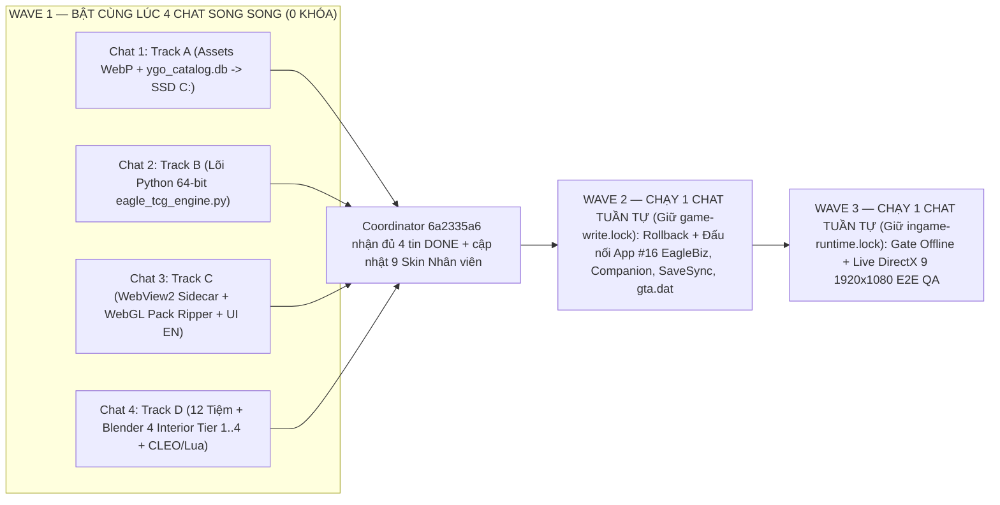

# Bộ Prompt Phân Luồng & Hướng Dẫn Chạy Song Song / Khóa Ghi (`TCG Card Shop × Yu-Gi-Oh!`)

- **Hội thoại Điều phối Trung tâm (Master Coordinator ID):** `6a2335a6-d5d7-47e6-9128-fbc62404a3a8`
- **Trạng thái `Phase 0`:** **ĐÃ HOÀN TẤT `100%`** tại `D:\GTA Archive\Staging\project-eagle\tcg-yugioh-20261111\contracts\` (`tcg_contracts.py`, `tcg_schema.sql`, `tcg_skin_roster.json`). Bạn **không cần** chạy riêng bước khởi tạo mà có thể **bắn ngay cả 4 hội thoại của `Wave 1` chạy song song cùng lúc!**

---

## 1. Quy Tắc Thứ Tự Chạy & Quản Lý Khóa (`Đọc 30 Giây Để Không Bao Giờ Xung Đột`)



| Đợt chạy | Số hội thoại mở cùng lúc | Phụ thuộc (`Depends On`) | Khóa chiếm giữ (`eagle_coord_lock.py`) | Lưu ý vận hành cho bạn |
| :--- | :--- | :--- | :--- | :--- |
| **WAVE 1 (`Prompt 1, 2, 3, 4`)** | **Mở `4` chat chạy SONG SONG ngay bây giờ** | `Phase 0` *(đã xong)* | **`KHÔNG GIỮ KHÓA NÀO`** (`0` đụng file dùng chung, `0` bật `gta_pe.exe`) | Bạn mở 4 tab chat mới, dán lần lượt `Prompt 1`, `Prompt 2`, `Prompt 3`, `Prompt 4` cho chạy cùng lúc. Trong lúc 4 chat chạy, bạn chốt 9 mã skin nhân viên ở hội thoại điều phối này. Khi xong, cả 4 chat sẽ tự bắn `send_message` báo về `6a2335a6-d5d7-47e6-9128-fbc62404a3a8`. |
| **WAVE 2 (`Prompt 5`)** | **Chỉ mở `1` chat duy nhất** | **Chờ cả `4` chat Wave 1 (`Track A, B, C, D`) báo `DONE`** + chốt xong `9` skin | **Chiếm `game-write.lock`** trong lúc ghi file dùng chung rồi nhả ngay | **TUYỆT ĐỐI KHÔNG bật `Prompt 5` khi Wave 1 chưa xong đủ 4 luồng**, và không chạy song song với tác vụ khác đang sửa `EagleCompanion.py` / `hud.lua` / `gta.dat`. |
| **WAVE 3 (`Prompt 6`)** | **Chỉ mở `1` chat duy nhất** | **Chờ `Wave 2` báo `DONE` và đã nhả `game-write.lock`** | **Chiếm `ingame-runtime.lock`** để mở độc quyền `gta_pe.exe` + `:8765` | Trong lúc `Wave 3` chạy test tự động DirectX 9 `1920×1080`, bạn không mở thêm cửa sổ `gta_pe.exe` khác để tránh đụng cổng `:8765` và chuột/cửa sổ. |

---

## 2. Danh Sách `30` Skin Anime/Game Trong Kho `gameplay-lab` (`0%` Trùng Dân Đi Đường)

> [!TIP]
> Cả `30` skin dưới đây đều **đã cài sẵn trong `COMPONENTPEDS.img` của `gameplay-lab`** (rig 32 xương chuẩn, `0` lỗi texture, `animGroup` dáng đi người thường chuẩn, dung lượng nhẹ `267 KB – 5,469 KB`), **KHÔNG xuất hiện trong `pedgrp.dat` / nhóm dân đi bộ ngoài phố**, và **KHÔNG đụng hàng** dàn nhân vật chính của Mondstadt, `WaifuLink`, `Wall Street`, `Cinema/Library` hay tài xế `EagleRide`.
> Bạn chỉ cần nhắn lại **9 số thứ tự** (ví dụ: `1, 4, 5, 6, 8, 9, 17, 23, 25`) ngay tại hội thoại điều phối này — tôi sẽ ghi vào `tcg_skin_roster.json`, **9 skin đó thành 9 Nhân viên thuê được (`STAFF_01..STAFF_09`)**, và **21 skin còn lại tự động làm tập Khách hàng & Khán giả xem giải trong tiệm!**

| Mã `#` | `Ped ID` (`Model`) | Tên Nhân Vật | Tác Phẩm / Nguồn | Dung lượng |
| :---: | :--- | :--- | :--- | :---: |
| **`#01`** | `48205` (`LCS_GRDANG2`) | **Ai Hoshino** | *Oshi no Ko* | `1,249 KB` |
| **`#02`** | `49210` (`UL_WMYSOS`) | **Nami** | *One Piece* | `1,882 KB` |
| **`#03`** | `48953` (`AT_HMYAP`) | **Ruan Mei** | *Honkai: Star Rail* | `5,469 KB` |
| **`#04`** | `49025` (`AT_WFYHDG`) | **Serika Kuromi** | *Blue Archive* | `3,032 KB` |
| **`#05`** | `48962` (`AT_SBMYTR4`) | **Midori Saiba** | *Blue Archive* | `3,647 KB` |
| **`#06`** | `48917` (`ug_bp_wmybp3`) | **Hitori Gotoh (Bocchi)** | *Bocchi the Rock!* | `731 KB` |
| **`#07`** | `49047` (`MH2_BUM1`) | **Usada Pekora** | *Hololive VTuber* | `993 KB` |
| **`#08`** | `49014` (`AT_WORK18`) | **Red** | *Pokémon* | `1,296 KB` |
| **`#09`** | `49012` (`AT_WORK16`) | **Zhongli** | *Genshin Impact* | `1,986 KB` |
| **`#10`** | `49309` (`VC_LANCE`) | **Ningguang** | *Genshin Impact* | `3,381 KB` |
| **`#11`** | `48545` (`CC_HOSTAGE4`) | **Raiden Ei** | *Genshin Impact* | `4,073 KB` |
| **`#12`** | `49117` (`MH2_WATCHDOGS4`) | **Ganyu** | *Genshin Impact* | `4,223 KB` |
| **`#13`** | `49036` (`DUN_SHIRT2`) | **Nilou** | *Genshin Impact* | `4,850 KB` |
| **`#14`** | `48982` (`AT_WMOTSH`) | **Kamisato Ayaka** | *Genshin Impact* | `4,887 KB` |
| **`#15`** | `49190` (`UL_WMOPL`) | **Kaedehara Kazuha** | *Genshin Impact* | `2,638 KB` |
| **`#16`** | `49010` (`AT_WORK14`) | **Xiangling** | *Genshin Impact* | `3,446 KB` |
| **`#17`** | `48993` (`AT_WMYCLX`) | **Tingyun** | *Honkai: Star Rail* | `4,461 KB` |
| **`#18`** | `49300` (`VC_GONZALEZ`) | **Astra Yao** | *Zenless Zone Zero* | `5,290 KB` |
| **`#19`** | `48854` (`MW_WMYLFF`) | **Ukinami Yuzuha** | *Zenless Zone Zero* | `4,477 KB` |
| **`#20`** | `48966` (`AT_WFYBBU`) | **Red Hood** | *Goddess of Victory: NIKKE* | `325 KB` |
| **`#21`** | `49386` (`VCS_LOUISE1`) | **Helm (Aqua)** | *Goddess of Victory: NIKKE* | `267 KB` |
| **`#22`** | `48983` (`AT_WMYATBU`) | **Yukari Takeba** | *Persona 3* | `392 KB` |
| **`#23`** | `49382` (`VCS_JANET`) | **Mitsuru Kirijo** | *Persona 3* | `871 KB` |
| **`#24`** | `48913` (`ug_bp_bmybp1`) | **Rem** | *Re:Zero* | `1,551 KB` |
| **`#25`** | `48749` (`BW_XMAS_RUDY`) | **Komi Shouko** | *Komi Can't Communicate* | `3,165 KB` |
| **`#26`** | `49211` (`UL_WMYVDBD`) | **Nene Kusanagi** | *Project SEKAI* | `3,474 KB` |
| **`#27`** | `49295` (`VC_DICK`) | **Dusk** | *Arknights* | `3,951 KB` |
| **`#28`** | `49031` (`DUN_RUN1`) | **2B** | *NieR* | `4,350 KB` |
| **`#29`** | `49093` (`MH2_PERVUNICORN`) | **Megumi Fushiguro** | *Jujutsu Kaisen* | `1,659 KB` |
| **`#30`** | `49186` (`UL_WFYTSP`) | **Daiwa Scarlet** | *Uma Musume* | `2,924 KB` |

---

## 3. WAVE 1 — 4 Prompt Chạy SONG SONG Ngay Bây Giờ (`0` Giữ Khóa)

### Prompt 1 — `Track A: Trích Xuất 136 Bộ Yu-Gi-Oh! + Phụ Kiện/SFX TCSS -> SSD C: & ygo_catalog.db` *(Chạy song song)*

````text
Bạn là Agent thực thi **Track A (Asset Extraction, Multi-Thread WebP Pipeline & `ygo_catalog.db` Builder)** cho hạng mục tích hợp `TCG Card Shop Simulator × Dan's YuGiOh Expansion v4.1.1` vào `Project Eagle (gameplay-lab)`.

### 1. ĐỊA CHỈ ĐIỀU PHỐI & QUY TẮC KHÓA / AN TOÀN (BẮT BUỘC TUÂN THỦ 100%)
- **Master Coordinator Conversation ID:** `6a2335a6-d5d7-47e6-9128-fbc62404a3a8`
  - Ngay khi hoàn thành toàn bộ Track A (hoặc nếu gặp bất kỳ điểm nghẽn không tự gỡ được), bạn **BẮT BUỘC** gọi tool `send_message(Recipient="6a2335a6-d5d7-47e6-9128-fbc62404a3a8", Message=...)` gửi báo cáo chi tiết (số lượng thẻ/foil/pack/SKU đã xuất, dung lượng trên ổ C:, kết quả kiểm tra `ygo_catalog.db` & `duel_web/`) về cho Coordinator!
- **Ngôn ngữ hiển thị dữ liệu:** **100% Tiếng Anh (`English`)** cho toàn bộ tên bộ bài, tên lá bài, tên SKU phụ kiện, mô tả và danh mục `ShopDeco`.
- **KHÔNG CHIẾM KHÓA (`0 Locks`):** Track A chạy song song hoàn toàn độc lập với Track B, C, D. **TUYỆT ĐỐI KHÔNG** lấy `game-write.lock` hay `ingame-runtime.lock`, **KHÔNG** khởi chạy `gta_pe.exe` hay `EagleCompanion.py`, và **KHÔNG** sửa bất kỳ file nào đang có sẵn của `gameplay-lab` ngoài thư mục tài nguyên cô lập mới tạo riêng cho TCG bên dưới.
- **LUẬT CỨNG TẠO ẢNH:** **CẤM TUYỆT ĐỐI** gọi bất kỳ API tạo ảnh bên ngoài nào (`gpt-image-*`, `dall-e-*`, v.v.). Toàn bộ ảnh thẻ, foil, vỏ pack và icon phụ kiện trích xuất trực tiếp từ 2 kho game nguồn trên ổ `D:`.

### 2. TÀI LIỆU & HỢP ĐỒNG KHÓA CỨNG CẦN ĐỌC TRƯỚC TIÊN
1. Hợp đồng khóa cứng `Phase 0` (TUÂN THỦ 100% tên bảng, tên cột, đường dẫn tương đối):
   - `D:\GTA Archive\Staging\project-eagle\tcg-yugioh-20261111\contracts\tcg_contracts.py`
   - `D:\GTA Archive\Staging\project-eagle\tcg-yugioh-20261111\contracts\tcg_schema.sql`
2. Thiết kế kỹ thuật chi tiết (TDD — Mục 3 & Mục 4, Mục 5.1 công thức EV):
   - `c:\Users\LENOVO\Desktop\GTA\docs\project-eagle\tcss-yugioh-detailed-technical-design-2026-11-11.md`
3. Tạo phiếu công việc riêng của bạn tại:
   - `c:\Users\LENOVO\Desktop\GTA\docs\project-eagle\work-items\2026-11-11-antigravity-tcg-track-a-assets.md` (`status: active` -> cập nhật `done` khi xong).

### 3. NGUỒN DỮ LIỆU ĐỌC (`100% READ-ONLY` TRÊN Ổ `D:`) & ĐÍCH GHI DUY NHẤT
- **Nguồn đọc (`100% Read-Only` — cấm ghi/sửa/xóa file nguồn):**
  1. `D:\GTA Archive\Integration Part 2\Dan's YuGiOh Expansion - Current Release 1675 4.1.1 2026-10-20T16-14Z 5X78h59Vf\BepInEx\plugins\Dan's YuGiOh Expansion\` (`packs.txt`, `prices\*.json`, `YuGiOh Cards\2002..2013+` gồm 136 UnityFS v8 LZ4 bundles, `web\**`, `YgoDuelTable.dll`).
  2. `D:\GTA Archive\Integration Part 2\[tamhongame.com]_TCSS\TCG Card Shop Simulator\Card Shop Simulator_Data\` (`Managed\Assembly-CSharp.dll`, `resources.assets`, `sharedassets0.assets`, `.resS`).
- **Đích ghi DUY NHẤT được phép chạm tới:**
  1. Script/tool/log trung gian: `D:\GTA Archive\Staging\project-eagle\tcg-yugioh-20261111\track_a\`
  2. Tài nguyên runtime trên SSD `C:`: `C:\Users\LENOVO\Desktop\GTA\Project Eagle\gta sa gameplay-lab\data\project-eagle\tcg_yugioh\`
     - `cards_webp/` (`820×1024` WebP Quality 90 — toàn bộ `~13,544` bản in thẻ Yu-Gi-Oh! đã bake chữ)
     - `foils_webp/` (`512×512` WebP Quality 88 — toàn bộ `~7,529` `FoilMask` cho các độ hiếm có nhũ; `Common` để `NULL`)
     - `packs_webp/` (`1024×1024` WebP Quality 92 — vỏ gói `136` bộ mở rộng)
     - `sku_icons/` (WebP icon các mặt hàng thực tế giữ lại từ TCSS: `Deodorant` cho máy `AutoCleanser`, phụ kiện `Ultra PRO` Sleeves / Deck Boxes / Playmats / Toploaders / Binders, `Manga`, `Boardgame`, `BulkBox`, và icon cho `183` món trang trí `ShopDeco` — **LOẠI BỎ 100%** các thẻ/hộp/tượng giả tưởng `Tetramon`/`Destiny`/`Ghost` của TCSS!)
     - `sfx/` (Trích xuất AudioClip gốc từ TCSS sang `.ogg`/`.wav` chuẩn cho WebView2 phát trực tiếp: tối thiểu `SFX_OpenPack`, `SFX_HighValueCardReveal`, `PlayCard_Shuffle2`, `SFX_Checkout`, tiếng lật bài/click).
     - `duel_web/` (Copy nguyên vẹn bộ `web/` của `YgoDuelTable`: `index.html`, `assets/`, `ai-decks.json`, `engine/` gồm `ocgcore` WebAssembly `MODE_MR5`, `cards.cdb` `14,466` lá, `13,323` script `.lua`, `96` deck `.ydk`, `banlists.json`; kiểm tra và cấu hình đường dẫn nạp ảnh lá bài trong `duel_web/` hoặc bảng ánh xạ `konami_passcode -> face_webp_relpath` để **dùng chung ảnh trong `../cards_webp/`**, không nhân đôi dung lượng!).
     - `ygo_catalog.db` (Cơ sở dữ liệu SQLite tĩnh chỉ đọc khớp 100% `PART I` của `tcg_schema.sql`: `catalog_expansions`, `catalog_ygo_cards`, `catalog_shop_skus`, `catalog_shop_deco`).

### 4. LƯU Ý KỸ THUẬT QUAN TRỌNG ĐỂ LÀM NHANH & CHÍNH XÁC
- Môi trường Python hiện có sẵn `PIL` (Pillow có encoder WebP), `zstandard`, `sqlite3`, `numpy`, `pefile`, VÀ máy có sẵn **`.NET 9.0 SDK` (`C:\Program Files\dotnet\dotnet.exe`)** (lưu ý `UnityPy` và `lz4` Python chưa cài sẵn). Bạn có thể viết một công cụ giải nén `UnityFS v8` (LZ4 block + SerializedFile `Texture2D` `DXT1`/`DXT5`/`RGBA32`/`BC7`) siêu tốc bằng **C# `.NET 9.0` đa luồng (`Parallel.ForEach`)** hoặc Python + C# helper để giải mã toàn bộ `136` bundle Yu-Gi-Oh! + `TCSS` assets trong vài phút!
- Chú ý lật trục dọc (`vertical flip`) đúng chiều của Unity `Texture2D` (`DXT1/DXT5` gốc lưu bottom-up trong Unity): **BẮT BUỘC mở kiểm tra trực quan ít nhất 5 file `.webp` bằng tool `read_file`** (1 thẻ Monster, 1 thẻ Spell/Trap, 1 `FoilMask`, 1 vỏ `Pack`, 1 icon phụ kiện) để chắc chắn 100% ảnh không bị lộn ngược đầu!
- Đối chiếu chính xác `konami_passcode` của từng lá trong `catalog_ygo_cards` với bảng `texts` / `datas` trong `duel_web/engine/cards.cdb` và trích xuất đúng quy luật `SlotWeights` (7 lá/pack, `22` cấp độ hiếm, cờ `is_one_of_one = 1` cho thẻ độc bản `1-of-1`) + công thức `PullRatePrices` EV (`pack_wholesale_unit`, `base_msrp`, `box32_cost`, `box64_cost`) từ `YgoDuelTable.dll` / `packs.txt` / `prices/*.json`.

### 5. TIÊU CHÍ NGHIỆM THU BẮT BUỘC TRƯỚC KHI BÁO `DONE`
1. Kiểm tra SQLite `ygo_catalog.db`: đủ `136` expansions, toàn bộ bản in thẻ (`~13,544` rows), `0` broken `face_webp_relpath` / `foil_webp_relpath` / `pack_art_relpath` / `icon_relpath` trên đĩa, `pack_wholesale_unit > 0` và `box64_cost < 2 * box32_cost`.
2. Tổng dung lượng thư mục `gameplay-lab\data\project-eagle\tcg_yugioh\` gọn nhẹ (`~1.6 – 2.2 GB` trên SSD `C:`).
3. Ghi biên bản kiểm tra vào `D:\GTA Archive\Staging\project-eagle\tcg-yugioh-20261111\track_a\track_a_verification.json`, cập nhật phiếu `work-items` sang `done`, và gọi `send_message` báo kết quả về `6a2335a6-d5d7-47e6-9128-fbc62404a3a8`.
````

---

### Prompt 2 — `Track B: Lõi Python 64-bit (eagle_tcg_engine.py), Kho 3 Tầng, Kinh Tế Ngày/Tháng & REST API` *(Chạy song song)*

````text
Bạn là Agent thực thi **Track B (Python 64-bit Core Engine `eagle_tcg_engine.py`, 3-Layer Inventory, Gacha/Economy Simulator & REST/Duel API Backend)** cho hạng mục tích hợp `TCG Card Shop Simulator × Dan's YuGiOh Expansion v4.1.1` vào `Project Eagle (gameplay-lab)`.

### 1. ĐỊA CHỈ ĐIỀU PHỐI & QUY TẮC KHÓA / AN TOÀN (BẮT BUỘC TUÂN THỦ 100%)
- **Master Coordinator Conversation ID:** `6a2335a6-d5d7-47e6-9128-fbc62404a3a8`
  - Khi hoàn tất Track B (hoặc nếu vướng mắc), **BẮT BUỘC** gọi `send_message(Recipient="6a2335a6-d5d7-47e6-9128-fbc62404a3a8", Message=...)` gửi kết quả kiểm thử `Part A` (`10,000`-pack Monte Carlo, mô phỏng `90` ngày, toàn bộ endpoints `/api/tcg/*` & `/api/*`) về cho Coordinator!
- **Ngôn ngữ toàn bộ chuỗi/log/review/thông báo:** **100% Tiếng Anh (`English`)**.
- **KHÔNG CHIẾM KHÓA (`0 Locks`):** Track B chạy song song độc lập với Track A, C, D. **TUYỆT ĐỐI KHÔNG** lấy `game-write.lock` hay `ingame-runtime.lock`, **KHÔNG** khởi chạy `gta_pe.exe` hay `EagleCompanion.py` thật, và **KHÔNG** sửa bất kỳ file nào trong `gameplay-lab` (việc cắm vào `EagleCompanion.py` và `eagle_savegame_sync.py` sẽ do Wave 2 thực hiện dưới khóa sau khi cả 4 luồng xong).

### 2. TÀI LIỆU & HỢP ĐỒNG KHÓA CỨNG CẦN ĐỌC TRƯỚC TIÊN
1. Hợp đồng khóa cứng `Phase 0` (BẮT BUỘC import và tuân thủ 100%):
   - `D:\GTA Archive\Staging\project-eagle\tcg-yugioh-20261111\contracts\tcg_contracts.py`
   - `D:\GTA Archive\Staging\project-eagle\tcg-yugioh-20261111\contracts\tcg_schema.sql`
   - `D:\GTA Archive\Staging\project-eagle\tcg-yugioh-20261111\contracts\tcg_skin_roster.json` (dùng hàm `load_skin_roster()` động để khi người dùng đổi 9 mã nhân viên thì engine tự nhận ngay không cần sửa code!).
2. Thiết kế kỹ thuật chi tiết (TDD — toàn bộ Mục 1, 2, 3, 5, 6):
   - `c:\Users\LENOVO\Desktop\GTA\docs\project-eagle\tcss-yugioh-detailed-technical-design-2026-11-11.md`
3. Đọc tham chiếu (`100% Read-Only`) cách `gameplay-lab` quản lý tiền, save slot và HTTP handler tại:
   - `C:\Users\LENOVO\Desktop\GTA\Project Eagle\gta sa gameplay-lab\eagle_savegame_sync.py`
   - `C:\Users\LENOVO\Desktop\GTA\Project Eagle\gta sa gameplay-lab\eagle_dialogue\wallet_store.py`
   - `C:\Users\LENOVO\Desktop\GTA\Project Eagle\gta sa gameplay-lab\EagleCompanion.py` (chỉ đọc phần HTTP router & Wallet/Save hooks).
   - `D:\GTA Archive\Integration Part 2\Dan's YuGiOh Expansion - Current Release 1675 4.1.1 2026-10-20T16-14Z 5X78h59Vf\BepInEx\plugins\Dan's YuGiOh Expansion\` (`packs.txt`, `prices\`, `web\ai-decks.json`, `web\engine\cards.cdb`, `YgoDuelTable.dll`) và `Assembly-CSharp.dll` của TCSS (`Read-Only`) để lấy chính xác công thức xác suất, độ nhạy giá, chấm điểm thẻ và 7 API endpoints của `YgoDuelTable`.
4. Tạo phiếu công việc riêng của bạn tại:
   - `c:\Users\LENOVO\Desktop\GTA\docs\project-eagle\work-items\2026-11-11-antigravity-tcg-track-b-engine.md` (`status: active` -> `done`).

### 3. ĐÍCH GHI DUY NHẤT CỦA TRACK B
- Chỉ ghi mọi file code, bài test và DB kiểm thử vào:
  `D:\GTA Archive\Staging\project-eagle\tcg-yugioh-20261111\track_b\`
  - `eagle_tcg_engine.py` (Module lõi hoàn chỉnh, thread-safe SQLite WAL, thiết kế adapter sạch cho `WalletStore` tiền mặt/ngân hàng NeoBank, `SavegameSync` snapshot/restore/new_game_reset, HTTP request dispatcher cho mọi route trong `tcg_contracts.API_ROUTES`, và bộ đóng gói buffer nhị phân `1,024-byte` cho khe nhớ CLEO `0x00CAFE80` `'ETCG'`).
  - `test_tcg_engine_part_a.py` + DB test `part_a.db` + `track_b_verification.json`.
  - *(Mẹo song song hóa: vì Track A đang build `ygo_catalog.db` song song, `eagle_tcg_engine.py` mở `YGO_CATALOG_DB_PATH` khi có sẵn trên đĩa, và trong `test_tcg_engine_part_a.py` bạn có thể dựng ngay một `seed_catalog_for_test.db` đọc thẳng từ `packs.txt` + `prices/*.json` + `cards.cdb` để test 100% logic thực tế mà không phải ngồi chờ Track A nén xong 21,000 ảnh WebP!)*

### 4. CÁC HẠNG MỤC LOGIC BẮT BUỘC PHẢI ĐẦY ĐỦ 100% TRONG `eagle_tcg_engine.py`
1. **Kho đồ 3 tầng (`EagleInventory`) & Khởi tạo Ngày 1 chuẩn thế giới mở:**
   - Ngày 1 (`New Game`): cả `12` tiệm trong `TCG_WORLD_SHOPS` đều có `owner_type = 'NPC'`, **0 phát Starter Deck giả tạo** (`tcg_binder_collection` trống, `tcg_decks` trống); cấp tự động `1` `ITEM_CARD_BINDER` vào `player_bag_items` ngay khi mở Sổ hoặc mua món TCG đầu tiên.
   - Tầng 1 (`player_bag_items`) chỉ giữ `ITEM_CARD_BINDER`, các Pack/Box nguyên seal cá nhân và quà tặng; khi xé Pack, lá bài chảy thẳng vào Tầng 2 (`tcg_binder_collection`); hàng của tiệm nằm riêng ở Tầng 3 (`shop_warehouse_stock`, `shop_singles_showcase`).
2. **Engine Xé Pack (`1x` & `8x Fast`), Khóa Độc Bản Toàn Cầu `1-of-1` & Chấm Điểm Thẻ (`TCG 1..10`):**
   - Quay đủ 7 lá/pack theo `slot_weights_json`; nếu trúng thẻ `is_one_of_one == 1` đã có trong `tcg_pulled_1of1` của save hiện tại thì tự động reroll sang thẻ hợp lệ cùng bậc hiếm, còn chưa ai mở thì ghi khóa vĩnh viễn vào `tcg_pulled_1of1`.
   - Gửi chấm điểm `ECONOMY_12D` / `STANDARD_6D` / `EXPRESS_2D`, trả thẻ đúng hạn theo ngày GTA, nhân hệ số giá trị theo điểm `1..10` (`Grade 10 = 4.5x`, `Grade 9 = 2.1x`, `Grade <= 6` giảm giá) + tính năng **`Crack Slab`** đập hộp thẻ điểm thấp trả về thẻ thô trong Binder!
3. **Mô Phỏng Doanh Thu Hàng Ngày Có Trạng Thái (`08:00–21:00`) & Chu Kỳ Tháng (`30` Ngày GTA):**
   - Bù đủ các giờ hoạt động `08:00–21:00` kể cả khi ngủ lưu game `+6h` / viện `+12h`:
     - Nếu `is_open == 0` hoặc `qty_in_stock == 0` -> doanh thu món đó `= $0` + đẩy cảnh báo Hết hàng tiếng Anh lên `EagleBiz`.
     - Tính `N_visitors` từ `Tier Base` (`28 / 58 / 105 / 175`) + `shop_level` + `star_rating` + `owned_decor_ids_json` + `personal_showcase_json` (`Tier >= 2`).
     - Phân loại `8` tệp ví khách hàng + `Ultra-Whales`, đường cong độ nhạy giá chuẩn TCSS (bán cắt cổ khách bỏ về + đánh rớt sao), công suất quầy thu ngân theo `checkout_sec` của nhân viên `Cashier` (quá tải -> `walkouts_queue`), thưởng tăng ca ngầm (`enable_overtime == 1` và `willing_overtime == True` -> mở tới `22:30` tăng `1.14x` doanh thu + `+0.15★`), `Restocker` tự bù kệ, máy `AutoCleanser` trừ `deodorant_charges` (hết bình -> sự cố khách hôi rớt sao!), máy `AutoPackOpener` (`Tier >= 3`) tự bóc Pack dư và đóng `BulkBox` thẻ Common, sinh thư `shop_trade_inbox` có hạn `3–5` ngày, lọc `10` mẫu review tiếng Anh chân thực và lưu đầy đủ `shop_daily_logs`.
   - Chu kỳ `30` ngày GTA: lăn sóng giá thị trường (`PriceChangeManager` `0.65x .. 1.85x`) + lập Hóa đơn gộp tháng (`monthly_rent + electricity + 30d staff salaries`; quá hạn 5 ngày khóa nhập hàng sỉ).
   - Tiệm `NPC`: tự động làm mới kệ Pack/Box/Singles và lịch Giải đấu mỗi ngày theo `era_bias` từng vùng; hỗ trợ mua lại thẻ lẻ của người chơi giá `70%` thị trường và nút `Buyout Property` chuyển tiệm sang `owner_type = 'PLAYER'` vĩnh viễn!
4. **Đầy đủ REST API `/api/tcg/*` + 7 Endpoints `/api/*` của `YgoDuelTable` + Giải Đấu Loại Trực Tiếp `8/16/32`:**
   - Kiểm tra hợp lệ Deck `.ydk` (`40..60` Main Deck, `0..15` Extra/Side, tối đa `3` bản cùng tên, kiểm tra sở hữu thật trong `tcg_binder_collection`) và phục vụ chuẩn xác cả 7 routes `/api/deck`, `/api/cards/meta`, `/api/ai-decks`, `/api/ai-deck`, `/api/duel-reward`, `/api/banlists`, `/api/collection` để frontend `duel_web/` (`ocgcore` WASM) chạy trơn tru 100%.

### 5. TIÊU CHÍ NGHIỆM THU BẮT BUỘC TRƯỚC KHI BÁO `DONE`
- Chạy `py_compile` và chạy `test_tcg_engine_part_a.py` đạt **`100% PASS`** trên mọi kịch bản: Monte Carlo `10,000` packs (không bao giờ lọt 2 bản của cùng 1 thẻ `1-of-1`), hết sạch kho `qty == 0` doanh thu đúng `$0`, tăng ca `OT`, chấm điểm + `Crack Slab`, mua đứt tiệm `NPC -> PLAYER`, nâng `Tier 1 -> 4`, quyết toán hóa đơn `30` ngày, giải đấu `8/16/32`, Save/Load snapshot nguyên tử, và test HTTP server giả lập cho toàn bộ endpoints trong `API_ROUTES`.
- Ghi báo cáo JSON vào `track_b_verification.json`, đóng phiếu `work-items` sang `done`, và gọi `send_message` báo về `6a2335a6-d5d7-47e6-9128-fbc62404a3a8`.
````

---

### Prompt 3 — `Track C: Borderless 16:9 WebView2 Sidecar, 60 FPS WebGL Pack Ripper & Giao Diện Tiếng Anh` *(Chạy song song)*

````text
Bạn là Agent thực thi **Track C (Borderless `16:9` WebView2 Sidecar Host, `60–144 FPS` WebGL 3D Pack Ripper + 22-Rarity Holo Shader & 100% English Shop/Binder/Duel SPA)** cho hạng mục tích hợp `TCG Card Shop Simulator × Dan's YuGiOh Expansion v4.1.1` vào `Project Eagle (gameplay-lab)`.

### 1. ĐỊA CHỈ ĐIỀU PHỐI & QUY TẮC KHÓA / AN TOÀN (BẮT BUỘC TUÂN THỦ 100%)
- **Master Coordinator Conversation ID:** `6a2335a6-d5d7-47e6-9128-fbc62404a3a8`
  - Khi hoàn tất Track C (hoặc nếu vướng mắc), **BẮT BUỘC** gọi `send_message(Recipient="6a2335a6-d5d7-47e6-9128-fbc62404a3a8", Message=...)` gửi kết quả build `EagleTcgSidecarHost.exe`, kiểm thử UI tiếng Anh, WebGL Pack Ripper và cầu nối `ocgcore` về cho Coordinator!
- **Ngôn ngữ hiển thị UI:** **100% Tiếng Anh (`English`)** sắc nét, hiện đại trên toàn bộ mọi màn hình, tab, nút bấm, tooltip, trạng thái giải đấu và thông báo.
- **KHÔNG CHIẾM KHÓA (`0 Locks`):** Track C chạy song song độc lập với Track A, B, D. **TUYỆT ĐỐI KHÔNG** lấy `game-write.lock` hay `ingame-runtime.lock`, **KHÔNG** khởi chạy `gta_pe.exe` hay sửa file trong `gameplay-lab`.
- **LUẬT CỨNG TẠO ẢNH:** **CẤM TUYỆT ĐỐI** gọi bất kỳ API tạo ảnh bên ngoài nào (`gpt-image-*`, `dall-e-*`, v.v.). Dùng CSS/SVG vector hiện đại và tài nguyên trích xuất của dự án.

### 2. TÀI LIỆU & HỢP ĐỒNG KHÓA CỨNG CẦN ĐỌC TRƯỚC TIÊN
1. Hợp đồng khóa cứng `Phase 0` (TUÂN THỦ 100% danh sách `API_ROUTES`, cấu trúc dữ liệu, mã cửa hàng):
   - `D:\GTA Archive\Staging\project-eagle\tcg-yugioh-20261111\contracts\tcg_contracts.py`
   - `D:\GTA Archive\Staging\project-eagle\tcg-yugioh-20261111\contracts\tcg_schema.sql`
   - `D:\GTA Archive\Staging\project-eagle\tcg-yugioh-20261111\contracts\tcg_skin_roster.json`
2. Thiết kế kỹ thuật chi tiết (TDD — đặc biệt Mục 2, Mục 4, Mục 6 WebGL Pack Ripping + 22-Rarity `FoilMask` Shader + `ocgcore` WASM):
   - `c:\Users\LENOVO\Desktop\GTA\docs\project-eagle\tcss-yugioh-detailed-technical-design-2026-11-11.md`
3. Đọc tham chiếu (`100% Read-Only`):
   - `C:\Users\LENOVO\Desktop\GTA\Project Eagle\gta sa gameplay-lab\eagle_vn_ingame_overlay.py` (cách dò HWND `gta_pe.exe`, bám khung cửa sổ `16:9`, tự ẩn khi Minimize / Alt-Tab / Pause Menu).
   - `D:\GTA Archive\Integration Part 2\Dan's YuGiOh Expansion - Current Release 1675 4.1.1 2026-10-20T16-14Z 5X78h59Vf\BepInEx\plugins\Dan's YuGiOh Expansion\web\` (`index.html`, `assets/`, `ai-decks.json`, `engine/` — để nhúng iframe / điều hướng mượt mà sang bàn đấu `ocgcore` WASM `8,000 LP` ngay trong Sidecar!).
4. Tạo phiếu công việc riêng của bạn tại:
   - `c:\Users\LENOVO\Desktop\GTA\docs\project-eagle\work-items\2026-11-11-antigravity-tcg-track-c-sidecar-ui.md` (`status: active` -> `done`).

### 3. ĐÍCH GHI DUY NHẤT CỦA TRACK C
- Chỉ ghi mọi mã nguồn, bản build `.exe` và bài kiểm thử vào:
  `D:\GTA Archive\Staging\project-eagle\tcg-yugioh-20261111\track_c\`
  1. `EagleTcgSidecarHost/` -> biên dịch sẵn ra binary chạy ngay (`EagleTcgSidecarHost.exe` viết bằng **`.NET 9.0 WindowsDesktop` (`C:\Program Files\dotnet\dotnet.exe`) + Evergreen `WebView2` (`157.0.4341.42` đã cài sẵn trên máy)**; lưu ý Python chưa cài `pywebview` nên `.NET 9.0` WinForms/Win32 + `WebView2` là hướng chuẩn xác, siêu mượt và native 100%!).
     - Khởi chạy ngầm (`pre-warmed hidden window`) để khi nhận lệnh `SHOW <route>` (qua local pipe / stdin / localhost poll) cửa sổ bật lên trong **`< 16 ms` (`0 ms` trắng màn hình)**!
     - Kiểu cửa sổ Borderless `16:9` căn khớp vùng client của `gta_pe.exe` (hoặc căn giữa màn hình khi chạy test độc lập), tự động ẩn ngay lập tức khi người chơi bấm `[ESC]` (trừ khi đang ở modal con thì đóng modal trước), hoặc khi `gta_pe.exe` bị thu nhỏ / Alt-Tab / bật Pause Menu, đồng thời gọi `POST /api/tcg/sidecar/close` để trả lại chuột camera cho GTA.
  2. `eagle_tcg_sidecar_overlay.py`: trình điều khiển Python gọn sạch quản lý vòng đời `EagleTcgSidecarHost.exe` để Wave 2 cắm thẳng vào `EagleCompanion.py` chỉ bằng 3 dòng code.
  3. `sidecar_ui/`: Toàn bộ ứng dụng SPA **100% Tiếng Anh** đẳng cấp (Dark-Gold Konami Duelist × Sleek Retail Manager theme) gồm đủ **5 phân hệ**:
     - **Phân hệ 1 — `EagleBiz Remote Hub` (khi mở từ `App #16` ngoài đường):**
       - Nếu sở hữu `0` tiệm: Danh bạ `12` cửa hàng thẻ bài trên toàn map (kèm khu vực, cấp `Tier`, xu hướng bộ bài, lịch giải đấu hôm nay + nút `Set GPS Waypoint`) và nút mở `Card Binder & Deck Builder`.
       - Nếu sở hữu `>= 1` tiệm: Trung tâm điều hành chuỗi cửa hàng từ xa + Bảng cảnh báo Hết hàng / Chốt sổ Hóa đơn `30` ngày + chuyển nhanh vào từng tiệm.
     - **Phân hệ 2 — `Customer Mode UI` (khi vào tiệm `owner_type == 'NPC'`):**
       - Mua lẻ Pack / thùng `32` & `64` gói / phụ kiện (`Ultra PRO`, v.v.); Tủ kính mua thẻ lẻ & thẻ chấm điểm `TCG 1..10`; Quầy bán nhanh thẻ dư lấy `70%` tiền mặt ngay lập tức; Ghi danh Giải đấu (`8/16/32` người); Dịch vụ gửi chấm điểm thẻ (`Economy 12d` / `Standard 6d` / `Express 2d` + nút `Crack Slab` cho thẻ điểm `<= 6`); và nút nổi bật **`Buy This Property ($...)`** để thâu tóm cửa hàng!
     - **Phân hệ 3 — `Shop Owner Mode UI` (khi vào tiệm `owner_type == 'PLAYER'`):**
       - **Dashboard & Daily Logs:** Đổi tên tiệm, gạt công tắc `OPEN / CLOSED (08:00–21:00)`, chọn `Play Event` tăng phí bàn đấu, biểu đồ & bảng `shop_daily_logs` (khách ghé, khách mua, bỏ về do kẹt quầy/hết hàng/giá đắt, doanh thu Pack/Singles/Bàn đấu, 5 review tiếng Anh trong ngày), thanh toán Hóa đơn gộp `30` ngày (`Rent + Electricity + 30d Staff Wages`), theo dõi bình `Deodorant` của `AutoCleanser`.
       - **Wholesale & Licenses:** Mở khóa giấy phép bộ bài mới theo `shop_level`, đặt thùng sỉ `32`/`64` gói, bình `Deodorant`, phụ kiện `Ultra PRO`, `Manga`, `Boardgame`, `BulkBox` (giao thẳng vào kho `0` bê thùng tay!).
       - **Warehouse & Pricing:** Chỉnh giá bán lẻ từng SKU có thanh chỉ báo tâm lý khách (`Fair / Slight Markup / Overpriced` so với giá thị trường đang lăn sóng) + ngưỡng tự động bù kệ `auto_restock_min`.
       - **Showcase, Personal Display & Auto-Opener:** Niêm yết thẻ lẻ/slab lên Tủ kính bán lẻ; chọn tối đa `20` bảo vật khóa vào `PersonalShowcase` (`Tier >= 2`) hút khách đại gia; nạp Pack tồn vào máy `AutoPackOpener` (`Tier >= 3`) tự bóc và đóng gói `BulkBox` thẻ Common.
       - **Async Trade Inbox:** Duyệt các lời đề nghị bán/đổi thẻ của khách có đồng hồ đếm ngược hạn chót `3–5` ngày (`Accept` / `Decline` / `Counter-Offer`).
       - **Staff, Decor & Tier Upgrade:** Thuê/sa thải/phân vai (`Cashier` / `Restocker` / `Both`) và bật/tắt `Overtime (OT)` cho `9` nhân viên (hiển thị tên nhân vật tiếng Anh đọc từ `/api/tcg/state` / `tcg_skin_roster.json`); mua `183` món `ShopDeco` cộng buff khách/Whale; bấm **`Upgrade Storefront Interior (Tier 1 -> Tier 2 -> Tier 3 -> Tier 4)`**.
       - **Tournament Manager:** Lên lịch giải đấu `8/16/32` người, chọn thể thức (`GOAT 2005`, `Edison 2010`, `Modern MR5`, `Anime Legends`), phí vào cửa & phần thưởng.
     - **Phân hệ 4 — `3D Pack Ripper Studio (pack_ripper_webgl.js)` (`60–144 FPS`):**
       - Dựng gói bài 3D phủ texture `packs_webp/<SET>.webp`; người chơi **nhấn giữ và kéo chuột ngang đường răng cưa mép trên** để xé rách vỏ gói có hạt sáng phát nổ + phát âm thanh `SFX_OpenPack.ogg`!
       - Lật từng lá trong xấp `7` lá: nghiêng chuột (`tilt X/Y`) điều khiển **GLSL Custom Fragment Shader** kết hợp `face_webp` + `foil_webp` (`FoilMask`) tái hiện rực rỡ **`22` cấp độ hiếm Yu-Gi-Oh!** (Super, Ultra vàng kim, Secret sọc cầu vồng chéo, Ultimate dập nổi, Ghost 3D bạc, Starlight / Quarter Century Secret kim tuyến chéo rực sáng, `1-of-1` viền hào quang độc bản!) + nổ âm thanh `SFX_HighValueCardReveal.ogg` khi ra thẻ hiếm/giá trị cao + chế độ **`Fast Rip 8x Packs`** tổng kết giá trị mở được so với vốn!
     - **Phân hệ 5 — `Card Binder, .ydk Deck Builder & ocgcore Duel Arena`:**
       - Lọc kho thẻ theo Set / Độ hiếm / Passcode / Giá trị / Slab, kéo thả lắp `Main Deck (40–60)` + `Extra Deck (0–15)` + `Side Deck (0–15)` lưu chuẩn `.ydk`, và mở thẳng bàn đấu `duel_web/` (`ocgcore` WebAssembly `8,000 LP`, đấu tự do với `96` Character Decks Anime hoặc đánh trận trong nhánh Giải đấu `8/16/32` rồi gửi kết quả thắng/thua về `/api/tcg/tourney/report`).
  4. `mock_contract_server.py`: Server test cục bộ giả lập đúng hợp đồng `tcg_contracts.API_ROUTES` để bạn bật thật `EagleTcgSidecarHost.exe`, chụp ảnh màn hình kiểm tra trực quan từng giao diện và shader WebGL trước khi bàn giao!

### 4. TIÊU CHÍ NGHIỆM THU BẮT BUỘC TRƯỚC KHI BÁO `DONE`
- Biên dịch thành công `EagleTcgSidecarHost.exe` (`0` errors), chạy `py_compile` trên `eagle_tcg_sidecar_overlay.py` & `mock_contract_server.py`.
- Bật `EagleTcgSidecarHost.exe` kết nối `mock_contract_server.py`, chụp ảnh màn hình và dùng `read_file` tự kiểm tra trực quan: (1) `Customer Mode`, (2) `Owner Dashboard + Pricing/Trade`, (3) `3D Pack Ripper + Holo FoilMask Shader`, (4) `Binder & .ydk Deck Builder` — đảm bảo 100% Tiếng Anh, bố cục cân đối, không tràn chữ, tốc độ bật/ẩn tức thì.
- Ghi kết quả vào `track_c_verification.json`, đóng phiếu `work-items` sang `done`, và gọi `send_message` báo về `6a2335a6-d5d7-47e6-9128-fbc62404a3a8`.
````

---

### Prompt 4 — `Track D: 12 Mặt Bằng Bản Đồ, Blender 4 Interior Tĩnh (Tier 1..4) & CLEO/Lua Director` *(Chạy song song)*

````text
Bạn là Agent thực thi **Track D (12 World Storefront Placement, Blender 5.0 4 Static Tiered Interiors `Tier 1..4` & CLEO/Lua Crowd/Staff/`RadioEx` Speaker Director)** cho hạng mục tích hợp `TCG Card Shop Simulator × Dan's YuGiOh Expansion v4.1.1` vào `Project Eagle (gameplay-lab)`.

### 1. ĐỊA CHỈ ĐIỀU PHỐI & QUY TẮC KHÓA / AN TOÀN (BẮT BUỘC TUÂN THỦ 100%)
- **Master Coordinator Conversation ID:** `6a2335a6-d5d7-47e6-9128-fbc62404a3a8`
  - Khi hoàn tất Track D (hoặc nếu vướng mắc), **BẮT BUỘC** gọi `send_message(Recipient="6a2335a6-d5d7-47e6-9128-fbc62404a3a8", Message=...)` gửi kết quả kiểm định nhị phân `.IMG/.IDE/.IPL/.COL3`, tọa độ raycast `12` cửa hàng và kịch bản `EagleTcgBridge.cs` + `EagleTcgDirector.lua` về cho Coordinator!
- **Ngôn ngữ hiển thị HUD/Prompt trong game:** **100% Tiếng Anh (`English`)**, **CHỈ DÙNG 7-bit ASCII sạch** (tuyệt đối strip sạch dấu và các ký tự cấm của `CFont`: `~`, `|`, `*`, `@` để không bao giờ gây treo/vỡ chữ GTA!).
- **KHÔNG CHIẾM KHÓA (`0 Locks`):** Track D chạy song song độc lập với Track A, B, C. Bạn chỉ đọc các file `.COL/.IPL/.IDE/.IMG` của `gameplay-lab` ở chế độ **`100% Read-Only`** để đo mặt đất (`ground_z`) và kiểm tra khoảng trống, rồi **xuất toàn bộ sản phẩm build vào `D:\GTA Archive\Staging\project-eagle\tcg-yugioh-20261111\track_d\`** (Wave 2 sẽ copy vào `gameplay-lab` và đăng ký `gta.dat` dưới `game-write.lock`). **TUYỆT ĐỐI KHÔNG** lấy lock, **KHÔNG** bật `gta_pe.exe`, và **KHÔNG BAO GIỜ** đụng tới `COMPONENTPEDS.img` (`12.78 GB`).
- **LUẬT CỨNG TẠO ẢNH:** **CẤM TUYỆT ĐỐI** gọi bất kỳ API tạo ảnh bên ngoài nào (`gpt-image-*`, `dall-e-*`, v.v.). Dùng texture gốc trích xuất từ TCSS / `Dueling Computer.glb` / procedural PIL sạch cho bảng hiệu.

### 2. TÀI LIỆU & HỢP ĐỒNG KHÓA CỨNG CẦN ĐỌC TRƯỚC TIÊN
1. Hợp đồng khóa cứng `Phase 0` (BẮT BUỘC khớp `100%` từng Model ID, tọa độ `Area Code = 1`, địa chỉ `0x00CAFE80` và offset byte trong `SHM_OFF_*`):
   - `D:\GTA Archive\Staging\project-eagle\tcg-yugioh-20261111\contracts\tcg_contracts.py`
   - `D:\GTA Archive\Staging\project-eagle\tcg-yugioh-20261111\contracts\tcg_skin_roster.json`
2. Thiết kế kỹ thuật chi tiết (TDD — đặc biệt Mục 7: `4` Cấp Interior 3D Cố Định, `12` Địa Điểm Bản Đồ, Ambient NPC, `9` Nhân Viên Cố Định Skin & Loa `RadioEx` `[E]`):
   - `c:\Users\LENOVO\Desktop\GTA\docs\project-eagle\tcss-yugioh-detailed-technical-design-2026-11-11.md`
3. Tài liệu chuẩn kỹ thuật 3D & CLEO của `gameplay-lab` (`Read-Only`):
   - `c:\Users\LENOVO\Desktop\GTA\docs\project-eagle\technical-limits-and-capacity-audit-2026-11-05.md`
   - `c:\Users\LENOVO\Desktop\GTA\docs\project-eagle\cinema-library-item1-world-blueprint-2026-11-06.md`
   - `c:\Users\LENOVO\Desktop\GTA\docs\project-eagle\skin-and-3d-model-conversion-lessons-2026-10-25.md`
   - `C:\Users\LENOVO\Desktop\GTA\Project Eagle\gta sa gameplay-lab\cleo\EagleLiteratureHud.lua` & `EagleLiteratureBridge.cs` (tham khảo mẫu cầu nối `_rwdseg` + điều phối đám đông NPC trong `Area Code = 1`).
   - Kiểm tra cách `RadioEx` / đổi đài hoạt động trong `gameplay-lab` (`Read-Only` trong `docs/project-eagle/presentation-current-state.md` và `scripts/`/`cleo/`).
4. Tạo phiếu công việc riêng của bạn tại:
   - `c:\Users\LENOVO\Desktop\GTA\docs\project-eagle\work-items\2026-11-11-antigravity-tcg-track-d-world-3d.md` (`status: active` -> `done`).

### 3. ĐÍCH GHI DUY NHẤT CỦA TRACK D (`D:\GTA Archive\Staging\project-eagle\tcg-yugioh-20261111\track_d\`)
1. **Khảo Sát `.COL` Mặt Đất & Xác Định Chính Xác `12` Cửa Hàng Thế Giới Mở (`12_shops_world_placement.json`):**
   - Với đủ `12` mã tiệm trong `tcg_contracts.TCG_WORLD_SHOPS` (`TCG_LS_IDLEWOOD`, `TCG_LS_VERONA`, `TCG_LS_RODEO`, `TCG_SF_HASHBURY`, `TCG_SF_CHINATOWN`, `TCG_SF_FINANCIAL`, `TCG_LV_STRIP`, `TCG_LV_CREEK`, `TCG_MONDSTADT_PLAZA`, `TCG_WIBU_AKIBA` ưu tiên tòa `radio_kaikan` tại Akihabara `wibu01_japan_island`, `TCG_SAKURA_DOWNTOWN`, `TCG_COUNTRYSIDE_DILLIMORE`):
   - Quét `.IPL` & raycast `.COL` thực tế của `gameplay-lab` để lấy tọa độ vỉa hè/sảnh cửa ra vào chuẩn xác `100%`: có mặt sàn `.COL` rắn chắc (`ground_z` chính xác), khoảng không trên đầu `>= 4.0m`, không nằm dưới mặt nước/trong tường kín, và cách mọi cổng dịch chuyển hiện hữu (`Wall Street`, `30` điểm `Cinema/Library`, `Mondstadt` portals, cửa hàng vanilla) tối thiểu **`>= 35m`**!
   - Ghi đầy đủ tọa độ marker cửa vào, tọa độ đứng bấm `[E]`, góc quay `heading` khi bước ra khỏi tiệm, và vị trí gắn biển hiệu `Yu-Gi-Oh! OFFICIAL CARD SHOP` ngoài mặt tiền (dùng các Model ID từ `15254..15289` trong dải được cấp `15250..15309`).
2. **Xây Dựng `4` Cấp Nội Thất 3D Tĩnh (`int_tcg_t1..t4` -> `eagle_tcg_interiors.{img,ide,ipl,col}`):**
   - Trích xuất mesh low-poly từ TCSS (`44–1,304` tris: kệ gỗ/kim loại trưng bày Booster Box, Tủ kính trưng bày thẻ lẻ có gắn sẵn mặt thẻ Yu-Gi-Oh! tĩnh trang trí dưới lớp kính — không swap texture 3D động lúc runtime, Quầy thu ngân POS, bàn đấu bài 2 ghế, máy `AutoCleanser` treo tường, kệ kho `CardStorageShelf`, tủ `PersonalShowcase` cho `Tier >= 2`, máy `AutoPackOpener` cho `Tier >= 3`) + mô hình **`Dueling Computer.glb`** từ `Dan's YuGiOh Expansion` + đạo cụ **Loa thùng / Dàn âm thanh `RadioEx` Speaker** đặt nổi bật gần quầy/sảnh đấu bài!
   - Ráp qua Blender / trình đóng gói RenderWare chuẩn của project thành `4` phòng kín tại đúng tọa độ `INTERIOR_TIERS` trong `tcg_contracts.py` (`Area Code = 1`, `Z = +1650.0`, `Y = -2650.0`, `X = 2200.0 / 2650.0 / 3100.0 / 3550.0`, Model IDs `15250..15253`):
     - `Tier 1 (15250, int_tcg_t1)`: `10m × 14m`, ấm cúng kiểu tiệm sưu tầm cổ điển, `2` bàn đấu + `1` `Dueling Computer`, quầy thu ngân, kệ hàng, tủ kính, `AutoCleanser`, Loa `RadioEx`.
     - `Tier 2 (15251, int_tcg_t2)`: `15m × 20m`, rộng sáng hơn, `4` bàn đấu + `2` `Dueling Computer`, mở thêm khu **`PersonalShowcase`**.
     - `Tier 3 (15252, int_tcg_t3)`: `22m × 26m`, sảnh giải đấu chuyên nghiệp, `8` bàn đấu + `2` `Dueling Computer`, mở thêm góc máy **`AutoPackOpener`**.
     - `Tier 4 (15253, int_tcg_t4)`: `30m × 34m`, đại đấu trường kiểu Akihabara Radio Kaikan Megastore, `12` bàn đấu + sân khấu bàn chung kết trung tâm, hệ đèn trần rực sáng (prelight vertex color sáng rõ vừa phải, không cháy trắng), lối đi quanh khu bàn đấu **rộng thoáng `>= 2.4m`** để đám đông NPC đứng xem không bao giờ kẹt va chạm!
   - **Kiểm định cứng giới hạn nhị phân Engine:** Mọi `.dff` có `numMaterials <= 136`, `vertices <= 65,535`; mọi tên entry `.IMG` `<= 23` ký tự; mọi tên `.COL3` `<= 19` ký tự; `.TXD` `platformId = 9` mipmap chẵn lũy thừa 2 `DXT1/DXT5`; `.COL3` kín sàn/tường/trần + `TBox` gọn quanh quầy, kệ và bàn đấu; mọi dòng `.IPL` có `lodIndex = -1`.
3. **Cầu Nối Bộ Nhớ `EagleTcgBridge.cs` & Đạo Diễn Hoạt Cảnh 3D `EagleTcgDirector.lua`:**
   - `EagleTcgBridge.cs` (kèm bản biên dịch `.cs`/`.cm` chạy được ngay trên CLEO của `gameplay-lab`): cấp phát khối heap `1,024` bytes, xóa `0`, ghi `0x45544347` (`'ETCG'`) vào `0x00CAFE80` và con trỏ heap vào `0x00CAFE84` (**TUYỆT ĐỐI KHÔNG** chạm `>= 0x00CB0000`).
   - `EagleTcgDirector.lua`:
     - Hiển thị marker & prompt tiếng Anh sạch ngoài cửa `12` tiệm; khi bấm `[E]` bước vào: fade màn hình mượt, đặt `Area Code = 1`, dịch chuyển Aether vào đúng tâm `spawn_xyz_h` của `INTERIOR_TIERS[interior_tier]` (đọc từ SHM hoặc trạng thái tiệm; nếu đang ở trong tiệm mà chủ tiệm bấm nâng cấp `Tier` trên Sidecar khiến `SHM_OFF_INTERIOR_TIER` tăng lên, tự động fade nhẹ và chuyển Aether sang phòng `Tier` mới ngay lập tức!).
     - Khóa sạch dân đi đường ngẫu nhiên trong `Area 1` (`SetPedDensityMultiplierThisFrame(0.0)`).
     - **Spawn Nhân viên đúng vai trò & skin:** Nếu `owner_type == 'NPC'`, đặt 1 nhân viên thu ngân mặc định đứng quầy; nếu `owner_type == 'PLAYER'`, đọc mảng `SHM_OFF_HIRED_STAFF_PEDS` & `SHM_OFF_HIRED_STAFF_ROLES` (`1=CASHIER` đứng sau quầy thu ngân; `2=RESTOCKER` / `3=BOTH` đi tuần tự giữa kệ kho và các dãy kệ trưng bày diễn hoạt xếp hàng!).
     - **Spawn Khách hàng Ambient & Khán giả Giải đấu:** Đọc danh sách `21` skin khách tiệm từ `SHM_OFF_CUSTOMER_POOL_PEDS` (hoặc fallback từ `tcg_skin_roster.json`), cho `4..14` khách (tùy `Tier` và trạng thái `SHM_OFF_SHOP_IS_OPEN`) bước từ cửa vào xem kệ bài, ngồi đối diện nhau đánh bài ở các bàn phụ; đặc biệt khi `SHM_OFF_TOURNEY_ACTIVE == 1`, xếp thêm vòng khán giả đứng cổ vũ quanh khu bàn đấu giải nhưng chừa trống bàn của Aether!
     - **Các điểm tương tác phím tắt trong phòng (`100% English ASCII`):**
       - Đứng gần Quầy thu ngân / Máy chủ quản lý bấm `[E]` (hoặc bấm `[F6]` bất kỳ đâu trong tiệm) -> ghi `SHM_OFF_UI_TRIGGER_CMD = 1` + tăng `SHM_OFF_UI_TRIGGER_SEQ` để mở `Customer/Owner Sidecar`.
       - Đứng gần Bàn đấu trống hoặc `Dueling Computer` bấm `[E]` -> `SHM_OFF_UI_TRIGGER_CMD = 2` mở `Duel / Tournament Sidecar`.
       - Bấm `[B]` -> `SHM_OFF_UI_TRIGGER_CMD = 3` mở nhanh `Card Binder & Deck Builder`.
       - Đứng gần **Loa `RadioEx` Speaker** bấm `[E]` -> phát âm báo & đổi kênh nhạc `RadioEx` đang phát trong tiệm (`SHM_OFF_UI_TRIGGER_CMD = 4` / điều khiển radio stream nội bộ) kèm dòng thông báo ASCII tên đài trên màn hình!
       - Đứng tại cửa ra bấm `[E]` -> dịch chuyển trả Aether về đúng vỉa hè của tiệm đó (`Area Code = 0`) và dọn sạch toàn bộ ped/prop tạm (`0` rò rỉ `CPed Pool`).

### 4. TIÊU CHÍ NGHIỆM THU BẮT BUỘC TRƯỚC KHI BÁO `DONE`
- Chạy script kiểm định nhị phân độc lập trên `eagle_tcg_interiors.{img,ide,ipl,col}`: xác nhận `0` vật liệu vượt `136`, `0` đỉnh vượt `65,535`, `0` tên vượt `19`/`23` ký tự, raycast từ điểm `spawn_xyz_h` của cả 4 phòng `Tier 1..4` chạm đúng mặt sàn `.COL3` ở `Z ~ 1650.0`, đầy đủ tọa độ `Counter`, `Duel Tables`, `Dueling Computer`, `RadioEx Speaker` và `Exit Door` khớp `1:1` với `EagleTcgDirector.lua`.
- Kiểm tra cú pháp `luac` / parser trên `EagleTcgDirector.lua` và kiểm tra binary `EagleTcgBridge.cs`.
- Ghi đầy đủ thông số vào `track_d_binary_audit.json`, đóng phiếu `work-items` sang `done`, và gọi `send_message` báo về `6a2335a6-d5d7-47e6-9128-fbc62404a3a8`.
````

---

## 4. WAVE 2 — Prompt Đấu Nối File Dùng Chung (`CHỈ CHẠY SAU KHI CẢ 4 CHAT WAVE 1 XONG — GIỮ game-write.lock`)

> [!WARNING]
> **CHƯA CHẠY PROMPT 5 LÚC NÀY!** Hãy chờ cả 4 hội thoại `Track A, B, C, D` ở trên báo `DONE` về hội thoại điều phối `6a2335a6-d5d7-47e6-9128-fbc62404a3a8` và chốt xong `9` mã skin nhân viên trong `tcg_skin_roster.json`, sau đó mới mở **1 hội thoại duy nhất** chạy `Prompt 5` bên dưới.

### Prompt 5 — `Wave 2 (Phase 2): Tạo Rollback + Đấu Nối App #16 EagleBiz, EagleCompanion, SaveSync & gta.dat (Dưới game-write.lock)`

````text
Bạn là Agent thực thi **Wave 2 — Phase 2 (Shared-File Integration, `App #16: EagleBiz`, Companion/SaveSync Wiring & Guarded Rollback)** cho hạng mục `TCG Card Shop Simulator × Dan's YuGiOh Expansion v4.1.1` trên `Project Eagle (gameplay-lab)`.

### 1. ĐIỀU KIỆN TIÊN QUYẾT, ĐỊA CHỈ ĐIỀU PHỐI & QUY TẮC KHÓA `game-write.lock` (BẮT BUỘC 100%)
- **Master Coordinator Conversation ID:** `6a2335a6-d5d7-47e6-9128-fbc62404a3a8`
- **Kiểm tra đầu vào trước khi chạm bất kỳ file nào:** Xác minh cả 4 gói đầu ra của Wave 1 đã hiện diện đầy đủ và đạt chuẩn:
  1. Track A: `gameplay-lab\data\project-eagle\tcg_yugioh\{ygo_catalog.db, cards_webp, foils_webp, packs_webp, sku_icons, sfx, duel_web}`
  2. Track B: `D:\GTA Archive\Staging\project-eagle\tcg-yugioh-20261111\track_b\eagle_tcg_engine.py`
  3. Track C: `D:\GTA Archive\Staging\project-eagle\tcg-yugioh-20261111\track_c\{EagleTcgSidecarHost, eagle_tcg_sidecar_overlay.py, sidecar_ui}`
  4. Track D: `D:\GTA Archive\Staging\project-eagle\tcg-yugioh-20261111\track_d\{eagle_tcg_interiors.img, eagle_tcg_interiors.ide, eagle_tcg_interiors.ipl, eagle_tcg_interiors.col, EagleTcgBridge.cs, EagleTcgDirector.lua, 12_shops_world_placement.json}`
  5. Hợp đồng & Roster skin: `D:\GTA Archive\Staging\project-eagle\tcg-yugioh-20261111\contracts\{tcg_contracts.py, tcg_schema.sql, tcg_skin_roster.json}`.
- **QUY TẮC KHÓA GHI BẮT BUỘC (`tools/eagle_coord_lock.py`):**
  - Đọc `c:\Users\LENOVO\Desktop\GTA\docs\project-eagle\shared-agent-workflow.md` và tạo phiếu công việc `c:\Users\LENOVO\Desktop\GTA\docs\project-eagle\work-items\2026-11-11-antigravity-tcg-wave2-integration.md`.
  - Khi chuẩn bị sao lưu và sửa các file dùng chung trong `C:\Users\LENOVO\Desktop\GTA\Project Eagle\gta sa gameplay-lab`, **BẮT BUỘC giữ `EagleCoordLock("game-write", work_item=..., scope=...)`**.
  - **NGAY SAU KHI LẤY ĐƯỢC `game-write.lock`**, phải **đọc lại từ đĩa** phiên bản mới nhất của mọi file dùng chung sắp sửa (`EagleCompanion.py`, `eagle_savegame_sync.py`, `eagle_phone_ui.py`, `hud.lua`, `models/hud.txd`, `CUSTOM/EAGLEPHONE_UI.TXD`, `data/gta.dat`, `eagle_gg_map_pois.py`, `eagle_ride_engine.py`), tuyệt đối không ghi đè bằng bản nhớ tạm trước khi giữ khóa!
  - **KHÔNG** khởi chạy `gta_pe.exe` trong Wave 2 (việc chạy game kiểm thử thuộc về Wave 3 dưới `ingame-runtime.lock`). Ngay khi đấu nối + kiểm tra `py_compile` + chốt hash `After` xong, phải **nhả ngay `game-write.lock`** trong khối `finally:`.
- **LUẬT CỨNG TẠO ẢNH & NGÔN NGỮ:** **100% Tiếng Anh (`English`)**; **CẤM TUYỆT ĐỐI** gọi API tạo ảnh bên ngoài (icon `ep_ic_biz` tạo bằng vector/PIL sạch hoặc `image-generator` nội bộ nếu cần).

### 2. CÁC BƯỚC ĐẤU NỐI CHÍNH XÁC TRONG WAVE 2
1. **Tạo Backup Nguyên Bản & Script Phục Hồi Có Kiểm Tra Hash (`rollback_tcg_yugioh_integration.py`) TRƯỚC TIÊN:**
   - Lưu bản sao nguyên gốc + bảng băm `before_sha256` của toàn bộ file dùng chung sắp chạm tới vào `D:\GTA Archive\Staging\project-eagle\tcg-yugioh-20261111\backup_before\`.
   - Viết `D:\GTA Archive\Staging\project-eagle\tcg-yugioh-20261111\rollback_tcg_yugioh_integration.py` (hỗ trợ `--preflight` và `--apply`, kiểm tra khớp SHA-256 trước khi khôi phục và gỡ sạch các file TCG mới thêm).
2. **Triển Khai Các Module & Archive Độc Lập Của Track B, C, D Vào `gameplay-lab`:**
   - Copy `tcg_contracts.py` (cập nhật đường dẫn `SKIN_ROSTER_JSON_PATH` về bản runtime trong `gameplay-lab\data\project-eagle\tcg_yugioh\tcg_skin_roster.json` đồng thời copy `tcg_skin_roster.json` vào đó để runtime không phụ thuộc thư mục staging `D:`), `eagle_tcg_engine.py`, `eagle_tcg_sidecar_overlay.py` và thư mục host/UI (`EagleTcgSidecarHost/`, `sidecar_ui/` kết nối tới `data/project-eagle/tcg_yugioh/` và `duel_web/`) vào vị trí chuẩn trong `gameplay-lab`.
   - Copy `eagle_tcg_interiors.{img,ide,ipl,col}` vào `gameplay-lab\CUSTOM\` và copy `EagleTcgBridge.cs` (kèm `EagleTcgBridge.cm` nếu cần) + `EagleTcgDirector.lua` vào `gameplay-lab\cleo\`. Nối `dofile` nạp `EagleTcgDirector.lua` và gọi `DrawEagleTcgDirector()` mỗi frame trong `hud.lua` (cạnh `DrawEagleLiteratureHud()`).
3. **Đấu Nối Duy Nhất 1 Cổng `App #16: EagleBiz` (`ep_ic_biz`) Trên `EaglePhone`:**
   - **CHÚ Ý QUAN TRỌNG:** Trong `hud.lua` (dòng ~2946), `EaglePhone` hiện đã có **15 App (`1..15`, ô 15 là `ep_ic_stake` — `EagleStake Casino`)**. **TUYỆT ĐỐI GIỮ NGUYÊN 15 APP HIỆN CÓ!** Thêm `EagleBiz` làm **App thứ `16` (`ep_ic_biz`)** (thêm trang 2 / dòng tiếp theo mượt mà trên SpringBoard cả trong `hud.lua` lẫn `eagle_phone_ui.py`, đóng gói texture `ep_ic_biz` chuẩn `DXT5` `platformId = 9` vào `models/hud.txd` và `CUSTOM/EAGLEPHONE_UI.TXD`).
   - Khi bấm mở `EagleBiz`: hiển thị tóm tắt gọn trên điện thoại (số tiệm sở hữu, thông báo Hết hàng / Hóa đơn 30 ngày, nút định vị GPS tiệm gần nhất, và nút bấm mở ngay cửa sổ `16:9` `EagleTcgSidecarHost` ở chế độ Remote Hub hoặc Card Binder!).
4. **Đấu Nối `EagleCompanion.py` (`127.0.0.1:8765`), Khóa Chuột `0x0053F509`, Ví `NeoBank`, `ocgcore_offline_shim.js` & `eagle_savegame_sync.py`:**
   - Sử dụng trực tiếp các adapter đã viết sẵn của Track B & Track C:
     - Router HTTP 1 dòng của Track B: `try_handle_companion_http(handler, tcg_engine)` + `WalletAdapter(companion_engine=..., wallet_store=...)` (giữ nghiêm ngặt kiểu `int` cho `WalletStore._validated`) + `TcgSidecarController(api_base_url="http://127.0.0.1:8765", ...)` của Track C (`eagle_tcg_sidecar_overlay.py`).
     - **LƯU Ý QUAN TRỌNG VỀ `ocgcore` OFFLINE (`Track A` + `Track C`):** Track A đã vá offline `duel_web/assets/index-YRLDIQli.js` (`../cards_webp/`, `./cards_meta.json`, `./banlists.json`); đồng thời khi phục vụ `/duel_web/index.html` trên `127.0.0.1:8765`, chèn thêm `<script src="/sidecar_ui/ocgcore_offline_shim.js"></script>` vào `<head>` và nối `/api/cards/meta` đọc `cards.cdb` để bàn đấu `ocgcore` boot offline `100%` trong `< 200 ms`!
   - Đăng ký toàn bộ routes `/api/tcg/*`, 7 routes `/api/*` của `YgoDuelTable`, và static serving cho `sidecar_ui/` + `data/project-eagle/tcg_yugioh/` (gồm `cards_webp/`, `foils_webp/`, `packs_webp/`, `sku_icons/`, `sfx/`, `duel_web/`) trên `CompanionHTTPHandler` (`127.0.0.1:8765`).
   - Kết nối thanh toán mua Pack/Box, mua đứt mặt bằng, nâng cấp `Tier`, nhận doanh thu tiệm, trả hóa đơn tháng và thưởng giải đấu trực tiếp với `WalletStore` / `NeoBank` hiện có của Aether.
   - **QUY TẮC SỐNG CÒN KHI GHI KHE NHỚ CLEO `0x00CAFE80` (`'ETCG'`, CON TRỎ HEAP TẠI `0x00CAFE84`):**
     - **TUYỆT ĐỐI KHÔNG BAO GIỜ `WriteProcessMemory` ĐÈ LÊN BYTES `384..1023` (`0x180..0x3FF`)!** Vùng `384..1023` là hộp thư nội bộ `EagleTcgBridge.cs <-> EagleTcgDirector.lua` điều khiển corona, dịch chuyển và 15 NPC trong tiệm!
     - Ngay cả trong vùng `0..383` (`0x000..0x17F`), **KHÔNG ghi đè các ô do Lua làm chủ**: `0x008` (`SHM_OFF_HEARTBEAT_LUA`), `0x010` (`SHM_OFF_ACTIVE_SHOP_INDEX` — do Lua ghi `0..11` khi Aether bước vào tiệm và `-1` khi bước ra!), và `0x02C..0x033` (`SHM_OFF_UI_TRIGGER_CMD` + `SHM_OFF_UI_TRIGGER_SEQ` — do Lua tăng `SEQ` khi bấm `[E]`/`[F6]`/`[B]`: `1`=Counter, `2`=DuelTable, `3`=Binder, `4`=CycleSpeakerRadio, `5`=Showcase/AutoPackOpener).
     - Mỗi nhịp tick, Python **ĐỌC** vùng `0..255` trước (xử lý `ACTIVE_SHOP_INDEX`, `RADIO_STATION_IDX` khi `CMD=4`, và bật `TcgSidecarController` khi `UI_TRIGGER_SEQ` tăng), sau đó **CHỈ `WriteProcessMemory` ĐÚNG CÁC LÁT DO PYTHON LÀM CHỦ**: `0x00C` (`HEARTBEAT_PY`, 4B), `0x014..0x02B` (`INTERIOR_TIER`..`SIDECAR_VISIBLE`, 24B), `0x034..0x0D7` (`HIRED_STAFF_*` + `CUSTOMER_POOL_*`, 164B), và `0x100..0x17F` (`HUD_BANNER_ASCII`, 128B — chỉ ghi khi có thông báo mới).
     - Khi `EagleTcgSidecarHost` đang hiển thị (`SHM_OFF_SIDECAR_VISIBLE == 1`), kích hoạt khóa chuột camera `0x0053F509` (`F3 A5 -> 90 90`) giống cơ chế `WaifuLinkIngameOverlay`, tự khôi phục `F3 A5` ngay khi đóng Sidecar!
   - Đấu nối `eagle_savegame_sync.py`: đồng bộ nguyên tử `LiveSession.sqlite <-> EagleTcgSlot{1..8}.sqlite` khi Save/Load `GTAPEsf{1..8}.b`, tự bù các giờ `08:00–21:00` khi ngủ qua đêm `+6h`, và reset sạch `LiveSession.sqlite` về Ngày 1 (`12` tiệm `NPC`, `0` lá bài) khi Cold Boot hoặc bấm `New Game` mà không chạm tới các slot đã lưu!
5. **Đăng Ký `data/gta.dat`, `GG Map` (`eagle_gg_map_pois.py`) & `EagleRide` (`eagle_ride_engine.py`):**
   - Khai báo `IMG CUSTOM\eagle_tcg_interiors.img`, `IDE CUSTOM\eagle_tcg_interiors.ide`, `COLFILE 0 CUSTOM\eagle_tcg_interiors.col`, `IPL CUSTOM\eagle_tcg_interiors.ipl` đúng thứ tự chuẩn trong `data/gta.dat`.
   - Thêm đủ `12` cửa hàng TCG (tên tiếng Anh + tọa độ cửa thực tế từ `12_shops_world_placement.json`) vào danh mục POI của `eagle_gg_map_pois.py` và điểm đến mở khóa sẵn của `eagle_ride_engine.py`.

### 3. KIỂM CHỨNG OFFLINE, NHẢ KHÓA & BÁO CÁO VỀ COORDINATOR
- Chạy `py_compile` trên toàn bộ các file `.py` vừa thêm/sửa (`0` lỗi).
- Ghi đầy đủ `after_sha256` vào manifest của `rollback_tcg_yugioh_integration.py` và chạy thử `python rollback_tcg_yugioh_integration.py --preflight` đạt `PASS 100%`.
- Chạy `eagle_doctor.py` kiểm tra sức khỏe cấu trúc `gameplay-lab`.
- **Nhả `game-write.lock`**, xác nhận `python tools/eagle_coord_lock.py status` báo `"game-write": null`, cập nhật phiếu `work-items` sang `done`, và gọi `send_message(Recipient="6a2335a6-d5d7-47e6-9128-fbc62404a3a8", Message=...)` báo sẵn sàng cho Wave 3!
````

---

## 5. WAVE 3 — Prompt Kiểm Thử Live DirectX 9 `1920×1080` & Nghiệm Thu (`CHỈ CHẠY SAU KHI WAVE 2 XONG — GIỮ ingame-runtime.lock`)

> [!WARNING]
> **CHỈ CHẠY PROMPT 6 SAU KHI WAVE 2 ĐÃ HOÀN TẤT VÀ NHẢ `game-write.lock`!** Hội thoại này sẽ chiếm `ingame-runtime.lock` để khởi chạy độc quyền `EagleCompanion.py` + `gta_pe.exe` ở độ phân giải `1920×1080` và kiểm thử tận mắt mọi tính năng của cả `Customer Mode` lẫn `Shop Owner Mode`.

### Prompt 6 — `Wave 3 (Phase 3): Gate Offline + Live DirectX 9 1920×1080 E2E QA (Customer POV + Owner POV) & Bàn Giao`

````text
Bạn là Agent thực thi **Wave 3 — Phase 3 (Offline Integrity Gate + Live DirectX 9 `1920×1080` End-to-End QA cho cả `Customer POV` và `Shop Owner POV` + Final Handover)** của dự án `TCG Card Shop Simulator × Dan's YuGiOh Expansion v4.1.1` trên `Project Eagle (gameplay-lab)`.

### 1. ĐỊA CHỈ ĐIỀU PHỐI & QUY TẮC KHÓA `ingame-runtime.lock` (BẮT BUỘC 100%)
- **Master Coordinator Conversation ID:** `6a2335a6-d5d7-47e6-9128-fbc62404a3a8`
- Đọc `c:\Users\LENOVO\Desktop\GTA\docs\project-eagle\shared-agent-workflow.md`, `tcss-yugioh-detailed-technical-design-2026-11-11.md` và tạo phiếu công việc `c:\Users\LENOVO\Desktop\GTA\docs\project-eagle\work-items\2026-11-11-antigravity-tcg-wave3-e2e-qa.md`.
- **Bước 1 (Ngoài khóa — Gate Offline `Part A`):**
  - Kiểm tra `python tools/eagle_coord_lock.py status` đảm bảo `game-write` đã trống.
  - Chạy `rollback_tcg_yugioh_integration.py --preflight`, `eagle_doctor.py`, và kiểm tra HTTP endpoints offline + cấu trúc nhị phân `CUSTOM/eagle_tcg_interiors.{img,ide,ipl,col}`.
- **Bước 2 (Giữ `ingame-runtime.lock` — Live DirectX 9 `1920×1080` `Part B`):**
  - Trước khi bật `EagleCompanion.py` (`:8765`) hay `gta_pe.exe`, **BẮT BUỘC giữ `EagleCoordLock("ingame-runtime", work_item=..., scope="Live DX9 1920x1080 E2E QA for TCG Card Shop")`** và bọc toàn bộ phiên chạy trong khối `try ... finally:`.
  - Nếu trong quá trình test phát hiện bug ở code/script/UI cần sửa: đóng `gta_pe.exe`, lấy ngắn hạn `game-write.lock` để vá lỗi + cập nhật hash `after_sha256` trong manifest rollback, nhả `game-write.lock`, rồi chạy lại bài test DirectX 9 cho tới khi `PASS 100%`!
  - Trong khối `finally:` trước khi nhả `ingame-runtime.lock`: đóng sạch `gta_pe.exe`, `EagleTcgSidecarHost.exe` và `EagleCompanion.py` do phiên test mở; xóa slot save thử nghiệm tạm thời (không đụng slot thật của người dùng) và reset `LiveSession.sqlite` + `phone-wallet.json` về đúng trạng thái sạch Ngày 1 (`01/01/2010`, `12` tiệm `NPC`, `0` lá bài).

### 2. DANH SÁCH NGHIỆM THU TRỰC QUAN BẮT BUỘC TRONG `gta_pe.exe` (`1920×1080`, DÙNG `read_file` SOI TỪNG ẢNH CHỤP!)
1. **Part B1 — Trải Nghiệm Khách Hàng (`Customer POV`):**
   - Khởi động New Game Ngày 1: xác nhận Aether có `0` lá bài giả tạo ban đầu; mở `EaglePhone` chụp xác nhận **`App #16: EagleBiz` (`ep_ic_biz`)** hiển thị đẹp, không làm mất hay lệch bất kỳ App nào từ `1..15` (`ep_ic_stake` vẫn nguyên vẹn!).
   - Tới mặt tiền tiệm `TCG_LS_IDLEWOOD` và đại siêu thị `TCG_WIBU_AKIBA` (Akihabara): chụp ảnh mặt tiền + biển hiệu ngoài phố (Aether đứng vững trên vỉa hè `.COL`, không lơ lửng/lọt đất).
   - Bấm `[E]` bước vào tiệm `NPC`: chụp ảnh không gian 3D bên trong có khách hàng Ambient (từ danh sách `21` skin khách) và nhân viên đứng quầy, kệ bài, tủ kính có bài trang trí tĩnh, bàn đấu rộng rãi.
   - Bấm `[E]` tại quầy mở `Customer Sidecar` (`16:9` Tiếng Anh, khóa chuột camera GTA mượt mà): mua các gói Booster Pack / Booster Box -> chuyển sang **`3D Pack Ripper`**, mô phỏng kéo chuột xé mép gói bài, chụp ảnh hiệu ứng lật thẻ **GLSL `FoilMask` Holo** sắc nét, mở đủ `>= 40` lá Main Deck!
   - Mở `Card Binder` (`[B]`), xếp 1 bộ bài hợp lệ `>= 40` lá xuất `.ydk` -> lại gần Bàn đấu / `Dueling Computer` bấm `[E]` mở sảnh đấu `duel_web/` (`ocgcore` WASM `8,000 LP`, Master Rule 5), vào đánh thực tế với AI Character Deck chụp ảnh bàn đấu hoạt động chuẩn xác + thử ghi danh Giải đấu `8` người, gửi `1` thẻ đi Chấm điểm (`Grading`) và bán thẻ trùng lấy `70%` tiền mặt!
2. **Part B2 — Trải Nghiệm Chủ Tiệm (`Shop Owner POV`), Nhân Viên Skin Cố Định, Loa `RadioEx`, Nâng `Tier 1->4` & Save/Load:**
   - Bấm **`Buy This Property`** mua đứt cửa hàng -> xác nhận tiệm chuyển vĩnh viễn sang `Owner Mode`!
   - Trên `Owner Sidecar`: đổi tên cửa hàng, mở khóa License bộ bài mới, đặt mua sỉ thùng `64` gói + bình `Deodorant` vào kho, chỉnh giá bán lẻ, niêm yết thẻ lẻ lên Tủ kính.
   - Vào tab **Staff**: thuê ít nhất `1` `Cashier` + `1` `Restocker` (bật `Overtime`) -> đóng Sidecar và **chụp ảnh 3D trong phòng chứng minh đúng nhân vật trong `9` skin nhân viên đã chọn xuất hiện đứng sau quầy thu ngân và đi xếp hàng lên kệ!**
   - Lại gần **Loa `RadioEx` Speaker** trong tiệm bấm `[E]` -> xác nhận đổi đài nhạc và hiển thị thông báo ASCII sạch trên màn hình!
   - Mở Sidecar bấm **Nâng cấp mặt bằng `Tier 1 -> Tier 2 -> Tier 3 -> Tier 4`**: chụp ảnh 3D xác nhận Aether được chuyển sang không gian nội thất rộng sang trọng hơn, có đủ khu tủ **`PersonalShowcase`** và máy **`AutoPackOpener`** hoạt động!
   - Kiểm chứng mô phỏng qua ngày & chu kỳ `30` ngày: xác nhận `shop_daily_logs` ghi nhận doanh thu thật từ tồn kho, hộp thư `Trade Inbox` nhận lời gạ đổi thẻ có hạn chót, Hóa đơn gộp tháng hiển thị trên `EagleBiz`, và kiểm chứng **Save/Load `GTAPEsf{N}.b`** khôi phục nguyên vẹn 100% cửa hàng, kho thẻ Binder, nhân viên và cấp `Tier`!
   - Kiểm tra `EagleLuaErrors.log` (`0` lỗi mới) và `eagle_doctor.py` đạt `PASS 100%`.

### 3. BÁO CÁO BÀN GIAO CUỐI CÙNG
- Lưu bộ ảnh chụp nghiệm thu và viết báo cáo tổng kết đầy đủ tại `c:\Users\LENOVO\Desktop\GTA\docs\project-eagle\tcg-yugioh-e2e-qa-and-handover-2026-11-11.md`.
- Cập nhật mục trạng thái mới nhất vào `docs/project-eagle/README.md` và `docs/project-eagle/shared-agent-workflow.md` (giữ khóa ngắn hạn nếu cần sửa doc điều phối dùng chung).
- Đóng phiếu công việc sang `done`, đảm bảo mọi khóa (`game-write`, `ingame-runtime`) đều bằng `null`, và gọi `send_message(Recipient="6a2335a6-d5d7-47e6-9128-fbc62404a3a8", Message=...)` báo cáo hoàn tất toàn bộ dự án về cho Coordinator!
````
