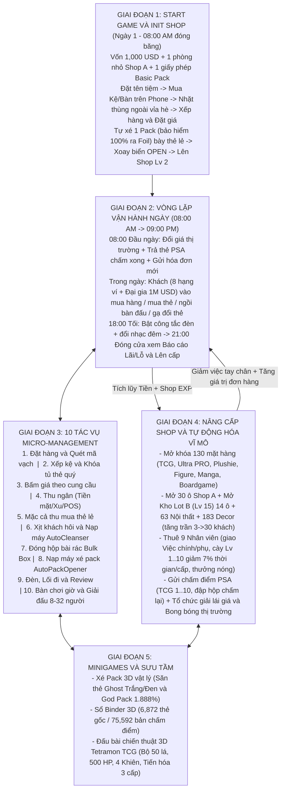

# Bóc Tách Chuyên Sâu Toàn Bộ Feature & Flow Của `TCG Card Shop Simulator` (`TCSS`)

- **Ngày lập:** `2026-11-11`
- **Hội thoại tổng hợp:** Antigravity `fce76ec3-c432-4a45-a1b1-d6737afe00d5`
- **Phạm vi:** Đi sâu độc lập riêng **`TCG Card Shop Simulator` (`OPNeonGames`, Unity `6000.0.66f2`)** từ `Start Game / Init Shop -> Vận hành ngày & AI khách -> 10 nhóm Micro-management -> Nâng cấp/Nhân sự/Đầu cơ -> Minigame Xé Pack & Đấu bài 50 lá -> Bảng Checklist 26 hạng mục (TCSS-01..26)` để người dùng duyệt giữ/rút gọn/bỏ trước khi sang game thứ 2 (`ICS2`).

> [!NOTE]
> Mọi con số, công thức, tên màn hình và điều kiện mở khóa dưới đây đều được trích xuất trực tiếp từ mã CIL `Assembly-CSharp.dll` và dữ liệu gốc (`SO_MonsterData`, `StockItemData_Optimized`) của bản PC `Unity 6000.0.66f2`. *(Lưu ý kỹ thuật: trong DLL có một số enum rác từ game mobile clicker cũ của cùng studio như `Gem`, `TapBooster`, `Helicopter` không hề được gọi trong gameplay PC — đã được lọc sạch khỏi tài liệu này).*

---

## Tổng Quan Sơ Đồ Luồng Chơi Từ Đầu Đến Cuối (`End-to-End Flow`)

---

## GIAI ĐOẠN 1 — Start Game & Init Shop (`Ngày 1: Dựng Tiệm Từ Con Số 0`)

Khi bấm **New Game**, trò chơi khởi tạo dữ liệu mặc định (`CPlayerData::CreateDefaultData`) và dẫn người chơi qua chuỗi **Onboarding 11 bước thực hành** (`TutorialManager` / `ETutorialTaskCondition`):

### 1.1. Trạng thái xuất phát điểm
- **Tiền vốn khởi đầu:** **`$1,000.00`** tiền mặt (hỗ trợ đổi đơn vị hiển thị sang `USD`, `EUR`, `JPY`, `GBP`, `CNY`, `CAD`, `AUD`, `MYR` trong Cài đặt).
- **Cấp độ & Đồng hồ:** `Shop Level 1` (`0 EXP`), `Day 1`, đồng hồ khóa cứng ở **`08:00 AM`** (thời gian chưa trôi để người chơi thong thả bày tiệm lần đầu).
- **Mặt bằng ban đầu:** Chỉ mở duy nhất `1` phòng nhỏ mặt tiền của **Shop A** (`30` ô mở rộng xung quanh đang bị tường chặn; gian nhà bên cạnh **Lot B / Kho** đóng cửa khóa).
- **Đồ có sẵn trong tiệm:** `1` Quầy thu ngân cơ bản (`CashCounter`), `1` Thùng rác (`TrashBin`) ngoài cửa, `1` Biển lật `OPEN / CLOSED` treo ngay cửa kính, và duy nhất **`1` Giấy phép nhập hàng (`Basic Card Pack`)** đã mở sẵn.

### 1.2. Đi từng bước khởi tạo tiệm (`Init Shop Step-by-Step`)
1. **Bước 1 — Đặt tên cửa hàng:** Đi ra mặt tiền tiệm, nhìn lên bảng hiệu lớn (`InteractableShopBillboard`), bấm tương tác để gõ tên Shop của mình.
2. **Bước 2 — Mở Điện thoại mua Kệ & Bàn đầu tiên:** Bấm `[Tab]` mở **Smartphone (`PhoneManager`)** -> vào app **`Furniture Shop`** đặt mua:
   - `1` Kệ bán hàng (`Shelf`),
   - `1` Bàn trưng bày thẻ lẻ (`CardTable`),
   - `1` Bàn đấu bài cho khách ngồi (`PlayTable`).
3. **Bước 3 — Nhập lô hàng sỉ đầu tiên:** Mở app **`Restock (TCG)`** trên điện thoại -> bỏ các thùng `Basic Card Pack` vào giỏ hàng -> thanh toán tiền hàng + **Phí giao hàng (`Delivery Fee`)**.
4. **Bước 4 — Chạy ra vỉa hè bê thùng & Dựng nội thất:**
   - Ngay khi thanh toán, các thùng carton vật lý (`PackageBox_Shelf` và `PackageBox_Item`) rơi xuống vỉa hè trước cửa tiệm.
   - Chạy ra nhặt thùng nội thất (`PickupBox`), mở hộp cầm mẫu kệ xanh lá đi vào tiệm, xoay góc và bấm đặt xuống sàn (`PlaceMoveObject`).
5. **Bước 5 — Bóc thùng hàng, Xếp lên kệ & Vứt vỏ thùng:**
   - Nhặt thùng carton chứa pack bài, bấm mở nắp thùng (`OpenBox`), chỉ tâm ngắm vào ngăn kệ trống và giữ chuột trái để từng gói bài bay đều lên kệ (`PutItemOnShelf` — nhãn sản phẩm tự động gắn vào ngăn kệ đó).
   - Cầm vỏ thùng carton rỗng đem ra ném vào **`TrashBin`** để tiêu hủy.
6. **Bước 6 — Bấm nhãn giá bán lẻ đầu tiên:**
   - Bấm vào bảng giá nhỏ gắn trên mép ngăn kệ (`InteractablePriceTag`) mở màn hình **`SetItemPriceScreen`**.
   - Màn hình hiện rõ **`Cost Price`** (giá vốn nhập sỉ), **`Market Price`** (giá thị trường hôm nay) và **`Profit`** (lãi ròng). Người chơi chỉnh giá (thường bấm nút **`+10%`** rồi **`Round`** làm tròn số) để tối ưu tốc độ bán lẫn lợi nhuận.
7. **Bước 7 — Tự tay Xé Pack đầu tiên & Bày thẻ lẻ lên tủ kính:**
   - Rút vài gói bài từ kệ cầm trên tay -> bấm chuột mở gói (**cơ chế bảo hiểm tân thủ:** ở gói bài đầu tiên trong đời, nếu 6 lá đầu trượt hiệu ứng lấp lánh thì lá thứ 7 được code ép cứng **`100%` nổ `Foil`**!).
   - Bấm `[R]` mở **Sổ sưu tầm (`Card Binder`)**, rút lá bài giá trị cao nhất vừa trúng ra cầm trên tay -> đặt lên ô trưng bày của **`CardTable`** (`PutCardOnShelf`) và gắn giá bán lẻ cho lá bài đó.
8. **Bước 8 — Thiết lập Bàn Đấu Bài tính giờ:**
   - Đặt chiếc **`PlayTable`** xuống sàn, mở app **`Manage Event`** kiểm tra mức phí thuê giờ (mặc định thể thức `Standard`) để khách có chỗ ngồi đấu bài trả tiền giờ.
9. **Bước 9 — Lật biển `CLOSED -> OPEN` khai trương tiệm:**
   - Đi tới cửa kính chính, bấm vào tấm biển treo (`InteractableOpenCloseSign`) lật sang **`OPEN`**.
   - Ngay lập tức đồng hồ `08:00 AM` bắt đầu chạy, khách bộ hành ngoài phố rẽ vào cửa tiệm!
10. **Bước 10 — Đứng quầy thanh toán đơn hàng đầu tiên & Lên Cấp 2:**
    - Đứng vào sau **`CashCounter`** (`StartCounter`), bấm quét từng món hàng khách đặt lên bàn, nhận tiền mặt thối lại tiền lẻ (hoặc bấm số máy POS quẹt thẻ).
    - Bán đủ gói bài, thẻ lẻ và thu tiền bàn chơi đầu tiên sẽ giúp tiệm cán mốc **`Shop Level 2`** — cột mốc ngầm cực quan trọng trong code vì từ `Shop Level >= 2` mới **chính thức mở khóa tỷ lệ nổ thẻ `Ghost` siêu hiếm và `God Pack`**!

---

## GIAI ĐOẠN 2 — Vòng Lặp Vận Hành Hàng Ngày (`08:00 AM – 09:00 PM`) & AI Khách Hàng

### 2.1. Ba mốc thời gian của một ngày
1. **Đầu ngày mới (`08:00 AM` — `OnDayStarted`):**
   - `PriceChangeManager` tính toán lại biến động giá thị trường mới cho toàn bộ thẻ bài & hàng hóa (dựa trên thể thức giải đấu tiệm đang chạy hôm trước) và kiểm tra xem có mặt hàng nào bị **nổ bong bóng sập giá (`Price Crash`)** không.
   - `RestockManager` kiểm tra các lô thẻ đã gửi đi chấm điểm PSA: đơn nào hết hạn ngày chờ sẽ thả **hộp bưu phẩm thẻ chấm điểm (`PackageBoxCard`)** ngay trước cửa tiệm.
   - `RentBillScreen` cộng dồn hóa đơn **Tiền thuê mặt bằng + Tiền điện + Lương nhân viên** của ngày trước vào mục hóa đơn chờ thanh toán.
   - Nhân viên đã thuê đi bộ từ ngoài phố vào tiệm nhận ca.
2. **Trong giờ mở cửa (`08:00 AM -> 09:00 PM`):**
   - Bầu trời bên ngoài cửa kính chuyển dần qua 4 pha ánh sáng (`Morning -> Afternoon -> Evening -> Night`).
   - Đúng **`06:00 PM (18:00)`**, trời sập tối và nhạc nền tự chuyển từ `BGM_ShopDay` sang bản nhạc chill buổi tối `BGM_ShopNight` — người chơi phải nhớ bật **Công tắc đèn tường (`InteractableLightSwitch`)** để tiệm sáng trưng.
3. **Đóng cửa kết ngày (`09:00 PM` — `Day End`):**
   - Tới `09:00 PM`, đồng hồ dừng lại ở chữ `"Day End"`: khách mới ngừng vào tiệm, nhưng **khách đang ở sẵn bên trong vẫn tiếp tục mua nốt hàng, đánh nốt ván bài và xếp hàng thanh toán cho bằng hết** (nhân viên không chịu tăng ca sẽ bỏ về đúng `21:00`; nhân viên có cờ `Overtime` sẽ ở lại phụ dọn khách cuối cùng).
   - Khi tiệm vắng bóng khách (hoặc người chơi tới cửa bấm qua ngày), màn hình **`EndOfDayReportScreen`** hiện ra tổng kết: Số khách ghé thăm, Doanh thu bán hàng / bán thẻ / bàn chơi, Tiền vốn nhập hàng / Tiền hóa đơn, Lãi ròng (`Total Profit`), Tổng EXP cộng thêm, rồi tự động **Auto-Save** sang ngày kế tiếp.

### 2.2. Luồng AI `31` trạng thái & `8` hạng ví tiền của Khách hàng (`CustomerManager`)
Mỗi vị khách bước qua cửa đều được roll ngẫu nhiên **Hạng khách (`ECustomerType`: `Peasant`, `AverageJoe`, `Shark`, `Whale`, `Collector`, `SuperCollector`, `UltimateCollector`, `LegendCollector`)** quyết định độ chịu chi và số món muốn mua:
- **Ngân sách trong ví khách (`GetCustomerMaxMoney`):**
  - `95.0%` khách mang ví tiêu chuẩn (tăng dần theo cấp độ Shop và số phòng đã mở).
  - `4.7%` khách mang gấp **`2×`** ngân sách; `0.3%` khách mang gấp **`4×`** ngân sách.
  - **Cú nổ Đại Gia Săn Thẻ Hiếm (`Ultra-Whale`):** Có **`0.2% – 2.0%`** xác suất vị khách bước vào là siêu đại gia với túi tiền cộng thêm **`+$50,000` tới `+$1,000,000`** — đây là nhóm khách duy nhất đủ tiền mua đứt những lá bài `Ghost Foil TCG 10` giá hàng chục ngàn đô trưng trên tủ kính của bạn!
- **Hành trình khách đi trong tiệm:**
  - Bước vào cửa (`EnteringShop`) -> đi dạo tới **Kệ hàng** (`WalkToShelf`), **Bàn thẻ lẻ** (`WalkToCardShelf`), **Thùng bài từ thiện** (`WalkToBulkDonationBox`), hoặc đứng ngắm **Tượng/Đồ trang trí** (`WalkToDeco`).
  - Sau khi nhặt hàng (hoặc tay trắng nếu kệ rỗng / giá cắt cổ), khách có thể rẽ sang:
    - **Ngồi bàn chơi bài (`WalkToPlayTable` -> `PlayingAtTable`)** khi tìm đủ cặp 2 người (hoặc đánh giải đấu nhánh 8–32 người),
    - **Ra quầy gạ bán/đổi thẻ lẻ (`WaitingToTradeCard`)**,
    - **Xếp hàng thanh toán (`QueuingToPay` -> `ReadyToPay`)** rồi rời tiệm (`ExitingShop`) và để lại đánh giá sao (`CustomerReview`).

---

## GIAI ĐOẠN 3 — Bóc Tách Chi Tiết `10` Nhóm Micro-Management (Thao Tác Tay Hàng Ngày)

### 3.1. Nhập hàng, Bóc hộp lẻ, Xếp Kệ Kho & Máy Quét Mã Vạch
- **2 App đặt hàng trên Phone:** Tách riêng app **`Restock TCG & Accessories`** (pack, thùng box, hộp bài, xịt thơm, bọc bài, thảm đấu, đồ Ultra PRO) và app **`Boardgame / Plushie / Manga`** (gấu bông, tượng figure, truyện tranh, cờ bàn). Mỗi đơn tính thêm **Phí vận chuyển (`Delivery Fee`)** theo quy mô thùng.
- **Mở khóa Máy Quét Mã Vạch Cầm Tay (`ScannerRestockScreen` — giá mở khóa `$12,000`):**
  - Khi tiệm đã có hàng chục chiếc kệ, thay vì phải nhớ món nào hết hàng để mò trong menu điện thoại, người chơi mở tính năng **Barcode Scanner**, rút máy quét tia đỏ chỉ thẳng vào **tem giá trên kệ bán** hoặc **nhãn kệ kho**: bấm chuột trái để cộng thẳng `+1` thùng món đó vào giỏ hàng, chuột phải trừ bớt, rồi bấm thanh toán ngay trên màn hình máy quét!
- **Tương tác Thùng hàng & Chuyển đổi `Box -> Pack`:**
  - Thùng hàng chia 2 cỡ vật lý **`Small Box`** và **`Big Box`** (không cho trộn khác cỡ vào chung 1 ô kệ kho).
  - Mẹo vi mô rất hay của TCSS: Bạn có thể bán nguyên hộp **Booster Box (`32` hoặc `64` gói)** trên kệ để lấy cục tiền to, **HOẶC** cầm hộp Booster Box trên tay bấm nút xé vỏ hộp (`CardBoxToCardPack`) để bung nó ra thành các gói `Booster Pack` lẻ đem xếp kệ hoặc tự xé!
- **Kệ Kho (`WarehouseShelf`), Hộp Lưu Trữ Thùng Rỗng (`EmptyBoxStorage`) & Thùng Rác (`TrashBin`):**
  - **Kệ Kho (`WarehouseShelf` / `A` / `B` / `C`):** Chỉ cho phép nhét nguyên thùng carton lên cất dự trữ kèm bảng nhãn icon món hàng (khách không lấy hàng từ kệ kho, chỉ nhân viên và chủ tiệm lấy).
  - **Giá cất thùng rỗng (`EmptyBoxStorage`):** Ép dẹp và xếp chồng các vỏ thùng carton rỗng để tái sử dụng khi bạn muốn đóng gói cất bớt kệ cũ hoặc dời hàng trên kệ.

### 3.2. Xếp Bài Lẻ, Sổ Sưu Tập (`Binder`), Tủ Trữ Bài `10,000` Lá & Kệ Khoe Cá Nhân
- **Sổ Binder cầm tay (`CollectionBinderUI` — phím `[R]`):** Xem toàn bộ thẻ đang sở hữu theo từng bộ mở rộng (`7` bộ) hoặc chuyển sang **Sổ Thẻ Đã Chấm Điểm (`Graded Album`)**. Cho phép lọc/sắp xếp theo **`7` tiêu chí** (`Số thứ tự chuẩn`, `Số lượng đang có`, `Giá lẻ`, `Hệ nguyên tố`, `Độ hiếm`, `Tổng giá trị bài trùng`, `Tổng tài sản`).
- **Bàn & Tủ Kính Bán Thẻ Lẻ (`CardTable`, `VintageCardTable`, `CardDisplayWall`, `CardDisplayElectronic`):** Đặt từng lá bài lẻ lên mặt nhung/tủ kính có đèn LED để bán cho khách sưu tầm và đại gia.
- **Tủ Lưu Trữ Thẻ Nội Bộ (`CardStorageShelf` — sức chứa tới `10,000` lá):**
  - Dùng làm kho đệm chứa thẻ lẻ để nhân viên tự động rút ra đem bày lên bàn kính khi bàn bán vơi.
  - **Công tắc an toàn `CanWorkerTake` (`SetCardStorageShelfSettingScreen`):** Có nút tích bật/tắt quyền nhân viên lấy bài (khi tắt sẽ hiện biển cảnh báo `"Not For Sale"` trên tủ) để bạn cất riêng thẻ quý chờ mang đi chấm PSA hoặc để dành đánh giải mà không sợ nhân viên lôi ra bán mất!
- **Kệ Trưng Bày Cá Nhân (`PersonalShelf A/B/C`):** Tủ kính chuyên để trưng bày thẻ hiếm, thẻ chấm điểm `TCG 10` hoặc tượng quý cho đẹp tiệm — khách chỉ đứng trầm trồ chứ hệ thống khóa cứng không bán.

### 3.3. Định Giá Vi Mô (`Set Price`) & Đường Cong Tâm Lý Khách Hàng
Mỗi khi khách đứng trước kệ hàng hoặc bàn thẻ lẻ, code chạy hàm `CustomerManager::GetCustomerBuyItemChance` tính độ chênh lệch `%` giữa **Giá bạn đặt (`setPrice`)** và **Giá thị trường hôm đó (`marketPrice`)**:

| Mức chênh so với Giá Thị Trường (`Market Price`) | Xác suất khách chốt mua | Phản ứng / Hệ quả phụ |
| :---: | :---: | :--- |
| **`<= -20%`** (Khuyến mãi sâu) | **`100%`** | Mua ngay lập tức nếu đủ tiền trong ví |
| **`-10%`** | **`95%`** | Rất hài lòng |
| **`0%` (Đúng giá thị trường)** | **`90%`** | Chuẩn cân bằng |
| **`+10%`** | **`75%`** | Điểm ngọt tối ưu doanh thu của đa số người chơi |
| **`+20%`** | **`60%`** | Bắt đầu kén khách |
| **`+30%`** | **`45%`** | Hơn nửa số khách lắc đầu bỏ đi |
| **`+40%`** -> **`+50%`** -> **`+60%`** | **`15%`** -> **`5%`** -> **`1%`** | Rất khó bán, dễ bị chê đắt |
| **`> +60%`** (Chặt chém) | **`0%` (Không ai mua!)** | Bị khách mắng tại chỗ và phang **Review 1 sao (`-40` điểm `ItemPrice`)**! |

*(Ghi chú tinh tế trong code: Với các gói pack rẻ tiền có giá thị trường `< $2.00`, nếu bạn làm tròn từ `$1.60` lên `$2.00` tức lệch `+25%`, game tự động chia mềm hệ số phạt đi tới `10` lần để người chơi làm tròn chẵn đô la mà không bị khách chửi!)*

### 3.4. Đứng Quầy Thu Ngân (`Cashier Counter`: Quét Hàng, Đếm Tiền Lẻ & Bấm Máy POS)
- **Cấu hình tách chuyên môn cho từng quầy (`SetCashierCounterSettingScreen`):** Khi tiệm đông khách và có từ 2 quầy trở lên, bạn có thể bấm cài đặt từng quầy để bật/tắt riêng **`CanCheckout` (Quầy chỉ tính tiền)** và **`CanTradeCard` (Quầy chỉ tiếp khách đổi/bán thẻ lẻ — hiện biển `"No Checkout"` hoặc `"No Trading"` tương ứng)**.
- **Bước 1 — Quét mã từng món:** Bấm chuột (hoặc giữ chuột trái quét liên thanh) lên từng gói bài/hộp hàng khách bày trên mặt quầy để bỏ vào túi nilon (`ScanItemPlasticBag`).
- **Bước 2A — Khách đưa Tiền Mặt (`UI_CashCounterScreen`):**
  - Ngăn kéo két tiền bật mở gồm khay **Tiền giấy** và khay **Tiền xu lẻ**.
  - Chuột trái nhặt thêm tờ tiền/đồng xu trả khách, chuột phải cất bớt lại vào hộc. Màn hình hiện rõ số tiền khách đưa, tổng hóa đơn và số tiền cần thối (`Change to Give`).
  - **2 luật bắt lỗi thối tiền:**
    1. Nếu thối thiếu tiền -> không bấm chốt `[Space]` được; nếu thối dư **quá `+$2.00`** -> game cũng **khóa nút chốt** kèm cảnh báo `TooMuchCounterChangeAmount` để cứu chủ tiệm khỏi mất tiền oan!
    2. Nếu bạn lười nhặt tiền chẵn mà cố tình xả cả nắm xu `1 cent` (`Pennies`) trả cho khách -> khách vẫn cầm nhưng ra về sẽ viết **Review chê bai `GiveManyChangePennies`**!
- **Bước 2B — Khách đưa Thẻ Tín Dụng (`UI_CreditCardScreen`):**
  - Khách chìa thẻ nhựa ra -> máy quẹt thẻ POS đưa lên trước mặt -> người chơi gõ con số tổng tiền trên bàn phím số (hoặc Numpad máy tính, yêu cầu khớp chính xác tới `±$0.01`) rồi bấm `Enter` quẹt thẻ.

### 3.5. Tiếp Khách Gạ Bán & Đổi Thẻ Lẻ Tại Quầy (`CustomerTradeCardScreen`)
- Thỉnh thoảng có khách đặc biệt không mua hàng mà đi thẳng tới vị trí bên hông quầy thu ngân rút ra `1` lá bài lẻ từ nhà mang tới (`WaitingToTradeCard`):
  - **`60%` trường hợp — Khách gạ BÁN lấy tiền mặt:** Khách đưa ra mức giá mong muốn (`Ask Price`). Bạn có nút bấm mở ngay **Biểu đồ giá lịch sử (`ItemPriceGraphScreen`)** để kiểm tra xem thẻ này thật sự đáng giá bao nhiêu và đang lên hay xuống giá, sau đó chốt mua ngay hoặc **gõ lại con số thấp hơn để Mặc cả (`Haggle`)**!
  - **`40%` trường hợp — Khách gạ ĐỔI NGANG lấy 1 lá bài khác trong Album của bạn:** Màn hình chia đôi Trái – Phải so sánh giá thị trường và số lượng bạn đang có trong sổ của cả 2 lá bài để bạn cân nhắc lời/lỗ.
- Nếu trả giá ép quá sâu nhiều lần vượt ngưỡng chịu đựng (`m_MaxDeclineCount`), khách sẽ nổi cáu cầm thẻ bỏ về; bạn cũng có nút `"Let Me Think"` để tạm thoát ra kiểm tra kho rồi quay lại chốt kèo.

### 3.6. Xử Lý Khách "Bốc Mùi" & Lắp Bình Khử Mùi Tự Động (`Smelly Customers` & `AutoCleanser`)
- **Cơ chế phát sinh:** Từ `2%` đến `17%` lượng khách bước vào tiệm (tăng thêm `+3%` buổi chiều, `+5%` buổi tối; trần tối đa cùng lúc `= ShopLevel / 5 + 1`) mang đám mây khói hôi màu xanh lá quanh người với chỉ số mùi **`m_SmellyMeter = 10`**. Đặc biệt trong code: khách bốc mùi bị khóa không bao giờ tự mua chai lăn/xịt khử mùi bày trên kệ!
- **Thảm họa dây chuyền nếu bỏ mặc:** Cứ vài giây, mọi vị khách sạch đứng trong **bán kính `3.0m`** quanh khách hôi sẽ quét kiểm tra mùi và dính xác suất **`15% × số khách hôi đứng gần`**: trúng đòn là khách sạch nhăn mặt than *"Ugh, the stench..."*, **vứt bỏ ý định mua sắm chạy thẳng ra khỏi cửa tiệm** và giáng ngay một quả Review `-30` điểm (`SmellyCustomer`)!
- **2 cách khắc chế:**
  1. **Cầm bình xịt tay (`Deodorant` — mặt hàng số `23`):** Rút `1` chai xịt thơm từ thùng/kệ cầm trên tay (`HoldSprayState`), chạy lại gần khách hôi tầm `2.5m` bấm xịt **`2` nhát** (`mỗi nhát trừ 5 điểm mùi`, `1` chai xịt được tổng cộng **`20` nhát**).
  2. **Lắp Máy Xịt Khử Mùi Tự Động (`AutoCleanser 1 / 2 / 3`):**
     - Mua máy gắn cạnh lối cửa ra vào hoặc hành lang hẹp, bật nguồn (`TurnOn`) và nạp sẵn các chai `Deodorant` vào ổ chứa của máy (`AutoCleanser 1 -> 2 -> 3` nâng cấp dần số lượng bình dự trữ bên trong).
     - Máy hoạt động như cảm biến chuyển động (tầm quét `2.5m`, hồi chiêu `3.0s` mỗi nhát xịt): hễ khách hôi đi ngang cửa là tự xịt sạch mùi trước khi kịp bước sâu vào quầy kệ! Khi cạn bình máy sẽ báo `Need Refill` (bản Deluxe của game còn có thêm cỗ máy tối thượng **`DeluxeInfiniteScentMachine`** xịt thơm vĩnh viễn không tốn bình).

### 3.7. Đóng Hộp Bài Rác (`Workbench`) & Thùng Quyên Góp Từ Thiện (`BulkDonationBox`)
1. **Bàn Đóng Gói Bài Lẻ (`InteractableWorkbench`):**
   - Tương tác bàn mở **`WorkbenchUIScreen`**, thiết lập bộ lọc thông minh: chọn Bộ bài (`Tetramon` / `Destiny`), chọn Giới hạn độ hiếm (`Any Rarity` / `Common only`...), kéo thanh trượt **Số bản sao giữ lại an toàn** (mặc định chỉ gom những lá bạn đang dư **`> 4` bản** để không mất bài làm bộ sưu tập/đấu giải), và kéo khoảng giá thẻ cho phép gom (**`$0.01` đến `$20.00`**).
   - Bấm nút -> nhân vật chạy hoạt ảnh gom đúng **`100` lá bài lẻ** đóng thành `1` hộp **Bulk Box** trong `5` giây! Tuỳ tổng giá trị 100 lá bên trong, hộp tự động mang nhãn hạng **`Base` (`<= $100`)**, **`HG` (`<= $200`)**, **`MG` (`<= $400`)**, **`PG` (`<= $1,200`)**, hoặc **`UG` (`> $1,200`)** — đem đặt thẳng lên kệ bán lẻ thu tiền chẵn cực gọn!
   - *(Bàn `Workbench` cũng kiêm luôn nơi mở sách hướng dẫn luật chơi `Rulebook` và chỉnh sửa bộ bài thi đấu `Deck Builder`).*
2. **Thùng Bài Từ Thiện (`BulkDonationBox`):**
   - Đổ nhanh hàng trăm lá bài rẻ tiền vào thùng gỗ miễn phí đặt trong tiệm (`QuickFill`). Khách nghèo hoặc trẻ em ghé tiệm sẽ lại bốc miễn phí (`TakingItemFromBulkDonationBox`) và để lại **Review 5 sao khen chủ tiệm hào phóng (`BulkDonation`)** giúp kéo điểm uy tín toàn shop lên nhanh!

### 3.8. Máy Xé Pack Tự Động (`AutoPackOpener 1 / 2 / 3`)
- Khi về sau bạn muốn khui hàng chục thùng Booster Box một lúc để săn thẻ `Ghost` mang đi chấm PSA mà mỏi tay không muốn kéo chuột xé từng gói một: mua máy **`AutoPackOpener`** (3 cấp đời máy `1 -> 2 -> 3` chứa nhiều pack hơn và rút ngắn thời gian xử lý mỗi gói), nhét đầy các gói pack vào phễu, bấm chạy -> máy tự động cắt vỏ và dồn toàn bộ thẻ mở được (giữ nguyên 100% tỷ lệ rớt Ghost/God Pack) vào khay chờ bạn bấm `Collect` thu một lần!

### 3.9. Công Tắc Đèn, Sắp Xếp Lối Đi & `14` Tiêu Chí Khách Đánh Giá Sao (`CustomerReviewScreen`)
Điểm xếp hạng `1.0 -> 5.0 Sao` của cửa hàng được tổng hợp minh bạch từ **`14` nguyên nhân thực tế (`ECustomerReviewType`)**:
1. `ItemVariety` — Độ đa dạng mặt hàng trên kệ.
2. `ItemPrice` — Giá hàng hóa bán lẻ đắt hay hợp lý.
3. `CardPrice` — Giá thẻ bài lẻ trên tủ kính đắt hay rẻ.
4. `CardRarity` — Tiệm có trưng thẻ hiếm/đắt tiền cho khách ngắm và mua không.
5. `PlaytablePrice` — Phí thuê giờ bàn đấu bài có hợp lý không.
6. `SmellyCustomer` — Bị khách hôi đứng gần ám mùi.
7. `BlockedStore` — Chủ tiệm kê kệ hàng bít kín lối đi (`NavMesh` bị nghẽn).
8. `OwnerOpenPack` — Chủ tiệm đứng xé pack bài ngay trước mặt lúc khách đang chờ hoặc xé hết pack trên kệ.
9. `GiveManyChangePennies` — Thối tiền thừa toàn đồng xu lẻ `1 cent`.
10. `BulkDonation` — Điểm cộng nhờ có thùng tặng bài miễn phí.
11. `LightTurnedOff` — Trời tối (`>= 18:00`) mà không bật công tắc đèn.
12. `TournamentProblem` & `13. TournamentReviewBomb` — Hủy giải đấu hoặc treo giải thưởng dỏm/thiếu số lượng.
13. `StoreGeneric` — Nhận xét chung theo trải nghiệm mua sắm.

### 3.10. Hai Tầng Tổ Chức Sự Kiện Bàn Chơi & Giải Đấu Chính Thức (`Events & Tournaments`)
1. **Tầng 1 — Sự Kiện Bàn Chơi Hàng Ngày (`Manage Event` / `SetGameEventScreen`):**
   - Áp dụng chung cho mọi chiếc `PlayTable` thường trong tiệm. Bạn chọn **Phí ngồi chơi theo giờ (`$/hr`)** và chọn **`1` trong `12` Thể thức sự kiện (`EGameEventFormat`)**: `Standard`, `Pauper`, `Fire Cup`, `Earth Cup`, `Water Cup`, `Wind Cup`, `1st Edition Vintage`, `Silver Border`, `Gold Border`, `EX Border`, `FullArt Border`, `Foil Cup`.
   - **Đòn bẩy thao túng giá thị trường:** Mỗi thể thức (trừ Standard) thu một khoản phí vận hành mỗi ngày (`$/day`), đổi lại sẽ **đẩy xu hướng tăng giá thị trường `(+)` cho đúng nhóm thẻ của giải đó** vào các ngày kế tiếp.
2. **Tầng 2 — Giải Đấu Nhánh Đấu Loại Chính Thức (`Host Tournament` / `HostTournamentScreen`):**
   - **Điều kiện chuẩn bị:** Mua kệ trưng cúp/quà **`TournamentPrizeShelf`** đặt trong tiệm + dùng màn hình **`SetPlayerTableNumberScreen`** đánh số thứ tự bàn thi đấu (`Table 1, 2, 3, 4...`) cho các bàn `PlayTable`.
   - **Thiết lập giải:** Chọn quy mô nhánh đấu (**`8`, `16` hoặc tối đa `32` tuyển thủ**), chọn các vật phẩm/lá bài đắt giá từ kho đặt lên kệ giải thưởng (`HostTournamentSelectPrizeScreen`). Hệ thống tự động gợi ý mức **Lệ phí đăng ký (`Entry Fee`)** hoặc bạn tự đặt.
   - **Diễn biến trong ngày:** Khách thi đấu ghi danh -> bảng điện tử **`TournamentPairingScreen`** chia cặp từng vòng (`Round 1, Round 2...`) -> tuyển thủ ngồi đúng số bàn đánh loại trực tiếp -> nhà vô địch bước tới kệ nhận phần thưởng và **đứng tạo dáng ăn mừng (`PosingAtTournamentPrizeShelf`)**! Chủ tiệm cũng có nút **`Sign Up Tournament`** để tự vác bộ bài của mình vào đánh giải!

---

## GIAI ĐOẠN 4 — Nâng Cấp Shop, Mở Rộng Quy Mô & Tự Động Hóa Vĩ Mô (`High-Level Progression`)

### 4.1. Cấp Độ Cửa Hàng (`Shop Level`) & Cây Giấy Phép `130` Mặt Hàng (`Licenses`)
- **Ngành hàng 1 — Thẻ bài TCG (`35` mã):** `8` dòng Pack & `8` dòng Booster Box của `Tetramon` & `Destiny` + `Ascension Card Pack` + pack phụ (`Megabot`, `FantasyRPG`, `CatJob`), `8` bộ `Precon Starter Deck`, `10` hộp `Bulk Box`.
- **Ngành hàng 2 — Phụ kiện & Thương Hiệu Thật `Ultra PRO` (`48` mã):** `Deodorant`, `4` `DeckBox`, `4` `D20 Dice`, `2` `BinderBook`, `6` `CardSleeve`, `18` `Playmat`, cùng **`12+` sản phẩm chính hãng `Ultra PRO`** (`UP_PennySleeves`, `UP_Toploader`, `UP_SemiRigidCardHolder`, `UP_MagneticHolder`, `UP_CardPreserver`, `UP_PlatinumSeriesPocketPages`, `UP_Album`, `UP_TowerDeckbox`, `UP_Playmat 1..4`).
- **Ngành hàng 3 — Thú Nhồi Bông & Tượng Mô Hình Tiến Hóa (`21` mã):** Đủ cấp tiến hóa `A -> B -> C -> D -> Evo` của `Piggy`, `Golem`, `Starfish`, `Bat`, `Beetle`, `Fox`, `ToonZ`.
- **Ngành hàng 4 — Cờ Bàn (`Boardgames`) & Truyện Tranh `Manga` (`20` mã):** `5` hộp Boardgame + `14` tập `Manga 1..14`.

### 4.2. Mở Rộng Mặt Bằng (`Shop A` + `Lot B`) & Biển Chuyển Đổi Công Năng Kho
- **Mở rộng `Shop A`:** Mở tuần tự **`30` ô diện tích** (từ `$300` lũy tiến).
- **Mở khóa `Lot B / Warehouse`:** Đạt **`Shop Level 15`** + **`$5,000`**, mở tiếp **`14` ô phòng** (`$1,000+` lũy tiến), kèm biển gạt **`InteractableWarehouseAllowEnterSign`** chuyển đổi linh hoạt giữa **Kho nội bộ kín** và **Sảnh đấu giải / trưng bày mở đón khách**.

### 4.3. Xây Dựng Nội Thất Tự Do (`63` Loại) & Trang Trí Tăng Giới Hạn Khách (`183` Món)
- **`63` mẫu Nội thất & Máy móc (`EObjectType`):** Có **Nam châm hút cạnh `0.30m`** giúp xếp kệ thẳng tắp; đóng thùng hoặc bán thanh lý thu về `50%` tiền gốc.
- **`183` món Trang trí (`ShopBuyDecoUIScreen` + `PlaceDecoUIScreen`):** Đổi Tường/Sàn/Trần riêng cho Shop A & Lot B; treo `72` Poster, `35` Tượng lớn, `13` Đèn Neon, `8` Cây cảnh, `55` Tranh cộng đồng — cộng trực tiếp vào công thức tăng giới hạn khách tối đa từ **`3` lên `30` khách cùng lúc**!

### 4.4. Thuê `9` Nhân Viên, Giao Việc Chính/Phụ & Cày Cấp Kỹ Năng RPG (`WorkerManager`)

| # | Tên Nhân Viên | Lv Mở Khóa | Phí Tuyển | Lương/Ngày | Tốc Độ Châm Kệ Gốc | Tốc Độ Thu Ngân Gốc | Tăng Ca Sau 21:00? |
| :-: | :--- | :-: | ---: | ---: | :---: | :---: | :---: |
| 1 | **Zackery Cole** | Lv 10 | `$500` | `$50` | `2.45s` (Chậm) | `2.85s` (Chậm) | Không |
| 2 | **Terence Fay** | Lv 15 | `$1,000` | `$150` | `2.55s` | `2.30s` | Có |
| 3 | **Dennis Brandon** | Lv 20 | `$2,000` | `$300` | `1.25s` (Nhanh) | `1.95s` | Có |
| 4 | **Clark Cash** | Lv 25 | `$2,400` | `$400` | `2.50s` | **`0.90s` (Siêu tốc quầy)** | Không |
| 5 | **Angus Mick** | Lv 30 | `$3,000` | `$400` | **`0.40s` (Siêu tốc kệ!)** | `2.55s` | Có |
| 6 | **Benji Otto** | Lv 35 | `$5,000` | `$500` | `1.20s` | `1.30s` | Không |
| 7 | **Alexander Cole** | Lv 38 | `$8,000` | `$400` | `1.23s` | `1.42s` (`+50%` chạy bộ) | Có |
| 8 | **Lauren Posie** | Lv 40 | `$7,500` | `$500` | `1.00s` | `1.40s` | Có |
| 9 | **Axel Charleton** | Lv 45 | `$10,000` | `$700` | **`0.50s` (Đỉnh)** | **`0.99s` (Đỉnh, `+50%` chạy)** | Có |

- Giao **Việc Chính + Việc Phụ** trong `7` lệnh (`Nghỉ`, `Thu ngân`, `Châm kệ hàng & kho`, `Châm bàn thẻ lẻ từ CardStorageShelf`, `Bấm giá theo % + làm tròn`, `Nạp bình AutoCleanser`, `Nạp pack AutoPackOpener` có bảng lọc loại pack được phép xé); cày cấp **`Lv 1 -> Lv 10`** mỗi đầu việc (`-7%` thời gian thao tác & `+3%` chạy bộ/cấp) + nút **Thưởng nóng `$1,000`**.

### 4.5. Dịch Vụ Chấm Điểm Thẻ Bài `TCG 1..10` (`Card Grading`) & Đập Hộp Chấm Lại
- Gửi tối đa `8` lá/đơn qua 4 gói (`Value $10/12d`, `Standard $40/7d`, `Express $200/4d`, `Premium $1,500/2d`); thẻ mới có **`38.40%` ra `TCG 10`**, hỗ trợ **Đập hộp chấm lại (`Crack & Re-grade`: `30%` tăng `+1`, `41%` giữ nguyên, `29%` tụt `-1`)**.

### 4.6. Hóa Đơn Định Kỳ & Hệ Điều Hành `16` Ứng Dụng Trên Điện Thoại
- **Hóa đơn (`Rent + Electric + Salary`):** Ân hạn `8` ngày, quá `13` ngày cưỡng chế trừ tiền.
- **`16` ứng dụng trên Smartphone của TCSS:** Nhập TCG, Nhập Boardgame/Manga, Mua Nội thất, Mở rộng phòng, Mua Decor, Sự kiện bàn chơi, Tổ chức Giải đấu, Thuê nhân viên, Chấm điểm thẻ, Tra biểu đồ giá, Xem Review, Đóng Hóa đơn, Máy quét mã vạch, Chụp ảnh, Thư viện ảnh, Cài đặt/Save.

---

## GIAI ĐOẠN 5 — Minigames & Hệ Thống Sưu Tầm / Đấu Bài Chiến Thuật

1. **Minigame 1 — Xé Pack Vật Lý 3D (`CardOpeningSequence`):** Kéo rách mép vỏ, tung `7` lá 3D, khựng sáng Holo khi thẻ `>= $10`, săn `Foil` (`5%`), `FullArt` (`0.25%`), `Ghost` Trắng/Đen (`0.1–0.2%`) và `God Pack` (`1.888%`).
2. **Sổ Sưu Tập `6,872` Thẻ Gốc (`75,592` bản chấm điểm) qua `7` bộ mở rộng.**
3. **Minigame 2 — Đấu Bài Chiến Thuật 3D `Tetramon TCG` (`PlayTableGame`):** Bộ bài chuẩn **`50` lá** (tối đa `4` bản sao/loài), `500 HP`, `5` lá mở màn + `Mulligan`, `4` lá `Guardian` úp, `4` Ô Nguyên Tố tiến hóa `Basic -> Stage 1 -> Stage 2`, `120` chiêu thức & `20` hiệu ứng trạng thái; thắng/đấu giao hữu nhận `1–4` gói pack miễn phí trên bàn.

---
---

## BẢNG CHECKLIST `26` HẠNG MỤC CỦA `TCSS` ĐỂ CHỐT `GIỮ / RÚT GỌN / BỎ`

### Nhóm 1 — Sưu tầm, Thẻ bài & Thị trường (Trái tim của game)
| Mã | Tính năng | Gợi ý tích hợp vào GTA | Ghi chú để cân nhắc |
| :-: | :--- | :---: | :--- |
| **`TCSS-01`** | **Kho `6,872` Thẻ bài (`7` bộ: Tetramon, Destiny, Ascension, Ghost, Megabot, FantasyRPG, CatJob)** | **GIỮ 100%** | Giữ trọn vẹn độ sướng sưu tầm (cả 6 viền + Foil + Ghost Đen/Trắng). |
| **`TCSS-02`** | **Minigame Xé Pack tương tác (kéo rách vỏ, khựng sáng Holo `>= $10`, tỷ lệ `God Pack 1.888%`)** | **GIỮ 100%** | Xé được ở mọi nơi trong GTA (mua ở tiệm NPC xé ngay trên phố hoặc xé tại tiệm mình). |
| **`TCSS-03`** | **Sổ Sưu Tập `Binder` (`7` kiểu lọc/sắp xếp + trang Thẻ Chấm Điểm riêng)** | **GIỮ 100%** | Mở nhanh bằng phím tắt hoặc qua `EaglePhone` để khoe/xem tổng tài sản thẻ. |
| **`TCSS-04`** | **Dịch vụ Chấm Điểm Thẻ `TCG 1..10` (`4` gói chờ 2–12 ngày + Đập hộp chấm lại `Crack & Re-grade`)** | **GIỮ 100%** | Tạo động lực săn thẻ điểm `10` cực cuốn ở giai đoạn giữa và cuối game. |
| **`TCSS-05`** | **Khách Đại Gia `Ultra-Whale` (`0.2–2%` khách mang ví `+$50k..$1M`)** | **GIỮ 100%** | Trong GTA có thể dùng skin NPC sang trọng / nhân vật VIP bước vào tiệm săn thẻ `TCG 10`! |
| **`TCSS-06`** | **Biến động Giá Thị Trường hàng ngày + Biểu đồ giá + Nổ bong bóng `Price Crash (±25%)`** | **GIỮ & ĐẤU NỐI** | Hiển thị biểu đồ nến/đường mượt ngay trên app kinh doanh của `EaglePhone`. |

### Nhóm 2 — Mặt bằng, Hàng hóa & Xây dựng cửa hàng
| Mã | Tính năng | Gợi ý tích hợp vào GTA | Ghi chú để cân nhắc |
| :-: | :--- | :---: | :--- |
| **`TCSS-07`** | **Cây Giấy phép `130` Mặt hàng (`Pack, Box, Deck, Ultra PRO, Plushie, Figure, Manga, Boardgame`)** | **GIỮ 100%** | Cực hợp không khí Akihabara `WIBU-01` & khu phố Nhật; thú bông/manga còn dùng làm **quà tặng bạn gái `WaifuLink`**! |
| **`TCSS-08`** | **Đặt Nội thất 3D tự do (`63` kệ/bàn/tủ) + Nam châm hút khít cạnh `0.30m` + Đóng thùng bán lại `50%`** | **GIỮ 100%** | Hút cạnh `0.30m` giúp đặt kệ trong nội thất GTA cực dễ và thẳng hàng. |
| **`TCSS-09`** | **Mở rộng diện tích phòng (`Shop A` + khu Kho/Sảnh phụ `Lot B` có biển gạt cho/cấm khách vào)** | **RÚT GỌN GỌN GÀNG** | Thay vì `30 + 14 = 44` lần đập tường lắt nhắt, có thể gộp thành **`4–6` mốc nâng cấp mở rộng mặt bằng lớn** + `1` khu Kho/Sảnh giải đấu `Lot B` có biển gạt. |
| **`TCSS-10`** | **`183` Đồ Trang Trí (`Poster, Tượng, Neon, Cây`) & Đổi Tường/Sàn tăng trần khách (`3 -> 30`)** | **GIỮ (CHỌN LỌC)** | Tuyển bộ Poster/Neon/Tượng đẹp nhất, giữ nguyên công thức trang trí tăng lượng khách tối đa (trần NPC đồng thời trong nội thất GTA tầm `12–20` người để mượt FPS). |
| **`TCSS-11`** | **Kệ Trưng Bày Cá Nhân Không Bán (`PersonalShelf`)** | **GIỮ 100%** | Có thể cho đặt cả ở **Tiệm** lẫn trong **Nhà riêng / Safehouse của Aether**! |

### Nhóm 3 — Các thao tác Micro-Management hàng ngày
| Mã | Tính năng | Gợi ý tích hợp vào GTA | Ghi chú để cân nhắc |
| :-: | :--- | :---: | :--- |
| **`TCSS-12`** | **Nhập hàng thả thùng ngoài vỉa hè -> Bê thùng xếp kệ / kệ kho + Xé hộp `Box` ra `Pack` lẻ** | **GIỮ 100%** | Xe tải giao hàng đỗ trước cửa tiệm trong GTA thả thùng carton rất chân thực; mệt thì thuê nhân viên bê! |
| **`TCSS-13`** | **Máy Quét Mã Vạch Cầm Tay (`Barcode Scanner` mở khóa `$12,000`)** | **TÙY CHỌN** | Tiện khi tiệm lớn, hoặc tích hợp nút **"Đặt bù nhanh các kệ đang vơi (`Auto-Fill Cart`)"** thẳng trên `EaglePhone` (không cần mở khóa tốn `$12k`). |
| **`TCSS-14`** | **Quản lý Vỏ thùng rỗng (`EmptyBoxStorage` xếp thùng cũ vs `TrashBin`)** | **RÚT GỌN** | Cho đóng gói kệ cũ bất cứ lúc nào mà **không bắt phải đi gom từng vỏ thùng carton rỗng** cất kho cho đỡ rối tay. |
| **`TCSS-15`** | **Tủ Trữ Thẻ `10,000` lá (`CardStorageShelf`) + Công tắc khóa nhân viên `CanWorkerTake`** | **GIỮ 100%** | Bắt buộc phải có để nhân viên tự châm bàn thẻ lẻ mà không bán nhầm thẻ quý của Aether. |
| **`TCSS-16`** | **Định giá từng kệ/lá bài + Đường cong tâm lý khách (`-20%` -> `+60%`)** | **GIỮ 100%** | Có nút chỉnh nhanh `+10% / +20% / Làm tròn` cực gọn, không gây phiền. |
| **`TCSS-17`** | **Đứng Quầy Thu Ngân: Quét món + Đếm tờ tiền/đồng xu thối tay + Nhập số máy POS** | **TÙY CHỌN (`2` CHẾ ĐỘ)** | **Đề xuất:** Vẫn có giao diện thối tiền/quẹt POS cho lúc đầu game trải nghiệm, nhưng kèm nút **`[Q] Thu ngân nhanh 1 chạm`** để không bị mỏi tay khi chưa kịp thuê thu ngân; giữ tính năng tách quầy `Checkout` / `Trade`. |
| **`TCSS-18`** | **Khách gạ Bán (`60%`) / Đổi Thẻ Lẻ (`40%`) tại quầy & Mặc cả giá (`Haggle`)** | **GIỮ 100%** | Rất vui và kịch tính khi khách bất ngờ mang thẻ hiếm tới tiệm gạ đổi! |
| **`TCSS-19`** | **Khách "Bốc Mùi" (`Smelly`) + Cầm bình xịt tay (`2` nhát) + Lắp máy xịt tự động `AutoCleanser`** | **GIỮ (DÙNG ĐỒ GTA)** | Aether rút bình xịt native của GTA xịt thẳng khách hôi lúc đầu, về sau gắn máy `AutoCleanser` cảm biến ở cửa (nạp bình `Deodorant`) là nhàn tênh! |
| **`TCSS-20`** | **Bàn đóng hộp bài rác `Workbench` (`100` lá trùng -> hộp `Bulk Box`) + Thùng từ thiện `BulkDonationBox`** | **GIỮ 100%** | Giải quyết triệt để đống bài thường dư thừa sau khi xé pack. |
| **`TCSS-21`** | **Máy Xé Pack Tự Động `AutoPackOpener 1..3`** | **GIỮ 100%** | Cứu cánh tuyệt vời ở giai đoạn giàu có mở hàng trăm pack săn Ghost. |
| **`TCSS-22`** | **Công tắc Đèn tối (`18:00`) + Hệ thống `14` tiêu chí Review sao** | **TÙY CHỌN RÚT GỌN** | Giữ bảng Review sao minh bạch; đèn cửa hàng cho **tự động bật sáng khi trời GTA sang `18:00`** (khỏi bắt chạy đi bấm công tắc mỗi tối) và **bỏ lỗi phạt `OwnerOpenPack`** để Aether thoải mái xé pack trong tiệm! |

### Nhóm 4 — Nhân sự, Giải đấu, Đấu bài & Hệ thống phụ
| Mã | Tính năng | Gợi ý tích hợp vào GTA | Ghi chú để cân nhắc |
| :-: | :--- | :---: | :--- |
| **`TCSS-23`** | **Thuê Nhân viên (`Giao Việc chính + Việc phụ`, chọn loại pack được phép xé, cày cấp `Lv 1..10`, thưởng nóng)** | **GIỮ 100%** | AI nhân viên của TCSS rất thông minh; trong GTA có thể cho chọn ngoại hình nhân viên là các skin NPC anime đẹp! |
| **`TCSS-24`** | **Sự kiện Bàn chơi hàng ngày (`12` thể thức lái giá thị trường) + Giải đấu nhánh `8–32` người (`Kệ giải thưởng` + `Bảng cặp đấu`)** | **GIỮ 100%** | Kết nối hoàn hảo giữa Bàn chơi -> Giải đấu -> Đầu cơ giá thẻ ngày hôm sau, và cho phép Aether ghi danh đánh giải. |
| **`TCSS-25`** | **Minigame Đấu Bài Chiến Thuật `Tetramon TCG` (`Bộ 50 lá`, `500 HP`, `4 Khiên`, `Tiến hóa 3 cấp`, `120` chiêu)** | **CẦN CHỐT ĐỘ SÂU** | **Phương án A:** Giữ trọn vẹn luật chuẩn `50` lá + Deck Builder. **Phương án B:** Rút gọn còn **ván nhanh `20` lá / `300 HP` / `3` ô** (mất `60–90s`/ván). **Phương án C:** Không làm minigame đấu bài tay, chỉ mô phỏng tự động kết quả giải đấu. |
| **`TCSS-26`** | **Điện thoại riêng, Hóa đơn riêng, Camera chụp ảnh & Đồng hồ khóa cứng `21:00` bắt đóng cửa** | **GỘP GTA & BỎ RÁC** | - Gộp app quản lý shop + hóa đơn vào **`EaglePhone` + `NeoBank`**. - **Bỏ** Camera/PhotoGallery riêng của TCSS. - **Không khóa cứng màn hình lúc `21:00`:** Tới `21:00` tiệm tự tổng kết gửi thông báo về `EaglePhone` (hoặc cho thuê ca đêm), trong khi Aether vẫn tự do đi chơi đêm khắp bản đồ GTA! |
