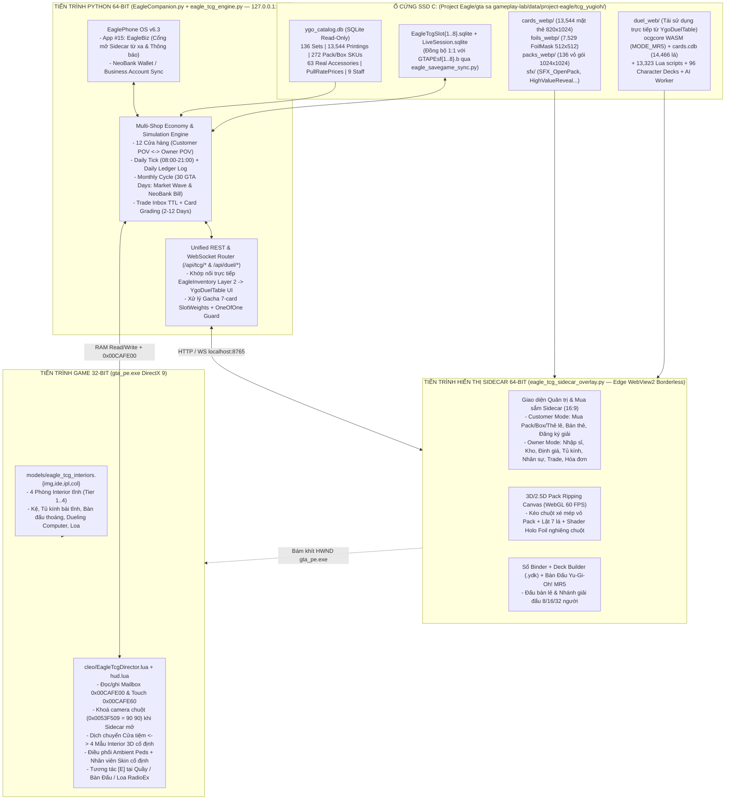
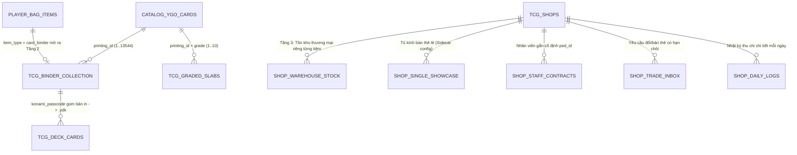

# Technical Design Document (TDD): Tích Hợp `TCG Card Shop Simulator × Dan's YuGiOh Expansion v4.1.1` Vào `Project Eagle (gameplay-lab)`

- **Ngày lập thiết kế:** `2026-11-11`
- **Hội thoại thiết kế & tinh chỉnh yêu cầu:** Antigravity (`fce76ec3-c432-4a45-a1b1-d6737afe00d5`)
- **Hội thoại nhận bàn giao thực thi:** [GTA Integration Simulator Mods](conversation://6a2335a6-d5d7-47e6-9128-fbc62404a3a8)
- **Đích tích hợp duy nhất:** `C:\Users\LENOVO\Desktop\GTA\Project Eagle\gta sa gameplay-lab`
- **Nguồn dữ liệu gốc (100% Read-Only trên `D:`):**
  1. [TCG Card Shop Simulator](file:///D:/GTA%20Archive/Integration%20Part%202/%5Btamhongame.com%5D_TCSS/TCG%20Card%20Shop%20Simulator) (`Unity 6000.0.66f2`, `Assembly-CSharp.dll` `.NET` CIL sạch)
  2. [Dan's YuGiOh Expansion v4.1.1](file:///D:/GTA%20Archive/Integration%20Part%202/Dan's%20YuGiOh%20Expansion%20-%20Current%20Release%201675%204.1.1%202026-10-20T16-14Z%205X78h59Vf) (`136` UnityFS LZ4 bundles, `13,544` bản in thẻ Yu-Gi-Oh!, `YgoDuelTable.dll` + `ocgcore` WebAssembly Master Rule 5)
- **Tài liệu liên quan:**
  - Khảo sát ban đầu (`07:33 AM`): [ics2-and-tcss-integration-technical-blueprint-2026-11-11.md](file:///c:/Users/LENOVO/Desktop/GTA/docs/project-eagle/ics2-and-tcss-integration-technical-blueprint-2026-11-11.md)
  - Bóc tách 26 bước TCSS gốc: [tcss-deep-dive-features-and-flows-2026-11-11.md](file:///c:/Users/LENOVO/Desktop/GTA/docs/project-eagle/tcss-deep-dive-features-and-flows-2026-11-11.md)
  - Đặc tả nghiệp vụ đã chốt: [tcss-yugioh-refined-gta-spec-2026-11-11.md](file:///c:/Users/LENOVO/Desktop/GTA/docs/project-eagle/tcss-yugioh-refined-gta-spec-2026-11-11.md)

---

## 0. Bảng Đối Chiếu Thay Đổi Kiến Trúc So Với Bản Khảo Sát Đầu Ngày (`07:33 AM`)

> [!IMPORTANT]
> Bản blueprint lúc `07:33 AM` bên hội thoại `6a2335a6-d5d7-47e6-9128-fbc62404a3a8` được lập **trước khi** người dùng rà soát từng bước gameplay của TCSS và đưa ra bản mod `Dan's YuGiOh Expansion v4.1.1`. Mọi hạng mục mâu thuẫn giữa hai tài liệu **bắt buộc tuân theo bảng chốt dưới đây**.

| Hạng mục | Đề xuất sơ bộ lúc `07:33 AM` (ĐÃ HỦY / THAY THẾ) | Thiết kế Kỹ thuật Đã Chốt (BẮT BUỘC ÁP DỤNG) |
| :--- | :--- | :--- |
| **Hệ thẻ bài & Engine đấu bài** | `6,872` thẻ giả của TCSS (`Tetramon`, `Destiny`...) + đấu bài `Tetramon 50 lá` | **`100%` Yu-Gi-Oh! (`Dan's YuGiOh Expansion v4.1.1`)**: `136` bộ mở rộng, `13,544` bản in thẻ thật, `272` SKU Pack/Box + **`ocgcore` WebAssembly (`MODE_MR5`, `8,000 LP`, `13,323` script Lua)**; bỏ sạch 7 bộ bài giả của TCSS |
| **Bộ bài khởi đầu (Starter Deck)** | Phát sẵn hoặc bán hộp Starter Deck 40 lá ngày đầu | **KHÔNG tạo Starter Deck giả tạo.** Ngày đầu người chơi vào tiệm mua & tự tay xé Booster Pack (`7` lá/gói) / mua thẻ lẻ gom đủ `>= 40` lá vào Sổ Binder để xếp deck |
| **Xây dựng nội thất 3D & Dẫn đường NPC** | Đặt kệ 3D tự do bằng chuột + hút từ tính `0.30m` + lưới ô vuông `0.5m` giải A\* dẫn đường NPC | **BỎ đặt nội thất 3D tự do & A\* động.** Mỗi tiệm dùng **`4` Interior 3D cố định theo cấp (`Tier 1..4`)** to dần, sang dần; kệ/tủ kính/bàn đấu/máy xịt/máy xé đặt sẵn ở vị trí thoáng không kẹt va chạm. Chi phí nội thất bắt buộc được **cộng gộp vào giá mua/nâng cấp Tier** |
| **Bê thùng vỉa hè, Xếp kệ tay, Vứt rác** | Xe tải thả `CargoBox` ngoài vỉa hè -> Aether bê thùng (`CARRY.IFP`) vào xếp từng ngăn kệ & vứt vỏ thùng | **BỎ HOÀN TOÀN.** Mọi thao tác nhập sỉ, xuất kho lên kệ, đóng/mở bán theo Pack hay Box đều xử lý gọn trên **Sidecar** |
| **Đứng quầy thu ngân & Xịt khách hôi** | Đứng quầy thối tiền mặt/bấm POS; cầm `WEAPON_SPRAYCAN` chạy xịt khách bốc mùi | **BỎ đứng quầy thủ công & cầm bình xịt chạy đuổi khách.** Thanh toán tự động theo năng suất (`Chủ + Nhân viên Thu ngân Lv 1..10`); máy `AutoCleanser` có sẵn trong tiệm, người chơi chỉ cần mua bình xịt (`Deodorant`) nạp qua Sidecar |
| **Chu kỳ Giá thị trường & Hóa đơn** | Đổi giá thị trường và tính tiền thuê mặt bằng mỗi ngày | **Chuyển sang chu kỳ Tháng (`30` ngày GTA)** cho `PriceChangeManager` & `RentBillScreen` (có thông báo cuối tháng + báo hết hàng tức thì), nhưng **Doanh thu vẫn mô phỏng và ghi Log chi tiết từng ngày (`08:00–21:00`)** |
| **Khách gạ bán / đổi thẻ lẻ (`Trade`)** | Đứng canh tại quầy chờ khách bước tới gạ đổi real-time | **Chuyển thành Hàng đợi Bất đồng bộ (`Trade Inbox`) trên Sidecar** có **thời hạn trả lời (`deadline` `3–5` ngày GTA)** |
| **Hành trình AI 31 trạng thái khách trong 3D** | Render 1:1 từng vị khách lấy đúng món hàng trên kệ 3D | **Tách làm 2 lớp độc lập:** (1) Toán học 31 trạng thái & 8 hạng ví chạy ngầm sinh doanh thu + Daily Log từ tồn kho thật; (2) Trong 3D GTA chạy **hoạt cảnh Ambient ngẫu nhiên đa dạng skin** (vào cửa -> ngắm kệ/tủ kính -> ngồi đấu giải -> xếp hàng -> ra về) + **Nhân viên cố định skin** |
| **Giao diện điều khiển & Đặt hàng** | Nhiều màn hình LuaJIT rời rạc + nhiều app trên `EaglePhone` | **Sidecar Overlay thống nhất** (mở trực tiếp bằng phím tắt/điểm tương tác khi ở trong tiệm, hoặc qua **duy nhất `1` app cổng vào `EagleBiz` trên `EaglePhone`** khi ở ngoài phố) |
| **Vị trí lưu tài nguyên ảnh thẻ & pack** | Để trên `D:\GTA Archive` nối Junction | **Copy/đóng gói thẳng sang ổ SSD `C:` bên trong `gameplay-lab`** để nạp tức thì `0 ms` |

---

## 1. Mô Tả Chi Tiết Yêu Cầu Người Dùng & Lý Do Cốt Lõi ("WHY Every Decision Was Made")

Phần này ghi lại đầy đủ **triết lý sản phẩm và nguyên nhân gốc rễ** mà người dùng đã phân tích khi chốt thiết kế, nhằm đảm bảo mọi quyết định kỹ thuật khi code đều bám đúng tinh thần gốc và không vô tình mang lại các cơ chế gây phiền toái.

### 1.1. Triết lý nền tảng: "Một tính năng trong Thế giới mở lớn vs. Game Simulator độc lập"
- **Yêu cầu:** Cắt bỏ triệt để các thao tác lao động chân tay lặp đi lặp lại mỗi ngày (chạy ra vỉa hè bê thùng hàng, khui thùng xếp kệ, nhặt vỏ carton bỏ thùng rác, cầm máy quét mã vạch đi bắn giá từng kệ, đứng quầy đếm tiền lẻ thối xu, bật công tắc đèn lúc `18:00`, lật biển `OPEN/CLOSED` bằng tay mỗi sáng, đứng canh quầy chờ khách gạ trade thẻ).
- **Lý do cốt lõi của người dùng:**
  - Trong *TCG Card Shop Simulator* gốc, **toàn bộ trò chơi chỉ xoay quanh duy nhất 1 cửa hàng**, nên nhà phát triển buộc phải đẻ ra hàng chục việc lặt vặt mỗi ngày để lấp đầy thời gian của người chơi.
  - Khi tích hợp vào **GTA (`gameplay-lab`)**, tiệm thẻ bài chỉ là **một hoạt động kinh doanh / giải trí nằm trong một thế giới mở khổng lồ** (nơi Aether còn lái xe dạo phố nghe nhạc `RadioEx`, đi hẹn hò 6 bạn gái `WaifuLink`, làm Story Quest, giao dịch tài chính `Wall Street`, đọc sách/xem phim...). Nếu giữ nguyên kiểu micromanagement bắt người chơi phải chôn chân ở tiệm mỗi ngày để bê thùng, thối từng đồng xu hay trực khách đổi bài real-time, tính năng này sẽ trở thành gánh nặng nhàm chán và phá hỏng nhịp chơi tự do của GTA.
  - Ngược lại, **những gì tạo nên linh hồn gây nghiện thật sự của trò chơi** — **Quản trị dòng tiền nhập sỉ & định giá**, **Cảm giác tự tay xé từng gói bài săn thẻ hiếm (`Pack Ripping`)**, **Sưu tầm Sổ Binder / Chấm điểm `TCG 1..10`**, và **Soạn bộ bài thi đấu giải Yu-Gi-Oh! chiến thuật** — phải được giữ lại trọn vẹn và làm thật xuất sắc.

### 1.2. Kiến trúc Sidecar Overlay + Duy nhất `1` App Cổng Vào trên `EaglePhone` (`EagleBiz`)
- **Yêu cầu:** Toàn bộ cấu hình cửa hàng (đặt tên tiệm, nhập hàng sỉ, kho hàng, bấm giá bán lẻ, chọn thẻ bày tủ kính, đặt phí bàn đấu & tạo giải, duyệt yêu cầu Trade, thuê/thưởng nhân viên, gửi chấm điểm thẻ, đóng hộp bài rác, xé pack, xem Sổ Binder) nằm gọn trong một **Sidecar Layout hiển thị đè mượt trong game** (tương tự cách `EaglePhone` / `WaifuLink Overlay` hoạt động). Khi đứng bên trong tiệm, người chơi có nút bấm bật thẳng Sidecar (và khi lại gần Bàn đấu bài bấm tương tác thì bật thẳng giao diện Sidecar Đấu bài / Xếp deck). Khi đi ngoài đường, người chơi mở `EaglePhone` và bấm vào **1 app quản lý cửa hàng duy nhất** để mở Sidecar này.
- **Lý do cốt lõi của người dùng:**
  - Điện thoại `EaglePhone` của TCSS gốc có tới `16` ứng dụng riêng lẻ (`Restock`, `Furniture`, `Hire`, `Bills`, `Grading`, `Tournament`, `Price`...). Nếu nhồi nhiều app của tiệm bài vào màn hình chính `EaglePhone` trong GTA (vốn là lưới `5×3 = 15` ô đã dùng `14` ô), điện thoại của Aether sẽ bị rối loạn và quá tải.
  - Gom tất cả về **1 Sidecar chuyên biệt** vừa cho không gian màn hình rộng `16:9` để hiển thị rõ chữ nhỏ trên thẻ bài Yu-Gi-Oh!, biểu đồ giá, nhánh giải đấu và hiệu ứng xé pack 3D, vừa giữ cho `EaglePhone` gọn sạch (chỉ hiện đúng `1` icon cổng vào sau khi người chơi thực sự sở hữu ít nhất 1 cửa hàng, hoặc tra cứu danh sách tiệm).

### 1.3. Nội thất 3D Cố định theo `4` Cấp Shop (`Tier 1..4`) + Gộp Chi Phí Nâng Cấp + Trang Trí Cộng Buff Ngầm
- **Yêu cầu:**
  1. Không làm tính năng tự mua từng cái kệ/bàn rồi đặt tự do trong không gian 3D. Thay vào đó, mỗi cấp độ cửa hàng (`Shop Tier 1 -> 4`) sở hữu một **Interior 3D cố định riêng biệt, rộng dần và sang xịn dần**, trong đó đã bày sẵn đầy đủ kệ hàng, tủ kính thẻ lẻ, bàn đấu bài, máy xịt khử mùi (`AutoCleanser`), tủ lưu trữ thẻ nội bộ (`CardStorageShelf`), máy xé pack tự động (`AutoPackOpener` ở cấp đủ cao) và kệ trưng bày cá nhân (`PersonalShowcase`).
  2. Tiền mua các thiết bị bắt buộc có sẵn đó được **cộng thẳng vào vốn mua cửa hàng ban đầu và chi phí nâng cấp lên mỗi Tier** (nâng cấp tiệm = mở rộng mặt bằng `Shop A + Lot B` + tự động sắm tối đa nội thất của cấp đó -> mở khóa sức chứa bán hàng lớn hơn, nhiều bàn đấu hơn, thuê được nhiều nhân viên hơn).
  3. **Tủ kính bán thẻ lẻ trong 3D** luôn chỉ render mô hình mặc định có sẵn vài lá bài tĩnh ngẫu nhiên trên mặt bàn, tuyệt đối không render động theo từng lá bài chủ tiệm chọn mỗi ngày; việc hôm nay bán lá gì, giá bao nhiêu hoàn toàn cấu hình bên Sidecar.
  4. **Vật phẩm Trang trí (`183` món `ShopDeco` có hiệu ứng)** và **Kệ Trưng Bày Cá Nhân (`PersonalShowcase` ở Tier lớn)**: vẫn cho người chơi mua/chọn bên Sidecar để kích hoạt **hiệu ứng cộng ngầm khả năng kiếm tiền / thu hút thêm khách**, không cần thay đổi lưới 3D ngoài đời để tránh phức tạp.
- **Lý do cốt lõi của người dùng:**
  - Engine GTA SA RenderWare bị giới hạn rất nặng về việc thay đổi nội thất động, va chạm vật lý vật nhỏ và tìm đường AI quanh vật cản tự đặt. Làm nội thất cố định theo từng Tier giúp tiệm ở cấp nào cũng được thiết kế ánh sáng, lối đi và khoảng trống quanh bàn đấu **đẹp chuẩn chỉnh, `0%` lỗi kẹt NPC (collision)**, đồng thời cắt bỏ thao tác đặt từng cái kệ tốn thời gian.
  - Tương tự, việc không bắt engine 3D GTA phải thay texture từng lá bài nhỏ xíu nằm trên mặt tủ kính mỗi khi chủ tiệm đổi hàng giúp loại bỏ hoàn toàn độ phức tạp `RwRaster` không cần thiết mà nhìn trong tiệm vẫn đẹp tự nhiên.

### 1.4. Chu kỳ Vĩ mô Theo Tháng (`30` Ngày GTA) + Doanh thu Mô phỏng Hàng Ngày (`08:00–21:00`) Có Log Đầy Đủ
- **Yêu cầu:**
  1. Bỏ 3 pha ánh sáng ngày/chiều/tối của TCSS và bỏ việc chốt sổ bắt buộc mỗi tối. Các chu kỳ vĩ mô như **Biến động giá thị trường (`PriceChangeManager`)** và **Thanh toán hóa đơn (`RentBillScreen`: Tiền mặt bằng + Điện + Lương tháng nhân viên)** diễn ra **mỗi tháng `1` lần (`30` ngày GTA)** kèm thông báo nhắc cuối tháng trên `EaglePhone`. Riêng **Nhập hàng (`Restock`)** người chơi chủ động kiểm tra kho (quy mô kho được nhân rộng tương ứng để trữ đủ hàng bán dài ngày, nhưng nếu một mặt hàng bán đứt trước hạn tháng thì bắn thông báo hết hàng ngay để nhập bổ sung).
  2. Khung giờ cửa hàng sinh doanh thu cố định từ **`08:00` đến `21:00`** theo đồng hồ thực của GTA (có nút gạt `OPEN / CLOSED` trong Sidecar nếu chủ tiệm muốn tạm đóng cửa).
  3. Doanh thu mỗi ngày (`08:00–21:00`) được tính toán bằng **mô hình tổng hòa trạng thái thật của cửa hàng (`Stateful Simulation`)**: cấp độ shop, kỹ năng nhân viên (kể cả thuộc tính ngầm **Nhân viên chịu tăng ca `Overtime (OT)`** giúp cộng thêm doanh thu và độ hài lòng khách), cơ sở vật chất/trang trí, điểm Review sao, độ hấp dẫn của mặt hàng đang hot, mức giá bán hợp lý, phí thuê bàn đấu (tăng mạnh vào ngày có giải), cộng với các sự kiện cụ thể như **khách mua đúng lá bài lẻ chủ tiệm bày trên Sidecar** hoặc **tiền vé đăng ký giải đấu**. **Nguyên tắc sắt đá:** Nếu kho/kệ hết sạch hàng thì doanh thu bán hàng = `$0` (tuyệt đối không ghi nhận khách mua thành công món mà tiệm không có!).
  4. Dù cuối tháng mới tổng kết hóa đơn, **tiền thu được mỗi ngày bắt buộc phải lưu Log chi tiết đầy đủ (`Daily Ledger Log`)**.
  5. **Khách gạ bán/đổi thẻ lẻ (`CustomerTradeCard`):** Chuyển thành **hàng đợi yêu cầu trong tab `Trade` của Sidecar có hạn chót (`deadline`)** để người chơi rảnh lúc nào mở lên duyệt lúc đó, không bắt đứng trực ở tiệm.
  6. **Máy khử mùi (`AutoCleanser`):** Máy có sẵn từ đầu, người chơi chỉ cần nhớ mua bình xịt (`Deodorant`) nạp vào; nếu để cạn bình sẽ phát sinh xác suất tiệm bị ám mùi làm tụt điểm yêu thích/Review.
- **Lý do cốt lõi của người dùng:**
  - Trong GTA, `1` ngày game trôi rất nhanh (`24` phút ngoài đời hoặc chỉ vài giây khi ngủ lưu game `+6h`). Nếu bắt trả hóa đơn và đổi giá thị trường mỗi ngày, người chơi vừa lái xe đi làm nhiệm vụ một lát đã bị dồn dập thông báo hóa đơn và lệch giá. Giãn chu kỳ vĩ mô ra `30` ngày GTA giúp người chơi thảnh thơi tận hưởng thế giới mở, trong khi Log chi tiết từng ngày vẫn giữ nguyên cảm giác quản trị kinh doanh chân thực, minh bạch từng đồng thu chi.

### 1.5. Tách Biệt Hoạt Cảnh 3D Sinh Động (`Ambient Peds`) Khỏi Toán Học Tính Tiền + Loa Đổi Nhạc `RadioEx`
- **Yêu cầu:**
  1. Giữ nguyên phân bố **31 trạng thái hành vi & 8 hạng ví tiền của khách hàng** ở tầng backend để roll ngẫu nhiên `N` khách mỗi ngày, đối chiếu tồn kho/giá cả thật của shop và xuất ra Log tính tiền; **không cố render 1:1 hành trình từng vị khách đó trong 3D GTA**.
  2. Tuy nhiên, khi Aether thực sự bước chân vào cửa hàng ở **bất kỳ cấp độ (`Tier 1..4`) nào**, không gian 3D phải **luôn sống động**: nhiều mẫu Ped khách hàng đa dạng (không lặp lại nhàm chán) đi từ cửa chính vào -> dạo ngắm kệ hàng -> đứng ngắm tủ kính thẻ lẻ / kệ trưng bày cá nhân -> ngồi vào bàn đấu bài (đặc biệt vào ngày tổ chức giải đấu sẽ có các cặp ngồi đấu + đám đông khách đứng vây xem xung quanh ở khu vực thoáng, song song với khách đi mua sắm bình thường) -> xếp hàng ở quầy thanh toán -> đi ra cửa.
  3. **Nhân viên (`9` hồ sơ nhân sự RPG):** Mỗi nhân viên trong pool thuê được gắn cứng với **`1` `ped_id` (Skin ID) cố định**. Thuê ai làm **Thu ngân (`Cashier`)** thì render đúng skin người đó đứng quầy làm động tác tính tiền; thuê ai làm **Bốc xếp (`Restocker`)** thì render người đó đi lại giữa Kho / Tủ thẻ nội bộ -> Kệ hàng -> Máy xé pack tự động -> Máy tỏa hương -> Tủ kính (nếu gắn kèm prop bê thùng hàng `CARRY.IFP` mượt được thì gắn, không ép buộc nếu gây lỗi).
  4. **Nhạc nền trong tiệm:** Dùng hệ thống đài **`RadioEx`** sẵn có của game; vì đi bộ trong tiệm không lăn chuột đổi đài như khi ngồi trên xe được nên đặt **một chiếc Loa / Đài phát nhạc (`Speaker Prop`)** trong tiệm để Aether bước tới bấm đổi kênh đài.
- **Lý do cốt lõi của người dùng:**
  - Giải pháp này hóa giải hoàn hảo bài toán khó nhất của engine GTA SA: vừa đạt được cảnh tượng cửa hàng đông vui, có hồn, nhìn rõ thành quả thuê nhân viên và tổ chức giải đấu, vừa tránh được `100%` lỗi kẹt đường / lệch đồng bộ khi ép AI 3D của năm 2004 phải diễn chính xác từng giao dịch mua từng gói bài.

### 1.6. Hệ Thống Kho Đồ Cá Nhân 3 Tầng (`EagleInventory` 3-Layer Architecture)
- **Yêu cầu:** Thiết kế cơ sở dữ liệu Inventory mở rộng trên Sidecar cho Aether sao cho sau này dùng chung được cho các tính năng đời sống khác (đi siêu thị mua quà tặng bạn gái, gắp thú bông, đồ ăn...), trong đó **Sổ Sưu Tập Bài (`Card Binder`)**, **Pack bài**, **Booster Box**, **Hộp bài rác (`Bulk Box`)** là các vật phẩm nằm ở tầng túi đồ, còn **bản thân cuốn `Card Binder` là một CSDL tầng thứ 2 chứa danh sách hàng ngàn lá bài đang sở hữu**.
- **Lý do cốt lõi của người dùng:**
  - Đây là quyết định kiến trúc kỹ thuật nền tảng cho toàn project: số lượng thẻ bài Yu-Gi-Oh! lên tới `13,544` bản in. Nếu đổ thẳng từng lá bài vào túi đồ cấp cao nhất (`Top-level Player Bag`), túi đồ sẽ lập tức biến thành bãi rác không thể tìm thấy món quà tặng bạn gái hay vật phẩm nhiệm vụ. Đóng gói toàn bộ thẻ lẻ vào bên trong thực thể `Card Binder` (Tầng 2) và tách riêng Kho hàng thương mại của từng cửa hàng (Tầng 3) giúp túi đồ cá nhân luôn gọn sạch tuyệt đối.

### 1.7. Đa Cửa Hàng Rải Rác Trên Bản Đồ & Tách Bạch Rõ Ràng `Customer POV` vs. `Shop Owner POV`
- **Yêu cầu:**
  1. Trong thế giới GTA có sẵn **nhiều cửa hàng thẻ bài** đặt ở các khu vực khác nhau.
  2. **Tách bạch rạch ròi 2 góc nhìn:** Khi Aether bước vào một cửa hàng **chưa mua**, tiệm đó hoạt động hoàn toàn dưới quyền chủ NPC — Aether vào với tư cách **Khách hàng (`Customer POV`)**: đi mua Pack/Box/Thẻ lẻ bày trong tủ kính của tiệm đó, bóc bài ngay tại chỗ, mở Sổ Binder soạn bộ bài, ngồi vào bàn đấu với khách hoặc đóng lệ phí tham gia giải đấu của tiệm, bán lại thẻ dư, gửi chấm điểm thẻ, hoặc chọn **Mua đứt cửa hàng đó (`Buy Shop Property`)**.
  3. Khi Aether xuống tiền mua một cửa hàng, cửa hàng đó chuyển hẳn sang **Góc nhìn Chủ tiệm (`Shop Owner POV`)** do Aether điều hành toàn quyền qua Sidecar / `EagleBiz` (trong khi các cửa hàng khác chưa mua vẫn tiếp tục là tiệm NPC để Aether ghé chơi như khách hàng).
- **Lý do cốt lõi của người dùng:**
  - Nếu chỉ có `Owner POV`, người chơi buộc phải bỏ số vốn lớn mở tiệm ngay từ đầu mới được chạm vào việc bóc pack và đánh bài Yu-Gi-Oh!. Nhờ có mạng lưới tiệm NPC (`Customer POV`), ngay từ Ngày 1 chỉ với vài chục đô trong túi, Aether đã có thể chạy ra tiệm bài đầu phố mua vài gói *Legend of Blue Eyes* tự tay xé bài, gom đủ 40 lá soạn deck và đi đánh giải kiếm tiền thưởng — đúng chuẩn trải nghiệm nhập vai đời sống trong thế giới mở.

### 1.8. Tinh Hoa Cốt Lõi: `100% Yu-Gi-Oh! (ocgcore MR5)` + Xé Pack Vật Lý & Đặt Tài Nguyên Trên Ổ `C:`
- **Yêu cầu:**
  1. Chỉ dùng duy nhất hệ bài **Yu-Gi-Oh!** từ bản mod `Dan's YuGiOh Expansion v4.1.1` (bỏ toàn bộ thẻ giả Tetramon/Destiny của TCSS gốc; chỉ giữ lại nhóm phụ kiện ngoài đời của TCSS như bình xịt khử mùi, bọc bài/hộp deck/thảm đấu `Ultra PRO`, truyện Manga, hộp đóng bài rác).
  2. Tái hiện bằng mọi giá trải nghiệm **Tự tay xé Pack 3D (`CardOpeningSequence`)** sát bản gốc nhất có thể và tích hợp trọn vẹn **Đấu bài chiến thuật Yu-Gi-Oh!** (cả đấu bàn lẻ lẫn đấu giải nhánh loại trực tiếp).
  3. Copy toàn bộ tài nguyên cần dùng của bản mod sang **ổ SSD `C:`** để load nhanh tức thì.
- **Lý do cốt lõi của người dùng:**
  - Người chơi gắn bó cảm xúc thật với kho tàng `13,544` lá bài Yu-Gi-Oh! chính thống và luật đấu Master Rule 5 có chiều sâu chiến thuật thực sự chứ không phải 50 lá bài giả đơn giản của Tetramon. Đặt thẳng bộ ảnh đã tối ưu lên SSD `C:` đảm bảo khoảnh khắc xé pack lật bài và gọi hình thẻ trong trận đấu đạt độ trễ `0 ms`, không bao giờ khựng hình chờ ổ lưu trữ.

---

## 2. Kiến Trúc Hệ Thống & Giao Tiếp Liên Tiến Trình (`System & IPC Architecture`)

### 2.1. Sơ Đồ Tổ Chức Tiến Trình (`0 MB` Gánh Nặng Lên Không Gian Địa Chỉ 32-bit Của `gta_pe.exe`)

Tiến trình `gta_pe.exe` là ứng dụng DirectX 9 32-bit (`LargeAddressAware`, trần `4 GiB VAS`). Do đó, toàn bộ cơ sở dữ liệu `13,544` bản in thẻ, trình mô phỏng kinh tế các cửa hàng, hiệu ứng xé pack WebGL 60 FPS và máy ảo WebAssembly `ocgcore` Yu-Gi-Oh! được đặt **100% ở tiến trình Sidecar 64-bit bên ngoài**, kết nối với `gta_pe.exe` qua hộp thư RAM có sẵn của `EagleCompanion.py`:



### 2.2. Cơ Chế Cửa Sổ Sidecar, Chiếm Quyền Chuột & Phím Mở Nhanh

1. **Cửa sổ Borderless Topmost bám khít `gta_pe.exe`:**
   - Kế thừa trực tiếp mẫu thiết kế đã chạy ổn định 100% của [eagle_vn_ingame_overlay.py](file:///c:/Users/LENOVO/Desktop/GTA/Project%20Eagle/gta%20sa%20gameplay-lab/eagle_vn_ingame_overlay.py) (`_find_process_main_hwnd`), `eagle_tcg_sidecar_overlay.py` khởi tạo một cửa sổ **WebView2 (Chromium Edge có sẵn trên Windows 10/11)** không viền, căn khít vùng Client `16:9` của `gta_pe.exe` và tự động ẩn ngay khi người chơi bấm `ESC`, `Alt+Tab` hoặc đóng Sidecar.
   - Nhờ dùng tiến trình GPU riêng của WebView2 64-bit, hiệu ứng shader lấp lánh 22 cấp độ hiếm (`Ghost Rare`, `Starlight/Quarter Century`, `Ultimate Rare`) và bàn đấu 3D `ocgcore` đạt **60–144 FPS mượt tuyệt đối** mà tiêu tốn **`0 B` RAM của `gta_pe.exe`**.
2. **Tách Camera & Bắt Chuột Mượt:**
   - Ngay khi `sidecar_visible == True`, `EagleCompanion.py` kích hoạt cơ chế tách chuột camera đã kiểm chứng của `EaglePhone OS v6.3` (vá `2` byte `0x0053F509`: `F3 A5 -> 90 90` chặn game đọc chuyển động chuột quay camera, đồng thời vô hiệu hóa phím bắn/đấm của Aether) và khôi phục nguyên trạng `F3 A5` ngay tích tắc khi đóng Sidecar.
3. **Ba Điểm Mở Sidecar (`Context-Aware Entry Points`):**
   - **Điểm mở #1 — Đứng bên trong bất kỳ Tiệm Thẻ Bài nào (`currArea == AREA_TCG_INTERIOR`):**
     - Hiện gợi ý HUD góc trên: `[F6] / [E tại Quầy] Mở Tiệm Bài (Customer / Owner Sidecar)` và `[B] Mở Nhanh Sổ Binder & Kho Pack Cá Nhân`.
     - Nếu tiệm thuộc NPC -> mở thẳng giao diện **`Customer Storefront`** của tiệm đó. Nếu tiệm thuộc Aether -> mở thẳng giao diện **`Owner Command Center`** của tiệm đó.
   - **Điểm mở #2 — Đứng cạnh Bàn Đấu Bài / Máy `Dueling Computer` trong tiệm bấm `[E]`:**
     - Mở thẳng Sidecar vào chế độ **`Duel Terminal`** (chọn Deck trong Binder -> Đấu giao hữu với bài thủ NPC đang ngồi tại bàn hoặc Đánh trận tiếp theo trong Nhánh Giải Đấu đang diễn ra).
   - **Điểm mở #3 — Khi đang đi ngoài đường phố (`EaglePhone -> App #15: EagleBiz`):**
     - Điền vào ô trống thứ `15` cuối cùng trên lưới `5×3` của [eagle_phone_ui.py](file:///c:/Users/LENOVO/Desktop/GTA/Project%20Eagle/gta%20sa%20gameplay-lab/eagle_phone_ui.py):
       - *Trước khi mua tiệm đầu tiên:* Mở trang **Danh bạ & Định vị GPS các Cửa hàng Thẻ bài trên bản đồ** (xem tiệm nào đang mở giải đấu gì, giá sang nhượng bao nhiêu, bấm đặt Waypoint `T`, và mở xem từ xa Sổ Binder cá nhân).
       - *Sau khi sở hữu `>= 1` tiệm:* Mở từ xa toàn bộ **Bảng điều khiển Chủ tiệm (`Owner Sidecar`)** để nhập hàng sỉ, chỉnh giá, duyệt `Trade Inbox`, đóng tiền hóa đơn tháng, hẹn lịch giải đấu và chuyển đổi qua lại giữa các chi nhánh đang làm chủ.

### 2.3. Đồng Bộ Tiền Tệ & Lưu Trữ Theo Từng Slot Save (`eagle_savegame_sync.py`)

- **Đồng bộ Tiền (`Money Authority`):**
  - Mọi giao dịch **Cá nhân của Aether** (mua Pack/Thẻ lẻ ở tiệm NPC, đóng lệ phí dự giải, nhận tiền thưởng thắng ván bài, bán thẻ cá nhân, hoặc bỏ vốn mua đứt cửa hàng) trừ/cộng trực tiếp vào ví tiền mặt `ADDR_PLAYER_MONEY` (`0x00B7CE50` / `0x00B7CE54`) hoặc thẻ `NeoBank` qua `WalletStore` của `EagleCompanion.py`.
  - Mọi dòng tiền **Vận hành Doanh nghiệp** của các tiệm Aether làm chủ (doanh thu bán hàng mỗi ngày, tiền nhập sỉ thùng hàng, lương nhân viên, hóa đơn điện & mặt bằng cuối tháng) hạch toán qua **Quỹ Doanh Nghiệp (`shop_treasury_balance`)** liên thông nạp/rút 1 chạm với tài khoản `NeoBank` (giúp không làm nhảy loạn số tiền mặt trên góc màn hình GTA mỗi phút khi khách mua gói bài lẻ).
- **Đồng bộ Save Slot (`GTAPEsf{1..8}.b`):**
  - Đăng ký hook vào [eagle_savegame_sync.py](file:///c:/Users/LENOVO/Desktop/GTA/Project%20Eagle/gta%20sa%20gameplay-lab/eagle_savegame_sync.py):
    - Khi lưu game vào Slot `N`: gọi `sqlite3.Connection.backup()` sao lưu nguyên tử `LiveSession.sqlite` -> `Documents\Project Eagle User Files\EagleTcgSlot{N}.sqlite` gắn kèm chữ ký `Block 0` của `GTAPEsf{N}.b`.
    - Khi nạp Slot `N`: khôi phục đúng `EagleTcgSlot{N}.sqlite` vào phiên chạy.
    - Khi bấm `New Game` hoặc Cold Boot chưa vào save: khởi tạo lại thế giới mặc định Ngày `01/01/2010` (`12` cửa hàng đều thuộc NPC, túi đồ Aether = `1` cuốn `Card Binder` rỗng `0` lá bài, lịch sử thẻ `1-of-1` chưa ai bóc).

---

## 3. Thiết Kế Cơ Sở Dữ Liệu SQLite (`EagleInventory` 3 Tầng & Đa Cửa Hàng)

### 3.1. Sơ Đồ Quan Hệ Thực Thể 3 Tầng (`3-Layer Inventory Separation`)



### 3.2. Lược Đồ DDL Chi Tiết (`LiveSession.sqlite` & `ygo_catalog.db`)

```sql
-- =========================================================================
-- A. DANH MỤC TĨNH CHỈ ĐỌC (ygo_catalog.db — Trích xuất 1 lần từ bản Mod)
-- =========================================================================
CREATE TABLE catalog_expansions (
    set_index           INTEGER PRIMARY KEY,          -- 0..135 (136 bộ mở rộng Yu-Gi-Oh!)
    set_code            TEXT NOT NULL UNIQUE,         -- VD: 'LOB', 'MRD', 'IOC', 'RA01'...
    set_name            TEXT NOT NULL,
    release_order       INTEGER NOT NULL,
    unlock_shop_level   INTEGER NOT NULL DEFAULT 1,   -- Cấp độ shop mở khóa giấy phép nhập sỉ
    license_cost        REAL NOT NULL DEFAULT 0.0,    -- Phí mua giấy phép bán lẻ (giống cây License TCSS)
    pack_wholesale_unit REAL NOT NULL,                -- Giá gốc 1 gói tính từ PullRatePrices EV
    box32_cost          REAL NOT NULL,                -- Giá nhập thùng 32 gói
    box64_cost          REAL NOT NULL,                -- Giá nhập thùng 64 gói (chiết khấu sỉ)
    pack_art_relpath    TEXT NOT NULL,                -- 'packs_webp/LOB.webp' (1024x1024)
    slot_weights_json   TEXT NOT NULL                 -- Trọng số xác suất 7 lá/pack từ config mod
);

CREATE TABLE catalog_ygo_cards (
    printing_id         INTEGER PRIMARY KEY,          -- 1..13544 (mỗi bản in + độ hiếm là 1 ID duy nhất)
    set_index           INTEGER NOT NULL REFERENCES catalog_expansions(set_index),
    card_number_in_set  TEXT NOT NULL,                -- VD: 'LOB-001'
    konami_passcode     INTEGER NOT NULL,             -- Mã 8 chữ số nối thẳng sang cards.cdb của ocgcore!
    card_name           TEXT NOT NULL,
    rarity_code         TEXT NOT NULL,                -- 1 trong 22 độ hiếm (Common, Super, Ultra, Secret, Ghost, 1of1...)
    rarity_tier         INTEGER NOT NULL,             -- 0..21
    is_one_of_one       INTEGER NOT NULL DEFAULT 0,   -- 1 = Thẻ độc bản toàn cầu (chỉ bóc ra tối đa 1 lần/save)
    base_market_price   REAL NOT NULL,                -- Giá gốc từ prices/{expansion}.json
    face_webp_relpath   TEXT NOT NULL,                -- 'cards_webp/00001.webp' (820x1024 đã bake sẵn khung + chữ)
    foil_webp_relpath   TEXT                          -- 'foils_webp/00001_foil.webp' (512x512 FoilMask, NULL nếu Common)
);
CREATE INDEX idx_ygo_passcode ON catalog_ygo_cards(konami_passcode);
CREATE INDEX idx_ygo_set_rarity ON catalog_ygo_cards(set_index, rarity_code);

CREATE TABLE catalog_shop_skus (
    sku_id              TEXT PRIMARY KEY,             -- VD: 'PACK_LOB', 'BOX64_LOB', 'ACC_DEODORANT', 'ACC_ULTRAPRO_SLEEVE_BLK', 'BULK_BOX_WHITE'...
    sku_category        TEXT NOT NULL,                -- 'BOOSTER_PACK' | 'BOOSTER_BOX' | 'CLEANSER' | 'ACCESSORY' | 'MANGA' | 'BOARDGAME' | 'BULK_BOX'
    display_name        TEXT NOT NULL,
    set_index           INTEGER,                      -- Khác NULL nếu là Pack/Box Yu-Gi-Oh!
    units_per_case      INTEGER NOT NULL DEFAULT 1,
    unlock_shop_level   INTEGER NOT NULL DEFAULT 1,
    license_cost        REAL NOT NULL DEFAULT 0.0,
    base_wholesale_cost REAL NOT NULL,
    base_msrp           REAL NOT NULL,
    icon_relpath        TEXT NOT NULL
);

-- =========================================================================
-- B. TẦNG 1 — TÚI ĐỒ CÁ NHÂN TOÀN CỤC CỦA AETHER (player_bag_items)
-- Dùng chung cho TCG, Quà tặng bạn gái WaifuLink, Gấu bông Kawaii, Đồ ăn...
-- =========================================================================
CREATE TABLE player_bag_items (
    bag_slot_id         INTEGER PRIMARY KEY AUTOINCREMENT,
    item_id             TEXT NOT NULL,                -- VD: 'ITEM_CARD_BINDER', 'PACK_LOB', 'BOX32_MRD', 'GIFT_PERFUME'...
    item_domain         TEXT NOT NULL,                -- 'TCG_CONTAINER' | 'TCG_SEALED' | 'WAIFU_GIFT' | 'PLUSHIE' | 'CONSUMABLE'
    quantity            INTEGER NOT NULL CHECK (quantity >= 0),
    metadata_json       TEXT DEFAULT '{}',
    UNIQUE(item_id, metadata_json)
);

-- =========================================================================
-- C. TẦNG 2 — CƠ SỞ DỮ LIỆU BÊN TRONG SỔ BINDER CÁ NHÂN (Card Binder DB)
-- Không làm phình Tầng 1 dù sở hữu đủ 13,544 bản in thẻ!
-- =========================================================================
CREATE TABLE tcg_binder_collection (
    printing_id         INTEGER PRIMARY KEY,          -- Tham chiếu catalog_ygo_cards.printing_id
    konami_passcode     INTEGER NOT NULL,
    qty_owned           INTEGER NOT NULL CHECK (qty_owned >= 0),
    qty_locked_in_decks INTEGER NOT NULL DEFAULT 0,   -- Tránh vô tình bán/đóng hộp rác lá đang nằm trong Deck thi đấu
    first_pulled_day    INTEGER NOT NULL,
    is_new_unseen       INTEGER NOT NULL DEFAULT 1
);

CREATE TABLE tcg_graded_slabs (
    slab_id             INTEGER PRIMARY KEY AUTOINCREMENT,
    printing_id         INTEGER NOT NULL,
    grade               INTEGER NOT NULL CHECK (grade BETWEEN 1 AND 10), -- TCG 1..10 (hệ số giá 0.3x -> 10.0x)
    graded_day          INTEGER NOT NULL,
    cert_serial         TEXT NOT NULL UNIQUE,         -- Mã chứng nhận hiển thị trên nhãn hộp Slab
    location_state      TEXT NOT NULL DEFAULT 'BINDER' -- 'BINDER' | 'PERSONAL_SHOWCASE' | 'SHOP_SALE_CASE'
);

CREATE TABLE tcg_decks (
    deck_id             INTEGER PRIMARY KEY AUTOINCREMENT,
    deck_name           TEXT NOT NULL,
    format_tag          TEXT NOT NULL DEFAULT 'MR5_STANDARD', -- 'MR5_STANDARD' | 'GOAT' | 'EDISON' | 'UNLIMITED'
    ydk_content         TEXT NOT NULL,                -- Nội dung chuẩn #main / #extra / !side bằng konami_passcode
    sleeve_id           TEXT NOT NULL DEFAULT 'default',
    updated_day         INTEGER NOT NULL
);

CREATE TABLE tcg_grading_orders (
    order_id            INTEGER PRIMARY KEY AUTOINCREMENT,
    service_tier        TEXT NOT NULL,                -- 'ECONOMY_12D' | 'STANDARD_6D' | 'EXPRESS_2D'
    submitted_day       INTEGER NOT NULL,
    ready_day           INTEGER NOT NULL,             -- submitted_day + (2..12 ngày GTA)
    fee_paid            REAL NOT NULL,
    items_json          TEXT NOT NULL,                -- Danh sách printing_id gửi chấm (tối đa 8 lá/đơn như TCSS)
    status              TEXT NOT NULL DEFAULT 'IN_PROGRESS' -- 'IN_PROGRESS' | 'READY_TO_CLAIM' | 'CLAIMED'
);

CREATE TABLE tcg_pulled_1of1 (
    printing_id         INTEGER PRIMARY KEY,          -- Đảm bảo thẻ 1-of-1 chỉ xuất hiện duy nhất 1 lần trong cả Save!
    pulled_by           TEXT NOT NULL,                -- 'PLAYER' | 'NPC_TOURNAMENT_PRIZE'
    pulled_day          INTEGER NOT NULL
);

-- =========================================================================
-- D. TẦNG 3 — ĐA CỬA HÀNG TRÊN BẢN ĐỒ & KHO THƯƠNG MẠI (Multi-Shop State)
-- =========================================================================
CREATE TABLE tcg_shops (
    shop_id             TEXT PRIMARY KEY,             -- VD: 'TCG_WIBU_AKIBA', 'TCG_LS_MARKET', 'TCG_SF_QUEENS'...
    shop_name           TEXT NOT NULL,                -- Chủ tiệm đổi tên tùy ý qua Sidecar sau khi mua
    region_code         TEXT NOT NULL,                -- 'WIBU-01' | 'LOS_SANTOS' | 'SAN_FIERRO' | 'LAS_VENTURAS' | 'CHICAGO' | 'LIBERTY' | 'MONDSTADT'
    owner_type          TEXT NOT NULL DEFAULT 'NPC',  -- 'NPC' (Customer POV) | 'PLAYER' (Shop Owner POV)
    interior_tier       INTEGER NOT NULL DEFAULT 1 CHECK (interior_tier BETWEEN 1 AND 4),
    shop_level          INTEGER NOT NULL DEFAULT 1 CHECK (shop_level BETWEEN 1 AND 100),
    shop_xp             INTEGER NOT NULL DEFAULT 0,
    is_open             INTEGER NOT NULL DEFAULT 1,   -- Nút gạt OPEN / CLOSED trong Sidecar (khung 08:00-21:00)
    buyout_price        REAL NOT NULL,                -- Giá sang nhượng mặt bằng + trọn gói nội thất Tier ban đầu
    monthly_base_rent   REAL NOT NULL,                -- Tiền thuê 1 tháng (30 ngày GTA)
    treasury_balance    REAL NOT NULL DEFAULT 0.0,    -- Quỹ tiền mặt kinh doanh của tiệm
    star_rating         REAL NOT NULL DEFAULT 3.50,   -- Điểm đánh giá 1.00 .. 5.00 sao
    deodorant_charges   INTEGER NOT NULL DEFAULT 100, -- Số lượt xịt còn lại trong máy AutoCleanser
    charity_bulk_points INTEGER NOT NULL DEFAULT 0,   -- Điểm thùng từ thiện BulkDonationBox tăng xác suất 5 sao
    table_hourly_fee    REAL NOT NULL DEFAULT 8.0,    -- Phí thuê bàn đấu tính giờ
    daily_format_bonus  TEXT NOT NULL DEFAULT 'NONE', -- Sự kiện bàn chơi thường nhật
    radio_station_idx   INTEGER NOT NULL DEFAULT 0,   -- Kênh RadioEx đang phát qua Loa của tiệm
    entrance_xyz_json   TEXT NOT NULL,                -- Tọa độ [x, y, z, heading] ngoài phố
    unlocked_skus_json  TEXT NOT NULL DEFAULT '[]'    -- Danh sách giấy phép mặt hàng đã mở khóa
);

CREATE TABLE shop_warehouse_stock (
    shop_id             TEXT NOT NULL REFERENCES tcg_shops(shop_id),
    sku_id              TEXT NOT NULL REFERENCES catalog_shop_skus(sku_id),
    qty_in_stock        INTEGER NOT NULL DEFAULT 0 CHECK (qty_in_stock >= 0),
    sell_on_shelf       INTEGER NOT NULL DEFAULT 1,   -- 1 = Đang mở bán cho khách; 0 = Cất kho dự trữ (VD giữ Pack tự xé)
    retail_price        REAL NOT NULL,                -- Giá bán lẻ chủ tiệm bấm trên Sidecar
    PRIMARY KEY (shop_id, sku_id)
);

CREATE TABLE shop_single_showcase (
    slot_id             INTEGER PRIMARY KEY AUTOINCREMENT,
    shop_id             TEXT NOT NULL REFERENCES tcg_shops(shop_id),
    slot_index          INTEGER NOT NULL,             -- Số ô tủ kính mở theo interior_tier (Tier 1: 8 ô -> Tier 4: 40 ô)
    printing_id         INTEGER NOT NULL,
    slab_grade          INTEGER NOT NULL DEFAULT 0,   -- 0 = Thẻ thường (Raw); 1..10 = Thẻ đã chấm điểm Slab
    asking_price        REAL NOT NULL,
    auto_refill_from_storage INTEGER NOT NULL DEFAULT 1,
    UNIQUE(shop_id, slot_index)
);

CREATE TABLE shop_card_storage_pool (
    shop_id             TEXT NOT NULL REFERENCES tcg_shops(shop_id),
    printing_id         INTEGER NOT NULL,
    qty_stored          INTEGER NOT NULL CHECK (qty_stored >= 0),
    markup_pct          REAL NOT NULL DEFAULT 10.0,   -- Để nhân viên Restocker tự lấy bù lên Tủ kính khi trống!
    PRIMARY KEY (shop_id, printing_id)
);

CREATE TABLE shop_personal_showcase (
    shop_id             TEXT NOT NULL REFERENCES tcg_shops(shop_id),
    slot_index          INTEGER NOT NULL,             -- Tủ trưng bày thẻ quý không bán (tăng trần khách & tỷ lệ Whale)
    printing_id         INTEGER NOT NULL,
    slab_grade          INTEGER NOT NULL DEFAULT 0,
    PRIMARY KEY (shop_id, slot_index)
);

CREATE TABLE shop_decor_owned (
    shop_id             TEXT NOT NULL REFERENCES tcg_shops(shop_id),
    deco_id             TEXT NOT NULL,                -- 183 món trang trí cộng buff ngầm (tăng Max Customers / Whale %)
    is_active           INTEGER NOT NULL DEFAULT 1,
    PRIMARY KEY (shop_id, deco_id)
);

CREATE TABLE shop_staff_contracts (
    shop_id             TEXT NOT NULL REFERENCES tcg_shops(shop_id),
    staff_profile_id    INTEGER NOT NULL CHECK (staff_profile_id BETWEEN 1 AND 9), -- Zackery Cole .. Axel Charleton
    fixed_ped_id        INTEGER NOT NULL,             -- Skin ID cố định trong GTA cho nhân viên này
    primary_role        TEXT NOT NULL,                -- 'CASHIER' | 'RESTOCKER'
    secondary_role      TEXT NOT NULL DEFAULT 'NONE',
    cashier_skill_lv    INTEGER NOT NULL DEFAULT 1,   -- Lv 1..10 (-7% thời gian thanh toán mỗi cấp)
    restock_skill_lv    INTEGER NOT NULL DEFAULT 1,
    willing_overtime    INTEGER NOT NULL DEFAULT 0,   -- 1 = Có chịu OT (cộng ngầm doanh thu cuối ngày & độ hài lòng)
    daily_wage          REAL NOT NULL,                -- Cộng dồn thanh toán vào Hóa đơn cuối tháng (30 ngày)
    morale_bonus_pct    REAL NOT NULL DEFAULT 0.0,    -- Tăng khi chủ tiệm bấm Thưởng nóng (Give Bonus)
    PRIMARY KEY (shop_id, staff_profile_id)
);

CREATE TABLE shop_trade_inbox (
    offer_id            INTEGER PRIMARY KEY AUTOINCREMENT,
    shop_id             TEXT NOT NULL REFERENCES tcg_shops(shop_id),
    created_day         INTEGER NOT NULL,
    expires_day         INTEGER NOT NULL,             -- Hạn chót trả lời (created_day + 3..5 ngày GTA)
    customer_name       TEXT NOT NULL,
    offer_type          TEXT NOT NULL,                -- 'SELL_TO_SHOP' (60%) | 'CARD_SWAP' (40%)
    offered_printing_id INTEGER NOT NULL,
    offered_slab_grade  INTEGER NOT NULL DEFAULT 0,
    requested_cash      REAL DEFAULT 0.0,             -- Số tiền khách đòi nếu bán đứt cho tiệm (75%..115% giá thị trường)
    requested_printing_id INTEGER,                    -- Lá bài trong kho tiệm khách xin đổi nếu là CARD_SWAP
    status              TEXT NOT NULL DEFAULT 'PENDING' -- 'PENDING' | 'ACCEPTED' | 'REJECTED' | 'EXPIRED'
);

CREATE TABLE shop_tournaments (
    tournament_id       INTEGER PRIMARY KEY AUTOINCREMENT,
    shop_id             TEXT NOT NULL REFERENCES tcg_shops(shop_id),
    scheduled_day       INTEGER NOT NULL,
    bracket_size        INTEGER NOT NULL CHECK (bracket_size IN (8, 16, 32)),
    format_code         TEXT NOT NULL,                -- 'MR5_STANDARD' | 'GOAT_2005' | 'EDISON_2010' | 'ANIME_CHARACTER' | 'HIGH_ROLLER'
    entry_fee           REAL NOT NULL,
    prize_cash_1st      REAL NOT NULL,
    prize_pack_sku      TEXT,
    prize_pack_qty      INTEGER NOT NULL DEFAULT 0,
    player_registered   INTEGER NOT NULL DEFAULT 0,   -- 1 = Aether trực tiếp cầm Deck vào đánh nhánh loại trực tiếp!
    bracket_state_json  TEXT NOT NULL DEFAULT '{}',
    status              TEXT NOT NULL DEFAULT 'SCHEDULED' -- 'SCHEDULED' | 'LIVE_TODAY' | 'COMPLETED'
);

CREATE TABLE shop_daily_logs (
    shop_id             TEXT NOT NULL REFERENCES tcg_shops(shop_id),
    game_day            INTEGER NOT NULL,             -- Ngày thứ N tính từ 01/01/2010
    date_label          TEXT NOT NULL,
    visitors_rolled     INTEGER NOT NULL,
    visitors_served     INTEGER NOT NULL,
    visitors_lost_queue INTEGER NOT NULL,             -- Khách bỏ về do quá tải thu ngân (gợi ý thuê thêm/nâng cấp Cashier)
    gross_pack_box_rev  REAL NOT NULL,
    gross_single_rev    REAL NOT NULL,
    gross_table_tourney REAL NOT NULL,
    cogs_estimated      REAL NOT NULL,
    auto_packs_ripped   INTEGER NOT NULL DEFAULT 0,   -- Số pack máy AutoPackOpener đã bóc trong ngày
    smelly_incidents    INTEGER NOT NULL DEFAULT 0,   -- Số ca khách hôi không khử kịp do hết bình Deodorant
    notable_events_json TEXT NOT NULL,                -- Chi tiết từng lá bài đắt tiền đã bán, khách Whale, review mới...
    PRIMARY KEY (shop_id, game_day)
);

CREATE TABLE shop_monthly_bills (
    bill_id             INTEGER PRIMARY KEY AUTOINCREMENT,
    shop_id             TEXT NOT NULL REFERENCES tcg_shops(shop_id),
    month_cycle_index   INTEGER NOT NULL,             -- Kỳ 30 ngày thứ K
    issued_day          INTEGER NOT NULL,
    due_day             INTEGER NOT NULL,             -- Hạn thanh toán (+7 ngày sau khi chốt tháng)
    rent_amount         REAL NOT NULL,
    electricity_amount  REAL NOT NULL,                -- Tính theo Tier + số máy AutoPackOpener / Dueling Computer
    staff_wages_30d     REAL NOT NULL,
    paid_status         TEXT NOT NULL DEFAULT 'UNPAID' -- 'UNPAID' | 'PAID' | 'OVERDUE'
);
```

---

## 4. Pipeline Trích Xuất Tài Nguyên Offline & Triển Khai Trên Ổ SSD `C:`

Thực hiện đúng chỉ đạo *"cứ copy qua ổ C để load cho nhanh"*, một script build offline duy nhất (`staging/project-eagle/tcg-yugioh-builder/build_tcg_assets_to_c.py`) đọc tĩnh từ ổ `D:` và xuất bộ tài nguyên tối ưu thẳng vào `C:\Users\LENOVO\Desktop\GTA\Project Eagle\gta sa gameplay-lab\data\project-eagle\tcg_yugioh\`:

### 4.1. Bảng Chuyển Đổi & Dung Lượng Thực Tế Trên Ổ `C:`

| Nhóm tài nguyên gốc trên `D:\GTA Archive\Integration Part 2` | Quy cách gốc | Định dạng tối ưu trên SSD `C:` (`gameplay-lab`) | Dung lượng trên `C:` |
| :--- | :--- | :--- | ---: |
| **`136` UnityFS v8 LZ4 Bundles (`13,544` mặt lá bài Yu-Gi-Oh!)** | `820×1024` `DXT5` đã bake sẵn hình + khung + chữ sắc nét (`~10.9 GB` raw) | Chuyển sang **`WebP Quality 90`** (`cards_webp/00001..13544.webp`) — giữ độ nét chữ Effect 100%, WebView2 giải mã bằng phần cứng `< 0.8 ms` | **`~1.35 GB`** |
| **`7,529` Mặt nạ Lấp lánh (`FoilMask` cho 21 cấp Holo)** | `512×512` `DXT5` kênh mask phản xạ cầu vồng (`~2.4 GB` raw) | Chuyển sang **`WebP Lossless / Q88`** (`foils_webp/`) dùng làm texture thứ 2 trong WebGL Holo Shader | **`~0.24 GB`** |
| **`136` Vỏ Gói Bài (`Pack Art` từ `LOB` -> `RA04`)** | `1024×1024` `DXT5` bao bì gốc của từng set | Chuyển sang **`WebP Quality 92`** (`packs_webp/*.webp`) bọc lên lưới 3D `CardOpeningSequence` | **`~0.04 GB`** |
| **Bộ Máy Đấu Bài `YgoDuelTable/web/` (`ocgcore` MR5)** | `index.js`, `worker-B4siJm5t.js` (`ocgcore` WASM), `cards.cdb` (`14,466` lá), `13,323` `.lua` scripts, `96` Character `.ydk`, `banlists.json` | Copy nguyên khối `1:1` sang `duel_web/` + ánh xạ ảnh thẻ trong trận trỏ chung vào `cards_webp/` (không nhân đôi ảnh!) | **`~0.14 GB`** |
| **Âm thanh gốc TCSS & Icon Phụ kiện thực tế** | `SFX_OpenPack`, `SFX_HighValueCardReveal`, `PlayCard_Shuffle2`, `SFX_Checkout` + `63` icon `Ultra PRO` / `Deodorant` / `Manga` | Xuất `.ogg` + `.webp` vào `sfx/` và `sku_icons/` | **`~0.03 GB`** |
| **Mô hình 3D Nội thất tĩnh & Đạo cụ (`eagle_tcg_interiors.img`)** | `Dueling Computer.glb` (`2.7 MB`) + Kệ/Tủ kính/Bàn đấu/Máy xé/Máy xịt của TCSS (`44–1,304` tris, `1–2` submesh!) | Chuẩn hóa qua Blender 5.0 sang RenderWare `.dff` + `.txd` (`DXT1/DXT5`) + `.col` (`TBox` siêu nhẹ) đặt trong `models/eagle_tcg_interiors.img` | **`~0.06 GB`** |
| **TỔNG CỘNG TRÊN Ổ SSD `C:`** | *(Giảm hơn `86%` so với `13.8 GB` giải nén thô)* | **Truy xuất nội bộ `100%` trên SSD `C:`, tốc độ nạp `0 ms`** | **`~1.86 GB`** |

---

## 5. Engine Mô Phỏng Kinh Tế & Dòng Tiền (`Daily Tick 08:00–21:00` & Chu Kỳ Tháng `30` Ngày)

Toàn bộ công thức tâm lý khách hàng, độ nhạy giá, chấm điểm thẻ và lương nhân sự được giữ chuẩn từ mã CIL của `Assembly-CSharp.dll` (`TCSS`) kết hợp thuật toán `PullRatePrices` của `Dan's YuGiOh Expansion v4.1.1`, nhưng được điều phối lại theo nhịp **Mô phỏng Trạng thái Hàng Ngày (`08:00–21:00`) + Quyết toán Vĩ mô Hàng Tháng (`30` ngày GTA)**.

### 5.1. Công Thức Khởi Tạo Giá Gốc Pack/Box Từ `PullRatePrices` (`EV Pricing`)

Vì dùng `100%` `13,544` bản in thẻ Yu-Gi-Oh! với giá lẻ thực tế từ `prices/*.json`, giá sỉ (`Wholesale`) và giá bán lẻ khuyến nghị (`MSRP`) của từng bộ Booster Pack (`136` set) được tính tự động lúc build `ygo_catalog.db` theo đúng hàm `ExpectedValue` của bản mod:

$$EV_{\text{pack}}(s) = \sum_{k=1}^{7} \sum_{r \in \text{Rarities}} P(\text{slot}_k = r) \cdot \overline{\text{MarketPrice}}(s, r)$$

- `base_msrp(s) = clamp(round(EV_pack(s) * 1.15, 2), 3.50, 45.00)`
- `pack_wholesale_unit(s) = round(base_msrp(s) * 0.62, 2)` (biên lợi nhuận gộp chuẩn `~38%` khi bán đúng giá thị trường).
- `box32_cost(s) = round(32 * pack_wholesale_unit(s) * 0.94, 2)` và `box64_cost(s) = round(64 * pack_wholesale_unit(s) * 0.88, 2)` (nhập thùng lớn tiết kiệm vốn).

### 5.2. Mô Phỏng Doanh Thu Hàng Ngày (`08:00–21:00`) Của Cửa Hàng Người Chơi (`Owner POV`)

Mỗi ngày trong game khi cửa hàng ở trạng thái `is_open == 1` trong khung **`08:00` đến `21:00`** (`13` tiếng hoạt động; nếu Aether ngủ lưu game `+6h` hoặc qua nửa đêm, `eagle_savegame_sync.py` tự động bù đủ các giờ trong khung `08:00–21:00` chưa tính), hàm `simulate_player_shop_day(shop_id, game_day)` chạy tuần tự **6 bước kiểm chứng trạng thái thật**:

#### Bước 1 — Tính Lượng Khách Ghé Tiệm Trong Ngày (`N_visitors`)
- **Trần cơ bản theo Cấp Mặt Bằng (`Tier Base`):** `Tier 1 = 28`, `Tier 2 = 58`, `Tier 3 = 105`, `Tier 4 = 175` khách/ngày.
- **Cộng Cấp Độ Shop & Điểm Sao (`1.0★..5.0★`):**
  - `level_bonus = shop_level * 1.2`
  - `rating_mult = 0.45 + 0.22 * star_rating` (`1.0★ -> 0.67x`, `3.5★ -> 1.22x`, `5.0★ -> 1.55x`).
- **Cộng Trang Trí (`ShopDeco`) & Tủ Trưng Bày Cá Nhân (`PersonalShowcase` — chuẩn CIL TCSS):**
  - `deco_customer_bonus`: tổng hiệu ứng từ các vật phẩm trang trí người chơi đã mua kích hoạt trên Sidecar.
  - `showcase_bonus = min(20, floor(sum_personal_showcase_market_value / 50000.0) * (1.0 + deco_showcase_mult))` (trưng bày thẻ `Ghost Rare` / `1-of-1` / `TCG 10` đắt giá hút tối đa `+20` khách VIP/ngày).
- **Cộng Sự Kiện Giải Đấu & Phạt Mùi Hôi (`AutoCleanser`):**
  - Nếu hôm nay có Giải đấu chính thức (`LIVE_TODAY`): `+ bracket_size * 1.5` khách vãng lai & khán giả.
  - Mỗi `5` khách vào tiệm có `1` khách mang cờ `is_smelly` (`20%`): nếu `deodorant_charges > 0`, máy `AutoCleanser` tự trừ `1` lượt xịt (`0` phạt). Nếu **`deodorant_charges == 0`** (chủ tiệm quên mua bình xịt nạp máy và không có Restocker tự nạp từ kho), tiệm bị dính trạng thái ám mùi -> `smelly_penalty_mult = 0.68` (mất `32%` khách bỏ đi ngay và phát sinh review `1★–2★ SmellyCustomer`).

#### Bước 2 — Roll `8` Hạng Ví Tiền & Tỷ Lệ Đại Gia (`Ultra-Whales`)
Mỗi vị khách $i \in \{1 \dots N_{\text{visitors}}\}$ được roll ngẫu nhiên hạng ngân sách đúng theo phân phối TCSS:
1. **8 hạng ví thường:** từ `Pocket Change ($10–$35)` -> `Casual ($35–$90)` -> `Hobbyist ($90–$220)` -> `Collector ($220–$600)` -> `Serious Collector ($600–$1,800)` -> `High Roller ($1,800–$5,000)` -> `Local Patron ($5,000–$12,000)` -> `Regional Whale ($12,000–$35,000)`.
2. **Đột biến `Ultra-Whale` (`0.2%` cơ bản, tăng lên tối đa `2.0%` tại khu vực hạng sang như `WIBU-01 Akihabara` / `Vinewood` + `PersonalShowcase` xịn):** cộng thẳng **`+$50,000 .. +$1,000,000`** ngân sách chuyên lùng mua thẻ lẻ `Ghost Rare` / `Starlight` / `Slab TCG 10` trong Tủ kính!
3. **Roll ý định hành động (từ 31 trạng thái gốc gom thành 5 nhu cầu thực chất):**
   - `72%` Mua Pack / Booster Box / Phụ kiện `Ultra PRO` / Manga (ưu tiên mặt hàng đang `Trending` của tháng),
   - `28%` Ngắm và hỏi mua **Thẻ lẻ bày trong `shop_single_showcase`**,
   - `22%` Thuê bàn ngồi đấu bài tính giờ (`table_hourly_fee` × `1..3` giờ),
   - `6%` Để lại lời mời Bán / Đổi thẻ lẻ vào **`shop_trade_inbox`**,
   - `15%` Thả phiếu đánh giá Sao (`1★..5★`) dựa trên trải nghiệm thật hôm đó.

#### Bước 3 — Kiểm Tra Tồn Kho Thật & Đường Cong Tâm Lý Giá (`Price Sensitivity Curve`)
- **Kiểm tra Tồn kho Cứng:** Khách muốn mua SKU `k` chỉ thực hiện được khi `qty_in_stock > 0` VÀ `sell_on_shelf == 1`. Nếu kho hết sạch mặt hàng đó -> giao dịch thất bại (`$0` doanh thu, tăng đếm `out_of_stock_misses`, và nếu một SKU vừa chạm mốc `qty_in_stock == 0` thì bắn thông báo nhắc nhập hàng qua `EagleBiz`).
- **Đường cong Chấp nhận Giá (chuẩn TCSS):** Gọi $\Delta p = \frac{\text{retail\_price} - \text{current\_market\_price}}{\text{current\_market\_price}}$:
  - $\Delta p \le -0.20$: **`100%`** chốt mua ngay (dễ mua sỉ nhiều gói + để lại review `5★ GoodPrice`),
  - $-0.20 < \Delta p \le 0.00$: **`95% -> 85%`** chốt mua,
  - $0.00 < \Delta p \le +0.10$: **`85% -> 72%`** chốt mua *(vùng tối ưu lợi nhuận `+10%` kinh điển của TCSS)*,
  - $+0.10 < \Delta p \le +0.25$: **`72% -> 40%`** chốt mua,
  - $+0.25 < \Delta p \le +0.60$: **`40% -> 5%`** chốt mua (khách ví dày/Whale ít nhạy giá hơn khách bình dân),
  - $\Delta p > +0.60$: **`0%`** mua + xác suất cao phang ngay review **`1★ Overpriced`**.

#### Bước 4 — Giới Hạn Năng Suất Thanh Toán Thu Ngân (`Cashier Throughput`) & Hiệu Ứng Tăng Ca Ngầm (`OT`)
Thay cho việc bắt Aether đứng quầy thối từng đồng xu, tổng số đơn hàng tối đa tiệm xử lý trôi chảy trong ngày được quyết định bởi năng lực thu ngân:

$$\text{CheckoutCap} = C_{\text{auto\_base}} + \sum_{e \in \text{Cashiers}} \left\lfloor \frac{48}{1 - 0.07 \cdot (\text{skill\_lv}_e - 1)} \cdot (1 + \text{morale\_bonus}_e) \cdot M_{\text{OT}}(e) \right\rfloor$$

- $C_{\text{auto\_base}} = 36$ khách/ngày (quầy thanh toán tự động cơ bản khi chưa thuê người).
- Mỗi nhân viên giao việc `CASHIER` nâng cấp kỹ năng RPG từ `Lv 1 -> Lv 10` giảm `7%` thời gian/cấp (`Lv 1` phục vụ thêm `48` khách -> `Lv 10` phục vụ thêm **`130` khách/ngày**!).
- **Thuộc tính ngầm `willing_overtime == 1` (`OT`):** Nhân viên chịu ở lại làm thêm cuối ca tự động nhân hệ số **`M_OT = 1.14` (`+14%` sản lượng phục vụ & dọn kệ giờ cao điểm tối)** và cộng **`+0.15★` độ hài lòng khách hàng**, đổi lại mức `daily_wage` nhỉnh hơn nhân viên không chịu OT.
- Nếu lượng khách muốn mua vượt quá `CheckoutCap`, phần khách dôi ra bị ghi vào `visitors_lost_queue` trong Log ngày (không thu được tiền và có thể để lại review `LongQueue`), tạo động lực kinh tế rõ ràng để chủ tiệm thuê thêm hoặc thưởng nóng nhân viên!

#### Bước 5 — Tự Động Hóa Của Nhân Viên Bốc Xếp (`Restocker` + `AutoPackOpener` + `CardStorageShelf`)
Nếu tiệm có thuê nhân viên giao việc `RESTOCKER`:
1. **Tự nạp Bình khử mùi:** Nếu `deodorant_charges < 20` và trong `shop_warehouse_stock` còn tồn `ACC_DEODORANT`, nhân viên tự trừ `1` bình kho nạp thêm `+100` lượt xịt vào `AutoCleanser`.
2. **Tự vận hành Máy Xé Pack (`AutoPackOpener` — mở khóa từ `Tier 3`):** Nếu chủ tiệm bật cấu hình *"Cho nhân viên xé N gói SKU X mỗi ngày"*, hệ thống bóc thật `N` gói bằng đúng bảng RNG 7 lá, tự cất thẻ giá trị cao vào `shop_card_storage_pool` và gom bài thường dư vào bộ đếm đóng `Bulk Box`.
3. **Tự bù Thẻ lẻ lên Tủ kính (`CardStorageShelf -> Single Showcase`):** Ngay khi một ô trong `shop_single_showcase` được khách mua trống và có bật `auto_refill_from_storage == 1`, nhân viên tự rút lá bài kế tiếp từ `shop_card_storage_pool` đặt lên ô đó với giá `market_price * (1 + markup_pct / 100)`.

#### Bước 6 — Lọc `10/14` Tiêu Chí Review Hợp Lệ & Ghi Sổ Nhật Ký Ngày (`shop_daily_logs`)
- **Loại bỏ vĩnh viễn 4 tiêu chí review không còn tồn tại:** `BlockedStore` (kệ chắn lối đi), `GiveManyChangePennies` (thối toàn xu 1 cent), `LightTurnedOff` (quên bật đèn tối), `OwnerOpenPack` (chủ đứng xé bài trước mặt khách).
- **Giữ 10 tiêu chí phản ánh đúng chất lượng điều hành:** `GoodPrice`, `Overpriced`, `GreatVariety`, `OutOfStockItem`, `RareSinglesShowcase`, `FunDuelTables`, `LongQueue`, `SmellyCustomer`, `CleanFragrantShop`, và **`GenerousCharityOwner`** (tăng mạnh khi chủ tiệm bỏ bài thường dư vào **Thùng Từ Thiện `BulkDonationBox`** trên Sidecar).
- Cuối ngày `21:00`, toàn bộ số liệu thu/chi, danh sách lá bài lẻ đắt tiền vừa bán được, số khách mất do hàng đợi và các lời mời `Trade Inbox` mới (`expires_day = game_day + random(3, 5)`) được ghi bền vững vào bảng `shop_daily_logs`.

### 5.3. Chu Kỳ Quyết Toán Vĩ Mô Theo Tháng (`30` Ngày GTA)

Cứ mỗi khi `game_day % 30 == 0`:
1. **Đợt Sóng Giá Thị Trường Tháng Mới (`Monthly PriceChangeManager`):**
   - Chọn ngẫu nhiên `2–3` bộ mở rộng Yu-Gi-Oh! hoặc Archetype làm **Tâm điểm Meta của Tháng (`+20% .. +55%` giá thị trường & nhu cầu mua)** (nếu tháng trước chủ tiệm tổ chức nhiều Giải đấu theo format nào thì format đó được cộng trọng số lên xu hướng tháng kế tiếp!), `1–2` bộ hạ nhiệt (`-15% .. -30%`), các bộ còn lại dao động nhẹ `±8%`.
2. **Phát Hành Hóa Đơn Tổng Kết Tháng (`shop_monthly_bills` + Thông Báo `EaglePhone`):**
   - Gộp 1 lần duy nhất cho mỗi tiệm đang sở hữu: `Tổng hóa đơn = monthly_base_rent + electricity_amount + (30 × tổng daily_wage nhân viên)`.
   - Bắn thông báo Banner trên `EaglePhone`: *"Kỳ chốt sổ Tháng K: Hóa đơn tiệm bài & Biến động giá thị trường tháng mới đã cập nhật trên EagleBiz!"* (cho hạn `7` ngày thanh toán từ Quỹ tiệm hoặc `NeoBank`; có nút bật `Auto-Pay` tự trích quỹ).

### 5.4. Mô Phỏng Vòng Quay Của Các Cửa Hàng NPC (`Customer POV`)

Đối với tất cả cửa hàng có `owner_type == 'NPC'`, mỗi sáng `08:00` hệ thống tự làm mới kệ hàng và Tủ kính thẻ lẻ theo **bản sắc vùng miền** để Aether đi dạo mua sắm luôn thú vị:
- **Tiệm Nhỏ Đầu Phố (`Bullworth`, `Idlewood LS`, `Palomino`):** Luôn dồi dào các gói bài cổ điển giá mềm (`LOB`, `MRD`, `SRL`, `GX`), hộp bài rác giá rẻ và giải đấu `Pauper / Goat Format` lệ phí thấp (`$20`) rất hợp cho Aether khởi nghiệp Ngày 1 đi bóc bài gom đủ 40 lá.
- **Tiệm Hạng Trung (`San Fierro Queens`, `Downtown Chicago`, `Liberty City`):** Có sẵn Booster Box 32/64 gói, phụ kiện bọc bài `Ultra PRO`, giải `Edison / MR5 Standard` (`$100`).
- **Thánh Địa Đại Siêu Thị Bài (`WIBU-01 Akihabara Radio Kaikan`, `Las Venturas Strip`):** Mở bán các bộ hiếm đời cao (`Quarter Century Bonanza`, `Prismatic Art`), tủ kính trưng bày nhiều thẻ lẻ `Secret Rare` / `Ghost Rare` / `Slab TCG 9–10` đắt giá và tổ chức giải `High-Roller Championship` thưởng hàng ngàn đô + gói bài hiếm!

---

## 6. Giao Diện Sidecar, Engine Xé Pack Vật Lý 3D & Đấu Giải `ocgcore` Master Rule 5

### 6.1. Cấu Trúc Giao Diện Sidecar Theo Ngữ Cảnh (`Customer POV` vs. `Owner POV`)

| Chế độ mở | Các phân khu (`Tabs`) hiển thị trên Sidecar `16:9` |
| :--- | :--- |
| **1. `Customer Mode`** *(Khi đứng trong tiệm của NPC)* | 1. **`Buy Packs & Boxes`** (chọn mua lẻ từng gói hoặc nguyên thùng bỏ vào Túi đồ Tầng 1)<br>2. **`Singles Glass Case`** (soi từng lá bài lẻ / hộp Slab `TCG 1..10` tiệm đang bày bán để mua đứt ngay)<br>3. **`Sell Cards to Shop`** (bán nhanh bài trùng trong Binder cho chủ tiệm NPC lấy `70%` giá thị trường)<br>4. **`Tournaments & Tables`** (xem lịch giải của tiệm, đóng lệ phí ghi danh vào nhánh đấu `8/16/32` người)<br>5. **`Card Grading Counter`** (gửi thẻ quý đi chấm điểm `TCG 1..10`, nhận sau `2–12` ngày GTA)<br>6. **`Buy This Property ($...)`** (nút sang nhượng mua đứt cửa hàng này để chuyển sang `Owner Mode`!) |
| **2. `Owner Mode`** *(Khi đứng trong tiệm đã mua hoặc mở qua `EagleBiz`)* | 1. **`Dashboard & Daily Logs`** (nút gạt `OPEN/CLOSED`, biểu đồ doanh thu từng ngày, nhật ký chi tiết hôm qua, thông báo hết hàng, thanh toán Hóa đơn tháng)<br>2. **`Wholesale & Licenses`** (mở khóa cây giấy phép Set bài/Phụ kiện theo `shop_level`, đặt mua sỉ thùng `32/64` gói & bình `Deodorant` vào Kho Tầng 3)<br>3. **`Pricing & Warehouse`** (bảng chỉnh giá bán lẻ có thanh gợi ý `%` lệch giá thị trường tháng, nút bật/tắt bán trên kệ hoặc rút Pack từ kho sang tay Aether để tự xé!)<br>4. **`Singles Showcase & Auto-Opener`** (chọn thẻ đắt tiền lên Tủ kính bán, chọn thẻ quý lên `PersonalShowcase` lấy buff khách, cấu hình `CardStorageShelf` & máy `AutoPackOpener`, đóng `Bulk Box` & bỏ `BulkDonationBox` từ thiện)<br>5. **`Trade Inbox (Deadline)`** (duyệt/từ chối danh sách khách gạ bán hoặc đổi thẻ trước ngày hết hạn)<br>6. **`Staff, Decor & Tier Upgrade`** (thuê/giao việc/thưởng nóng `9` nhân viên RPG, mua `183` món `ShopDeco` cộng buff, bấm **Nâng Cấp Tier Nội Thất `1 -> 4`** trọn gói)<br>7. **`Host Tournament`** (tạo giải đấu `8/16/32` người, đặt vé vào cửa & cúp thưởng, tự ghi danh tham gia nếu muốn) |
| **3. Phân khu Chung Luôn Sẵn Sàng** | - **`Pack Ripping Studio`** (bóc trực tiếp các Pack/Box đang có trong túi Aether)<br>- **`Card Binder & Deck Builder (.ydk)`** (sưu tầm `13,544` bản in, lọc theo Set/Độ hiếm/Giá, lắp Deck `40–60` Main + `0–15` Extra + `0–15` Side)<br>- **`Yu-Gi-Oh! Duel Arena`** (bàn đấu `ocgcore` Master Rule 5) |

### 6.2. Đặc Tả Kỹ Thuật Minigame Số #1: **Tự Tay Xé Pack 3D & Shader Holo 22 Cấp (`Pack Ripping Studio`)**

Để tái hiện **100% khoảnh khắc gây nghiện nhất của TCSS**, module `pack_ripper_webgl.js` trên Sidecar thực thi đúng 4 pha vật lý và âm thanh của `CardOpeningSequence`:

1. **Pha 1 — Cầm Gói Bài 3D & Kéo Chuột Xé Mép Trên (`Interactive Top-Seam Tear`):**
   - Dựng mesh gói bài 3D hơi phồng nhẹ bọc texture `1024×1024` của đúng bộ Yu-Gi-Oh! đang mở (VD `LOB.webp`), nghiêng phản sáng kim loại theo con trỏ chuột.
   - Người chơi **nhấn giữ chuột trái và kéo ngang qua rãnh răng cưa phía trên gói bài** (có thanh lực cắt trực quan + hỗ trợ nút `Auto-Open Next Pack` khi muốn bóc nhanh cả thùng 64 gói): dải vỏ bạc phía trên uốn cong tách rời theo đường kéo chuột đồng bộ chính xác với tiếng xé giấy bạc **`SFX_OpenPack.ogg`**.
2. **Pha 2 — Thuật Toán Roll `7` Lá Bài Chuẩn `SlotWeights` & Khóa Độc Bản `OneOfOne`:**
   - Gọi `POST /api/tcg/open_pack` trên backend Python: đọc ma trận `slot_weights_json` của bộ mở rộng đó để roll `7` lá (6 lá đầu phân bổ Common/Rare, lá chốt số 7 có xác suất nổ `Super` / `Ultra` / `Secret` / `Ultimate` / `Ghost Rare` / `Starlight` / `Quarter Century Secret`, kèm tỉ lệ hiếm nổ **God Pack** toàn thẻ lấp lánh!).
   - Nếu RNG chạm trúng ô `OneOfOne`, truy vấn bảng `tcg_pulled_1of1`: nếu `printing_id` đó đã từng bóc ra trong save này thì hạ xuống `Quarter Century Secret` cùng set; nếu chưa ai bóc thì ghi khóa vĩnh viễn vào `tcg_pulled_1of1`!
3. **Pha 3 — Lật Từng Lá Bài & Hiệu Ứng `FoilMask` Cầu Vồng Nghiêng Chuột 60 FPS:**
   - Xấp `7` lá bài trượt ra với mặt lưng xoáy đặc trưng của Konami; mỗi cú click chuột (hoặc phím `Space`) trượt lá trên cùng bay sang phải (`PlayCard_Shuffle2.ogg`) để lộ lá tiếp theo.
   - Fragment Shader GLSL kết hợp `face_webp` (`820×1024`) + `foil_webp` (`512×512`) tái tạo chuẩn hiệu ứng nghiêng thẻ dưới ánh đèn:
     - *Super / Ultra Rare:* lớp ánh cầu vồng chéo mượt chỉ phủ đúng vùng khung tranh quái vật và chữ vàng kim, không làm lóa ô chữ Effect.
     - *Secret / Prismatic / Starlight / Quarter Century:* vân kim tuyến chéo / lưới caro lấp lánh chạy dọc viền thẻ khi lắc chuột.
     - *Ghost Rare / 1-of-1:* ánh bạc ba chiều huyền ảo + viền hạt sáng phát nổ kèm âm thanh **`SFX_HighValueCardReveal.ogg`** và nhãn nhảy giá trị **`NEW! MARKET VALUE: $...`** khi trúng thẻ hiếm!
4. **Pha 4 — Tổng Kết Giá Trị Gói & Chấm Điểm `TCG 1..10`:**
   - Màn hình tổng kết hiện đủ `7` lá vừa mở, tổng giá trị thị trường so với giá vốn gói bài (Bóc lời hay lỗ), tự động cất toàn bộ vào `tcg_binder_collection` (Tầng 2).
   - Các lá quý gửi đi **Chấm điểm `TCG 1..10`** khi nhận kết quả trả về áp dụng đúng mảng hệ số nhân giá trị thực của TCSS: `[0.3x, 0.4x, 0.5x, 0.6x, 0.8x, 1.0x, 1.3x, 1.8x, 3.0x, 10.0x]` (nếu xui bị điểm `TCG 1..5` làm tụt giá thấp hơn thẻ thô, người chơi có nút **`Crack Slab`** đập hộp nhựa lấy lại thẻ thô gửi chấm lại!).

### 6.3. Đặc Tả Kỹ Thuật Minigame Số #2: **Đấu Bài Chiến Thuật Yu-Gi-Oh! Master Rule 5 (`ocgcore` WebAssembly)**

Tận dụng trọn vẹn kho báu có sẵn bên trong `Dan's YuGiOh Expansion v4.1.1` (`YgoDuelTable`), chúng ta **không cần tự viết lại luật Yu-Gi-Oh!** (vốn có hơn `13,323` script chuỗi Chain, Link, Synchro, Xyz, Pendulum, Fusion, Handtrap cực kỳ phức tạp) mà đấu nối trực tiếp trình khách `duel_web/` vào backend Python `EagleCompanion.py`:

1. **Cầu Nối `7` Endpoint Tương Thích `100%` Với `YgoDuelTable`:**
   - `GET /api/collection`: Gom nhóm bảng `tcg_binder_collection` theo `konami_passcode` (`SELECT konami_passcode, SUM(qty_owned) FROM tcg_binder_collection GROUP BY konami_passcode`). Nhờ vậy, bóc trúng bất kỳ độ hiếm nào của *Blue-Eyes White Dragon* (`LOB` Common, `SDK` Ultra hay `Ghost Rare`) đều dùng được ngay trong trình xếp Deck (tối đa `3` bản/tên lá bài theo đúng luật Konami + `banlists.json`)!
   - `GET / POST / DELETE /api/decks`: Đọc/ghi trực tiếp định dạng `.ydk` vào bảng `tcg_decks` (kiểm tra chặt điều kiện tối thiểu **`40` lá Main Deck** — ngày đầu chưa bóc đủ 40 lá hệ thống sẽ báo số lá còn thiếu để khuyến khích đi bóc thêm Pack!).
   - `GET /api/characters` & `GET /api/banlists`: Trả danh sách **`96` bộ bài nhân vật Anime kinh điển** (Yugi, Kaiba, Joey, Mai, Pegasus, Marik, Jaden, Chazz, Yusei, Jack Atlas, Kite, Revolver, Playmaker...) + các bộ bài Meta khách quen của từng vùng tiệm.
   - `POST /api/challenge`: Khởi tạo phiên đấu trong `worker-B4siJm5t.js` (`ocgcore` WebAssembly chạy `MODE_MR5`, `8,000 LP`, `5` ô Monster + `2` Extra Monster Zone, AI suy nghĩ bằng **Monte-Carlo Lookahead Rollout `450 ms/nước`** cực thông minh và nhanh).
   - `POST /api/duel/result`: Ghi nhận thắng/thua -> trao thưởng ngay!
2. **Hai Chế Độ Thi Đấu Trong Game:**
   - **Đấu Giao Hữu Tại Bàn (`Casual Table Duel` — bấm `[E]` tại bất kỳ Bàn đấu / `Dueling Computer` nào có khách ngồi):**
     - Thắng ván bài nhận ngay **Tiền tip giao lưu `$15 – $78`**, **`+50..120` Shop/Duelist XP**, và **`35%` cơ hội được đối thủ tặng `1` Booster Pack ngẫu nhiên** bỏ vào túi!
   - **Giải Đấu Chính Thức Nhánh Loại Trực Tiếp (`8 / 16 / 32` Người — Cả ở Tiệm NPC lẫn Tiệm Của Aether):**
     - Sơ đồ nhánh đấu trực quan (`Quarterfinals -> Semifinals -> Grand Finals`).
     - Các cặp NPC vs. NPC ở nhánh bên kia được mô phỏng kết quả tự động theo sức mạnh Deck; riêng các trận của Aether người chơi trực tiếp cầm Deck của mình vào đánh trên bàn `ocgcore`!
     - Vô địch giải nhận **Tiền thưởng lớn (`$250` giải xóm -> `$25,000+` giải Championship ở Akihabara / Las Venturas)** + **Thùng Booster Box hiếm** + **Tăng vọt điểm uy tín Sao (`+0.35★`)** nếu tổ chức tại chính tiệm của Aether.

---

## 7. Thế Giới 3D Trong GTA: `12` Cửa Hàng, `4` Interior Tĩnh, Ambient Peds & Loa `RadioEx`

### 7.1. Bảng Quy Cách `4` Cấp Nội Thất 3D Cố Định (`Static Tiered Interiors` — `0%` Lỗi Collision)

Mỗi mẫu Interior được dựng sẵn cố định trong `models/eagle_tcg_interiors.{img,ide,ipl,col}` tại `Area Code` nội thất riêng (tách tọa độ cách nhau `250m` trên cao độ `Z = 1100m`), với lối đi rộng `>= 2.4m` và **Khu Vực Bàn Đấu Giải Đặt Ở Khoảng Không Gian Thoáng Trung Tâm / Sảnh Rộng** để đám đông đứng xem không bao giờ va quệt với luồng khách đi mua hàng:

| Cấp Nội Thất | Quy mô Không gian & Phong cách 3D | Thiết bị 3D Đặt Sẵn Trong Phòng | Chi phí Mở / Nâng Cấp Trọn Gói *(đã gộp tiền Nội thất)* | Quyền Lợi Kinh Doanh Mở Khóa |
| :--- | :--- | :--- | ---: | :--- |
| **`Tier 1` (Khởi Nghiệp)** | Tiệm 1 gian ấm cúng (`10m × 12m`), sàn gỗ sáng, quầy thu ngân gọn | `4` Kệ hàng, `1` Tủ kính thẻ lẻ (bài tĩnh trang trí), `2` Bàn đấu bài, `1` Máy `AutoCleanser`, `1` Tủ thẻ nội bộ, `1` Loa `RadioEx` | *Đã tính sẵn trong Giá mua đứt cửa hàng (`$12,000 – $45,000` tùy khu vực)* | Kho `800` đơn vị, `8` ô Tủ kính thẻ lẻ, tổ chức giải `8` người, thuê tối đa `2` nhân viên |
| **`Tier 2` (Mở Rộng Gian B)** | Tiệm 2 gian thông nhau (`16m × 18m`), thêm kho sau `Lot B` & đèn neon | `8` Kệ hàng lớn, `2` Tủ kính thẻ lẻ, `4` Bàn đấu + `2` máy `Dueling Computer`, `2` Máy `AutoCleanser`, `1` Loa `RadioEx` | **`+$35,000`** *(gộp phí mở mặt bằng + sắm đủ kệ/bàn/máy mới)* | Kho `2,500` đơn vị, `16` ô Tủ kính, mở **`PersonalShowcase` (`4` ô)**, giải `16` người, tối đa `4` nhân viên |
| **`Tier 3` (Trung Tâm Thẻ Bài)** | Sảnh rộng hiện đại (`22m × 26m`), khu vực đấu giải tách biệt thoáng đãng | `14` Kệ trưng bày, `4` Tủ kính dài, `6` Bàn đấu + `4` `Dueling Computer`, **`1` Máy `AutoPackOpener`**, `3` `AutoCleanser`, `PersonalShowcase` lớn | **`+$95,000`** *(gộp phí đại tu sảnh + mua máy xé Pack tự động)* | Kho `6,000` đơn vị, `28` ô Tủ kính, **`PersonalShowcase` (`8` ô)**, kích hoạt **Nhân viên tự xé Pack**, tối đa `6` nhân viên |
| **`Tier 4` (Đế Chế Flagship)** | Đại siêu thị Hobby 2 phân khu sang trọng kiểu Akihabara (`30m × 36m`), sân khấu Chung kết ở giữa | `22` Kệ đôi, `6` Tủ kính VIP, `8` Bàn đấu + `6` `Dueling Computer`, **`2` Máy `AutoPackOpener`**, `4` `AutoCleanser`, Tủ khoe thẻ Huyền thoại | **`+$240,000`** *(trọn gói cấp cao nhất, mua full toàn bộ thiết bị)* | Kho `15,000` đơn vị, `40` ô Tủ kính, **`PersonalShowcase` (`12` ô)**, giải lớn **`32` người**, thuê trọn bộ `9` nhân viên |

### 7.2. Phân Bố `12` Cửa Hàng Thẻ Bài Trên Toàn Bản Đồ `gameplay-lab`

Đặt `12` địa điểm trải đều các thành phố (mặc định lúc New Game cả `12` tiệm đều là `owner_type = 'NPC'` mở cửa đón Aether vào làm khách; Aether thích tiệm nào có thể mua đứt tiệm đó hoặc thâu tóm cả chuỗi!):
1. **`TCG_LS_IDLEWOOD`** — *Idlewood Corner Cards* (`Los Santos`, khởi điểm `Tier 1`, giá mua mềm `$14,500`).
2. **`TCG_LS_MARKET`** — *Vinewood Boulevard Hobby Lounge* (`Los Santos`, khởi điểm `Tier 2`, giá mua `$58,000`).
3. **`TCG_BU_BULLWORTH`** — *Bullworth Town Comic & Cards* (`Bullworth`, khởi điểm `Tier 1`, giá mua `$12,000`).
4. **`TCG_SF_QUEENS`** — *Queens Duelist Guild* (`San Fierro`, khởi điểm `Tier 2`, giá mua `$48,000`).
5. **`TCG_LV_STRIP`** — *Starlight Mirage High-Roller Cards* (`Las Venturas`, khởi điểm `Tier 3`, nhiều khách Whale, giá mua `$145,000`).
6. **`TCG_CH_LOOP`** — *Downtown Loop Card Exchange* (`Chicago`, khởi điểm `Tier 2`, giá mua `$62,000`).
7. **`TCG_INLAND_NORTH`** — *Lakeshore Hobby Station* (`INLAND-03A` Bắc Chicago, khởi điểm `Tier 1`, giá mua `$22,000`).
8. **`TCG_LC_STAR`** — *Star Junction Duel Plaza* (`Liberty City`, khởi điểm `Tier 3`, giá mua `$135,000`).
9. **`TCG_VC_OCEAN`** — *Ocean Beach Collectors* (`Vice City`, khởi điểm `Tier 2`, giá mua `$52,000`).
10. **`TCG_MD_MONDSTADT`** — *Cat's Tail & Duelist Tavern Annex* (`Mondstadt`, khởi điểm `Tier 2`, giá mua `$65,000`).
11. **`TCG_WIBU_SUB`** — *Kanda Backstreet Vintage Cards* (`WIBU-01` Nhật Bản, khởi điểm `Tier 2`, giá mua `$75,000`).
12. **`TCG_WIBU_AKIBA`** — *Akihabara Radio Kaikan TCG Megastore* (`WIBU-01` Nhật Bản — tận dụng tòa nhà `radio_kaikan` biểu tượng, khởi điểm **`Tier 4` Flagship**, thánh địa giải đấu lớn nhất map, giá mua `$380,000`).

### 7.3. Đạo Diễn Hoạt Cảnh 3D Trong Tiệm (`EagleTcgDirector.lua`) & Loa Đổi Nhạc `RadioEx`

Khi Aether bước qua cửa vào bên trong một tiệm (`currArea == AREA_TCG_INTERIOR`), script `EagleTcgDirector.lua` chỉ duy trì tối đa `10–22` `CPed` cục bộ trong phòng (xóa sạch `100%` ngay khi Aether bước ra phố):

1. **Nhân Viên Gắn Skin Cố Định (`9` Hồ Sơ Nhân Sự `Zackery Cole .. Axel Charleton`):**
   - Bảng ánh xạ cố định `staff_profile_id (1..9) -> fixed_ped_id` (chọn 9 skin NPC lịch sự/anime không trùng nhau trong kho skin hiện có của `gameplay-lab`; ở tiệm NPC hệ thống cũng đặt sẵn 1–2 nhân viên mặc định đứng quầy).
   - **Nếu `primary_role == 'CASHIER'`:** Spawn đúng vị trí sau Quầy thu ngân, xoay mặt ra sảnh, lặp chu kỳ animation thao tác quầy thanh toán (`INT_SHOP: shop_cashier` / `shop_pay`).
   - **Nếu `primary_role == 'RESTOCKER'`:** Di chuyển tuần tự theo chuỗi waypoint tĩnh an toàn đã đo sẵn cho từng Tier: `Điểm Kho / CardStorageShelf -> Kệ hàng -> Máy AutoPackOpener (nếu Tier >= 3) -> Máy AutoCleanser -> Tủ kính thẻ lẻ` kèm animation lấy/xếp đồ (`INT_SHOP: shop_shelf`), có tùy chọn gắn nhẹ hộp carton nhỏ trên tay bằng `069B` khi đi từ kho ra kệ nếu kiểm tra thực tế không vướng tay áo skin.
2. **Khách Hàng Ambient Đa Dạng Skin (`Decoupled Random Visitor Loop`):**
   - Số lượng Ped khách duy trì đồng thời tỷ lệ thuận với độ đông của tiệm (`Tier 1: 4–6` khách -> `Tier 4: 12–16` khách), rút ngẫu nhiên không trùng lặp từ danh sách `> 60` `ped_id` dân thường / wibu / học sinh / du khách để tiệm luôn tươi mới.
   - Mỗi vị khách mới đều **spawn tại Cửa ra vào**, đi theo đồ thị waypoint cố định không va chạm của Tier đó, chọn ngẫu nhiên `2–3` hoạt động (`Đứng ngắm Kệ Pack` -> `Cúi nhìn Tủ kính thẻ lẻ / Kệ PersonalShowcase` -> `Xếp hàng trước Quầy thu ngân` -> `Đi ra Cửa biến mất`, sau vài giây lại có vị khách skin khác bước từ cửa vào).
   - **Chế độ Ngày Có Giải Đấu (`Tournament Day Crowd`):** Các ghế tại khu vực Bàn đấu bài được lấp đầy bởi các cặp Ped ngồi đối diện làm động tác ra bài, đồng thời spawn thêm `4–8` Ped khán giả đứng quây thành vòng cung thoáng xung quanh bàn đấu vỗ tay/cổ vũ (`ON_LOOKERS`), trong khi luồng khách dạo kệ mua sắm bên ngoài vẫn diễn ra bình thường.
3. **Loa / Đài Phát Nhạc `RadioEx` Tương Tác `[E]` Trong Tiệm:**
   - Đặt `1` đạo cụ Loa/Đài Hi-Fi nổi bật cạnh quầy thu ngân ở cả `4` Tier.
   - Khi Aether lại gần `< 2.0m`, hiện gợi ý: **`[E] Đổi Kênh Nhạc Tiệm (Đang phát: <Tên Đài RadioEx>)`**. Bấm `[E]` chuyển sang đài kế tiếp trong danh sách đài custom của `RadioEx` (lưu `radio_station_idx` riêng cho từng tiệm và phát tiếp từ vị trí luồng ảo `m_VirtualPosition` đang chạy của `WibuMenu.asi` / `PECore.asi`, không phát lại từ `0:00`!).

---

## 8. Lộ Trình Triển Khai 4 Pha, An Toàn Phục Hồi & Nghiệm Thu (`Part A` + `Part B`)

Tuân thủ nghiêm ngặt [shared-agent-workflow.md](file:///c:/Users/LENOVO/Desktop/GTA/docs/project-eagle/shared-agent-workflow.md): mọi quá trình build chạy trong thư mục staging riêng (`staging/project-eagle/tcg-yugioh-integration-20261111/`), chỉ giữ `game-write.lock` đúng lúc copy file vào `gameplay-lab` và `ingame-runtime.lock` lúc mở `gta_pe.exe` chụp ảnh nghiệm thu.

1. **Phase 1 — Pipeline Đóng Gói Tài Nguyên Lên Ổ `C:` & Lõi SQLite/Simulation Offline:**
   - Viết & chạy `build_tcg_assets_to_c.py` trích xuất toàn bộ `136` set Yu-Gi-Oh! (`13,544` thẻ WebP + `7,529` `FoilMask` + `136` vỏ Pack + `duel_web/` `ocgcore` + SFX/Icons TCSS) sang `gameplay-lab/data/project-eagle/tcg_yugioh/` và tạo `ygo_catalog.db`.
   - Xây dựng `eagle_tcg_engine.py` (3-layer `EagleInventory`, công thức `Daily Tick 08:00–21:00`, `Monthly Cycle 30d`, `Trade Inbox`, `Card Grading`, `SlotWeights` Gacha & cầu nối `ocgcore` `/api/*`).
   - *Gate kiểm thử Offline:* Test tự động mở `10,000` pack kiểm tra phân phối xác suất + khóa `1-of-1`, giả lập `90` ngày (`3` kỳ tháng) kiểm chứng `qty_in_stock == 0 -> $0 revenue`, log ngày khớp từng xu với tổng quỹ tháng, và chạy thử `ocgcore` AI đấu AI.
2. **Phase 2 — Sidecar Overlay (`WebView2`), Xé Pack 3D `60 FPS` & Đấu Bài `ocgcore` MR5:**
   - Xây dựng `eagle_tcg_sidecar_overlay.py` + giao diện `Customer Mode` / `Owner Mode` + `Pack Ripping Studio` (kéo chuột xé vỏ, shader `FoilMask` 22 độ hiếm) + tích hợp `Card Binder (.ydk)` với bàn đấu `duel_web/` và cổng `App #15: EagleBiz` trên `EaglePhone` + đồng bộ `eagle_savegame_sync.py`.
3. **Phase 3 — `4` Interior 3D Tĩnh, `12` Địa Điểm Bản Đồ, Ambient Peds/Nhân Viên & Loa `RadioEx`:**
   - Xuất `eagle_tcg_interiors.{img,ide,ipl,col}` cho `Tier 1..4` (gồm `Dueling Computer` & kệ/bàn TCSS low-poly), đặt `12` cổng tiệm trên bản đồ, viết `EagleTcgDirector.lua` điều phối `9` nhân viên cố định skin + khách Ambient đa dạng + đám đông xem giải + Loa đổi đài `RadioEx` `[E]`.
4. **Phase 4 — Nghiệm Thu Toàn Diện (`Part A Offline` + `Part B Live DirectX 9 1920×1080`) & Script Rollback:**
   - Kèm script `rollback_tcg_yugioh_integration.py` kiểm tra SHA-256 trước/sau.
   - Chạy kiểm thử thực tế trong `gta_pe.exe` kiểm chứng cả **2 góc nhìn**:
     - *Customer POV:* Vào tiệm NPC mua Pack -> tự tay kéo chuột xé Pack lật thẻ Holo -> gom đủ `>= 40` lá trong Binder xếp Deck `.ydk` -> bấm `[E]` tại bàn đấu đánh thắng ván Yu-Gi-Oh! `8,000 LP` & dự giải đấu.
     - *Owner POV:* Mua đứt cửa hàng -> đổi tên tiệm, nhập sỉ thùng 64 gói, chỉnh giá bán lẻ, bày thẻ lẻ lên Tủ kính, thuê nhân viên `Cashier` + `Restocker` (thấy đúng skin nhân viên đứng quầy & đi xếp kệ trong 3D), bấm `[E]` đổi nhạc Loa `RadioEx`, nâng cấp `Tier` nội thất thấy phòng rộng sang hơn, kiểm tra Log doanh thu ngày & Hóa đơn tháng, lưu/nạp `GTAPEsf{N}.b` và chạy `eagle_doctor.py` đạt `PASS 100%` (`EagleLuaErrors.log = 0`).
