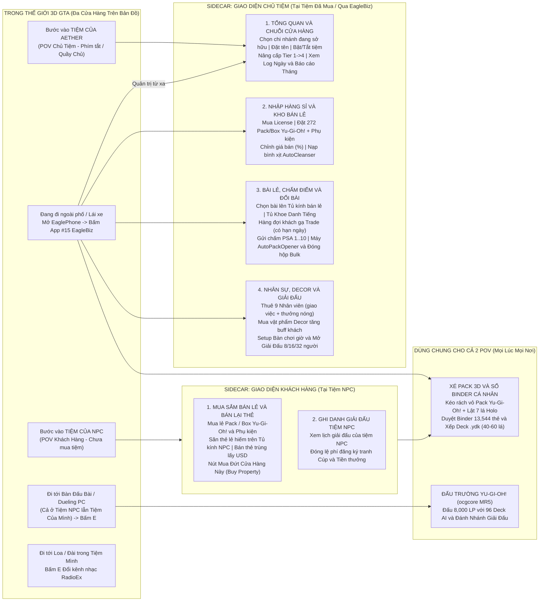
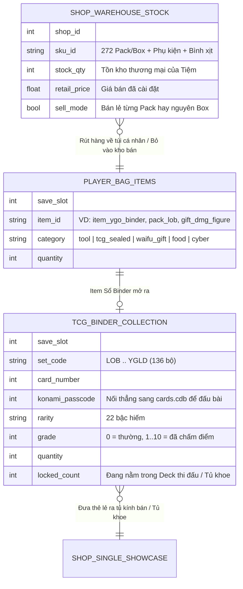

# Bản Thiết Kế Tinh Gọn (`Refined Spec`): Tích Hợp `TCG Card Shop Simulator` × `Dan's Yu-Gi-Oh! Expansion v4.1.1` Vào GTA (`gameplay-lab`)

Tài liệu này tổng hợp:
1. **Kết quả giải phẫu kỹ thuật bản mod `Dan's Yu-Gi-Oh! Expansion v4.1.1`** (từ subagent [YuGiOh Mod Reverse Engineer](conversation://530804af-04f3-4880-9704-b4a0b085b878)),
2. **Phân tích, phản biện và giải pháp kỹ thuật** cho toàn bộ các quyết định cắt giảm micro-management của bạn,
3. **Kiến trúc chuẩn hóa** cho **Sidecar UI**, **App #15 trên `EaglePhone`**, **Hệ thống Inventory 3 tầng**, **Chu kỳ Kinh tế Tháng + Log Ngày**, **4 Cấp Nội Thất 3D Cố Định**, **Xé Pack 3D/Holo** và **Đấu Bài Chiến Thuật Yu-Gi-Oh! chuẩn Konami**.

---

## PHẦN 1 — PHÁT HIỆN ĐỘT PHÁ TỪ BẢN MOD `Dan's Yu-Gi-Oh! Expansion v4.1.1`

Kết quả dịch ngược `YgoDuelTable.dll` (`v0.15.0`), `136` gói AssetBundle và thư mục `web/` mang lại **3 tin cực vui** khớp hoàn hảo với định hướng **Sidecar** của bạn:

> [!IMPORTANT]
> **Bản mod KHÔNG PHẢI là bản thay ảnh đè lên luật Tetramon!** Bên trong nó nhúng sẵn **nguyên một Engine Đấu Bài Yu-Gi-Oh! chuẩn chính thức của Konami (`Project Ignis / EDOPro ocgcore` biên dịch sang WebAssembly)** kèm cơ sở dữ liệu **`14,466` thẻ (`cards.cdb`)** và **`13,323` file script hiệu ứng bài `.lua`** chạy độc lập qua giao thức HTTP/Web — nghĩa là chúng ta **có thể bê nguyên vẹn 100% luật đấu Yu-Gi-Oh! thật sự vào Sidecar của GTA**!

### 1.1. Quy mô Hệ thống Sưu tầm & Hàng hóa trong bản mod Yu-Gi-Oh!
- **`136` Bộ Mở Rộng Yu-Gi-Oh! theo đúng dòng thời gian lịch sử (`2002 – 2015`):**
  - Trải dài từ thời kỳ đầu *Legend of Blue-Eyes White Dragon (`LOB`)*, *Metal Raiders (`MRD`)*, *Pharaoh's Servant (`PSV`)*, *Invasion of Chaos (`IOC`)* -> kỷ nguyên *GX* -> *5D's (`TDGS` — mở màn Synchro)* -> *ZEXAL (`GENF` — mở màn Xyz)* -> *ARC-V (`DUEA` — mở màn Pendulum)* cho tới *Dimension of Chaos (`DOCS`)* và *Yugi's Legendary Decks (`YGLD`)*.
- **`13,544` Phiên bản Thẻ bài (`6,604` tên bài độc nhất) chia theo `22` Độ Hiếm Yu-Gi-Oh! chuẩn:**
  - Từ `Common (5,734)`, `Short Print`, `Rare (1,736)`, `Super Rare (1,609)`, `Ultra Rare (851)`, `Secret Rare (807)`, `Ultimate Rare (603)`, `Gold Rare (212)`, `Platinum Rare (38)`, `Duel Terminal Parallel` cho tới siêu phẩm **`Ghost Rare (34)`**, **`Ghost/Gold Rare (6)`** và **`Prismatic Secret Rare (16)`** (cùng tính năng đánh dấu thẻ độc bản **`1-of-1`**!).
- **Toàn bộ `13,544` lá bài đã được bake sẵn thành ảnh hoàn chỉnh `820×1024` (`DXT5`) + `7,529` mặt nạ lấp lánh `FoilMask` (`512×512`):**
  - Khác với thẻ Tetramon gốc bị tách rời từng mảnh, mỗi lá Yu-Gi-Oh! đã có sẵn khung màu chuẩn, hình quái, sao/cấp, hộp chữ hiệu ứng, `ATK/DEF` và mã bộ (`LOB-001`), đi kèm mặt nạ `FoilMask` riêng cho từng bậc hiếm (ví dụ `Rare` chỉ ánh kim ở dòng chữ tên bài, `Super Rare` lấp lánh ô hình vẽ, `Ultra Rare` sáng cả hình lẫn chữ vàng, `Secret / Ghost Rare` lấp lánh toàn bộ lá bài!).
- **Bảng Giá Thị Trường Đời Thật (`prices/*.json`) + Thuật Toán Cân Bằng Kinh Tế (`PullRatePrices`):**
  - Có đủ giá USD thực tế trên TCGplayer cho cả `13,544` thẻ (từ `$0.01` tới **`$4,347.17`** cho thẻ chưa chấm điểm — như *Blue-Eyes White Dragon RP01* `$2,999.98`, *Dark Magician Girl MFC-000* `$530.15`, *Stardust Dragon Ghost Rare* `$431.02`!), kèm công thức tự động cân bằng giá theo tỷ lệ rớt `SlotWeights` để mở pack không bị lạm phát đầu game.
- **Danh mục Hàng hóa (`SKUs`) của bản mod & Điểm khuyết cần bù:**
  - Bản mod cung cấp **`272` mặt hàng mới**: `136` loại **Booster Pack** (`7` lá/gói, đủ mesh 3D + vỏ gói `1024×1024`) + `136` loại **Booster Box** (đủ mesh 3D + vỏ hộp `1024×1024`) + `1` mô hình bàn máy tính đấu bài cổ điển **`Dueling Computer.glb`** (`13,241` tris).
  - **Điểm khuyết duy nhất:** Bản mod có **`0` phụ kiện** (không có bình xịt khử mùi, bọc bài, sổ album, thảm đấu, gấu bông hay truyện tranh).
  - **Giải pháp kết hợp hoàn hảo:** Chúng ta **LOẠI BỎ 100% thẻ & pack giả tưởng của TCSS (`Tetramon`, `Destiny`, `Megabot`, `FantasyRPG`, `CatJob`)** để tiệm thuần chất **Yu-Gi-Oh! 100%**, nhưng **GIỮ LẠI nhóm phụ kiện đời thật từ TCSS** gồm: **Bình xịt `Deodorant`**, **`16` phụ kiện chính hãng `Ultra PRO`** (`Sleeves`, `Toploader`, `Magnetic Holder`, `Pro-Binder`, `Deckbox`, `Playmat`), **`14` tập `Manga` & `Boardgame`** và **Hộp bài lẻ `Bulk Box`**!

### 1.2. Cơ chế Đấu Bài Chiến Thuật Yu-Gi-Oh! có sẵn trong bản mod (`web/ + ocgcore`)
- **Luật thi đấu:** Chạy lõi C++ **`ygopro-core` (`ocgcore` WASM)** chuẩn **Master Rule 5 (`8,000 LP`, rút 5 lá đầu trận, đủ các Phase `Draw -> Standby -> Main 1 -> Battle -> Main 2 -> End`, `5` ô Quái chính + `2` ô Extra Monster, `5` ô Phép/Bẫy/Pendulum + ô Môi trường, Bộ bài chính `40–60` lá, Extra Deck `0–15` lá hỗ trợ đủ `Ritual / Fusion / Synchro / Xyz / Pendulum / Link`, chuỗi `Chain` Spell Speed 1/2/3)**.
- **AI Đối Thủ Thông Minh (`worker-B4siJm5t.js` + `ai-decks.json`):** Có sẵn AI nhìn trước nước đi bằng **Monte-Carlo Rollout** (`450 ms`/nước, tự clone trạng thái bộ nhớ WASM để thử combo trước khi đánh!) đi kèm **`96` bộ bài nhân vật & chiến thuật kinh điển** chia làm 3 bậc `Easy (59)` / `Medium (7)` / `Hard (30)` của **35 bài thủ huyền thoại** (*Yami Yugi, Seto Kaiba, Joey, Mai, Pegasus, Marik, Bakura, Jaden, Chazz, Alexis, Jack Atlas, Yuma...*).
- **Liên kết Kho Thẻ Thật (`/api/collection`):** Trình xếp bài (`.ydk` Deck Builder) đọc trực tiếp số lượng từng lá bài người chơi đang sở hữu trong **Sổ Binder** (kèm luật giới hạn `Banlist` tối đa `0/1/2/3` lá trùng tên) — muốn có *Mirror Force*, *Pot of Greed* hay *Blue-Eyes Ultimate Dragon* bỏ vào Deck, Aether phải tự xé trúng từ Pack, mua lẻ ở Tiệm NPC hoặc thu mua qua mục Trade!

---

## PHẦN 2 — KIẾN TRÚC KỸ THUẬT CHO CÁC CÂU HỎI LỚN CỦA BẠN

### 2.1. Câu hỏi 1: Tổ chức `Sidecar UI` và `EaglePhone` như thế nào cho gọn nhất?

Ý tưởng của bạn — **gom toàn bộ quản trị TCG Shop vào Sidecar, còn trên `EaglePhone` chỉ đặt đúng 1 App làm cổng vào (Entrance)** — là **quyết định chuẩn xác tuyệt đối** vì 2 lý do thực tế trong `gameplay-lab`:
1. **Vừa khít ô cuối cùng trên màn hình chính `EaglePhone`:** Hiện tại lưới `5×3` (`15` ô) của `EaglePhone` đã dùng từ `App #1` đến `App #14` (`Contacts`). Ô trống số **`#15`** chính là vị trí vàng cuối cùng! Nếu nhét lẻ app Đặt hàng, Hóa đơn, Chấm thẻ lên điện thoại sẽ làm vỡ lưới `5×3`. Đặt **`App #15: EagleBiz` (Quản Trị Kinh Doanh)** vừa giữ điện thoại cực kỳ sạch sẽ (chỉ hiện/mở khóa khi Aether bắt đầu mua mặt bằng kinh doanh, hoặc trước khi mua tiệm thì mở danh sách mặt bằng đang rao bán), vừa dùng chung làm cổng vào cho cả **Tiệm Bài TCG** lẫn **Tiệm Net ICS2** về sau!
2. **Đặt hàng sỉ (`Wholesale Ordering`) nên nằm luôn trong Sidecar:** Khi đặt hàng nằm ngay cạnh tab Kho hàng & Bảng giá trong giao diện rộng của Sidecar, bạn nhìn thấy ngay mặt hàng nào sắp cạn, giá thị trường tháng này đang tăng hay giảm để bấm nhập `×1 / ×5 / ×20` thùng liền mạch, không phải thoát Sidecar rút điện thoại ra bấm riêng.

- **Cách hiển thị Sidecar ngay trong màn hình GTA mượt nhất:** Vì `gta_pe.exe` chạy trên Windows 10/11 có sẵn nhân **WebView2** của hệ điều hành, tiến trình Python/C# Sidecar 64-bit sẽ phủ một lớp cửa sổ trong suốt không viền (`Borderless In-Game Overlay`, tự động khóa chuột camera GTA qua cơ chế `0x0053F509` y hệt lúc mở `EaglePhone` cảm ứng 144Hz). Nhờ vậy:
  - Toàn bộ `13,544` ảnh bài nét cao, shader lấp lánh `Secret / Ghost Rare` khi xé pack và bộ máy **`ocgcore` WebAssembly Yu-Gi-Oh!** chạy ở tốc độ **60–144 FPS bằng GPU 64-bit**,
  - Tuyệt đối **không ăn 1 byte nào vào giới hạn RAM `4 GB` 32-bit của `gta_pe.exe`**!

---

### 2.2. Câu hỏi 2: Kiến trúc `Inventory` (Túi đồ mở rộng) & Vị trí của `Sổ Binder`

Đây là lựa chọn kiến trúc cực kỳ quan trọng như bạn đã nhận ra, vì sắp tới Aether còn đi siêu thị mua quà cho bạn gái `WaifuLink`, gắp thú bông Kawaii ở tiệm Net, cầm pack bài đi xé dạo... Nếu đổ phẳng `13,544` mã bài chung mâm với quà cáp sẽ làm nổ giao diện túi đồ; ngược lại nếu tách rời hoàn toàn thành hệ thống đóng kín thì sau này không mang hộp bài/thú bông đi tặng quà hay giao dịch chéo được.

**Giải pháp tối ưu nhất: Kiến trúc Inventory 3 Tầng Phân Tách Rõ *"Túi Cá Nhân"* và *"Kho Cửa Hàng"* (lưu trong SQLite đồng bộ theo từng slot save `GTAPEsf{N}.b`):**

1. **Tầng 1 — `Túi Đồ Cá Nhân Của Aether` (`player_bag_items` — Dùng chung cho toàn bộ các mod trong GTA):**
   - Chỉ chứa các vật phẩm cấp cao gọn nhẹ: **`1` quyển `Sổ Sưu Tập Yu-Gi-Oh! (Card Binder)`**, các **Gói Pack / Hộp Booster Box chưa bóc** mà Aether mua ở tiệm NPC (hoặc rút từ kho tiệm mình về túi để tự tay xé), **Quà tặng bạn gái `WaifuLink`** (gấu bông, figure, truyện Manga, bánh ngọt siêu thị...).
2. **Tầng 2 — `Cơ Sở Dữ Liệu Sổ Binder` (`tcg_binder_collection` — Tầng con bên trong vật phẩm `Sổ Binder`):**
   - Bản thân `Sổ Binder` là 1 vật phẩm nằm ở Tầng 1; khi bấm mở `Sổ Binder` (hoặc mở tab Binder trong Sidecar), nó truy vấn bảng `tcg_binder_collection` riêng biệt chứa toàn bộ hàng vạn lá bài lẻ & thẻ chấm điểm `PSA 1..10` của bạn, đồng thời cấp dữ liệu trực tiếp cho **Deck Builder đấu bài**!
3. **Tầng 3 — `Kho Thương Mại Của Cửa Hàng` (`shop_warehouse_stock`):**
   - Tách bạch hoàn toàn sổ sách kế toán của cửa hàng với túi cá nhân của Aether! Hàng nhập sỉ chảy thẳng vào `Kho Cửa Hàng` để bán sinh lời mỗi ngày; khi nào bạn ngứa tay muốn lấy `10` gói *Legend of Blue-Eyes* trong kho ra tự xé, chỉ cần bấm nút **`"Lấy ra Xé ngay / Chuyển vào Túi"`** ngay trên Sidecar!

---

### 2.3. Câu hỏi 3: Giải đáp thắc mắc về `Kệ Trưng Bày Cá Nhân (PersonalShelf)` trong code gốc

Tôi đã kiểm tra trực tiếp mã máy CIL của hàm `CustomerManager::EvaluateMaxCustomerCount` (offset `0x029d..0x0399`) trong `Assembly-CSharp.dll` để trả lời chính xác câu hỏi của bạn:
- **Kết quả từ code gốc:** **CÓ TÁC DỤNG TĂNG KHÁCH THẬT SỰ!** Với mọi chiếc `PersonalShelf` (`m_ItemNotForSale == true`), game cộng tổng **Giá thị trường (`Market Price`) của toàn bộ các lá bài hiếm đang trưng trên kệ đó**, chia cho `$50,000` rồi nhân hệ số `decoBonus` của tủ để **cộng thẳng vào giới hạn khách tối đa ghé tiệm (tối đa cộng thêm tới `+20` khách!)**.
- **Đề xuất áp dụng vào GTA cực gọn:**
  - **Trong game 3D:** Tiệm từ cấp vừa/lớn trở lên có đặt sẵn mô hình **Tủ Trưng Bày Danh Tiếng** làm điểm neo cho khách NPC đi ngang dừng lại trầm trồ ngắm nghía (mẫu thẻ 3D bên trong cố định, không cần đổi động).
  - **Trong Sidecar:** Có một ô nhỏ **`"Tủ Trưng Bày Danh Tiếng (Showcase Slots)"`** (mở `4 -> 12` ô theo cấp Shop) cho phép bạn ghim những lá `Ghost Rare` / `PSA 10` đắt giá nhất trong Binder lên khoe (an toàn 100% không bị bán mất). Tổng giá trị tủ khoe càng cao -> **càng cộng thêm `%` lượng khách ghé tiệm mỗi ngày và tăng tỷ lệ xuất hiện khách Đại Gia (`Ultra-Whale`)**! Như vậy việc giữ lại thẻ siêu hiếm trong bộ sưu tập vừa sướng mắt vừa đẻ ra tiền cho shop!

---

## PHẦN 3 — ĐÁNH GIÁ & TINH CHỈNH TOÀN BỘ LUỒNG VẬN HÀNH THEO Ý BẠN

Mọi đề xuất cắt bỏ thao tác tay lặp lại của bạn (bỏ bê thùng vỉa hè, bỏ xếp từng gói lên kệ, bỏ nhặt vỏ thùng rác, bỏ đứng quầy đếm xu thối tiền, bỏ bật/tắt đèn tối, bỏ đánh số bàn giải đấu) đều **cực kỳ hợp lý và giúp loại bỏ 100% rủi ro lỗi kẹt vật lý/AI trong GTA SA**. Dưới đây là cách khớp nối trơn tru từng mảnh ghép bạn đã duyệt:

### 3.1. Hệ thống Cấp độ Shop (`Lv 1..50`) kết hợp `4` Bậc Nội Thất 3D Cố Định (`Interior Tiers`)
Vì bản mod Yu-Gi-Oh! trải khóa giấy phép `136` bộ bài từ `Lv 1` tới `Lv 30+` và nhân viên tới `Lv 45`, nhưng trong GTA chúng ta không thể vẽ 45 cái nội thất khác nhau, cách đẹp nhất là **giữ thanh `Shop Level (1..50)` lên cấp mượt theo EXP**, và gom việc mở rộng mặt bằng + tự động mua sắm trọn gói nội thất vào **`4` Mốc Đại Trùng Tu Nội Thất (`Shop Tier 1 -> 4`)**:

| Bậc Tiệm (`Interior Tier`) | Yêu cầu & Chi phí Trọn gói *(đã gộp Mặt bằng + Full Kệ/Máy/Bàn)* | Không gian 3D cố định trong GTA (`Area Code = 1`) | Năng lực Vận hành mở khóa trong Sidecar |
| :---: | :--- | :--- | :--- |
| **Tier 1** *Tiệm Bài Nhỏ Khởi Nghiệp* | Mua ban đầu (`~$3,500` gồm mặt bằng + kệ cơ bản + 1 bàn đấu + máy xịt thơm) | Gian tiệm nhỏ ấm cúng: Quầy thu ngân, dãy kệ hàng, 1 tủ kính thẻ lẻ, 1 bàn đấu, máy xịt thơm cửa, loa Radio | Sức chứa kho `500` đơn vị, bán tối đa `8` thẻ lẻ cùng lúc, `1` bàn chơi giờ, thuê tối đa **`1` nhân viên**. |
| **Tier 2** *Cửa Hàng Thẻ Bài Phố Thị* | `Shop Lv 10` + Phí nâng cấp trọn gói (`~$15,000`) | Mặt bằng rộng gấp đôi: thêm dãy kệ đôi, 2 tủ kính, cụm **3 bàn đấu bài thoáng rộng**, có thêm bàn `Workbench` & máy tính `Dueling PC` | Kho `2,000` đơn vị, `20` ô bán thẻ lẻ, mở khóa **Đóng hộp Bulk Box**, mở **Giải đấu 8 người**, thuê tối đa **`3` nhân viên**. |
| **Tier 3** *Siêu Thị & Phòng Đấu Chuyên Nghiệp* | `Shop Lv 22` + Phí nâng cấp trọn gói (`~$50,000`) | Sảnh lớn có khu Kho sau + Khu đấu giải riêng: 4 tủ kính LED, **Tủ khoe cá nhân (`Personal Showcase`)**, **Máy xé pack `AutoPackOpener`**, 2 quầy thu ngân | Kho `6,000` đơn vị, `45` ô bán thẻ lẻ, mở khóa **Máy xé Pack tự động**, **Tủ khoe tăng uy tín**, **Giải đấu 16 người**, thuê **`6` nhân viên**. |
| **Tier 4** *Đại Bản Doanh Đấu Bài Hạng Đế Chế* | `Shop Lv 35` + Phí nâng cấp trọn gói (`~$150,000`) | Đại sảnh 2 phân khu sang trọng bậc nhất: Khu trưng bày VIP, dãy máy tự động đời cuối & Sảnh Đấu Trường trung tâm cực thoáng cho khán giả vây quanh | Kho `15,000` đơn vị, `100` ô bán thẻ lẻ, `AutoPackOpener` siêu tốc, **Giải đấu lớn 32 người**, thuê trọn bộ **`9` nhân viên**! |

---

### 3.2. Công thức Mô phỏng Kinh tế Hậu trường (`08:00 – 21:00` Hàng Ngày + Quyết toán `30` Ngày/Tháng)

1. **Mô phỏng Doanh thu & Trừ kho mỗi ngày (`Daily Simulation Engine` kèm Log chi tiết):**
   - Mỗi ngày trong game (`08:00 -> 21:00`), Python Sidecar không bắt engine 3D vẽ thật mà tính toán chính xác dựa trên hiện trạng thực của tiệm để ghi **Nhật ký ngày (`Daily Log`)**:
     - **Số lượng khách ghé tiệm trong ngày (`N`):** Quyết định bởi `Shop Tier` + `Shop Level` + `Điểm Review Sao (1.0★–5.0★)` + `Buff Đồ Trang Trí đã mua` + `Giá trị Tủ Khoe Cá Nhân` (trừ điểm phạt nếu **Máy khử mùi hết sạch bình xịt `Deodorant`**!).
     - **Năng lực phục vụ tối đa (`Checkout Throughput Cap`):** Chủ tiệm mặc định tự xử lý nền được `K_base` khách/ngày; mỗi nhân viên giao việc `Thu ngân` cộng thêm năng lực theo `Tốc độ gốc × (1 + 0.07 × Cấp Skill)` (nhân viên có thuộc tính **Chịu Tăng Ca `OT`** cộng thêm **`+12%` doanh thu cuối ngày & điểm hài lòng khách**!). Nếu khách đông vượt quá năng lực thu ngân -> phần khách dội ra sẽ bỏ về và ghi vào Log *"Quầy thu ngân quá tải — nên thuê thêm nhân viên tính tiền!"*.
     - **Roll `8` hạng ví khách & Đại gia (`Ultra-Whale`):** Mỗi khách roll ngẫu nhiên nhu cầu mua Pack/Box/Phụ kiện (chỉ mua thành công nếu **trong Kho đang còn hàng thật** và qua bài kiểm tra **Đường cong độ nhạy giá `-20%..+60%`** -> trừ thẳng tồn kho), thuê bàn ngồi chơi, hoặc là **Đại gia ví `$50k–$1M`** chốt mua các lá bài hiếm bạn đang treo bán trên tab `Tủ Kính Thẻ Lẻ`!
     - **Hàng đợi Gạ Đổi / Bán Bài Lẻ (`Async Trade Inbox`):** Mỗi ngày có xác suất sinh `1–2` lời đề nghị khách muốn bán thẻ hiếm hoặc đổi thẻ với bạn, nằm gọn trong tab **`Trade Offers`** của Sidecar kèm **hạn chót `3–5` ngày trong game** để bạn rảnh lúc nào mở lên mặc cả/chốt đơn lúc đó!
2. **Chu kỳ Vĩ mô theo Tháng (`30` Ngày trong game = `1` Kỳ Quyết Toán):**
   - **Đầu mỗi Tháng (Ngày 1):** Hệ thống cập nhật **Bảng Giá Thị Trường Tháng Mới** cho các bộ bài/độ hiếm (kèm tin tức xu hướng tháng để bạn đầu cơ ôm thẻ/chỉnh giá) và gửi thông báo trên `EaglePhone`. *(Gợi ý nhỏ cho Bàn chơi hàng ngày: thay vì thao túng giá thị trường phức tạp, việc chọn Thể thức bàn chơi như `Classic Duel Monsters`, `GX Fusion`, `5D's Synchro`, `Xyz` trong Sidecar sẽ trực tiếp tăng tiền thuê bàn và tăng tốc độ tiêu thụ đúng các hộp bài thuộc kỷ nguyên đó ngay trong tháng!)*
   - **Cuối mỗi Tháng (Ngày 30):** Tổng kết Báo cáo Tài chính Tháng (`Doanh thu gộp - Vốn nhập hàng - Hóa đơn Tiền mặt bằng + Điện + Lương 30 ngày của nhân viên`), gửi thông báo thanh toán qua `EaglePhone` / `NeoBank`.
   - **Ngoại lệ giữ nhịp nhanh hợp lý:** Cảnh báo **Cháy hàng kho / Hết bình xịt khử mùi** báo ngay lập tức khi chạm `0`; dịch vụ **Gửi chấm điểm thẻ `PSA / TCG 1..10`** giữ thời gian chờ **`2–12` ngày game** để nhịp đập hộp săn điểm `10` luôn hào hứng, không bị ngâm cả tháng!

---

### 3.3. Diễn hoạt 3D Sống Động Trong Tiệm (`Ambient Ped Choreography` + `Nhân viên cố định` + `Loa Radio`)
Khi Aether bước chân qua cửa vào nội thất Tiệm Bài (`Area Code = 1`), cầu CLEO + Python điều phối cảnh quan hoàn toàn tách biệt với logic tính tiền nhưng cực kỳ chân thực:
- **Dàn Nhân viên theo đúng Hồ sơ thuê (`Fixed Skin Pool`):** Mỗi người trong `9` nhân viên (`Zackery Cole` .. `Axel Charleton`) gắn cứng với `1` Skin ID riêng biệt:
  - Ai đang giữ việc `Thu ngân` -> đứng đúng sau quầy làm động tác quét hàng/giao dịch với khách xếp hàng.
  - Ai đang giữ việc `Kho / Vận hành` -> đi lại tuần hoàn từ cửa Kho -> ra dãy Kệ hàng -> ghé Máy xé pack `AutoPackOpener` -> kiểm tra Máy xịt thơm `AutoCleanser` -> lấy bài ở Tủ lưu trữ `CardStorageShelf` ra Tủ kính (nếu gắn thêm thùng carton nhẹ trên tay bằng `CARRY.IFP` khi từ kho bước ra kệ cũng làm được rất dễ vì lối đi nội thất đã cố định 100%!).
- **Luồng Khách hàng vãng lai đa dạng (`Ambient Visitors`):** Số lượng ped khách xuất hiện tỉ lệ thuận với độ nổi tiếng của tiệm (`2 -> 14` ped, đổi skin liên tục không trùng lặp): đi từ cửa chính vào -> tản ra đứng ngắm kệ Pack, cúi nhìn Tủ kính bài lẻ & Tủ khoe cá nhân, ngồi đối diện nhau trên bàn đấu bài, xếp hàng trước quầy thu ngân -> đi ra cửa biến mất.
  - **Vào Ngày Tổ Chức Giải Đấu:** Các bàn đấu ở khu vực thoáng giữa sảnh luôn kín các cặp tuyển thủ ngồi đánh giải kèm `3–6` ped khán giả đứng vây xem cổ vũ xung quanh!
- **Đài / Loa Nhạc Trong Tiệm (`In-Shop Radio Prop`):** Đặt mô hình dàn âm thanh/loa ngay quầy hoặc góc tiệm; Aether lại gần bấm `[E]` để chuyển kênh trực tiếp từ hệ thống đài `RadioEx` của GTA!

---

### 3.4. Hai "Ngôi Sao Sáng Nhất": Xé Pack Vật Lý & Đấu Giải Yu-Gi-Oh! Trực Tiếp

1. **Trải nghiệm Tự Tay Xé Pack Yu-Gi-Oh! (`Pack Ripping Experience`):**
   - Dùng đúng `136` mẫu vỏ gói bạc `1024×1024` của từng bộ Yu-Gi-Oh! + âm thanh rách vỏ nguyên bản `"SFX_OpenPack"` từ TCSS:
   - Giữ chuột trái kéo vệt cắt ngang mép trên bao bì (thả sớm tự tụt lại) -> vỏ bạc bung sáng xòe **`7` lá bài Yu-Gi-Oh! úp lưng xoáy nâu chuẩn Konami** -> bấm lật từng lá (nghiêng chuột xoay góc 3D thấy rõ lớp ánh kim `FoilMask` chạy chéo trên mặt thẻ `Ultra / Secret / Ghost Rare`, tự động khựng hiệu ứng tia sáng Holo + chuông `"SFX_HighValueCardReveal"` khi trúng thẻ quý!). Có cả nút mở nhanh cho người bận nhưng giữ trọn vẹn độ "phê" thủ công khi xé hộp hiếm!
2. **Trải nghiệm Ngồi Bàn Đấu Bài & Đánh Giải Đấu Ở Cả `2` POV (`Khách Hàng` & `Chủ Tiệm`):**
   - **Khởi đầu tự nhiên 100% (Không thêm `Starter Deck` giả):** Ngày đầu vào game, Aether thuần túy ghé các Tiệm Bài NPC (hoặc tiệm mình) **mua lẻ từng Pack / Box về tự tay xé và săn mua thêm Thẻ lẻ trên tủ kính** cho tới khi tích lũy đủ tối thiểu **`40` lá** trong `Card Binder` -> tự mở `Deck Builder` xếp bộ bài `.ydk` đầu đời của riêng mình để bước vào bàn đấu!
   - **Tách bạch rõ Hệ thống Đa Cửa Hàng trên Bản đồ GTA (`NPC-Owned` vs `Player-Owned`):**
     - Trên khắp bản đồ GTA có **nhiều Tiệm Bài độc lập** (Los Santos, San Fierro, Las Venturas, Akihabara `WIBU-01`...).
     - **Khi bước vào Tiệm chưa mua (`POV Khách Hàng`):** Mở `Sidecar Cửa Hàng Bán Lẻ` để mua Pack/Box/Phụ kiện về túi, mua thẻ hiếm trên tủ kính của NPC, bán lại thẻ trùng lấy tiền mặt, bấm `[E]` ở bàn đấu gạ khách NPC giao hữu kiếm thưởng, đăng ký đánh **Giải Đấu do tiệm NPC tổ chức**, hoặc bấm **`"Mua Đứt Cửa Hàng Này"`** khi đã tích đủ vốn!
     - **Khi đã mua lại cửa hàng đó (`POV Chủ Tiệm`):** Cửa hàng đó chuyển hẳn sang quyền điều hành của Aether trên `Sidecar Quản Trị Cửa Hàng` / `EagleBiz App #15` (nhập sỉ, chỉnh giá, thuê nhân viên, mở rộng Tier `1 -> 4`, tự đứng ra tổ chức Giải Đấu `8/16/32` người và có thể đích thân ngồi bàn tranh Cúp ngay trên sân nhà!), trong khi các tiệm chưa mua khác trên bản đồ vẫn vận hành bình thường để Aether ghé sang với tư cách Khách Hàng.

---

## PHẦN 4 — CÁC QUYẾT ĐỊNH ĐÃ CHỐT KHÓA SỔ CHO GAME #1 (`LOCKED DECISIONS — 11/11/2026`)

> [!IMPORTANT]
> **Trạng thái Hồ sơ Game #1 (`TCSS × Yu-Gi-Oh!`):** **ĐÃ CHỐT 100%** theo xác nhận của người dùng:
> 1. **Thuần `100% Yu-Gi-Oh!` cho thẻ bài:** Loại bỏ toàn bộ thẻ Tetramon giả tưởng; chỉ sử dụng **`136` bộ thẻ Yu-Gi-Oh! (`13,544` lá)** kết hợp nhóm **Phụ kiện đời thật của TCSS** (`Bình xịt Deodorant`, `16` món `Ultra PRO`, `Manga`, `Boardgame`, `Hộp Bulk Box`).
> 2. **Không chèn `Starter Deck` — Giữ trọn nhịp Xé Pack tích lũy tự nhiên & Đầy đủ `2` POV:** Khởi đầu bằng việc mua Pack về xé & gom thẻ lẻ cho đủ `40+` lá để soạn bộ bài thi đấu; thiết kế song song đầy đủ cả **`POV Khách Hàng`** (vào tiệm mua bài, xé bài, soạn bài, đánh giải) lẫn **`POV Chủ Cửa Hàng`**.
> 3. **Thế giới Đa Cửa Hàng tách bạch rõ ràng:** Đặt nhiều cửa hàng bài khắp thế giới GTA; mỗi cửa hàng chưa sở hữu là **Tiệm NPC** (Aether vào đóng vai Khách Hàng), và Aether có thể bỏ vốn **mua đứt bất kỳ cửa hàng nào** để chuyển cửa hàng đó sang chế độ **Tự Điều Hành (`Owner Mode`)**.
> 4. **Đặt tài nguyên ảnh thẻ trực tiếp trên ổ `C:` (`gameplay-lab`):** Sao chép/tối ưu bộ ảnh thẻ Yu-Gi-Oh! sang thẳng ổ SSD `C:` của `gameplay-lab` khi triển khai để đảm bảo tốc độ load tức thì `0 ms` khi xé Pack, lật Sổ Binder và đấu bài.
