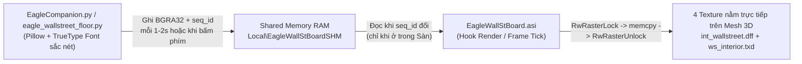

# Khảo Sát Kỹ Thuật & Bản Thiết Kế Sàn Chứng Khoán 3D (`Eagle Wall Street Exchange`)

- **Ngày khảo sát:** `2026-11-05`
- **Hội thoại:** `7cc5f56b-9a2d-46ce-902b-37b8220f72be` (Antigravity)
- **Đích khảo sát:** `C:\Users\LENOVO\Desktop\GTA\Project Eagle\gta sa gameplay-lab` & `D:\GTA Archive\Skin Library`
- **Phạm vi thực hiện:** Chỉ đọc mã nguồn, nhị phân `gta_pe.exe`, bản đồ `.IPL` và kho skin (`0` thay đổi vào game runtime).

---

## 1. Phân Tích Rõ Trạng Thái: Có Sẵn / Tài Liệu Tham Khảo / Cần Xây Mới

| Hạng mục | Đã có sẵn trong `gameplay-lab` & Kho | Nguồn tham khảo mạng / Kiến trúc | Phần cần xây dựng khi triển khai |
| :--- | :--- | :--- | :--- |
| **Bảng điện tử 3D trực tiếp trong game** | `gta_pe.exe` (`1.0 US`, timestamp `0x427101CA`) có đầy đủ hàm RenderWare `CTxdStore::FindTxdSlot` (`0x00731850`), `RwTexDictionaryFindNamedTexture` (`0x007F39F0`), `RwRasterLock` (`0x007FB2D0`), `RwRasterUnlock` (`0x007FAEC0`) và `MinHook.x86.dll`. | Sàn **NYSE (18 Broad Street)**: dải băng LED 360° ôm quanh cổ cột đá, bảng Jumbotron trên vòm tường và màn hình đa chiều tại các quầy *Trading Post* hình móng ngựa. | Plugin C++ nhẹ **`EagleWallStBoard.asi`** (`~15 KB`) đọc framebuffer `BGRA32` từ Shared Memory do `EagleCompanion.py` vẽ bằng font TrueType sắc nét và ghi thẳng vào `RwRaster*` của vật thể 3D trên tường/trần + dịch UV dải chữ chạy 60–144 FPS. |
| **Tòa nhà Entrance bên ngoài** | Có sẵn nhiều tòa nhà cột đá Tân cổ điển, cao ốc ngân hàng và cả tổ hợp mang tên `wb_stockexc` (`ID=83020`, Downtown Chicago), hoàn toàn trống `ENEX` quanh cửa. | **NYSE 18 Broad St** (mặt tiền cột đá Corinthian + trán tường tam giác), **BAWSAQ** (GTA IV Star Junction / Algonquin), các mẫu vỏ ngoại thất NYSE trên Sketchfab. | Gắn cặp `ENEX` 2 chiều nối cửa ngoài phố vào sảnh nội thất tại `Area Code = 1, Z = +1550.0m` + gắn icon bản đồ (`CRadar::SetCoordBlip`) và bảng hiệu/tượng Bò Húc (Charging Bull) trước cửa nếu cần. |
| **AI Tư vấn Broker giá rẻ** | Đã xác minh trên `https://api.openai.com/v1` (`EAGLE_CHARACTER_OPENAI_API_KEY`) có sẵn **`gpt-5.4-nano`** (`gpt-5.4-nano-2026-03-17`) và **`gpt-5-nano`** (`gpt-5-nano-2025-08-07`), tách biệt hoàn toàn với `gpt-6-luna`. | Chuyên viên môi giới tại sàn (*Floor Specialist / Institutional Broker*) phân tích xu hướng theo ngành và nhận ủy thác lệnh. | Module độc lập `eagle_wallstreet_floor.py` nối `gpt-5.4-nano` với dữ liệu live (`self.day`, nến OHLC 24 mã, tin `EagleTimes`, danh mục Aether) + cầu CLEO `EagleWallStBridge.cs`. |
| **Dàn 7–8 NPC Broker có đủ xương animation** | Kho `D:\GTA Archive\Skin Library\Project Eagle\numbered-skins` có **`42` skin mục `normal` chưa gán (`unassigned`)** đạt `0` cảnh báo, có đủ `Skin PLG (0x0116)` + `HAnim PLG (0x011E)`; ngoài ra có `940` slot ped gốc `0` lần xuất hiện ngoài phố. | Nhân sự sàn chứng khoán mặc sơ mi, cà vạt, vest, áo khoác công sở, kính, thực hiện animation chỉ bảng, gọi điện, gõ máy, ăn mừng/ôm đầu. | Đóng gói **8 Custom Ped ID mới `49448..49455`** (`ws_broker_01..08`, nối tiếp `49447` trong `data/peds.ide` + `CUSTOM/custom_mods.img`) để không đụng bất kỳ NPC đường phố nào. |

---

## 2. Cơ Chế Render Bảng Điện Tử Trực Tiếp Lên Vật Thể 3D (100% In-World, Không Mở Popup Kiểu Điện Thoại)

### 2.1. Xác minh địa chỉ hàm RenderWare trực tiếp trên `gta_pe.exe`

Đã kiểm tra PE Section mapping trên `Project Eagle\gta sa gameplay-lab\gta_pe.exe`:
- `CTxdStore::FindTxdSlot` (`0x00731850`): `8B 44 24 04 53 55 56 57`
- `CTxdStore::AddTxdSlot` (`0x00731C80`): `8B 0D 0C 80 C8 00 56 E8` (`ms_pTxdPool = 0x00C8800C`)
- `RwTexDictionaryFindNamedTexture` (`0x007F39F0`): `8B 44 24 04 53 83 C0 08`
- `RwRasterLock` (`0x007FB2D0`): `8B 44 24 08 8B 54 24 0C`
- `RwRasterUnlock` (`0x007FAEC0`): `A1 24 7B C9 00 56 8B 74` (`RwEngineInstance = 0x00C97B24`)

### 2.2. Luồng cập nhật Bảng Điện Tử 3D Thời Gian Thực (`0` Disk I/O, `< 0.2 ms`/nhịp)

Trong file `.DFF` của Sàn Chứng Khoán (`int_wallstreet.dff`), các tấm màn hình LED là **mặt lưới 3D thật có vật liệu tự phát sáng (`Prelight = 255,255,255`, không bị tối theo góc đèn)**:
1. **`ws_ticker_ring` (`2048×128`) — Vòng Đai LED 360° Quanh Trần & Cột**:
   - Dải băng điện tử uốn tròn chạy suốt chu vi sảnh chính và quấn quanh các đảo giao dịch.
   - Plugin `.asi` cập nhật độ lệch tọa độ UV `u_offset` theo mỗi khung hình (`60–144 FPS`), tạo hiệu ứng **dòng chữ bảng giá xanh/đỏ trôi ngang mượt liên tục trong không gian 3D**.
2. **`ws_board_main` (`1024×512`) — Đại Bảng Phố Wall Trung Tâm**:
   - Đặt cao trên bức tường chính phía Bắc: hiển thị chỉ số tổng hợp **EAGLE-24 INDEX**, Top Gainers / Top Losers, đồng hồ phiên giao dịch (`OPENING BELL 09:30 - 16:00`), thanh tâm lý thị trường (*Fear & Greed*) và dòng tin vắn nóng từ `The Eagle Times`.
3. **`ws_board_chart_a` & `ws_board_chart_b` (`1024×512` × 2) — Bảng Biểu Đồ Nến Nhật Trên Tường Đá**:
   - Vẽ trực tiếp bằng Pillow với phông chữ tài chính sắc nét (`Consolas` / `Segoe UI Semibold` có khử răng cưa, không bị vỡ hạt hay mất ký tự như `CFont` GTA SA): 36 cây nến OHLC, đường `MA7` / `MA20`, cột Volume và sổ lệnh mua/bán (*Orderbook Depth*).
4. **`ws_post_screen` (`1024×512`) — Cụm Màn Hình Cong Trên Quầy Giao Dịch (Tương tác 3D tại chỗ)**:
   - Khi người chơi đứng trước quầy *Trading Post* và nhấn `[E]`, camera 3D của game **dịch nhẹ qua vai Aether nhìn thẳng vào cụm màn hình 3D thật trước mặt** (không bật khung điện thoại 2D).
   - Người chơi bấm phím chọn mã / khối lượng / lệnh `Spot`, `Long/Short`, `Limit`, `Take-Profit / Stop-Loss` -> hình ảnh trên **chính chiếc màn hình 3D gắn trên bàn** cập nhật tức thì ở `30 FPS`, đồng thời Đại Bảng trên tường lớn chuyển sang soi chi tiết mã đang chọn và phát tiếng chuông khớp lệnh vang khắp sảnh!

---

## 3. Khảo Sát Ứng Viên Tòa Nhà Entrance Trong `gameplay-lab` & Tham Khảo Trên Mạng

### 3.1. Tham khảo kiến trúc thực tế & nguồn 3D trên mạng
- **Bố cục chuẩn NYSE (`18 Broad Street, Manhattan`)**:
  - Ngoại thất: Khối dinh thự đá cẩm thạch Tân cổ điển với hàng cột Corinthian khổng lồ và bậc thềm rộng.
  - Nội thất (*Main Trading Floor* `~33m × 42m`, trần cao `~21m`): Kết hợp đối lập giữa cột đá cổ điển thế kỷ 20, giếng trời kính trên trần và các đảo máy trạm điện tử hiện đại hình móng ngựa (*Specialist Trading Posts*) ở dưới sàn, cùng ban công lửng (*Bell Podium & Broadcast Balcony*) nhìn xuống toàn sảnh.
- **Tình trạng model trên mạng (Sketchfab / GTAinside / LibertyCity.net)**:
  - Cộng đồng chỉ chia sẻ rời rạc phần vỏ ngoài tòa nhà NYSE / BAWSAQ (GTA IV) hoặc tượng *Charging Bull*, hầu như không có sẵn nội thất sàn chứng khoán đầy đủ `.dff`/`.col` cho GTA SA.
  - Do đó, dựng nội thất **`int_wallstreet.dff` + `.col3`** bằng pipeline Blender 5.0 (cùng công nghệ đã dựng `INT-01..07` Mondstadt đạt `100% PASS`) sẽ cho phép thiết kế chính xác vị trí các màn hình LED 3D, hành lang lửng, bục rung chuông và va chạm sàn/quầy mượt tuyệt đối.

### 3.2. Hệ Thống 4 Cổng Chi Nhánh Tại 4 Thành Phố Lớn & Khoảng Cách Thực Tế

Đã đo trực tiếp khoảng cách Euclid giữa 4 tòa nhà ứng viên ở 4 đô thị khác nhau trong `gameplay-lab` — tất cả đều cách nhau rất xa (**`4.13 km` đến `17.77 km`**), cực kỳ lý tưởng để mở **cả 4 cổng đi vào cùng Sàn Giao Dịch Trung Tâm**:

| Chi nhánh | Thành phố | Tòa nhà & Tọa độ cửa vào | Khoảng cách tới `ENEX` gần nhất | Khoảng cách tới các chi nhánh khác |
| :---: | :--- | :--- | :---: | :--- |
| **Branch #1** | **Los Santos** (Commerce) | Dinh Thự Cột Đá Tân Cổ Điển Pershing Square `(1481.0, -1771.0, 18.8)` | `> 80.0m` (trống `100%`) | `4.13 km` tới SF • `12.03 km` tới Chicago • `16.21 km` tới LC |
| **Branch #2** | **San Fierro** (Financial) | Cao ốc Tài chính `monolith_sfe` (`ID=9907`) `(-1759.0, 789.8, 25.0)` | `80.1m` (trống `100%`) | `4.13 km` tới LS • `11.68 km` tới Chicago • `17.77 km` tới LC |
| **Branch #3** | **Downtown Chicago** | Tổ hợp Sàn Chứng Khoán `wb_stockexc` (`ID=83020`) `(6287.8, 9257.5, 20.7)` | `181.7m` (trống `100%`) | `12.03 km` tới LS • `11.68 km` tới SF • `8.42 km` tới LC |
| **Branch #4** | **Liberty City** (South Staunton) | Phố Tài chính Nam Staunton gần `flatironlt01` `(14580.9, 7784.2, 42.2)` | `84.0m` (trống `100%`) | `16.21 km` tới LS • `17.77 km` tới SF • `8.42 km` tới Chicago |

- **Cơ chế Cửa Ra Thông Minh (`Smart Branch Return`)**: Thay vì dùng `enex` tĩnh trong `.ipl` (vốn chỉ trả người chơi về 1 tọa độ cố định duy nhất), script `EagleWallStBridge.cs` lưu biến `last_entered_branch_id (0..3)` ngay khi bước qua vòng sáng cửa vào -> đưa Aether vào sảnh nội thất chung (`Area Code = 1, Z = +1550.0m`), và khi bước ra cửa sảnh sẽ **trả Aether về đúng thành phố vừa bước vào** (kèm tùy chọn thang máy VIP chuyển nhanh giữa 4 trung tâm tài chính).
- **Tích hợp Định vị & Dịch chuyển trên `EaglePhone` (`GG Map`)**: Đăng ký đủ 4 địa điểm vào `CURATED_GG_MAP_POIS` trong `Project Eagle\gta sa gameplay-lab\eagle_gg_map_pois.py` (hỗ trợ cả **Set GPS** lẫn **Fast Travel / EagleRide**) kèm blip radar cố định qua `CRadar::SetCoordBlip`. Riêng hai cao ốc ngân hàng `Mulholland Bank Plaza (1465.0, -1012.0, 26.8)` và `Rodeo Bank (597.8, -1265.5, 43.1)` được giữ nguyên để làm **Trụ sở Ngân hàng NeoBank** ở giai đoạn tiếp theo.

---

## 4. Kiến Trúc Tư Vấn Broker Bằng Model `gpt-5.4-nano` & Hành Vi Sống Động Trên Sàn

### 4.1. AI Tư vấn Chuyên sâu Giá rẻ (`gpt-5.4-nano`)
- **Model sử dụng**: `gpt-5.4-nano` (hoặc `gpt-5-nano`) qua cùng hạ tầng `https://api.openai.com/v1` (`EAGLE_CHARACTER_OPENAI_API_KEY`), giới hạn `max_completion_tokens = 220`, phản hồi nhanh dưới `1 giây` và chi phí cực thấp, giữ nguyên toàn bộ hạn mức `gpt-6-luna` cho WaifuLink / Mondstadt / Paimon.
- **4 Bàn Chuyên Biệt Trên Sàn (Mỗi bàn có 1 Senior Broker tương tác `[E]` + 1 Floor Trader phụ tá)**:
  1. **Post 1 — Big Tech & AI Growth Desk**: Chuyên nhóm `NVDA, AAPL, MSFT, TSLA, META, AMD, GOOG, AMZN, NFLX, BRK`.
  2. **Post 2 — Gold, Oil & Rare Gems Pit**: Chuyên nhóm `XAU, XAG, XPT, DIAMOND, RUBY, WTI`.
  3. **Post 3 — Digital Assets & High-Beta Desk**: Chuyên nhóm `BTC, ETH, SOL, BNB, XRP, DOGE, ADA, LTC`.
  4. **Post 4 — Institutional & Derivatives Desk**: Chuyên lệnh lớn, thiết lập tự động **Take-Profit / Stop-Loss / Limit Order** và đọc "tin đồn dòng tiền lớn" (*Floor Flow Whisper*) trong ngày.
- **Chế độ Offline Fallback**: Nếu mất mạng hoặc tắt API, Broker vẫn trả lời mượt bằng bộ mẫu câu phân tích định lượng trực tiếp từ dữ liệu nến OHLC + `MA7/MA20` + biến động ngày.

### 4.2. Máy Trạng Thái Hành Vi Ambient Của 8 Nữ Broker (Xác minh từ `anim/anim.img` + `anim/ped.ifp`)
Đã kiểm tra trực tiếp `Project Eagle\gta sa gameplay-lab\anim\anim.img` — có sẵn đầy đủ các gói `.ifp` gốc (`cop_ambient.ifp`, `otb.ifp`, `int_office.ifp`, `gangs.ifp`, `casino.ifp`, `bar.ifp`) để chạy vòng lặp hành vi sống động cho 8 nữ Broker:
1. **Đi qua đi lại giữa bàn giao dịch và Đại Bảng LED**: `0x05D3` (`TASK_GO_STRAIGHT_TO_COORD` ở tốc độ đi bộ `move_state = 4`) nối giữa các waypoint quanh đảo *Trading Post* và trước bức tường biểu đồ nến.
2. **Ngước nhìn chăm chú bảng điện tử & phản ứng theo nến Xanh/Đỏ**: `OTB` (`wtchrace_loop` đứng theo dõi bảng, `wtchrace_win` vung tay reo mừng khi thị trường tăng mạnh, `wtchrace_lose` ôm đầu tiếc nuối khi sập giá) + `COP_AMBIENT` (`Coplook_watch`, `Coplook_loop`).
3. **Trầm ngâm suy nghĩ phân tích biểu đồ**: `COP_AMBIENT` (`Coplook_think` khoanh tay chống cằm suy tư, `Coplook_nod` gật gù xác nhận xu hướng, `Coplook_shake` lắc đầu).
4. **Đứng trao đổi, tranh luận theo cặp**: Hai Broker bước lại đối diện nhau qua `0x0609` (`TASK_TURN_CHAR_TO_FACE_CHAR`) và luân phiên chạy `ped` (`IDLE_chat`) + `GANGS` (`prtial_gngtlkA..H` cử chỉ tay trao đổi chuyên môn).
5. **Trực máy trạm & nghe điện thoại khách VIP**: `INT_OFFICE` (`OFF_Sit_Type_Loop`, `OFF_Sit_Watch`) tại ghế quầy *Trading Post* và `ped` (`phone_in`, `phone_talk`, `phone_out`).

---

## 5. Đội Hình Chính Thức 8 Nữ Broker Đã Chốt (`Custom Ped IDs 49448..49455`, `0` Xuất Hiện Ngoài Đường, Đủ Xương `Skin + HAnim`)

Người dùng đã duyệt và chốt chính thức **8 Nữ Broker** từ bảng 18 ứng viên (`100%` nhân vật nữ, `0` xuất hiện trên đường phố `occ = 0`, kiểm định nhị phân đủ `Skin PLG 0x0116` + `HAnim PLG 0x011E` và `numMaterials <= 29 << 136`):

| Custom Ped ID | Tên model đóng gói | Nhân vật & Tác phẩm | Tên file gốc (`assetStem`) | Dung lượng | Vị trí & Vai trò trên Sàn Phố Wall |
| :---: | :--- | :--- | :--- | :---: | :--- |
| **`49448`** | `ws_yanagi` | **Yanagi** (*Zenless Zone Zero*) | `Yanagi2 ZZZ__325d45b66c3f` | `3.81 MB` | **Trưởng bàn Post 01** (Big Tech, AI & Gaming: `NVDA, AAPL, MSFT, TTWO`) |
| **`49449`** | `ws_zani` | **Zani** (*Wuthering Waves*) | `Zani 2__2fe1bc361661` | `5.92 MB` | **Trưởng bàn Post 02** (Vàng, Dầu mỏ & Kim loại quý: `XAU, WTI, NGAS, DIAMOND`) |
| **`49450`** | `ws_evelyn` | **Evelyn** (*Zenless Zone Zero*) | `Evelyn ZZZ__bb8e66695b04` | `4.54 MB` | **Giám đốc Post 04** (Lệnh Tổ chức, Phái sinh, `TP/SL` & *Block Order Flow*) |
| **`49451`** | `ws_kazusa` | **Kazusa** (*Blue Archive*) | `BA Kazusa__02044940a40e` | `4.98 MB` | **Floor Execution Trader** (Đi lại giữa sảnh, trao đổi cặp & khớp lệnh nhanh) |
| **`49452`** | `ws_yaowg` | **Yao Winter** (*Snowbreak*) | `Yao WG__34b5e496a2b3` | `4.78 MB` | **Quant Research Analyst** (Đứng phân tích trước Bảng Nến Nhật tường Tây `ws_board_chart_a`) |
| **`49453`** | `ws_karenina` | **Karenina E** (*Punishing: Gray Raven*) | `Karenina E__f1744532d9f5` | `4.41 MB` | **Trưởng bàn Post 03** (Crypto & High-Beta Perp: `BTC, ETH, SOL, DOGE, PEPE`) |
| **`49454`** | `ws_himeko` | **Himeko** (*Honkai: Star Rail*) | `Himeko HSR__c39ec2725d83` | `4.80 MB` | **Executive Venture Partner** (Đứng trên Ban công Chuông Mở Sàn `Z = +3.20m` quan sát toàn sàn) |
| **`49455`** | `ws_topaz` | **Topaz** (*Honkai: Star Rail*) | `Topaz HSR__5a9e50f46c36` | `4.18 MB` | **Giám đốc Đầu tư Chiến lược IPC** (Đi tuần sảnh chính, tranh luận xu hướng & theo dõi bảng `BTC`) |

---

## 6. Quy Trình Triển Khai An Toàn: Dựng & Kiểm Thử 3D Offline Trước, Tích Hợp In-Game Sau

Tuân thủ đúng quy trình dựng map đã áp dụng thành công cho quần thể `Mondstadt INT-01..07`:
1. **Giai đoạn 1 — Dựng & Test Không Gian 3D Offline ngoài Game (`staging/project-eagle/wallstreet-exchange-20261105/`)**:
   - Thiết kế sảnh chính **Eagle Wall Street Exchange** (`36m × 44m`, trần vòm kính cao `18m` kín `100%` `nz < 0`, hàng cột đá Corinthian chiếu UV Triplanar không biến dạng, 4 đảo *Trading Post* hình móng ngựa, ban công lửng *Opening Bell Podium*, tượng *Charging Bull* mạ đồng ở sảnh đón).
   - Sinh bộ texture mẫu độ phân giải cao từ Pillow cho Vòng Đai LED 360° (`ws_ticker_ring`), Đại Bảng Trung Tâm (`ws_board_main`), 2 Bảng Nến Nhật (`ws_board_chart_a/b`) và cụm màn hình quầy (`ws_post_screen`) gắn trực tiếp lên vật liệu tự phát sáng (`Prelight 255`).
   - Xuất cặp **`int_wallstreet.dff` + `ws_interior.txd` + `int_wallstreet.col` (`COL3` `stride=1`, ramp cầu thang mượt)**, chạy kiểm định va chạm `FastColRaycaster` offline, kết xuất bộ ảnh đa góc nhìn bằng Blender 5.0 + trình xem 3D WebGL trực quan để người dùng duyệt bố cục trước khi chạm vào `gameplay-lab`.
2. **Giai đoạn 2 — Đóng gói 8 Nữ Broker + Plugin `EagleWallStBoard.asi` + AI `gpt-5.4-nano` & Tích hợp vào `gameplay-lab`**:
   - Chỉ thực hiện sau khi người dùng duyệt bản 3D offline và chốt 8 mã skin nữ; giữ khóa `game-write` / `ingame-runtime` theo đúng quy ước phối hợp và tạo gói rollback riêng.
