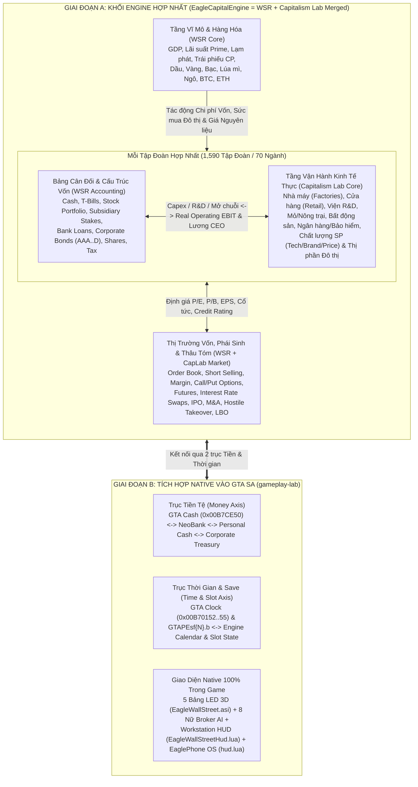

# Báo Cáo Khảo Sát Kỹ Thuật, Dịch Ngược & Kế Hoạch Tích Hợp Hệ Thống Tài Chính Chuyên Sâu (`Wall Street Raider` & `Capitalism Lab`) Vào GTA San Andreas (`gameplay-lab`)

- **Ngày lập báo cáo:** `2026-11-08`
- **Agent thực hiện:** Antigravity (`856604f7-97b9-40e9-9acf-c099663da9a6`)
- **Subagents dịch ngược chuyên trách:**
  - [WSR Reverse Engineer](conversation://b21f56bb-8233-46c2-9001-cd608f48418d) — Khảo sát & dịch ngược `C:\Program Files (x86)\wsr`
  - [Capitalism Lab Researcher](conversation://f5987e16-7dee-412f-b6c8-2f93e83cc9a1) — Khảo sát & dịch ngược `C:\Users\LENOVO\Downloads\capitalism lab\[tamhongame.com]_CL\Capitalism Lab`
- **Phiếu công việc:** [`work-items/2026-11-08-antigravity-wsr-and-capitalism-lab-research-and-blueprint.md`](work-items/2026-11-08-antigravity-wsr-and-capitalism-lab-research-and-blueprint.md)
- **Chế độ khảo sát:** `100% READ-ONLY` (không sửa đổi bất kỳ file nào của GTA SA, Wall Street Raider hay Capitalism Lab).

---

## 1. Phân Tích Hiện Trạng Hệ Thống Tài Chính Trong `gameplay-lab` & Giới Hạn Cần Vượt Qua

### 1.1. Kiến trúc hiện có trong `gameplay-lab`
Hiện tại, hệ thống kinh tế và tài chính của `Project Eagle (gameplay-lab)` đã có hạ tầng hiển thị và lưu trữ rất tốt:
1. **Ví tiền & Ngân hàng (`EagleCompanion.py` + `eagle_dialogue/wallet_store.py`):**
   - Tiền mặt trên người Aether (`ADDR_PLAYER_MONEY = 0x00B7CE50`, `ADDR_PLAYER_DISP_MONEY = 0x00B7CE54`, kiểu `int32` tối đa `$999,999,999`).
   - Tài khoản `NeoBank` (`self.bank`), Sổ tiết kiệm (`self.savings`, lãi `+1.5%/ngày`), Vay tín dụng (`self.loan`, lãi `+3%/ngày`).
2. **Đồng hồ & Lịch kinh tế gắn theo từng Slot Save (`eagle_savegame_sync.py`):**
   - Đọc đồng hồ thực của GTA SA (`ADDR_CLOCK_MINUTES = 0x00B70152`, `ADDR_CLOCK_HOURS = 0x00B70153`, `ADDR_CLOCK_DAYS = 0x00B70154`, `ADDR_CLOCK_MONTHS = 0x00B70155`).
   - Tự động tăng ngày khi qua nửa đêm (`23:59 -> 00:00`), ngủ Safehouse (`+6h`) hoặc nhập viện (`+12h`).
   - Tự động lưu/nạp file sidecar `EagleCompanionSave{N}.json` khớp 1:1 với từng file save `GTAPEsf{N}.b` và tự động reset về `Day 1 (01/01/2010)` khi bấm `New Game`.
3. **Sàn Chứng Khoán Phố Wall 3D (`Model ID 15100`, `EagleWallStreet.asi`, `eagle_wallstreet_floor.py`) & `EaglePhone OS v6.3`:**
   - Có sẵn không gian 3D Sàn NYSE (`Area Code = 1`, nối với 4 cổng thành phố Los Santos, San Fierro, Downtown Chicago, Liberty City), 5 bảng điện tử LED D3D9 (`Local\EagleWallStreetSHM`, `9.44 MB` BGRA32) và 8 nữ Broker AI tư vấn qua `gpt-5-nano`.

### 1.2. Tại sao trải nghiệm ra quyết định tài chính hiện tại bị hạn chế?
- **Phụ thuộc vào dữ liệu lịch sử tĩnh (`eagle_historical_data.py` & `eagle_market_regimes_2010_2025.py`):**
  - Toàn bộ 35 mã Cổ phiếu/Hàng hóa và 16 mã Crypto chỉ dao động ngẫu nhiên quanh đường giá lịch sử cố định giai đoạn `2010–2025` (`pull = (target - o) / o * 0.15`).
  - Người chơi biết trước lịch sử ngoài đời (ví dụ biết chắc `BTC`, `NVDA`, `TSLA` sẽ tăng hàng nghìn lần) nên **không cần phân tích báo cáo tài chính, định giá P/E, P/B, dòng tiền hay chu kỳ vĩ mô**.
- **Giao dịch của người chơi không tác động lên thị trường (Zero Market Impact & Zero Corporate Control):**
  - Dù người chơi mua `$100` hay `$100,000,000` cổ phiếu `NVDA`, giá cổ phiếu không hề nhúc nhích, không có sổ lệnh cung/cầu thật, không thể thâu tóm cổ phần kiểm soát (`51%`), không thể bầu HĐQT, thay CEO, chia cổ tức, phát hành trái phiếu, bán khống thật hay thực hiện M&A / LBO.

---

## 2. Kết Quả Dịch Ngược Chuyên Sâu: Wall Street Raider (`C:\Program Files (x86)\wsr`)

### 2.1. Kiến trúc Binary & Runtime (`WSR.EXE` v8.70/9.0)
- **Định dạng PE:** 32-bit x86 (`IMAGE_FILE_MACHINE_I386 = 0x014C`), biên dịch bằng **PowerBASIC for Windows (PB/Win 32-bit, Linker v2.52)**, kích thước `4,028,416` bytes (`EntryPoint = VA 0x006AA1CE`).
- **Lợi thế vàng cho việc tích hợp:** `DllCharacteristics = 0x0000` (**KHÔNG bật ASLR**, `ImageBase = 0x00400000` cố định tuyệt đối). Mọi biến toàn cục trong RAM của `WSR.EXE` luôn nằm ở địa chỉ VA cố định trên mọi lần khởi chạy!
- **Cơ chế dịch chuyển `.data` của PowerBASIC (`VA 0x006AA2FE`):**
  - Khi khởi động, runtime PowerBASIC dịch khối `.data + 0x28` lên cao thêm `0xED8` (`3,800`) bytes (từ `0x006B6028` lên `0x006B6F00`) và xóa trắng vùng `0x006B6028..0x006B6EFF` làm BSS:
    1. **`VA 0x006B6530 .. 0x006B6EFF` (`2,512 B`):** Biến đơn toàn cục (`Global Scalars`: HWND, Năm, Quý, Sub-Tick, Tốc độ, GDP, Lãi suất, Giá Dầu/Vàng/Bạc/BTC/ETH, Bảng cân đối tạm tính).
    2. **`VA 0x006B6F00 .. 0x006BB7F3` (`18,676 B`):** Bộ mô tả mảng toàn cục (`20-byte Array Descriptors` cho 1,600 thực thể).
    3. **`VA 0x006BB7F4 .. 0x00750F40` (`612,172 B`):** Hằng số chuỗi & số thực (`FileOffset = Runtime_VA - 0x004028D8`).

### 2.2. Hệ thống Thực thể `1..1600` & Bản đồ Địa chỉ Bộ nhớ (`Money & Time`)
Trong WSR, **Người chơi** và **Tập đoàn** dùng chung không gian chỉ số `Entity ID` từ `1` đến `1600`:
- `ID 1..5`: 5 Người chơi (**Aether = `Entity ID 1`**).
- `ID 11..60`: 50 Ngân hàng thương mại (`IND = 1`, ví dụ `ID 11 = CMB / J.P. Morgan Chase`).
- `ID 61..85`: 25 Công ty Bảo hiểm (`IND = 2`).
- `ID 86..130`: 45 Công ty Chứng khoán / Holding (`IND = 3`).
- `ID 131..1580`: 1,450 Tập đoàn sản xuất, công nghệ, năng lượng, bán lẻ, khai khoáng thuộc 70 ngành (`IND = 4..70`).
- `ID 1581..1600`: 20 Quỹ ETF (`IND = 71`).

#### A. Bảng Địa chỉ Biến Thời Gian (`Time Scalars`)
| Địa chỉ VA | Kiểu | Tên biến | Ý nghĩa & Công thức quy đổi |
| :--- | :--- | :--- | :--- |
| **`0x006B6CC8`** | `int32` | `YEAR&` | Năm hiện tại (tăng `+1` tại `VA 0x004C681F` khi hết Quý 4). |
| **`0x006B6CCC`** | `int32` | `ENDYEAR&` | Năm kết thúc ván chơi. |
| **`0x006B6BE8`** | `int32` | `QTR&` | Quý hiện tại (`1..4`, tăng tại `VA 0x004C665D` khi `SUBTICK& > 1600`). |
| **`0x006B6AA8`** | `int32` | `SUBTICK&` | Nhịp mô phỏng trong Quý (`1..1600`, tăng `+1` tại `VA 0x004C60A2` trong `MasterSimulationStep` `0x004C602E`). |
| **`0x006B6CA4`** | `int32` | `TICKERSPEED&` | Tốc độ Ticker (`1..100`, độ trễ mỗi nhịp = `(100 - speed) * 2` ms tại `0x0041F2D0`). |
| **`0x006B6940`** | `int32` | `TICKER_RUNNING&` | `1 = RUN`, `0 = STOP`. |

> **Công thức quy đổi Ngày Tháng trong WSR (`VA 0x005F0E5D` & `0x0049FFA8`):**
> - `1 Quý = 1,600 Sub-Ticks`, `1 Tháng = 500 Sub-Ticks` (`Tháng 1: 1..500`, `Tháng 2: 501..1000`, `Tháng 3: 1001..1600`).
> - **`1 Ngày lịch (Calendar Day) ≈ 16.67 Sub-Ticks`** (`16` hoặc `17` Sub-Ticks mỗi ngày).

#### B. Phát hiện Quan trọng: Bẫy `GetForegroundWindow` khi chạy ngầm (`VA 0x0041DBDC`)
- Tại `VA 0x0041DBDC` trong `MainTickerLoop` (`0x0041DAB8`), `WSR.EXE` gọi `USER32!GetForegroundWindow` và so sánh với `hMainDlg` (`[0x006B676C]`). Tại **`VA 0x0041DC16` (`74 26` = `je 0x0041DC3E`)**, nếu cửa sổ WSR không phải là cửa sổ đang active trên màn hình (ví dụ khi người chơi đang lái xe trong `gta_pe.exe`), WSR sẽ **tự động dừng Ticker**!
- **Giải pháp triệt để:** Chỉ cần `WriteProcessMemory` **2 bytes tại `VA 0x0041DC16` từ `74 26` thành `EB 26` (`jmp 0x0041DC3E`)** kèm bật cờ `Suppress Popups` (`WM_COMMAND 0x0299`), `WSR.EXE` sẽ chạy mô phỏng hoàn hảo ở hậu trường ngay cả khi ẩn cửa sổ hoặc khi người chơi đang ở trong GTA SA!

#### C. Bảng Địa chỉ Biến Tiền Tệ, Vĩ Mô & Mảng Thực Thể (`Money & Portfolio`)
> **Quy ước đơn vị tiền của WSR:** Mọi biến tiền kiểu `EXT` (`10-byte Extended Precision Float` — chuẩn 80-bit `long double` của x87 FPU) đều tính bằng đơn vị **`$1,000,000` (`$ Millions` USD)**. Giá trị `1.0` = `$1,000,000`; `0.001` = `$1,000`.
> Với mọi mảng 1 chiều (`Descriptor VA`), địa chỉ phần tử thứ `i` (`1..1600`) là:
> $$\text{Element\_VA}(i) = \text{*(uint32\_t*)}(\text{Descriptor\_VA}) + i \times \text{ElementSize}$$

| Địa chỉ / Descriptor VA | Kiểu phần tử | Tên biến / Mảng | Ý nghĩa & Ứng dụng tích hợp |
| :--- | :--- | :--- | :--- |
| **`Desc 0x006B71B8`** | `EXT` (`10B`) | **`CASH##(1..1600)`** | **Tiền mặt ngân hàng (`Demand Deposits`)**. Tiền cá nhân của Aether (`Player 1`) nằm tại **`*(uint32_t*)0x006B71B8 + 10`**! |
| **`Desc 0x006BB0B4`** | `EXT` (`10B`) | **`TBILLS##(1..1600)`** | Trái phiếu kho bạc (`T-Bills`) của từng thực thể `1..1600`. |
| **`Desc 0x006BA478`** | `EXT` (`10B`) | **`BANKLOAN##(1..1600)`** | Dư nợ vay ngân hàng (`Bank Loan`) của từng thực thể `1..1600`. |
| **`Desc 0x006BA4EC`** | `EXT` (`10B`) | **`NETWORTH##(1..1600)`** | Tài sản ròng (`Net Worth`) của từng thực thể `1..1600`. |
| **`Desc 0x006B7388`** | `EXT` (`10B`) | **`PRICE##(1..1600)`** | Giá cổ phiếu (`$/share`) của toàn bộ `1,590` công ty (`11..1600`). |
| **`Desc 0x006B9014`** | `EXT` (`10B`) | **`SHARES##(1..1600)`** | Số cổ phiếu đang lưu hành (triệu CP) của từng công ty. |
| **`Desc 0x006B722C`** | `int32` (`4B`) | **`CONTROLLED_BY&(1..1600)`** | ID thực thể đang nắm quyền kiểm soát công ty (`1` = Aether kiểm soát trực tiếp). |
| **`Desc 0x006B9754`** | `int32` (`4B`) | **`CREDIT_RATING&(1..1600)`** | Xếp hạng tín nhiệm (`10=AAA` .. `1=D`). |
| **`Desc 0x006B70D0`** | `BSTR` (`4B`) | **`SYMBOL$(1..1600)`** | Mã chứng khoán (Ticker Symbol, ví dụ `"AAPL"`, `"CMB"`). |
| **`Desc 0x006BADFC`** | `int32` (`4B`) | **`CHEAT_FLAG&(1..5)`** | Cờ dùng nút Cheat (`0` = trong sạch). Khi đồng bộ tiền qua RAM, giữ `[ [0x006BADFC] + 4 ] == 0`. |
| **`VA 0x006B6954`** | `EXT` (`10B`) | `CALC_TOTAL_ASSETS##` | Tổng tài sản vừa tính của thực thể đang chọn (`0x004266F8`). |
| **`VA 0x006B6960`** | `EXT` (`10B`) | `CALC_TOTAL_DEBT##` | Tổng nợ vừa tính của thực thể đang chọn. |
| **`VA 0x006B663C`** | `EXT` (`10B`) | `CALC_NET_WORTH##` | Tài sản ròng vừa tính của thực thể đang chọn. |
| **`VA 0x006B6C40`** | `EXT` (`10B`) | `STOCK_INDEX##` | Chỉ số chứng khoán tổng hợp toàn thị trường. |
| **`VA 0x006B6AFC..D00`** | `float`/`int32` | Macro & Spot Prices | `0x6B6AFC`: GDP (%), `0x6B6BDC`: Prime Rate (%), `0x6B6C9C`: Long Bond (%), `0x6B6BB0`: Oil (`/100`), `0x6B6B00`: Gold, `0x6B6C38`: Silver, `0x6B6CF8`: BTC (`int32`), `0x6B6D00`: ETH (`int32`). |

#### D. Xác minh Cân bằng Kế toán (`Accounting Identity`) & Giải mã `varichek.dll`
1. **Cân bằng kế toán tự động 100%:** Hàm `CalculateEntityBalanceSheet` (`VA 0x004266F8`, được gọi bởi `UpdateMainScreenUI` `VA 0x004400FD`) tính lại từ đầu `TotalAssets = CASH##(id) + TBILLS##(id) + Stocks + Bonds + Derivatives` và `NetWorth = TotalAssets - TotalDebt` ở mỗi nhịp. Do đó, cộng/trừ trực tiếp vào `CASH##(1)` (`*(uint32_t*)0x006B71B8 + 10`) tự động cập nhật `Total Assets`, `Net Worth`, `Credit Rating` và hạn mức vay (`Borrowing Power`) mà không làm lệch bất kỳ sổ cái kế toán nào!
2. **Giải mã `varichek.dll`:** Dịch ngược toàn bộ `varichek.dll` (`EntryPoint 0x00404C2E`, export duy nhất `HiScore` @ `VA 0x004010CE`) chứng minh `varichek.dll` **chỉ dùng để mã hóa chuỗi điểm cao trong file `SCORES.WSR` trên đĩa** (dịch mã ASCII `+0x4C`), hoàn toàn **không quét RAM** và không kiểm tra `CASH##(1)` trong lúc chơi.

---

## 3. Kết Quả Dịch Ngược Chuyên Sâu: Capitalism Lab (`CapMain.exe` v11.0.98 Release)

### 3.1. Kiến trúc Binary, DLC & Cách khởi chạy trực tiếp
- **Phiên bản:** `11.0.98 Release` (`VA 0x008503C4`), biên dịch bằng **MSVC 14.36 (Visual Studio 2022)**, 32-bit x86 (`ImageBase = 0x00400000`, hỗ trợ `.reloc` nên khi đọc/ghi RAM chỉ cần lấy `base = GetModuleHandleA(NULL)` của `CapMain.exe` cộng với `RVA`).
- **Mở khóa sẵn toàn bộ 7 DLC:** Hàm `DlcArray::init` (`RVA 0x00063780`, mảng `dlc_array` tại `RVA 0x00516F30`) đã được patch mở khóa sẵn toàn bộ:
  1. `Subsidiary DLC` (Công ty con & IPO)
  2. `City Economic Simulation DLC` (Kinh tế đô thị, bất động sản, ngân sách thành phố)
  3. `Digital Age DLC` & `Smartphone DLC` (Phần mềm, Internet, Viễn thông, Công nghệ)
  4. `Banking and Finance DLC` (Ngân hàng thương mại, Bảo hiểm, Phát hành trái phiếu)
  5. `Experimental DLC`
  6. `Service Industry DLC`
- **Khởi chạy trực tiếp không cần `CapStart.exe`:** Dịch ngược `CapStart.exe` (`VA 0x00401000`) cho thấy nó chỉ gọi `CreateProcessA(NULL, "capmain.exe test testtest", ...)`. Sidecar của GTA SA có thể gọi thẳng `CreateProcessA` với tham số `"CapMain.exe test testtest"` để nắm giữ trực tiếp `HANDLE` và `PID` của `CapMain.exe`.

### 3.2. Tách biệt Hoàn hảo giữa `Personal Cash` (Tiền Cá Nhân) và `Corporate Cash` (Tiền Công Ty)
Khác với các game chiến thuật thông thường, Capitalism Lab tách biệt rõ ràng **Tài sản cá nhân của người chơi (`PersonInfo`)** và **Bảng cân đối của Tập đoàn (`Group`)**, và lưu toàn bộ tiền bằng kiểu **IEEE-754 `double` (8 bytes) không mã hóa** (đơn vị `$1.0 = $1 USD`):

| Hạng mục | Chuỗi truy xuất địa chỉ (RVA từ `CapMain.exe` base `0x00400000`) | Kiểu | Ý nghĩa & Cơ chế trong Game |
| :--- | :--- | :--- | :--- |
| **`player_recno` (Person)** | `int16_t recno = *(int16_t*)(base + 0x0051BF94)` (`VA 0x0091BF94`) | `int16` | Chỉ số người chơi trong `person_array` (`RVA 0x0051BF28`), thường bằng `1`. |
| **`PersonInfo*` của Aether** | `pPerson = *(*(DWORD**)(base + 0x0051BF28 + 0x14) + (recno - 1))`   `person_id = *(int16_t*)pPerson`   `pInfo = *(DWORD*)(base + 0x0051C0E0) + (person_id - 1) * 0x5A8` | Struct `0x5A8` (`1448 B`) | Con trỏ tới hồ sơ cá nhân của người chơi trong `PersonRes` (`RVA 0x0051C0E0`). |
| **`Personal Cash`** | **`*(double*)(pInfo + 0x50)`** *(Xác minh tại `GoalEffect.cpp` `VA 0x00510C0D` & `sys.cpp` `VA 0x00651142`)* | `double` (`8B`) | **Tiền mặt cá nhân của Aether!** Nhận lương CEO hàng tháng, nhận cổ tức (`Dividends`), dùng để mua cổ phiếu cá nhân, mua biệt thự (`Mansion`) hoặc rót vốn lập công ty. |
| **`CEO Salary`** | **`*(double*)(pInfo + 0xD0)`** *(Xác minh tại `pERSON3.CPP` `VA 0x0061BAC4`)* | `double` (`8B`) | Mức lương CEO hàng năm trả từ công ty về `Personal Cash` của Aether. |
| **`Group*` (Tập đoàn)** | `g_recno = *(int32_t*)(base + 0x00646E50)`   `pGroup = *(*(DWORD**)(base + 0x00646DF0 + 0x14) + (g_recno - 1))` | Struct `Group` | Con trỏ tới tập đoàn chính do người chơi điều hành. |
| **`Corporate Cash`** | **`*(double*)(pGroup + 0xCC0)`** *(cùng `+0x39D0`, `+0x3A30` trong `Group::add_cash` `VA 0x0051BC70`)* | `double` (`8B`) | Tiền mặt trong kho bạc của Tập đoàn (dùng để xây nhà máy, siêu thị, R&D, ngân hàng). |

### 3.3. Cơ chế Thời Gian (`Info::next_day()`) & Framebuffer `SDL2.dll`
1. **Biến Thời Gian Toàn Cục (`Info` struct @ `RVA 0x00645BA0` / `VA 0x00A45BA0`):**
   - `info.game_date` (`int32`, Julian Day tuyệt đối) @ **`RVA 0x00645BB8`** (`VA 0x00A45BB8`)
   - `info.game_day` (`1..31`) @ **`RVA 0x00645BBC`** (`VA 0x00A45BBC`)
   - `info.game_month` (`1..12`) @ **`RVA 0x00645BC4`** (`VA 0x00A45BC4`)
   - `info.game_year` (`1990..2100`) @ **`RVA 0x00645BC8`** (`VA 0x00A45BC8`)
   - Hàm bước sang ngày mới: **`Info::next_day()` @ `RVA 0x000E3EA0` (`VA 0x004E3EA0`, `ecx = 0x00A45BA0`)**.
   - Biến tốc độ game (`0 = Pause`, `1..5 = Speed 1..5`): **`word ptr [base + 0x00644B18]` (`VA 0x00A44B18`)** và delay frame tại **`dword ptr [base + 0x0050D4E4]` (`VA 0x0090D4E4`)** (hàm `Sys::set_speed(int)` @ `VA 0x00656240`).
2. **Software Framebuffer 16-bit RGB565 (`vga_front` @ `RVA 0x0050E2B4`):**
   - Toàn bộ khung hình của `CapMain.exe` được vẽ sẵn trong RAM dưới dạng mảng pixel phẳng **16-bit RGB565** tại con trỏ **`*(uint16_t**)(base + 0x0050E2C8)`** (`VA 0x0090E2C8`), pitch `*(int*)(base + 0x0050E2CC)`, kích thước `[0x0090C330] x [0x0090C334]`.
   - Định dạng RGB565 này tương thích trực tiếp phần cứng với `D3DFMT_R5G6B5` của DirectX 9 trong GTA SA (hoặc chuyển sang BGRA32 cho `EagleWallStreetSHM` chỉ mất `< 1.5 ms`).

---

## 4. Kiến Trúc Tích Hợp Native 2 Giai Đoạn (`Two-Stage Native Merger Architecture`)

### 4.1. Quyết định Kiến trúc Cốt lõi: Gộp Native `WSR + Capitalism Lab` Trước -> Tích Hợp Vào `GTA SA` Sau
Thay vì chạy `WSR.EXE` và `CapMain.exe` như 2 tiến trình ngoài (External Process Bridging), chúng ta thực hiện **Tích hợp Native 100% vào hệ thống của Project Eagle (`Eagle Side Module` + `GTA Native UI`) theo lộ trình 2 giai đoạn rõ ràng**:

1. **Giai đoạn A (`Stage A — Unified WSR + Capitalism Lab Native Engine`):**
   - Trích xuất toàn bộ cơ sở dữ liệu gốc trên đĩa của cả 2 game (`CORPNAME.DAT`, `wsr101.dat`, `Scenwin1..4.wsr`, `Mscnews.dat` từ **Wall Street Raider**; `gameset/1STD.SET`, `firm/*.BLD`, cây công nghệ R&D, chuỗi cung ứng sản phẩm & bất động sản/ngân hàng từ **Capitalism Lab**) kết hợp với các phương trình toán học đã dịch ngược từ `WSR.EXE` (`VA 0x004C602E`, `0x004266F8`, `0x0042B809`) và `CapMain.exe` (`Info::next_day`, `Group`, `Firm*`, `Stock`, `Town`).
   - **Hợp nhất (Merge) 2 mô hình này thành một khối Engine Tài chính & Kinh tế Thực duy nhất (`EagleCapitalEngine` — `eagle_capital_engine.py`)** chạy độc lập, nơi **Tầng Vĩ mô & Phố Wall của WSR** và **Tầng Kinh tế Thực & Chuỗi cung ứng của Capitalism Lab** là **một cơ thể kế toán duy nhất**.
2. **Giai đoạn B (`Stage B — Native Integration into GTA SA gameplay-lab`):**
   - Sau khi khối `EagleCapitalEngine` đã được hợp nhất và kiểm thử hoàn chỉnh (bảng cân đối kế toán khớp 100%, cung cầu, M&A, phái sinh, nhà máy/bán lẻ/ngân hàng chạy mượt), tiến hành **cắm khối Engine chung đó vào GTA SA (`gameplay-lab`)** qua đúng **2 trục Tiền (`Money`) và Thời gian (`Time`)**, hiển thị trực tiếp lên **5 bảng LED 3D (`EagleWallStreet.asi`)**, **8 Nữ Broker AI**, **Workstation Native HUD (`EagleWallStreetHud.lua`)** và **EaglePhone OS (`hud.lua`)**!

### 4.2. Sơ đồ Hợp Nhất `WSR (Top-Down Macro/Finance)` + `Capitalism Lab (Bottom-Up Real Economy)` Thành Một Khối Duy Nhất
Tại sao việc merge `WSR` và `Capitalism Lab` trước lại hợp lý tuyệt đối về mặt toán học và kiến trúc?
- **Wall Street Raider (`WSR`)** cực mạnh ở **Tầng Thượng Tầng Tài Chính (Top-Down)**: Vĩ mô (`GDP`, `Prime Rate`, `Inflation`, `Bond Yields`, `Commodities`, `Crypto`), Cấu trúc vốn của 1,590 tập đoàn (`Cổ phiếu`, `Trái phiếu doanh nghiệp AAA..D`, `Bank Loans`, `T-Bills`, `Holding/Subsidiary Cross-Ownership`), Công cụ phái sinh (`Call/Put Options`, `Futures`, `Interest Rate Swaps`), Thuế và Nghiệp vụ thâu tóm (`M&A`, `Hostile Takeover`, `LBO`, `Spin-off`, `Liquidation`, `Antitrust Lawsuits`). Tuy nhiên, phần hoạt động kinh doanh cốt lõi của từng công ty trong WSR chỉ được tính bằng một biến trừu tượng (`Operating ROCE %` trên `Capital Assets`).
- **Capitalism Lab (`CapLab`)** lại cực mạnh ở chính phần mà WSR trừu tượng hóa — **Tầng Hạ Tầng Kinh Tế Thực (Bottom-Up)**: Từng công ty sở hữu các cơ sở vật lý (`FirmFactory` nhà máy, `FirmRetail` siêu thị/cửa hàng, `FirmRD` viện R&D, `FirmMine`/`FirmFarm` mỏ khoáng sản/nông trại, `FirmApartment`/`FirmCommercial` tòa nhà căn hộ/văn phòng cho thuê, `FirmBank`/`FirmInsurance` chi nhánh ngân hàng/bảo hiểm, `FirmSoftware`/`FirmInternet`/`FirmTelecom` công nghệ số), sản xuất và bán các sản phẩm cụ thể (`Quality = Tech + Raw Material`, `Brand = Advertising + Loyalty`, `Market Share` theo `Price + Quality + Brand`), trả **Lương CEO (`CEO Salary`)** và tạo ra **Lợi nhuận hoạt động thực (`Real Operating EBIT`)**.

Khi gộp 2 game lại trước ở **Giai đoạn A**, điểm khớp nối tự nhiên 100% giữa hai hệ thống chính là **Tài sản Hoạt động (`Operating Capital Assets / Firms`) và Lợi nhuận Hoạt động (`Operating Cash Flow / EBIT`) trên Bảng Cân Đối Kế Toán của mỗi Tập đoàn**:

---

## 5. Thiết Kế Chi Tiết Giai Đoạn A: Hợp Nhất `WSR` + `Capitalism Lab` Thành `EagleCapitalEngine`

### 5.1. Kiến trúc Thực thể & Bảng Cân Đối Kế Toán Hợp Nhất (`Unified Corporate & Person Schema`)
Trong khối Engine hợp nhất (`EagleCapitalEngine`), mọi thực thể (`Player / Person` và `1,590 Corporations` thuộc `70 Industries`) đều tuân theo **Phương trình Kế toán Thống nhất** kết hợp cả WSR (`VA 0x004266F8`) và Capitalism Lab (`Group` & `PersonInfo`):

1. **Hồ Sơ Cá Nhân Người Chơi & Các Tỷ Phú (`UnifiedPerson` — kế thừa `WSR Player 1..5` + `CapLab PersonInfo`):**
   - `personal_cash`: Tiền mặt cá nhân (nhận Lương CEO hàng tháng, Cổ tức cổ phiếu, lãi giao dịch cá nhân; kết nối trực tiếp với `NeoBank` trong GTA SA).
   - `ceo_of_corp_id` & `ceo_annual_salary`: Tập đoàn đang làm CEO và mức lương CEO hàng năm (từ `PersonInfo + 0xD0` của Capitalism Lab).
   - `stock_holdings`, `bond_holdings`, `option_contracts`, `futures_contracts`, `swap_contracts`, `short_positions`: Danh mục đầu tư tài chính và phái sinh cá nhân (từ WSR).
   - `personal_real_estate`: Biệt thự / tài sản cá nhân (`Mansion` từ Capitalism Lab).
   - `bank_loan`, `margin_debt`, `credit_rating` (`AAA..D`), `borrowing_power`: Hạn mức tín dụng cá nhân (từ WSR `VA 0x0042B809`).

2. **Tập Đoàn Hợp Nhất (`UnifiedCorporation` — kế thừa `WSR Corp 11..1600` + `CapLab Group & Firms`):**
   - **Tài sản (`Total Assets`):**
     - `cash` & `tbills`: Tiền mặt và Trái phiếu kho bạc tại công ty.
     - `operating_firms_value` (`CapLab Layer` thay thế cho `Capital Assets` trừu tượng của WSR): Tổng giá trị sổ sách của các cơ sở hoạt động thực tế thuộc tập đoàn (**Nhà máy `FirmFactory`, Cửa hàng bán lẻ `FirmRetail`, Trung tâm R&D `FirmRD`, Mỏ/Nông trại `FirmMine/Farm`, Tòa nhà Căn hộ/Thương mại `FirmApartment/Commercial`, Chi nhánh Ngân hàng/Bảo hiểm `FirmBank/Insurance`, Công ty Phần mềm/Viễn thông `FirmSoftware/Telecom`**).
     - `inventory_and_supply_stock`: Giá trị tồn kho nguyên vật liệu và thành phẩm trong chuỗi cung ứng (từ Capitalism Lab).
     - `equity_stakes_value` & `bond_portfolio_value`: Giá trị cổ phần sở hữu tại các công ty con (`Subsidiaries` `<` và `>` từ `wsr101.dat` + `Subsidiary DLC` của Capitalism Lab) và danh mục trái phiếu nắm giữ.
   - **Nợ phải trả (`Total Liabilities`):**
     - `bank_loans`: Vay ngân hàng thương mại (lãi suất biến đổi theo `Prime Rate` + `Credit Spread`).
     - `corporate_bonds`: Trái phiếu doanh nghiệp phát hành (`JBOS` / `BCOUP` từ `wsr101.dat` của WSR: kỳ hạn, lãi suất coupon cố định, giao dịch thứ cấp theo lợi suất thị trường).
     - `bank_customer_deposits` & `insurance_reserves`: Tiền gửi khách hàng và dự phòng bảo hiểm (với các tập đoàn thuộc ngành Ngân hàng `IND=1` và Bảo hiểm `IND=2`, kết hợp WSR Banking + Capitalism Lab `Banking DLC`).
   - **Vốn chủ sở hữu (`Shareholders' Equity / Net Worth`):**
     - `shares_outstanding`, `share_price`, `market_cap`, `book_value_per_share`, `retained_earnings`, `tax_loss_carryforward`.
     - `controlled_by_id`: Thực thể nắm quyền kiểm soát (`>= 50%` biểu quyết hoặc cổ đông lớn nhất liên minh HĐQT).

### 5.2. Cơ chế Mô phỏng 2 Tầng (`Two-Tier Hybrid Simulation — Macro Sector + Micro Firm LOD`)
Để mô phỏng đồng thời **1,590 tập đoàn của WSR** và **chuỗi cung ứng/nhà máy/cửa hàng chi tiết của Capitalism Lab** chỉ trong **`< 2 ms` mỗi nhịp** mà không gây lag cho GTA SA:
- **Tầng 1 — Vĩ Mô, Ngành & Tài Chính (`All 1,590 Corporations`):**
  - Toàn bộ 1,590 công ty (nạp từ `CORPNAME.DAT` và `wsr101.dat`) vận hành đầy đủ trên thị trường chứng khoán, trái phiếu, phái sinh, M&A và chịu tác động trực tiếp từ chu kỳ vĩ mô WSR (`GDP`, `Prime Rate`, `Oil`, `Gold`, `Silver`, `Wheat`, `Corn`, `BTC`, `ETH`) cùng chỉ số cung/cầu – công nghệ – thương hiệu của 70 ngành.
- **Tầng 2 — Vi Mô Cơ Sở Kinh Doanh & Chuỗi Cung Ứng (`Active Micro-Firm Layer — Capitalism Lab Engine`):**
  - Mọi tập đoàn do **Aether sáng lập (`Startup / IPO`)**, **Aether thâu tóm quyền kiểm soát (`CONTROLLED_BY == Aether`)**, cùng các **tập đoàn đối thủ đầu ngành tại 4 đô thị của Project Eagle (`Los Santos`, `San Fierro`, `Downtown Chicago`, `Liberty City`)** đều vận hành chi tiết ở cấp độ từng **`Firm` (`Building`)** và **`Product`** theo đúng công thức của Capitalism Lab (`1STD.SET` & `firm/*.BLD`):
    - Xây dựng & nâng cấp **Mỏ nguyên liệu -> Nhà máy sản xuất -> Viện R&D -> Chuỗi cửa hàng bán lẻ / Siêu thị -> Tòa nhà Văn phòng / Chung cư cho thuê -> Ngân hàng / Bảo hiểm**.
    - Điểm **Tổng thể sản phẩm (`Overall Rating`)** tại mỗi thành phố được tính từ:
      $$\text{Rating}_{\text{city}} = w_Q \cdot \text{Quality}(\text{Tech}, \text{InputQuality}) + w_B \cdot \text{Brand}(\text{Advertising}, \text{Loyalty}) - w_P \cdot \frac{\text{Price}}{\text{CityWageIndex}}$$
    - Doanh thu bán hàng và tiền thuê bất động sản trừ đi chi phí nguyên liệu, lương nhân công, chi phí R&D, quảng cáo và lương CEO tạo thành **Lợi nhuận Hoạt động Thực (`Real Operating EBIT`)**, chảy thẳng vào Báo cáo Kết quả Kinh doanh Quý (`Quarterly Income Statement`) và Bảng Cân Đối Kế Toán WSR của tập đoàn đó!

---

## 6. Thiết Kế Chi Tiết Giai Đoạn B: Tích Hợp Khối Engine Chung Vào GTA SA (`Money, Time & Native UI`)

Sau khi khối `EagleCapitalEngine` (WSR + Capitalism Lab đã hợp nhất) hoàn thiện ở Giai đoạn A, Giai đoạn B kết nối khối này vào `gameplay-lab` qua đúng **2 trục Tiền và Thời Gian** cùng **hệ thống UI Native sẵn có của GTA SA**:

### 6.1. Trục Liên Kết #1: TIỀN TỆ (`Native Money Pipeline`)
- **4 Tầng Tài Khoản Thống Nhất (Không cần chạy EXE ngoài, 100% Native trong `EagleCompanion.py`):**
  1. **Tiền mặt trên người Aether (`GTA Pocket Cash` `0x00B7CE50`):** Dùng cho chi tiêu đường phố GTA SA (`$1` units, trần `$999,999,999`).
  2. **Tài khoản Ngân hàng Cá nhân (`NeoBank Checking & Personal Cash`):** Nhận trực tiếp **Lương CEO hàng tháng (`CEO Salary`)**, **Cổ tức tiền mặt (`Cash Dividends`)**, và lợi nhuận rút từ tài khoản chứng khoán. Tự động chống tràn trần `$999,999,999` của GTA SA (số dư tỷ phú được giữ an toàn bằng kiểu `float64`/`int64` trong `NeoBank Sovereign Vault`, rút ra ví tiền mặt GTA bất cứ lúc nào).
  3. **Tài khoản Đầu tư & Phái sinh Phố Wall (`WSR Trading & Margin Account`):** Dùng để mua/bán cổ phiếu của 1,590 tập đoàn, bán khống (`Short`), giao dịch `Options (Call/Put)`, `Futures` hàng hóa/crypto, `Interest Rate Swaps`, mua `Trái phiếu Chính phủ / Doanh nghiệp`, hoặc gom cổ phần để **Thâu tóm (`Hostile Takeover / LBO`)**.
  4. **Kho bạc Tập đoàn & Công ty con (`Corporate Treasury` của các Tập đoàn Aether kiểm soát):** Tiền của công ty tách biệt 100% với tiền cá nhân của Aether theo đúng luật kế toán của cả WSR và Capitalism Lab. Aether chỉ có thể chuyển tiền giữa Cá nhân và Công ty thông qua các nghiệp vụ hợp pháp: **Nhận Lương CEO**, **Chia Cổ tức (`Dividend Payout`)**, **Phát hành thêm Cổ phiếu (`Right Issue / Private Placement`)**, **Mua lại Cổ phiếu quỹ (`Stock Buyback`)**, hoặc **Cho vay / Trả nợ nội bộ**.

### 6.2. Trục Liên Kết #2: THỜI GIAN & LƯU TRỮ (`Native Time & Save-Slot Synchronization`)
- **Đồng bộ trực tiếp với Đồng hồ GTA SA (`0x00B70152..55`) và `eagle_savegame_sync.py`:**
  - **Mỗi 1 giờ trôi qua trong GTA SA** (`60 giây` thực khi đang đi dạo phố): `EagleCapitalEngine` tự động chạy **nhịp Intraday (`Sub-Ticks`)** cập nhật giá cổ phiếu, hàng hóa, tỷ giá, lãi suất, sổ lệnh và tin tức thị trường trực tiếp lên 5 bảng LED 3D và `EaglePhone`.
  - **Mỗi khi qua nửa đêm (`00:00`) hoặc nhảy giờ khi Ngủ / Nhập viện / Tua nhanh thời gian tại Bàn điều hành CEO**: `EagleCapitalEngine` chạy **nhịp Cuối ngày (`Daily Operational Step` của Capitalism Lab: sản xuất nhà máy, bán hàng bán lẻ, tiến độ R&D, thu tiền thuê bất động sản)**.
  - **Mỗi cuối Tháng / Quý (`Monthly & Quarterly Settlement`):** Tự động trả **Lương CEO**, chốt **Báo cáo Tài chính Quý (`EPS`, `ROCE`, `Credit Rating AAA..D`)**, trả **Lãi vay / Coupon Trái phiếu / Cổ tức**, và tính **Thuế Thu nhập Doanh nghiệp & Cá nhân**.
- **Lưu / Nạp 1:1 theo từng Slot Save của GTA SA (`GTAPEsf{N}.b`):**
  - Toàn bộ trạng thái của khối `EagleCapitalEngine` (vĩ mô, 1,590 tập đoàn, các nhà máy/cửa hàng/R&D/bất động sản, danh mục phái sinh, lịch sử giá) được nén và lưu gắn chặt với từng slot `EagleCompanionSave{N}.json` (`Slot 1..8`), tự động reset sạch sẽ về `Day 1` khi bấm `New Game`.

### 6.3. Trải Nghiệm Giao Diện Native 100% Trong Game (`EaglePhone` + `3D Wall Street Floor` + `Native Workstation HUD`)
1. **Trên `EaglePhone OS v6.3` (`hud.lua`):**
   - Xem nhanh bảng giá, chỉ số vĩ mô (`GDP`, `Prime Rate`, `Inflation`, `Gold`, `Oil`, `BTC`), danh mục cổ phiếu/phái sinh, thông báo Lương CEO & Cổ tức, và điều chỉnh nhanh ngân sách/giá bán của các công ty con.
2. **Trên 5 Bảng Điện Tử LED 3D (`EagleWallStreet.asi` — `Local\EagleWallStreetSHM`) & 8 Nữ Broker AI:**
   - Băng truyền 3D `ws_ticker_ring` và 4 đại bảng LED hiển thị trực tiếp dữ liệu thật từ `EagleCapitalEngine` (1,590 mã cổ phiếu, đường cong lợi suất trái phiếu, bản tin M&A / phá sản / phát minh R&D mới).
   - 8 Nữ Broker AI (`Yanagi`, `Zani`, `Evelyn`, `Kazusa`, `Yao`, `Karenina`, `Himeko`, `Topaz`) phân tích trực tiếp bảng cân đối kế toán, P/E, xếp hạng tín nhiệm và chuỗi cung ứng của `EagleCapitalEngine` để tư vấn cho Aether.
3. **Màn hình Điều hành Chuyên sâu Native (`Bloomberg & CEO Executive Workstation` trong `EagleWallStreetHud.lua`):**
   - Khi đứng tại Quầy Terminal ở Sàn Phố Wall 3D và mở Workstation, giao diện Native đa tab ngay trong GTA SA cung cấp trọn vẹn 2 nhóm quyền lực:
     - **Tab Phố Wall (WSR Suite):** Sàng lọc 1,590 công ty & 70 ngành, xem Bảng Cân Đối / Báo cáo KQKD / Cây sở hữu chéo (`Parent/Subsidiary`), đặt lệnh Mua/Bán/Short, giao dịch `Options / Futures / Swaps / Bonds`, và phát động **Thâu tóm (`Tender Offer / Hostile Takeover / LBO / Merger / Restructuring`)**.
     - **Tab Đế Chế Kinh Doanh (Capitalism Lab Suite):** Thành lập tập đoàn/công ty con, mở **Nhà máy, Cửa hàng bán lẻ, Viện R&D, Mỏ/Nông trại, Cao ốc Bất động sản, Ngân hàng/Bảo hiểm** tại 4 thành phố (`Los Santos`, `San Fierro`, `Chicago`, `Liberty City`), nối chuỗi cung ứng (`Supplier -> Factory -> Retail`), đặt giá bán, ngân sách Marketing và mức Lương CEO / Cổ tức!

---

## 7. Lộ Trình Triển Khai Chi Tiết Theo 2 Giai Đoạn (Master Implementation Plan)

| Giai đoạn | Phase | Tên Hạng Mục | Nội dung công việc cụ thể | Đầu ra & Kiểm chứng |
| :--- | :--- | :--- | :--- | :--- |
| **STAGE A** *(Merge WSR + CapLab thành Native Engine)* | **Phase A1** | **Trích xuất Database & Giải mã Công thức Toán học (`Data & Formula Extraction`)** | - Viết bộ parser trích xuất toàn bộ `CORPNAME.DAT` (1,590 công ty, 53 quốc gia), `wsr101.dat` (70 ngành, tài sản, nợ, trái phiếu, sở hữu chéo `<` `>`), `Mscnews.dat`/`Scenwin*.wsr` (bản tin vĩ mô & sự kiện) từ `C:\Program Files (x86)\wsr`. - Viết bộ parser trích xuất `gameset/1STD.SET` & `firm/*.BLD` (66 loại công trình, danh mục sản phẩm, nguyên liệu đầu vào, R&D tech tree, chi phí xây dựng/vận hành) từ Capitalism Lab. - Dịch ngược chi tiết các công thức tính của `WSR.EXE` (`0x004C602E`, `0x004266F8`, `0x0042B809`) và `CapMain.exe` (`Firm*`, `Group`, `Town`) sang đặc tả toán học sạch. | Bộ dữ liệu chuẩn hóa (`eagle_wsr_caplab_db.json`) + Tài liệu công thức toán học hợp nhất. |
| **STAGE A** *(Merge WSR + CapLab thành Native Engine)* | **Phase A2** | **Xây dựng & Kiểm thử Độc lập Khối Engine Hợp Nhất (`eagle_capital_engine.py`)** | - Lập trình module Python Native thuần túy `eagle_capital_engine.py` hợp nhất cả 2 tầng: **Tầng Vĩ mô & Phố Wall (WSR)** + **Tầng Nhà máy, Chuỗi cung ứng, R&D, BĐS & Ngân hàng (Capitalism Lab)**. - Cài đặt đầy đủ các nghiệp vụ: Cổ phiếu, Bán khống, Trái phiếu (`AAA..D`), Options (`Black-Scholes`), Futures, Interest Rate Swaps, M&A/Hostile Takeover/LBO, Xây dựng Firm/Supply Chain, Lương CEO & Cổ tức. - Chạy bộ kiểm thử tự động Offline (`Part A QA`) giả lập 40 quý (10 năm) để xác minh cân bằng kế toán (`Assets == Liabilities + Equity`), không lỗi tràn số, tốc độ `< 2ms/tick`. | Module `eagle_capital_engine.py` chạy độc lập hoàn chỉnh + Báo cáo PASS kiểm thử mô phỏng Offline. |
| **STAGE B** *(Tích hợp Khối Chung vào GTA SA)* | **Phase B1** | **Đấu nối vào Hệ thống Tiền, Thời gian & Save Game của GTA SA** | - Tích hợp `eagle_capital_engine.py` vào `EagleCompanion.py` và `eagle_savegame_sync.py`. - Kết nối trục **Tiền** (`GTA Cash <-> NeoBank <-> Personal Cash <-> Corporate Treasury`, tự động nhận Lương CEO & Cổ tức) và trục **Thời gian** (`GTA Clock 0x00B70152..55 <-> Engine Intraday Sub-Ticks / Daily Firm Step / Quarterly Settlement`). - Đồng bộ lưu/nạp theo từng Slot Save `GTAPEsf{N}.b` và reset khi `New Game`. | Đồng bộ Tiền & Thời gian 2 chiều mượt mà trong `gameplay-lab`. |
| **STAGE B** *(Tích hợp Khối Chung vào GTA SA)* | **Phase B2** | **Nâng cấp Giao diện Native 3D Wall Street Floor, Workstation HUD & EaglePhone** | - Nối dữ liệu thật của `EagleCapitalEngine` lên 5 bảng LED 3D (`EagleWallStreet.asi`) và 8 Nữ Broker AI (`eagle_wallstreet_floor.py`). - Nâng cấp màn hình **Native Workstation (`EagleWallStreetHud.lua`)** và **`EaglePhone OS` (`hud.lua`)** để người chơi thực hiện đầy đủ cả nghiệp vụ Phố Wall (WSR: Options, Swaps, Bonds, M&A, Takeover) lẫn quản trị Đế chế Kinh doanh (CapLab: Xây nhà máy/cửa hàng/R&D/BĐS, nối chuỗi cung ứng, đặt giá & lương CEO) ngay trong GTA SA! | Trải nghiệm End-to-End 100% Native trong `gta_pe.exe` (`Part B Live QA`). |
